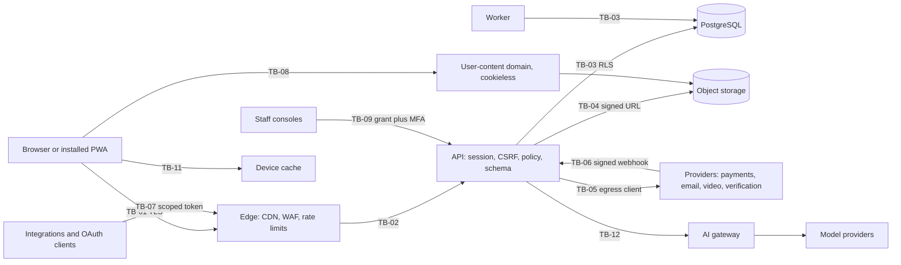
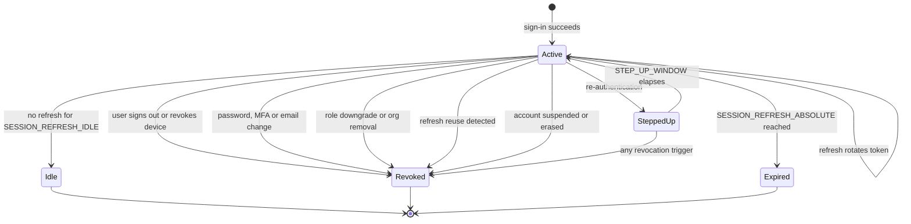
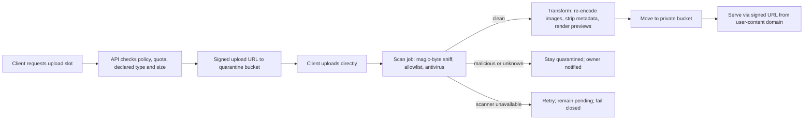
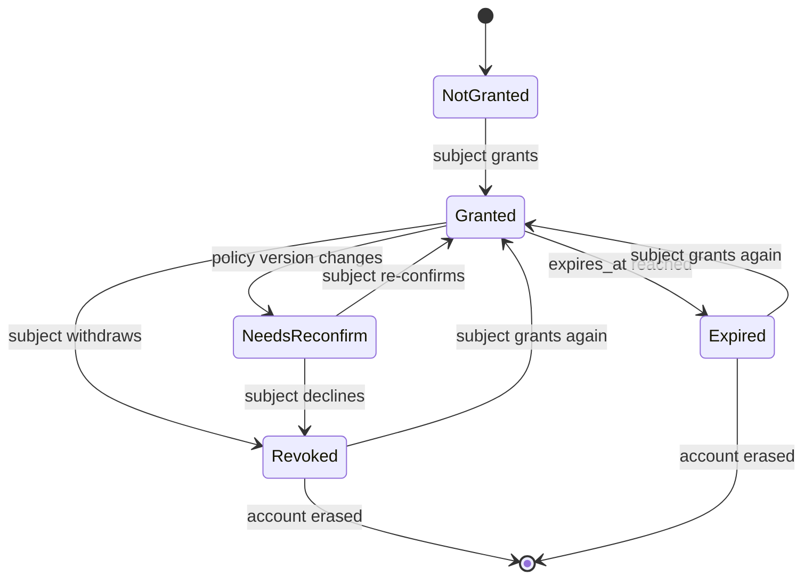
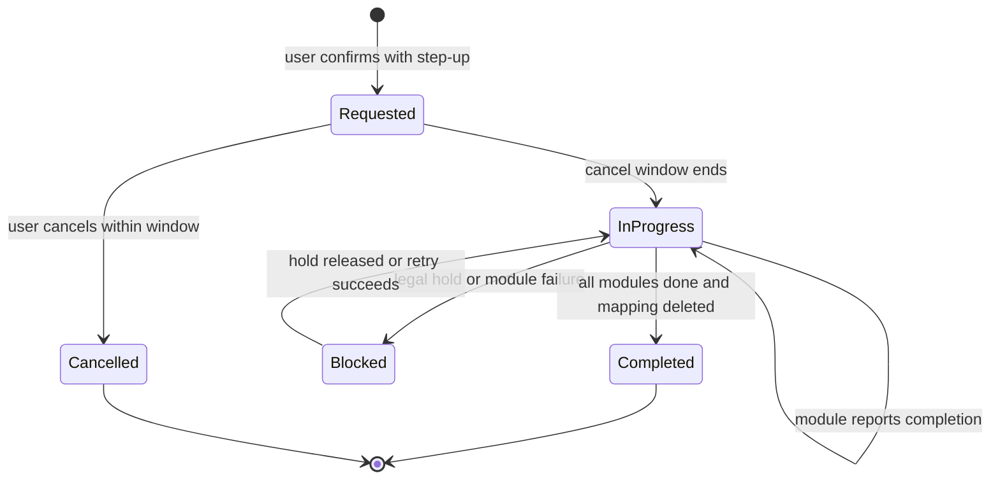

# Blueprint 05: security and privacy

> **Status.** Intent, not ratified. Nothing here claims anything is built; what is built is in `ARCHITECTURE.md` and `project-mindmap/`. Decision `DEC-001`: this blueprint does not supersede `SSOT.md` until `OD-PRD-31` defines ratification.
>
> **What this file holds.** Security architecture, privacy and data governance, compliance map, fairness and AI governance.
>
> **Merged on 2026-11-25** from the files listed below; each one is a section under its original title. Nothing was removed; the originals are in git history at commit `08387ec`.

| Section | Former file |
|---|---|
| Security Architecture | `PRODUCT_BLUEPRINT/05_SECURITY_PRIVACY/01_SECURITY_ARCHITECTURE.md` |
| Privacy and Data Governance | `PRODUCT_BLUEPRINT/05_SECURITY_PRIVACY/02_PRIVACY_AND_DATA_GOVERNANCE.md` |
| Compliance Map | `PRODUCT_BLUEPRINT/05_SECURITY_PRIVACY/03_COMPLIANCE_MAP.md` |
| Fairness and AI Governance | `PRODUCT_BLUEPRINT/05_SECURITY_PRIVACY/04_FAIRNESS_AND_AI_GOVERNANCE.md` |

## Security Architecture

_Former file: `PRODUCT_BLUEPRINT/05_SECURITY_PRIVACY/01_SECURITY_ARCHITECTURE.md`._

Status: intended complete product. Nothing in this file claims that a control is built. What exists today is recorded only in `ARCHITECTURE.md` and `docs/reports/` [SRC: CONVENTIONS §1].

Owner role: `SAD` (Security Officer). Reviewers: `PAD`, privacy lead (see [02_PRIVACY_AND_DATA_GOVERNANCE.md](#privacy-and-data-governance)), counsel for anything in [03_COMPLIANCE_MAP.md](#compliance-map).

Identifier namespaces used here:

| Namespace                                       | Meaning                                                                                       | Range in this file                                                                                |
| ----------------------------------------------- | --------------------------------------------------------------------------------------------- | ------------------------------------------------------------------------------------------------- |
| `NFR-SEC-nnn`                                   | Testable security requirement                                                                 | NFR-SEC-001..NFR-SEC-072 (§24)                                                                    |
| `OD-SEC-nn`                                     | Security decision for stakeholders                                                            | OD-SEC-01..OD-SEC-16 (§25). OD-SEC-17 onward live in [03_COMPLIANCE_MAP.md](#compliance-map) |
| `RSK-SEC-nn`                                    | Security risk                                                                                 | RSK-SEC-01..RSK-SEC-14 (§26)                                                                      |
| `AS-nn`, `TB-nn`, `AB-<group>-nn`, `RL-<class>` | Document-local labels (assets, trust boundaries, abuse cases, rate classes). Not registry ids | —                                                                                                 |

### 1. Objectives and principles

Security exists to protect four product promises: a person's career data is seen only by those they chose, evidence and verification status cannot be forged, hiring and assessment outcomes are decided by accountable humans, and the platform stays available when deadlines matter [DER from SSOT §1.2, §15].

| #   | Principle                                 | What it means in practice                                                                                                                        | Source                          |
| --- | ----------------------------------------- | ------------------------------------------------------------------------------------------------------------------------------------------------ | ------------------------------- |
| P1  | Deny by default                           | Every route, job, event consumer and query declares a policy action; anything undeclared is refused                                              | [SRC: SSOT §10.14 BR-08, BR-09] |
| P2  | Server authority                          | The client, service worker and cache are never the source of truth for identity, permissions, entitlements, timers, scores or verification state | [SRC: SSOT §19.2]               |
| P3  | Defense in depth                          | Edge, application policy, database row-level security (RLS) and infrastructure each block the same class of attack independently                 | [SRC: SSOT §15.4]               |
| P4  | Least privilege and least data            | Each principal, service and AI call receives only the fields its purpose needs                                                                   | [SRC: SSOT §15.2, §16.5]        |
| P5  | Tenant isolation is a Sev-1 property      | A cross-tenant read is treated as a critical incident regardless of data volume                                                                  | [SRC: Yash 14/THREAT_MODEL A7]  |
| P6  | Accountable humans for consequential acts | AI and automated signals open review items; they never reject, sanction or grade a person on their own                                           | [SRC: SSOT §15.10.1]            |
| P7  | Evidence over assertion                   | A control is "in place" only when an automated test or recorded drill proves it                                                                  | [SRC: SSOT Part I §H]           |
| P8  | Uniform, non-leaky failure                | Errors carry a generic message and a correlation id; existence of other users' resources is never revealed                                       | [SRC: SSOT §15.7 HDN-010]       |

### 2. Asset inventory

Classification codes `C0`..`C4` are defined in [02_PRIVACY_AND_DATA_GOVERNANCE.md §2](#privacy-and-data-governance).

| Label | Asset                                                                          | Owning modules     | Class | Why it matters                                                | Primary threats (abuse labels §6) |
| ----- | ------------------------------------------------------------------------------ | ------------------ | ----- | ------------------------------------------------------------- | --------------------------------- |
| AS-01 | Credentials, passkeys, MFA secrets, recovery codes, session and refresh tokens | IDN                | C4    | Account takeover exposes everything the user can see and do   | AB-FND-01..05                     |
| AS-02 | Candidate personal data: profile, resume, contact details, preferences         | PRF, SET           | C2/C3 | Privacy harm, discrimination, legal exposure                  | AB-CID-01, AB-HIR-01, AB-PLT-02   |
| AS-03 | Evidence records, verification status ("rung"), credentials, badges            | EVD, BGV, REP      | C2    | The core promise "verified over claimed"                      | AB-CID-02..05                     |
| AS-04 | Referee, attestation and capability tokens                                     | EVD, BGV           | C4    | Possession equals the ability to attest as a third party      | AB-CID-03                         |
| AS-05 | Consent records and share grants                                               | SET                | C2    | Decide who may see what; legal proof                          | AB-HIR-01, AB-INS-01              |
| AS-06 | Assessment content, answer keys, attempt data, integrity signals               | ASM, LRN           | C3    | Credible skill signals; fairness                              | AB-LRN-01..04                     |
| AS-07 | Tenant data of employers, institutions and enterprises                         | EMP, ATS, INS, ENT | C2/C3 | Cross-tenant read is Sev-1                                    | AB-HIR-03, AB-INS-02              |
| AS-08 | Applications, pipeline stages, scorecards, interview notes, recordings, offers | JOB, ATS, INT      | C3    | Hiring decisions; litigation evidence                         | AB-HIR-02..06                     |
| AS-09 | Messages, community posts, reviews                                             | MSG, NET, TSF      | C2/C3 | Private communication; harassment vector                      | AB-SOC-01..05                     |
| AS-10 | Billing state, entitlements, payouts, tax identifiers                          | BIL, STU, GIG, MEN | C3/C4 | Revenue, fraud, financial regulation                          | AB-COM-01..05                     |
| AS-11 | AI gateway policy, budgets, prompts, provider keys, model outputs              | AIC                | C3/C4 | Cost, assessment fairness, data leakage                       | AB-AIC-01..06                     |
| AS-12 | Signing keys, key-encryption keys, API secrets, webhook secrets                | PLT, IDN           | C4    | Total compromise                                              | AB-PLT-05                         |
| AS-13 | Audit log, privileged-access records, erasure ledger                           | ADM, SET           | C3    | Accountability and legal proof                                | AB-GOV-01..03                     |
| AS-14 | Build, deploy and dependency chain; static asset origin                        | PLT                | C1    | Code execution in every user's browser                        | AB-PLT-06                         |
| AS-15 | User-content origin and rendered rich content                                  | PLT, PRF, NET      | C2    | Stored XSS and phishing                                       | AB-PLT-03                         |
| AS-16 | Availability of the core career loop                                           | all                | C1    | Hiring and enrollment deadlines                               | AB-PLT-07                         |
| AS-17 | Salary, review and market aggregates                                           | MKT, EMP, ANL      | C2    | Re-identification of individuals through small cells          | AB-INT-03                         |
| AS-18 | Fairness self-identification data (demographics)                               | AIC, ANL           | C4    | Special-category data; must never reach recruiters or rankers | AB-AIC-05                         |
| AS-19 | Identity-verification artifacts and background-check reports                   | BGV                | C4    | Government ids, criminal records; regulated                   | AB-CID-06                         |

### 3. Adversaries

| Label  | Adversary                                               | Capability                                    | Motive                                                      | Source                         |
| ------ | ------------------------------------------------------- | --------------------------------------------- | ----------------------------------------------------------- | ------------------------------ |
| ADV-1  | Anonymous attacker or bot operator                      | Automation, breach lists, residential proxies | Takeover, spam, scraping                                    | [SRC: Yash 14/THREAT_MODEL §3] |
| ADV-2  | Malicious candidate                                     | Valid account, crafted uploads, collusion     | Inflate verification, cheat assessments                     | [SRC: same]                    |
| ADV-3  | Malicious or careless recruiter or org member           | Valid org role                                | Harvest candidates, bypass consent, cross-tenant snooping   | [SRC: same]                    |
| ADV-4  | Impostor or colluding referee                           | Controls a mailbox                            | Forge attestations                                          | [SRC: same]                    |
| ADV-5  | Malicious insider (support, moderator, admin, engineer) | Privileged tooling                            | Data browsing, tampering                                    | [SRC: same]                    |
| ADV-6  | Supply-chain attacker                                   | Compromised dependency, CI step or CDN        | Code execution                                              | [SRC: same]                    |
| ADV-7  | Network attacker or shared-device user                  | Physical access to a signed-in browser        | Session and data theft                                      | [SRC: same]                    |
| ADV-8  | Competitor or data broker                               | Systematic scraping                           | Business intelligence                                       | [SRC: same]                    |
| ADV-9  | Fraudulent employer or fake job poster                  | Creates an employer org                       | Phishing, advance-fee scams, identity theft of applicants   | [PROP]                         |
| ADV-10 | Fraudulent instructor, mentor or freelancer             | Seller account                                | Payout fraud, stolen content, off-platform payment scams    | [PROP]                         |
| ADV-11 | Abusive user (harasser, stalker)                        | Valid account                                 | Locate or harass a person through profile, messages, events | [PROP]                         |
| ADV-12 | Malicious integration or compromised customer system    | Valid OAuth client or webhook endpoint        | Bulk extraction, replay                                     | [PROP]                         |

### 4. Trust boundaries

| Label | Boundary                                                                                   | Crossing                                | Required controls                                                                                                                        |
| ----- | ------------------------------------------------------------------------------------------ | --------------------------------------- | ---------------------------------------------------------------------------------------------------------------------------------------- |
| TB-01 | Internet to edge                                                                           | Every request                           | TLS 1.2+ (1.3 preferred), WAF, bot challenge on auth routes, request size limits, per-IP and per-ASN rate limits                         |
| TB-02 | Edge to API                                                                                | Authenticated and anonymous requests    | Session validation, CSRF check on unsafe methods, policy evaluation, schema validation, idempotency                                      |
| TB-03 | API to database                                                                            | Every query                             | Per-transaction principal and tenant context, RLS FORCE on tenant and personal tables, least-privilege database roles, statement timeout |
| TB-04 | API and worker to object storage                                                           | Uploads and downloads                   | Signed URLs bound to object and principal with short expiry; private buckets; quarantine bucket                                          |
| TB-05 | API and worker to external providers (payments, email, AI, verification, video, calendars) | Outbound calls                          | Central egress client, allowlisted hosts, timeouts, circuit breakers, redaction, per-provider credentials                                |
| TB-06 | External providers to API (webhooks)                                                       | Inbound callbacks                       | Signature verification, replay window, idempotent processing, persist-then-acknowledge                                                   |
| TB-07 | Third-party integrations (public API, OAuth clients, customer webhooks)                    | API calls and outbound events           | Scoped tokens, per-client rate limits, consent-gated payloads                                                                            |
| TB-08 | Browser main origin to user-content origin                                                 | Rendered uploads and media              | Separate registrable, cookieless domain; `Content-Disposition` and `nosniff`                                                             |
| TB-09 | Platform staff to production data                                                          | Support, moderation, admin, engineering | Time-boxed grants, step-up MFA, reason codes, subject-visible access log, break-glass procedure                                          |
| TB-10 | Tenant A to tenant B                                                                       | Any shared component                    | Tenant id in every key, query, cache entry, job payload, search document and log line                                                    |
| TB-11 | Device storage (PWA cache, IndexedDB) to server                                            | Offline reads and queued writes         | No tokens at rest, owner-only cache, cleared on sign-out and revocation, server re-validates queued writes                               |
| TB-12 | AI gateway to model providers                                                              | Prompts and outputs                     | Purpose and classification check, redaction, consent check, assessment-mode check, output schema validation                              |

### 5. STRIDE by surface

S = spoofing, T = tampering, R = repudiation, I = information disclosure, D = denial of service, E = elevation of privilege. Each cell names the threat and the control that answers it; the control's requirement id is in §24 [DER].

| Surface                                                   | S                                                                                                                             | T                                                                                                        | R                                                                              | I                                                                                   | D                                                                                                                                                       | E                                                                                                    |
| --------------------------------------------------------- | ----------------------------------------------------------------------------------------------------------------------------- | -------------------------------------------------------------------------------------------------------- | ------------------------------------------------------------------------------ | ----------------------------------------------------------------------------------- | ------------------------------------------------------------------------------------------------------------------------------------------------------- | ---------------------------------------------------------------------------------------------------- |
| Web app and PWA shell                                     | Phishing lookalike origin; mitigated by passkeys (origin-bound) and HSTS preload (NFR-SEC-030)                                | Malicious script via dependency or CDN; Subresource Integrity, CSP with nonces (NFR-SEC-031)             | n/a — client actions are logged server-side                                    | Tokens readable by XSS; httpOnly cookies only (NFR-SEC-011)                         | Heavy client bundle on low-end devices; budgets in [01_NON_FUNCTIONAL_REQUIREMENTS.md](06_QUALITY_AND_PERFORMANCE.md#non-functional-requirements) | Hidden admin routes treated as protection; server-side policy on every call (NFR-SEC-020)            |
| Authentication endpoints                                  | Credential stuffing, reset-link takeover; layered rate limits, uniform responses, single-use hashed tokens (NFR-SEC-001..006) | Host-header poisoning of reset links; canonical base URL from config (NFR-SEC-007)                       | Disputed sign-in; audit `auth.login_*` with IP prefix and device (NFR-SEC-060) | Account enumeration; uniform response and timing (NFR-SEC-004)                      | Hash-cost exhaustion; bounded hash pool returns 429 (NFR-SEC-003)                                                                                       | MFA bypass through recovery; recovery delay and alerts (NFR-SEC-008)                                 |
| Public REST API (`/api/v1`)                               | Forged or replayed token; signature, expiry, revocation list (NFR-SEC-012)                                                    | Mass assignment of protected fields; strict schemas with unknown-key rejection (NFR-SEC-040)             | Unattributed writes; actor on every mutating audit event (NFR-SEC-060)         | IDOR/BOLA; resource loaded then authorized, non-visible returns 404 (NFR-SEC-021)   | Expensive queries; rate classes, pagination caps, statement timeout (NFR-SEC-050)                                                                       | Function-level bypass; route policy registry lint (NFR-SEC-020)                                      |
| Database                                                  | Shared connection role used as identity; per-transaction principal context (NFR-SEC-023)                                      | Direct writes to protected columns; column privileges and definer functions (NFR-SEC-024)                | Silent row edits; append-only history tables (NFR-SEC-061)                     | Missing tenant filter; RLS FORCE plus canary rows (NFR-SEC-022)                     | Lock contention, runaway queries; statement and lock timeouts (NFR-SEC-051)                                                                             | Application role able to alter schema; migration role separate (NFR-SEC-025)                         |
| Object storage and media                                  | Guessable object paths; random keys and signed URLs (NFR-SEC-045)                                                             | Polyglot or malicious files; sniff, scan, re-encode (NFR-SEC-044)                                        | Disputed upload; uploader id and hash stored (NFR-SEC-046)                     | Public bucket misconfiguration; private by default, policy test (NFR-SEC-045)       | Upload flooding, zip bombs; size and count caps, decompression limits (NFR-SEC-044)                                                                     | Path traversal in filenames; server-generated keys only (NFR-SEC-044)                                |
| Worker and background jobs                                | Job forged by enqueuing through public API; only server code enqueues (NFR-SEC-026)                                           | Payload altered in queue; jobs read authoritative state, not payload copies, for decisions (NFR-SEC-026) | Job outcome unknown; job audit with attempt history (NFR-SEC-062)              | Job runs without tenant pin; tenant pinned in payload and re-checked (NFR-SEC-022)  | Poison job loops; bounded retries and dead-letter queue (NFR-SEC-052)                                                                                   | Worker role broader than needed; per-job-kind privileges (NFR-SEC-026)                               |
| Inbound webhooks (payments, email, video, verification)   | Forged callback; signature verification with provider secret (NFR-SEC-047)                                                    | Replayed event; timestamp window and event-id dedupe (NFR-SEC-047)                                       | Lost event; persisted before acknowledgment (NFR-SEC-047)                      | Error bodies leak internals; generic 400 (NFR-SEC-047)                              | Flooding; per-provider rate limit at edge (NFR-SEC-050)                                                                                                 | Event grants entitlement directly; entitlements derived from reconciled provider state (NFR-SEC-048) |
| Outbound webhooks and integrations                        | Endpoint impersonation; HTTPS only, signed payloads (NFR-SEC-049)                                                             | n/a — payload signed by platform                                                                         | Disputed delivery; delivery log with response code (NFR-SEC-049)               | Over-broad payloads; consent-gated, minimal event DTOs (NFR-SEC-049)                | Slow receivers block queue; per-endpoint concurrency and backoff (NFR-SEC-052)                                                                          | Client scopes broader than consented; scope review on install (NFR-SEC-027)                          |
| AI gateway                                                | Caller spoofs purpose; purpose bound server-side to route (NFR-SEC-055)                                                       | Prompt injection via user content; enclosure, no side-effect tools, output schema (NFR-SEC-056)          | Unexplained suggestion; provenance record per call (NFR-SEC-063)               | Personal data sent to provider; redaction and classification gate (NFR-SEC-055)     | Cost exhaustion; reserve-then-settle budgets (NFR-SEC-057)                                                                                              | AI used during a prohibited assessment; server-side assessment-mode check (NFR-SEC-058)              |
| Real-time channels (messaging, interviews, notifications) | Joining another user's channel; channel tokens bound to participant (NFR-SEC-028)                                             | Message edits rewriting history; edit history kept (owner module MSG)                                    | Denied sending; server-stamped message ids                                     | Subscription to unauthorized topics; topic authorization on subscribe (NFR-SEC-028) | Connection floods; per-user connection cap (NFR-SEC-050)                                                                                                | n/a — channels carry no privileged commands                                                          |
| Staff consoles (support, moderation, admin, finance)      | Stolen staff session; phishing-resistant MFA mandatory (NFR-SEC-009)                                                          | Unreviewed config change; dual control on high-risk changes (NFR-SEC-065)                                | Staff denies action; hash-chained audit with operator id (NFR-SEC-061)         | Browsing user data; time-boxed grants, subject-visible access log (NFR-SEC-066)     | n/a — consoles are not public                                                                                                                           | Self-approval; requester differs from approver (NFR-SEC-065)                                         |
| Device storage (PWA)                                      | Another person on a shared device; shared-device mode and idle lock (NFR-SEC-016)                                             | Tampered queued writes; server re-validates every queued mutation (NFR-SEC-042)                          | n/a — server records the authoritative write                                   | Cached data after sign-out; cache purge on sign-out and on 401/403 (NFR-SEC-016)    | n/a — local only                                                                                                                                        | Cached permissions; never trusted by the server (P2)                                                 |

### 6. Abuse cases per module group

Each row names the abuse, how it is attempted, the controls that must exist and how it is detected. Controls owned by a feature module are stated as requirements on that module (module ids marked "(planned)" where the module file defines them).

#### 6.1 Foundation: IDN, SET, NTF

| Label     | Abuse                                            | Vector                                                        | Required controls                                                                                                                                                | Detection                                                    |
| --------- | ------------------------------------------------ | ------------------------------------------------------------- | ---------------------------------------------------------------------------------------------------------------------------------------------------------------- | ------------------------------------------------------------ |
| AB-FND-01 | Credential stuffing                              | Breach lists through rotating proxies                         | Edge per-IP/ASN limits, durable per-account counters, progressive delay, passkeys, breached-password check, step-up for risky actions                            | Failed-login rate by account, IP prefix and ASN              |
| AB-FND-02 | Password reset or email-change takeover          | Intercepted link, host-header poisoning, mailbox compromise   | Hashed single-use tokens, short expiry, canonical base URL, notification to old address, 24 h hold before email change takes effect for MFA-less accounts [PROP] | Reset volume per account; reset followed by new-device login |
| AB-FND-03 | Session theft or refresh replay                  | XSS, malware, device theft                                    | httpOnly cookies, short access token, rotating refresh with family revocation, device list with revoke                                                           | Refresh-reuse alarm                                          |
| AB-FND-04 | SIM-swap or MFA fatigue                          | Social engineering of carrier or push spam                    | No SMS factor, no push-approve factor; TOTP and passkeys only [SRC: Yash 14/SECURITY_ARCHITECTURE §2.1]                                                          | n/a — factor not offered                                     |
| AB-FND-05 | Account and handle enumeration                   | Register, login and reset responses, timing                   | Uniform responses and timing; handle availability check behind throttle                                                                                          | Enumeration-pattern rule                                     |
| AB-FND-06 | Consent forging by the client                    | Client sends `granted=true` for another user or scope         | Consent writes only for the session subject; scope catalogue validated server-side                                                                               | Consent writes per minute per account                        |
| AB-FND-07 | Notification abuse (email bombing a third party) | Repeated invitations, referee requests, verification resends  | Per-recipient caps across all senders, per-sender caps, suppression list                                                                                         | Bounce and complaint rates                                   |
| AB-FND-08 | Data-rights abuse                                | Fraudulent export request to exfiltrate another person's data | Export only for the session subject after step-up; download link to the account, never emailed as an attachment                                                  | Export requests after recent credential change               |

#### 6.2 Career identity: PRF, EVD, BGV, REP

| Label     | Abuse                           | Vector                                                          | Required controls                                                                                                                                      | Detection                                                  |
| --------- | ------------------------------- | --------------------------------------------------------------- | ------------------------------------------------------------------------------------------------------------------------------------------------------ | ---------------------------------------------------------- |
| AB-CID-01 | Profile scraping                | Public profile pages, search, enumeration of handles            | Public profile opt-in, robots policy, per-viewer view budgets, no contact fields on public pages                                                       | View-rate anomaly per viewer and per IP                    |
| AB-CID-02 | Self-assigned verification      | Client sets `verified` or rung fields                           | No verification field in any request schema; status changes only through verification workflow functions                                               | Schema-conformance tests                                   |
| AB-CID-03 | Forged referee attestation      | Candidate supplies attacker-controlled mailbox; forwarded token | Peer attestations never reach authority rung; exact employer-domain match for work claims; tokens 256-bit, hashed, single-use, bound to request        | Referee-graph ring detection to human review               |
| AB-CID-04 | Forged documents                | Edited PDFs, lookalike certificates                             | UI says "document provided", never "true", until an issuer or authority verifies; issuer verification through signed credentials where available       | Duplicate file hashes across accounts                      |
| AB-CID-05 | Reputation farming              | Endorsement rings, fake reviews, self-dealing                   | Endorsement requires connection; per-source caps; graph anomaly flags to TSF review                                                                    | Clustering of mutual endorsements                          |
| AB-CID-06 | Misuse of background-check data | Recruiter requests checks without candidate authorization       | Check only after candidate's explicit authorization per request; pre-adverse-action workflow per [03_COMPLIANCE_MAP.md](#compliance-map) FCRA row | Check requests without linked authorization (must be zero) |

#### 6.3 Learning: LRN, STU, ASM

| Label     | Abuse                               | Vector                                | Required controls                                                                                                                      | Detection                                                          |
| --------- | ----------------------------------- | ------------------------------------- | -------------------------------------------------------------------------------------------------------------------------------------- | ------------------------------------------------------------------ |
| AB-LRN-01 | Answer-key extraction               | API responses, client bundle, caching | Keys never sent to client; graded server-side; keys encrypted at rest                                                                  | Content-hash of answers found in public pastes (monitoring) [PROP] |
| AB-LRN-02 | Assessment cheating                 | Proxy test-taker, collusion, AI use   | Server timer, randomized variants, AI-mode enforcement in gateway, similarity detection, integrity signals routed to human review only | Similarity clusters; attempt timing outliers                       |
| AB-LRN-03 | Code-execution sandbox escape       | Submitted code in challenges          | Isolated sandbox with no network, CPU, memory and wall-clock limits, read-only filesystem, per-run ephemeral environment               | Sandbox syscall denials                                            |
| AB-LRN-04 | Course piracy                       | Download of paid video and materials  | Signed, short-lived media URLs bound to enrollment; watermarking for paid content [PROP]; download limits                              | Concurrent stream count per enrollment                             |
| AB-LRN-05 | Fake completion to mint credentials | Calling completion endpoints directly | Completion computed server-side from recorded progress and required assessment; credentials issued by a single issuance function       | Completions faster than content duration                           |

#### 6.4 Hiring: JOB, ATS, INT, EMP

| Label     | Abuse                                   | Vector                                                     | Required controls                                                                                                                                                                                | Detection                                      |
| --------- | --------------------------------------- | ---------------------------------------------------------- | ------------------------------------------------------------------------------------------------------------------------------------------------------------------------------------------------ | ---------------------------------------------- |
| AB-HIR-01 | Recruiter bypasses consent              | Direct evidence ids, search side channels, exports         | Consent obligations checked at read time; search documents carry consent epoch; access log visible to candidate                                                                                  | Reads without an active grant (must be zero)   |
| AB-HIR-02 | Fake job postings and recruitment scams | New employer org posts phishing jobs, asks for fees or ids | Employer verification before publishing (domain proof or business verification), new-org posting limits, scam-keyword review, report button on every job, block requests for payment in messages | Reports per job; new-org posting velocity      |
| AB-HIR-03 | Cross-tenant pipeline read              | Missing org filter, shared cache keys                      | RLS FORCE on ATS tables, tenant id in cache keys and search filters, canary rows                                                                                                                 | Canary-row access alarms                       |
| AB-HIR-04 | Bulk candidate export                   | CSV export of whole talent pool                            | Export limited to applicants of the org's own jobs; export events audited; volume caps per day                                                                                                   | Export volume per org                          |
| AB-HIR-05 | Interview recording without consent     | Recording started silently                                 | All-party consent captured before recording; recording blocked otherwise [SRC: SSOT §15.7 HDN-027]                                                                                               | Recordings without consent rows (must be zero) |
| AB-HIR-06 | Discriminatory screening questions      | Knockout questions on protected traits                     | Question library review; blocked terms for protected characteristics; questions shown to candidate verbatim                                                                                      | TSF review of flagged questions                |

#### 6.5 Social: NET, MSG

| Label     | Abuse                                 | Vector                                          | Required controls                                                                               | Detection                         |
| --------- | ------------------------------------- | ----------------------------------------------- | ----------------------------------------------------------------------------------------------- | --------------------------------- |
| AB-SOC-01 | Spam outreach                         | Mass connection requests, cold messages         | Weekly caps, credit per non-connection message, recipient-side filters                          | Accept and reply rates per sender |
| AB-SOC-02 | Harassment and stalking               | Messages, profile views, event attendance lists | Block (hides both ways), mute, report; private-mode profile views; attendee lists opt-in        | Report volume per sender          |
| AB-SOC-03 | Malicious links and files in messages | Phishing, malware                               | Link safety check at send and at click (interstitial for unknown domains); attachments scanned  | Click-through on flagged links    |
| AB-SOC-04 | Off-platform payment scams            | "Pay me via gift card" in messages              | Pattern detection flags to TSF; in-product warning on payment-request phrases                   | Flag rate                         |
| AB-SOC-05 | Stored XSS in posts and comments      | Script in markdown, SVG, URL schemes            | Text-only by default; allowlist sanitizer for markdown; `javascript:` and `data:` URLs rejected | Sanitizer-rejection metrics       |

#### 6.6 Intelligence: AIC, SRC, MKT

| Label     | Abuse                                          | Vector                                                                            | Required controls                                                                                                                          | Detection                                   |
| --------- | ---------------------------------------------- | --------------------------------------------------------------------------------- | ------------------------------------------------------------------------------------------------------------------------------------------ | ------------------------------------------- |
| AB-AIC-01 | Prompt injection through resumes and job posts | Hidden instructions in user content shown to an AI feature used by another person | Content enclosed as data; no tool with side effects in the call; output schema validation; canary token in system prompt                   | Canary leak alarm                           |
| AB-AIC-02 | Personal data leakage to providers             | Unredacted prompts                                                                | Mandatory redaction for names, emails, phones, addresses, national ids [SRC: SSOT §15.10.3]                                                | Redaction-miss sampling                     |
| AB-AIC-03 | Free-tier inference abuse                      | Many accounts, scripted calls                                                     | Budget reserve-then-settle, per-account and global caps, no paid inference for free users unless a cost policy allows it [SRC: SSOT §16.4] | Spend anomaly                               |
| AB-AIC-04 | Ranking manipulation                           | Keyword stuffing, hidden text in resumes                                          | Text normalization, hidden-text stripping, evidence-weighted features                                                                      | Outlier match scores                        |
| AB-AIC-05 | Demographic data reaching rankers              | Feature leakage                                                                   | Separate store and key for self-identification data; build fails if a non-allowlisted feature reaches the scorer                           | Feature-allowlist test                      |
| AB-AIC-06 | Model output defames or fabricates credentials | Hallucination presented as fact                                                   | Outputs labeled as AI suggestions; claims about the user must cite a source object; never written to verified state                        | Sampling review                             |
| AB-INT-03 | Re-identification through aggregates           | Narrow salary or review filters                                                   | Small-cell suppression with `min_cohort_k` at query layer; no drill-down below threshold [SRC: SSOT §15.7 HDN-026]                         | Query-pattern differencing detection [PROP] |

#### 6.7 Governance and institutions: TSF, ADM, INS, ENT, ANL

| Label     | Abuse                                                             | Vector                                                  | Required controls                                                                                     | Detection                       |
| --------- | ----------------------------------------------------------------- | ------------------------------------------------------- | ----------------------------------------------------------------------------------------------------- | ------------------------------- |
| AB-GOV-01 | Insider browsing                                                  | Support console                                         | Time-boxed grants, reason codes, approver for broad scope, subject-visible access log, monthly review | Grant volume per operator       |
| AB-GOV-02 | Audit tampering                                                   | Database-level edits                                    | Append-only audit with hash chain and external anchoring                                              | Daily chain verification        |
| AB-GOV-03 | Abuse of moderation powers                                        | Moderator removes a competitor's content                | Every sanction has a statement of reasons, appeal to a different moderator, sampling QA               | Overturn rate per moderator     |
| AB-INS-01 | Institution oversharing student data                              | Faculty exports cohort data beyond consent              | Consent scope `evidence.share_institution`; aggregates with suppression; exports audited              | Export volume per institution   |
| AB-INS-02 | Cross-institution access                                          | Shared staff accounts across institutions               | Membership-scoped sessions; organization context switch is explicit and audited                       | Context-switch frequency        |
| AB-ENT-01 | Employer surveillance of employees through internal mobility data | Managers reading employees' external job-search signals | Hard separation: external job-seeking activity never visible to the current employer's tenant [PROP]  | Policy test (must be zero rows) |

#### 6.8 Commercial and OS expansion: BIL, GIG, MEN, EVT

| Label     | Abuse                                | Vector                                            | Required controls                                                                                             | Detection                                       |
| --------- | ------------------------------------ | ------------------------------------------------- | ------------------------------------------------------------------------------------------------------------- | ----------------------------------------------- |
| AB-COM-01 | Entitlement without payment          | Tampered return URL, forged webhook               | Return URL grants nothing; entitlements derived from verified, reconciled provider state                      | Daily reconciliation drift                      |
| AB-COM-02 | Card testing through checkout        | Many small attempts                               | Payment provider risk tools; per-account and per-IP checkout limits; bot challenge on checkout                | Decline-rate spike                              |
| AB-COM-03 | Refund fraud                         | Consume then refund repeatedly                    | Refund rules in BIL; dual control above a threshold [PROP] ([SRC: SSOT §15.7 HDN-022])                        | Refund rate per account                         |
| AB-COM-04 | Payout account takeover              | Change payout bank details after account takeover | Payout detail change needs step-up and a hold period [PROP] before first payout; notification to all channels | Payout detail change followed by payout request |
| AB-COM-05 | Escrow and milestone fraud in gigs   | Fake delivery, chargeback after release           | Milestone acceptance by client, dispute window, provider-held funds                                           | Dispute rate                                    |
| AB-COM-06 | Fake events collecting attendee data | Event organizer harvests registrant contacts      | Attendee contact sharing opt-in per event; organizer verification for paid events                             | Reports per organizer                           |

#### 6.9 Platform: PLT, PWA

| Label     | Abuse                               | Vector                                                       | Required controls                                                                                                        | Detection                   |
| --------- | ----------------------------------- | ------------------------------------------------------------ | ------------------------------------------------------------------------------------------------------------------------ | --------------------------- |
| AB-PLT-01 | SSRF                                | Import URL, webhook endpoint, link preview, SSO metadata URL | Central egress client (§14)                                                                                              | Blocked-destination counter |
| AB-PLT-02 | API scraping by integration clients | Valid OAuth client with broad scope                          | Scopes least-privilege, per-client quotas, consent screen naming data, revoke from account settings                      | Per-client volume anomaly   |
| AB-PLT-03 | Stored XSS via uploads              | SVG, HTML, PDF with script                                   | Served only from user-content domain with `Content-Disposition: attachment` for non-image types; SVG converted to raster | CSP violation reports       |
| AB-PLT-04 | CSRF, clickjacking, open redirect   | Cross-site forms, framing, `returnTo`                        | CSRF token plus Origin check; `frame-ancestors 'none'`; `returnTo` restricted to relative paths on an allowlist          | CSRF rejection metrics      |
| AB-PLT-05 | Secret leakage                      | Repository, logs, CI, client bundle                          | Secret manager, scanning in CI and pre-commit, log redaction tests                                                       | Scanner findings            |
| AB-PLT-06 | Supply-chain compromise             | Malicious package, dependency confusion, CI action takeover  | §19 controls                                                                                                             | SBOM diff alerts            |
| AB-PLT-07 | Denial of service                   | Expensive search, report spam, upload floods                 | Rate classes, timeouts, queue fairness per tenant, WAF                                                                   | Saturation alerts           |
| AB-PLT-08 | Cookie tossing from a sibling host  | Takeover of a subdomain under the apex                       | `__Host-` cookies, user content on a different registrable domain, dangling-DNS monitoring                               | Duplicate-cookie alarm      |

### 7. Authentication model

#### 7.1 Methods

| Method                                 | Who                                                                                                                      | Design                                                                                                                                                                                                                                                                         | Source                                    |
| -------------------------------------- | ------------------------------------------------------------------------------------------------------------------------ | ------------------------------------------------------------------------------------------------------------------------------------------------------------------------------------------------------------------------------------------------------------------------------ | ----------------------------------------- |
| Passkey (WebAuthn)                     | All human roles; preferred                                                                                               | Discoverable credentials; `userVerification: required` for sign-in and step-up; attestation `none`; store credential id, public key, sign counter, transports, backup flags; sign-counter regression is a risk signal, not an automatic lockout (synced passkeys can report 0) | [SRC: Yash 14/SECURITY_ARCHITECTURE §2.1] |
| Password                               | All human roles                                                                                                          | Argon2id; Unicode NFKC normalization; length 12..128 [PROP, OD-SEC-02]; no composition rules; no periodic forced rotation; breached and common password denylist; paste and password managers allowed (WCAG 3.3.8)                                                             | [SRC: same; NIST SP 800-63B direction]    |
| TOTP second factor                     | Optional for `CAN`, `STD`, `INS`, `MNT`, `FRL`; mandatory for `REC`, `HMG`, `EAD`, `IAD`, `PLO`, `EXA` [PROP, OD-SEC-03] | RFC 6238, 30 s step, ±1 step tolerance, secrets encrypted with a dedicated key; replay of a used code within its window refused                                                                                                                                                | [DER]                                     |
| Phishing-resistant MFA                 | Mandatory for `MOD`, `SUP`, `FIN`, `PAD`, `SAD`                                                                          | Passkey or hardware security key only; TOTP not accepted for staff roles                                                                                                                                                                                                       | [PROP]                                    |
| Recovery codes                         | Anyone with MFA                                                                                                          | 10 single-use codes, 10 characters from an unambiguous alphabet, stored hashed; regenerating invalidates the old set                                                                                                                                                           | [PROP]                                    |
| Email magic link                       | Optional sign-in for `CAN`/`STD` only [PROP, OD-SEC-04]                                                                  | Hashed single-use token, 15 min expiry [PROP], bound to the requesting browser by a nonce cookie; never for staff roles                                                                                                                                                        | [PROP]                                    |
| Social sign-in (OIDC)                  | `CAN`, `STD`, `INS`, `MNT` [PROP, OD-SEC-05]                                                                             | Authorization code with PKCE; `email_verified` required before linking to an existing account; linking an existing account requires signing in to it first                                                                                                                     | [PROP]                                    |
| Enterprise SSO (OIDC or SAML 2.0)      | Members of EMP, INS, ENT tenants                                                                                         | Org-verified domains; enforced SSO disables password sign-in for that domain's members; SCIM 2.0 provisioning and deprovisioning [PROP]; IdP-initiated SAML off by default                                                                                                     | [SRC: Yash 14/SECURITY_ARCHITECTURE §2.1] |
| Service principal (client credentials) | `API`                                                                                                                    | OAuth 2.0 client credentials; secrets shown once, stored hashed; short-lived scoped access tokens; optional mTLS or private-key JWT for enterprise clients [PROP]                                                                                                              | [SRC: same]                               |
| Capability token                       | Referees, interview guests, event guests                                                                                 | Not account authentication; a single-purpose token bound to one resource and one action, 256-bit random, hashed at rest, single-use or bounded-use, expiry per purpose                                                                                                         | [SRC: same]                               |

#### 7.2 Password hashing

| Item                | Value                                                                                                                               | Source                                    |
| ------------------- | ----------------------------------------------------------------------------------------------------------------------------------- | ----------------------------------------- |
| Algorithm           | Argon2id (RFC 9106)                                                                                                                 | [SRC: Yash 14/SECURITY_ARCHITECTURE §2.2] |
| Floor               | Never below the OWASP Password Storage Cheat Sheet minimum (19 MiB memory, 2 iterations, parallelism 1, or an equivalent trade-off) | [SRC: same]                               |
| Starting parameters | 64 MiB, 3 iterations, parallelism 1, 16-byte salt, 32-byte output [PROP]                                                            | [SRC: same]                               |
| Calibration         | Tuned so one verification costs 250..500 ms of CPU on production hardware at idle; re-evaluated yearly [PROP]                       | [SRC: same]                               |
| Capacity guard      | Hashing runs in a bounded pool; a full queue returns `429` with `Retry-After`; login rate limits apply before hashing               | [SRC: same]                               |
| Storage format      | PHC string so parameters travel with the hash; lazy rehash on successful sign-in when parameters change                             | [SRC: same]                               |
| Legacy hashes       | Existing PBKDF2-SHA512 hashes are verified once and replaced on next successful sign-in                                             | [SRC: ARCHITECTURE.md §20]                |
| Pepper              | Optional; decided under OD-SEC-02                                                                                                   | [SRC: Yash OPEN-B49]                      |

#### 7.3 Account recovery

1. User selects "Forgot password" and enters an email address.
2. System responds identically whether or not the account exists, with the same latency envelope.
3. If the account exists and has no MFA: a reset link (hashed single-use token, 60 min expiry [PROP]) is emailed; using it requires setting a new password; all sessions are revoked; the user is notified on every channel.
4. If the account has MFA: the reset link must be followed by a second factor or a recovery code. Without either, the request enters a recovery hold of 72 h [PROP, OD-SEC-06] during which notices go to every verified channel and any signed-in session can cancel it.
5. Staff accounts never self-recover; recovery requires `SAD` approval plus identity verification by a second staff member (dual control).

#### 7.4 Step-up authentication

A fresh authentication (`recent_auth_at` within the step-up window, default 10 min [PROP, OD-SEC-01]) is required for: changing password, passkeys, MFA or recovery codes; changing email or phone; requesting a data export; requesting erasure; creating, rotating or revoking API clients and webhook secrets; changing SSO configuration; changing roles or inviting admins; changing payout details; approving a support grant; any staff action on another person's data. Unmet step-up returns `403` with error code `STEP_UP_REQUIRED` and the methods available.

### 8. Session and token lifecycle

#### 8.1 Constants (single table; every other document cites these names)

| Constant                         | Meaning                                                                       | Default                                         | Status                                    |
| -------------------------------- | ----------------------------------------------------------------------------- | ----------------------------------------------- | ----------------------------------------- |
| `SESSION_ACCESS_TTL`             | Lifetime of the signed access token                                           | 15 min                                          | [SRC: Yash ADR-T06]; [PROP] here          |
| `SESSION_REFRESH_IDLE`           | Refresh lifetime without use                                                  | 14 days                                         | [PROP], OD-SEC-01                         |
| `SESSION_REFRESH_ABSOLUTE`       | Maximum session age regardless of use                                         | 90 days                                         | [PROP], OD-SEC-01                         |
| `SESSION_SHARED_DEVICE_ABSOLUTE` | Cap when "This is a shared device" is selected                                | 12 h                                            | [PROP], OD-SEC-01                         |
| `SESSION_PRIVILEGED_ABSOLUTE`    | Cap for `MOD`, `SUP`, `FIN`, `PAD`, `SAD` sessions                            | 12 h, idle 30 min                               | [PROP], OD-SEC-01                         |
| `SESSION_REFRESH_REUSE_LEEWAY`   | Window in which a just-rotated refresh token is accepted once (parallel tabs) | 10 s                                            | [SRC: Yash PWA-01]; [PROP]                |
| `STEP_UP_WINDOW`                 | Freshness of `recent_auth_at`                                                 | 10 min                                          | [PROP], OD-SEC-01                         |
| `SESSION_REVOKE_PROPAGATION`     | Time for a revoked session to stop working on all API instances               | ≤ 5 s target; ≤ `SESSION_ACCESS_TTL` hard bound | [SRC: Yash 14/SECURITY_ARCHITECTURE R3-2] |
| `GRANTS_CACHE_TTL`               | Maximum staleness of a cached role or membership                              | 15 s                                            | [SRC: same]                               |
| `SIGNING_KEY_ROTATION`           | Rotation period for token signing keys                                        | 90 days with 24 h overlap                       | [SRC: Yash 14/SECURITY_ARCHITECTURE §2.3] |
| `RESET_TOKEN_TTL`                | Password reset link                                                           | 60 min                                          | [PROP]                                    |
| `EMAIL_VERIFY_TTL`               | Email verification code or link                                               | 24 h link; 10 min code                          | [PROP]                                    |
| `REFEREE_TOKEN_TTL`              | Referee attestation link                                                      | 14 days                                         | [SRC: Yash 14/THREAT_MODEL AC-07]         |
| `EXPORT_LINK_TTL`                | Data export download link                                                     | 24 h                                            | [SRC: Yash 14/PRIVACY §4]                 |
| `IDEMPOTENCY_KEY_RETENTION`      | How long an idempotency key replays its first result                          | 24 h                                            | [PROP]                                    |

#### 8.2 Tokens and cookies

| Token                                | Format                                                                                                                                                                                                                     | Delivery                                                                                | Rules                                                                                                                                                         |
| ------------------------------------ | -------------------------------------------------------------------------------------------------------------------------------------------------------------------------------------------------------------------------- | --------------------------------------------------------------------------------------- | ------------------------------------------------------------------------------------------------------------------------------------------------------------- |
| Access token                         | Signed JWS (Ed25519 preferred), `kid` header; claims `sub`, `sid`, `amr`, `iat`, `exp`, `grants_version`, `recent_auth_at`, `act` (when a staff member acts on behalf of a user); no email, no role list, no personal data | Cookie `__Host-ts_at`: `HttpOnly; Secure; SameSite=Lax; Path=/`                         | Never in `localStorage` or `sessionStorage`; never in URLs                                                                                                    |
| Refresh token                        | Opaque 256-bit random value, SHA-256 hashed at rest, stored with `session_id` and `family_id`                                                                                                                              | Cookie `__Secure-ts_rt`: `HttpOnly; Secure; SameSite=Strict; Path=/api/v1/auth/refresh` | Rotates on every use; reuse outside the leeway revokes the whole family and alerts; accepted only when its `session_id` equals the `sid` in the access cookie |
| CSRF token                           | HMAC of `sid` with a server key                                                                                                                                                                                            | Returned by sign-in and `GET /me`; sent as `X-CSRF-Token`                               | Required on every unsafe method, plus `Origin` and `Sec-Fetch-Site` validation                                                                                |
| API access token (service principal) | Signed JWS, `aud` = API, `scope` list, `client_id`, `tenant_id`                                                                                                                                                            | `Authorization: Bearer`                                                                 | 10 min lifetime [PROP]; no refresh token; re-request with client credentials                                                                                  |
| Personal access token                | Opaque, prefixed `tsp_` for secret scanning, hashed at rest                                                                                                                                                                | `Authorization: Bearer`                                                                 | Optional; scoped; expiry required, maximum 1 year [PROP]; shown once                                                                                          |

Current-state note: the existing implementation stores self-issued HMAC tokens in `localStorage` with a 24 h lifetime and no refresh flow [SRC: ARCHITECTURE.md §12]. This blueprint replaces that transport; whether the platform keeps a self-issued token service or adopts a managed identity provider is OD-SEC-07.

#### 8.3 Session lifecycle

Rules:

1. Every session row stores `created_at`, `last_seen_at`, device label (user-agent family and OS), coarse location (country and region from IP, no precise location), `amr`, and `shared_device` flag. Users see and revoke them in Settings > Security > Devices.
2. Revoking a session adds its `sid` to a denylist checked on every request for the remaining access-token lifetime.
3. Signing out clears both cookies, revokes the refresh family, and instructs the service worker to purge user caches (`Clear-Site-Data: "cache", "storage"` on the sign-out response [PROP]).
4. A sign-in from a new device sends a notification to the account's verified email ("New sign-in") with a one-click "This was not me" that revokes the session and starts recovery.
5. Organization context (which employer, institution or enterprise tenant the user acts in) is part of the request, not the token; switching context is audited as `session.org_context_switched`.

### 9. Authorization model

#### 9.1 Layers

| Layer           | Control                                                                                                                                                                             | Source                                                               |
| --------------- | ----------------------------------------------------------------------------------------------------------------------------------------------------------------------------------- | -------------------------------------------------------------------- |
| Route           | Every route declares a policy action; a registry lint fails the build if a route has none                                                                                           | [SRC: Yash 14/SECURITY_ARCHITECTURE §3]                              |
| Policy decision | One function `can(principal, action, resource, context)` in `packages/domain`; deny by default; returns `allow`, `deny` or `allow_with_obligations` (masking, consent check, audit) | [SRC: same; CLAUDE.md "business rules live only in packages/domain"] |
| Object          | Resource loaded, then authorized; non-visible objects return `404 NOT_FOUND`; visible but forbidden actions return `403 FORBIDDEN`                                                  | [SRC: same]                                                          |
| Tenant          | `tenant_id` on every tenant row; RLS FORCE; tenant context set per transaction; no context returns zero rows                                                                        | [SRC: same]                                                          |
| Field           | Masking obligations (for example contact details hidden until a consent grant); protected columns not writable by the application role                                              | [SRC: same]                                                          |
| Consent         | Consent obligations resolved at read time, never cached                                                                                                                             | [SRC: Yash 14/PRIVACY §3]                                            |
| Database        | RLS policies are the last line; the API's database role cannot bypass RLS for tenant and personal tables [PROP, OD-SEC-08]                                                          | [DER from ARCHITECTURE.md §20 "API connection can bypass RLS"]       |

#### 9.2 RBAC: platform and tenant roles

Roles are canonical codes from CONVENTIONS §5. A person can hold several roles; each tenant role is held per tenant.

| Scope                | Roles                                      | Granted by                                                                                                          | Notes                                                                        |
| -------------------- | ------------------------------------------ | ------------------------------------------------------------------------------------------------------------------- | ---------------------------------------------------------------------------- |
| Personal (no tenant) | `CAN`, `STD`, `INS`, `MNT`, `FRL`          | Self-service, with eligibility checks (for example `INS` and `MNT` require profile completion and terms acceptance) | `STD` is a `CAN` with an institution membership                              |
| Employer tenant      | `REC`, `HMG`, `EAD`                        | `EAD` of that tenant                                                                                                | At least one `EAD` per tenant always (last-admin removal refused with `409`) |
| Institution tenant   | `IAD`, `PLO`, `INS` (institution-employed) | `IAD` of that tenant                                                                                                | Faculty see only consented student data                                      |
| Enterprise tenant    | `EXA`, plus enterprise employees as `CAN`  | `EXA`                                                                                                               | Employees' external job-seeking data never visible to the tenant (AB-ENT-01) |
| Platform staff       | `MOD`, `SUP`, `FIN`, `PAD`, `SAD`          | `SAD` with dual approval                                                                                            | Staff roles never combine with tenant roles in the same account [PROP]       |
| Machine              | `API`                                      | Tenant admin (tenant clients) or `PAD` (platform integrations)                                                      | Scoped tokens only                                                           |

#### 9.3 ABAC attributes used by policies

| Attribute    | Examples                                                                                                                                                            | Used for                                                                                                                 |
| ------------ | ------------------------------------------------------------------------------------------------------------------------------------------------------------------- | ------------------------------------------------------------------------------------------------------------------------ |
| Subject      | roles, tenant memberships with role, `amr`, `recent_auth_at`, account status (`active`, `restricted`, `suspended`, `pending_erasure`), age band, verification level | Step-up, staff MFA, minors' restrictions                                                                                 |
| Resource     | owner, `tenant_id`, visibility (`private`, `connections`, `recruiters`, `named_org`, `public`), lifecycle state, classification                                     | Object checks, masking                                                                                                   |
| Relationship | connection, application to this org's job, interview participant, enrollment, mentor engagement, contract party                                                     | Contextual access (for example a recruiter may read a candidate only through an application or an active search consent) |
| Consent      | active grant of scope X to grantee Y for target Z                                                                                                                   | Consent-gated reads                                                                                                      |
| Environment  | assessment AI mode, maintenance mode, region of residence, time window                                                                                              | AI-mode enforcement, residency routing                                                                                   |
| Entitlement  | plan features and quotas                                                                                                                                            | Feature gating only; entitlements never grant access to another person's data                                            |

#### 9.4 Permission matrix (cross-cutting actions)

| Action                              | CAN         | REC                | HMG                                | EAD                | IAD                      | MOD                    | SUP                 | FIN                                  | PAD                     | SAD                     | API                                    |
| ----------------------------------- | ----------- | ------------------ | ---------------------------------- | ------------------ | ------------------------ | ---------------------- | ------------------- | ------------------------------------ | ----------------------- | ----------------------- | -------------------------------------- |
| Read own data                       | allow       | allow              | allow                              | allow              | allow                    | allow                  | allow               | allow                                | allow                   | allow                   | n/a                                    |
| Read a candidate's private evidence | owner only  | with consent grant | with consent grant via application | with consent grant | with institution consent | no                     | with support grant  | no                                   | with support grant      | with break-glass        | with scope `evidence:read` and consent |
| Change tenant roles                 | no          | no                 | no                                 | allow (own tenant) | allow (own tenant)       | no                     | no                  | no                                   | allow with audit        | allow with audit        | scope `org:admin`                      |
| Moderate content                    | report only | report only        | report only                        | report only        | report only              | allow                  | no                  | no                                   | allow                   | allow                   | no                                     |
| Issue refund                        | request     | no                 | no                                 | request            | request                  | no                     | request             | allow (below dual-control threshold) | allow with dual control | allow with dual control | no                                     |
| Read message bodies of others       | no          | no                 | no                                 | no                 | no                       | reported messages only | with specific grant | no                                   | with specific grant     | with break-glass        | no                                     |
| Export tenant data                  | no          | no                 | no                                 | allow with step-up | allow with step-up       | no                     | no                  | no                                   | allow with audit        | allow with audit        | scope `org:export`                     |
| Change platform config and flags    | no          | no                 | no                                 | no                 | no                       | no                     | no                  | no                                   | allow with dual control | allow with dual control | no                                     |

#### 9.5 API scopes

Scopes follow `resource:action`. A token's effective permission is the intersection of its scopes, the granting principal's permissions and the subject's consents.

| Scope                                     | Grants                                                                                   | Grantable by                     |
| ----------------------------------------- | ---------------------------------------------------------------------------------------- | -------------------------------- |
| `profile:read`                            | Read profile fields visible to the grantee                                               | Candidate (OAuth consent screen) |
| `evidence:read`                           | Read evidence the candidate has shared with the client's tenant                          | Candidate                        |
| `jobs:read`, `jobs:write`                 | Read or manage the tenant's job postings                                                 | `EAD`                            |
| `applications:read`, `applications:write` | Read or move the tenant's applications (stage changes still need a human actor id, §9.7) | `EAD`                            |
| `interviews:write`                        | Create and update interviews and availability                                            | `EAD`                            |
| `org:admin`, `org:export`                 | Manage members; export tenant data                                                       | `EAD`, `IAD`, `EXA` with step-up |
| `webhooks:manage`                         | Create and rotate webhook endpoints                                                      | Tenant admin                     |
| `learning:read`, `learning:write`         | Course catalog, enrollments, progress (institution LMS sync)                             | `IAD`, `INS`                     |

#### 9.6 Service principals

1. Every internal service (API, worker, scheduler, AI gateway, search indexer, media processor) runs under its own principal with its own database role and its own secret.
2. Each job kind declares the tables it reads and writes; the worker role for that job kind holds only those privileges [PROP].
3. Jobs carry `tenant_id` and `actor` (the human or system principal that caused the job); the job re-loads authoritative state and re-checks policy before acting.
4. No service principal can perform a consequential action on a person (reject, sanction, grade, refund) without a human actor id recorded on the triggering request.

#### 9.7 Separation of duties

| Pair that must differ                                                                         | Reason                      |
| --------------------------------------------------------------------------------------------- | --------------------------- |
| Support grant requester and approver                                                          | Prevent self-granted access |
| Refund or payout requester and approver above threshold                                       | Fraud                       |
| Moderation decision and appeal reviewer                                                       | Fair appeal                 |
| Assessment author and integrity reviewer for the same attempt                                 | Conflict of interest        |
| Platform config change author and approver (high-risk flags, rate-limit overrides, AI policy) | Change control              |
| Staff role grantor and grantee                                                                | Privilege escalation        |

#### 9.8 Permission staleness

| Fact                                   | Maximum staleness         | Fail mode                                                                                                     |
| -------------------------------------- | ------------------------- | ------------------------------------------------------------------------------------------------------------- |
| Roles and memberships                  | `GRANTS_CACHE_TTL` (15 s) | Version mismatch forces reload                                                                                |
| Session revocation                     | Checked every request     | Denylist store unreachable: fail closed for step-up and staff actions; fall back to database lookup otherwise |
| Entitlement for reads                  | 60 s [PROP]               | Last known value                                                                                              |
| Entitlement for spend, quota or export | 0 s (primary read)        | Deny                                                                                                          |
| Consent, support grants                | 0 s                       | Deny                                                                                                          |
| Client caches                          | Never authoritative       | Re-fetch on focus; `401`/`403` clears local caches                                                            |

### 10. Secrets and key management

#### 10.1 Rules

1. All secrets live in a managed secret store; the application reads them at start-up or through a short-lived lease. No secret is committed, baked into an image, written to logs or shipped to the browser [SRC: ARCHITECTURE.md INVARIANT-006].
2. Deployed environments refuse to start when a required secret is missing or matches a known development value [SRC: ARCHITECTURE.md §20 "deployed configuration refusals"].
3. Each secret has a named owner role, a rotation period and a tested rotation procedure.
4. Keys are separated by purpose: a key used for signing sessions is never used for encryption, CSRF or webhooks.
5. Encryption uses envelope encryption: data-encryption keys (DEKs) are wrapped by key-encryption keys (KEKs) held in a cloud KMS or HSM; KEK material never leaves the KMS.

#### 10.2 Key and secret inventory

| Key or secret                                                   | Purpose                                           | Storage                                                                            | Rotation                                    | Compromise response                                                |
| --------------------------------------------------------------- | ------------------------------------------------- | ---------------------------------------------------------------------------------- | ------------------------------------------- | ------------------------------------------------------------------ |
| Session signing keys (Ed25519)                                  | Sign access tokens                                | Secret store; public half in internal key set                                      | `SIGNING_KEY_ROTATION`                      | Remove `kid`; all tokens with it fail; users refresh or re-sign-in |
| CSRF HMAC key                                                   | Derive CSRF tokens                                | Secret store                                                                       | 90 days [PROP]                              | Rotate; clients fetch new token via `GET /me`                      |
| KEK-PII                                                         | Wrap DEKs for confidential personal fields        | KMS                                                                                | Yearly automatic [PROP]                     | Re-wrap DEKs; rotate KEK                                           |
| KEK-FIN                                                         | Wrap DEKs for tax ids and payout data             | KMS, separate key policy                                                           | Yearly [PROP]                               | Same; finance notified                                             |
| KEK-DEMO                                                        | Wrap DEKs for fairness self-identification data   | KMS, access only to fairness-audit job principal                                   | Yearly [PROP]                               | Same; privacy lead notified                                        |
| KEK-ASM                                                         | Wrap answer keys and protected assessment items   | KMS                                                                                | Yearly [PROP]                               | Re-wrap; affected item banks retired                               |
| Per-subject DEK                                                 | Crypto-erasure of a person's field-encrypted data | Database, wrapped by KEK-PII                                                       | On erasure: destroyed                       | n/a                                                                |
| TOTP secret key                                                 | Encrypt TOTP seeds                                | KMS-wrapped                                                                        | Yearly [PROP]                               | Re-enroll affected users                                           |
| Webhook signing secrets (outbound, per endpoint)                | Sign payloads to customer endpoints               | Database, encrypted                                                                | On customer request; overlap 24 h           | Rotate and notify customer                                         |
| Provider credentials (payments, email, AI, video, verification) | Call providers                                    | Secret store, per environment                                                      | Per provider policy, at least yearly [PROP] | Revoke at provider; rotate                                         |
| Provider webhook secrets                                        | Verify inbound callbacks                          | Secret store                                                                       | On provider rotation                        | Rotate at provider                                                 |
| Bring-your-own AI provider keys                                 | User-authorized AI provider                       | Encrypted per user (credential class C4, not personal data) [SRC: SSOT §15.5 note] | User controlled                             | User revokes at provider; platform deletes on removal              |
| Database credentials                                            | Service roles                                     | Secret store, short-lived if supported                                             | 90 days [PROP]                              | Rotate; review audit                                               |
| CI and deploy credentials                                       | Build and release                                 | OIDC federation to cloud; no long-lived keys [PROP]                                | n/a (short-lived)                           | Revoke trust policy                                                |

### 11. Encryption

#### 11.1 In transit

| Path                                           | Requirement                                                                                                                                         |
| ---------------------------------------------- | --------------------------------------------------------------------------------------------------------------------------------------------------- |
| Browser to edge                                | TLS 1.2 minimum, TLS 1.3 preferred; modern cipher suites only; HSTS `max-age=63072000; includeSubDomains`, `preload` after review [SRC: SSOT §15.6] |
| Edge to API, API to database, API to providers | TLS with certificate verification; database connections `sslmode=verify-full` [PROP]                                                                |
| Internal service traffic                       | TLS or a private network with mutual authentication [PROP, OD-SEC-09]                                                                               |
| Email                                          | Opportunistic TLS by provider; no sensitive content in email bodies (links to the app instead)                                                      |
| Push notifications                             | Web Push payload encryption (RFC 8291); payload carries no sensitive text                                                                           |

#### 11.2 At rest

| Store                                     | Requirement                                                                                                               |
| ----------------------------------------- | ------------------------------------------------------------------------------------------------------------------------- |
| Database, replicas, backups, WAL archives | Provider encryption with AES-256 or equivalent; backups in a separate account or project with separate credentials [PROP] |
| Object storage                            | Server-side encryption; versioning on evidence buckets                                                                    |
| Search index, cache                       | Encrypted volumes; cache holds no C4 data                                                                                 |
| Logs and traces                           | Encrypted at rest; redacted before write                                                                                  |
| Device (PWA)                              | No tokens; owner data only; cleared on sign-out; IndexedDB not relied on for confidentiality                              |

#### 11.3 Field-level encryption

| Field                                                | Class                | Key                                      | Notes                                                                       | Source                      |
| ---------------------------------------------------- | -------------------- | ---------------------------------------- | --------------------------------------------------------------------------- | --------------------------- |
| Phone number                                         | C3                   | KEK-PII via per-subject DEK              | Searchable by keyed hash for duplicate detection                            | [SRC: SSOT §15.5]           |
| Tax id, national id, bank or payout details          | C4                   | KEK-FIN                                  | Prefer provider-held storage; store only provider references where possible | [SRC: SSOT §15.5]           |
| Resume raw text                                      | C3                   | KEK-PII via per-subject DEK              | Decrypted only in parsing and owner view                                    | [SRC: SSOT §15.5]           |
| Date of birth (age gate)                             | C3                   | KEK-PII                                  | Store age band where exact date is not needed [PROP]                        | [SRC: SSOT §15.5 open note] |
| Salary reports                                       | C3                   | KEK-PII                                  | Aggregates computed in a job; raw rows never exposed                        | [SRC: same]                 |
| Interview recordings and transcripts                 | C3                   | Storage-level plus per-object key [PROP] | Retention per privacy schedule                                              | [SRC: same]                 |
| Identity-verification results and background reports | C4                   | KEK-FIN or provider-held                 | Store result and reference, not document images, unless counsel requires    | [SRC: same]                 |
| Accommodation requests                               | C4 (health-adjacent) | KEK-PII, separate access policy          | Visible only to the person handling the accommodation                       | [SRC: same]                 |
| Fairness self-identification                         | C4                   | KEK-DEMO                                 | Separate schema; only the audit job can decrypt                             | [DER]                       |
| Answer keys, protected items                         | C3                   | KEK-ASM                                  | Decrypted inside grading only                                               | [SRC: SSOT §15.7 HDN-020]   |
| Billing event payloads                               | C3                   | KEK-FIN                                  | Card data never present (provider-hosted checkout)                          | [SRC: SSOT §15.5]           |

### 12. Input handling and injection defenses

| Class                      | Rule                                                                                                                                                                                                                                                                             |
| -------------------------- | -------------------------------------------------------------------------------------------------------------------------------------------------------------------------------------------------------------------------------------------------------------------------------- |
| Schema validation          | Every request body, query and path parameter is validated with a shared Zod contract (`packages/contracts`); unknown keys are rejected with `400 VALIDATION_FAILED`; protected fields (owner, tenant, status, verification rung, scores, prices) never appear in request schemas |
| Size limits                | JSON body 1 MiB default, 256 KiB for auth routes [PROP]; arrays capped per field; strings have explicit maximum lengths in the contract                                                                                                                                          |
| Unicode                    | Normalize to NFC for storage (NFKC for passwords and handles); strip zero-width and bidirectional override characters in names, handles and titles; reject control characters                                                                                                    |
| SQL                        | Parameterized queries only; no string-built SQL; dynamic sort fields mapped from an allowlist; full-text search inputs passed through the search engine's parser, never concatenated                                                                                             |
| HTML and markdown          | User text rendered as text by default; markdown through an allowlist sanitizer (no raw HTML, no `javascript:`, `data:` or `vbscript:` URLs); lint forbids `dangerouslySetInnerHTML` on user data                                                                                 |
| URLs                       | Only `https:` (and `mailto:` in profiles) accepted; displayed with the destination domain; outbound clicks to unknown domains through an interstitial                                                                                                                            |
| Email and headers          | Header values reject CR and LF; template engine escapes all variables                                                                                                                                                                                                            |
| CSV and spreadsheet export | Cells starting with `=`, `+`, `-`, `@`, tab or carriage return are prefixed with a single quote                                                                                                                                                                                  |
| Logs                       | Structured JSON logging; user values never interpolated into message templates; newline escaping                                                                                                                                                                                 |
| Deserialization            | JSON only on public interfaces; no native object deserialization of untrusted data; XML (SAML) parsed with external entities disabled and signature wrapping defenses                                                                                                            |
| Regular expressions        | User-supplied patterns not accepted; server patterns reviewed for catastrophic backtracking or run with a linear-time engine                                                                                                                                                     |
| Templates                  | No user-controlled template strings in server-side or AI prompt templates; user content inserted only as delimited data                                                                                                                                                          |
| Code execution             | Candidate code (challenges) runs only inside the isolated sandbox (AB-LRN-03), never in API or worker processes                                                                                                                                                                  |

### 13. File-upload security

#### 13.1 Pipeline

#### 13.2 Rules

| Rule           | Value                                                                                                                                                                                                                              |
| -------------- | ---------------------------------------------------------------------------------------------------------------------------------------------------------------------------------------------------------------------------------- |
| Allowed types  | Per purpose: avatar and cover (JPEG, PNG, WebP; SVG refused); evidence (PDF, PNG, JPEG, WebP, plain text, Office Open XML documents); course media (MP4, WebM, MP3, M4A, VTT captions); imports (CSV, JSON) [PROP, OD-SEC-10]      |
| Detection      | Type decided by content sniffing, not by the extension or the client `Content-Type`; mismatch refused with `415 UNSUPPORTED_MEDIA_TYPE`                                                                                            |
| Size           | Avatar 5 MiB; evidence 25 MiB per file; course video 4 GiB through resumable upload; import 10 MiB [PROP, OD-SEC-10]                                                                                                               |
| Archives       | ZIP refused by default [PROP]; if allowed later, nested depth ≤ 2, total uncompressed ≤ 10× compressed and ≤ 100 MiB                                                                                                               |
| Antivirus      | Every non-media file scanned before it is visible to anyone, including its owner's sharees; scanner failure fails closed                                                                                                           |
| Active content | PDFs with JavaScript or embedded files flagged; Office macros refused; HTML refused                                                                                                                                                |
| Metadata       | EXIF (including GPS) stripped from images; document author metadata retained only in the owner's original                                                                                                                          |
| Names          | Server-generated object keys; original filename stored as display text only, sanitized                                                                                                                                             |
| Serving        | From the user-content registrable domain, cookieless; `Content-Disposition: attachment` for everything that is not an image, audio or video; `X-Content-Type-Options: nosniff`; `Content-Security-Policy: sandbox` on served files |
| Access         | Signed URLs bound to object and principal, expiry 5 min for private files [PROP]; revoking a share stops new URL issuance immediately and old URLs lapse within their expiry                                                       |
| Quotas         | Per-account storage quota by plan [PROP, OD-SEC-10]; upload count limit per hour (RL-UPLOAD)                                                                                                                                       |
| Scan latency   | p95 upload-to-visible ≤ 60 s [SRC: Yash 15/SLO SLO-22]                                                                                                                                                                             |

### 14. Server-side request forgery (SSRF)

All server-initiated HTTP requests to user-influenced destinations (link previews, profile URL checks, import from URL, customer webhook endpoints, SSO metadata URLs, calendar ICS feeds, portfolio repository fetches) go through one egress client [SRC: SSOT §15.7 HDN-004, HDN-017]:

1. Scheme allowlist: `https` only (plus `http` for nothing); ports 443 and 8443 [PROP].
2. Resolve DNS, then reject private, loopback, link-local, multicast, carrier-grade NAT, unique-local IPv6, IPv4-mapped IPv6 and cloud metadata addresses; connect to the validated IP (no second resolution).
3. Redirects not followed automatically; each hop re-validated; maximum 3 hops.
4. Timeouts: connect 3 s, total 10 s [PROP]; response size cap 5 MiB [PROP].
5. Requests leave through an egress proxy with its own allowlist for platform providers and a deny-internal rule for user destinations.
6. No user-controlled headers; no credentials attached to user destinations.
7. Customer webhook endpoints are validated on registration and on every delivery.
8. Every blocked attempt increments `egress.blocked_total{reason}` and is logged with the requesting principal.

### 15. Browser and edge security headers

| Header                                         | Value                                                                                                                                                                                                                                                                                                                                                                                                       | Source                                    |
| ---------------------------------------------- | ----------------------------------------------------------------------------------------------------------------------------------------------------------------------------------------------------------------------------------------------------------------------------------------------------------------------------------------------------------------------------------------------------------- | ----------------------------------------- |
| `Strict-Transport-Security`                    | `max-age=63072000; includeSubDomains`; `preload` after domain review                                                                                                                                                                                                                                                                                                                                        | [SRC: SSOT §15.6]                         |
| `Content-Security-Policy`                      | `default-src 'self'; script-src 'self' 'nonce-{n}' 'strict-dynamic' 'wasm-unsafe-eval'; style-src 'self'; img-src 'self' https://{ugc-domain} data:; media-src https://{ugc-domain}; connect-src 'self' {realtime-origin}; frame-src {approved video and meeting origins}; frame-ancestors 'none'; base-uri 'self'; form-action 'self'; object-src 'none'; upgrade-insecure-requests; report-to csp` [PROP] | [DER from SSOT §15.6]                     |
| `X-Content-Type-Options`                       | `nosniff`                                                                                                                                                                                                                                                                                                                                                                                                   | [SRC: SSOT §15.6]                         |
| `Referrer-Policy`                              | `strict-origin-when-cross-origin`; `no-referrer` on capability-token pages                                                                                                                                                                                                                                                                                                                                  | [SRC: SSOT §15.6; Yash AC-07]             |
| `Permissions-Policy`                           | Deny by default; `camera=(self)`, `microphone=(self)`, `display-capture=(self)` only on documents that need capture (interview room, proctored assessment)                                                                                                                                                                                                                                                  | Conflict, see OD-SEC-11                   |
| `Cross-Origin-Opener-Policy`                   | `same-origin`                                                                                                                                                                                                                                                                                                                                                                                               | [SRC: SSOT §15.6]                         |
| `Cross-Origin-Resource-Policy`                 | `same-site`                                                                                                                                                                                                                                                                                                                                                                                                 | [SRC: SSOT §15.6]                         |
| `Cache-Control` on authenticated API responses | `private, no-store`                                                                                                                                                                                                                                                                                                                                                                                         | [SRC: Yash 14/SECURITY_ARCHITECTURE R3-2] |

Conflict recorded: SSOT §15.6 sets `camera=()` and `microphone=()` globally, which blocks interviews and proctoring on the platform's own origin [SRC: SSOT §15.6 note]. Because a single-page app's response header applies to the whole document, capture-enabled features must load as separate documents (for example `/rooms/*` served as its own HTML entry). Decision OD-SEC-11.

### 16. Rate limiting and abuse prevention

#### 16.1 Layers

1. Edge: per-IP and per-ASN limits, bot challenge on authentication, checkout and sign-up; geographic or reputation blocks only by `SAD` decision with audit.
2. Application: per-principal and per-tenant token buckets by rate class; durable counters for authentication (survive restart and failover) [SRC: Yash 14/SECURITY_ARCHITECTURE Rev2 §3].
3. Business caps: weekly outreach caps, invitation caps, referee request caps, application caps; enforced in `packages/domain`.
4. Cost caps: AI budgets per account, tenant and platform.

#### 16.2 Rate classes (defaults are proposals; OD-SEC-12)

| Class               | Applies to                                                          | Key                          | Default limit [PROP]                                                                                     | Response                                                     |
| ------------------- | ------------------------------------------------------------------- | ---------------------------- | -------------------------------------------------------------------------------------------------------- | ------------------------------------------------------------ |
| RL-AUTH             | Sign-in, sign-up, reset, MFA verify, magic link                     | IP prefix and account        | 10 per 15 min per account+IP; 50 per 15 min per IP [SRC: docs/quality/SECURITY.md default 10 per 15 min] | `429` with `Retry-After`; progressive delay after 5 failures |
| RL-READ             | Ordinary authenticated reads                                        | Principal                    | 600 per min                                                                                              | `429`                                                        |
| RL-WRITE            | Ordinary writes                                                     | Principal                    | 120 per min                                                                                              | `429`                                                        |
| RL-HEAVY            | Search, exports, report generation, match explanations              | Principal and tenant         | 30 per min per principal; 300 per min per tenant                                                         | `429`; queue position for async                              |
| RL-UPLOAD           | Upload slot requests                                                | Principal                    | 60 per hour; storage quota by plan                                                                       | `429` or `413`                                               |
| RL-AI               | AI gateway calls                                                    | Principal, tenant, platform  | Budget-based (tokens and cost), not request count                                                        | `402 QUOTA_EXHAUSTED` or `429`                               |
| RL-MSG              | Messages and connection requests to non-connections                 | Sender                       | 50 messages per hour; weekly outreach caps by plan [SRC: SSOT BR-130]                                    | `429` with reason                                            |
| RL-NOTIFY-RECIPIENT | Any email or SMS-like send to one recipient address from any sender | Recipient                    | 5 invitations or referee requests per day [PROP]                                                         | Silently dropped beyond cap; sender sees "limit reached"     |
| RL-PUBLIC           | Anonymous public pages and public API                               | IP                           | 300 per min                                                                                              | `429`; challenge                                             |
| RL-WEBHOOK-IN       | Provider callbacks                                                  | Provider and source IP range | 100 per s                                                                                                | `429` (providers retry)                                      |
| RL-INTEGRATION      | Third-party clients                                                 | Client and tenant            | Plan-defined [OD-SEC-12]                                                                                 | `429` with `RateLimit-*` headers                             |

Every `429` response carries `Retry-After` and the standard `RateLimit` headers; limit breaches emit `ratelimit.exceeded{class}` metrics. Limit changes are configuration with audit, not code changes.

#### 16.3 Bot and fraud signals

Signals feed TSF review queues, never automatic sanctions on a person's merit: account creation velocity per device and IP prefix, disposable email domains, impossible travel between sessions, headless-browser markers, repeated payment declines, identical content across accounts. Automated technical controls (throttle, challenge, temporary hold of a send) are allowed because they are reversible and do not judge a person [SRC: Yash 14/PRIVACY §7].

### 17. Audit logging

#### 17.1 What is audited

Every security-relevant or consequential action writes one audit event in the same database transaction as the change (or, for read audits, before the response is sent). Event names follow `audit.<domain>.<verb>` [SRC: Yash 14/SECURITY_ARCHITECTURE R3-3].

| Domain                    | Events (minimum)                                                                                                                                                                                                      |
| ------------------------- | --------------------------------------------------------------------------------------------------------------------------------------------------------------------------------------------------------------------- |
| Authentication            | `auth.login_succeeded`, `auth.login_failed`, `auth.mfa_changed`, `auth.passkey_changed`, `auth.password_changed`, `auth.recovery_started`, `auth.recovery_completed`, `auth.step_up_completed`, `auth.step_up_failed` |
| Sessions                  | `session.revoked`, `session.refresh_reuse_detected`, `session.org_context_switched`                                                                                                                                   |
| Organizations             | `org.created`, `org.member_added`, `org.member_removed`, `org.role_changed`, `org.sso_configured`, `org.ownership_transferred`, `org.offboarded`, `org.export_requested`                                              |
| Privileged access         | `grant.requested`, `grant.approved`, `grant.used`, `grant.expired`, `grant.revoked`, `impersonation.started`, `impersonation.ended`, `impersonation.action_blocked`, `breakglass.invoked`, `breakglass.closed`        |
| Privacy                   | `privacy.export_requested`, `privacy.export_delivered`, `privacy.erasure_requested`, `privacy.erasure_completed`, `consent.granted`, `consent.revoked`, `privacy.rights_request_decided`                              |
| Third-party reads         | `access.evidence_viewed`, `access.profile_viewed_by_org`, `access.contact_revealed` (these also populate the subject-visible access log)                                                                              |
| Evidence and verification | `evidence.created`, `evidence.status_changed`, `verification.decided`, `credential.issued`, `credential.revoked`                                                                                                      |
| Hiring                    | `application.submitted`, `application.stage_changed`, `application.bulk_move_completed`, `offer.sent`, `offer.accepted`, `interview.recording_started`                                                                |
| Assessments               | `assessment.attempt_submitted`, `assessment.integrity_flag_opened`, `assessment.integrity_decided`, `assessment.grade_overridden`                                                                                     |
| Moderation                | `moderation.action_taken`, `moderation.appeal_decided`                                                                                                                                                                |
| Billing                   | `billing.plan_changed`, `billing.refund_issued`, `billing.payout_details_changed`, `billing.payout_released`, `billing.webhook_rejected`                                                                              |
| AI                        | `ai.output_accepted`, `ai.output_rejected`, `ai.policy_denied`, `ai.canary_tripped`                                                                                                                                   |
| Platform change           | `change.flag_changed`, `change.config_changed`, `change.rate_limit_overridden`, `admin.job_run`                                                                                                                       |
| Legal                     | `legal.request_received`, `legal.request_answered`, `legal.request_declined`, `legal.hold_placed`, `legal.hold_released`                                                                                              |

#### 17.2 Event schema

`event_id` (UUIDv7), `occurred_at` (server UTC), `event_name`, `actor_subject_ref`, `actor_role`, `on_behalf_of_subject_ref` (impersonation or support), `tenant_id`, `resource_type`, `resource_id`, `outcome` (`success`, `denied`, `error`), `reason_code`, `request_id`, `trace_id`, `ip_prefix` (IPv4 /24, IPv6 /48), `user_agent_family`, `prev_hash`, `hash`. No free text, no personal data beyond opaque references [SRC: Yash 14/PRIVACY §6.1].

#### 17.3 Integrity, access and retention

1. Append-only: the application role can insert only; update and delete privileges do not exist on audit tables.
2. Hash chain per partition (`hash = SHA-256(prev_hash || canonical_event)`); a daily job verifies the chain and anchors the day's final hash outside the primary database (separate storage account with write-once retention) [SRC: SSOT §15.7 HDN-009].
3. Erasure compatibility: audit rows carry `subject_ref`, never the account id; erasure deletes the identity mapping, so rows stay intact and unlinkable [SRC: Yash 14/PRIVACY §6.1]. This resolves the SSOT conflict between HDN-009 and erasure only if OD-PRV-03 accepts the design.
4. Access: `SAD` and `PAD` read through the audit console; tenant admins read their tenant's events; users read their own access log; nobody edits.
5. Retention: per [02_PRIVACY_AND_DATA_GOVERNANCE.md §6](#privacy-and-data-governance) (`RET-AUDIT`).
6. Alerting rules on the audit stream: staff reads of a person's data without an active grant (must be zero), refresh-reuse events, more than N failed step-ups in 10 min, mass exports, break-glass use, role grants to staff roles.

### 18. Privileged access, impersonation and break-glass

#### 18.1 Support grants

1. A support agent opens a grant request from a ticket: scope (resource types and ids), reason code, duration (maximum 4 h [SRC: Yash 14/SECURITY_ARCHITECTURE §3]).
2. Narrow scopes (one account, read-only) are auto-approved only when the user initiated the ticket and consented in the ticket ("Allow support to view my account for this ticket") [PROP]; otherwise a second staff member approves.
3. During the grant, every read is logged and shown to the subject in Settings > Privacy > Access log within 1 min [PROP].
4. Grants expire server-side; dormant staff privileges expire after 60 days without use [SRC: same].

#### 18.2 View-as (impersonation)

Read-only by default. Blocked while viewing as a user: credential, MFA and payment changes, sending messages, consent changes, export, erasure, approving grants. A persistent banner shows the operator; tokens carry the `act` claim so every downstream log names the operator [SRC: Yash 14/SECURITY_ARCHITECTURE R3-4].

#### 18.3 Break-glass

| Step       | Rule                                                                                                                      |
| ---------- | ------------------------------------------------------------------------------------------------------------------------- |
| Who        | Two named `SAD` holders; credentials sealed (hardware keys in separate custody) [PROP]                                    |
| When       | Production incident where normal grants cannot work (identity system down, data corruption under active exploitation)     |
| How        | Invocation requires both holders (two-person rule), an incident id and a reason; access lasts 1 h [PROP] and auto-expires |
| Visibility | `breakglass.invoked` pages the security on-call and notifies the incident channel immediately                             |
| After      | Mandatory review within 2 business days [PROP]; all actions listed from audit; credentials rotated                        |
| Test       | Drilled every 6 months [PROP]                                                                                             |

#### 18.4 Staff access hygiene

Staff accounts are separate from any personal account; phishing-resistant MFA; managed devices only for console access [PROP, OD-SEC-13]; console reachable only through an identity-aware proxy; quarterly access review of every staff role; immediate deprovisioning on role change or departure (SCIM from the workforce IdP).

### 19. Supply-chain security

| Control                | Requirement                                                                                                                                                                        |
| ---------------------- | ---------------------------------------------------------------------------------------------------------------------------------------------------------------------------------- |
| Lockfile and pinning   | Exact versions in the lockfile; installs in CI use frozen lockfile; no install scripts from new dependencies without review [PROP]                                                 |
| Dependency intake      | New direct dependencies need a reviewer check of maintenance, license, download provenance and known vulnerabilities                                                               |
| Vulnerability scanning | Software composition analysis on every pull request and daily on the default branch; results gate merges per §20 SLAs                                                              |
| SBOM                   | CycloneDX or SPDX SBOM generated per release artifact and retained with it                                                                                                         |
| Provenance             | Build provenance attestation (SLSA level 2 target, level 3 aspiration [PROP]); images signed; deploy verifies signature                                                            |
| CI hardening           | Third-party CI actions pinned to commit SHA; least-privilege tokens per job; OIDC federation instead of stored cloud keys; protected branches with required review                 |
| Secret scanning        | In CI and pre-commit; push protection on the repository host; token prefixes (`tsp_`) registered for partner scanning [PROP]                                                       |
| Client assets          | Served from the platform origin with hashed filenames; third-party scripts only through allowlisted origins with Subresource Integrity; no tag manager injecting arbitrary scripts |
| Base images            | Minimal, regularly rebuilt base images; container scanning; non-root runtime                                                                                                       |
| Static analysis        | SAST on every pull request (injection, unsafe rendering, crypto misuse); lint rules for `dangerouslySetInnerHTML`, raw SQL, `eval`                                                 |

### 20. Vulnerability management

| Severity (CVSS v4 base plus exploitability context) | Mitigation target | Fix target                     | Source            |
| --------------------------------------------------- | ----------------- | ------------------------------ | ----------------- |
| Critical (SEV-1)                                    | 24 h              | 72 h                           | [SRC: SSOT §15.8] |
| High (SEV-2)                                        | 72 h              | 7 days with a blocking control | [SRC: SSOT §15.8] |
| Medium (SEV-3)                                      | n/a               | 14 days                        | [SRC: SSOT §15.8] |
| Low (SEV-4)                                         | n/a               | Next release                   | [SRC: SSOT §15.8] |

SSOT notes target remediation hypotheses that differ (V61-26); these values stand until OD-SEC-14 ratifies them.

Intake channels: automated scanning, penetration tests (before general availability and yearly thereafter [PROP]), a public `security.txt` and responsible disclosure policy with safe harbor, a bug bounty programme after general availability [PROP, OD-SEC-15]. Every finding gets an owner, severity, due date and verification test; exceptions require `SAD` approval with an expiry date.

### 21. Incident response

#### 21.1 Severity

| Severity | Definition                                                                                                                | Examples                               | Response start      |
| -------- | ------------------------------------------------------------------------------------------------------------------------- | -------------------------------------- | ------------------- |
| SEC-P0   | Confirmed breach of C3/C4 data, cross-tenant access, active account takeover at scale, compromise of signing keys or KEKs | Tenant A reads tenant B's pipeline     | 15 min, 24×7 [PROP] |
| SEC-P1   | Likely breach or exploitable critical vulnerability in production; assessment content leak                                | Answer bank posted publicly            | 1 h                 |
| SEC-P2   | Contained incident, no evidence of data access                                                                            | Blocked SSRF attempts from one account | 1 business day      |
| SEC-P3   | Policy deviation without exposure                                                                                         | Expired grant used once and blocked    | 3 business days     |

#### 21.2 Phases

1. Detect and declare: any staff member can declare; the security on-call becomes incident commander.
2. Contain: revoke sessions or keys, disable features by flag, block accounts or IPs, isolate hosts. Containment actions are audited.
3. Preserve evidence: snapshot logs, audit ranges and affected rows before remediation; chain of custody record.
4. Assess: scope who and what was affected using the audit log, access log and consent records [SRC: Yash 14/PRIVACY §12].
5. Notify: the privacy lead and counsel decide regulator and individual notification within the applicable deadlines (for example GDPR 72 h to the supervisory authority after awareness; customers per contract) [SRC: SSOT §15.9.1]; tenant customers notified per their agreements.
6. Eradicate and recover: fix, rotate credentials, restore from backup if needed (with erasure re-application, see privacy §8.6).
7. Review: blameless post-incident review within 5 business days [PROP]; actions tracked to closure.

### 22. Secure development lifecycle and verification

| Stage   | Activity                                                                                                                                                                                                                                                       |
| ------- | -------------------------------------------------------------------------------------------------------------------------------------------------------------------------------------------------------------------------------------------------------------- |
| Design  | Threat-model delta for each feature touching a trust boundary, new data class, AI or payments; privacy checklist (privacy doc §11)                                                                                                                             |
| Build   | Policy action declared for every new route and job; contract schemas; tests for allow and deny                                                                                                                                                                 |
| Review  | Security reviewer required for changes to authentication, authorization, crypto, uploads, egress, webhooks, AI gateway                                                                                                                                         |
| Test    | Generated authorization matrix tests (every role × action × resource state); IDOR suite with foreign ids for every route; RLS tests with the real application role; tenant canary rows; CSRF and header tests; fuzzing of parsers (uploads, imports, markdown) |
| Release | Dependency and container scans pass; no open Critical or High beyond SLA                                                                                                                                                                                       |
| Operate | Detection rules, quarterly access review, drills (key rotation, break-glass, restore)                                                                                                                                                                          |

Tests named in this file must exist before the related NFR is reported as met. The existing `persistence-honesty` and `database-migrations` suites stay mandatory [SRC: CLAUDE.md Rules].

### 23. AI gateway security controls

All AI calls pass through one gateway [SRC: SSOT §16.1]. Security controls in order of execution:

1. Identity and purpose: the calling route binds a capability id (for example `aic.resume_suggest`); the gateway refuses capability ids not registered for that route.
2. Classification: input fields are tagged `PUBLIC`, `INTERNAL`, `PRIVATE`, `SENSITIVE`, `RESTRICTED`, `NEVER_EXTERNAL` [SRC: SSOT §16.5]; `NEVER_EXTERNAL` (credentials, fairness data, government ids, answer keys) cannot be sent to any provider.
3. Consent and assessment mode: `ai.assist.process` consent checked at call time; an active assessment in `AI_PROHIBITED` mode for the subject denies every capability that could help answer it, whichever route calls it [SRC: SSOT §17.2–17.3].
4. Budget: reserve estimated cost before the call; settle after; deny when the reserve fails.
5. Redaction: mandatory placeholders for names, emails, phones, addresses, national ids [SRC: SSOT §15.10.3]; restoration only for display to the authorized viewer.
6. Enclosure: user content wrapped in delimited data blocks with an instruction never to follow instructions inside them; canary token in system prompt [SRC: SSOT §15.10.4].
7. Tools: no AI-callable tool may write data, send messages or call external URLs; any proposed change is returned as a draft for a human to apply.
8. Output validation: strict schema; parse failure falls back to a non-AI path; outputs containing the canary are dropped and alerted.
9. Provenance: request id, capability, provider and model version, prompt template hash, classification, policy decision, redactions applied, output hash, and later user acceptance or rejection [SRC: SSOT §15.10.6, §16.8].
10. Provider terms: production providers must contractually offer no training on customer data and bounded retention (OD-PRV-09).

### 24. Security requirements (NFR-SEC)

Each requirement is pass/fail testable. "Test" names the verification that proves it. Tier per CONVENTIONS §6.

| ID          | Requirement                                                                                                                                                                                            | Test                                                                                                   | Tier | Source                                       |
| ----------- | ------------------------------------------------------------------------------------------------------------------------------------------------------------------------------------------------------ | ------------------------------------------------------------------------------------------------------ | ---- | -------------------------------------------- |
| NFR-SEC-001 | Authentication routes enforce RL-AUTH per account+IP and per IP, with counters that survive process restart and instance failover                                                                      | Integration test restarts the API between attempts; the 11th attempt in the window still returns `429` | R0   | [SRC: Yash Rev2 §3]                          |
| NFR-SEC-002 | After 5 consecutive failed sign-ins for one account, each further attempt is delayed progressively (1 s, 2 s, 4 s … capped at 30 s) [PROP] without locking the legitimate owner out of passkey sign-in | Automated test measures response delay; passkey sign-in still succeeds                                 | R0   | [DER]                                        |
| NFR-SEC-003 | Password hashing runs in a bounded pool; when saturated the API returns `429` within 100 ms rather than queuing unbounded work                                                                         | Load test with concurrent sign-ins beyond pool size                                                    | R0   | [SRC: Yash 14 §2.2]                          |
| NFR-SEC-004 | Sign-in, sign-up and reset responses are identical in body, status and timing envelope (difference of medians ≤ 50 ms) for existing and non-existing accounts                                          | Statistical timing test over 200 samples each                                                          | R0   | [SRC: Yash AC-30]                            |
| NFR-SEC-005 | Passwords shorter than the minimum, longer than 128 characters, or on the breached/common denylist are refused with a specific message                                                                 | Unit tests with denylist samples                                                                       | R0   | [SRC: Yash 14 §2.1]                          |
| NFR-SEC-006 | All email tokens (verify, reset, magic link, referee, invitations) are ≥ 128-bit random, stored only as hashes, single-use, and expire per §8.1                                                        | Database inspection test finds no plaintext token; reuse returns `410`                                 | R0   | [SRC: Yash INV-T05]                          |
| NFR-SEC-007 | Links in emails are built from the configured canonical base URL; a request with a forged `Host` header produces links to the canonical host                                                           | Integration test with forged `Host`                                                                    | R0   | [SRC: Yash AC-05]                            |
| NFR-SEC-008 | Recovery of an MFA-protected account without a second factor waits for the recovery hold and notifies every verified channel; any signed-in session can cancel it                                      | End-to-end test with clock control                                                                     | R1   | [PROP]                                       |
| NFR-SEC-009 | `MOD`, `SUP`, `FIN`, `PAD`, `SAD` accounts cannot sign in or act without a phishing-resistant factor (passkey or security key)                                                                         | Policy test: TOTP-only staff account refused                                                           | R0   | [PROP]                                       |
| NFR-SEC-010 | Roles listed as MFA-mandatory in §7.1 cannot complete onboarding into a tenant role without enrolling a second factor                                                                                  | End-to-end test                                                                                        | R2   | [PROP]                                       |
| NFR-SEC-011 | No session, refresh or CSRF secret is readable by page JavaScript except the CSRF token; access and refresh tokens are only in `HttpOnly; Secure` cookies with the names and attributes in §8.2        | Browser test inspects `document.cookie`, `localStorage`, `sessionStorage`, IndexedDB                   | R0   | [SRC: Yash 14 §2.3; ARCHITECTURE.md §12 gap] |
| NFR-SEC-012 | Every request with an expired, wrongly signed, unknown-`kid` or revoked token returns `401` and performs no side effect                                                                                | Contract tests per failure type                                                                        | R0   | [SRC: Yash 14 §2.3]                          |
| NFR-SEC-013 | Refresh tokens rotate on every use; presenting a rotated token outside `SESSION_REFRESH_REUSE_LEEWAY` revokes the family and emits `session.refresh_reuse_detected`                                    | Integration test                                                                                       | R0   | [SRC: Yash BR-T050]                          |
| NFR-SEC-014 | A refresh whose stored `session_id` differs from the access cookie's `sid` is rejected without rotation; duplicate security cookies in one request are rejected and cleared                            | Integration test                                                                                       | R0   | [SRC: Yash REVW-32]                          |
| NFR-SEC-015 | Password, MFA, email change, role downgrade, org removal, suspension and erasure revoke affected sessions; revoked sessions fail within `SESSION_REVOKE_PROPAGATION` on every API instance             | Multi-instance test measures propagation                                                               | R0   | [SRC: Yash R3-2]                             |
| NFR-SEC-016 | Sign-out and any `401`/`403` purge user-scoped caches in the service worker and IndexedDB; shared-device sessions end at `SESSION_SHARED_DEVICE_ABSOLUTE` and lock after 15 min idle [PROP]            | Browser test checks storage after sign-out                                                             | R1   | [SRC: Yash AC-24]                            |
| NFR-SEC-017 | Unsafe methods without a valid CSRF token or with a cross-site `Origin`/`Sec-Fetch-Site` return `403 CSRF_REJECTED`                                                                                    | Contract test                                                                                          | R0   | [SRC: Yash 14 §2.3]                          |
| NFR-SEC-018 | Step-up-gated actions (§7.4) return `403 STEP_UP_REQUIRED` when `recent_auth_at` is older than `STEP_UP_WINDOW`                                                                                        | Contract test per action                                                                               | R1   | [SRC: Yash BR-T057]                          |
| NFR-SEC-019 | Users can list and revoke every active session; new-device sign-in notifies the verified email within 5 min                                                                                            | End-to-end test                                                                                        | R1   | [PROP]                                       |
| NFR-SEC-020 | Every registered route and job kind declares a policy action; the build fails when one is missing                                                                                                      | Registry lint in CI                                                                                    | R0   | [SRC: SSOT BR-08]                            |
| NFR-SEC-021 | For every route taking a resource id, a valid id owned by another user or tenant returns `404` with no side effect                                                                                     | Generated IDOR suite covering 100% of id-bearing routes                                                | R0   | [SRC: Yash AC-01]                            |
| NFR-SEC-022 | Tenant and personal tables have RLS enabled and forced; a transaction without tenant/principal context reads zero rows; seeded canary rows in a sentinel tenant are never returned to any other tenant | RLS test suite with the application role; production canary alarm                                      | R0   | [SRC: Yash INV-T03]                          |
| NFR-SEC-023 | Each transaction sets principal and tenant context with `SET LOCAL`; connection reuse cannot leak context between requests                                                                             | Pool-reuse test                                                                                        | R0   | [DER]                                        |
| NFR-SEC-024 | Protected columns (owner, tenant, verification rung, scores, status) are not writable by the application role except through reviewed definer functions                                                | Privilege test attempts direct update                                                                  | R0   | [SRC: Yash AC-03]                            |
| NFR-SEC-025 | Schema changes run only under a migration role; the runtime roles hold no DDL privileges                                                                                                               | Privilege test                                                                                         | R0   | [DER]                                        |
| NFR-SEC-026 | Jobs can be enqueued only by server code; each job kind runs with its declared privileges, re-loads authoritative state and re-checks policy before acting                                             | Code test plus privilege test per job kind                                                             | R1   | [DER]                                        |
| NFR-SEC-027 | Third-party OAuth clients show a consent screen naming each scope in plain language; users and tenant admins can revoke a client and its tokens stop working within `SESSION_REVOKE_PROPAGATION`       | End-to-end test                                                                                        | R5   | [PROP]                                       |
| NFR-SEC-028 | Real-time subscriptions are authorized on subscribe and re-checked on membership change; a removed participant stops receiving events within 15 s                                                      | Integration test                                                                                       | R2   | [DER]                                        |
| NFR-SEC-029 | Organization admins can enforce SSO for verified domains; enforced members cannot sign in with password; SCIM deprovisioning revokes sessions within 5 min                                             | Integration test with test IdP                                                                         | R5   | [SRC: Yash 14 §2.1]                          |
| NFR-SEC-030 | All production hosts serve HSTS as in §15; no production endpoint answers on plain HTTP except a redirect                                                                                              | External scan                                                                                          | R0   | [SRC: SSOT §15.6]                            |
| NFR-SEC-031 | CSP as in §15 is enforced (not report-only) on every HTML document; no inline script without a nonce; third-party scripts carry Subresource Integrity                                                  | Header test and CSP violation monitoring                                                               | R1   | [DER]                                        |
| NFR-SEC-032 | Capture permissions (camera, microphone, display capture) are enabled only on the documents listed under OD-SEC-11                                                                                     | Header test per document                                                                               | R2   | [SRC: SSOT §15.6 conflict]                   |
| NFR-SEC-033 | Authenticated API responses carry `Cache-Control: private, no-store`; public responses that vary by auth state carry correct `Vary`                                                                    | Header test                                                                                            | R0   | [SRC: Yash R3-2]                             |
| NFR-SEC-034 | Error responses never contain stack traces, SQL, internal hostnames or provider error bodies; they contain a stable code and `request_id`                                                              | Fault-injection test                                                                                   | R0   | [SRC: SSOT HDN-010]                          |
| NFR-SEC-035 | TLS configuration scores at least the equivalent of "A" on a standard external scanner; TLS 1.0 and 1.1 disabled                                                                                       | External scan per release                                                                              | R0   | [DER]                                        |
| NFR-SEC-036 | Field-level encryption applies to every field in §11.3; database dumps taken with the application role show ciphertext for those fields                                                                | Dump inspection test                                                                                   | R1   | [SRC: SSOT §15.5]                            |
| NFR-SEC-037 | Erasing a subject destroys their per-subject DEK; previously encrypted fields in backups become undecryptable once the key's backup copies age out                                                     | Crypto-erasure test                                                                                    | R1   | [DER]                                        |
| NFR-SEC-038 | Every key and secret in §10.2 has a documented rotation procedure that has been executed in staging within its period                                                                                  | Rotation drill record                                                                                  | R1   | [SRC: SSOT §22.5]                            |
| NFR-SEC-039 | No secret appears in the repository, client bundle, container image layers or logs                                                                                                                     | Secret scanning on repo, bundle and images; log-redaction test                                         | R0   | [SRC: Yash AC-27]                            |
| NFR-SEC-040 | Every request is validated against its contract; unknown keys return `400 VALIDATION_FAILED` listing field paths                                                                                       | Contract fuzz test                                                                                     | R0   | [SRC: SSOT §15.4]                            |
| NFR-SEC-041 | User-supplied rich text renders without executing script for the OWASP XSS filter evasion corpus                                                                                                       | Rendering test with corpus                                                                             | R1   | [SRC: Yash AC-14]                            |
| NFR-SEC-042 | Offline-queued writes are re-validated (authorization, schema, version) on sync; a queued write for a revoked permission fails with a visible conflict, not silently                                   | PWA sync test                                                                                          | R1   | [SRC: SSOT §19.2]                            |
| NFR-SEC-043 | CSV and spreadsheet exports neutralize formula-leading cells                                                                                                                                           | Export test                                                                                            | R1   | [SRC: Yash AC-31]                            |
| NFR-SEC-044 | Uploads follow §13: content sniffing, allowlist, size caps, antivirus before visibility, fail closed on scanner failure, EXIF stripping, server-generated keys                                         | Upload test corpus (EICAR, polyglots, oversized, zip bomb, traversal names)                            | R1   | [SRC: SSOT HDN-006]                          |
| NFR-SEC-045 | Buckets are private; objects are reachable only via signed URLs bound to object and principal with the expiry in §13.2                                                                                 | Policy test; unsigned request returns `403`                                                            | R1   | [SRC: SSOT §15.1]                            |
| NFR-SEC-046 | Each stored file records uploader, SHA-256 hash and scan result; the hash is shown to authorized verifiers                                                                                             | Data test                                                                                              | R1   | [DER]                                        |
| NFR-SEC-047 | Inbound webhooks verify signatures, reject timestamps outside a 5 min window [PROP], deduplicate by provider event id, and persist before acknowledging                                                | Webhook contract tests including replay                                                                | R1   | [SRC: SSOT HDN-005]                          |
| NFR-SEC-048 | Entitlements are derived only from verified provider state; a checkout return URL alone grants nothing; a daily reconciliation reports drift                                                           | Integration test; reconciliation report                                                                | R1   | [SRC: Yash AC-21]                            |
| NFR-SEC-049 | Outbound webhooks are HTTPS-only, signed (HMAC-SHA256 with timestamp), carry only consented minimal fields, and log each delivery attempt                                                              | Integration test with test receiver                                                                    | R5   | [PROP]                                       |
| NFR-SEC-050 | Rate classes in §16.2 are enforced; responses carry `Retry-After` and `RateLimit` headers                                                                                                              | Per-class load test                                                                                    | R0   | [SRC: SSOT §15.4]                            |
| NFR-SEC-051 | Database statements time out at 5 s for interactive roles and 60 s for job roles [PROP]; lock wait timeout 2 s [PROP]                                                                                  | Integration test with slow query                                                                       | R0   | [DER]                                        |
| NFR-SEC-052 | Retries are bounded; a job failing its maximum attempts moves to a dead-letter queue with an alert                                                                                                     | Fault-injection test                                                                                   | R0   | [SRC: SSOT §20.1]                            |
| NFR-SEC-053 | All user-influenced outbound requests pass through the egress client and are refused for the address classes in §14                                                                                    | SSRF test corpus (metadata IP, DNS rebinding, redirects, IPv6 mapped)                                  | R1   | [SRC: SSOT HDN-004]                          |
| NFR-SEC-054 | Per-recipient send caps apply across all senders for invitations, referee requests and verification emails                                                                                             | Integration test                                                                                       | R1   | [SRC: Yash AC-26]                            |
| NFR-SEC-055 | The AI gateway refuses `NEVER_EXTERNAL` fields and unredacted direct identifiers for external providers                                                                                                | Gateway unit tests with seeded identifiers                                                             | R4   | [SRC: SSOT §15.10.3, §16.5]                  |
| NFR-SEC-056 | Prompt-injection test corpus produces no tool call, no policy bypass and no canary leak                                                                                                                | Red-team suite (fairness doc §8)                                                                       | R4   | [SRC: SSOT §15.10.4]                         |
| NFR-SEC-057 | AI spend cannot exceed the active budget for an account, tenant or platform by more than one in-flight call's reserved estimate                                                                        | Budget concurrency test                                                                                | R4   | [SRC: SSOT §16.4]                            |
| NFR-SEC-058 | While a subject has an active `AI_PROHIBITED` attempt, every AI capability that could assist returns `403 AI_MODE_PROHIBITED` from any route or client                                                 | Gateway matrix test                                                                                    | R3   | [SRC: SSOT §17.3]                            |
| NFR-SEC-059 | No AI output writes to verified state, application stage, moderation outcome, grade or refund without a human actor id                                                                                 | Code-path test and database constraint `actor_subject_ref NOT NULL`                                    | R4   | [SRC: SSOT §15.10.1]                         |
| NFR-SEC-060 | Every event in §17.1 is written with the schema in §17.2 in the same transaction as the change                                                                                                         | Audit coverage test per action                                                                         | R0   | [SRC: Yash R3-3]                             |
| NFR-SEC-061 | Audit tables are append-only for all runtime roles; the daily hash-chain verification passes and its anchor is stored outside the primary database                                                     | Privilege test; verifier job result                                                                    | R1   | [SRC: SSOT HDN-009]                          |
| NFR-SEC-062 | Each job records attempts, outcome and error class; operators can see why a job failed without reading payload personal data                                                                           | Job audit test                                                                                         | R1   | [DER]                                        |
| NFR-SEC-063 | Each AI call has a provenance record as in §23 step 9, retrievable by request id                                                                                                                       | Gateway test                                                                                           | R4   | [SRC: SSOT §16.8]                            |
| NFR-SEC-064 | Audit and security logs are retained per `RET-AUDIT` and `RET-SECLOG` and are searchable by request id, actor and resource within 1 min of the event                                                   | Log pipeline test                                                                                      | R1   | [DER]                                        |
| NFR-SEC-065 | Actions in §9.7 refuse when requester and approver are the same principal                                                                                                                              | Policy test                                                                                            | R1   | [SRC: Yash 14 §3]                            |
| NFR-SEC-066 | Staff reads of personal data require an active grant and appear in the subject's access log within 1 min                                                                                               | End-to-end test                                                                                        | R1   | [SRC: Yash INV-T18]                          |
| NFR-SEC-067 | Break-glass requires two holders, expires in 1 h and pages security on-call; it is drilled every 6 months                                                                                              | Drill record                                                                                           | R1   | [PROP]                                       |
| NFR-SEC-068 | Release artifacts have an SBOM and signed provenance; deploy refuses unsigned artifacts                                                                                                                | Pipeline test                                                                                          | R1   | [SRC: SSOT HDN-011]                          |
| NFR-SEC-069 | No Critical or High vulnerability is open beyond its §20 target without an approved, unexpired exception                                                                                               | Weekly vulnerability report                                                                            | R0   | [SRC: SSOT §15.8]                            |
| NFR-SEC-070 | Code execution for challenges runs in a sandbox with no network, ≤ 1 vCPU, ≤ 512 MiB memory, ≤ 10 s wall time per test case [PROP], read-only base filesystem and a fresh environment per run          | Sandbox escape test suite                                                                              | R3   | [SRC: SSOT HDN-021]                          |
| NFR-SEC-071 | Employer organizations cannot publish jobs until verification (OD-SEC-16) passes; unverified orgs are limited to drafts                                                                                | Policy test                                                                                            | R2   | [PROP]                                       |
| NFR-SEC-072 | A penetration test by an independent party covers authentication, authorization, tenancy, uploads, payments and AI before general availability; all Critical and High findings are fixed and retested  | Test report and retest record                                                                          | R2   | [PROP]                                       |

### 25. Open decisions

| ID        | Question                                                                                                 | Options                                                                                                                                                                                | Default proposal                                | Who decides                          | Blocking                                  |
| --------- | -------------------------------------------------------------------------------------------------------- | -------------------------------------------------------------------------------------------------------------------------------------------------------------------------------------- | ----------------------------------------------- | ------------------------------------ | ----------------------------------------- |
| OD-SEC-01 | Session constants in §8.1 (refresh idle and absolute, shared-device cap, privileged cap, step-up window) | A: values in §8.1; B: shorter (7/30 days) for stronger stolen-token bounds; C: longer for PWA convenience                                                                              | A                                               | Product owner + `SAD`                | IDN session features, PWA offline sign-in |
| OD-SEC-02 | Password minimum length and server-side pepper                                                           | A: 12 chars, no pepper; B: 8 chars (NIST minimum) plus mandatory breached check; C: 12 chars plus KMS pepper                                                                           | A                                               | `SAD`                                | IDN sign-up                               |
| OD-SEC-03 | Which roles must use MFA                                                                                 | A: all tenant roles mandatory, personal roles optional (§7.1); B: tenant admins only; C: everyone                                                                                      | A                                               | Product owner + `SAD`                | Recruiter onboarding                      |
| OD-SEC-04 | Offer passwordless email sign-in for candidates                                                          | A: yes, candidates and students only; B: no                                                                                                                                            | A                                               | Product owner                        | IDN sign-in screens                       |
| OD-SEC-05 | Social sign-in providers                                                                                 | A: none at R0, add OIDC providers at R1; B: at R0; C: never                                                                                                                            | A                                               | Product owner                        | IDN                                       |
| OD-SEC-06 | Recovery hold length for MFA accounts without a factor                                                   | A: 72 h; B: 24 h [SRC: Yash 14 §2.1]; C: support-verified only                                                                                                                         | A                                               | `SAD`                                | Account recovery                          |
| OD-SEC-07 | Keep a self-issued token service (current ADR-004) or adopt a managed identity provider                  | A: keep and harden to §8; B: managed IdP for authentication with platform authorization; C: hybrid (managed IdP for enterprise SSO only)                                               | A until enterprise SSO (R5), then revisit       | Product owner + `SAD` + architecture | All of IDN; SSO                           |
| OD-SEC-08 | Remove the API role's ability to bypass RLS                                                              | A: application role subject to RLS FORCE, a separate audited maintenance role for jobs that need cross-tenant scans; B: keep bypass, rely on application checks                        | A                                               | Architecture + `SAD`                 | Data access layer                         |
| OD-SEC-09 | Mutual TLS for internal service traffic                                                                  | A: private network plus service tokens; B: mTLS service mesh                                                                                                                           | A until more than one deployable service exists | Architecture                         | Deployment topology                       |
| OD-SEC-10 | Upload type allowlist, size limits and storage quotas per plan                                           | A: §13.2 values; B: stricter evidence types (PDF and images only)                                                                                                                      | A                                               | Product owner                        | EVD, LRN, STU, MSG uploads                |
| OD-SEC-11 | Capture permissions for interviews and proctoring (SSOT §15.6 conflict)                                  | A: capture-enabled routes served as separate documents with `camera=(self)`, `microphone=(self)`; B: enable for the whole app; C: delegate capture to an embedded provider origin only | A                                               | Architecture + `SAD`                 | INT video interviews, ASM proctoring      |
| OD-SEC-12 | Rate-limit values per class and per plan                                                                 | A: §16.2 values, tuned after load baseline; B: plan-differentiated from launch                                                                                                         | A                                               | Product owner + SRE                  | Public API pricing, abuse controls        |
| OD-SEC-13 | Require managed devices for staff console access                                                         | A: yes for `PAD`, `SAD`, `FIN`; B: all staff; C: no                                                                                                                                    | B                                               | `SAD`                                | Staff operations                          |
| OD-SEC-14 | Ratify vulnerability SLAs (SSOT §15.8 vs V61-26 alternatives)                                            | A: SSOT §15.8; B: target hypotheses                                                                                                                                                    | A                                               | `SAD`                                | Release gates                             |
| OD-SEC-15 | Bug bounty programme                                                                                     | A: private programme after general availability; B: public; C: disclosure policy only                                                                                                  | A                                               | `SAD` + product owner                | n/a (post-GA)                             |
| OD-SEC-16 | Employer verification method before job publishing                                                       | A: verified email domain matching company website plus business registry check for paid plans; B: domain only; C: manual review for every new org                                      | A                                               | Product owner + TSF lead             | JOB publishing, scam prevention           |

### 26. Risks

| ID         | Risk                                                                                     | Likelihood / impact | Mitigation                                                                 | Owner               |
| ---------- | ---------------------------------------------------------------------------------------- | ------------------- | -------------------------------------------------------------------------- | ------------------- |
| RSK-SEC-01 | Cross-tenant data exposure through a missed filter in a new feature                      | Medium / High       | RLS FORCE, generated IDOR suite, canary rows, OD-SEC-08                    | `SAD`               |
| RSK-SEC-02 | Account takeover at scale through credential stuffing before passkey adoption            | High / Medium       | RL-AUTH, breached-password check, MFA for tenant roles                     | `SAD`               |
| RSK-SEC-03 | Fake employers use the platform to phish job seekers                                     | High / High         | OD-SEC-16 verification, scam detection, report flows                       | TSF lead            |
| RSK-SEC-04 | Prompt injection through user content causes an AI feature to leak another person's data | Medium / High       | §23 controls, no side-effect tools, red team                               | AI governance owner |
| RSK-SEC-05 | Assessment item bank leak destroys credibility of credentials                            | Medium / High       | KEK-ASM, item rotation, leak monitoring                                    | ASM owner           |
| RSK-SEC-06 | Insider browsing of candidate data                                                       | Low / High          | Grants, access log, monthly review                                         | `SAD`               |
| RSK-SEC-07 | Supply-chain compromise of a frontend dependency                                         | Medium / High       | §19 controls                                                               | Engineering lead    |
| RSK-SEC-08 | Erasure conflicts with tamper-evident audit if `subject_ref` design is rejected          | Medium / Medium     | OD-PRV-03                                                                  | Privacy lead        |
| RSK-SEC-09 | Self-issued identity stack accumulates unreviewed edge cases (recovery, SSO, SCIM)       | Medium / High       | OD-SEC-07, external pen test (NFR-SEC-072)                                 | `SAD`               |
| RSK-SEC-10 | Payout account takeover drains seller earnings                                           | Medium / High       | Step-up, payout change hold, notifications                                 | `FIN`               |
| RSK-SEC-11 | Sandbox escape from code challenges                                                      | Low / High          | NFR-SEC-070, isolated execution infrastructure                             | ASM owner           |
| RSK-SEC-12 | Media and file storage misconfiguration makes evidence public                            | Low / High          | Private by default, policy tests, CSPM scan [PROP]                         | Platform lead       |
| RSK-SEC-13 | Real-time and offline features cache sensitive data on shared devices                    | Medium / Medium     | NFR-SEC-016, shared-device mode                                            | PWA owner           |
| RSK-SEC-14 | Security controls are documented but never proven, repeating the gap noted in SSOT §21.2 | High / High         | Every NFR-SEC has a named test; release gate refuses unproven requirements | `SAD`               |

### 27. Legacy source trace

| Source                                                | Used for                                                                                                   | Dropped or changed, and why                                                                                                                            |
| ----------------------------------------------------- | ---------------------------------------------------------------------------------------------------------- | ------------------------------------------------------------------------------------------------------------------------------------------------------ |
| SSOT §15.1–15.10                                      | Layers, field encryption, headers, HDN controls, vulnerability SLAs, AI safety, redaction                  | `camera=()`/`microphone=()` global policy changed to per-document enablement (OD-SEC-11); HDN-029..032 have no text in any source and are not invented |
| SSOT §10.14 BR-01..BR-09                              | Deny by default, route and domain authorization                                                            | `ROLE_USER`/`ROLE_ADMIN` labels replaced by CONVENTIONS role codes; BR-07 billing audience conflict left to BIL                                        |
| Yash 14/SECURITY_ARCHITECTURE (incl. Rev2, Rev3)      | Methods, Argon2id, cookie design, refresh binding, staleness, audit names, impersonation, tenant isolation | Constants consolidated into §8.1 with [PROP] tags because the cited constants table does not exist                                                     |
| Yash 14/THREAT_MODEL                                  | Assets, adversaries, abuse cases AC-01..AC-34                                                              | Remote-module (federation) specific threats reduced to supply-chain controls because the bundled build is the default                                  |
| ARCHITECTURE.md §12, §20 and docs/quality/SECURITY.md | Current-state notes (HMAC tokens in `localStorage`, PBKDF2, rate-limit defaults)                           | Not copied as status; used only to record migration needs                                                                                              |

## Privacy and Data Governance

_Former file: `PRODUCT_BLUEPRINT/05_SECURITY_PRIVACY/02_PRIVACY_AND_DATA_GOVERNANCE.md`._

Status: intended complete product. Nothing here claims a control is built or that TalentSphere complies with any law. Legal characterizations (lawful basis, controller or processor role, deadlines) are candidates for counsel to confirm; see [03_COMPLIANCE_MAP.md](#compliance-map). This is not legal advice.

Owner role: privacy lead (a function, not a headcount claim), with `SAD` and counsel. Settings surfaces are owned by module SET; this file sets the rules SET and every other module implement.

| Namespace                                           | Meaning                                                                        | Range in this file             |
| --------------------------------------------------- | ------------------------------------------------------------------------------ | ------------------------------ |
| `NFR-PRV-nnn`                                       | Testable privacy requirement                                                   | NFR-PRV-001..NFR-PRV-048 (§16) |
| `OD-PRV-nn`                                         | Privacy decision                                                               | OD-PRV-01..OD-PRV-16 (§17)     |
| `RSK-PRV-nn`                                        | Privacy risk                                                                   | RSK-PRV-01..RSK-PRV-10 (§18)   |
| `PUR-nn`, `RET-<name>`, `C0`..`C4`, scope ids `x.y` | Document-local labels: purposes, retention parameters, classes, consent scopes | —                              |

### 1. Principles and roles

| #   | Principle             | Rule                                                                                                                                                |
| --- | --------------------- | --------------------------------------------------------------------------------------------------------------------------------------------------- |
| PP1 | Purpose first         | Every collected field maps to at least one `PUR-` purpose; a field with no purpose is not collected [SRC: Yash 14/PRIVACY §2]                       |
| PP2 | Privacy by default    | All optional consent scopes are off for new accounts; profiles start private; no pre-ticked boxes [SRC: Yash 14/PRIVACY §3]                         |
| PP3 | Contextual visibility | Each item has a visibility level: `private`, `connections`, `recruiters` (consented search), `named_org`, `institution`, `public` [SRC: SSOT §15.2] |
| PP4 | Check at use time     | Consent and visibility are evaluated when data is read or sent, never from a cache [SRC: Yash CONST-S13]                                            |
| PP5 | Separation of stores  | AI conversation memory, user profile, talent graph and verified evidence are separate stores with separate rules [SRC: SSOT §16.6]                  |
| PP6 | Provable lifecycle    | Collection, sharing, retention and deletion each leave an auditable record                                                                          |
| PP7 | Equal effort          | Withdrawing consent or leaving takes no more steps than granting or joining                                                                         |

Controller and processor roles (candidates; counsel confirms per OD-SEC-18):

| Processing                                                                                         | TalentSphere role (candidate)                                                                       | Counterparty role                             |
| -------------------------------------------------------------------------------------------------- | --------------------------------------------------------------------------------------------------- | --------------------------------------------- |
| Candidate accounts, profiles, evidence, learning, community, marketplace discovery                 | Controller                                                                                          | n/a                                           |
| An employer's own hiring pipeline in ATS (applications to its jobs, scorecards, notes, interviews) | Processor for the employer, or joint controller for marketplace-originated applications             | Employer is controller                        |
| Institution-provisioned student accounts and cohort reporting                                      | Processor for the institution for managed learning; controller for the student's own career profile | Institution is controller (education records) |
| Enterprise internal mobility and L&D (ENT)                                                         | Processor                                                                                           | Enterprise is controller (employee data)      |
| Payments                                                                                           | Controller for billing records; payment provider acts per its terms                                 | Payment provider                              |

### 2. Data classification

| Class | Name                  | Definition                                                   | Examples                                                                                                                                                                                                              | Handling minimum                                                                     |
| ----- | --------------------- | ------------------------------------------------------------ | --------------------------------------------------------------------------------------------------------------------------------------------------------------------------------------------------------------------- | ------------------------------------------------------------------------------------ |
| C0    | Public                | Intended for anyone                                          | Published job posts, public course pages, profiles the user set public                                                                                                                                                | Integrity controls only                                                              |
| C1    | Internal              | Non-personal operational data                                | Feature flags, aggregate metrics above `min_cohort_k`, build metadata                                                                                                                                                 | Access by staff role                                                                 |
| C2    | Personal              | Identifies or relates to a person; ordinary sensitivity      | Name, headline, skills, evidence metadata, application status, messages metadata                                                                                                                                      | Purpose-bound, access-controlled, exportable, erasable                               |
| C3    | Confidential personal | Harm likely if disclosed                                     | Contact details, resume text, messages bodies, scorecards, interview notes, recordings, assessment attempts, salary reports, date of birth, location history                                                          | C2 plus field encryption where listed, access logging for third-party reads          |
| C4    | Restricted            | Special-category, financial, credential or legally regulated | Fairness self-identification (race, ethnicity, sex, disability, veteran status), accommodation requests, government ids, background-check reports, tax ids, payout details, credentials, minors' data flagged as such | C3 plus separate key, separate store or schema, no AI egress, named-role access only |

Derived data inherits the highest class of its inputs unless it is aggregated above `min_cohort_k` and reviewed as non-personal [DER].

### 3. PII inventory by module

`Subjects`: CAN candidate, STD student, REF referee or other non-account person, EMPL employee of a tenant, STF staff, ORG contact person of an organization.

| Module          | Data categories                                                                                                                                                                          | Highest class                     | Subjects  | Purposes               | Notes                                                                              |
| --------------- | ---------------------------------------------------------------------------------------------------------------------------------------------------------------------------------------- | --------------------------------- | --------- | ---------------------- | ---------------------------------------------------------------------------------- |
| IDN             | Email, phone, password hash, passkeys, MFA secrets, sessions (device, IP prefix, coarse location), date of birth or age band                                                             | C4 (credentials)                  | all       | PUR-01                 | IP stored as prefix in audit; full IP in security logs only for `RET-SECLOG`       |
| SET             | Consent records, privacy settings, rights requests, notification preferences                                                                                                             | C2                                | all       | PUR-19, PUR-12         | Consent rows keyed by `subject_ref`                                                |
| NTF             | Delivery addresses, push endpoints, delivery logs                                                                                                                                        | C2                                | all       | PUR-12, PUR-13         | Email bodies not stored after send beyond `RET-NOTIFY`                             |
| REP             | Badges, points, endorsements, reputation signals                                                                                                                                         | C2                                | CAN       | PUR-02, PUR-15         | Reputation is contextual; no universal score [SRC: SSOT §18.1]                     |
| PRF             | Name, headline, photo, location (city level), work history, education, skills, resume files and text, portfolio, links, preferences (salary expectation, work authorization, relocation) | C3                                | CAN, STD  | PUR-02, PUR-21, PUR-22 | Work authorization and salary expectation are C3 and never public                  |
| EVD             | Evidence items, artifacts, referee contact details, attestations, credentials                                                                                                            | C3                                | CAN, REF  | PUR-03, PUR-04         | Referee data minimized to name, email, relationship, organization                  |
| BGV             | Identity-verification results, background-check authorizations and reports, adverse-action notices                                                                                       | C4                                | CAN       | PUR-25                 | Provider-held documents preferred; regulated (FCRA-type)                           |
| SRC             | Search queries, saved searches, search documents of discoverable candidates                                                                                                              | C2                                | CAN, REC  | PUR-21, PUR-06         | Candidate search documents exist only with `search.discoverable`                   |
| LRN             | Enrollments, progress, notes, quiz attempts, certificates                                                                                                                                | C2                                | CAN, STD  | PUR-08                 | Institution-managed learning may be an education record                            |
| STU             | Instructor identity, payout details, tax forms, course content                                                                                                                           | C4 (payout)                       | INS       | PUR-11, PUR-26         | Payout and tax data provider-held where possible                                   |
| ASM             | Attempts, answers, code submissions, timing, integrity signals, proctoring media if enabled                                                                                              | C3 (C4 if biometric)              | CAN, STD  | PUR-08, PUR-09         | Proctoring with face or voice analysis is a DPIA trigger and EU AI Act review item |
| JOB             | Applications, answers to screening questions, cover letters, application snapshots, accommodation requests                                                                               | C3 (C4 accommodation)             | CAN       | PUR-05, PUR-27         | Accommodation request visible only to its handler                                  |
| ATS             | Pipeline stages, scorecards, interviewer notes, rejection reasons, offers                                                                                                                | C3                                | CAN, EMPL | PUR-27                 | Employer is controller (candidate role in §1)                                      |
| INT             | Availability, calendar tokens, interview schedules, recordings, transcripts                                                                                                              | C3                                | CAN, EMPL | PUR-27                 | Recording only with all-party consent [SRC: SSOT HDN-027]                          |
| EMP             | Org profile, members, employer reviews (anonymous), interview experiences                                                                                                                | C2 (reviewer identity C3)         | ORG, CAN  | PUR-28                 | Anonymous reviewer identity hidden from employer [SRC: SSOT BR-136]                |
| NET             | Connections, follows, posts, comments, referrals, recommendations                                                                                                                        | C2                                | CAN       | PUR-29                 | Recommendations shown only after recipient acceptance [SRC: SSOT BR-132]           |
| MSG             | Message bodies, attachments, read receipts                                                                                                                                               | C3                                | all       | PUR-29, PUR-07         | Staff read only reported messages or under a specific grant                        |
| AIC             | Prompts, conversation memory, match explanations, embeddings, AI provenance                                                                                                              | C3                                | CAN, REC  | PUR-06, PUR-10         | Memory separate from profile; user can view and delete memory                      |
| TSF             | Reports, moderation decisions, appeals, fraud signals                                                                                                                                    | C3                                | all       | PUR-15, PUR-16         | Reporter identity hidden from reported user                                        |
| INS             | Student roster, cohort membership, placement outcomes, institution consents                                                                                                              | C3                                | STD       | PUR-18, PUR-23         | Minors possible (§10)                                                              |
| BIL             | Billing contact, invoices, subscription state, provider ids, tax location                                                                                                                | C3                                | CAN, ORG  | PUR-11                 | No card data stored                                                                |
| MEN             | Mentor profiles, session bookings, session notes, coaching goals                                                                                                                         | C3                                | CAN, MNT  | PUR-30                 | Session notes private to the participants who wrote them                           |
| GIG             | Contracts, milestones, deliverables, payments, disputes, ratings                                                                                                                         | C3 (C4 payout)                    | FRL, ORG  | PUR-31                 | Tax forms provider-held                                                            |
| EVT             | Registrations, attendance, team membership, submissions, judging scores                                                                                                                  | C2                                | CAN       | PUR-32                 | Attendee list visibility opt-in                                                    |
| MKT             | Salary reports, career-path aggregates                                                                                                                                                   | C3 (raw), C0 (aggregates above k) | CAN       | PUR-33                 | `min_cohort_k` suppression                                                         |
| ENT             | Employee skills, internal applications, L&D assignments                                                                                                                                  | C3                                | EMPL      | PUR-34                 | Employer is controller; external job search never visible to employer              |
| ANL             | Product analytics events, rollups                                                                                                                                                        | C2 (pseudonymous)                 | all       | PUR-14                 | Consent-gated; operational telemetry separate (PUR-24)                             |
| ADM             | Support tickets, staff actions, grants                                                                                                                                                   | C3                                | all, STF  | PUR-17                 | Ticket attachments scanned and retained per `RET-SUPPORT`                          |
| PWA             | Device cache of owner data, push subscriptions                                                                                                                                           | C2/C3                             | all       | PUR-01, PUR-12         | Never authoritative; purged on sign-out                                            |
| PLT             | Files, media, webhook delivery logs, OAuth grants                                                                                                                                        | C3                                | all       | PUR-35                 | Webhook logs store status, not payload bodies                                      |
| (cross-cutting) | Fairness self-identification                                                                                                                                                             | C4                                | CAN       | PUR-36                 | Separate store, audit job only (fairness doc §4)                                   |

### 4. Lawful basis and purposes register

"Basis" is the candidate GDPR Article 6 basis for counsel to confirm: `contract` (6(1)(b)), `consent` (6(1)(a)), `legit-int` (6(1)(f)), `legal` (6(1)(c)). Rows marked consent are opt-in in the product regardless of whether another basis could apply (privacy by default) [SRC: Yash 14/PRIVACY §2]. C4 special-category rows also need an Article 9(2) condition (OD-PRV-01).

| PUR    | Purpose                                                                     | Modules            | Consent scope                                                                                    | Basis (candidate)                                             | Recipients                                 | Automated decision?                                |
| ------ | --------------------------------------------------------------------------- | ------------------ | ------------------------------------------------------------------------------------------------ | ------------------------------------------------------------- | ------------------------------------------ | -------------------------------------------------- |
| PUR-01 | Account, authentication, security                                           | IDN, PWA           | —                                                                                                | contract; legit-int (security)                                | Email provider                             | No                                                 |
| PUR-02 | Maintain profile and portfolio                                              | PRF, REP           | `profile.public_view` for public visibility                                                      | contract; consent (public)                                    | Public if chosen                           | No                                                 |
| PUR-03 | Store evidence and run verification                                         | EVD                | —                                                                                                | contract                                                      | Verifiers named by the user                | No (human decisions)                               |
| PUR-04 | Contact referees and employer mailboxes at the user's request               | EVD                | —                                                                                                | contract; legit-int (referee, minimized)                      | Referee                                    | No                                                 |
| PUR-05 | Share an application snapshot with the employer                             | JOB                | `application.share_snapshot` (shown at submit)                                                   | consent; pre-contract steps                                   | Hiring team of that job                    | No                                                 |
| PUR-06 | Job and learning recommendations and match explanations to the candidate    | AIC, SRC           | `matching.recommend`                                                                             | consent                                                       | Candidate                                  | Decision support only                              |
| PUR-07 | Recruiter outreach                                                          | MSG, ATS           | `outreach.recruiter_contact`                                                                     | consent                                                       | Recruiter                                  | No                                                 |
| PUR-08 | Deliver courses and assessments                                             | LRN, ASM           | —                                                                                                | contract                                                      | Instructors                                | Objective-item grading is automated and appealable |
| PUR-09 | Assessment integrity review                                                 | ASM                | —                                                                                                | legit-int                                                     | Human reviewers                            | Signals advisory; human decides                    |
| PUR-10 | AI assistance on the user's own content                                     | AIC                | `ai.assist.process`                                                                              | consent                                                       | AI provider (redacted)                     | Suggestions only                                   |
| PUR-11 | Billing, entitlements, payouts                                              | BIL, STU, GIG, MEN | —                                                                                                | contract; legal (tax records)                                 | Payment provider, tax provider             | Entitlements by rule                               |
| PUR-12 | Transactional notifications                                                 | NTF                | Per-channel preferences                                                                          | contract                                                      | Email and push services                    | No                                                 |
| PUR-13 | Marketing and lifecycle email                                               | NTF                | `comms.marketing_email`                                                                          | consent                                                       | Email provider                             | No                                                 |
| PUR-14 | Product analytics                                                           | ANL                | `analytics.product`                                                                              | consent                                                       | None external by default                   | No                                                 |
| PUR-15 | Safety, moderation, abuse prevention                                        | TSF, REP           | —                                                                                                | legit-int; legal (DSA notice-and-action)                      | Moderators                                 | No automated sanctions on merit                    |
| PUR-16 | Fraud and verification-integrity analytics                                  | TSF, EVD           | —                                                                                                | legit-int [SRC: Yash OPEN-B46]                                | Human reviewers                            | Flags to review only                               |
| PUR-17 | Customer support with privileged access                                     | ADM                | Ticket-level permission                                                                          | legit-int                                                     | Support (time-boxed)                       | No                                                 |
| PUR-18 | Institution cohort reporting                                                | INS                | `evidence.share_institution`                                                                     | consent; contract (institution)                               | Faculty (aggregates)                       | No                                                 |
| PUR-19 | Rights handling and legal obligations                                       | SET, ADM           | —                                                                                                | legal                                                         | Handlers                                   | No                                                 |
| PUR-20 | Aggregate research                                                          | ANL, MKT           | `data.research_aggregate`                                                                        | consent [SRC: Yash OPEN-B10]                                  | Internal                                   | No                                                 |
| PUR-21 | Recruiter search presence                                                   | SRC                | `search.discoverable`                                                                            | consent                                                       | Consented recruiters                       | Decision support only                              |
| PUR-22 | Candidate-granted employer access to evidence and contact details           | EVD, PRF           | `evidence.share_summary`, `evidence.share_artifact` (per org), `profile.share_contact` (per org) | consent                                                       | Named org                                  | No                                                 |
| PUR-23 | Alumni outcome sharing with an institution                                  | INS                | `alumni.share_outcomes`                                                                          | consent                                                       | Named institution                          | No                                                 |
| PUR-24 | Operational telemetry (reliability, errors, security signals; no person id) | ANL, PLT           | —                                                                                                | legit-int, counsel to confirm (OD-PRV-07)                     | Internal SRE                               | No                                                 |
| PUR-25 | Identity verification and background checks                                 | BGV                | Per-check authorization                                                                          | consent plus regulatory authorization (FCRA-type)             | Verification provider, requesting employer | Results reviewed by humans; adverse action process |
| PUR-26 | Instructor onboarding and payouts                                           | STU                | —                                                                                                | contract; legal (tax)                                         | Payment and tax providers                  | No                                                 |
| PUR-27 | Employer hiring process (pipeline, interviews, offers)                      | ATS, INT           | —                                                                                                | employer's basis (TalentSphere as processor)                  | Employer team                              | Human decisions only                               |
| PUR-28 | Employer reviews and interview experiences                                  | EMP                | —                                                                                                | legit-int (public interest in workplace information), counsel | Public (anonymous)                         | No                                                 |
| PUR-29 | Networking and messaging                                                    | NET, MSG           | —                                                                                                | contract                                                      | Chosen participants                        | No                                                 |
| PUR-30 | Mentorship and coaching sessions                                            | MEN                | —                                                                                                | contract                                                      | Mentor and mentee                          | No                                                 |
| PUR-31 | Freelance contracts and disputes                                            | GIG                | —                                                                                                | contract                                                      | Counterparty                               | No                                                 |
| PUR-32 | Events and hackathons                                                       | EVT                | `events.share_attendee_contact` per event                                                        | contract; consent (contact sharing)                           | Organizer, judges                          | Judging by humans                                  |
| PUR-33 | Salary and market insights                                                  | MKT                | `market.contribute_salary`                                                                       | consent                                                       | Public aggregates above k                  | No                                                 |
| PUR-34 | Enterprise internal mobility and L&D                                        | ENT                | —                                                                                                | employer's basis (processor)                                  | Employer                                   | Decision support only                              |
| PUR-35 | Files, media and integrations                                               | PLT                | Per-client OAuth consent                                                                         | contract; consent (integrations)                              | Chosen integrations                        | No                                                 |
| PUR-36 | Fairness and adverse-impact monitoring                                      | AIC, ANL           | `fairness.self_identify`                                                                         | consent; Art 9(2) condition per OD-PRV-01                     | Audit job; auditors (aggregates only)      | No                                                 |

### 5. Consent model

#### 5.1 Scope catalogue

| Scope                           | Grantee granularity                                                          | Default                                    | Expiry option                                  | Purpose |
| ------------------------------- | ---------------------------------------------------------------------------- | ------------------------------------------ | ---------------------------------------------- | ------- |
| `profile.public_view`           | Everyone                                                                     | Off                                        | No                                             | PUR-02  |
| `search.discoverable`           | All verified employer orgs, or an excluded-org list (block current employer) | Off                                        | Yes                                            | PUR-21  |
| `matching.recommend`            | Platform                                                                     | Off                                        | No                                             | PUR-06  |
| `outreach.recruiter_contact`    | All verified orgs                                                            | Off                                        | Yes                                            | PUR-07  |
| `application.share_snapshot`    | One org, one job                                                             | Granted at submit with explicit field list | Ends at application end plus `RET-APPLICATION` | PUR-05  |
| `evidence.share_summary`        | All verified orgs                                                            | Off                                        | Yes                                            | PUR-22  |
| `evidence.share_artifact`       | One org                                                                      | Off                                        | Yes, default 90 days [PROP]                    | PUR-22  |
| `profile.share_contact`         | One org                                                                      | Off                                        | Yes                                            | PUR-22  |
| `ai.assist.process`             | Platform and listed AI providers                                             | Off                                        | No                                             | PUR-10  |
| `analytics.product`             | Platform                                                                     | Off                                        | No                                             | PUR-14  |
| `comms.marketing_email`         | Platform                                                                     | Off                                        | No                                             | PUR-13  |
| `evidence.share_institution`    | One institution                                                              | Off                                        | Yes                                            | PUR-18  |
| `alumni.share_outcomes`         | One institution, chosen fields                                               | Off                                        | Yes                                            | PUR-23  |
| `data.research_aggregate`       | Platform                                                                     | Off                                        | No                                             | PUR-20  |
| `events.share_attendee_contact` | One event                                                                    | Off                                        | Event end                                      | PUR-32  |
| `market.contribute_salary`      | Platform aggregates                                                          | Off                                        | No                                             | PUR-33  |
| `fairness.self_identify`        | Audit job only                                                               | Off; each field has "Prefer not to say"    | No                                             | PUR-36  |

The scope list lives in one catalogue in `packages/contracts`; a scope not in the catalogue cannot be granted or checked [SRC: Yash 14/PRIVACY §3 CSC rule].

#### 5.2 Consent record

Append-only rows keyed by opaque `subject_ref`: `scope`, `grantee_type`, `grantee_id`, `target` (data object or field set), `granted` (boolean), `policy_version`, `source` (screen id or API client), `expires_at`, `created_at`, coarse client info. The current state is a view over the latest non-expired row per (subject, scope, grantee, target).

#### 5.3 Rules

1. Consent is never bundled with terms acceptance; each scope has its own control with accept and decline of equal prominence.
2. The screen states in plain language: what data, who receives it, for how long, how to withdraw.
3. Withdrawal is in the same place, with the same number of steps, and takes effect at the next read; asynchronous clean-up (search documents, caches, embeddings) completes within `CONSENT_CLEANUP_MAX` (15 min [PROP]).
4. A material change to a scope's description increments its policy version; the scope is treated as not granted until the user re-confirms.
5. Browser Global Privacy Control (`Sec-GPC: 1`) is honored as an opt-out of any sale or sharing for cross-context advertising (none is planned) and of `analytics.product` for that browser [PROP, OD-PRV-08].
6. Storage: only strictly necessary cookies and local storage by default; analytics storage only after `analytics.product`; therefore no cookie banner is expected, subject to counsel on ePrivacy and PECR rules [SRC: Yash OPEN-B55].
7. Minors' accounts cannot grant `search.discoverable`, `outreach.recruiter_contact`, `profile.public_view`, `comms.marketing_email` or `analytics.product` (§10).

#### 5.4 Consent state per grant

#### 5.5 Effects of revocation

| Scope                        | Immediate effect                                                                                             | Asynchronous effect                                                           | Cannot be undone (must be stated to the user)                    |
| ---------------------------- | ------------------------------------------------------------------------------------------------------------ | ----------------------------------------------------------------------------- | ---------------------------------------------------------------- |
| `profile.public_view`        | Public profile returns 404; CDN purged                                                                       | Search engines asked to drop via `noindex` and removal                        | Copies others already saved                                      |
| `search.discoverable`        | Excluded from recruiter results at next query                                                                | Search document removed                                                       | Shortlists recruiters already made                               |
| `matching.recommend`         | No new recommendations                                                                                       | Embeddings and match explanations deleted                                     | n/a                                                              |
| `application.share_snapshot` | Live reads by the hiring team stop; snapshot kept as employer's hiring record under the employer's retention | Dashboards drop live items                                                    | What the team already saw                                        |
| `evidence.share_artifact`    | New signed URLs refused                                                                                      | Issued URLs lapse within their expiry                                         | Downloads already made                                           |
| `profile.share_contact`      | Contact masked for that org                                                                                  | Audit entry                                                                   | Details already copied                                           |
| `ai.assist.process`          | AI routes return `CONSENT_REQUIRED`                                                                          | Pending AI jobs cancelled; conversation memory kept until the user deletes it | Data already processed by the provider under its retention terms |
| `analytics.product`          | Client stops sending; server rejects                                                                         | Pseudonymous key discarded                                                    | Aggregates already computed                                      |
| `fairness.self_identify`     | Excluded from next audit run                                                                                 | Values deleted                                                                | Aggregates already published (above k)                           |

### 6. Purpose limitation rules

1. Data collected for one `PUR-` may be used for another only if the new purpose is listed as compatible in this register or a new consent scope is obtained; adding a compatibility entry needs privacy-lead approval and a DPIA-trigger check (§12).
2. Hard separations [SRC: SSOT §16.6; DER]:
   - Fairness self-identification (PUR-36) is never available to recruiters, rankers, AI prompts, search or analytics outside the audit job.
   - Assessment integrity signals (PUR-09) are never shown to employers as such; employers see only the attempt outcome after human review.
   - Accommodation requests are never visible to evaluators or interviewers beyond the accommodation itself.
   - Enterprise internal data (PUR-34) never flows to the marketplace, and marketplace activity never flows to the current employer.
   - AI conversation memory never becomes profile content or evidence without the user's explicit "Add to profile" action.
   - Payment status and plan tier are never ranking or matching inputs [SRC: Yash 14/PRIVACY §7].
3. Model training on personal data (any purpose) requires a separate decision (OD-PRV-10); default: not allowed.
4. Data sold or shared for cross-context behavioral advertising: never [SRC: SSOT §15.9.2 CCPA "no sale"].

### 7. Retention schedule

Retention values are policy configuration, not architectural constants [SRC: SSOT Part I §G]. Every value below is a [PROP] default that stands until OD-PRV-04 (and the specific OD named) is decided with counsel. A legal hold (`legal.hold_placed`) suspends deletion for the held records only.

| Parameter               | Data                                                                    | Trigger (clock start)                  | Default [PROP]                                                                                                                                                             | Disposition                                              | OD        |
| ----------------------- | ----------------------------------------------------------------------- | -------------------------------------- | -------------------------------------------------------------------------------------------------------------------------------------------------------------------------- | -------------------------------------------------------- | --------- |
| `RET-ACCOUNT-INACTIVE`  | Whole account with no sign-in                                           | Last sign-in                           | 36 months, after two warning emails at −60 and −14 days                                                                                                                    | Erasure workflow (§8.6)                                  | OD-PRV-04 |
| `RET-DEACTIVATED`       | Account deactivated by the user (not erased)                            | Deactivation                           | 30 days [SRC: SSOT §15.9.1 deactivation purge]                                                                                                                             | Erasure                                                  | OD-PRV-02 |
| `RET-SESSION`           | Revoked or expired session rows                                         | Revocation or expiry                   | 30 days                                                                                                                                                                    | Delete                                                   | OD-PRV-04 |
| `RET-SECLOG`            | Security logs with full IP                                              | Event                                  | 90 days                                                                                                                                                                    | Delete                                                   | OD-PRV-04 |
| `RET-OPLOG`             | Operational logs (redacted)                                             | Event                                  | 30 days logs, 7 days traces [SRC: Yash 14 R3-6]                                                                                                                            | Delete                                                   | OD-PRV-04 |
| `RET-AUDIT`             | Audit events                                                            | Event                                  | 7 years [PROP]                                                                                                                                                             | Keep unlinkable after erasure (§8.6)                     | OD-PRV-03 |
| `RET-CONSENT`           | Consent records                                                         | Superseded or account erased           | Life of account plus 6 years [PROP] as proof                                                                                                                               | Unlinkable after erasure                                 | OD-PRV-03 |
| `RET-APPLICATION`       | Employer's copy of an application, scorecards, notes, interview records | Application terminal state             | Employer-configured, default 24 months [SRC: SSOT §15.9.2 "2-year decision retention"]; minimum per applicable law (US federal: 1 year from the record or action, counsel) | Delete or pseudonymize per employer setting              | OD-PRV-05 |
| `RET-APPLICATION-DRAFT` | Unsubmitted application drafts                                          | Last edit                              | 90 days                                                                                                                                                                    | Delete                                                   | OD-PRV-04 |
| `RET-RECORDING`         | Interview recordings and transcripts                                    | Interview date                         | 90 days unless the employer extends to the application retention                                                                                                           | Delete                                                   | OD-PRV-05 |
| `RET-MESSAGE`           | Message bodies                                                          | Sent                                   | Life of both participants' accounts; a participant deleting a conversation hides it for them only                                                                          | Delete when both erased                                  | OD-PRV-04 |
| `RET-EVIDENCE`          | Evidence items and artifacts                                            | Owner deletion                         | Until owner deletes; revoked or superseded versions kept 30 days for undo                                                                                                  | Delete; history tombstoned                               | —         |
| `RET-REFEREE`           | Referee contact data                                                    | Request completion or expiry           | 12 months after the attestation decision; immediately if the referee declines and asks for deletion                                                                        | Delete; attestation keeps role and organization only     | OD-PRV-04 |
| `RET-ATTEMPT`           | Assessment attempts and answers                                         | Attempt submission                     | 3 years (credential validity evidence)                                                                                                                                     | Delete; aggregated item statistics kept                  | OD-PRV-06 |
| `RET-INTEGRITY`         | Integrity signals and proctoring media                                  | Attempt decision                       | Media 30 days after decision unless appealed; signals 12 months                                                                                                            | Delete                                                   | OD-PRV-06 |
| `RET-AI-PROMPT`         | AI prompts and outputs                                                  | Call                                   | 30 days for troubleshooting; provenance metadata (no content) per `RET-AUDIT`                                                                                              | Delete content                                           | OD-PRV-09 |
| `RET-AI-MEMORY`         | AI conversation memory                                                  | Last use                               | Until the user deletes it, maximum 12 months without use                                                                                                                   | Delete                                                   | OD-PRV-09 |
| `RET-ANALYTICS-RAW`     | Raw product analytics events                                            | Event                                  | 13 months                                                                                                                                                                  | Aggregate then delete                                    | OD-PRV-04 |
| `RET-NOTIFY`            | Notification delivery records                                           | Send                                   | 90 days                                                                                                                                                                    | Delete                                                   | OD-PRV-04 |
| `RET-SUPPORT`           | Support tickets and attachments                                         | Ticket closure                         | 24 months                                                                                                                                                                  | Delete                                                   | OD-PRV-04 |
| `RET-MODERATION`        | Reports, decisions, statements of reasons                               | Decision                               | 5 years for decisions (DSA transparency and repeat-offender handling, counsel); reporter identity 12 months                                                                | Delete or pseudonymize                                   | OD-PRV-04 |
| `RET-BILLING`           | Invoices, tax records, payout records                                   | Fiscal year end                        | Per tax law of the seller's jurisdiction, default 7 years (counsel)                                                                                                        | Keep minimal record after erasure                        | OD-PRV-04 |
| `RET-BGV`               | Background-check reports                                                | Check completion                       | Per regulation and employer contract; default 12 months                                                                                                                    | Delete                                                   | OD-SEC-21 |
| `RET-FAIRNESS`          | Fairness self-identification values                                     | Last update                            | Until withdrawn or account erased; audit snapshots 3 years in aggregate only                                                                                               | Delete individual values                                 | OD-PRV-01 |
| `RET-MINOR`             | Data of accounts flagged as minors                                      | Account end or institution offboarding | Shortened: 12 months after last activity                                                                                                                                   | Erasure                                                  | OD-PRV-11 |
| `RET-BACKUP`            | Database backups and point-in-time recovery archives                    | Backup time                            | 35 days [PROP]                                                                                                                                                             | Age out; erasures re-applied after restore (§8.6 step 8) | OD-PRV-02 |
| `RET-EXPORT`            | Generated export archives                                               | Generation                             | `EXPORT_LINK_TTL` (24 h)                                                                                                                                                   | Delete                                                   | —         |

Retention jobs run daily, are idempotent, emit `privacy.retention_run` metrics (rows evaluated, deleted, held) and alert when a run fails or deletes zero rows for 7 consecutive days where rows were due [PROP].

### 8. Data subject rights procedures

Generic rights are mapped to product capabilities; statutory naming and deadlines per jurisdiction are counsel matters. Deadline parameters:

| Parameter               | Default [PROP]                                                                                                          | Source              |
| ----------------------- | ----------------------------------------------------------------------------------------------------------------------- | ------------------- |
| `DSR_DEADLINE`          | 30 days from verified request (GDPR one month; extendable by up to two further months for complex requests with notice) | [SRC: SSOT §15.9.5] |
| `DSR_DEADLINE_CCPA`     | 45 days (extendable once by 45)                                                                                         | [DER, counsel]      |
| `ERASURE_CANCEL_WINDOW` | 7 days                                                                                                                  | Conflict, OD-PRV-02 |
| `ERASURE_COMPLETION`    | 30 days from request; internal target 21 days                                                                           | [SRC: Yash SLO-24]  |

#### 8.1 Identity verification for requests

1. Signed-in requests: active session plus step-up (security doc §7.4).
2. Requests from people without a session (referees, deleted-account holders, non-users named in content): email challenge to an address on file; personal data is never sent as an email attachment.
3. Authorized agents (CCPA): signed authorization plus direct confirmation by the subject.
4. Requests forwarded by an employer, institution or enterprise tenant concerning data for which they are controller: routed to that tenant's admin queue with a 5 business-day handoff target [PROP]; TalentSphere assists as processor.

#### 8.2 Access and transparency

1. User opens Settings > Privacy > Your data.
2. The page shows, without a request: categories held per module, purposes, recipients, consents with history, the access log (who viewed what, when), automated-processing explanations, and retention per category.
3. "Request full copy" starts an export (§8.3).

- Acceptance: Given a candidate whose evidence was viewed by org X, when they open the access log, then the entry shows org X, the item and the date. Negative: Given a user who is not the subject, when they call the access-log API with the subject's id, then the response is `404`.

#### 8.3 Portability and export

1. User selects "Request export", chooses format (machine-readable JSON per module plus original uploaded files; human-readable HTML summary).
2. Step-up is required; request id and due date are shown.
3. An export job collects data through each module's export interface (every module that holds personal data must implement one); third-party personal data inside the subject's content (for example other people's messages) is limited to what the subject already sees.
4. When ready (target ≤ 24 h [PROP]), a notification links to the download page; the link expires after `EXPORT_LINK_TTL`; download requires a signed-in session.
5. Errors: a module export failure retries 3 times, then the request is flagged to the privacy queue and the user sees "Partly delayed" with the new date, never a silent partial file.

#### 8.4 Rectification

1. Self-service edits for profile and unverified evidence.
2. Editing a verified item creates a new version that is unverified until re-verification; the UI states this before saving.
3. Third-party data (an employer's note, a reference) is contested through "Request correction"; the controller of that record (employer or referee) is asked to respond within the DSR deadline; if declined, the subject can attach a statement that is shown alongside the record [PROP].

#### 8.5 Restriction and objection

- Restriction: handler-assisted. The item is hidden from search, sharing, matching and AI while kept; the user sees a "Restricted" label and can lift it.
- Objection to legitimate-interest processing (PUR-15, PUR-16, PUR-24, PUR-28): reviewed by the privacy queue with a reasoned answer; consent-based purposes are switched off by the user directly.
- Opt-out of sale or sharing (CCPA): no sale or sharing occurs; the control exists and records the choice [DER].

#### 8.6 Erasure

Steps:

1. User selects "Delete account" in Settings > Privacy; the screen lists what will be deleted, what is kept and why (billing records, employer copies of applications under their retention, unlinkable audit history), and the dates.
2. Step-up; the request is recorded; sessions other than the current are revoked; the account becomes `pending_erasure` (hidden from search, messaging shows "Account closing").
3. During `ERASURE_CANCEL_WINDOW` the user can cancel by signing in.
4. At window end, the privacy orchestrator emits `privacy.erasure_started`; every module consumes it and deletes or anonymizes its data per its own rules, reporting completion.
5. Shared artifacts: messages sent by the subject show "Deleted user"; endorsements and recommendations given by the subject are removed; evidence attested by the subject as referee keeps the attestation with "Referee account deleted".
6. Last step: delete the `subject_identity_map` row and destroy the per-subject key; append-only history remains but cannot be linked [SRC: Yash 14/PRIVACY §6.1].
7. A receipt (without personal data) is emailed and a post-erasure sweep verifies no table still holds the account id.
8. Backups: erased subject refs are recorded in an erasure ledger kept outside the restorable database; after any restore, the ledger is re-applied before the system serves traffic [DER from SSOT §15.9.1 note].

Conflict recorded: SSOT intends a 30-day cancel window and a 30-day completion deadline from the same start, which cannot both hold [SRC: SSOT §15.9.1, DOR-017]. Default here: 7-day cancel window, completion within 30 days of request. Decision OD-PRV-02.

#### 8.7 Automated decisions and human review

1. Every match explanation, integrity flag, objective grade and moderation action shows "Ask for human review".
2. The request goes to a reviewer different from any original human actor; the reviewer records outcome and reasons; target 10 business days [PROP].
3. No legal or similarly significant decision is made solely by automated means (fairness doc §5).

#### 8.8 Request register

Every request has: id, type, subject_ref, received_at, verified_at, due_at, status (`received`, `verifying`, `in_progress`, `extended`, `fulfilled`, `refused`, `withdrawn`), handler, outcome, reasons, appeal route. Monthly metrics: count by type, median and p95 time to fulfil, overdue count (target 0).

### 9. Minimization, pseudonymization and aggregates

1. Collection forms request only fields mapped to a purpose; optional fields are marked optional and are never required to unlock unrelated features.
2. Location: city and country by default; precise geolocation is not collected [PROP].
3. Age: an age band or "over minimum age" flag where the exact date is not needed.
4. Subject references: history tables use opaque `subject_ref`; only `subject_identity_map` links refs to accounts.
5. Aggregates: one policy parameter `min_cohort_k`, default k ≥ 10 for public and sensitive cells; stricter feature values override; any lower value needs owner and counsel decision [SRC: SSOT Part I §G, BR-178]. Conflict recorded: SSOT BR-135 sets ≥ 5 reports for salary cells, below the default; the default applies until OD-PRV-12.
6. Suppression is enforced in the query layer, including complementary suppression so a suppressed cell cannot be derived from totals [DER]; cohort suppression is not claimed to be differential privacy [SRC: ARCHITECTURE.md §20].
7. Test and staging environments never contain production personal data; staging uses synthetic or irreversibly anonymized data [SRC: SSOT §22.1].

### 10. Children and minors

Not directed at children. Design stance until counsel decides per market (OD-PRV-11):

| Rule                                      | Value                                                                                                                                                                                                |
| ----------------------------------------- | ---------------------------------------------------------------------------------------------------------------------------------------------------------------------------------------------------- |
| Minimum self-registration age             | 16 [PROP]; market overrides (for example 13 in the US for COPPA purposes, 18 under India DPDP unless verifiable parental consent)                                                                    |
| Age signal                                | Date of birth or age band at sign-up; no age inference from behavior                                                                                                                                 |
| Under-minimum at sign-up                  | Registration refused without storing the entered date; neutral message ("You can't create an account right now") so the user is not prompted to retry with a false date                              |
| Institution-provisioned learners under 18 | Allowed only through an institution tenant (INS) with the institution as controller and, where required, parental consent collected by the institution                                               |
| Defaults for minor accounts               | No public profile, no recruiter search, no outreach, no marketing, no analytics, no AI memory, no behavioral recommendations beyond course progress, no messaging with non-institution adults [PROP] |
| Turning 18                                | Prompt to review settings; restrictions lift only after the user opts in to each scope                                                                                                               |
| Discovered minor without consent basis    | Account restricted; data deleted within 30 days unless an institution confirms enrollment                                                                                                            |
| Hiring                                    | Job applications by minors allowed only for jobs marked as open to minors (internships, apprenticeships) where local law permits [PROP]                                                              |

### 11. Privacy-by-design checklist (required for every feature specification and pull request touching personal data)

1. Which `PUR-` ids does the feature serve? Is any data used for a new purpose?
2. Which data classes and fields are collected, displayed, shared or derived? Is each field necessary?
3. Which consent scope is checked, and is it checked at read or send time?
4. Who can see each field (visibility level, roles, tenants)? Is masking needed?
5. Is a third-party read logged to the subject's access log?
6. What is the retention parameter (`RET-`) and how is the data deleted or anonymized on erasure?
7. Is the data included in the module's export interface?
8. Do logs, events, analytics and error reports stay free of personal free text and direct identifiers?
9. Does any AI call receive this data? With which classification and redaction?
10. Does it involve minors, special-category data, profiling, monitoring, new processors or cross-border transfer? If yes, start a DPIA (§12).
11. What does the user see explaining the processing at the point of collection?
12. Which tests prove revocation, erasure and export behavior?

### 12. DPIA triggers

A privacy review and DPIA (standard template: description, necessity and proportionality, risks to rights and freedoms, mitigations, residual risk, sign-off) is completed before build when a change involves any of:

1. New or changed AI use on personal data, including any change to ranking, matching or screening inputs.
2. Systematic evaluation or scoring of people (match scores, integrity signals, reputation).
3. Special-category or C4 data (fairness self-identification, accommodation, background checks, biometrics, government ids).
4. Processing of minors' data.
5. Proctoring, recording, or monitoring (interviews, assessments, enterprise learning tracking).
6. A new processor, recipient class or cross-border transfer.
7. Large-scale public exposure (public profiles, salary aggregates, reviews).
8. Combining datasets from different modules for a new purpose.
9. Employer-side features used on employees (ENT internal mobility, skills inference).

The SSOT requires a DPIA before launch [SRC: SSOT §15.9.1 Art 35]. A DPIA is reviewed again when the processing changes materially or every 2 years [PROP].

### 13. Cross-border transfer

| Item                          | Design                                                                                                                                                                                                                  |
| ----------------------------- | ----------------------------------------------------------------------------------------------------------------------------------------------------------------------------------------------------------------------- |
| Residency attribute           | Every account and tenant has `data_residency_region` set from the declared country at sign-up or the tenant contract [SRC: SSOT §15.9.3]                                                                                |
| Primary region                | Decided by OD-SEC-24; SSOT intends US-East primary with an EU partition later [SRC: SSOT §15.9.3]                                                                                                                       |
| Regional storage              | Personal data of an EU-region subject stored and processed in the EU region once the EU partition exists; until then, transfers rely on an approved mechanism                                                           |
| Transfer mechanisms           | EU-US Data Privacy Framework for certified recipients; Standard Contractual Clauses (EU) and the UK International Data Transfer Addendum otherwise, each with a transfer impact assessment [SRC: SSOT §15.9.3; counsel] |
| AI egress                     | Subjects in a region route only to model endpoints in permitted regions; no permitted endpoint means the non-AI fallback [SRC: SSOT §15.9.3]                                                                            |
| India                         | DPDP allows transfers except to countries the government restricts; maintain a check against the restricted list [DER, counsel]                                                                                         |
| Support access across regions | Staff in another region access data only under grants; recorded as a transfer in the register                                                                                                                           |

### 14. Subprocessor register structure

The register is a maintained table published to customers and reviewed on every change. Columns:

| Column                 | Content                                                                                                                                                                                                                      |
| ---------------------- | ---------------------------------------------------------------------------------------------------------------------------------------------------------------------------------------------------------------------------- |
| Subprocessor           | Legal entity name                                                                                                                                                                                                            |
| Service                | What it does for the platform (hosting, database, object storage, CDN, email, push, payments, AI inference, video meetings, identity verification, background checks, antivirus, observability, support desk, calendar sync) |
| Data categories        | Classes and categories sent                                                                                                                                                                                                  |
| Subjects               | Which subject types                                                                                                                                                                                                          |
| Purposes               | `PUR-` ids                                                                                                                                                                                                                   |
| Location of processing | Countries and regions                                                                                                                                                                                                        |
| Transfer mechanism     | DPF, SCC, IDTA, adequacy, none needed                                                                                                                                                                                        |
| Contract               | DPA in place (yes or no, date), security terms, retention and no-training terms for AI providers                                                                                                                             |
| Role                   | Processor, subprocessor, independent controller                                                                                                                                                                              |
| Risk tier              | Low, medium, high (C3/C4 data or AI)                                                                                                                                                                                         |
| Review date            | Last security and privacy review                                                                                                                                                                                             |
| Notice                 | Customer notice date before a new subprocessor goes live (default 30 days [PROP], OD-PRV-13)                                                                                                                                 |

No subprocessor receives C4 data unless its purpose requires it (verification, background checks, payments) and the privacy lead approved it.

### 15. Transparency artifacts

Layered privacy notice; candidate notice for employers' processing (who controls what); just-in-time notices on each consent screen; AI use notice (fairness doc §6); referee notice in every referee email with decline and deletion links; access log; consent history; retention table in Settings; subprocessor register; cookie and storage statement; notice at collection for California residents (categories, purposes, retention, no sale); annual transparency report for moderation and government requests [PROP].

### 16. Privacy requirements (NFR-PRV)

| ID          | Requirement                                                                                                                                                                          | Test                                                             | Tier | Source                           |
| ----------- | ------------------------------------------------------------------------------------------------------------------------------------------------------------------------------------ | ---------------------------------------------------------------- | ---- | -------------------------------- |
| NFR-PRV-001 | Every persisted personal-data field is mapped to a `PUR-` id and a `RET-` parameter in a machine-readable data map; the build fails on an unmapped column in a table tagged personal | Schema lint against the data map                                 | R0   | [SRC: Yash 14/PRIVACY §10]       |
| NFR-PRV-002 | All optional consent scopes default to not granted for new accounts                                                                                                                  | Sign-up test inspects consent view                               | R0   | [SRC: Yash 14/PRIVACY §3]        |
| NFR-PRV-003 | Consent is checked at read or send time; no cache holds consent state                                                                                                                | Revoke-then-read test returns denial on the very next request    | R1   | [SRC: Yash CONST-S13]            |
| NFR-PRV-004 | Asynchronous consent clean-up (search, embeddings, caches) completes within `CONSENT_CLEANUP_MAX`                                                                                    | Timed integration test                                           | R1   | [PROP]                           |
| NFR-PRV-005 | Consent records are append-only, keyed by `subject_ref`, and include policy version and source                                                                                       | Privilege and schema test                                        | R0   | [SRC: Yash 14/PRIVACY §3]        |
| NFR-PRV-006 | A scope description change increments its policy version and treats existing grants as needing re-confirmation                                                                       | Unit test                                                        | R1   | [SRC: same]                      |
| NFR-PRV-007 | Withdrawal takes no more interactions than granting, measured in the UI flow definitions                                                                                             | Journey test counts steps                                        | R1   | [DER]                            |
| NFR-PRV-008 | The scope catalogue is the only list of scope ids; granting or checking an unknown scope fails                                                                                       | Contract test                                                    | R0   | [SRC: Yash FF-12]                |
| NFR-PRV-009 | No analytics storage or analytics request occurs before `analytics.product` is granted                                                                                               | Browser test inspects storage and network before and after grant | R1   | [SRC: Yash 14/PRIVACY §11]       |
| NFR-PRV-010 | Operational telemetry beacons validate against an allowlist schema that contains no user id or persistent client id                                                                  | Beacon schema lint                                               | R1   | [SRC: Yash 14/PRIVACY §3.1]      |
| NFR-PRV-011 | `Sec-GPC: 1` is recorded and honored per OD-PRV-08                                                                                                                                   | Integration test                                                 | R2   | [PROP]                           |
| NFR-PRV-012 | Users can view categories held, purposes, recipients, consents, retention and their access log without filing a request                                                              | End-to-end test                                                  | R1   | [SRC: Yash 14/PRIVACY §4]        |
| NFR-PRV-013 | Every third-party read of C3 data or shared evidence appears in the subject's access log within 1 min                                                                                | End-to-end test                                                  | R1   | [SRC: Yash INV-T18]              |
| NFR-PRV-014 | Every module holding personal data implements an export interface; the export contains every field in the data map for that subject                                                  | Data-map coverage test against a seeded subject                  | R1   | [SRC: SSOT §15.9.1 Art 20]       |
| NFR-PRV-015 | Export is machine-readable JSON plus original files, delivered behind sign-in, with link expiry `EXPORT_LINK_TTL`                                                                    | End-to-end test                                                  | R1   | [SRC: Yash 14/PRIVACY §4]        |
| NFR-PRV-016 | Exports never include other people's personal data beyond what the subject already sees in the product                                                                               | Test with multi-party conversations                              | R1   | [DER]                            |
| NFR-PRV-017 | Editing verified evidence creates a new unverified version and the UI warns before saving                                                                                            | UI and data test                                                 | R1   | [SRC: Yash 14/PRIVACY §4]        |
| NFR-PRV-018 | Restriction hides the item from search, sharing, matching and AI while keeping it                                                                                                    | Integration test                                                 | R2   | [SRC: same]                      |
| NFR-PRV-019 | Erasure follows §8.6; cancel window and completion deadline are configuration values per OD-PRV-02                                                                                   | State-machine test with clock control                            | R1   | [SRC: SSOT §15.9.1]              |
| NFR-PRV-020 | After erasure completes, a sweep finds no row in any table or index that contains the account id, email or phone                                                                     | Post-erasure sweep test                                          | R1   | [SRC: Yash INV-T38]              |
| NFR-PRV-021 | After erasure, the audit hash-chain verification still passes                                                                                                                        | Verifier test after erasure                                      | R1   | [SRC: Yash TEST-PRV-009]         |
| NFR-PRV-022 | Append-only tables contain no direct identifiers or free-text columns                                                                                                                | Schema lint                                                      | R0   | [SRC: Yash TEST-PRV-010]         |
| NFR-PRV-023 | After a database restore, the erasure ledger is re-applied before traffic is admitted                                                                                                | Restore drill record                                             | R1   | [DER]                            |
| NFR-PRV-024 | Each erasure produces a receipt listing deleted categories and retained categories with reasons                                                                                      | End-to-end test                                                  | R1   | [SRC: Yash 14/PRIVACY §6.1]      |
| NFR-PRV-025 | Rights requests have due dates computed from the applicable deadline parameter; overdue requests alert the privacy queue daily                                                       | Unit test plus alert test                                        | R1   | [SRC: SSOT §15.9.5]              |
| NFR-PRV-026 | Requests from people without accounts are fulfilled only after an email challenge; no personal data is sent as an email attachment                                                   | Integration test                                                 | R1   | [SRC: Yash 14/PRIVACY §4]        |
| NFR-PRV-027 | Every automated output that affects a person offers "Ask for human review", routed to a reviewer different from the original actor                                                   | Policy test                                                      | R2   | [SRC: Yash 14/PRIVACY §7]        |
| NFR-PRV-028 | Retention jobs delete or anonymize data per §7 within 24 h after the due time, skipping only rows under legal hold                                                                   | Retention test with clock control                                | R1   | [SRC: SSOT §15.9.1 Art 5(1)(e)]  |
| NFR-PRV-029 | Legal holds are scoped to named records, audited, and listed for review every 90 days                                                                                                | Integration test                                                 | R2   | [PROP]                           |
| NFR-PRV-030 | Aggregates shown to any role suppress cells below `min_cohort_k`, including complementary suppression                                                                                | Query-layer test with differencing attack                        | R2   | [SRC: SSOT HDN-026]              |
| NFR-PRV-031 | Fairness self-identification data is stored in a separate schema readable only by the audit job principal                                                                            | Privilege test with every runtime role                           | R4   | [SRC: Yash 14 R3-6]              |
| NFR-PRV-032 | Purpose separations in §6 rule 2 hold: no query path from recruiter, ranker, AI or search principals reaches PUR-36 data, integrity signals or accommodation records                 | Data-flow tests per principal                                    | R2   | [DER]                            |
| NFR-PRV-033 | Payment status and plan tier are absent from ranking and matching features                                                                                                           | Feature allowlist test                                           | R2   | [SRC: Yash INV-T19]              |
| NFR-PRV-034 | Under-minimum-age registration is refused without storing the date entered                                                                                                           | Sign-up test                                                     | R0   | [SRC: Yash 14/PRIVACY §8]        |
| NFR-PRV-035 | Minor accounts cannot enable the scopes listed in §5.3 rule 7                                                                                                                        | Policy test                                                      | R3   | [PROP]                           |
| NFR-PRV-036 | Each account and tenant has `data_residency_region`; storage and AI routing honor it                                                                                                 | Integration test per region                                      | R4   | [SRC: SSOT §15.9.3]              |
| NFR-PRV-037 | No subprocessor receives data before it appears in the published register with a DPA date                                                                                            | Egress allowlist cross-check                                     | R1   | [SRC: SSOT §15.9.5 DSR register] |
| NFR-PRV-038 | Image uploads have EXIF and GPS metadata removed before anyone other than the owner can access them                                                                                  | Upload test                                                      | R1   | [DER]                            |
| NFR-PRV-039 | Logs, traces and error reports contain no email addresses, phone numbers, tokens or message bodies                                                                                   | Log-redaction test with seeded values                            | R0   | [SRC: Yash INV-T14]              |
| NFR-PRV-040 | Staging and test environments contain no production personal data                                                                                                                    | Data scan of non-production stores                               | R0   | [SRC: SSOT §22.1]                |
| NFR-PRV-041 | A DPIA record exists and is approved before any feature meeting a §12 trigger is enabled in production                                                                               | Release gate checks the DPIA register                            | R1   | [SRC: SSOT §15.9.1 Art 35]       |
| NFR-PRV-042 | The privacy notice version shown at sign-up and in Settings matches the current published version; acceptance of material changes is recorded                                        | Integration test                                                 | R0   | [DER]                            |
| NFR-PRV-043 | Users can view and delete AI conversation memory per item and in full                                                                                                                | End-to-end test                                                  | R4   | [SRC: SSOT §16.6]                |
| NFR-PRV-044 | Public profile pages expose only fields the user marked public and never contact details                                                                                             | Rendering test                                                   | R1   | [SRC: SSOT §15.2]                |
| NFR-PRV-045 | Profile-view logging honors the viewer's private mode                                                                                                                                | Integration test                                                 | R2   | [SRC: SSOT BR-133]               |
| NFR-PRV-046 | Anonymous reviewer identity is never returned to employer or public principals                                                                                                       | Policy test                                                      | R2   | [SRC: SSOT BR-136]               |
| NFR-PRV-047 | Interview recording starts only after every participant consented in that session                                                                                                    | Integration test                                                 | R2   | [SRC: SSOT HDN-027]              |
| NFR-PRV-048 | A rights-request register reports monthly counts, median and p95 fulfilment time and overdue count                                                                                   | Report generation test                                           | R1   | [DER]                            |

### 17. Open decisions

| ID        | Question                                                                                             | Options                                                                                                                                                 | Default proposal                                    | Who decides                    | Blocking                                                 |
| --------- | ---------------------------------------------------------------------------------------------------- | ------------------------------------------------------------------------------------------------------------------------------------------------------- | --------------------------------------------------- | ------------------------------ | -------------------------------------------------------- |
| OD-PRV-01 | Collect fairness self-identification data, and under which Article 9(2) condition and US practice    | A: voluntary self-identification with explicit consent, separate store; B: no collection, external audits only; C: per-employer collection as processor | A, counsel to confirm basis per market              | Product owner + counsel        | Bias monitoring (fairness doc §4), EEOC and LL144 audits |
| OD-PRV-02 | Erasure clocks (SSOT DOR-017) and backup retention                                                   | A: 7-day cancel, 30-day completion, 35-day backups; B: 30-day cancel then 30-day completion (60 total, needs counsel); C: no cancel window              | A                                                   | Product owner + counsel        | SET erasure flow                                         |
| OD-PRV-03 | Accept the `subject_ref` and identity-map design for unlinkable history                              | A: accept; B: rewrite history rows on erasure (breaks hash chain)                                                                                       | A                                                   | Privacy lead + `SAD` + counsel | Audit, consent and evidence history design               |
| OD-PRV-04 | Ratify retention defaults in §7                                                                      | A: §7 values; B: per-market tables                                                                                                                      | A, with per-market overrides where counsel requires | Counsel + product owner        | Retention jobs                                           |
| OD-PRV-05 | Employer retention for applications and recordings                                                   | A: employer-configurable within platform minimum and maximum; B: fixed platform value                                                                   | A                                                   | Product owner + counsel        | ATS, INT                                                 |
| OD-PRV-06 | Retention of assessment attempts and integrity media                                                 | A: §7 values; B: shorter media retention (7 days)                                                                                                       | A                                                   | ASM owner + counsel            | ASM                                                      |
| OD-PRV-07 | Basis for operational telemetry (consent or legitimate interest)                                     | A: legitimate interest with allowlist; B: consent (synthetic-only client SLIs)                                                                          | A                                                   | Counsel                        | Client SLIs in NFR doc                                   |
| OD-PRV-08 | Scope of Global Privacy Control handling                                                             | A: opt-out of analytics and any sharing; B: sharing only                                                                                                | A                                                   | Product owner + counsel        | ANL                                                      |
| OD-PRV-09 | AI provider terms required before enablement (no training, retention ceiling, region)                | A: zero retention or ≤ 30 days, no training, region-bound; B: provider defaults                                                                         | A                                                   | Privacy lead + AI governance   | AIC enablement                                           |
| OD-PRV-10 | Use of personal data to train or fine-tune any model                                                 | A: never; B: only with a dedicated consent scope and de-identification                                                                                  | A                                                   | Product owner + counsel        | AIC roadmap                                              |
| OD-PRV-11 | Minimum age per market and minors through institutions                                               | A: §10 defaults; B: 18+ only, institutions excluded for minors                                                                                          | A                                                   | Counsel + product owner        | IDN sign-up, INS                                         |
| OD-PRV-12 | `min_cohort_k` for salary cells (BR-135 ≥ 5 vs default 10)                                           | A: 10; B: 5 with additional noise; C: 20 for small markets                                                                                              | A                                                   | Product owner + counsel        | MKT, EMP insights                                        |
| OD-PRV-13 | Customer notice period for new subprocessors                                                         | A: 30 days; B: 14 days                                                                                                                                  | A                                                   | Counsel                        | Enterprise contracts                                     |
| OD-PRV-14 | Lawful basis for showing marketplace candidates to employers before an application (search presence) | A: consent (`search.discoverable`); B: legitimate interest with opt-out                                                                                 | A                                                   | Counsel                        | SRC recruiter search                                     |
| OD-PRV-15 | Disclosure of anonymous reviewer identity on legal request                                           | A: only on valid legal order, with notice to reviewer where lawful; B: never store identity                                                             | A                                                   | Counsel + TSF lead             | EMP reviews                                              |
| OD-PRV-16 | What happens to employer copies of applications when a candidate erases                              | A: employer keeps as controller under its retention, candidate told; B: platform deletes on candidate erasure                                           | A                                                   | Counsel                        | ATS, SET erasure receipt                                 |

### 18. Risks

| ID         | Risk                                                                               | Likelihood / impact | Mitigation                                                                                      | Owner               |
| ---------- | ---------------------------------------------------------------------------------- | ------------------- | ----------------------------------------------------------------------------------------------- | ------------------- |
| RSK-PRV-01 | Consent revocation not propagated to derived stores (search, embeddings, exports)  | Medium / High       | Read-time checks, consent epoch, clean-up SLA                                                   | Privacy lead        |
| RSK-PRV-02 | Erasure misses a module or a backup restore resurrects erased data                 | Medium / High       | Module export and erasure interfaces mandatory, sweep, ledger re-application                    | Privacy lead        |
| RSK-PRV-03 | Fairness data leaks into ranking or recruiter views                                | Low / High          | Separate schema and key, data-flow tests                                                        | AI governance owner |
| RSK-PRV-04 | Controller and processor roles unclear with employers, causing unanswered requests | Medium / Medium     | OD-SEC-18, tenant routing of requests                                                           | Counsel             |
| RSK-PRV-05 | Small-cell re-identification in salary or institution reports                      | Medium / Medium     | `min_cohort_k`, complementary suppression                                                       | ANL owner           |
| RSK-PRV-06 | Minors onboarded without valid basis                                               | Medium / High       | Age gate, institution-only path                                                                 | INS owner           |
| RSK-PRV-07 | AI providers retain prompts beyond policy                                          | Medium / Medium     | OD-PRV-09 contract terms, redaction                                                             | Privacy lead        |
| RSK-PRV-08 | Employer surveillance of employees' job search                                     | Low / High          | Hard separation, tests                                                                          | ENT owner           |
| RSK-PRV-09 | Retention defaults adopted without counsel review                                  | Medium / Medium     | OD-PRV-04 gate before production                                                                | Counsel             |
| RSK-PRV-10 | Dark patterns creep into consent screens through growth experiments                | Medium / Medium     | Experiment review rule: consent screens excluded from A/B tests without privacy approval [PROP] | Product owner       |

### 19. Legacy source trace

| Source                                    | Used for                                                                                                                         | Dropped or changed, and why                                                                                                                                       |
| ----------------------------------------- | -------------------------------------------------------------------------------------------------------------------------------- | ----------------------------------------------------------------------------------------------------------------------------------------------------------------- |
| SSOT Part I §G, §15.2, §15.9              | Retention as configuration, `min_cohort_k`, erasure clocks, GDPR matrix, DSR queue, residency                                    | Erasure clocks left open as OD-PRV-02; DSR-001..012 items absorbed into §8 procedures                                                                             |
| Yash 14/PRIVACY_AND_DATA_LIFECYCLE_DESIGN | Purposes register, consent design, revocation effects, rights flows, processors, `subject_ref`, minors, DPIA triggers, checklist | PUR ids renumbered and extended to OS-expansion modules (PUR-25..36); catalogue reference `CONSENT_SCOPE_CATALOGUE.md` replaced by `packages/contracts` catalogue |
| Yash 14/SECURITY_ARCHITECTURE R3-6        | Sensitive data classes                                                                                                           | Mapped to C0..C4                                                                                                                                                  |

## Compliance Map

_Former file: `PRODUCT_BLUEPRINT/05_SECURITY_PRIVACY/03_COMPLIANCE_MAP.md`._

> **Not legal advice.** This map lists regimes that may apply to TalentSphere and the engineering controls that would support meeting them. Every row needs counsel review. Applicability depends on facts not yet decided (markets, customer types, user ages, which features launch). Nothing here states that TalentSphere complies with, is certified under, or will be certified under any regime. Legal dates and thresholds change; counsel must confirm current text before any row is relied on [SRC: Yash 14/COMPLIANCE_APPLICABILITY_MATRIX "Important"].

Owner role: counsel (external or internal) with the privacy lead and `SAD`. Decisions are `OD-SEC-17` onward (OD-SEC-01..16 are in [01_SECURITY_ARCHITECTURE.md](#security-architecture)). Risks continue as `RSK-SEC-15` onward.

### 1. How to use this map

1. The product owner confirms trigger facts in §2 (OD-SEC-17).
2. Counsel records a determination per regime: `applies`, `applies in part`, `does not apply`, `monitor`, with date and scope.
3. For each `applies`, the listed controls become release gates; missing controls become backlog items with the module owner.
4. The map is re-reviewed when a trigger fact changes, a new module is enabled (especially OS-expansion modules gated by `DEC-002`), or yearly.

Status values used below: `candidate` (not yet reviewed) for every row at the time of writing.

### 2. Trigger facts to confirm

| Fact                                                                                                  | Why it matters                                                                    | Default assumption for design [PROP]                                     |
| ----------------------------------------------------------------------------------------------------- | --------------------------------------------------------------------------------- | ------------------------------------------------------------------------ |
| Markets where users are offered the service                                                           | GDPR, UK GDPR, CCPA, DPDP, local AI and hiring rules                              | Design for EU, UK, US and India from the start; launch set per OD-SEC-17 |
| Whether employers use matching, ranking or screening to make or substantially assist hiring decisions | EU AI Act high-risk, NYC LL 144, other AEDT rules                                 | Yes, assume decision support is used by employers                        |
| Whether users under 18 (or under 13) can hold accounts                                                | COPPA, GDPR Art 8, DPDP children rules, age-appropriate design codes              | Institution path only for under 18 (privacy doc §10)                     |
| Whether institutions are schools receiving US federal education funds                                 | FERPA                                                                             | Yes for some INS customers                                               |
| Whether the platform obtains background-check reports for employers                                   | FCRA and state equivalents                                                        | Only through a consumer reporting agency partner                         |
| Whether the platform hosts user-generated content for the public in the EU                            | DSA                                                                               | Yes (posts, reviews, profiles)                                           |
| Whether card payments are taken                                                                       | PCI DSS                                                                           | Yes, through provider-hosted checkout only                               |
| Whether public sector or education customers buy the product                                          | Section 508, EN 301 549, procurement questionnaires                               | Yes, eventually                                                          |
| Annual revenue and data volume thresholds                                                             | CCPA applicability, DPDP Significant Data Fiduciary designation, DSA size classes | Unknown; do not assume exemption                                         |
| Whether offers, contracts or consents are signed electronically                                       | ESIGN, UETA, eIDAS                                                                | Yes (offers, gig contracts)                                              |

### 3. Regime map

| Ref    | Regime                                                                                                                                                                                                                                          | Why a candidate                                                                                                                                                                                                                                 | Main obligations relevant to design (summary, counsel to confirm)                                                                                                                                                                                                                                                                                                                                                                                                                                                                                                                                                                                                                                                                                                                                                                                                                                                                                                                                                       | Modules most affected             | Controls in this blueprint                                                                                       | OD                    |
| ------ | ----------------------------------------------------------------------------------------------------------------------------------------------------------------------------------------------------------------------------------------------- | ----------------------------------------------------------------------------------------------------------------------------------------------------------------------------------------------------------------------------------------------- | ----------------------------------------------------------------------------------------------------------------------------------------------------------------------------------------------------------------------------------------------------------------------------------------------------------------------------------------------------------------------------------------------------------------------------------------------------------------------------------------------------------------------------------------------------------------------------------------------------------------------------------------------------------------------------------------------------------------------------------------------------------------------------------------------------------------------------------------------------------------------------------------------------------------------------------------------------------------------------------------------------------------------- | --------------------------------- | ---------------------------------------------------------------------------------------------------------------- | --------------------- |
| REG-01 | EU GDPR                                                                                                                                                                                                                                         | Personal data of people in the EU; employment-related processing                                                                                                                                                                                | Lawful basis (Art 6) and special-category condition (Art 9); transparency (Art 13–14); rights (Art 15–22); privacy by design and default (Art 25); processor contracts (Art 28); records of processing (Art 30); security (Art 32); breach notice to authority within 72 h and to individuals when high risk (Art 33–34); DPIA (Art 35); DPO where required (Art 37); EU representative if no EU establishment (Art 27); transfer rules (Ch V)                                                                                                                                                                                                                                                                                                                                                                                                                                                                                                                                                                          | All; SET, IDN, AIC, ATS           | Privacy doc §4–§14; NFR-PRV-001..048; NFR-SEC-036, 060..066                                                      | OD-SEC-17, 18, 23, 24 |
| REG-02 | UK GDPR and Data Protection Act 2018, as amended by the Data (Use and Access) Act 2025                                                                                                                                                          | Users in the UK                                                                                                                                                                                                                                 | As REG-01 with UK specifics; amended automated decision-making rules (significant decisions need safeguards: information, ability to contest, human intervention); UK transfer mechanism (IDTA or Addendum); commencement dates of the 2025 amendments to confirm                                                                                                                                                                                                                                                                                                                                                                                                                                                                                                                                                                                                                                                                                                                                                       | All                               | Same as REG-01; fairness doc §5 human oversight                                                                  | OD-SEC-17             |
| REG-03 | California CCPA as amended by CPRA, and other US state comprehensive privacy laws                                                                                                                                                               | California residents including job applicants and employees; other states depending on thresholds                                                                                                                                               | Notice at collection; right to know, delete, correct; opt-out of sale or sharing (honor Global Privacy Control); limit use of sensitive personal information; service-provider contracts; risk assessments, cybersecurity audits and automated decision-making technology rules under the 2025 regulations (phased dates); no discrimination for exercising rights                                                                                                                                                                                                                                                                                                                                                                                                                                                                                                                                                                                                                                                      | SET, ANL, AIC, ATS, BIL           | Privacy doc §5.3 rule 5, §8; NFR-PRV-011, 025                                                                    | OD-SEC-17, OD-PRV-08  |
| REG-04 | India Digital Personal Data Protection Act 2023 and DPDP Rules 2025                                                                                                                                                                             | Users in India (stakeholder documents reference India) [SRC: SSOT Part I §G]                                                                                                                                                                    | Notice and consent in clear language with itemized purposes; consent withdrawal as easy as giving; consent managers; verifiable parental consent for under-18 and no tracking or targeted advertising of children; reasonable security safeguards; breach notice to the Data Protection Board and each affected person; erasure when purpose ends; grievance redressal; Significant Data Fiduciary duties if designated (DPIA, audit, India-based DPO); phased commencement to confirm                                                                                                                                                                                                                                                                                                                                                                                                                                                                                                                                  | IDN, SET, NTF, INS                | Privacy doc §5, §8, §10; NFR-PRV-002, 007, 034, 035                                                              | OD-SEC-31             |
| REG-05 | EU AI Act (Regulation (EU) 2024/1689)                                                                                                                                                                                                           | AI used for recruitment and selection (filtering applications, evaluating candidates, targeted job ads) and for education (admission, evaluating learning outcomes, monitoring during tests) is listed as high-risk in Annex III points 3 and 4 | Prohibited practices (Art 5) include emotion recognition in workplaces and education, already applicable; AI literacy (Art 4); for high-risk systems the provider needs risk management (Art 9), data governance including bias examination (Art 10, with Art 10(5) allowing special-category data for bias detection under safeguards), technical documentation (Art 11), automatic logging (Art 12), instructions and transparency to deployers (Art 13), human oversight design (Art 14), accuracy, robustness and cybersecurity (Art 15), quality management (Art 17), conformity assessment, EU database registration, post-market monitoring and serious-incident reporting; deployers (employers) must use as instructed, assign human oversight, keep logs, inform workers and affected persons (Art 26); right to explanation (Art 86); chatbot and synthetic content transparency (Art 50). Application dates for high-risk obligations are subject to change by EU legislative proposals; counsel to confirm | AIC, SRC, JOB, ATS, ASM, LRN, INT | Fairness doc §3–§9; NFR-AIG-001..040; NFR-SEC-055..059, 063                                                      | OD-SEC-19             |
| REG-06 | New York City Local Law 144 (automated employment decision tools)                                                                                                                                                                               | Employers and employment agencies using a tool that substantially assists hiring or promotion decisions for NYC candidates                                                                                                                      | Independent bias audit within one year before use; public summary of results (selection or scoring rates and impact ratios by sex, race/ethnicity and intersectional categories); notice to candidates at least 10 business days before use, with job qualifications and characteristics assessed; information on data retention; instructions to request an alternative process or accommodation                                                                                                                                                                                                                                                                                                                                                                                                                                                                                                                                                                                                                       | AIC, ATS, JOB                     | Fairness doc §4 metrics, §6 notices; NFR-AIG-010..016                                                            | OD-SEC-20             |
| REG-07 | Other US AI-in-employment rules (for example Illinois AI Video Interview Act and Human Rights Act amendments on AI, Colorado AI Act, California Civil Rights Council automated-decision regulations, Maryland facial recognition in interviews) | Employers in those states using AI                                                                                                                                                                                                              | Notice and consent for AI analysis of video interviews; prohibition of discriminatory AI and of zip codes as proxies; impact assessments and notices for high-risk AI (Colorado; effective date to confirm); record retention of automated-decision data (California)                                                                                                                                                                                                                                                                                                                                                                                                                                                                                                                                                                                                                                                                                                                                                   | INT, AIC, ATS                     | Fairness doc §3 prohibited inputs, §6; INT recording consent                                                     | OD-SEC-20             |
| REG-08 | US equal employment law: Title VII, ADA, ADEA; Uniform Guidelines on Employee Selection Procedures (four-fifths rule); OFCCP for federal contractors                                                                                            | Employer customers' selection procedures, including tools they use                                                                                                                                                                              | No disparate treatment or unjustified disparate impact; job-relatedness of selection procedures; reasonable accommodation; applicant record retention (generally 1 year, longer for some contractors); federal agency guidance on AI has changed and counsel must confirm current position                                                                                                                                                                                                                                                                                                                                                                                                                                                                                                                                                                                                                                                                                                                              | JOB, ATS, ASM, INT, AIC           | Fairness doc §4 adverse-impact monitoring; accommodation flow; `RET-APPLICATION`                                 | OD-PRV-01, OD-PRV-05  |
| REG-09 | UK Equality Act 2010 and EU equal treatment directives                                                                                                                                                                                          | Employer customers in the UK and EU                                                                                                                                                                                                             | No discrimination on protected characteristics; reasonable adjustments for disabled candidates                                                                                                                                                                                                                                                                                                                                                                                                                                                                                                                                                                                                                                                                                                                                                                                                                                                                                                                          | JOB, ATS, ASM                     | Same as REG-08                                                                                                   | OD-SEC-17             |
| REG-10 | Pay transparency and salary history rules (for example New York, California, Colorado, Washington; EU Pay Transparency Directive with transposition deadline June 2026)                                                                         | Job postings and recruiter workflows                                                                                                                                                                                                            | Salary ranges in job posts for covered locations; no salary-history questions where banned; EU: pay range information before interview, no pay-history questions                                                                                                                                                                                                                                                                                                                                                                                                                                                                                                                                                                                                                                                                                                                                                                                                                                                        | JOB, ATS                          | JOB posting validation rule requiring a range for flagged locations [PROP]; blocked screening question terms     | OD-SEC-29             |
| REG-11 | Fair chance and criminal-history rules (for example NYC Fair Chance Act, California Fair Chance Act)                                                                                                                                            | Background checks and screening questions                                                                                                                                                                                                       | No criminal-history questions before a conditional offer where covered; individualized assessment process                                                                                                                                                                                                                                                                                                                                                                                                                                                                                                                                                                                                                                                                                                                                                                                                                                                                                                               | JOB, BGV                          | Blocked screening question terms; BGV gated after offer                                                          | OD-SEC-21             |
| REG-12 | US Fair Credit Reporting Act and state equivalents                                                                                                                                                                                              | Background checks for employment                                                                                                                                                                                                                | Standalone disclosure and written authorization; pre-adverse-action notice with report copy and summary of rights; waiting period; adverse-action notice; consumer reporting agency obligations sit with the partner                                                                                                                                                                                                                                                                                                                                                                                                                                                                                                                                                                                                                                                                                                                                                                                                    | BGV, ATS                          | Privacy doc PUR-25; AB-CID-06 controls                                                                           | OD-SEC-21             |
| REG-13 | Accessibility: WCAG 2.2 AA (technical standard); ADA (US); Section 508 (US federal customers); European Accessibility Act (applies to certain consumer services since June 2025); EN 301 549 (EU procurement)                                   | Public web and app; public sector and education buyers                                                                                                                                                                                          | Conformance to WCAG 2.2 AA (EN 301 549 currently references WCAG 2.1; counsel and standards updates to confirm); accessibility statement; Accessibility Conformance Report (VPAT) for buyers; feedback mechanism                                                                                                                                                                                                                                                                                                                                                                                                                                                                                                                                                                                                                                                                                                                                                                                                        | All UI                            | NFR-A11Y in [01_NON_FUNCTIONAL_REQUIREMENTS.md](06_QUALITY_AND_PERFORMANCE.md#non-functional-requirements) | OD-SEC-30             |
| REG-14 | PCI DSS v4.0.1                                                                                                                                                                                                                                  | Card payments                                                                                                                                                                                                                                   | Card data never touches platform systems by using provider-hosted Checkout and Customer Portal; scope likely limited to a self-assessment for fully outsourced e-commerce; confirm current SAQ eligibility (including script-integrity criteria for pages that redirect to payment) with the payment provider and acquirer                                                                                                                                                                                                                                                                                                                                                                                                                                                                                                                                                                                                                                                                                              | BIL                               | NFR-SEC-031 (CSP, SRI), NFR-SEC-047, 048                                                                         | OD-SEC-32             |
| REG-15 | SOC 2 (AICPA Trust Services Criteria)                                                                                                                                                                                                           | Enterprise and institution buyers ask for it                                                                                                                                                                                                    | Aspiration only: Type I then Type II report over security (and possibly availability, confidentiality, privacy)                                                                                                                                                                                                                                                                                                                                                                                                                                                                                                                                                                                                                                                                                                                                                                                                                                                                                                         | All, ADM, PLT                     | Security doc §10–§22; NFR-OBS; access reviews                                                                    | OD-SEC-25             |
| REG-16 | ISO/IEC 27001:2022, ISO/IEC 27701, ISO/IEC 42001                                                                                                                                                                                                | Buyer requirements, international customers, AI management                                                                                                                                                                                      | Aspiration only: information security management system, privacy extension, AI management system                                                                                                                                                                                                                                                                                                                                                                                                                                                                                                                                                                                                                                                                                                                                                                                                                                                                                                                        | All, AIC                          | Same as REG-15; fairness doc §7 governance                                                                       | OD-SEC-25             |
| REG-17 | EU Digital Services Act                                                                                                                                                                                                                         | Hosting and online platform services with user content for EU users                                                                                                                                                                             | Points of contact and legal representative; terms of service clarity; notice-and-action with statement of reasons; internal complaint handling and out-of-court dispute settlement for online platforms; trusted flaggers; no dark patterns; recommender system transparency; protection of minors; transparency reports; some duties exempt for micro and small enterprises; very large platform duties only above the user threshold                                                                                                                                                                                                                                                                                                                                                                                                                                                                                                                                                                                  | TSF, NET, EMP, PRF, ADM           | TSF moderation flows; privacy doc §15 transparency report; AB-GOV-03                                             | OD-SEC-26             |
| REG-18 | COPPA (US, under 13) and amended COPPA Rule                                                                                                                                                                                                     | If any user under 13 could hold an account                                                                                                                                                                                                      | Verifiable parental consent; limits on retention; no conditioning participation on more data than needed; amended rule compliance dates to confirm                                                                                                                                                                                                                                                                                                                                                                                                                                                                                                                                                                                                                                                                                                                                                                                                                                                                      | IDN, INS                          | Age gate (NFR-PRV-034); minimum age per OD-PRV-11                                                                | OD-SEC-22             |
| REG-19 | FERPA (US) and state student privacy laws (for example SOPIPA)                                                                                                                                                                                  | Institution customers sharing education records                                                                                                                                                                                                 | Platform as "school official" under contract with direct control by the institution; no redisclosure without consent; student right to inspect; no targeted advertising from student data                                                                                                                                                                                                                                                                                                                                                                                                                                                                                                                                                                                                                                                                                                                                                                                                                               | INS, LRN, ASM                     | Privacy doc §1 roles, PUR-18, PUR-23; severance on graduation [SRC: SSOT §15.9.4]                                | OD-SEC-27             |
| REG-20 | Commercial email and electronic marketing: CAN-SPAM (US), UK PECR, EU ePrivacy rules as implemented nationally, Canada CASL                                                                                                                     | Marketing and lifecycle email, cookies and device storage                                                                                                                                                                                       | Opt-in for marketing (EU, UK, Canada); clear sender identity and postal address; unsubscribe honored promptly; cookie and storage consent except strictly necessary                                                                                                                                                                                                                                                                                                                                                                                                                                                                                                                                                                                                                                                                                                                                                                                                                                                     | NTF, ANL                          | `comms.marketing_email` scope; NFR-PRV-009; one-click unsubscribe                                                | OD-SEC-17             |
| REG-21 | Electronic signature laws: US ESIGN Act and UETA; EU eIDAS                                                                                                                                                                                      | Offer letters, gig contracts, mentoring agreements, consent records                                                                                                                                                                             | Intent to sign, consent to electronic records, attribution, record integrity and retention; simple electronic signature is usually enough for these documents; qualified signatures only where a law or customer requires                                                                                                                                                                                                                                                                                                                                                                                                                                                                                                                                                                                                                                                                                                                                                                                               | ATS (offers), GIG, MEN, SET       | Signed-document record with signer identity, timestamp, document hash and audit [PROP]                           | OD-SEC-28             |
| REG-22 | Breach-notification laws (GDPR, UK GDPR, US state laws, DPDP, sector rules)                                                                                                                                                                     | Any personal-data incident                                                                                                                                                                                                                      | Assessment and notice to authorities and individuals within the applicable deadlines; customer notice per contract                                                                                                                                                                                                                                                                                                                                                                                                                                                                                                                                                                                                                                                                                                                                                                                                                                                                                                      | All                               | Security doc §21                                                                                                 | OD-SEC-17             |
| REG-23 | Subscription and consumer protection rules (auto-renewal disclosure, cancellation as easy as sign-up, distance-selling withdrawal rights, sales tax and VAT)                                                                                    | Paid plans for individuals                                                                                                                                                                                                                      | Clear renewal terms; online cancellation; refund rules per market; tax calculation                                                                                                                                                                                                                                                                                                                                                                                                                                                                                                                                                                                                                                                                                                                                                                                                                                                                                                                                      | BIL                               | BIL module rules                                                                                                 | OD-SEC-17             |
| REG-24 | Platform-to-business fairness and marketplace rules (for example EU Platform-to-Business Regulation for business users such as instructors and freelancers)                                                                                     | Instructors, mentors, freelancers selling through the platform                                                                                                                                                                                  | Clear terms, ranking parameter disclosure, notice before suspension with reasons, complaint handling                                                                                                                                                                                                                                                                                                                                                                                                                                                                                                                                                                                                                                                                                                                                                                                                                                                                                                                    | STU, GIG, MEN, SRC                | TSF statement of reasons; ranking transparency (fairness doc §6)                                                 | OD-SEC-26             |
| REG-25 | Sanctions and export screening                                                                                                                                                                                                                  | Payouts and paid services to people and companies in restricted jurisdictions                                                                                                                                                                   | Screening of payees and customers against sanctions lists, usually through the payment provider                                                                                                                                                                                                                                                                                                                                                                                                                                                                                                                                                                                                                                                                                                                                                                                                                                                                                                                         | BIL, GIG, STU                     | Provider screening; block payouts to restricted locations                                                        | OD-SEC-32             |

### 4. Module-to-regime matrix

`●` primary obligations land in this module; `○` the module supplies supporting data or controls. Regimes are the `REG-` refs in §3.

| Module | REG-01/02 GDPR | REG-03 CCPA | REG-04 DPDP | REG-05 AI Act | REG-06/07 AEDT rules | REG-08/09 EEO | REG-10/11 pay and fair chance | REG-12 FCRA | REG-13 a11y | REG-14 PCI | REG-17 DSA | REG-18/19 COPPA, FERPA | REG-20 email | REG-21 e-sign |
| ------ | -------------- | ----------- | ----------- | ------------- | -------------------- | ------------- | ----------------------------- | ----------- | ----------- | ---------- | ---------- | ---------------------- | ------------ | ------------- |
| IDN    | ●              | ●           | ●           |               |                      |               |                               |             | ●           |            |            | ●                      |              |               |
| SET    | ●              | ●           | ●           | ○             | ○                    |               |                               |             | ●           |            |            | ●                      | ●            | ○             |
| NTF    | ○              | ○           | ○           |               |                      |               |                               |             | ●           |            |            |                        | ●            |               |
| PRF    | ●              | ●           | ●           |               |                      | ○             |                               |             | ●           |            | ○          |                        |              |               |
| EVD    | ●              | ●           | ●           |               |                      |               |                               |             | ●           |            |            |                        |              |               |
| BGV    | ●              | ●           | ●           |               |                      | ○             | ●                             | ●           | ●           |            |            |                        |              | ○             |
| SRC    | ●              | ○           | ○           | ●             | ●                    | ●             |                               |             | ●           |            | ○          |                        |              |               |
| LRN    | ○              | ○           | ○           | ●             |                      |               |                               |             | ●           |            |            | ●                      |              |               |
| ASM    | ●              | ○           | ○           | ●             | ○                    | ●             |                               |             | ●           |            |            | ●                      |              |               |
| JOB    | ●              | ●           | ○           | ●             | ●                    | ●             | ●                             |             | ●           |            | ○          |                        |              |               |
| ATS    | ●              | ●           | ○           | ●             | ●                    | ●             | ●                             | ○           | ●           |            |            |                        |              | ●             |
| INT    | ●              | ○           | ○           | ●             | ●                    | ●             |                               |             | ●           |            |            |                        |              |               |
| EMP    | ○              | ○           |             |               | ○                    | ○             | ○                             |             | ●           |            | ●          |                        |              |               |
| NET    | ○              | ○           | ○           |               |                      |               |                               |             | ●           |            | ●          | ○                      |              |               |
| MSG    | ●              | ○           | ○           |               |                      |               |                               |             | ●           |            | ●          | ○                      |              |               |
| AIC    | ●              | ●           | ○           | ●             | ●                    | ●             |                               |             | ●           |            | ○          | ○                      |              |               |
| TSF    | ●              | ○           | ○           | ○             |                      |               |                               |             | ●           |            | ●          | ○                      |              |               |
| INS    | ●              | ○           | ●           | ●             |                      |               |                               |             | ●           |            |            | ●                      |              |               |
| BIL    | ○              | ●           | ○           |               |                      |               |                               |             | ●           | ●          |            |                        |              | ○             |
| MEN    | ○              | ○           | ○           | ○             |                      |               |                               |             | ●           | ○          | ○          |                        |              | ●             |
| GIG    | ○              | ○           | ○           | ○             |                      |               |                               |             | ●           | ○          | ○          |                        |              | ●             |
| EVT    | ○              | ○           | ○           |               |                      |               |                               |             | ●           | ○          | ○          | ○                      | ○            |               |
| MKT    | ●              | ○           | ○           |               |                      |               | ○                             |             | ●           |            |            |                        |              |               |
| ENT    | ●              | ●           | ○           | ●             | ●                    | ●             |                               |             | ●           |            |            |                        |              |               |
| ANL    | ●              | ●           | ○           | ○             | ●                    | ●             |                               |             | ●           |            | ○          | ○                      |              |               |
| ADM    | ●              | ●           | ●           | ○             |                      |               |                               |             | ●           |            | ●          |                        |              |               |
| PWA    | ○              | ○           |             |               |                      |               |                               |             | ●           |            |            |                        | ○            |               |
| PLT    | ●              | ○           | ○           |               |                      |               |                               |             | ○           | ○          |            |                        |              |               |

### 5. Key compliance workflows the product must support

| Workflow                            | Trigger                                                              | Steps the product supports                                                                                                                                         | Regimes        |
| ----------------------------------- | -------------------------------------------------------------------- | ------------------------------------------------------------------------------------------------------------------------------------------------------------------ | -------------- |
| Record of processing                | Any change to purposes, data map or processors                       | Generated from the data map (NFR-PRV-001) and the subprocessor register; exported for counsel                                                                      | REG-01, 02, 04 |
| Breach assessment                   | Security incident with personal data                                 | Scope from audit and access logs; notification templates per regime; decision log with timestamps                                                                  | REG-01..04, 22 |
| AEDT notice and alternative process | Employer enables matching or ranking for a job in a covered location | Job-level notice text shown to candidates before use with the required lead time; "Request alternative assessment or accommodation" control routed to the employer | REG-06, 07     |
| Bias audit data pack                | Yearly, or before first use of a tool in a covered location          | Export of selection and scoring rates by category with `min_cohort_k` suppression for an independent auditor; publication page for the employer's summary          | REG-06, 08     |
| High-risk AI technical file         | Before enabling an Annex III feature for EU users                    | Model card, data sheet, evaluation results, logging description, human-oversight instructions, change log (fairness doc §7)                                        | REG-05         |
| Statement of reasons                | Content removal, account restriction, demotion                       | Reason category, legal or terms ground, automated means used or not, how to appeal                                                                                 | REG-17, 24     |
| Pre-adverse action                  | Employer intends to act on a background report                       | Notice with report copy and rights summary; waiting period timer; final adverse-action notice                                                                      | REG-12         |
| Pay range check                     | Job post published to a covered location                             | Required salary range fields; block publish if missing                                                                                                             | REG-10         |
| Accessibility statement             | Each release                                                         | Statement with conformance level, known exceptions, contact; Accessibility Conformance Report for buyers                                                           | REG-13         |

### 6. Open decisions

| ID        | Question                                                                                                                                                                              | Options                                                                                                                                                                                                                                      | Default proposal                                                          | Who decides                             | Blocking                                   |
| --------- | ------------------------------------------------------------------------------------------------------------------------------------------------------------------------------------- | -------------------------------------------------------------------------------------------------------------------------------------------------------------------------------------------------------------------------------------------- | ------------------------------------------------------------------------- | --------------------------------------- | ------------------------------------------ |
| OD-SEC-17 | Launch markets and the order of expansion                                                                                                                                             | A: design for EU, UK, US, India, launch in a subset; B: one market only                                                                                                                                                                      | A                                                                         | Product owner + counsel                 | Every regime determination                 |
| OD-SEC-18 | Controller and processor roles for ATS, INS and ENT processing (privacy doc §1)                                                                                                       | A: processor for tenant workflows, controller for marketplace and profiles; B: joint controller for marketplace-originated applications                                                                                                      | A                                                                         | Counsel                                 | Data processing agreements, rights routing |
| OD-SEC-19 | EU AI Act role and scope: which features are high-risk AI systems, whether TalentSphere is provider, and whether high-risk features launch in the EU before conformity work completes | A: treat matching, ranking, screening, proctoring and learning-outcome evaluation as high-risk and withhold them in the EU until conformity is done; B: launch descriptive-only features in the EU; C: launch all with deployer instructions | A                                                                         | Counsel + product owner + AI governance | AIC, SRC, ATS, ASM, LRN in EU              |
| OD-SEC-20 | Whether any ranking or matching feature is an automated employment decision tool under NYC LL 144 and similar rules, and who commissions the bias audit                               | A: assume yes; platform provides audit data packs and commissions a platform-level audit employers can rely on where permitted; B: employers responsible entirely                                                                            | A                                                                         | Counsel                                 | AIC and ATS in covered locations           |
| OD-SEC-21 | Background checks: partner consumer reporting agency, which checks, when in the process                                                                                               | A: partner-run, post-offer only, platform orchestrates notices; B: not offered                                                                                                                                                               | B until a partner is selected (BGV brushes the "not generic HR" non-goal) | Product owner + counsel                 | BGV module                                 |
| OD-SEC-22 | Minimum age per market and whether any under-13 path exists                                                                                                                           | A: no under-13 accounts anywhere; B: institution-only under-13 with school consent                                                                                                                                                           | A                                                                         | Counsel                                 | IDN, INS                                   |
| OD-SEC-23 | Appointment of a DPO, EU and UK representatives, India grievance officer                                                                                                              | A: appoint when entering the market; B: before launch                                                                                                                                                                                        | B                                                                         | Counsel + product owner                 | GDPR, DPDP readiness                       |
| OD-SEC-24 | Primary hosting region and EU partition timing                                                                                                                                        | A: single primary region plus approved transfer mechanisms, EU partition later [SRC: SSOT §15.9.3]; B: EU region from launch                                                                                                                 | A                                                                         | Product owner + architecture + counsel  | Infrastructure, AI routing                 |
| OD-SEC-25 | Assurance programme: SOC 2 and ISO 27001 timing                                                                                                                                       | A: SOC 2 Type I before first enterprise contract, Type II after one observation period; ISO later; B: ISO first                                                                                                                              | A                                                                         | Product owner + `SAD`                   | Enterprise sales                           |
| OD-SEC-26 | DSA classification (hosting service or online platform) and EU P2B obligations                                                                                                        | A: online platform obligations for public content surfaces; B: hosting service only                                                                                                                                                          | A                                                                         | Counsel                                 | TSF, NET, EMP reviews                      |
| OD-SEC-27 | FERPA "school official" contract model for INS customers                                                                                                                              | A: standard institution data agreement; B: per-institution negotiation                                                                                                                                                                       | A                                                                         | Counsel                                 | INS onboarding                             |
| OD-SEC-28 | E-signature approach for offers and contracts                                                                                                                                         | A: built-in simple electronic signature with audit; B: integrate an e-signature provider                                                                                                                                                     | A for gig and mentoring terms, B for offer letters if employers require   | Product owner                           | ATS offers, GIG contracts                  |
| OD-SEC-29 | Enforce pay transparency at publishing time or warn only                                                                                                                              | A: block publish in covered locations; B: warn                                                                                                                                                                                               | A                                                                         | Product owner + counsel                 | JOB publishing                             |
| OD-SEC-30 | Publish an accessibility statement and Accessibility Conformance Report at launch                                                                                                     | A: yes, at launch; B: on buyer request only                                                                                                                                                                                                  | A                                                                         | Product owner                           | Public sector and education sales          |
| OD-SEC-31 | DPDP readiness: consent manager integration and Significant Data Fiduciary preparation                                                                                                | A: build consent ledger compatible with consent managers, prepare SDF artifacts if volumes approach designation; B: defer                                                                                                                    | A                                                                         | Counsel                                 | India launch                               |
| OD-SEC-32 | PCI scope confirmation and sanctions screening approach                                                                                                                               | A: provider-hosted payments only, self-assessment, provider screening; B: embedded card fields                                                                                                                                               | A                                                                         | `FIN` + counsel                         | BIL                                        |

### 7. Risks

| ID         | Risk                                                                                                           | Likelihood / impact | Mitigation                                            | Owner               |
| ---------- | -------------------------------------------------------------------------------------------------------------- | ------------------- | ----------------------------------------------------- | ------------------- |
| RSK-SEC-15 | High-risk AI features launched in the EU without conformity work                                               | Medium / High       | OD-SEC-19 gate, feature flags per region              | AI governance owner |
| RSK-SEC-16 | Employers use ranking without required notices or audits and the platform is named in claims                   | Medium / High       | AEDT notice workflow, audit packs, contract terms     | Counsel             |
| RSK-SEC-17 | Legal dates and thresholds in this map become stale                                                            | High / Medium       | Yearly counsel review; every date tagged "to confirm" | Counsel             |
| RSK-SEC-18 | OS-expansion modules (BGV, GIG, MEN, ENT) introduce regulated activities outside the career-platform non-goals | Medium / High       | `DEC-002` gate, per-module regime check before build  | Product owner       |

### 8. Legacy source trace

| Source                                                 | Used for                                                       | Dropped or changed, and why                                                                             |
| ------------------------------------------------------ | -------------------------------------------------------------- | ------------------------------------------------------------------------------------------------------- |
| Yash 14/COMPLIANCE_APPLICABILITY_MATRIX (CR-01..CR-19) | Regime candidates, trigger approach, "not legal advice" stance | Re-keyed as REG-01..25; added DPDP Rules 2025, pay transparency, fair chance, e-sign, P2B, sanctions    |
| SSOT §15.9                                             | GDPR matrix, EEOC, CCPA, FERPA, residency                      | Claims such as "AI never makes consequential decisions" moved to requirements with tests (fairness doc) |

## Fairness and AI Governance

_Former file: `PRODUCT_BLUEPRINT/05_SECURITY_PRIVACY/04_FAIRNESS_AND_AI_GOVERNANCE.md`._

Status: intended complete product. Nothing here claims a model, audit or control exists. Legal references are mapped in [03_COMPLIANCE_MAP.md](#compliance-map) and need counsel review; this is not legal advice.

Owner role: AI governance owner (a function) with the privacy lead, `SAD`, and the module owners of AIC, SRC, JOB, ATS, ASM, LRN, INT, TSF.

| Namespace     | Meaning                                         | Range                          |
| ------------- | ----------------------------------------------- | ------------------------------ |
| `NFR-AIG-nnn` | Testable AI governance and fairness requirement | NFR-AIG-001..NFR-AIG-040 (§10) |
| `OD-AIG-nn`   | Decision                                        | OD-AIG-01..OD-AIG-10 (§11)     |
| `RSK-AIG-nn`  | AI risk register entry                          | RSK-AIG-01..RSK-AIG-16 (§9)    |
| `AIS-nn`      | Document-local AI system inventory label        | AIS-01..AIS-18                 |

### 1. Principles

| #   | Principle                                                                                                                                                                                                                                                                                           | Source                   |
| --- | --------------------------------------------------------------------------------------------------------------------------------------------------------------------------------------------------------------------------------------------------------------------------------------------------- | ------------------------ |
| AP1 | AI suggests, drafts, explains, summarizes and recommends; it never decides, hires, rejects, disqualifies, penalizes or terminates. No code path goes from AI output to a write that affects a person without a human confirmation                                                                   | [SRC: SSOT §15.10.1]     |
| AP2 | No opaque universal "Talent Score"; any fit indicator shows its dimensions and limitations                                                                                                                                                                                                          | [SRC: SSOT §18.1]        |
| AP3 | Candidate-level predictive or automated hiring decisions are excluded from general availability unless a separate governance, validation, fairness, human-control and legal review admits them; descriptive benchmarking is allowed                                                                 | [SRC: SSOT Part I §E]    |
| AP4 | Anomaly is not guilt: integrity and fraud signals open review items; consequential restrictions need governed review and appeal                                                                                                                                                                     | [SRC: SSOT §18.3, §17.4] |
| AP5 | Prohibited: autonomous hiring or rejection, autonomous disqualification, real-time behavioral profiling for screening, emotion or sentiment analysis of candidates, resume fabrication, predictive performance scoring, AI grading of peer reviews, AI refund decisions, AI auto-publishing courses | [SRC: SSOT §15.10.2]     |
| AP6 | Fairness is measured, not asserted; every claim cites a metric, a dataset and a date                                                                                                                                                                                                                | [DER]                    |

Conflict recorded: SSOT §15.10.5 allows "auto-apply non-consequential only" at confidence ≥ 0.85, which must not extend to anything listed in AP1. Default: auto-apply is limited to formatting and the user's own drafts (OD-AIG-01).

### 2. AI system inventory and risk tiers

Tier: `PROHIBITED` (never built), `HIGH` (treated as high-risk; full controls in §3–§8), `LIMITED` (transparency duties, quality controls), `MINIMAL`. EU AI Act mapping is a candidate classification for counsel (OD-SEC-19).

| Label  | System                                                                                                            | Module   | What it does                                                  | Affected people      | Tier                                                   | Why                                                                                      |
| ------ | ----------------------------------------------------------------------------------------------------------------- | -------- | ------------------------------------------------------------- | -------------------- | ------------------------------------------------------ | ---------------------------------------------------------------------------------------- |
| AIS-01 | Candidate-to-job match explanation for candidates                                                                 | AIC      | Shows a candidate why a job fits, with gaps                   | Candidate            | LIMITED                                                | Information to the subject; no third-party decision                                      |
| AIS-02 | Job recommendations feed                                                                                          | AIC, SRC | Ranks jobs for a candidate                                    | Candidate            | LIMITED                                                | Affects opportunity exposure; monitored for exposure fairness by job attributes          |
| AIS-03 | Recruiter candidate search ranking                                                                                | SRC, ATS | Orders consented candidates for a recruiter query             | Candidates           | HIGH                                                   | Evaluates candidates for recruitment (Annex III point 4 candidate)                       |
| AIS-04 | Applicant ranking and shortlist suggestions within a job                                                          | ATS      | Orders applicants by fit dimensions                           | Applicants           | HIGH                                                   | Filtering and evaluating applications                                                    |
| AIS-05 | Resume parsing and field extraction                                                                               | PRF, ATS | Extracts structured fields from resumes                       | Candidates           | LIMITED                                                | Errors can propagate into ranking; quality-monitored by group                            |
| AIS-06 | Application summary for recruiters                                                                                | ATS      | Summarizes an application                                     | Applicants           | HIGH                                                   | Shapes evaluation; must not add or omit material facts                                   |
| AIS-07 | Job description assistant and bias-language checker                                                               | JOB      | Drafts job posts; flags exclusionary wording                  | Future applicants    | LIMITED                                                | Targeted job ads and wording influence who applies                                       |
| AIS-08 | Targeted job distribution and promoted jobs                                                                       | JOB, SRC | Chooses which candidates see a job                            | Candidates           | HIGH                                                   | Targeted job advertising (Annex III point 4 candidate); demographic targeting prohibited |
| AIS-09 | Interview transcription and note drafting                                                                         | INT      | Transcribes with consent; drafts notes for interviewer review | Candidates           | LIMITED                                                | Must not score candidates; no emotion or voice analysis                                  |
| AIS-10 | Assessment auto-grading of objective items and code tests                                                         | ASM      | Grades deterministic items and test cases                     | Learners, candidates | HIGH when used for hiring or credentials               | Evaluating learning outcomes (Annex III point 3 candidate); appealable                   |
| AIS-11 | Assessment integrity signals (similarity, timing, focus events)                                                   | ASM      | Raises review items                                           | Test takers          | HIGH                                                   | Monitoring during tests (Annex III point 3 candidate)                                    |
| AIS-12 | Proctoring with camera or screen                                                                                  | ASM      | Records for human review only                                 | Test takers          | HIGH                                                   | Biometric risk; face matching and emotion inference are not allowed (OD-AIG-02)          |
| AIS-13 | Learning path and course recommendations                                                                          | LRN, AIC | Suggests courses and next steps                               | Learners             | LIMITED (HIGH if it determines admission or placement) | Education access                                                                         |
| AIS-14 | Career assistant chat                                                                                             | AIC      | Answers career questions over the user's own data             | User                 | LIMITED                                                | Chatbot transparency                                                                     |
| AIS-15 | Content moderation classifiers                                                                                    | TSF      | Prioritizes reports and flags content for moderators          | Posters              | LIMITED                                                | Automated means must be disclosed in statements of reasons                               |
| AIS-16 | Fraud and fake-employer detection                                                                                 | TSF      | Flags suspicious accounts and jobs                            | Users, employers     | LIMITED                                                | Flags to human review only                                                               |
| AIS-17 | Salary and market estimates                                                                                       | MKT      | Estimates ranges from aggregates                              | Users                | MINIMAL                                                | Aggregates above `min_cohort_k`; methodology shown                                       |
| AIS-18 | Mentor and gig matching                                                                                           | MEN, GIG | Suggests mentors or freelancers                               | Mentors, freelancers | LIMITED (HIGH if treated as worker task allocation)    | Access to work                                                                           |
| —      | Emotion recognition, personality inference from video or voice, predictive job performance scores, social scoring | any      | —                                                             | —                    | PROHIBITED                                             | AP5; EU AI Act Art 5 for emotion recognition at work and in education                    |

### 3. Fairness requirements for matching, ranking and screening (AIS-03, 04, 06, 08, 10, 11)

#### 3.1 Inputs

1. Inputs come from a typed allowlist per system: skills and their evidence rung and recency; job requirements stated by the employer; years and type of experience; education credentials where the job requires them; candidate-stated preferences (location, work mode, salary range, job type); assessment results the candidate chose to share [SRC: Yash 14/PRIVACY §7].
2. Never inputs, directly or as features: protected characteristics (race, ethnicity, sex, gender identity, sexual orientation, religion, age, disability, pregnancy, national origin, marital or family status, veteran status, genetic information); fairness self-identification data; photos and video; names; pronouns; date of birth and graduation year; address below city level and postal or zip codes; employment gaps as a negative signal; plan tier, payment status or ad spend; integrity signals not yet decided by a human; accommodation requests [DER from SSOT §15.10.2; Yash INV-T19].
3. Proxy review: before release, each allowlisted feature is tested for correlation with protected categories on the evaluation set; features whose removal reduces adverse impact without materially reducing job-related validity are removed or reweighted; the review is recorded in the model card.
4. A build-time test fails if any non-allowlisted feature reaches a scorer.

#### 3.2 Employer-configured rules

1. Knockout questions are deterministic employer rules, not AI. Each must be shown to the candidate verbatim before applying, be job-related (employer confirms), and be from a reviewed library or pass a blocked-term check (protected characteristics, criminal history where fair-chance rules apply, salary history where banned).
2. A candidate who fails a knockout sees which requirement was not met, not a score.
3. Closing a job never rejects applicants automatically; each applicant gets a human decision or a "position closed" status that is not a rejection on merit [SRC: Yash 14/PRIVACY §7].

#### 3.3 Outputs

1. Rankings show dimension-level factors (skills matched, evidence strength, experience fit, preference fit) and an uncertainty indicator; no single number labeled as candidate quality.
2. Recruiter views label AI orderings as "Suggested order" and offer a non-AI sort (application date, alphabetical by anonymized id) as an equal option [PROP].
3. Optional anonymized review mode hides name, photo, age signals and school names in the first review stage [PROP, OD-AIG-03].
4. Summaries (AIS-06) must cite source fields; a summary sentence without a source is dropped by output validation.
5. Ties and near-ties (score differences inside the uncertainty band) are displayed as a group, not as a strict order [PROP].

#### 3.4 Exposure fairness for recommendations (AIS-02, AIS-08)

Job recommendations and targeted distribution must not use protected characteristics or proxies for targeting. Exposure is monitored (§4) so that, among candidates who meet a job's stated requirements, the rate of being shown the job does not differ across self-identified groups beyond the threshold in §4.3.

### 4. Bias monitoring

#### 4.1 Data

1. Group membership comes only from voluntary self-identification (`fairness.self_identify`) with "Prefer not to say" on every field, stored separately (privacy doc §6, NFR-PRV-031) [subject to OD-PRV-01].
2. Inferring demographics from names, photos or locations is not allowed by default (OD-AIG-04).
3. Categories follow the reporting conventions of the regime for which a report is produced (for example sex and race/ethnicity categories for US reports); intersectional categories are computed where cell sizes allow.
4. All published or employer-visible results suppress cells below `min_cohort_k`; for internal monitoring, cells below 30 are reported as "insufficient data" for significance testing [PROP].

#### 4.2 Metrics

| Metric                                 | Applies to                                                                        | Formula                                                                                                | Notes                                                                          |
| -------------------------------------- | --------------------------------------------------------------------------------- | ------------------------------------------------------------------------------------------------------ | ------------------------------------------------------------------------------ |
| Selection rate                         | Stage advancement, shortlist inclusion                                            | `SR_g = selected_g / considered_g`                                                                     | Per job family and per stage                                                   |
| Impact ratio (selection)               | AIS-03, 04, 10 used for hiring                                                    | `IR_g = SR_g / max_h SR_h`                                                                             | Four-fifths rule reference point (Uniform Guidelines) [SRC: SSOT §15.9.2 EEOC] |
| Scoring rate and impact ratio (scores) | Any continuous score                                                              | `ScR_g` = share of group scoring above the sample median; `IR_g = ScR_g / max_h ScR_h`                 | NYC LL 144 style reporting                                                     |
| Standardized mean difference           | Scores                                                                            | `(mean_g − mean_ref) / pooled_sd`                                                                      | Flags shifts not visible in rates                                              |
| Exposure ratio                         | AIS-02, 08                                                                        | Share of eligible group members shown the item in top-k positions divided by the highest group's share | Position-weighted variant uses `1/log2(1+rank)` weights                        |
| Equal opportunity difference           | When a ground-truth outcome exists (for example "hired" or "passed human review") | `TPR_g − TPR_ref`                                                                                      | Only with documented outcome definitions                                       |
| False positive rate parity             | AIS-11 integrity signals, AIS-16 fraud flags                                      | `FPR_g = flags_overturned_g / cleared_g`                                                               | Measured against human review outcomes                                         |
| Calibration within groups              | Any probability-like output                                                       | Observed rate vs predicted per score bucket per group                                                  | Required before any score is displayed as a likelihood                         |
| Extraction accuracy by group           | AIS-05                                                                            | Field-level F1 on a labeled set stratified by name origin, script, resume format                       | Protects against parsing that disadvantages non-standard resumes               |
| Appeal overturn rate by group          | AIS-10, 11, 15                                                                    | Overturned / appealed per group                                                                        | Signals biased review or signals                                               |

#### 4.3 Thresholds and actions [PROP, OD-AIG-05]

| Condition | Action |
| ------------------------------------------------------------------------------------------------------------------------------------------------------------ | -------------------------------------------------------------------------------------------------------------------------------------------------- | ------ | --------------------------------------- |
| `IR_g < 0.8` for any group with sufficient data, and the difference is statistically significant (two-sided Fisher exact or two-proportion z-test, p < 0.05) | Open an AI governance incident; module owner investigates within 10 business days; feature flag can disable the system for the affected job family |
| `IR_g < 0.8` without significance, or `0.8 ≤ IR_g < 0.9` | Watchlist; re-test next cycle with more data |
| Exposure ratio < 0.8 | Same as first row for AIS-02, AIS-08 |
| `                                                                                                                                                            | SMD                                                                                                                                                | > 0.2` | Investigation; check for proxy features |
| FPR ratio between groups > 1.25 | Integrity or fraud signal suspended for the affected signal type until reviewed |
| Extraction F1 gap > 5 percentage points | Parser fix before next release |

#### 4.4 Cadence

- Pre-release: every new model, feature change, prompt template change or threshold change is evaluated on a held-out set including group analysis; release blocked if a first-row condition holds.
- In production: monthly monitoring per system; quarterly adverse-impact report [SRC: SSOT §15.9.2 "quarterly adverse-impact monitoring"]; yearly independent bias audit where required (OD-SEC-20).
- Employer-level reports: tenants see their own selection rates by stage with suppression (opt-in for the tenant).

### 5. Human oversight rules

1. Every consequential state change (stage change, rejection, offer, integrity decision, credential revocation, moderation sanction, refund) requires a human actor id; the database column is `NOT NULL` [SRC: Yash 14/PRIVACY §7].
2. A human reviewer must see the underlying evidence, not only the AI output, before deciding; UI places the source material first and the AI summary second [PROP].
3. Bulk actions on AI-ordered lists (for example "reject all below position 50") are not offered; bulk rejection requires selecting candidates individually or by a deterministic, visible rule [PROP, OD-AIG-06].
4. Reviewers record a reason code for decisions taken after an AI suggestion; disagreement with the suggestion is recorded without penalty.
5. Override rate (human decisions differing from AI order) is monitored; an override rate near 0% over 30 days for a reviewer triggers an automation-bias review [PROP].
6. Appeals and human review requests go to a reviewer different from the original actor.
7. Training: every user of HIGH-tier features completes a short in-product orientation (what the tool does, its limits, the reviewer's responsibility) before first use (AI literacy) [PROP].
8. Kill switch: each AI system has a feature flag that disables it per tenant, per region and globally within 5 min, with a non-AI fallback.

### 6. Transparency to candidates and employers

| Audience                                                   | What they are told                                                                                                                                                     | Where                                                                                              |
| ---------------------------------------------------------- | ---------------------------------------------------------------------------------------------------------------------------------------------------------------------- | -------------------------------------------------------------------------------------------------- |
| Candidate, before applying to a job using AIS-04 or AIS-06 | That AI assists the employer's review, what characteristics are assessed, that a human decides, how to request an alternative process or accommodation, data retention | Job page notice and application screen; for covered locations, with the legally required lead time |
| Candidate, in recruiter search (AIS-03)                    | That discoverable profiles are ranked by listed factors; how to turn discoverability off                                                                               | Settings > Privacy and search consent screen                                                       |
| Candidate, on any match explanation                        | Factors, evidence used, uncertainty, what would improve the fit                                                                                                        | Explanation panel                                                                                  |
| Candidate, after an automated grade or integrity flag      | Result, reason, evidence summary, how to appeal                                                                                                                        | Attempt result page                                                                                |
| Any user talking to AIS-14                                 | That they are interacting with AI; outputs may be wrong                                                                                                                | Chat header                                                                                        |
| Any user receiving AI-generated content                    | Label "AI-generated draft" until edited and accepted by a human                                                                                                        | Inline label                                                                                       |
| Employers using HIGH-tier systems                          | Instructions for use, limitations, known failure modes, oversight duties, metrics summary                                                                              | Admin documentation and model cards                                                                |
| Public                                                     | Plain-language AI use page listing systems, tiers and how to contest                                                                                                   | Public website                                                                                     |

### 7. Governance lifecycle

| Gate          | Required artifacts                                                                                             | Approver                            |
| ------------- | -------------------------------------------------------------------------------------------------------------- | ----------------------------------- |
| G1 Proposal   | Use case, affected people, tier, DPIA trigger check, legal regime check                                        | AI governance owner                 |
| G2 Data       | Data sheet (sources, consent basis, coverage, known gaps), proxy review                                        | Privacy lead                        |
| G3 Evaluation | Accuracy, robustness, fairness (§4), calibration, red-team results (§8)                                        | AI governance owner + module owner  |
| G4 Release    | Model card, instructions for deployers, monitoring plan, rollback plan, kill switch tested, transparency texts | Product owner + AI governance owner |
| G5 Monitoring | Monthly metrics, incidents, drift                                                                              | Module owner                        |
| G6 Change     | Any model, prompt, feature or threshold change repeats G3 at minimum                                           | AI governance owner                 |
| G7 Retirement | Disable, archive model card and evaluation, delete model-specific data per retention                           | Module owner                        |

Model card fields: system label, version, provider and model id, intended use, out-of-scope uses, inputs allowlist, outputs, evaluation datasets and dates, metrics by group, known limitations, human oversight design, monitoring plan, contacts, change history.

### 8. Red-team plan

| Item          | Plan                                                                                                                                                                                                                                                                                                                                                                                                                                                                                                                                                                                                                                                                                                                                                                                                                                  |
| ------------- | ------------------------------------------------------------------------------------------------------------------------------------------------------------------------------------------------------------------------------------------------------------------------------------------------------------------------------------------------------------------------------------------------------------------------------------------------------------------------------------------------------------------------------------------------------------------------------------------------------------------------------------------------------------------------------------------------------------------------------------------------------------------------------------------------------------------------------------- |
| Scope         | All AIS systems tiered HIGH or LIMITED that process user content; the AI gateway                                                                                                                                                                                                                                                                                                                                                                                                                                                                                                                                                                                                                                                                                                                                                      |
| Cadence       | Before G4 for each system; after each major change; full exercise every 6 months [PROP]                                                                                                                                                                                                                                                                                                                                                                                                                                                                                                                                                                                                                                                                                                                                               |
| Team          | Internal security and product staff not on the system's team, plus external testers yearly [PROP]                                                                                                                                                                                                                                                                                                                                                                                                                                                                                                                                                                                                                                                                                                                                     |
| Scenarios     | (1) prompt injection hidden in resumes, job posts and messages aiming to change rankings, leak system prompts or other users' data; (2) jailbreaks to produce discriminatory job ads or interview questions; (3) counterfactual resume pairs differing only in name, gender markers, age markers, disability disclosure or school to measure ranking and summary differences; (4) AI-prohibited assessment bypass through other routes and clients; (5) hallucinated credentials or employment in summaries; (6) cost-exhaustion and denial of wallet; (7) data exfiltration through markdown links or image URLs in outputs; (8) toxicity and harassment generation in the career assistant; (9) evasion of fraud and scam classifiers by fake employers; (10) manipulation of moderation classifiers to suppress legitimate content |
| Pass criteria | Zero successful data exfiltration or policy bypass; counterfactual pairs produce rank changes within the uncertainty band in at least 95% of pairs [PROP]; no discriminatory content generated in the scenario set; all findings triaged with severity                                                                                                                                                                                                                                                                                                                                                                                                                                                                                                                                                                                |
| Outputs       | Findings register with severity per security doc §20 SLAs; test cases added to the regression suite                                                                                                                                                                                                                                                                                                                                                                                                                                                                                                                                                                                                                                                                                                                                   |

### 9. AI risk register

| ID         | Risk                                                                                    | Systems               | Likelihood / impact | Mitigation                                                          | Owner               |
| ---------- | --------------------------------------------------------------------------------------- | --------------------- | ------------------- | ------------------------------------------------------------------- | ------------------- |
| RSK-AIG-01 | Ranking produces adverse impact against a protected group                               | AIS-03, 04            | Medium / High       | §3 inputs, §4 monitoring, kill switch                               | AI governance owner |
| RSK-AIG-02 | Proxy features (school, location, career gaps) reintroduce bias                         | AIS-03, 04, 08        | High / High         | Proxy review, counterfactual red team                               | AIC owner           |
| RSK-AIG-03 | Automation bias: recruiters rubber-stamp AI order                                       | AIS-04                | High / High         | Equal non-AI sort, override monitoring, no bulk reject              | ATS owner           |
| RSK-AIG-04 | Resume parser underperforms for non-standard formats or scripts                         | AIS-05                | Medium / Medium     | Stratified accuracy, manual correction UI                           | PRF owner           |
| RSK-AIG-05 | Summaries hallucinate or omit material facts                                            | AIS-06                | Medium / High       | Source citation requirement, sampling review                        | ATS owner           |
| RSK-AIG-06 | Targeted job distribution excludes groups                                               | AIS-08                | Medium / High       | No demographic targeting, exposure monitoring                       | JOB owner           |
| RSK-AIG-07 | Integrity signals falsely flag disabled or neurodivergent test takers                   | AIS-11, 12            | Medium / High       | FPR parity, accommodations, human review only                       | ASM owner           |
| RSK-AIG-08 | Proctoring drifts into biometric identification or emotion analysis                     | AIS-12                | Low / High          | OD-AIG-02, prohibited list, DPIA                                    | ASM owner           |
| RSK-AIG-09 | Prompt injection changes ranking or leaks data                                          | All with user content | Medium / High       | Security doc §23, red team                                          | `SAD`               |
| RSK-AIG-10 | Career assistant gives harmful or misleading career, legal or immigration advice        | AIS-14                | Medium / Medium     | Scope limits, disclaimers, refusal patterns, sources                | AIC owner           |
| RSK-AIG-11 | Moderation classifiers suppress lawful speech disproportionately by dialect or language | AIS-15                | Medium / Medium     | Classifier only prioritizes; humans decide; per-language evaluation | TSF owner           |
| RSK-AIG-12 | Insufficient self-identification data makes monitoring inconclusive                     | All HIGH              | High / Medium       | Clear purpose explanation, periodic invitation, external audits     | AI governance owner |
| RSK-AIG-13 | Provider model updates change behavior silently                                         | All                   | High / Medium       | Pin model versions, G6 re-evaluation, canary prompts                | AIC owner           |
| RSK-AIG-14 | Regulatory classification changes (EU AI Act timing, US state laws)                     | All HIGH              | High / Medium       | Yearly counsel review, region flags                                 | Counsel             |
| RSK-AIG-15 | Fake employers use AI to generate convincing scam posts                                 | AIS-07, 16            | Medium / High       | Employer verification, scam classifiers, reports                    | TSF owner           |
| RSK-AIG-16 | Free-tier inference cost overrun                                                        | All                   | Medium / Medium     | Budgets, no silent paid fallback [SRC: SSOT §16.4]                  | `FIN`               |

### 10. Requirements (NFR-AIG)

| ID          | Requirement                                                                                                                                                                                  | Test                                                | Tier | Source                       |
| ----------- | -------------------------------------------------------------------------------------------------------------------------------------------------------------------------------------------- | --------------------------------------------------- | ---- | ---------------------------- |
| NFR-AIG-001 | Each AI system has a registered inputs allowlist; a non-allowlisted feature reaching a scorer fails the build                                                                                | Feature-allowlist test                              | R4   | [SRC: Yash INV-T19]          |
| NFR-AIG-002 | No field in §3.1 item 2 is present in any scorer input, prompt for HIGH systems, or embedding source                                                                                         | Data-flow test with seeded values                   | R4   | [DER]                        |
| NFR-AIG-003 | Proxy review results are recorded in the model card before G4                                                                                                                                | Release gate checks model card field                | R4   | [PROP]                       |
| NFR-AIG-004 | Knockout questions are shown verbatim before application and pass the blocked-term check                                                                                                     | Contract test                                       | R2   | [PROP]                       |
| NFR-AIG-005 | Closing a job does not change any applicant to a rejection state                                                                                                                             | Integration test                                    | R2   | [SRC: Yash 14/PRIVACY §7]    |
| NFR-AIG-006 | Rankings expose dimension-level factors and an uncertainty indicator; no single quality score is rendered                                                                                    | UI test                                             | R4   | [SRC: SSOT §18.1]            |
| NFR-AIG-007 | Recruiters can switch to a non-AI order with one action from every AI-ordered list                                                                                                           | UI test                                             | R4   | [PROP]                       |
| NFR-AIG-008 | AI summaries cite source fields; unsourced sentences are removed by output validation                                                                                                        | Gateway test                                        | R4   | [PROP]                       |
| NFR-AIG-009 | Near-ties within the uncertainty band are displayed as a group                                                                                                                               | UI test                                             | R4   | [PROP]                       |
| NFR-AIG-010 | The monitoring job computes selection rate, impact ratio, scoring-rate impact ratio, SMD and exposure ratio per §4.2 for each HIGH system monthly                                            | Job output test with synthetic data of known ratios | R4   | [SRC: SSOT §15.9.2]          |
| NFR-AIG-011 | Intersectional categories are computed where cells meet `min_cohort_k`; smaller cells are suppressed in every output                                                                         | Suppression test                                    | R4   | [SRC: SSOT HDN-026]          |
| NFR-AIG-012 | A significant impact ratio below 0.8 opens an AI governance incident automatically                                                                                                           | Alert test                                          | R4   | [PROP]                       |
| NFR-AIG-013 | Audit data packs for independent auditors can be exported per employer and job family with suppression                                                                                       | Export test                                         | R4   | [PROP]                       |
| NFR-AIG-014 | Employers can publish a bias-audit summary page linked from affected job posts                                                                                                               | UI test                                             | R4   | [PROP]                       |
| NFR-AIG-015 | Candidate AI-use notice is shown before AI-assisted review and, for covered locations, at least the configured lead time before use                                                          | Scheduling test                                     | R4   | [DER from REG-06]            |
| NFR-AIG-016 | Candidates can request an alternative selection process or accommodation from the job page; the request reaches the employer queue and is acknowledged within 2 business days [PROP]         | End-to-end test                                     | R4   | [DER from REG-06]            |
| NFR-AIG-017 | Every consequential state change stores a human actor id; inserts without it fail                                                                                                            | Database constraint test                            | R2   | [SRC: Yash 14/PRIVACY §7]    |
| NFR-AIG-018 | Bulk rejection by AI position is not available                                                                                                                                               | UI and API test                                     | R4   | [PROP]                       |
| NFR-AIG-019 | Decisions taken after an AI suggestion record a reason code                                                                                                                                  | Integration test                                    | R4   | [SRC: Yash 14/PRIVACY §7]    |
| NFR-AIG-020 | Override rate per reviewer is computed and an automation-bias review opens at ≤ 1% override over 30 days with ≥ 50 decisions [PROP]                                                          | Monitoring test                                     | R4   | [PROP]                       |
| NFR-AIG-021 | Appeals route to a reviewer different from the original actor                                                                                                                                | Policy test                                         | R3   | [SRC: Yash 14/PRIVACY §4]    |
| NFR-AIG-022 | Integrity signals never change an attempt outcome without a recorded human decision                                                                                                          | Integration test                                    | R3   | [SRC: SSOT §17.4]            |
| NFR-AIG-023 | Each AI system can be disabled per tenant, region and globally within 5 min with a working non-AI fallback                                                                                   | Flag drill                                          | R4   | [PROP]                       |
| NFR-AIG-024 | HIGH-tier features require the user to complete the orientation before first use                                                                                                             | UI test                                             | R4   | [PROP]                       |
| NFR-AIG-025 | Proctoring performs no face matching, emotion inference or voice analysis                                                                                                                    | Code review gate and model inventory check          | R3   | [SRC: SSOT §15.10.2]         |
| NFR-AIG-026 | Match explanations show factors, evidence used, uncertainty and improvement suggestions                                                                                                      | UI test                                             | R4   | [SRC: SSOT §18.2]            |
| NFR-AIG-027 | AI-generated content carries an "AI-generated draft" label until a human edits and accepts it                                                                                                | UI test                                             | R4   | [DER from REG-05 Art 50]     |
| NFR-AIG-028 | Chat interfaces state that the user is interacting with AI                                                                                                                                   | UI test                                             | R4   | [DER from REG-05 Art 50]     |
| NFR-AIG-029 | A public AI-use page lists every AIS system with tier and contest route                                                                                                                      | Content check per release                           | R4   | [PROP]                       |
| NFR-AIG-030 | Statements of reasons for moderation state whether automated means were used                                                                                                                 | Template test                                       | R4   | [DER from REG-17]            |
| NFR-AIG-031 | Candidates can turn off `matching.recommend` and remain eligible for all jobs through search and direct application                                                                          | End-to-end test                                     | R4   | [DER]                        |
| NFR-AIG-032 | Employers receive instructions for use and model cards for each HIGH system before enabling it                                                                                               | Admin flow test                                     | R4   | [DER from REG-05 Art 13]     |
| NFR-AIG-033 | Every HIGH system has a model card with all §7 fields before release                                                                                                                         | Release gate                                        | R4   | [PROP]                       |
| NFR-AIG-034 | Model and prompt versions are pinned; a provider change triggers G3 re-evaluation before production                                                                                          | Change-control test                                 | R4   | [DER]                        |
| NFR-AIG-035 | Evaluation includes stratified accuracy for resume parsing with a gap ≤ 5 percentage points                                                                                                  | Evaluation report                                   | R4   | [PROP]                       |
| NFR-AIG-036 | Counterfactual red-team pairs meet the §8 pass criterion before G4                                                                                                                           | Red-team report                                     | R4   | [PROP]                       |
| NFR-AIG-037 | Prompt-injection corpus produces no ranking change beyond the uncertainty band                                                                                                               | Red-team suite                                      | R4   | [DER]                        |
| NFR-AIG-038 | AI provenance records (security doc §23) are kept for HIGH systems for at least the log retention a deployer needs (default 6 months for logs, aligned with `RET-AUDIT` for metadata) [PROP] | Retention test                                      | R4   | [DER from REG-05 Art 12, 26] |
| NFR-AIG-039 | Serious incidents involving a HIGH system are recorded and assessed for regulatory reporting within 2 business days of detection [PROP]                                                      | Incident drill                                      | R4   | [DER from REG-05]            |
| NFR-AIG-040 | Fairness metrics and incidents are reviewed quarterly by the AI governance owner with a written record                                                                                       | Governance record                                   | R4   | [SRC: SSOT §15.9.2]          |

### 11. Open decisions

| ID        | Question                                                                                     | Options                                                                                                                                     | Default proposal                                 | Who decides                   | Blocking                       |
| --------- | -------------------------------------------------------------------------------------------- | ------------------------------------------------------------------------------------------------------------------------------------------- | ------------------------------------------------ | ----------------------------- | ------------------------------ |
| OD-AIG-01 | Scope of confidence-based auto-apply (SSOT §15.10.5 ≥ 0.85)                                  | A: only formatting and the user's own drafts; B: also tagging and categorization of the user's own content; C: none                         | A                                                | Product owner + AI governance | AIC suggestions                |
| OD-AIG-02 | Whether camera or screen proctoring is offered at all                                        | A: recorded for human review only, no biometric analysis, opt-in alternative (test center or live proctor); B: not offered                  | B until a DPIA and EU AI Act review are complete | Product owner + counsel       | ASM proctored assessments      |
| OD-AIG-03 | Offer anonymized first-stage review mode                                                     | A: optional per job; B: default on; C: not offered                                                                                          | A                                                | Product owner                 | ATS review screens             |
| OD-AIG-04 | Use inferred demographics for monitoring when self-identification is sparse                  | A: never; B: only for aggregate audits with counsel approval and no individual storage                                                      | A                                                | Counsel + AI governance       | Bias monitoring coverage       |
| OD-AIG-05 | Ratify thresholds in §4.3                                                                    | A: §4.3 values; B: stricter (0.9 impact ratio)                                                                                              | A                                                | AI governance + counsel       | Release gates for HIGH systems |
| OD-AIG-06 | Allow bulk actions on deterministic filters (not AI order)                                   | A: yes, filter visible and saved with the action; B: no bulk rejection at all                                                               | A                                                | Product owner                 | ATS bulk actions               |
| OD-AIG-07 | Whether candidate-level predictive features are ever admitted (SSOT Part I §E)               | A: excluded; B: admitted only after separate governance review                                                                              | A                                                | Product owner + counsel       | AIC roadmap                    |
| OD-AIG-08 | Who acts as EU AI Act provider for tenant-configured models                                  | A: TalentSphere provider for platform models; tenants may not bring custom scoring models; B: allow customer models with tenant as provider | A                                                | Counsel                       | Enterprise AI customization    |
| OD-AIG-09 | Independent bias audit commissioning and frequency                                           | A: yearly platform-level audit; B: per-employer audits only                                                                                 | A                                                | Counsel + product owner       | REG-06 readiness               |
| OD-AIG-10 | Sources allowed for career assistant answers on legal, immigration or compensation questions | A: link to authoritative sources, no individualized legal advice; B: refuse the topic                                                       | A                                                | Product owner + counsel       | AIS-14                         |

### 12. Legacy source trace

| Source                                            | Used for                                                                                | Dropped or changed, and why                                                                                                                              |
| ------------------------------------------------- | --------------------------------------------------------------------------------------- | -------------------------------------------------------------------------------------------------------------------------------------------------------- |
| SSOT Part I §E, §15.10, §16, §17, §18             | Human gate, prohibited list, redaction, confidence gates, matching pipeline, reputation | "Diversity injection active" (F-145) not carried as written because it has no observable pass condition; replaced by exposure monitoring with thresholds |
| Yash 14/PRIVACY §7                                | Automated-decision safeguards, allowlisted inputs                                       | Extended with metrics, thresholds and red-team plan                                                                                                      |
| Yash 14/COMPLIANCE_APPLICABILITY_MATRIX CR-04..07 | AI regime candidates                                                                    | Mapped to REG-05..07                                                                                                                                     |
