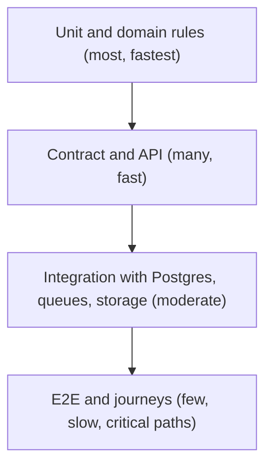
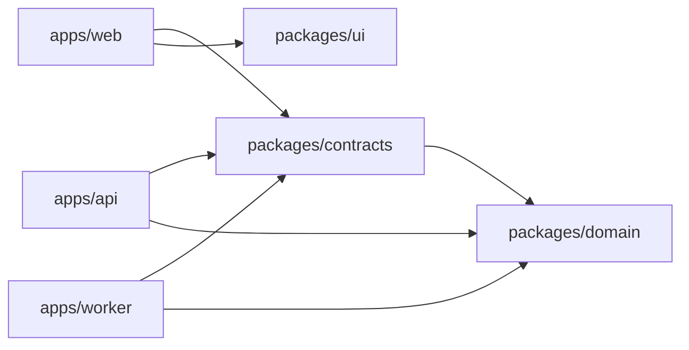
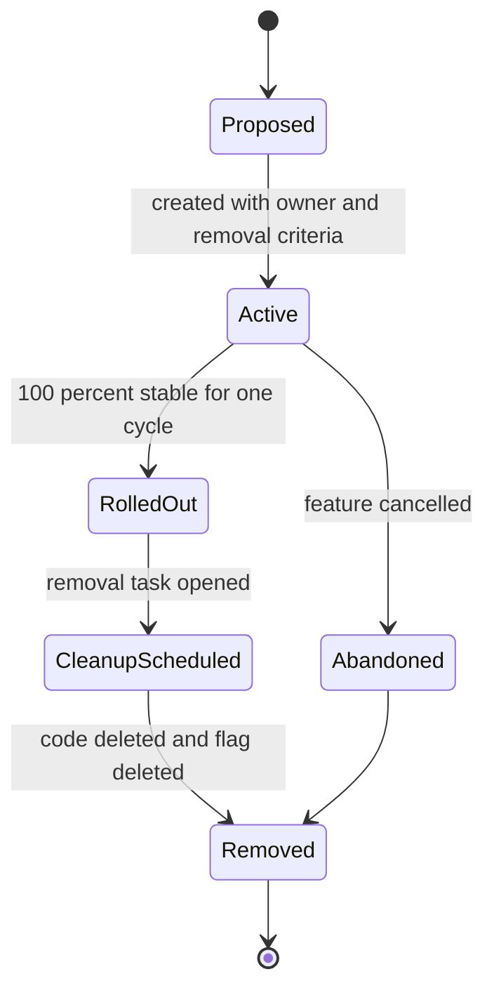

# Blueprint 06: quality and performance

> **Status.** Intent, not ratified. Nothing here claims anything is built; what is built is in `ARCHITECTURE.md` and `project-mindmap/`. Decision `DEC-001`: this blueprint does not supersede `SSOT.md` until `OD-PRD-31` defines ratification.
>
> **What this file holds.** Non-functional requirements, QA and test strategy, engineering standards.
>
> **Merged on 2026-11-25** from the files listed below; each one is a section under its original title. Nothing was removed; the originals are in git history at commit `08387ec`.

| Section | Former file |
|---|---|
| Non-Functional Requirements | `PRODUCT_BLUEPRINT/06_QUALITY_AND_PERFORMANCE/01_NON_FUNCTIONAL_REQUIREMENTS.md` |
| QA and Test Strategy | `PRODUCT_BLUEPRINT/06_QUALITY_AND_PERFORMANCE/02_QA_AND_TEST_STRATEGY.md` |
| Engineering Standards | `PRODUCT_BLUEPRINT/06_QUALITY_AND_PERFORMANCE/03_ENGINEERING_STANDARDS.md` |

## Non-Functional Requirements

_Former file: `PRODUCT_BLUEPRINT/06_QUALITY_AND_PERFORMANCE/01_NON_FUNCTIONAL_REQUIREMENTS.md`._

Status: intended complete product. No value here is a measured result. Security, privacy and AI requirements are in [01_SECURITY_ARCHITECTURE.md](05_SECURITY_PRIVACY.md#security-architecture) (NFR-SEC), [02_PRIVACY_AND_DATA_GOVERNANCE.md](05_SECURITY_PRIVACY.md#privacy-and-data-governance) (NFR-PRV) and [04_FAIRNESS_AND_AI_GOVERNANCE.md](05_SECURITY_PRIVACY.md#fairness-and-ai-governance) (NFR-AIG).

Owner roles: SRE lead (performance, reliability, availability, observability, DR), engineering lead (maintainability, compatibility), design lead (accessibility, internationalization).

| Namespace    | Range    |
| ------------ | -------- |
| `NFR-PERF`   | 001..024 |
| `NFR-SCL`    | 001..012 |
| `NFR-REL`    | 001..016 |
| `NFR-AVL`    | 001..010 |
| `NFR-A11Y`   | 001..020 |
| `NFR-OBS`    | 001..016 |
| `NFR-MNT`    | 001..014 |
| `NFR-I18N`   | 001..012 |
| `NFR-COMPAT` | 001..012 |
| `NFR-DR`     | 001..010 |
| `OD-NFR`     | 01..14   |
| `RSK-NFR`    | 01..08   |

### 1. Ground rules

1. Every requirement states an SLI (what is counted), a window, a percentile where latency is involved, a measurement source, and a threshold. A requirement missing any of these is not testable and cannot be used as completion evidence [SRC: SSOT §21.2, §20.8 note].
2. Thresholds are `[PROP]` defaults unless tagged `[SRC]`. A business-dependent threshold also names its `OD-NFR`. No threshold is a commitment until the OD is decided.
3. Latency percentiles are computed over a rolling 28-day window [PROP] unless stated; server latency is measured at API ingress from request received to last byte sent; client metrics on reference profiles (§2).
4. Where SSOT values conflict with each other, both are recorded and neither replaces the other until decided [SRC: SSOT §20.9, §20.11 conflict notes].
5. "Valid request" excludes requests rejected with 4xx because of client error, except `429` caused by the platform's own load shedding, which counts as bad [SRC: Yash 15/SLO SLO-01].

### 2. Measurement stack and reference profiles

| Profile        | Definition                                                                                                                                                  | Use                                         | Source                             |
| -------------- | ----------------------------------------------------------------------------------------------------------------------------------------------------------- | ------------------------------------------- | ---------------------------------- |
| RMP-1 (lab)    | Lighthouse mobile emulation: small phone viewport, 4× CPU slowdown, simulated slow 4G about 1.6 Mbit/s down and 150 ms RTT; Lighthouse version pinned in CI | Per-pull-request regression gate            | [SRC: Yash 15/SLO §3]              |
| RMP-2 (device) | One low-tier Android phone and the oldest supported iPhone on a throttled real network                                                                      | Release gate for critical journeys          | [SRC: same; device list OD-NFR-02] |
| RMP-3 (field)  | Real-user monitoring p75 by route template and device class, collected as operational telemetry without user identity                                       | Ground truth, informational until OD-PRV-07 | [SRC: same]                        |
| Desktop lab    | Lighthouse desktop preset                                                                                                                                   | Desktop targets                             | [PROP]                             |
| Server         | Ingress histograms per route template and class; traces                                                                                                     | API SLIs                                    | [DER]                              |
| Synthetic      | External probes of critical journeys every 1 min from at least 2 locations [PROP]                                                                           | Availability SLIs                           | [SRC: Yash 15/SLO SLO-02]          |

Critical journeys (used by availability, performance and degradation sections): `J-SIGNIN` sign in; `J-SEARCH` search jobs; `J-APPLY` submit an application; `J-PIPELINE` recruiter moves an applicant; `J-EVIDENCE` add evidence with a file; `J-LEARN` resume a lesson; `J-ASSESS` take and submit an assessment; `J-MSG` send a message; `J-INTERVIEW` join a scheduled interview; `J-CHECKOUT` buy a plan.

### 3. NFR catalogue

#### 3.1 Performance (NFR-PERF)

| ID           | Requirement                                                                                                 | SLI and window                                                      | Measurement                                                  | Default threshold                                                                                     | OD        |
| ------------ | ----------------------------------------------------------------------------------------------------------- | ------------------------------------------------------------------- | ------------------------------------------------------------ | ----------------------------------------------------------------------------------------------------- | --------- |
| NFR-PERF-001 | Point reads (C1: `GET /me`, a single application, a profile) are fast                                       | Server latency p95 / p99, 28 days                                   | Ingress histogram per route                                  | p95 ≤ 200 ms, p99 ≤ 500 ms [SRC: Yash 15/SLO §5]; SSOT list endpoints p95 < 200 ms [SRC: SSOT §20.11] | —         |
| NFR-PERF-002 | List and read-heavy endpoints (C2: job lists, pipeline, notifications)                                      | Same                                                                | Same                                                         | p95 ≤ 350 ms, p99 ≤ 800 ms [SRC: Yash]; conflicts with SSOT list p95 < 200 ms                         | OD-NFR-01 |
| NFR-PERF-003 | Writes (C3: create application, update profile, stage change) including audit and outbox in one transaction | Same                                                                | Same                                                         | p95 ≤ 400 ms, p99 ≤ 1,000 ms                                                                          | —         |
| NFR-PERF-004 | Authentication (C4) excluding password-hash cost                                                            | Same, hash timed separately                                         | Same plus hash span                                          | p95 ≤ 300 ms, p99 ≤ 800 ms; hash 250..500 ms (security doc §7.2)                                      | —         |
| NFR-PERF-005 | Search (C5: job search, candidate search) at target corpus size                                             | Same                                                                | Search load test at corpus size from OD-NFR-05               | p95 ≤ 300 ms [SRC: SSOT §20.11] vs ≤ 400 ms [SRC: Yash] vs F-92 ≤ 500 ms [SRC: SSOT §20.11 conflict]  | OD-NFR-01 |
| NFR-PERF-006 | Compute-on-demand (C6: match explanation, readiness score)                                                  | Same                                                                | Span histogram                                               | p95 ≤ 800 ms, p99 ≤ 2,000 ms; progress UI shown after 1 s                                             | —         |
| NFR-PERF-007 | Upload initiation and signed URL issue (C7)                                                                 | Same                                                                | Same                                                         | p95 ≤ 300 ms                                                                                          | —         |
| NFR-PERF-008 | AI-assisted features (C8)                                                                                   | Time to first token or first progress event                         | Gateway spans                                                | ≤ 2 s p95; completion asynchronous; never blocks other classes                                        | —         |
| NFR-PERF-009 | Webhook acknowledgment (C9)                                                                                 | Server latency                                                      | Handler histogram                                            | p95 ≤ 300 ms (persist then acknowledge)                                                               | —         |
| NFR-PERF-010 | Dashboard and aggregate endpoints served from rollups                                                       | Server latency                                                      | Ingress histogram                                            | p95 ≤ 400 ms [SRC: SSOT §20.11] vs F-102 ≤ 800 ms                                                     | OD-NFR-01 |
| NFR-PERF-011 | Largest Contentful Paint on public and candidate home routes                                                | LCP p75                                                             | RMP-1 lab (of record); RMP-3 field informational             | ≤ 2.5 s mobile, ≤ 2.0 s desktop [SRC: SSOT §20.8]; per-route values §4.1                              | OD-NFR-03 |
| NFR-PERF-012 | Interaction to Next Paint                                                                                   | INP p75                                                             | Field RMP-3; lab proxy Total Blocking Time ≤ 200 ms on RMP-1 | ≤ 200 ms [SRC: SSOT §20.8]                                                                            | OD-NFR-03 |
| NFR-PERF-013 | Cumulative Layout Shift                                                                                     | CLS p75                                                             | RMP-1 and RMP-3                                              | ≤ 0.1 [SRC: SSOT §20.8]                                                                               | —         |
| NFR-PERF-014 | Time to First Byte and First Contentful Paint                                                               | p75                                                                 | RMP-1                                                        | TTFB ≤ 800 ms; FCP ≤ 1.8 s mobile, ≤ 1.5 s desktop [SRC: SSOT §20.8]                                  | —         |
| NFR-PERF-015 | Per-route JavaScript budget                                                                                 | Compressed critical-path JS and CSS bytes (shell plus route chunk)  | CI bundle-size check                                         | Per §4.2 table                                                                                        | OD-NFR-04 |
| NFR-PERF-016 | Warm revisit of the installed PWA                                                                           | Time to interactive shell from service-worker cache with no network | Lighthouse repeat view on RMP-1                              | ≤ 1 s [SRC: Yash SLO-18]                                                                              | —         |
| NFR-PERF-017 | Main-thread long tasks during interactions                                                                  | Count of tasks > 50 ms in scripted interaction traces               | Playwright trace on RMP-1                                    | 0 tasks > 200 ms; ≤ 2 tasks > 50 ms per interaction [PROP]                                            | —         |
| NFR-PERF-018 | Outbox dispatch latency                                                                                     | Oldest undispatched event age                                       | Gauge                                                        | p99 ≤ 5 s [SRC: Yash SLO-20]                                                                          | —         |
| NFR-PERF-019 | Transactional email jobs start promptly                                                                     | Enqueue to start                                                    | Job metrics by class                                         | p95 ≤ 30 s [SRC: Yash SLO-21]                                                                         | —         |
| NFR-PERF-020 | Virus scan upload-to-visible                                                                                | Time                                                                | Scan job age                                                 | p95 ≤ 60 s for files ≤ 25 MiB [SRC: Yash SLO-22]                                                      | —         |
| NFR-PERF-021 | Dependent recompute after evidence revocation                                                               | Revocation to recompute complete                                    | Job age                                                      | p95 ≤ 5 min [SRC: Yash SLO-23]                                                                        | —         |
| NFR-PERF-022 | Real-time message delivery                                                                                  | Send accepted to delivered to an online recipient                   | Server timestamps on both ends                               | p95 ≤ 1 s; alert at 2 s [SRC: SSOT §20.4 realtime latency > 2 s]                                      | —         |
| NFR-PERF-023 | No N+1 query patterns on list endpoints                                                                     | Queries per request as a function of page size                      | Query-count assertion in integration tests                   | Constant query count independent of page size                                                         | —         |
| NFR-PERF-024 | Media playback start for course video                                                                       | Play pressed to first frame                                         | Player telemetry, RMP-1                                      | p75 ≤ 2 s on RMP-1 [PROP]; adaptive bitrate                                                           | OD-NFR-03 |

#### 3.2 Scalability (NFR-SCL)

| ID          | Requirement                                                                                       | SLI                                                              | Measurement                                                        | Default threshold                                                                                        | OD        |
| ----------- | ------------------------------------------------------------------------------------------------- | ---------------------------------------------------------------- | ------------------------------------------------------------------ | -------------------------------------------------------------------------------------------------------- | --------- |
| NFR-SCL-001 | API instances are stateless and horizontally scalable                                             | Throughput scales with instance count                            | Load test at 1, 2 and 4 instances                                  | ≥ 80% linear scaling to 4 instances [PROP]                                                               | —         |
| NFR-SCL-002 | System sustains planned peak with headroom                                                        | Sustained RPS at SLO latency                                     | Load test at 2× forecast peak [SRC: SSOT PROD-009 "VER-006 at 2×"] | Meets NFR-PERF-001..010 at 2× `RPS_peak`                                                                 | OD-NFR-05 |
| NFR-SCL-003 | Worker capacity scales with job arrival rate                                                      | Queue age stays within SLO as arrival rate doubles               | Load test with synthetic jobs                                      | NFR-PERF-018..021 met at 2× forecast job rate                                                            | OD-NFR-05 |
| NFR-SCL-004 | All list endpoints are paginated with cursors                                                     | Maximum page size                                                | Contract test                                                      | Default 25, maximum 100 [PROP]; offset pagination forbidden beyond 1,000 rows                            | —         |
| NFR-SCL-005 | Search result depth is capped                                                                     | Maximum reachable result position                                | Contract test                                                      | 1,000 results per query [PROP]                                                                           | —         |
| NFR-SCL-006 | Tenant fairness: one tenant cannot consume more than its share of shared queues and search        | Share of worker time and search QPS per tenant during contention | Load test with a noisy tenant                                      | No tenant above 25% of shared capacity under contention unless capacity is idle [PROP]                   | OD-NFR-06 |
| NFR-SCL-007 | Database connections stay within pooler limits                                                    | Connections used / limit                                         | Gauge                                                              | ≤ 80% [SRC: SSOT §20.4]                                                                                  | —         |
| NFR-SCL-008 | Bulk operations (pipeline bulk moves, imports, exports, notification fan-out) run as batched jobs | Synchronous request duration for bulk endpoints                  | Contract test                                                      | Bulk endpoints return `202` with a job id; no request processes more than 100 items synchronously [PROP] | —         |
| NFR-SCL-009 | Search index can be rebuilt from the database                                                     | Rebuild time at target corpus                                    | Rebuild drill                                                      | ≤ 1 h [SRC: Yash SLO-34]                                                                                 | OD-NFR-05 |
| NFR-SCL-010 | Storage growth is forecast monthly                                                                | Forecast error                                                   | Capacity review                                                    | Forecast within ±25% over 3 months [PROP]                                                                | —         |
| NFR-SCL-011 | Real-time connections per instance are bounded                                                    | Concurrent connections                                           | Gauge                                                              | Defined per instance after baseline; alert at 80%                                                        | OD-NFR-05 |
| NFR-SCL-012 | Architecture evolution triggers are defined for 10, 100, 1K, 10K, 100K and 1M+ users              | Trigger metrics documented and monitored                         | Capacity review                                                    | §5.3 triggers present for each stage [SRC: SSOT §20 intro]                                               | —         |

#### 3.3 Reliability (NFR-REL)

| ID          | Requirement                                                                                                                                         | SLI                                                   | Measurement                                           | Default threshold                                                                                                 | OD        |
| ----------- | --------------------------------------------------------------------------------------------------------------------------------------------------- | ----------------------------------------------------- | ----------------------------------------------------- | ----------------------------------------------------------------------------------------------------------------- | --------- |
| NFR-REL-001 | Every mutating endpoint that a client may retry accepts an `Idempotency-Key` and replays the first result for `IDEMPOTENCY_KEY_RETENTION`           | Duplicate side effects under retry                    | Fault-injection test sending each request twice       | 0 duplicates                                                                                                      | —         |
| NFR-REL-002 | Every outbound call has a timeout, bounded retries with jittered backoff, and a circuit breaker                                                     | Calls without timeout                                 | Static check of the egress client usage               | 0 calls bypass the client                                                                                         | —         |
| NFR-REL-003 | Per-request deadline propagates to dependencies                                                                                                     | Dependency calls exceeding the remaining deadline     | Trace analysis                                        | `deadline = min(client budget, class p99 × 2)` [SRC: Yash 15/SLO §5]                                              | —         |
| NFR-REL-004 | Side effects of a transaction are published through a transactional outbox                                                                          | Events lost or published for rolled-back transactions | Fault-injection test killing the process mid-commit   | 0                                                                                                                 | —         |
| NFR-REL-005 | Event consumers are idempotent and tolerate reordering                                                                                              | Duplicate or out-of-order delivery effects            | Replay test                                           | 0 incorrect states                                                                                                | —         |
| NFR-REL-006 | Jobs have bounded attempts and a dead-letter queue                                                                                                  | Oldest dead-letter item age                           | Gauge                                                 | Reviewed ≤ 1 business day [SRC: Yash SLO-25]                                                                      | OD-NFR-07 |
| NFR-REL-007 | Workers claim jobs safely with concurrent workers                                                                                                   | Jobs processed twice                                  | Concurrency test with `FOR UPDATE SKIP LOCKED` claims | 0 double processing [SRC: CLAUDE.md worker]                                                                       | —         |
| NFR-REL-008 | Graceful shutdown drains in-flight work                                                                                                             | Requests failed during deploy                         | Rolling deploy test under load                        | 0 failed requests caused by shutdown; drain deadline below the container grace period [SRC: SSOT §20.1 open item] | —         |
| NFR-REL-009 | Health checks separate liveness and readiness; readiness reaches the database and reports worker heartbeat freshness                                | False ready states                                    | Fault-injection (database down)                       | Readiness fails within 10 s of database loss; liveness unaffected [SRC: ARCHITECTURE.md §21]                      | —         |
| NFR-REL-010 | Concurrent edits do not silently overwrite                                                                                                          | Lost updates                                          | Optimistic concurrency test (entity version)          | 0; second writer receives `409 VERSION_CONFLICT`                                                                  | —         |
| NFR-REL-011 | Offline-queued PWA writes sync with operation ids and entity versions                                                                               | Lost or duplicated offline writes                     | PWA sync test                                         | 0 [SRC: SSOT §19.3]                                                                                               | —         |
| NFR-REL-012 | Assessment autosave and submission survive network loss                                                                                             | Answers lost after reconnect                          | Network-drop test during `J-ASSESS`                   | 0 answers lost; submission idempotent [SRC: SSOT §17.4]                                                           | —         |
| NFR-REL-013 | Billing state reconciles with the payment provider daily                                                                                            | Drift count                                           | Reconciliation job                                    | 0 unresolved drift older than 24 h                                                                                | —         |
| NFR-REL-014 | Migrations are backward compatible across one release (expand and contract)                                                                         | Failed deploys due to schema mismatch                 | Migration round-trip and mixed-version test           | 0 [SRC: SSOT §22.3 open item]                                                                                     | —         |
| NFR-REL-015 | Data integrity constraints are enforced in the database (foreign keys, checks, uniqueness) for every business invariant that can be expressed there | Invariants enforced only in code                      | Schema review checklist                               | 0 expressible invariants without a constraint                                                                     | —         |
| NFR-REL-016 | Persistence honesty: a module labelled durable never loses acknowledged writes on restart; ephemeral modules are labelled in the UI and API         | Acknowledged writes lost                              | `persistence-honesty` test suite                      | 0 [SRC: CLAUDE.md Rules]                                                                                          | —         |

#### 3.4 Availability (NFR-AVL)

| ID          | Requirement                                                       | SLI                                                                 | Measurement                 | Default threshold                                                                      | OD        |
| ----------- | ----------------------------------------------------------------- | ------------------------------------------------------------------- | --------------------------- | -------------------------------------------------------------------------------------- | --------- |
| NFR-AVL-001 | Core API availability                                             | Good responses within deadline / valid requests, 28 days            | Server metrics              | 99.9% (43.2 min budget per 30 days) [SRC: Yash SLO-01]                                 | OD-NFR-08 |
| NFR-AVL-002 | Web shell availability                                            | Synthetic shell load success / attempts                             | External probes             | 99.9% [SRC: Yash SLO-02]                                                               | OD-NFR-08 |
| NFR-AVL-003 | Authentication availability                                       | Successful sign-in, refresh and session validation / valid attempts | Server metrics on `/auth/*` | 99.9% [SRC: Yash SLO-04]                                                               | OD-NFR-08 |
| NFR-AVL-004 | Critical journeys succeed end to end                              | Synthetic journey success per `J-` journey                          | Probes every 5 min [PROP]   | 99.5% per journey [PROP]                                                               | OD-NFR-08 |
| NFR-AVL-005 | Background pipeline health                                        | Share of 5-min windows where outbox age ≤ NFR-PERF-018              | Gauge                       | 99% [SRC: Yash SLO-05]                                                                 | —         |
| NFR-AVL-006 | Billing webhook processing                                        | Verified webhooks processed within 5 min / received                 | Handler metrics             | 99.9% [SRC: Yash SLO-06]                                                               | —         |
| NFR-AVL-007 | Real-time messaging availability                                  | Successful connection and delivery / attempts                       | Server metrics              | 99.5% [PROP]                                                                           | OD-NFR-08 |
| NFR-AVL-008 | Interview room join success                                       | Joins succeeded / attempts (excluding client permission denials)    | Provider and server metrics | 99.5% [PROP]                                                                           | OD-NFR-08 |
| NFR-AVL-009 | Planned maintenance does not take core read paths offline         | Minutes of read unavailability for maintenance                      | Change records              | 0 for reads; writes may enter read-only mode with banner for ≤ 15 min per month [PROP] | —         |
| NFR-AVL-010 | Maintenance mode controls request admission, not just diagnostics | Requests admitted during maintenance for blocked classes            | Integration test            | 0 [SRC: ARCHITECTURE.md §21 gap]                                                       | —         |

#### 3.5 Accessibility (NFR-A11Y)

WCAG 2.2 Level AA is the release requirement [SRC: SSOT §21.3, §21.4]. Conflict recorded: SSOT §21.5 lists six Level A and AA criteria (2.4.11, 2.5.7, 2.5.8, 3.2.6, 3.3.7, 3.3.8) as forward targets, which contradicts the AA gate; this catalogue treats them as in scope and only 2.4.13 Focus Appearance (AAA) as a target, pending OD-NFR-09.

| ID           | Requirement                                                                                                                                   | Measurement                                                                    | Threshold                                                                                             |
| ------------ | --------------------------------------------------------------------------------------------------------------------------------------------- | ------------------------------------------------------------------------------ | ----------------------------------------------------------------------------------------------------- |
| NFR-A11Y-001 | Every route conforms to WCAG 2.2 AA                                                                                                           | Per-route conformance matrix (manual audit plus automation)                    | 100% of routes in scope; exceptions listed in the accessibility statement                             |
| NFR-A11Y-002 | Automated checks find no critical or serious issues                                                                                           | axe-core in CI on every route template and key states                          | 0 critical or serious [SRC: SSOT A11Y-002]                                                            |
| NFR-A11Y-003 | All functionality operable by keyboard with no traps                                                                                          | Keyboard-only run of every critical journey                                    | 100% of journeys                                                                                      |
| NFR-A11Y-004 | Focus is visible and not obscured (2.4.7, 2.4.11); focus appearance ≥ 2 px with 3:1 contrast as target (2.4.13)                               | Visual and automated check                                                     | 0 failures for 2.4.7 and 2.4.11                                                                       |
| NFR-A11Y-005 | Text contrast ≥ 4.5:1, large text and UI components ≥ 3:1, in light and dark themes                                                           | Token-level contrast test on `packages/ui/src/tokens.ts` pairs plus page audit | 0 failures                                                                                            |
| NFR-A11Y-006 | Target size at least 24 × 24 CSS px or sufficient spacing (2.5.8)                                                                             | Automated layout check                                                         | 0 failures                                                                                            |
| NFR-A11Y-007 | Dragging has a single-pointer alternative (2.5.7), including the curriculum builder and pipeline board                                        | Manual test                                                                    | 100% of drag interactions [SRC: SSOT §21.7]                                                           |
| NFR-A11Y-008 | Content reflows at 320 CSS px width and 400% zoom without two-dimensional scrolling (except data tables, boards and code editors)             | Manual test                                                                    | 0 failures                                                                                            |
| NFR-A11Y-009 | Forms have programmatic labels, error identification, suggestions and no redundant entry (3.3.1, 3.3.3, 3.3.7)                                | Automated plus manual                                                          | 0 failures                                                                                            |
| NFR-A11Y-010 | Authentication does not require a cognitive function test; password managers and paste work; one-time codes are pasteable (3.3.8)             | Manual test of sign-in, MFA, recovery                                          | 0 failures                                                                                            |
| NFR-A11Y-011 | Status messages are announced (4.1.3), including toasts, autosave and upload progress                                                         | Screen-reader test                                                             | 100% of status patterns                                                                               |
| NFR-A11Y-012 | Custom components expose name, role, value and state (4.1.2)                                                                                  | Component library audit                                                        | 100% of `components/ui` primitives                                                                    |
| NFR-A11Y-013 | Media has captions; prerecorded video has audio description or transcript; player is keyboard operable                                        | Content check and player test                                                  | 100% of platform-produced media; instructors warned when uploading without captions [SRC: SSOT §21.7] |
| NFR-A11Y-014 | Timed assessments announce remaining time and support extended-time accommodations                                                            | Screen-reader and accommodation test                                           | 100% of timed assessment types [SRC: SSOT §21.7]                                                      |
| NFR-A11Y-015 | Charts and leaderboards have a data-table alternative                                                                                         | Manual test                                                                    | 100% [SRC: SSOT §21.7]                                                                                |
| NFR-A11Y-016 | Infinite scroll has a "Load more" alternative and preserves focus                                                                             | Manual test                                                                    | 100% [SRC: SSOT §21.7]                                                                                |
| NFR-A11Y-017 | Motion respects `prefers-reduced-motion`                                                                                                      | Automated media-query test                                                     | 100% of animations                                                                                    |
| NFR-A11Y-018 | Help is consistently located (3.2.6)                                                                                                          | Manual test                                                                    | 0 failures                                                                                            |
| NFR-A11Y-019 | Critical journeys pass manual screen-reader testing on two combinations (for example NVDA with a desktop browser and VoiceOver on iOS) [PROP] | Test record per release                                                        | 0 blockers                                                                                            |
| NFR-A11Y-020 | An accessibility statement and Accessibility Conformance Report are published and updated per release                                         | Content check                                                                  | Present and dated (OD-SEC-30)                                                                         |

#### 3.6 Observability (NFR-OBS)

| ID          | Requirement                                                                                                                                                                                           | Measurement                     | Threshold                                                                                      |
| ----------- | ----------------------------------------------------------------------------------------------------------------------------------------------------------------------------------------------------- | ------------------------------- | ---------------------------------------------------------------------------------------------- |
| NFR-OBS-001 | Every request carries a `request_id` (UUIDv4 accepted from edge or generated) propagated to logs, database (`SET LOCAL app.request_id`), audit, AI provenance, provider calls and the response header | Trace propagation test          | 100% of requests [SRC: SSOT §20.3]                                                             |
| NFR-OBS-002 | Logs are structured JSON with timestamp, level, service, version, route template, tenant id, request id, trace id, outcome, duration                                                                  | Log schema validation           | 100% of log lines                                                                              |
| NFR-OBS-003 | Logs contain no personal free text, tokens or secrets                                                                                                                                                 | Redaction test (NFR-PRV-039)    | 0 findings                                                                                     |
| NFR-OBS-004 | Distributed traces cover API, database, queue, worker and provider spans                                                                                                                              | Sampled trace completeness      | ≥ 95% of sampled traces have all expected spans; sampling 10% baseline, 100% for errors [PROP] |
| NFR-OBS-005 | RED metrics (rate, errors, duration histograms) per route template and job kind                                                                                                                       | Metric presence check           | 100% of routes and job kinds                                                                   |
| NFR-OBS-006 | USE metrics (utilization, saturation, errors) for CPU, memory, database connections, locks, replication lag, disk, queue depth                                                                        | Metric presence                 | 100% of components                                                                             |
| NFR-OBS-007 | Every SLO in §8 has an SLI dashboard and multi-window burn-rate alerts                                                                                                                                | Dashboard and alert test        | Fast burn (2% budget in 1 h) pages; slow burn (10% in 3 days) tickets [PROP]                   |
| NFR-OBS-008 | Missing telemetry is an alert, not a healthy state                                                                                                                                                    | Alert on absent metrics         | Absent-for-5-min alert for every SLI [SRC: SSOT §20.2]                                         |
| NFR-OBS-009 | Alerts have severity, owner, runbook link and are tested                                                                                                                                              | Alert catalogue review          | 100% of alerts; P0 acknowledged within 10 min, P1 30 min [SRC: SSOT §20.5]                     |
| NFR-OBS-010 | Client errors and web vitals are reported as operational beacons (route template, error class, build version, timing bucket)                                                                          | Beacon schema test              | Per NFR-PRV-010                                                                                |
| NFR-OBS-011 | Worker heartbeat is written independently of batch length                                                                                                                                             | Heartbeat age during long batch | ≤ 15 s between heartbeats [PROP]; unhealthy above 45 s [SRC: ARCHITECTURE.md §21]              |
| NFR-OBS-012 | AI gateway metrics: requests, latency, errors, cost, acceptance rate per capability and provider                                                                                                      | Dashboard                       | Present; alert at error > 5% [SRC: SSOT §20.4]                                                 |
| NFR-OBS-013 | Security dashboard: auth failures, step-up failures, RLS denials, rate-limit hits, egress blocks, canary alarms                                                                                       | Dashboard                       | Present [SRC: SSOT §20.6]                                                                      |
| NFR-OBS-014 | Business health signals (funnels for critical journeys) are available from consented analytics only                                                                                                   | Dashboard                       | Present; regression > 10% week over week alerts [SRC: SSOT §20.4]                              |
| NFR-OBS-015 | Telemetry retention follows `RET-OPLOG`                                                                                                                                                               | Retention test                  | Logs 30 days, traces 7 days                                                                    |
| NFR-OBS-016 | Each deploy emits a change event visible on all dashboards                                                                                                                                            | Dashboard annotation test       | 100% of deploys and flag changes                                                               |

#### 3.7 Maintainability (NFR-MNT)

| ID          | Requirement                                                                                                               | Measurement                                                                        | Threshold                                                                             |
| ----------- | ------------------------------------------------------------------------------------------------------------------------- | ---------------------------------------------------------------------------------- | ------------------------------------------------------------------------------------- |
| NFR-MNT-001 | Business rules live only in `packages/domain`; routes and UI call them                                                    | Static dependency check: no rule constants or state transitions defined in `apps/` | 0 violations [SRC: CLAUDE.md Rules]                                                   |
| NFR-MNT-002 | Request and response schemas are defined once in `packages/contracts` and used by API and web                             | Contract import check                                                              | 100% of routes                                                                        |
| NFR-MNT-003 | Every migration has an automated round-trip test and is reversible or explicitly marked irreversible with a recovery plan | `database-migrations` suite                                                        | 100% [SRC: CLAUDE.md Rules]                                                           |
| NFR-MNT-004 | Type checking passes in strict mode for all packages                                                                      | `pnpm typecheck`                                                                   | 0 errors                                                                              |
| NFR-MNT-005 | Formatting and lint pass                                                                                                  | `pnpm lint`                                                                        | 0 errors                                                                              |
| NFR-MNT-006 | Test coverage of `packages/domain`                                                                                        | Line and branch coverage                                                           | ≥ 90% lines, ≥ 80% branches [PROP]                                                    |
| NFR-MNT-007 | Each feature's acceptance criteria map to at least one automated test                                                     | Traceability report from FR ids to tests                                           | 100% of Must features before release                                                  |
| NFR-MNT-008 | Dependencies are current                                                                                                  | Age of direct dependencies behind latest major                                     | No direct dependency more than one major version behind for more than 6 months [PROP] |
| NFR-MNT-009 | Feature flags have an owner and an expiry; stale flags are removed                                                        | Flag register                                                                      | 0 flags past expiry by more than 30 days [PROP]                                       |
| NFR-MNT-010 | Public API changes follow versioning and deprecation policy                                                               | Contract diff in CI                                                                | Breaking changes only in a new version; deprecation notice ≥ 6 months [PROP]          |
| NFR-MNT-011 | Design tokens are used for colors and spacing in feature code                                                             | Lint for hard-coded values                                                         | 0 violations [SRC: CLAUDE.md Style]                                                   |
| NFR-MNT-012 | Build is reproducible from the repository and pinned toolchain                                                            | Clean-build comparison                                                             | Identical artifact hashes for the same commit [PROP]                                  |
| NFR-MNT-013 | Runbooks exist for every P0 and P1 alert and for every drill in §3.10                                                     | Runbook register                                                                   | 100%                                                                                  |
| NFR-MNT-014 | CI duration for a pull request stays short enough for frequent integration                                                | p50 pipeline duration                                                              | ≤ 15 min [PROP]                                                                       |

#### 3.8 Internationalization (NFR-I18N)

| ID           | Requirement                                                                                                                                  | Measurement                               | Threshold                                                                                          |
| ------------ | -------------------------------------------------------------------------------------------------------------------------------------------- | ----------------------------------------- | -------------------------------------------------------------------------------------------------- |
| NFR-I18N-001 | All user-facing strings come from message catalogs with ICU message format (plurals, gender-neutral forms)                                   | Lint for literal strings in components    | 0 literals                                                                                         |
| NFR-I18N-002 | Launch locale set is configurable; English (US) is the source locale                                                                         | Config check                              | Locale list per OD-NFR-10                                                                          |
| NFR-I18N-003 | Dates, times, numbers and currencies are formatted with `Intl` per user locale                                                               | Unit tests per formatter                  | 100% of formatted values                                                                           |
| NFR-I18N-004 | All timestamps stored in UTC; scheduling uses IANA time zones and handles daylight-saving transitions                                        | Scheduling tests across transitions       | 0 wrong slots                                                                                      |
| NFR-I18N-005 | Names and addresses accept any Unicode script; no "first name / last name" requirement (single full-name field plus optional preferred name) | Validation tests with multi-script corpus | 0 rejections of valid names                                                                        |
| NFR-I18N-006 | Layout supports right-to-left scripts through logical CSS properties                                                                         | RTL visual test                           | 0 layout breaks on critical screens (when an RTL locale is enabled)                                |
| NFR-I18N-007 | Text expansion up to 35% does not truncate controls                                                                                          | Pseudo-localization test                  | 0 truncations on critical screens                                                                  |
| NFR-I18N-008 | Search handles diacritics and multiple scripts                                                                                               | Search tests                              | Accent-insensitive matching for Latin scripts; tokenization for CJK when those locales are enabled |
| NFR-I18N-009 | Prices show currency explicitly; taxes shown per market                                                                                      | BIL tests                                 | 100% of price displays                                                                             |
| NFR-I18N-010 | Email and notification templates are localized to the recipient's locale                                                                     | Template tests                            | 100% of templates for enabled locales                                                              |
| NFR-I18N-011 | Locale is selectable by the user and remembered; `Accept-Language` is the initial default                                                    | E2E test                                  | Pass                                                                                               |
| NFR-I18N-012 | Skills and job titles taxonomy supports localized labels with a stable language-independent id                                               | Data test                                 | 100% of taxonomy nodes have an id independent of label                                             |

#### 3.9 Compatibility (NFR-COMPAT)

| ID             | Requirement                                                                                                                               | Measurement                            | Threshold                                              |
| -------------- | ----------------------------------------------------------------------------------------------------------------------------------------- | -------------------------------------- | ------------------------------------------------------ |
| NFR-COMPAT-001 | Supported browsers: last 2 major versions of Chrome, Edge, Firefox, Safari (macOS and iOS), Samsung Internet [PROP]                       | Cross-browser E2E on critical journeys | 0 blockers                                             |
| NFR-COMPAT-002 | Oldest supported iOS and Android versions defined and tested on RMP-2 devices                                                             | Device lab run                         | Per OD-NFR-02                                          |
| NFR-COMPAT-003 | Viewport widths 320 px to 2560 px                                                                                                         | Visual regression                      | 0 layout breaks                                        |
| NFR-COMPAT-004 | PWA installable where the platform supports it; features degrade when capabilities are missing (push, background sync, WebAuthn, camera)  | Capability detection tests             | Every capability has a fallback path [SRC: SSOT §19.1] |
| NFR-COMPAT-005 | iOS web push and install limitations handled with email fallback                                                                          | iOS device test                        | Notifications still delivered by email                 |
| NFR-COMPAT-006 | Unsupported browsers see a clear message with supported options instead of a broken page                                                  | Test with an old user agent            | Pass                                                   |
| NFR-COMPAT-007 | Public API versioned under `/api/v1`; clients receive `Deprecation` and `Sunset` headers before removal                                   | Contract test                          | Pass                                                   |
| NFR-COMPAT-008 | Calendar integrations: ICS export plus two-way sync with major calendar providers [PROP]                                                  | Integration tests                      | Pass                                                   |
| NFR-COMPAT-009 | Exports and imports use open formats (JSON, CSV UTF-8 with BOM option, PDF, ICS, Open Badges or W3C Verifiable Credentials where offered) | Format validation                      | Pass                                                   |
| NFR-COMPAT-010 | Institution integrations support LTI 1.3 and SCIM 2.0 [PROP]                                                                              | Conformance test                       | Pass when INS integrations ship                        |
| NFR-COMPAT-011 | Service worker updates do not break open sessions: a new version activates on next navigation with a prompt                               | PWA update test                        | 0 broken sessions                                      |
| NFR-COMPAT-012 | Works with common assistive technologies (screen readers, voice control, switch access)                                                   | NFR-A11Y-019                           | Pass                                                   |

#### 3.10 Disaster recovery (NFR-DR)

| ID         | Requirement                                                                                                                                       | Measurement                      | Threshold                                                                                                                                                           | OD        |
| ---------- | ------------------------------------------------------------------------------------------------------------------------------------------------- | -------------------------------- | ------------------------------------------------------------------------------------------------------------------------------------------------------------------- | --------- |
| NFR-DR-001 | Database point-in-time recovery                                                                                                                   | Data loss window after restore   | RPO ≤ 15 min [SRC: SSOT §22.4] vs ≤ 5 min [SRC: Yash SLO-31]                                                                                                        | OD-NFR-11 |
| NFR-DR-002 | Database restore to a verified copy                                                                                                               | Time to restored, verified copy  | RTO ≤ 2 h [SRC: SSOT §22.4] vs ≤ 1 h [SRC: Yash SLO-31]                                                                                                             | OD-NFR-11 |
| NFR-DR-003 | Single database node failure                                                                                                                      | Data loss and failover time      | ≈ 0 committed loss with synchronous replica; ≤ 5 min failover [SRC: Yash SLO-30]                                                                                    | OD-NFR-11 |
| NFR-DR-004 | Object storage loss or corruption                                                                                                                 | Recoverability of evidence files | Versioning plus cross-region or off-site copy; RPO and RTO per OD-NFR-11                                                                                            | OD-NFR-11 |
| NFR-DR-005 | Region loss                                                                                                                                       | RPO and RTO                      | Undecided; depends on single vs multi-region [SRC: Yash SLO-33]                                                                                                     | OD-NFR-12 |
| NFR-DR-006 | Secrets and configuration recovery                                                                                                                | Time to restore                  | ≤ 30 min from secret manager and infrastructure as code [SRC: Yash SLO-35]; `.env.example` is not a recovery source [SRC: SSOT §22.4 conflict]                      | —         |
| NFR-DR-007 | Restore drills                                                                                                                                    | Drill records                    | Quarterly database restore and PITR record recovery; quarterly rollback drill (≤ 15 min); semi-annual secrets rotation; annual full DR simulation [SRC: SSOT §22.5] | —         |
| NFR-DR-008 | After restore, external systems are reconciled (payments, email suppression, media provider, search index) and erasures re-applied before traffic | Drill checklist                  | 100% of steps executed in drill [SRC: SSOT §22.5 open item; NFR-PRV-023]                                                                                            | —         |
| NFR-DR-009 | Backups are isolated from production credentials                                                                                                  | Access review                    | Separate account or project; deletion protection [PROP]                                                                                                             | —         |
| NFR-DR-010 | Application rollback                                                                                                                              | Time to previous stable version  | ≤ 15 min [SRC: SSOT §22.3, §22.5]                                                                                                                                   | —         |

Conflict recorded: SSOT §22.4 gives Auth data a daily backup with RPO ≤ 24 h while the same database has 15-minute WAL and RPO ≤ 15 min; both cannot hold. Default: one RPO for the whole database (OD-NFR-11).

### 4. Performance budgets

#### 4.1 Web vitals per route class

Measured as lab p75 on RMP-1 (of record) with field RMP-3 p75 reported alongside. Values are SSOT per-route budgets [SRC: SSOT §20.9]. Conflict recorded: several exceed the global targets of NFR-PERF-011/012 (LCP up to 3.5 s against < 2.5 s mobile; INP 300 ms against 200 ms). Default proposal: the global target applies to public, candidate-home, search, profile and messaging routes; the looser per-route value applies only to authoring and analytics routes listed as "heavy" below, until OD-NFR-03.

| Route class             | Examples                                                     | LCP     | INP                                | CLS    | Heavy route   |
| ----------------------- | ------------------------------------------------------------ | ------- | ---------------------------------- | ------ | ------------- |
| Marketing and public    | Landing, public job page, public profile, public course page | ≤ 1.8 s | ≤ 200 ms                           | ≤ 0.05 | No            |
| Search and marketplace  | Job search, course catalog, mentor directory                 | ≤ 2.0 s | ≤ 200 ms                           | ≤ 0.1  | No            |
| Profile and portfolio   | Own profile editor, portfolio                                | ≤ 2.0 s | ≤ 200 ms                           | ≤ 0.1  | No            |
| Messaging               | Inbox, conversation                                          | ≤ 2.0 s | ≤ 200 ms                           | ≤ 0.1  | No            |
| Dashboard and ATS       | Candidate home, recruiter pipeline                           | ≤ 2.5 s | ≤ 200 ms                           | ≤ 0.1  | No            |
| Feed first page         | Community feed                                               | ≤ 2.5 s | ≤ 300 ms (SSOT) vs 200 ms (global) | ≤ 0.1  | No (conflict) |
| Learning player         | Lesson player                                                | ≤ 3.0 s | ≤ 300 ms                           | ≤ 0.1  | Yes           |
| Challenge arena         | Code challenge with editor                                   | ≤ 3.0 s | ≤ 300 ms                           | ≤ 0.1  | Yes           |
| Course builder          | Instructor studio                                            | ≤ 3.5 s | ≤ 300 ms                           | ≤ 0.1  | Yes           |
| Admin and reporting     | Admin console, reports                                       | ≤ 3.5 s | ≤ 300 ms                           | ≤ 0.1  | Yes           |
| Institutional analytics | Cohort dashboards                                            | ≤ 3.5 s | ≤ 300 ms                           | ≤ 0.1  | Yes           |

#### 4.2 JavaScript and CSS budgets

Compressed transfer size of the critical path (shell plus route chunk, JS plus CSS). SSOT forbids route bundles above 200 KB gzipped [SRC: SSOT §20.10] while §20.9 allows up to 400 KB; the budget method (bytes that fit the LCP target on RMP-1) gives about 210 KB for a 2.5 s target [SRC: Yash 15/SLO §3]. Default proposal pending OD-NFR-04:

| Route class                                             | Critical-path budget (compressed)                              | Lazy-loaded allowance after interaction       |
| ------------------------------------------------------- | -------------------------------------------------------------- | --------------------------------------------- |
| Marketing and public                                    | ≤ 120 KB [SRC: SSOT §20.9]                                     | ≤ 80 KB                                       |
| Search, profile, messaging, dashboard, ATS, feed        | ≤ 200 KB [SRC: SSOT §20.10]                                    | ≤ 150 KB                                      |
| Heavy routes (player, arena, builder, admin, analytics) | ≤ 200 KB for first render; editors and charts loaded on demand | ≤ 400 KB total [SRC: SSOT §20.9 upper values] |

Other budgets [PROP]: images served in modern formats with explicit dimensions and responsive sizes; hero image ≤ 100 KB on mobile; web fonts ≤ 2 families, subset, `font-display: swap`; third-party scripts on authenticated routes: none except payment and video providers on their own routes; API responses for list endpoints ≤ 100 KB compressed per page.

#### 4.3 API latency classes (summary of NFR-PERF-001..010)

| Class                     | p95                                           | p99              | Notes                                   |
| ------------------------- | --------------------------------------------- | ---------------- | --------------------------------------- |
| C1 point read             | 200 ms                                        | 500 ms           |                                         |
| C2 list                   | 350 ms (Yash) / 200 ms (SSOT)                 | 800 ms           | OD-NFR-01                               |
| C3 write                  | 400 ms                                        | 1,000 ms         | No external call inside the transaction |
| C4 auth                   | 300 ms plus hash                              | 800 ms plus hash |                                         |
| C5 search                 | 300 ms (SSOT) / 400 ms (Yash) / 500 ms (F-92) | 800 ms           | OD-NFR-01                               |
| C6 compute on demand      | 800 ms                                        | 2,000 ms         | Progress UI after 1 s                   |
| C7 upload initiation      | 300 ms                                        | 700 ms           | Bytes go direct to storage              |
| C8 AI                     | First token ≤ 2 s                             | n/a              | Asynchronous completion, bulkhead       |
| C9 webhook acknowledgment | 300 ms                                        | 800 ms           | Persist then acknowledge                |
| Aggregates and dashboards | 400 ms (SSOT) / 800 ms (F-102)                | 1,000 ms         | From rollups; OD-NFR-01                 |

### 5. Scalability model and capacity planning

#### 5.1 Parameters (all values unknown until forecast and baseline load test; none assumed)

| Parameter  | Meaning                                                                                     | Source or owner                          |
| ---------- | ------------------------------------------------------------------------------------------- | ---------------------------------------- |
| `MAU_role` | Monthly active users per role (CAN, REC, INS, IAD, EXA, others)                             | Product and finance forecast (OD-NFR-05) |
| `a`        | Daily active / monthly active ratio                                                         | Analytics once live                      |
| `s`        | Sessions per daily active user per day                                                      | Analytics                                |
| `r_c`      | API requests per session by class C1..C9                                                    | Trace sampling, load model               |
| `p`        | Peak-to-average factor (hour of day, application deadlines, semester starts, hiring events) | Observed traffic profile                 |
| `b_k`      | Background jobs per active user per day by job kind                                         | Worker metrics                           |
| `f`        | Mean upload size and uploads per active candidate per month                                 | Storage metrics                          |
| `v`        | Video minutes uploaded per instructor per month and viewed per learner                      | Media metrics                            |
| `q`        | Concurrent real-time connections per daily active user                                      | Real-time metrics                        |
| `N_corpus` | Search corpus sizes (jobs, discoverable candidates, courses)                                | Data growth model                        |
| `h`        | CDN cache hit ratio for static assets and public pages                                      | CDN logs                                 |

#### 5.2 Formulas [SRC: Yash 15/SLO §9]

- Peak request rate: `RPS_peak = Σ_role MAU_role × a × s × Σ_c r_c × p / 86,400`.
- API instances: `N_api = ceil(RPS_peak × cpu_seconds_per_request / (cores_per_instance × u_target)) + N_spare`, with `u_target ≤ 0.6` and `N_spare ≥ 1` (survive loss of one instance).
- Workers: `N_worker = ceil(Σ_k λ_k × service_time_k / (concurrency_per_worker × u_target))`, with `λ_k` the job arrival rate per kind.
- Database connections: `conns = N_api × pool_per_instance + N_worker × pool_per_worker + admin_reserve ≤ 0.8 × pooler_limit`.
- Storage growth per month: `ΔS = MAU_CAN × uploads_per_month × f + video_minutes × bytes_per_minute + database_growth`.
- Search reindex time: `reindex_time = N_corpus / indexing_rate ≤ 1 h` (NFR-SCL-009).
- Real-time capacity: `connections_peak = DAU × q × p`; instances sized so each stays below 80% of its tested connection limit.

#### 5.3 Architecture evolution triggers

| Stage (active users) | Expected shape [DER]                                                                                                                             | Trigger to move to the next shape                                                            |
| -------------------- | ------------------------------------------------------------------------------------------------------------------------------------------------ | -------------------------------------------------------------------------------------------- |
| 10 to 100            | One API instance plus one worker, managed PostgreSQL, CDN                                                                                        | Need for zero-downtime deploys or any SLO burn caused by single instance                     |
| 100 to 1K            | Two or more API instances, two workers, connection pooler                                                                                        | Database CPU > 60% at peak, or pooler saturation > 80%                                       |
| 1K to 10K            | Read replica for reporting and search reads, rollup tables for dashboards, dedicated search engine if PostgreSQL full-text search p95 exceeds C5 | Search p95 over target at forecast corpus [SRC: Yash ADR-T11 revisit trigger 400 ms]         |
| 10K to 100K          | Separate queues per job class with tenant fairness, shared cache (for rate-limit counters, sessions denylist), media pipeline offloaded          | Rate-limit counter writes > 5% of primary write IOPS or check p95 > 5 ms [SRC: Yash Rev2 §3] |
| 100K to 1M+          | Partitioned hot tables (events, notifications, audit), regional deployment for residency, possibly service extraction for real-time and search   | Region requirements (OD-SEC-24) or single-primary write saturation                           |

#### 5.4 Capacity review

Monthly review of utilization against forecast; re-forecast when a trigger fires, before a large tenant onboards (institution semester start, enterprise rollout), or before a planned campaign. Headroom rule: provisioned capacity ≥ 2× observed peak for interactive paths [SRC: SSOT PROD-009].

### 6. Load profile questions (must be answered to set OD-NFR-05)

1. How many users per role are expected at launch, at 12 months and at 36 months?
2. What share of candidates are active daily versus only during a job search?
3. When are peaks: weekday mornings in which time zones, semester starts, campus placement seasons, application deadlines of large employers, hackathon submission deadlines?
4. What is the largest single tenant (recruiters, applicants per job, students per institution, employees per enterprise)?
5. How many applications can a single job receive in its first 24 hours (high-volume hiring)?
6. How many recruiters search concurrently, and how large is the discoverable candidate corpus?
7. How many concurrent assessment takers can one scheduled assessment have (campus drives)?
8. How many concurrent interviews and real-time conversations at peak?
9. What volume of video is uploaded and streamed per month?
10. What is the expected AI request mix per active user, and the cost policy per plan?
11. What notification fan-out occurs at peak (job alerts, digests)?
12. Which regions must be served and with what latency expectation?
13. Which integrations push or pull data in bulk (ATS imports, LMS sync, HRIS), and how often?

### 7. Caching and queueing strategy

#### 7.1 Caching

| Layer                          | What                                                                                                                 | Policy                                                                   | Invalidation                                                 |
| ------------------------------ | -------------------------------------------------------------------------------------------------------------------- | ------------------------------------------------------------------------ | ------------------------------------------------------------ |
| CDN                            | Hashed static assets                                                                                                 | `public, max-age=31536000, immutable`                                    | New hash per build                                           |
| CDN                            | Public pages and public API reads (public jobs, public profiles, course pages)                                       | `public, s-maxage=60, stale-while-revalidate=300` [PROP]                 | Purge on publish, unpublish, visibility change (within 60 s) |
| Service worker                 | App shell and static assets precached; owner data with network-first                                                 | Never authoritative; purge on sign-out and `401`/`403` [SRC: SSOT §19.2] | Version on each release                                      |
| Server memory                  | Policy grants (`GRANTS_CACHE_TTL` 15 s), feature flags (60 s), taxonomy (5 min)                                      | Keyed with tenant and principal                                          | Version bump on change                                       |
| Shared cache (when introduced) | Rate-limit counters, session denylist, rollup results                                                                | Keys include tenant id                                                   | TTL plus explicit invalidation                               |
| Rollup tables                  | Dashboards, institution analytics, salary aggregates                                                                 | Recomputed by jobs; freshness shown in UI                                | Event-driven or scheduled                                    |
| Never cached                   | Consent state, support grants, entitlements for spend, assessment answers, authenticated API responses at HTTP level | —                                                                        | —                                                            |

#### 7.2 Queueing

| Rule            | Detail                                                                                                                                                                                 |
| --------------- | -------------------------------------------------------------------------------------------------------------------------------------------------------------------------------------- |
| Queue store     | PostgreSQL `background_jobs` with `FOR UPDATE SKIP LOCKED` claims [SRC: CLAUDE.md] until a trigger in §5.3 requires a dedicated broker                                                 |
| Classes         | `interactive` (emails users wait for, scan, verification), `standard` (recompute, notifications), `bulk` (exports, imports, reindex, digests), `scheduled` (retention, reconciliation) |
| Priority        | Workers serve `interactive` first with reserved capacity (at least one worker slot always reserved) [PROP]                                                                             |
| Tenant fairness | Round-robin across tenants within a class; per-tenant concurrency cap (NFR-SCL-006)                                                                                                    |
| Retries         | Exponential backoff with jitter, maximum attempts per kind (default 5) [PROP]; then dead-letter                                                                                        |
| Idempotency     | Job kinds declare an idempotency key; duplicate enqueues collapse                                                                                                                      |
| Scheduling      | Scheduled jobs are single-run by lock; missed runs execute once on recovery, not once per missed interval                                                                              |
| Visibility      | Queue depth, oldest age, attempts, dead-letter count per class and kind                                                                                                                |

### 8. SLO, SLI and error-budget framework

1. Each SLO has: name, SLI definition (good events / valid events), window (rolling 28 days [PROP]), target, owner, dashboard, alert policy.
2. Error budget = `1 − target` over the window. Example: 99.9% over 30 days allows 43.2 min of bad minutes or 0.1% bad requests.
3. Burn-rate alerts: page when 2% of the 30-day budget burns in 1 h (fast burn) and confirmed over 5 min; ticket when 10% burns in 3 days (slow burn) [PROP].
4. Budget policy [SRC: Yash 15/SLO §10]: monthly SLO review by the SRE lead; when a budget is exhausted, releases to the affected surface freeze except reliability and security fixes until the budget recovers or the product owner accepts the risk in writing.
5. Changes to a target require an update to this file and the dashboard configuration in the same change.
6. Declared disasters (region loss) are reported separately and do not silently consume the monthly budget.
7. SLO set (initial): NFR-AVL-001..008 availability, NFR-PERF-001..010 latency (as latency SLOs: share of requests under the p95 threshold ≥ 95%), NFR-PERF-018..021 pipeline freshness, NFR-PERF-011..013 client vitals (synthetic of record).
8. Customer-facing SLAs, if any, are set below internal SLOs and only by commercial decision (OD-NFR-13).

### 9. Degradation modes

| Dependency failure                | Behavior                                                                                                                                              | User sees                                  | Journeys kept                 |
| --------------------------------- | ----------------------------------------------------------------------------------------------------------------------------------------------------- | ------------------------------------------ | ----------------------------- |
| AI gateway or model provider down | Non-AI fallback for every capability; AI features show "Unavailable right now"                                                                        | Banner on AI panels; drafts still editable | All                           |
| Search engine slow or down        | Fallback to simple database query with fewer filters and capped results; recruiter search disabled if consent filters cannot be applied (fail closed) | "Limited search" notice                    | J-SEARCH reduced              |
| Email provider down               | Queue and retry; in-app notifications continue; time-critical codes offer alternative factor                                                          | "Email delayed" message on code screens    | J-SIGNIN with passkey or TOTP |
| Payment provider down             | Checkout disabled with message; existing entitlements unchanged; webhooks reconciled later                                                            | "Purchases temporarily unavailable"        | All except J-CHECKOUT         |
| Video or meeting provider down    | Interview room shows fallback (phone dial-in or reschedule link) and notifies participants                                                            | Reschedule prompt                          | J-INTERVIEW degraded          |
| Antivirus scanner down            | Uploads accepted into quarantine and stay pending; nothing becomes visible unscanned                                                                  | "Processing" status                        | J-EVIDENCE delayed            |
| Object storage degraded           | Uploads paused with retry; cached reads continue                                                                                                      | Upload retry message                       | Reads                         |
| Real-time channel down            | Messaging falls back to polling every 15 s [PROP]                                                                                                     | "Reconnecting" indicator                   | J-MSG slower                  |
| Database primary failover         | Writes return `503` with `Retry-After` for up to failover time; reads from replica where safe                                                         | Read-only banner                           | Reads                         |
| Worker backlog                    | Interactive class protected; bulk jobs paused automatically when interactive age exceeds its SLO                                                      | Delayed digests and exports with dates     | All interactive               |
| Overload                          | Load shedding by class: `bulk` and anonymous public API first, then `HEAVY`, never auth refresh or assessment submission                              | `429` or `503` with `Retry-After`          | J-ASSESS, J-SIGNIN protected  |
| Offline client                    | Read cached owner data; queue allowed writes with operation ids; refuse server-required actions (assessments, payments, privileged actions)           | Offline banner with queued count           | Drafts and reading            |

Every mode has a feature flag or automatic trigger, a runbook and a test that forces the failure in staging [DER from SSOT §20.1].

### 10. Observability requirements

#### 10.1 Signal chain

`REQUEST → USER (subject_ref) → TENANT / PURPOSE → FEATURE → API ROUTE → DB / QUEUE → PROVIDER → RESULT` [SRC: SSOT §20.2]. Every hop carries `request_id` and `trace_id` (NFR-OBS-001).

#### 10.2 Required dashboards

| Dashboard          | Panels (minimum)                                                                                                                                      | Owner                       |
| ------------------ | ----------------------------------------------------------------------------------------------------------------------------------------------------- | --------------------------- |
| Platform health    | Availability per SLO, latency by class, error rate by route, queue depth and age by class, database CPU, connections, replication lag, deploy markers | SRE lead                    |
| Critical journeys  | Synthetic success and duration per `J-` journey                                                                                                       | SRE lead                    |
| Client performance | LCP, INP, CLS per route class (synthetic of record, field informational), bundle size trend                                                           | Frontend lead               |
| AI health          | Requests, latency, errors, cost, acceptance, policy denials, canary trips per capability [SRC: SSOT §20.6]                                            | AIC owner                   |
| Security health    | Auth events, step-up failures, RLS denials, rate-limit hits, egress blocks, canary alarms, refresh-reuse events [SRC: SSOT §20.6]                     | `SAD`                       |
| Billing            | Webhook success, processing age, reconciliation drift                                                                                                 | `FIN`                       |
| Privacy operations | Rights requests open and overdue, retention job results, consent clean-up age                                                                         | Privacy lead                |
| Trust and safety   | Report volume, queue age, moderation SLA, appeal outcomes [SRC: SSOT §20.6 UGC health]                                                                | TSF lead                    |
| Tenant health      | Per-tenant usage, errors, throttling, seat use [SRC: SSOT §20.6 institutional health]                                                                 | Customer success (function) |

#### 10.3 Alert rules (minimum)

| Alert              | Condition                                                                 | Severity                              |
| ------------------ | ------------------------------------------------------------------------- | ------------------------------------- |
| SLO fast burn      | §8 rule 3                                                                 | P0 for NFR-AVL-001..003, P1 otherwise |
| Error spike        | ≥ 5 new errors of one class in 5 min [SRC: SSOT §20.4]                    | P2, P1 if on a critical journey       |
| Slow queries       | Any interactive query > 1 s more than 10 times in 5 min [SRC: SSOT §20.4] | P2                                    |
| Connections        | Pool use > 80% for 5 min                                                  | P1                                    |
| Queue age          | Interactive class oldest job > 2× its SLO for 5 min                       | P1                                    |
| Dead letter        | Any new dead-letter item                                                  | P3                                    |
| Webhook errors     | Billing webhook failure > 2% in 15 min [SRC: SSOT §20.4]                  | P1                                    |
| Synthetic failure  | 3 consecutive failures of a journey probe [SRC: SSOT §20.4]               | P1                                    |
| Absent telemetry   | SLI metric missing for 5 min                                              | P1                                    |
| Tenant canary      | Any canary-row access                                                     | P0 (security)                         |
| Certificate expiry | < 14 days                                                                 | P2                                    |
| Backup failure     | Any failed backup or WAL archive gap > 5 min                              | P1                                    |

### 11. Open decisions

| ID        | Question                                                                                                  | Options                                                                                                                                       | Default proposal                                                            | Who decides                   | Blocking                                  |
| --------- | --------------------------------------------------------------------------------------------------------- | --------------------------------------------------------------------------------------------------------------------------------------------- | --------------------------------------------------------------------------- | ----------------------------- | ----------------------------------------- |
| OD-NFR-01 | Precedence between SSOT §20.11 hot-path values and per-feature criteria (list, search, dashboard latency) | A: tighter value is the target, looser is the alert threshold; B: feature criteria win; C: §20.11 wins                                        | A                                                                           | Product owner + SRE lead      | Latency SLOs, feature acceptance          |
| OD-NFR-02 | Device lab list for RMP-2 and oldest supported OS versions                                                | A: one low-tier Android and oldest iPhone receiving security updates; B: broader matrix                                                       | A                                                                           | Engineering lead              | NFR-COMPAT-002                            |
| OD-NFR-03 | Percentile and source of record for web vitals, and per-route budgets that exceed global targets          | A: synthetic p75 on RMP-1 of record, global targets for non-heavy routes (§4.1); B: field p75 of record                                       | A                                                                           | Product owner + frontend lead | NFR-PERF-011..014, 024                    |
| OD-NFR-04 | JavaScript budget per route (200 KB rule vs per-route 250–400 KB)                                         | A: §4.2 split between first render and lazy allowance; B: SSOT §20.9 values                                                                   | A                                                                           | Frontend lead                 | CI size gate                              |
| OD-NFR-05 | Launch and growth forecast per role and target corpus sizes (§6 answers)                                  | n/a — inputs required                                                                                                                         | Load test at assumed scenarios until forecasts exist, labelled as scenarios | Product owner + finance       | NFR-SCL-002, 003, 009, 011; capacity plan |
| OD-NFR-06 | Tenant fairness cap under contention                                                                      | A: 25%; B: plan-based shares                                                                                                                  | A                                                                           | SRE lead + product owner      | NFR-SCL-006                               |
| OD-NFR-07 | On-call model and dead-letter review cadence                                                              | A: business-hours review with paging for P0/P1; B: 24×7 rotation                                                                              | A until enterprise contracts require 24×7                                   | Product owner                 | NFR-REL-006, alert routing                |
| OD-NFR-08 | Availability targets per surface                                                                          | A: 99.9% core, 99.5% secondary (§3.4); B: 99.95% core with multi-zone                                                                         | A                                                                           | Product owner + SRE lead      | NFR-AVL-001..008                          |
| OD-NFR-09 | WCAG 2.2 forward-target list (SSOT §21.5 conflict)                                                        | A: all A and AA criteria in the gate, only 2.4.13 as target; B: keep SSOT list as targets                                                     | A                                                                           | Product owner + design lead   | NFR-A11Y-004, 006, 007, 010, 018          |
| OD-NFR-10 | Launch locales                                                                                            | A: English only at launch with full internationalization readiness; B: English plus market languages per OD-SEC-17                            | A                                                                           | Product owner                 | NFR-I18N-002                              |
| OD-NFR-11 | Database and storage RPO/RTO (SSOT ≤ 15 min / ≤ 2 h vs target ≤ 5 min / ≤ 1 h; Auth row conflict)         | A: one database RPO ≤ 5 min, RTO ≤ 1 h; B: SSOT values                                                                                        | B until HA and WAL archiving are measured, then A                           | SRE lead + product owner      | NFR-DR-001..004                           |
| OD-NFR-12 | Region-loss DR scope                                                                                      | A: single region with cross-region backups (restore in new region, RTO hours); B: warm standby region                                         | A                                                                           | Product owner + finance       | NFR-DR-005                                |
| OD-NFR-13 | Customer-facing SLA                                                                                       | A: none at launch; B: enterprise SLA below internal SLO                                                                                       | A                                                                           | Product owner                 | Enterprise contracts                      |
| OD-NFR-14 | Progressive rollout mechanism and automatic rollback thresholds (SSOT §22.3: p95 +20% or 5xx > 0.1%)      | A: feature-flag cohorts with those thresholds; B: traffic splitting between deployments (needs multi-instance and expand/contract migrations) | A                                                                           | SRE lead                      | Release process                           |

### 12. Risks

| ID         | Risk                                                                                     | Likelihood / impact | Mitigation                                                  | Owner            |
| ---------- | ---------------------------------------------------------------------------------------- | ------------------- | ----------------------------------------------------------- | ---------------- |
| RSK-NFR-01 | Targets set without forecasts lead to over- or under-provisioning                        | High / Medium       | OD-NFR-05, scenario-based load tests, triggers in §5.3      | SRE lead         |
| RSK-NFR-02 | Field telemetry blocked by consent decisions, leaving client SLOs on synthetic data only | Medium / Medium     | Synthetic of record (OD-NFR-03), OD-PRV-07                  | SRE lead         |
| RSK-NFR-03 | PostgreSQL-backed queue and search saturate before migration work is planned             | Medium / High       | §5.3 triggers monitored with alerts                         | Architecture     |
| RSK-NFR-04 | Heavy routes (builder, arena) exceed budgets on low-end devices                          | High / Medium       | Lazy loading, RMP-2 testing                                 | Frontend lead    |
| RSK-NFR-05 | Single-region outage exceeds the monthly budget                                          | Low / High          | OD-NFR-12, declared-disaster reporting                      | SRE lead         |
| RSK-NFR-06 | Restore without reconciling external systems corrupts billing or resurrects erased data  | Medium / High       | NFR-DR-008 checklist and drills                             | SRE lead         |
| RSK-NFR-07 | Accessibility regressions in rich interactions (drag-and-drop, editors, video)           | High / Medium       | Per-route matrix, manual screen-reader tests                | Design lead      |
| RSK-NFR-08 | Requirements reported as met without measurement, repeating SSOT §21.2 gap               | High / High         | Every NFR names a measurement; release gate checks evidence | Engineering lead |

### 13. Legacy source trace

| Source                              | Used for                                                                                                                                    | Dropped or changed, and why                                                                               |
| ----------------------------------- | ------------------------------------------------------------------------------------------------------------------------------------------- | --------------------------------------------------------------------------------------------------------- |
| SSOT §20 (20.1–20.11)               | Reliability rules, observability chain, monitoring triad, alert severities, dashboards, web vitals, route budgets, anti-patterns, hot paths | Conflicting values kept side by side with OD-NFR-01, 03, 04; ISR references dropped (client-rendered PWA) |
| SSOT §21.3–21.7                     | WCAG 2.2 AA gate and added accessibility requirements                                                                                       | Forward-target list conflict recorded (OD-NFR-09)                                                         |
| SSOT §22.3–22.5                     | Rollout, rollback, backup and DR, drills                                                                                                    | Auth backup row conflict recorded (OD-NFR-11); `.env.example` rejected as secrets recovery source         |
| Yash 15/SLO_AND_PERFORMANCE_TARGETS | Reference profiles, API classes, SLO-01..35, capacity formulas, error-budget policy                                                         | Federation-specific SLOs (remote activation) dropped because the bundled build is the default             |
| ARCHITECTURE.md §21                 | Current-state gaps (heartbeat, maintenance mode)                                                                                            | Used only to state requirements, not status                                                               |

## QA and Test Strategy

_Former file: `PRODUCT_BLUEPRINT/06_QUALITY_AND_PERFORMANCE/02_QA_AND_TEST_STRATEGY.md`._

Status: intended strategy for the complete TalentSphere product. Nothing here claims a test exists or passes. Today's measured state lives only in `ARCHITECTURE.md` and `docs/reports/`; the legacy [TESTING.md](../quality/TESTING.md) is input.

Evidence tags follow [CONVENTIONS](README.md#blueprint-conventions). Numeric thresholds are `[PROP]` defaults tied to an `OD-` id in section 22.

### 1. Principles

1. Tests prove intended behavior from the blueprint, not accidental current behavior. [SRC: docs/quality/TESTING.md §1]
2. Business rules are tested where they live: `packages/domain` (pure functions and state machines). Routes are tested only for wiring, authz and contract shape. [SRC: CLAUDE.md Rules]
3. A passing test must be able to fail. Every new test is demonstrated failing against a deliberately broken implementation once (mutation or reverted fix) before merge. [DER]
4. Honesty tests are first-class: features labelled `ephemeral`, simulated scoring, stubbed providers and dev outboxes must be asserted as labelled, never as real. The existing `persistence-honesty` and `database-migrations` suites are protected and never weakened. [SRC: CLAUDE.md Rules]
5. A skipped, quarantined or weakened check is a finding with an owner, not a fix. [SRC: CLAUDE.md Reticle honesty rules]
6. Test environments never contain production personal data. [DER]

### 2. Stack mapping

| Layer                       | Tooling for this stack                                         | Location (proposed)                                | Runs in                          |
| --------------------------- | -------------------------------------------------------------- | -------------------------------------------------- | -------------------------------- |
| Unit / domain               | Vitest                                                         | `packages/domain/**/*.test.ts`                     | local, CI PR                     |
| Component                   | Vitest + Testing Library (jsdom)                               | `apps/web/src/**/*.test.tsx`                       | local, CI PR                     |
| Contract                    | Vitest + Zod schemas from `packages/contracts`                 | `packages/contracts/**/*.test.ts`                  | CI PR                            |
| API integration (in-memory) | Vitest + Fastify `inject`                                      | `apps/api/**/*.test.ts`                            | CI PR                            |
| Integration with Postgres   | Vitest `test:pg` using `TEST_DATABASE_URL`                     | `apps/api/**/*.pg.test.ts`                         | CI PR (service container)        |
| Migration                   | Ledger helper suite + apply-from-empty + upgrade-from-previous | `supabase/migrations`, `database-migrations` suite | CI PR                            |
| Security                    | Vitest security suite + SAST + dependency audit + DAST         | `tests/security`                                   | CI PR, nightly                   |
| End to end                  | Playwright                                                     | `tests/e2e`                                        | CI merge, nightly, preview       |
| Accessibility               | axe via Playwright + manual audit                              | `tests/e2e/a11y`                                   | CI merge                         |
| Performance                 | k6 or equivalent HTTP load; Lighthouse CI; web-vitals RUM      | `tests/perf`                                       | nightly, pre-release             |
| Visual                      | Playwright screenshot comparison                               | `tests/e2e/visual`                                 | CI merge                         |
| Chaos / resilience          | Fault injection scripts against staging                        | `tests/resilience`                                 | scheduled, pre-release           |
| AI evaluation               | Offline eval harness with golden sets                          | `tests/ai-eval`                                    | per prompt/model change, nightly |

Tool names are `[PROP]` and replaceable through an ADR; the layer set is the requirement. Adding a test dependency touches `package.json` and is therefore an "ask first" action under the build-files rule. [SRC: AGENTS.md via CLAUDE.md]

### 3. Test pyramid



Target shape `[PROP]`: unit and domain roughly 60 percent of test count, contract and API 20, integration 12, E2E 5, other specialized 3. The shape is monitored as a metric (section 21), not enforced as a gate. `OD-QA-01`.

### 4. Layer specifications

#### 4.1 Unit and domain tests

- Scope: every `BR-<MOD>-nnn` rule and every `SM-<MOD>-nn` transition has at least one test in `packages/domain`.
- Style: table-driven for rules (input, expected decision, expected reason code); transition matrix test for state machines asserting every allowed transition succeeds, every disallowed transition throws a typed error, and terminal states accept nothing.
- Determinism: clock, random and id generators are injected; no `Date.now()` in domain code under test.
- Property tests `[PROP]` for pure scoring, ranking, deduplication, matching and permission-resolution functions: invariants (monotonicity, idempotency, symmetric merge, no privilege escalation).
- Negative tests are mandatory: for each rule, at least one input on each side of every boundary.
- Coverage expectation: statement and branch coverage is reported per package; domain package floor `[PROP]` 90 percent branches; gate in section 13. `OD-QA-02`.

#### 4.2 Component tests

- Every page has tests for loading, empty, error, populated and permission-denied states. [SRC: CODE_STYLE §4]
- Forms: required, invalid, server-error mapping, double-submit prevention, keyboard submission.
- No business rule assertions in component tests; they assert that the UI shows what the API/domain decided.

#### 4.3 Contract tests

- Every request and response schema in `packages/contracts` has: a valid fixture, one invalid fixture per constraint, and an unknown-field fixture (rejected or stripped per the standard).
- API responses of every route are validated against the response schema in integration tests (response-shape test), so server drift fails CI.
- Backward-compatibility check: the contract diff job compares the PR's schemas to the base branch and fails on a breaking change within a published API version (removed field, narrowed type, new required request field). Breaking changes require a new version and an ADR. [DER]
- Public API and webhook payloads (module PLT) carry consumer-driven fixtures stored in `tests/contract-fixtures` and replayed on every change.
- Provider contracts (Stripe, Brevo, video, storage, background-check vendors) use recorded and sanitized fixtures plus a scheduled live sandbox smoke test that is allowed to fail without blocking PRs but opens a defect.

#### 4.4 Integration tests with Postgres

- Run against a real Postgres of the same major version as production, created fresh per CI job, with all migrations applied from empty. [SRC: CLAUDE.md `pnpm test:pg`]
- Each test runs in a transaction or an isolated schema/database; no cross-test leakage. Parallel workers use separate databases.
- Mandatory classes: repository CRUD and constraint violations; uniqueness and foreign-key behavior; RLS policy tests proving a user of tenant A cannot read or write tenant B rows through every table that carries tenant or owner scope [SRC: CODE_STYLE §7]; optimistic-concurrency and idempotency-key behavior; `FOR UPDATE SKIP LOCKED` job claim with N concurrent workers executing each job exactly once [SRC: CLAUDE.md Worker; TESTING baseline notes duplicate execution]; outbox-to-worker delivery; retention sweep selection; full-text search ranking fixtures.
- A "persistence honesty" check asserts that every module marked durable has repository tests against Postgres and every module marked `ephemeral` is labelled so in API responses. [SRC: CLAUDE.md Rules]

#### 4.5 Migration tests

1. Apply all migrations to an empty database: must succeed and produce the schema snapshot stored in the repo.
2. Upgrade test: restore the previous release's schema plus seeded data, apply new migrations, run smoke queries. Fails on data loss or long locks (lock-timeout probe, see doc 07/01 section on zero-downtime).
3. Idempotency and ordering: ledger helper verifies unique, contiguous, immutable filenames and that applied migrations are never edited. [SRC: `database-migrations` suite]
4. Expand/contract compliance: a lint rule rejects in a single migration both the addition of a new required column and its use, and rejects `DROP COLUMN`/type narrowing in the same release as the code change that stops using it. [DER]
5. RLS coverage check: every new table in a tenant-scoped schema has RLS enabled and at least one policy test. [DER]
6. Rollback/forward-fix rehearsal for risky migrations, recorded in the PR.

#### 4.6 Security tests

- Authn/authz matrix test generated from the role permission matrices of each module: for every route and every canonical role, assert allow or deny exactly as the matrix states (deny by default). [DER]
- Token tests: HMAC session expiry, tampering, replay after logout/rotation, role flags from the client ignored. [SRC: CODE_STYLE §8]
- Tenant isolation tests (IDOR): for each resource route, request with another tenant's id returns 404 (not 403) with no existence leak.
- Rate-limit and lockout tests; the tests must not be weakened. [SRC: CLAUDE.md Rules]
- Input handling: injection corpora (SQL, XSS, header, path traversal, SSRF in URL-fetching features, CSV/formula injection in exports, prompt injection in AI inputs).
- Secrets: secret scanning in CI; test that logs and error bodies never contain tokens, passwords or raw DB errors.
- Webhook signature verification tests (Stripe and outbound webhooks), including replay with stale timestamp.
- File upload tests: type sniffing, size limit, malware-scan stub verdicts, polyglot files.
- Tool-availability honesty: the injection scan must fail, not pass, when its scanner is unavailable. [SRC: TESTING baseline note]
- Static: SAST, dependency audit (section 9 of doc 03 standards), container image scan, IaC scan, license check.
- Dynamic: authenticated DAST against preview on a schedule.

#### 4.7 End-to-end tests (Playwright)

- Run against a built preview with a seeded Postgres, the worker running, and a labelled dev outbox for email.
- Browsers `[PROP]`: Chromium on every merge; Firefox and WebKit nightly; mobile viewport emulation (Chromium Pixel-class and WebKit iPhone-class) on every merge for the smoke suite. `OD-QA-03`.
- Each journey `JRN-*` has at least one E2E test; each release-tier exit criterion has a tagged journey suite (`@r1`, `@r2` ...).
- Rules: no fixed sleeps; wait on observable conditions; each test creates its own data via API fixtures and never depends on order; each test records trace, video on failure, and network log.
- Real-time features (MSG, notifications, live interview) use two browser contexts.
- Time-dependent flows (deadlines, expiries, retention) use an injectable server clock exposed only in non-production builds.

#### 4.8 Accessibility tests

- Automated: axe on every route in every key state (empty, error, modal open); failures of `serious` or `critical` impact fail the build.
- Manual per release: keyboard-only walkthrough of top journeys; screen reader pass (NVDA with Firefox or Chrome, VoiceOver with Safari, TalkBack on Android) on registration, application, assessment-taking, course player, messaging; 200 percent zoom and 400 percent reflow check; reduced motion; forced colors; color-contrast spot check against tokens. Target conformance WCAG 2.2 AA `[PROP]`, `OD-QA-04`.
- Assessment-taking and video/interview surfaces have an accommodations test set (extra time, caption, alternative to proctoring) owned jointly with ASM.

#### 4.9 Performance tests

- Budgets come from the NFR register (`NFR-PERF-*`, owned by the architecture documents); this strategy defines how they are tested, with `[PROP]` initial budgets in section 14.
- Types: baseline (single user), load (expected peak), stress (find breaking point), soak (long duration for leaks), spike (sudden burst, e.g. campus-wide assessment start), and endurance of worker queues.
- Web: Lighthouse CI budgets on key routes; RUM web-vitals sampled in production.
- Database: top-N query plan regression check (EXPLAIN snapshot on seeded volume) for list and search queries; fails when a sequential scan appears on a table above a threshold row count.
- Results are compared with the previous release baseline; a regression beyond tolerance fails the release gate.

#### 4.10 Visual regression tests

- Playwright screenshots of design-system components in all states and a curated list of key pages in light and dark themes and three widths.
- Diffs above a threshold require explicit reviewer approval in the PR; baselines are updated only by reviewed commits, never automatically.
- Dynamic regions (timestamps, avatars) are masked by stable test ids.

#### 4.11 Chaos and resilience tests

Executed in staging (never production without an approved game day). Each experiment has a hypothesis, blast radius, abort condition and expected observable behavior.

| Experiment                                                | Expected behavior                                                                                           |
| --------------------------------------------------------- | ----------------------------------------------------------------------------------------------------------- |
| Kill the API process mid-request                          | In-flight non-idempotent writes either commit once or not at all; client retry with idempotency key is safe |
| Kill a worker mid-job                                     | Job lease expires and exactly one other worker completes it; side effects (email, webhook) not duplicated   |
| Postgres primary failover or connection saturation        | API returns canonical 503 with retry hint; no data corruption; recovery without restart                     |
| Email provider down or 429                                | Messages queue with backoff and dead-letter; user-facing action unaffected; operator alert fires            |
| Payment webhook delivered twice, out of order, or delayed | Entitlement state converges correctly; no double grant                                                      |
| Search index unavailable                                  | Degrades to database search or shows labelled degraded state                                                |
| Object storage error on upload and download               | Resumable upload; no orphan metadata; clear error state                                                     |
| AI provider timeout or policy refusal                     | Feature falls back to non-AI path with honest label; cost cap respected                                     |
| Clock skew between nodes                                  | Tokens and scheduled jobs behave within defined tolerance                                                   |
| Region or zone loss (if multi-zone)                       | Restore within RPO and RTO targets (doc 07/01 section 17)                                                   |

#### 4.12 Compatibility, localization and offline tests

- PWA: installability audit, service worker update flow, offline read of cached items, offline write queue replay and conflict resolution (module PWA).
- Localization: pseudo-locale run to detect hard-coded strings and truncation; right-to-left layout smoke test; date, number, currency and timezone formatting tests including DST boundaries. `OD-QA-05` decides the launch locale set.
- Browser extension (module PWA) has its own manifest, permission and content-script tests.

### 5. Test data strategy

1. **Synthetic only.** Fixtures are generated from factories (`buildCandidate`, `buildJob`, ...) with seeded random so runs are reproducible. No production dump is ever loaded into a lower environment. [DER]
2. **Personas.** A named persona set covers every canonical role in `CONVENTIONS` section 5, plus edge personas: user with 2,000 work-history items, user with unicode and very long names, minor-age-restricted account, suspended account, user with expired subscription, institution with 50,000 students, employer with 500 jobs.
3. **Layers.** `seed:minimal` (one of each role), `seed:standard` (realistic small world for E2E), `seed:volume` (performance, generated at scale with realistic skew), `seed:adversarial` (hostile strings, boundary values).
4. **Isolation.** Tests create their own tenant and clean up by tenant deletion; shared immutable reference data (skills taxonomy, countries) is loaded once.
5. **External services.** Emails go to the labelled dev outbox; payments use provider test mode with fixed test cards; background-check, video and AI providers use deterministic stubs in CI and sandboxes in scheduled smoke runs. Stubs are labelled so they cannot be mistaken for real results. [SRC: CLAUDE.md Stack]
6. **Privacy.** Data-subject rights tests (export, deletion, consent withdrawal) run against synthetic users and verify that every ENT with personal data is covered by the deletion and export maps.
7. **Secrets.** Test credentials are distinct from any real credential and rotated independently.
8. **Refresh.** Seed definitions are versioned with the migrations; a migration PR that changes schema updates seeds in the same PR.

### 6. Environments

| Environment | Purpose                                     | Data                               | Who deploys                | Tests run                                          |
| ----------- | ------------------------------------------- | ---------------------------------- | -------------------------- | -------------------------------------------------- |
| local       | developer loop                              | seed:minimal/standard              | developer                  | unit, component, API, pg on demand                 |
| CI          | every PR and merge                          | ephemeral Postgres, seed per suite | pipeline                   | all automated layers per gate                      |
| preview     | per-PR full stack for review, UAT-lite, E2E | seed:standard, auto-destroyed      | pipeline                   | E2E smoke, a11y, DAST baseline                     |
| staging     | production-like, release candidate soak     | seed:volume plus synthetic traffic | pipeline on release branch | full regression, performance, chaos, UAT           |
| production  | live                                        | real                               | pipeline with approval     | synthetic probes, canary checks, post-deploy smoke |

Staging parity rules: same Postgres major version, same worker count ratio, same CDN and auth settings, provider sandboxes, and feature flags mirroring the intended production flag state. Differences are listed in a parity register reviewed at each release.

### 7. Defect management

#### 7.1 Severity (impact)

| Severity    | Definition                                                                                                                                       | Examples                                                                                     |
| ----------- | ------------------------------------------------------------------------------------------------------------------------------------------------ | -------------------------------------------------------------------------------------------- |
| S1 Critical | Data loss or corruption, security or privacy breach, cross-tenant exposure, payment error, total outage of a core flow, legal-compliance failure | Candidate sees another candidate's private evidence; double charge; deletion request ignored |
| S2 Major    | Core flow broken for a user class with no workaround; wrong business-rule outcome                                                                | Applications cannot be submitted on mobile; assessment score miscomputed                     |
| S3 Moderate | Feature impaired, workaround exists; degraded performance within 2x budget                                                                       | Filter returns wrong order; slow report                                                      |
| S4 Minor    | Cosmetic or low-impact; copy errors; minor a11y issues that do not block use                                                                     | Misaligned icon; typo                                                                        |
| S5 Trivial  | Suggestions, polish                                                                                                                              | Spacing tweak                                                                                |

#### 7.2 Priority (urgency)

`P0` fix now, stop-the-line; `P1` fix in current cycle before release; `P2` schedule within next planned cycles; `P3` backlog. Priority is set by product and engineering leads; severity by QA. S1 defaults to P0, S2 to P1, S3 to P2, S4 and S5 to P3. A severity or priority override is recorded with a reason.

#### 7.3 Defect lifecycle

`New` -> `Triaged` -> `In progress` -> `In review` -> `Ready for verify` -> `Verified` -> `Closed`; side exits `Duplicate`, `Cannot reproduce` (needs evidence request, auto-close after the stale window in `OD-QA-06`), `Won't fix` (requires lead sign-off), `Deferred` (requires target release). A defect report minimally contains: environment and build id, steps, expected vs actual, evidence (screenshot, trace, request id), affected role and tenant, regression flag, linked FR/BR/TC ids.

#### 7.4 Defect rules

- Every S1 and S2 production defect gets a regression test before closure and a root-cause note (escape analysis: which layer should have caught it).
- Security defects follow the confidential path (not in public trackers) and the SAD/security officer process in the 05 security documents.
- Defect SLAs `[PROP]`: S1 acknowledge in 1 hour and mitigate on the severity-1 incident clock (doc 07/02); S2 acknowledge within 1 business day. `OD-QA-06`.

### 8. Definition of ready (DoR)

A story or feature is ready for build only when all hold:

1. Linked `FR-` id exists with full template fields and a named priority/tier.
2. Every acceptance criterion is in Given/When/Then, includes a negative case, and has a proposed test layer.
3. All referenced `BR-`, `SM-`, `ENT-`, `EVT-` ids exist in the module spec.
4. Permissions per role are stated; abuse cases listed.
5. UI work has `SCR-` ids and states (empty, loading, error, denied) designed, with accessibility notes.
6. Open `OD-` items that block it are resolved or explicitly deferred with a default.
7. Analytics and observability events are named (doc 03 observability standard).
8. Data impact is stated: migrations, retention class, privacy review needed or not.
9. Dependencies are available or scheduled before it.
10. Test data needs identified.

### 9. Definition of done (DoD)

1. Code merged by review standard (doc 03 section 11) with all required checks green.
2. Every acceptance criterion maps to at least one passing automated test (or a recorded manual test with owner where automation is impossible, with reason).
3. Negative and permission tests included.
4. Contract changes versioned and documented; no breaking change inside a version.
5. Migrations follow expand/contract and pass migration tests.
6. Accessibility checks pass for changed UI; no new serious axe violations.
7. Observability: logs, metrics, traces, audit events and alerts for the feature exist as specified.
8. Documentation updated: module spec, API docs, runbook entry where operational impact exists, feature-status record.
9. Feature flag in place with its lifecycle record if rollout is gradual.
10. Security and privacy checklist completed; threat model note for new trust boundaries.
11. User-visible change verified in the running app (CLAUDE.md verification rule). The verification outcome is recorded as a verdict, never as "no fault". [SRC: CLAUDE.md Reticle]
12. No new flaky test, no skipped test without a linked defect.

### 10. Acceptance criteria to test traceability

#### 10.1 Method

1. Each acceptance criterion in an `FR-` spec is given a stable id: `FR-<MOD>-<nnn>.AC<n>`, numbered in order of appearance. Negative criteria are suffixed in the trace as `.AC<n>-` when the criterion is the negative case.
2. Each automated test names the criterion(s) it proves in its title or metadata tag: `[FR-JOB-012.AC2]`. Vitest uses `describe`/`it` title prefix; Playwright uses `test.info().annotations` with type `ac`.
3. Business rules are traced the same way: `[BR-JOB-004]`; state machines `[SM-JOB-02:applied->withdrawn]`.
4. A generated report (script reading the module specs and a grep of test titles) produces the **traceability matrix**: rows = AC ids, columns = test layer, test file, last result, last run build.
5. Coverage views: AC coverage per FR, per module and per tier; BR coverage; SM transition coverage; journey coverage.
6. Orphan checks: a test tag referencing a nonexistent id fails the check; an AC with zero tests is a gap list entry.
7. Manual tests live in `tests/manual/<MOD>/` as numbered Markdown with the same tags and are included in the matrix with their last executed build.

#### 10.2 Traceability matrix format

| AC id           | Rule ids   | Layer       | Test location                    | Type     | Last result | Last build |
| --------------- | ---------- | ----------- | -------------------------------- | -------- | ----------- | ---------- |
| FR-JOB-012.AC1  | BR-JOB-004 | integration | `apps/api/jobs/apply.pg.test.ts` | positive | pass        | build id   |
| FR-JOB-012.AC3- | BR-JOB-004 | integration | same                             | negative | pass        | build id   |

Release gate G6 (section 13) requires 100 percent of `Must` ACs for features in the release tier to be mapped and passing, `Should` ACs mapped, and any gap on `Could` disclosed.

### 11. Exploratory testing

- Charter-based sessions of 60 to 90 minutes; a charter states mission, area, time-box, and risks to probe (for example "explore application withdrawal with concurrent recruiter action").
- Heuristics: SFDIPOT, CRUD per entity, boundary and interruption (network loss, back button, double submit, multi-tab, session expiry mid-form), role switching, locale and timezone, hostile input, slow device.
- Each release runs charters for every module changed plus a rotating set from the module catalogue; "fresh eyes" rule: the tester should not be the feature author.
- Output: session notes with findings, new test ideas, and defects; findings that reveal a missing automated test create a task to add it.
- Bug bash `[PROP]` before each tier exit: cross-functional, time-boxed, with a scoreboard for severity-weighted findings.

### 12. User acceptance testing (UAT)

1. Entry: release candidate on staging, all automated gates green, known-defect list published.
2. Participants by tier: R1 candidates (internal testers and a recruited beta cohort); R2 recruiter and hiring-manager pilot users; R3 instructor and institution admin pilots; R4+ domain reviewers (trust and safety, AI reviewers). `OD-QA-07` decides who is recruited.
3. Scripts: each UAT scenario is a journey with business-language steps and expected outcomes drawn from `JRN-*` and acceptance criteria; participants also have free-exploration time.
4. Capture: structured feedback form (task completed yes/no, difficulty, blockers), session recordings only with consent, defects entered with the defect template.
5. Exit: every Must journey completed by the agreed share of participants (`OD-QA-07` default `[PROP]` all participants complete without assistance for core loop), no open S1 or S2, product owner sign-off recorded in the release record.
6. Data used in UAT is synthetic except where participants test with their own consented data in an isolated beta tenant.

### 13. Release gates

Each gate is binary; override requires the named approver and is logged in the release record.

| Gate            | Stage                        | Criteria                                                                                                                                                                              | Override authority                                           |
| --------------- | ---------------------------- | ------------------------------------------------------------------------------------------------------------------------------------------------------------------------------------- | ------------------------------------------------------------ |
| G1 Commit       | pre-merge PR                 | lint, format check, typecheck, unit, component, contract, in-memory API tests green; secret scan clean; no new `any`/ts-ignore without justification comment                          | none (blocking)                                              |
| G2 Integration  | pre-merge PR                 | `test:pg` green; migration suite green; RLS tests green; dependency audit has no new high/critical                                                                                    | engineering lead for audit false positives only, with record |
| G3 Merge        | post-merge main              | E2E smoke and tagged tier suite green on preview; axe has no serious violations; visual diffs approved; contract diff clean                                                           | engineering lead                                             |
| G4 Candidate    | release candidate on staging | full regression green; performance within budget (section 14); security DAST has no high; chaos set passed for changed areas; migration upgrade test on production-shaped data passed | QA lead and engineering lead jointly                         |
| G5 Readiness    | pre-production               | no open S1/S2; S3 list reviewed; UAT sign-off; runbooks updated; rollback plan and flag plan present; on-call briefed; change record approved                                         | release manager                                              |
| G6 Traceability | G4 or G5                     | AC traceability complete per section 10 for the release scope                                                                                                                         | product owner for explicit waivers                           |
| G7 Post-deploy  | after production deploy      | synthetic probes green, canary metrics within thresholds, error budget not burning abnormally for the observation window                                                              | automatic rollback if breached                               |

AI-feature release adds gate G8 (section 16). Any release touching auth, billing, privacy or tenant isolation adds a mandatory security review sign-off (SAD).

### 14. Performance budgets (initial `[PROP]`, finalized by `OD-QA-08`)

| Area                 | Metric                                     | Initial budget                               |
| -------------------- | ------------------------------------------ | -------------------------------------------- |
| API read endpoints   | p95 latency at expected peak               | 300 ms                                       |
| API write endpoints  | p95 latency                                | 600 ms                                       |
| Search               | p95 latency                                | 800 ms                                       |
| Page                 | LCP p75 on mid-tier mobile over 4G profile | 2.5 s                                        |
| Page                 | INP p75                                    | 200 ms                                       |
| Page                 | CLS p75                                    | 0.1                                          |
| Initial JS per route | compressed                                 | budget set per route in Lighthouse CI config |
| Worker               | job queue age p95 for transactional email  | 60 s                                         |
| Error rate           | 5xx share of requests                      | below 0.5 percent during load test           |
| Availability         | per `OD-` set SLO                          | defined in doc 07/01                         |

Expected peak is a parameter, not a number we invent: `PERF_PEAK_RPS`, `PERF_CONCURRENT_USERS` are set by `OD-QA-08` from stakeholder volume assumptions.

### 15. Test case catalogue skeleton

Test-case ids: `TC-<GRP>-nnn`. Groups mirror the module groups in CONVENTIONS section 4. Each scenario is a named critical scenario; the module owner expands it into steps and traces it to AC ids. Layer codes: U unit/domain, C contract, I integration, S security, E e2e, A accessibility, P performance, R resilience. Priority is the scenario's regression tier: `Smoke` runs on every merge, `Core` in full regression, `Extended` in nightly.

#### 15.1 Foundation (IDN, SET, NTF)

| Id         | Scenario                                                                                                                        | Layer | Tier     |
| ---------- | ------------------------------------------------------------------------------------------------------------------------------- | ----- | -------- |
| TC-FND-001 | Register with email, verify email link once; reusing the link fails                                                             | E, I  | Smoke    |
| TC-FND-002 | Login lockout after repeated failures, unlock path, no user enumeration in messages                                             | S, I  | Core     |
| TC-FND-003 | Session token tamper, expiry and post-logout replay all rejected                                                                | S, U  | Core     |
| TC-FND-004 | Password reset invalidates all existing sessions                                                                                | I     | Core     |
| TC-FND-005 | Two-factor enrollment, challenge, recovery code single use                                                                      | E, S  | Core     |
| TC-FND-006 | Role switch and tenant switch never leak previous context data                                                                  | S, E  | Core     |
| TC-FND-007 | Consent withdrawal stops the dependent processing and emails within the defined window                                          | I     | Core     |
| TC-FND-008 | Data export contains every personal-data entity in the export map; deletion request removes or anonymizes all and is idempotent | I     | Core     |
| TC-FND-009 | Notification preference opt-out suppresses marketing but never mandatory security notices                                       | I, U  | Core     |
| TC-FND-010 | Email provider failure queues and retries without duplicate sends                                                               | R, I  | Core     |
| TC-FND-011 | Account deletion during an in-progress application keeps recruiter-side records per retention rule                              | I     | Extended |
| TC-FND-012 | Age/minor restriction blocks restricted features                                                                                | U, E  | Core     |

#### 15.2 Career identity (PRF, EVD, BGV)

| Id         | Scenario                                                                                             | Layer | Tier     |
| ---------- | ---------------------------------------------------------------------------------------------------- | ----- | -------- |
| TC-CID-001 | Create profile, add work history and skills, completeness score updates per rule                     | E, U  | Smoke    |
| TC-CID-002 | Visibility settings: private, recruiter-only and public views each show exactly the permitted fields | S, I  | Smoke    |
| TC-CID-003 | Employer verification request emails the verifier; one-time link verifies once; expiry rejected      | I, S  | Core     |
| TC-CID-004 | Verified claim cannot be edited without reverting to unverified                                      | U, I  | Core     |
| TC-CID-005 | Upload evidence file: type sniffing, size limit, malware verdict quarantine                          | S, I  | Core     |
| TC-CID-006 | Resume export renders all sections and respects hidden fields                                        | E, I  | Core     |
| TC-CID-007 | Background check consent required before order; revoked consent blocks results display               | I, S  | Core     |
| TC-CID-008 | Credential share link revoked takes effect immediately and expires on time                           | S, I  | Core     |
| TC-CID-009 | Duplicate employer or institution entity merge keeps verifications                                   | I     | Extended |
| TC-CID-010 | Profile with 2,000 items renders within the performance budget                                       | P     | Extended |

#### 15.3 Platform (SRC, ANL, PWA, PLT)

| Id         | Scenario                                                                                 | Layer | Tier     |
| ---------- | ---------------------------------------------------------------------------------------- | ----- | -------- |
| TC-PLT-001 | Search ranks exact and fuzzy matches per fixture; filters combine correctly              | I     | Smoke    |
| TC-PLT-002 | Search results never include records the viewer may not see (visibility and block lists) | S, I  | Smoke    |
| TC-PLT-003 | Public API key scope enforcement and per-key rate limit                                  | S, I  | Core     |
| TC-PLT-004 | Outbound webhook signed, retried with backoff, dead-lettered, replay by id idempotent    | I, R  | Core     |
| TC-PLT-005 | Offline queue replays writes after reconnect with conflict resolution                    | E     | Core     |
| TC-PLT-006 | Service worker update does not strand users on an old incompatible API version           | E     | Core     |
| TC-PLT-007 | Analytics report excludes data beyond viewer's tenant and applies k-anonymity threshold  | S, U  | Core     |
| TC-PLT-008 | Large file upload resumes after interruption; orphan cleanup job removes abandoned parts | R, I  | Extended |
| TC-PLT-009 | Search index outage degrades to labelled fallback                                        | R     | Core     |
| TC-PLT-010 | Browser extension requests only declared permissions and clears data on sign-out         | S, E  | Extended |

#### 15.4 Learning (LRN, STU, ASM)

| Id         | Scenario                                                                                                               | Layer | Tier     |
| ---------- | ---------------------------------------------------------------------------------------------------------------------- | ----- | -------- |
| TC-LRN-001 | Enroll, consume lessons, progress persists across devices, completion triggers certificate once                        | E, I  | Smoke    |
| TC-LRN-002 | Enrollment entitlement enforced: unpaid or unassigned learner cannot fetch protected media                             | S, I  | Smoke    |
| TC-LRN-003 | Instructor publishes course: validation blocks publish with missing required lesson content                            | E, U  | Core     |
| TC-LRN-004 | Assessment timer enforces server-side deadline regardless of client clock                                              | U, S  | Core     |
| TC-LRN-005 | Auto-graded scoring matches golden answer set; simulated scoring is labelled and cannot issue credentials              | U, I  | Smoke    |
| TC-LRN-006 | Integrity signals (tab switch, copy-paste, plagiarism similarity) create review items, never silently fail a candidate | I, U  | Core     |
| TC-LRN-007 | Accommodation (extra time) applies to timer and is audit logged                                                        | U, I  | Core     |
| TC-LRN-008 | Code challenge runner sandbox blocks network and resource abuse, enforces CPU and memory limits                        | S, R  | Core     |
| TC-LRN-009 | Campus-wide simultaneous assessment start meets queue and latency budget                                               | P     | Extended |
| TC-LRN-010 | Course player works with keyboard only and with captions on                                                            | A, E  | Core     |
| TC-LRN-011 | Retake rule and attempt cap enforced concurrently (two tabs)                                                           | I     | Core     |

#### 15.5 Hiring (JOB, ATS, INT, EMP)

| Id         | Scenario                                                                                             | Layer | Tier     |
| ---------- | ---------------------------------------------------------------------------------------------------- | ----- | -------- |
| TC-HIR-001 | Employer posts a job, moderation passes, job appears in search and detail within the indexing budget | E, I  | Smoke    |
| TC-HIR-002 | Candidate applies once; duplicate and concurrent apply produce a single application                  | I     | Smoke    |
| TC-HIR-003 | Pipeline stage moves obey the state machine; invalid transition rejected with typed error            | U, I  | Smoke    |
| TC-HIR-004 | Recruiter of employer A cannot read applications of employer B (IDOR)                                | S     | Smoke    |
| TC-HIR-005 | Candidate withdrawal while recruiter moves stage resolves to one consistent outcome                  | I     | Core     |
| TC-HIR-006 | Interview scheduling avoids double booking across calendars and timezones, DST boundary included     | U, I  | Core     |
| TC-HIR-007 | Interview reschedule and cancel notify all parties once, update calendar invites                     | I     | Core     |
| TC-HIR-008 | Scorecard blind-review mode hides candidate identity fields until reveal                             | S, E  | Core     |
| TC-HIR-009 | Offer creation, approval chain, candidate accept and decline each emit the expected events           | I     | Core     |
| TC-HIR-010 | Rejection email respects templates, opt-out class and does not leak other candidates                 | I, S  | Core     |
| TC-HIR-011 | Bulk action on 500 applications completes asynchronously with partial-failure report                 | I, P  | Extended |
| TC-HIR-012 | Employer team role changes take effect immediately and are audited                                   | S, I  | Core     |

#### 15.6 Social (NET, MSG)

| Id         | Scenario                                                                                          | Layer | Tier     |
| ---------- | ------------------------------------------------------------------------------------------------- | ----- | -------- |
| TC-SOC-001 | Connection request, accept, withdraw and block produce consistent visibility everywhere           | I, S  | Smoke    |
| TC-SOC-002 | Blocked user cannot message, view or find the blocker                                             | S     | Smoke    |
| TC-SOC-003 | Message delivered in real time to two contexts, ordering preserved, offline delivery on reconnect | E, I  | Core     |
| TC-SOC-004 | Message report enters moderation queue with evidence snapshot                                     | I     | Core     |
| TC-SOC-005 | Referral request, referral submission and attribution tracked once                                | I     | Core     |
| TC-SOC-006 | Message attachment passes malware scan before delivery                                            | S, I  | Core     |
| TC-SOC-007 | Spam rate limit throttles repeated connection requests and DMs                                    | S     | Core     |
| TC-SOC-008 | Community post edit and delete propagates to feeds and caches                                     | I     | Extended |
| TC-SOC-009 | Notification fan-out for a popular post stays within queue budget                                 | P     | Extended |

#### 15.7 Intelligence (AIC, MKT)

| Id         | Scenario                                                                                                       | Layer   | Tier  |
| ---------- | -------------------------------------------------------------------------------------------------------------- | ------- | ----- |
| TC-ITL-001 | Recommendations exclude blocked, ineligible and already-applied jobs                                           | I, U    | Core  |
| TC-ITL-002 | Matching explanation lists only factors actually used and omits protected attributes                           | U, S    | Smoke |
| TC-ITL-003 | AI assistant refuses out-of-policy requests and shows the honest AI label                                      | S, E    | Core  |
| TC-ITL-004 | Prompt injection in a resume or job description does not alter system behavior or exfiltrate other users' data | S       | Smoke |
| TC-ITL-005 | AI provider timeout falls back to non-AI behavior with label, within latency budget                            | R       | Core  |
| TC-ITL-006 | Per-user and per-tenant AI cost caps stop calls and show a clear message                                       | I, U    | Core  |
| TC-ITL-007 | Bias evaluation set shows score parity within threshold across demographic proxies                             | AI eval | Core  |
| TC-ITL-008 | Market salary insight hides cells below minimum sample size                                                    | U       | Core  |
| TC-ITL-009 | Human override of an AI-assisted ranking is logged and respected on re-rank                                    | I       | Core  |

#### 15.8 Governance (TSF, ADM)

| Id         | Scenario                                                                                       | Layer | Tier  |
| ---------- | ---------------------------------------------------------------------------------------------- | ----- | ----- |
| TC-GOV-001 | Report content, moderator action, appeal and reversal follow the state machine and audit trail | I, E  | Core  |
| TC-GOV-002 | Support agent impersonation requires reason and consent, is time-boxed and fully audited       | S, I  | Smoke |
| TC-GOV-003 | Admin role cannot grant itself a higher role (no self-escalation)                              | S     | Smoke |
| TC-GOV-004 | Admin audit log is append-only and tamper-evident                                              | S, I  | Core  |
| TC-GOV-005 | Fraud signal (fake employer, duplicate identity) quarantines listing and notifies reviewers    | I     | Core  |
| TC-GOV-006 | Feature flag and kill switch take effect within the propagation budget                         | I, E  | Core  |
| TC-GOV-007 | Legal hold prevents deletion sweep for the held subject                                        | I     | Core  |
| TC-GOV-008 | Bulk admin action requires two-person approval where configured                                | S, I  | Core  |

#### 15.9 Institutions (INS)

| Id         | Scenario                                                                                        | Layer | Tier     |
| ---------- | ----------------------------------------------------------------------------------------------- | ----- | -------- |
| TC-INS-001 | Bulk roster import validates rows, reports per-row errors, is idempotent on re-upload           | I, E  | Smoke    |
| TC-INS-002 | Student sees only own institution cohorts; placement officer sees only permitted students       | S     | Smoke    |
| TC-INS-003 | Cohort assignment of a course grants entitlements and removal revokes them                      | I     | Core     |
| TC-INS-004 | Placement drive: eligibility rules apply and ineligible students are excluded with reasons      | U, I  | Core     |
| TC-INS-005 | Institution analytics respect minimum cohort size and student consent                           | S, U  | Core     |
| TC-INS-006 | Institution SSO and SCIM-style provisioning create, update and deactivate users correctly       | I     | Core     |
| TC-INS-007 | Graduate transition keeps student data under personal ownership and detaches institution access | I     | Extended |

#### 15.10 Commercial (BIL)

| Id         | Scenario                                                                                           | Layer | Tier  |
| ---------- | -------------------------------------------------------------------------------------------------- | ----- | ----- |
| TC-BIL-001 | Checkout success webhook grants entitlement exactly once                                           | I     | Smoke |
| TC-BIL-002 | Duplicate, out-of-order and delayed webhooks converge to the same state                            | I, R  | Smoke |
| TC-BIL-003 | Webhook with bad signature or stale timestamp rejected                                             | S     | Smoke |
| TC-BIL-004 | Plan upgrade, downgrade and cancel apply proration and entitlement changes at the specified moment | U, I  | Core  |
| TC-BIL-005 | Failed payment follows the dunning state machine and restricts features only after grace period    | I     | Core  |
| TC-BIL-006 | Refund reverses entitlements and ledger entries                                                    | I     | Core  |
| TC-BIL-007 | Tax and currency rounding match fixtures                                                           | U     | Core  |
| TC-BIL-008 | Billing disabled mode (`BILLING_MODE=disabled`) shows no purchase paths and honest labeling        | E     | Smoke |
| TC-BIL-009 | Invoice access limited to billing admins of that organization                                      | S     | Core  |

#### 15.11 OS expansion (MEN, GIG, EVT, MKT, ENT)

| Id         | Scenario                                                                                      | Layer | Tier     |
| ---------- | --------------------------------------------------------------------------------------------- | ----- | -------- |
| TC-OSX-001 | Mentor session booking respects availability, timezones and cancellation window               | U, E  | Core     |
| TC-OSX-002 | Mentor payout or fee flow reconciles with ledger (if enabled)                                 | I     | Core     |
| TC-OSX-003 | Gig contract milestone, escrow-like hold and release follow the state machine                 | U, I  | Core     |
| TC-OSX-004 | Gig dispute freezes release and routes to moderators with evidence                            | I     | Core     |
| TC-OSX-005 | Hackathon registration cap, team formation rules and submission deadline enforced server-side | U, I  | Core     |
| TC-OSX-006 | Event ticketing waitlist promotion under concurrent cancellations                             | I     | Core     |
| TC-OSX-007 | Internal mobility posting visible only to eligible employees; manager consent rules enforced  | S, I  | Core     |
| TC-OSX-008 | Skills inference for enterprise is opt-in and employee-visible                                | S, E  | Core     |
| TC-OSX-009 | Career path recommendation cites sources and shows sample size caveat                         | U     | Extended |

#### 15.12 Engagement (REP)

| Id         | Scenario                                                                      | Layer | Tier  |
| ---------- | ----------------------------------------------------------------------------- | ----- | ----- |
| TC-ENG-001 | Points are awarded once per qualifying event even under retries               | I     | Smoke |
| TC-ENG-002 | Reputation cannot be inflated by self-referral or reciprocal farming patterns | U, S  | Core  |
| TC-ENG-003 | Badge award and revocation are audited and reflected on profile               | I     | Core  |
| TC-ENG-004 | Leaderboards respect opt-out and privacy setting                              | S, E  | Core  |
| TC-ENG-005 | Streak calculation handles timezone change and DST                            | U     | Core  |
| TC-ENG-006 | Recognition cannot be bought where the rule forbids it                        | U, I  | Core  |

### 16. AI evaluation testing

Applies to every AI-backed capability (matching, recommendations, assistant, resume feedback, interview prep, question generation, summarization, moderation classifiers, skill inference).

1. **Golden sets.** Versioned sets of inputs with expected outputs or rubric scores, stored in `tests/ai-eval/<capability>/`. Each set has provenance, a license note, and an owner. Synthetic or consented data only.
2. **Offline evaluation harness.** Runs a candidate prompt, model or ranking change against the golden set and reports metrics: task accuracy or rubric score, precision and recall for classifiers, ranking quality (NDCG at k) for recommenders, refusal correctness, hallucination rate on grounded tasks (every factual claim must cite the profile or source data), latency and token cost per call.
3. **Safety and policy.** Red-team set per capability: prompt injection through user-controlled fields, jailbreaks, requests for protected-attribute inference, personal-data extraction about other users, harmful advice, defamation of named people. Pass criterion: zero policy violations on the Must red-team subset.
4. **Fairness.** Counterfactual pairs (same qualifications, varied names, gender markers, age proxies, institution prestige, nationality) must produce score differences within a tolerance parameter `AI_FAIRNESS_TOLERANCE` (`[PROP]` default: no statistically significant difference at the agreed significance level; `OD-QA-09`). Adverse-impact ratio is reported for any automated screening or ranking use.
5. **Regression gate G8.** No AI release without: golden-set metrics not worse than baseline beyond tolerance, red-team pass, fairness pass, cost within cap, a rollback prompt/model version, and the honest-labeling check (AI output is always labelled; simulated output is never presented as real).
6. **Determinism.** Evaluation uses fixed seeds, temperature settings recorded in the run, and repeated trials to bound variance; flaky evals are handled by the flaky policy with thresholds on mean and variance.
7. **Online monitoring.** Shadow mode and canary comparison before full rollout; production monitors for refusal rate, user override rate, thumbs feedback, cost per active user, drift in input distribution. Alerts per doc 07/02.
8. **Human review.** A sampled human-review queue grades outputs weekly (cadence name: weekly) with inter-rater agreement tracking; disagreements feed the golden set.
9. **Provider change.** Switching model or provider is treated as a change requiring the full gate, even when the API is unchanged.
10. **Transparency tests.** Explanations shown to users are verified to correspond to the factors actually used (TC-ITL-002).

### 17. Flaky test policy

1. **Definition.** A flaky test passes and fails on the same code and environment. Detected by automatic rerun in CI: a test that fails then passes on retry is recorded as a flake event, never silently ignored.
2. **Retries.** CI may retry a failed test once to collect evidence; a pass on retry still counts as a flake event and the build annotation shows it.
3. **Budget.** Flake rate is a tracked metric (section 21). Exceeding the threshold `[PROP]` for a suite blocks adding new tests to that suite until the rate recovers. `OD-QA-10`.
4. **Quarantine.** A flaky test may be moved to a quarantine list only with a linked defect, an owner, and a maximum quarantine duration by cadence (one release cycle `[PROP]`). Quarantined tests still run and report but do not gate. A test in quarantine beyond the limit is deleted only by explicit decision of the QA lead, with the coverage gap recorded.
5. **No hiding.** Quarantine is not allowed for security, tenant-isolation, migration or honesty tests; those must be fixed immediately.
6. **Root-cause categories.** Timing/wait, shared state, order dependence, external service, clock, concurrency, resource limits, test bug. Fix patterns documented in the testing guide; fixed-sleep is never an accepted fix.
7. **Hard failures are real.** A test that fails twice is treated as a product defect until proven otherwise.

### 18. Review of tests

- Test code is reviewed with the same rigor as product code; reviewers check that the assertion would fail for the wrong behavior, that negative cases exist, and that no assertion was loosened to pass.
- Deleting or weakening an assertion requires a note in the PR and approval from the QA lead or module owner. [SRC: CLAUDE.md honesty rule]
- Tooling that bypasses a test (skip, only, retries raised) is flagged by a CI lint.

### 19. Regression suite management

- Tiers: `Smoke` (minutes, every merge), `Core` (full regression on release candidate and nightly), `Extended` (nightly/weekly cadence).
- Every S1/S2 defect adds a regression test at the lowest layer that can reproduce it.
- Suite health review each quarterly health review (doc 07/03): remove duplicates, move over-tall E2E tests down the pyramid, retire tests for withdrawn features (the `FR-` id keeps its `Withdrawn` status).

### 20. Roles in quality

| Role                     | Responsibility                                                             |
| ------------------------ | -------------------------------------------------------------------------- |
| QA lead                  | owns this strategy, gates, metrics, flaky policy, release quality sign-off |
| Feature developer        | unit, component, contract, integration tests for own change; DoD           |
| Module owner             | scenario catalogue for the module, AC traceability, exploratory charters   |
| Security officer (`SAD`) | security test plan, DAST, pen-test coordination, security sign-off         |
| Product owner            | UAT sign-off, waiver decisions                                             |
| Release manager          | gate enforcement and release record                                        |
| SRE/DevOps               | performance and resilience environments, synthetic probes                  |

Team sizes are not specified here; one person may hold several roles.

### 21. Quality metrics

| Metric                     | Definition / formula                                                               | Use                  |
| -------------------------- | ---------------------------------------------------------------------------------- | -------------------- |
| AC coverage                | ACs with at least one passing mapped test / total ACs in release scope             | G6                   |
| BR coverage                | BR ids referenced by at least one passing test / total BR ids                      | health               |
| SM transition coverage     | tested transitions / total defined transitions                                     | health               |
| Test pass rate (main)      | passing runs / total runs on main, excluding quarantined                           | health               |
| Flake rate                 | flake events / total test executions per suite                                     | policy               |
| Mean time to detect (MTTD) | time from defect introduction (commit) to detection                                | process              |
| Defect escape rate         | production defects S1-S3 / (all defects found S1-S3) in the release                | quality              |
| Defect density             | open defects by severity per module                                                | triage               |
| Defect age                 | median and p90 age of open defects by severity                                     | process              |
| Change failure rate        | production changes needing rollback, hotfix or flag-off / total production changes | DORA                 |
| Lead time for changes      | merge to production                                                                | DORA                 |
| Deployment frequency       | production deploys per cadence period                                              | DORA                 |
| Mean time to restore       | detection to recovery for S1/S2 incidents                                          | DORA                 |
| Pyramid ratio              | test counts per layer                                                              | shape monitoring     |
| Pipeline duration          | p50 and p90 per gate                                                               | developer experience |
| Accessibility debt         | open axe and manual a11y defects by severity                                       | a11y                 |
| Mutation score `[PROP]`    | killed mutants / total on `packages/domain` sample                                 | test strength        |
| Escape analysis completion | S1/S2 production defects with a regression test and root-cause note / total        | learning             |

Targets for these metrics are not invented here; baselines are measured over the first release cycle and then proposed via `OD-QA-11`.

### 22. Open decisions

| Id       | Question                                          | Options                                      | Default proposal `[PROP]`                                  | Decides                   | Blocks             |
| -------- | ------------------------------------------------- | -------------------------------------------- | ---------------------------------------------------------- | ------------------------- | ------------------ |
| OD-QA-01 | Pyramid ratio as monitored shape or enforced gate | monitor only / enforce                       | monitor only                                               | QA lead, engineering lead | metric design      |
| OD-QA-02 | Coverage floors                                   | none / per package                           | 90 percent branch for domain; reported elsewhere           | engineering lead          | G1                 |
| OD-QA-03 | Browser and device matrix                         | Chromium only / plus Firefox, WebKit, mobile | Chromium merge; others nightly                             | product owner, QA lead    | E2E setup          |
| OD-QA-04 | Accessibility conformance target                  | WCAG 2.1 AA / 2.2 AA                         | WCAG 2.2 AA                                                | product owner, legal      | a11y gates         |
| OD-QA-05 | Launch locale set                                 | English only / multiple                      | English first, i18n-ready                                  | product owner             | localization tests |
| OD-QA-06 | Defect SLAs and stale-report window               | as proposed / custom                         | section 7.4                                                | QA lead, engineering lead | triage process     |
| OD-QA-07 | UAT cohort composition and exit threshold         | internal / external beta                     | internal plus consented beta, all complete core loop       | product owner             | UAT                |
| OD-QA-08 | Performance budgets and expected peak load        | section 14 / custom                          | section 14, peak set from stakeholder volumes              | product owner, SRE        | perf gates         |
| OD-QA-09 | AI fairness tolerance and statistical test        | as proposed / custom                         | agreed significance, parity within tolerance               | AI lead, legal            | G8                 |
| OD-QA-10 | Flake thresholds and quarantine duration          | as proposed / custom                         | one release cycle quarantine; threshold set after baseline | QA lead                   | flaky policy       |
| OD-QA-11 | Targets for quality metrics                       | after baseline                               | propose after first release cycle                          | engineering lead          | dashboards         |

### 23. Risks

| Id        | Risk                                                                                                        | Mitigation                                                       |
| --------- | ----------------------------------------------------------------------------------------------------------- | ---------------------------------------------------------------- |
| RSK-QA-01 | Tests pass while features are simulated or ephemeral (as the legacy baseline showed for assessment scoring) | honesty tests, labelled stubs, G8 and persistence honesty checks |
| RSK-QA-02 | Tenant-isolation regressions across many modules                                                            | generated authz matrix tests and RLS coverage check              |
| RSK-QA-03 | E2E suite slow and flaky as product grows to 30 modules                                                     | pyramid discipline, tiering, flaky policy                        |
| RSK-QA-04 | AC traceability decays into paperwork                                                                       | generated matrix, orphan checks, gate G6                         |
| RSK-QA-05 | AI evaluation sets go stale or are biased                                                                   | owners, weekly human sampling, fairness sets                     |
| RSK-QA-06 | Build-file restriction slows adding test tooling                                                            | batch tooling requests through an ADR and ask-first step         |

### 24. Legacy trace

Informed by: [TESTING.md](../quality/TESTING.md) (layer list, honesty baseline), [SECURITY.md](../quality/SECURITY.md), [CODE_STYLE.md](../engineering/CODE_STYLE.md), CLAUDE.md rules (Vitest, `test:pg`, Playwright, honesty tests). Dropped: measured counts and the audit baseline as targets (they describe a past state, not intent). Added `[PROP]`: AI evaluation, chaos, visual, mutation testing, traceability generation, DORA metrics.

## Engineering Standards

_Former file: `PRODUCT_BLUEPRINT/06_QUALITY_AND_PERFORMANCE/03_ENGINEERING_STANDARDS.md`._

Status: intended standards for building the complete TalentSphere product. Input: [CODE_STYLE.md](../engineering/CODE_STYLE.md) (v6.0), which remains authoritative for the rules it states; this document extends it and cites it as `[SRC: CODE_STYLE §n]`. Other inputs: [API_CONTRACTS.md](../engineering/API_CONTRACTS.md), [DATABASE.md](../engineering/DATABASE.md), [PROJECT_MAINTENANCE.md](../quality/OPERATIONS.md#10-project-maintenance-tooling), CLAUDE.md rules. Evidence tags per [CONVENTIONS](README.md#blueprint-conventions). Numeric thresholds are `[PROP]` with an `OD-ENG-` id in section 20.

Rule wording: MUST and MUST NOT are enforced by CI or review; SHOULD requires a written reason to deviate.

### 1. Repository and module structure

#### 1.1 Monorepo layout `[SRC: CLAUDE.md Where things live]`

```text
apps/
  web/            React 19 + TypeScript + Vite PWA (pages, components, components/ui)
  api/            Fastify 5 modular monolith
  worker/         background_jobs consumer, email service, scheduled sweeps
packages/
  contracts/      Zod request/response/event schemas (single source of API shape)
  domain/         pure business rules and state machines, no I/O
  ui/             design tokens and primitives (tokens.ts)
supabase/migrations/   ordered SQL migrations
docs/              engineering, quality, governance, registries
PRODUCT_BLUEPRINT/ intended product specification
tests/             e2e, perf, security, resilience, ai-eval, manual (proposed)
```

#### 1.2 Dependency direction (MUST)



- `packages/domain` MUST NOT import from apps, `pg`, Fastify, React, the network, the filesystem, or the clock directly. Time, randomness and ids are injected.
- `packages/contracts` MAY depend on domain types only for shared enums and state names; it contains no logic beyond schema refinement.
- `apps/web` MUST NOT import from `apps/api` or `apps/worker`. `apps/api` and `apps/worker` MUST NOT import from each other; shared logic moves to `domain` or `contracts`.
- Cycles are forbidden; a dependency-graph lint check enforces them in CI. [DER]

#### 1.3 API module layout (modular monolith)

One folder per blueprint module code (for example `apps/api/src/modules/job/`) once the code is split out of `server.ts`:

```text
modules/<code>/
  routes.ts        thin: parse, authz, call use case, map result
  use-cases/       application orchestration, one file per use case
  repository.ts    persistence interface + pg implementation (or in-memory labelled ephemeral)
  adapters/        provider adapters (email, payment, storage, AI)
  events.ts        emitted events (EVT ids) and handlers
  index.ts         the only exported surface of the module
```

Rules:

- A module MAY call another module only through that module's `index.ts` exports or through domain events; it MUST NOT read another module's tables directly. [DER]
- Each module declares in its `index.ts` metadata: `persistence: "durable" | "ephemeral"`. Ephemeral modules MUST label responses as ephemeral. [SRC: CLAUDE.md Stack]
- Splitting `server.ts` into module folders is a refactor and needs approval before it happens. [SRC: CLAUDE.md "Ask before any big refactor"]

#### 1.4 Web layout

- Pages in `apps/web/src/pages`, shared components in `apps/web/src/components`, primitives in `components/ui`; feature folders only when a feature has more than one page or shared hooks. [SRC: CLAUDE.md]
- Server state uses the small fetch helper; introducing a data-fetching library requires an ADR. [SRC: CLAUDE.md Stack]
- Routes are code-split by module group to meet the performance budget (doc 06/02 section 14).

#### 1.5 File and symbol naming

- Files `kebab-case`; React component files `PascalCase.tsx` only if the repository convention already does so; consistency within a folder wins. [SRC: CODE_STYLE §2]
- Values and functions `camelCase`; components, classes and types `PascalCase`; true constants `UPPER_SNAKE_CASE`.
- Blueprint ids (`FR-`, `BR-`, `SM-`, `EVT-`, `ENT-`) appear in comments and test titles at the point of implementation: `// BR-JOB-004`. [DER]
- Event names `module.entity.action` in lowercase dot form matching the `EVT-` catalogue.
- Database objects `snake_case`; tables plural, primary keys `id`, foreign keys `<entity>_id`, timestamps `created_at`, `updated_at` as `timestamptz`.

### 2. Coding standards

#### 2.1 TypeScript (MUST) `[SRC: CODE_STYLE §1]`

- `strict` on in every project; no `any` (use `unknown` plus narrowing); no non-null assertions on external input; `@ts-ignore` forbidden, `@ts-expect-error` allowed with a linked issue.
- Explicit types on exported functions and public module surfaces.
- Domain states are discriminated unions with an exhaustive `switch` helper (`assertNever`) so adding a state breaks compilation.
- External input (HTTP, queue payload, webhook, env, local storage, provider response) is parsed with Zod at the boundary and never trusted afterward.
- Money is integer minor units plus ISO 4217 currency; never floats. Timestamps are UTC `Date`/ISO strings; user timezone is a display concern only. Ids are opaque strings; the client never constructs them.

#### 2.2 Layering (MUST) `[SRC: CODE_STYLE §3; CLAUDE.md Rules]`

| Layer      | Allowed                                                                     | Forbidden                                     |
| ---------- | --------------------------------------------------------------------------- | --------------------------------------------- |
| Route      | parse input, resolve actor, authorize, call a use case, serialize           | restating business rules, SQL, provider calls |
| Use case   | orchestrate repositories, domain rules, adapters, transactions, emit events | HTTP types, direct SQL strings                |
| Domain     | pure rules and state machines                                               | I/O, time, randomness                         |
| Repository | SQL, row mapping, constraint-to-error mapping                               | business decisions                            |
| Adapter    | provider SDK calls with timeout, retry, mapping to internal types           | business decisions, leaking provider types    |

#### 2.3 Functions and complexity

- SHOULD: functions under about 50 lines and cyclomatic complexity under 10 `[PROP]`; deviations explained in review. `OD-ENG-01`.
- No boolean flag arguments that change behavior; split the function.
- No hidden global state; module-level singletons only for clients created at startup and injected.

#### 2.4 Async and concurrency (MUST) `[SRC: CODE_STYLE §6]`

- Every external call has a timeout and cancellation (`AbortSignal`).
- Retries are bounded, use exponential backoff with jitter, and apply only to idempotent operations or operations carrying an idempotency key.
- Multi-step writes run inside one database transaction; side effects that leave the database (email, webhook, payment) go through the outbox and the worker, never inline after commit "hoping it works".
- Use optimistic concurrency (`version` column or `updated_at` precondition) for user-editable records edited concurrently, and return a typed conflict error.
- No unawaited promises (lint rule `no-floating-promises`).

#### 2.5 React (MUST) `[SRC: CODE_STYLE §4]`

- Functional components and hooks; no business rules in JSX; derived decisions come from the API or `packages/domain`.
- Every data-bound view implements loading, empty, error and permission-denied states explicitly.
- Semantic HTML first, ARIA only when native elements cannot express the role; visible focus; every interactive element reachable and operable by keyboard; form errors announced and associated via `aria-describedby`.
- Design tokens only: no hard-coded colors, spacing or font sizes in feature code; use `packages/ui/src/tokens.ts`. [SRC: CLAUDE.md Style]
- No `dangerouslySetInnerHTML` without a sanitizer reviewed under the security standard.
- Side effects in `useEffect` are limited to synchronization with external systems; fetches use the shared helper with abort on unmount.
- Respect reduced-motion and color-scheme preferences.

#### 2.6 Comments and readability

- Comments explain why, not what. A rule's `BR-` id and a link to its spec are enough documentation for the rule's intent.
- No commented-out code in merged changes. TODO comments MUST carry a tracker id.

#### 2.7 Security coding rules (MUST NOT) `[SRC: CODE_STYLE §8]`

- Commit secrets; log tokens, passwords, session ids, full card data or raw personal data; trust client role flags; expose raw database errors; pass unrestricted user content to external providers (AI, email templates) without the redaction step defined by the privacy standard.
- Build SQL by string concatenation; always parameterize.
- Disable TLS verification, auth, rate limits or RLS to make a test or demo pass.

#### 2.8 Formatting and lint

- Prettier is the formatter and `pnpm lint` is the Prettier check; ESLint rules in section 2 above (floating promises, no-explicit-any, exhaustive switch, import boundaries) are added through the build-file approval path. [SRC: CLAUDE.md Commands]
- Formatting changes MUST NOT be mixed into behavior PRs beyond the touched lines.

### 3. API and contract standards

Input: [API_CONTRACTS.md](../engineering/API_CONTRACTS.md). Group ids `API-<MOD>-nn` are defined per module.

#### 3.1 Contract-first (MUST)

1. The Zod schema in `packages/contracts` is the single source of request and response shape. Routes parse with it; clients infer types from it.
2. OpenAPI documentation is generated from the schemas (`[PROP]` tooling); no hand-written drifting copy.
3. Response validation: in non-production the API validates its own responses against the schema; in production sampling `[PROP]` reports violations as errors.

#### 3.2 URLs and methods

- Base path `/api/v1`. Resources plural nouns, kebab-case: `/api/v1/job-postings/{id}/applications`. [SRC: CLAUDE.md Where things live]
- Methods: `GET` safe and cacheable, `POST` create or action, `PUT` full replace, `PATCH` partial update (JSON merge semantics defined per resource), `DELETE` idempotent removal.
- Actions that are not CRUD use a sub-resource verb path `POST /applications/{id}/withdraw`; the verb maps to a state-machine transition.
- No verbs in collection paths; no deep nesting beyond two levels.

#### 3.3 Versioning and compatibility (MUST)

- Major version in the path. Within a version only additive changes: new optional request fields, new response fields, new enum values only where the contract declares enums as open.
- Breaking changes (removal, rename, type change, new required input, tightened validation on existing field, changed semantics) need a new version and an ADR. The contract-diff CI job enforces this (doc 06/02 section 4.3).
- Deprecation uses `Deprecation` and `Sunset` response headers and the policy in doc 07/03 section 7.

#### 3.4 Request and response conventions

- JSON, UTF-8, camelCase fields, ISO 8601 UTC timestamps, ids as strings.
- Create returns `201` with the resource and a `Location` header; accepted async work returns `202` with a job resource id.
- Mutations accept an `Idempotency-Key` header where retried delivery is plausible (applications, payments, messages, bulk imports); the server stores key, request hash and response for a bounded window `[PROP]` and replays the stored response; a different body with the same key returns `422 idempotency_key_reuse`. `OD-ENG-02` sets the window.
- Concurrency preconditions via `If-Match` with the resource version for editable resources; mismatch returns `412` with code `version_conflict`.
- Unknown request fields are rejected on mutations (strict schemas) so typos are not silently dropped.

#### 3.5 Pagination, filtering, sorting

- Cursor pagination for all lists that can grow: `?limit=` (default 25, max 100 `[PROP]`) and `?cursor=`; response `{ items, nextCursor }`; the cursor is opaque and stable under inserts.
- Offset pagination is allowed only for small bounded admin tables.
- Filters are explicit allow-listed query parameters; sorting `?sort=field` or `?sort=-field` against an allow-list; unknown parameter returns `400 unsupported_parameter` rather than being ignored.
- Total counts are computed only on request (`?includeTotal=true`) because they are expensive.

#### 3.6 Error format (MUST) `[SRC: CODE_STYLE §5]`

```json
{
  "error": {
    "code": "application.duplicate",
    "message": "You already applied to this job.",
    "requestId": "req_...",
    "details": [{ "field": "jobId", "issue": "duplicate" }]
  }
}
```

- `code` is a stable dotted machine code from a central registry; `message` is safe for display and never contains internals; `requestId` is always present and equals the log correlation id.
- HTTP status mapping: `400` malformed or failed validation, `401` unauthenticated, `403` authenticated but not permitted, `404` not found or hidden for isolation, `409` state conflict, `410` gone, `412` precondition failed, `413` too large, `422` semantic violation of a business rule, `429` rate limited with `Retry-After`, `500` unexpected, `502/504` upstream failure, `503` dependency down with `Retry-After`.
- Cross-tenant and invisible resources return `404`, not `403`.
- Validation errors list every failing field in one response.

#### 3.7 Authentication and authorization

- Session tokens as defined in `packages/domain/src/auth.ts`; scopes for service principals.
- Every route declares its required permission explicitly in route metadata; a route without declaration fails the boot-time check (deny by default). The authz matrix test (doc 06/02 section 4.6) is generated from these declarations.
- Authorization is evaluated in the use case with actor, resource and tenant; client-supplied role flags are ignored.

#### 3.8 Rate limiting and abuse controls

- Default per-actor and per-IP limits with stricter limits on authentication, messaging, search export and AI endpoints; limits are configuration, not code. Responses include `RateLimit-*` headers.
- Limits and lockouts MUST NOT be weakened to pass tests. [SRC: CLAUDE.md Rules]

#### 3.9 Events and webhooks

- Domain events are schemas in `packages/contracts`, named per the `EVT-` catalogue, carrying `eventId`, `occurredAt`, `actor`, `tenantId`, `schemaVersion`, `payload`.
- Event schema evolution follows the same additive rule; consumers MUST ignore unknown fields.
- Outbound webhooks are signed (HMAC with timestamp), retried with backoff, idempotent by event id, and documented with fixtures.

### 4. Database and migration standards

Input: [DATABASE.md](../engineering/DATABASE.md), `docs/engineering/DATABASE.md`.

#### 4.1 Schema rules (MUST)

- Constraints over application-only assumptions: `NOT NULL`, `CHECK`, `UNIQUE`, foreign keys with explicit `ON DELETE` behavior. [SRC: CODE_STYLE §7]
- Every table has `id`, `created_at`, `updated_at`; tenant-scoped tables have `tenant_id` (or equivalent owner column) with an index and RLS.
- Enumerations: Postgres enums or lookup tables with `CHECK`; adding a value is additive, removing is a contract change.
- Soft delete (`deleted_at`) only where the retention class requires recoverability; otherwise hard delete with audit event. Personal-data tables declare a retention class matching the module `ENT-` entry.
- Indexes justified by a query; a migration adding an index states the query it serves. Large-table index creation uses `CREATE INDEX CONCURRENTLY` in its own migration.
- JSONB only for genuinely schemaless payloads with a Zod schema; queryable fields get columns.
- No business logic in triggers except integrity (timestamps, audit capture); business rules stay in `packages/domain`. [SRC: CLAUDE.md Rules]

#### 4.2 Migration files (MUST)

- Location `supabase/migrations`, applied by `pnpm db:migrate`; names ordered and immutable once merged; an applied migration is never edited, a fix is a new migration. [SRC: `database-migrations` suite]
- One logical change per migration; each runs in a transaction unless it uses `CONCURRENTLY`.
- Every migration PR contains: the SQL, the schema snapshot update, seed updates, and RLS policy tests for new or changed policies. [SRC: CODE_STYLE §7]
- No ad hoc production schema edits; emergency changes still land as a migration afterwards within the same incident. [SRC: CODE_STYLE §7]
- Migrations set `lock_timeout` and `statement_timeout` to prevent long blocking `[PROP]`; values `OD-ENG-03`.

#### 4.3 Expand and contract (MUST)

Destructive or incompatible changes are split across releases:

1. **Expand:** add nullable column/new table/new index; deploy code that writes both and reads old.
2. **Migrate:** backfill in batches through a worker job (bounded batch size, resumable, idempotent), monitored.
3. **Switch:** deploy code that reads new.
4. **Contract:** after a full release cycle with no reads of the old shape, drop it in a separate migration.

Never in one release: rename a column, change a type in place, add `NOT NULL` without default to a populated table, drop a used column.

#### 4.4 Data access

- Queries parameterized; repositories return domain-shaped objects; no `SELECT *` in production code; N+1 queries are defects, detected by query-count assertions in integration tests for list endpoints.
- Transactions are short; no network calls inside a transaction.
- Raw database errors are mapped to canonical error codes at the repository boundary.
- Background job claiming uses `FOR UPDATE SKIP LOCKED` with lease expiry and attempt counters; handlers are idempotent. [SRC: CLAUDE.md Worker]

#### 4.5 RLS and tenancy

- RLS enabled on every table that holds user or tenant data; policies written deny-by-default; policy tests prove cross-tenant denial for read, insert, update and delete. [SRC: CLAUDE.md Rules]
- Service roles bypassing RLS are used only by the worker and migrations, never by request-handling code paths acting for a user.

### 5. Review process

#### 5.1 Pull request requirements

- Small, single-purpose PRs; size guideline `[PROP]` under 400 changed lines excluding generated files and lockfiles; larger changes need a split plan or reviewer agreement. `OD-ENG-04`.
- PR description states: linked `FR-`/`BR-` ids, what changed, how it was verified (including Reticle verdict for user-visible changes), risk and rollback, migration and flag notes.
- Behavior-changing PRs update: tests, analytics events, docs, migration, feature status record and ADR where material. [SRC: CODE_STYLE §10]
- Build files (`package.json`, lockfiles, `tsconfig*`, `vite*`/`vitest*`/`playwright.config.*`, `.github/`, `deploy/`, Dockerfiles, Prettier and git ignore files) are read-only for AI agents and require human owner approval for anyone. [SRC: CLAUDE.md Rules]

#### 5.2 Review checklist (reviewer MUST confirm)

1. Matches the FR spec and acceptance criteria; negative cases covered.
2. Business rules only in `packages/domain`; routes thin.
3. Authz explicit; tenant isolation preserved; no new unauthenticated route.
4. Input validated at the boundary; errors use canonical codes.
5. Migration safe (expand/contract, locks, RLS tests).
6. Observability and audit events present; no sensitive data in logs.
7. Tests would fail if the behavior broke; no weakened assertions.
8. Accessibility for UI; tokens used.
9. Dependencies justified (section 9).
10. Docs and flags updated.

#### 5.3 Approvals

| Change type                                               | Required approvals                                              |
| --------------------------------------------------------- | --------------------------------------------------------------- |
| Ordinary code                                             | 1 reviewer who did not author, plus CODEOWNER for touched paths |
| Auth, session, permissions, RLS, rate limits              | CODEOWNER plus security officer (`SAD`) review                  |
| Migrations                                                | CODEOWNER plus a second engineer who has read the SQL           |
| Billing and entitlements                                  | CODEOWNER plus finance-aware reviewer (`FIN` representative)    |
| Privacy-affecting (new personal data, retention, sharing) | privacy reviewer sign-off                                       |
| AI behavior                                               | AI evaluation gate G8 plus owner approval                       |
| Build files, CI, deploy                                   | repository owner (human)                                        |
| Public API/contract breaking change                       | ADR approved by architecture owner                              |

CODEOWNERS is maintained per path; reviewer count minimums are parameters (`OD-ENG-04`), not invented headcount.

#### 5.4 Review conduct

- Review turnaround expectation `[PROP]`: first response within one business day. Authors do not self-merge except documented emergency (section 6.5). Disagreements are resolved by the CODEOWNER; unresolved architectural disagreements go to an ADR.

### 6. Branching and release policy

#### 6.1 Branching

- Trunk-based: `main` is always releasable. Short-lived branches `type/short-description` (`feat/`, `fix/`, `chore/`, `docs/`, `refactor/`), merged by squash after required checks. `[PROP]`
- Branch protection on `main`: required status checks (G1, G2 from doc 06/02), required reviews, no force push, linear history, signed commits optional `OD-ENG-05`.
- Release branches are cut only if a release needs stabilization; otherwise releases are tags on `main`.

#### 6.2 Commits

- Conventional commit style `[PROP]`: `type(scope): summary` with module code as scope, for example `feat(job): add application withdrawal`. Body explains why; footer links ids. Attribution lines follow the session policy when an agent commits.
- Agents and developers do not commit or push unless asked. [SRC: CLAUDE.md Rules]

#### 6.3 Versioning

- The product release identifier is a build id plus a tag; the public API has its own major version (section 3.3). Semantic versioning for published packages and SDKs.
- A changelog entry (user-facing and operator-facing) is generated from merged PR labels.

#### 6.4 Release flow

1. Merge to `main` triggers build, test, deploy to staging.
2. Release candidate is promoted by tag; gates G4 to G6 evaluated (doc 06/02 section 13).
3. Production rollout by canary or flags (doc 07/01 section 13), then G7.
4. Release record lists scope (FR ids), flags, migrations, risks, rollback plan, approver.

#### 6.5 Hotfix and emergency

- A hotfix branches from the production tag, carries the minimal fix plus a regression test, is reviewed by one CODEOWNER at minimum, and merges back to `main` the same day by cadence name "same working cycle". Skipped checks require incident commander approval and are recorded; a post-incident review follows.

### 7. Architecture Decision Records (ADR)

Location `docs/engineering/DECISIONS.md` (existing: ADR-015, ADR-016). [SRC: docs/engineering/adr]

#### 7.1 When an ADR is required

New or changed: data store, queue, search engine, major library or framework, auth mechanism, tenancy model, public API version, cross-module contract, AI provider or model family, hosting provider, deployment topology, retention or privacy policy, anything that is expensive to reverse.

#### 7.2 Template

```markdown
# ADR-nnn: Title

Status: Proposed | Accepted | Superseded by ADR-xxx | Rejected | Deprecated
Context: forces, constraints, linked ODs/DECs
Decision: what we will do, in the active voice
Options considered: each with pros, cons, cost of reversal
Consequences: positive, negative, follow-up work, migration plan
Verification: how we will know it worked (metric or test)
Review trigger: the condition that makes us revisit it
```

#### 7.3 Rules

- ADR numbers are never reused; superseded ADRs stay and link forward.
- A decision made by the stakeholder is recorded as `DEC-nnn`; an ADR may cite it.
- Proposed ADRs are discussed in a PR; accepted by the architecture owner; implementation PRs link the ADR.
- ADRs state evidence, not documentation claims of "implemented"; see feature status reports. [SRC: CLAUDE.md Rules]

### 8. Documentation as code

1. Docs live in the repository, are reviewed in PRs, and are Prettier-formatted Markdown with relative links. [SRC: CONVENTIONS §10]
2. Generated artifacts (registers in `09_REGISTERS`, OpenAPI, traceability matrix, schema snapshot, event catalogue) are produced by scripts from sources and are never hand-edited. A CI check fails when a generated file is stale.
3. Link and anchor check runs in CI; broken relative links fail G1. Mermaid blocks are rendered by a syntax check.
4. Each module spec is the source of truth for intent; code comments carry ids only. A PR that changes behavior updates the module spec or opens an `OD-` explaining why it diverges. [SRC: CODE_STYLE §10]
5. Status honesty: documents distinguish intended from built; only `ARCHITECTURE.md` and feature-status reports state what is built; no feature is called implemented from documentation. [SRC: CLAUDE.md Rules]
6. Documentation ownership: each doc names an owner role in its header; unowned docs are listed in the quarterly health review (doc 07/03).
7. Runbooks, ADRs, and public API docs have "last verified" metadata updated when re-verified, not merely edited.
8. Doc types: reference (specs), how-to (runbooks), explanation (ADRs), tutorial (onboarding).
9. No secrets, personal data, or customer names in docs or examples; examples use synthetic data.

### 9. Dependency policy

#### 9.1 Adding a dependency (MUST)

A PR adding or upgrading a runtime dependency states: purpose, alternatives considered (including writing it ourselves), maintenance health (release cadence, issue response, maintainers count), license, size impact (bundle for web), security history, transitive count. Changes to `package.json` and lockfiles require the repository owner's approval. [SRC: CLAUDE.md Rules]

#### 9.2 Rules

- Licenses: allow-list (permissive: MIT, BSD, Apache-2.0, ISC) `[PROP]`; copyleft or unknown licenses blocked by the license check pending legal review. `OD-ENG-06`.
- Pin exact versions through the lockfile; package manager version pinned (pnpm per `package.json`). [SRC: CLAUDE.md Commands]
- Minimize: prefer platform features and existing dependencies; each new one must beat "write 30 lines". [SRC: CODE_STYLE §9]
- No dependencies fetched at runtime from CDNs for application code.
- Vulnerability handling: audit on every PR and nightly; severity response targets `[PROP]`: critical and high exploitable within one working cycle, moderate scheduled, with exceptions documented and time-boxed. `OD-ENG-07`.
- Supply chain: lockfile integrity check, install scripts disabled unless allow-listed, SBOM generated per release, provenance attestation for build artifacts `[PROP]`.
- Upgrades follow the cadence and process in doc 07/03 section 4.
- Abandoned dependency (no maintenance, unresolved security issue) triggers a replacement task tracked as tech debt.

### 10. Feature flag lifecycle

#### 10.1 Flag types

| Type              | Purpose                                        | Max life                                                    |
| ----------------- | ---------------------------------------------- | ----------------------------------------------------------- |
| Release           | hide incomplete or risky work, gradual rollout | until fully rolled out plus one release cycle, then removed |
| Experiment        | A/B tests                                      | until decision, then removed                                |
| Ops / kill switch | disable a feature or provider quickly          | permanent, documented in runbook                            |
| Entitlement       | plan-based access                              | not a flag; modeled in the billing module (BIL)             |
| Permission        | role access                                    | not a flag; modeled in authorization                        |

#### 10.2 Lifecycle



#### 10.3 Rules

- Every flag has: name `area.feature.purpose`, type, owner, creation date, description, default value, removal criteria, linked `FR-` id, and expiry review cadence.
- Default off in production for new release flags; staging mirrors intended production state.
- Evaluation server-side for anything security- or entitlement-sensitive; the client never decides access.
- Flags have a bounded number of combinations in tests: the CI runs the default config and the "all release flags on" config.
- Stale flag report in the quarterly health review; a release flag older than two release cycles after full rollout is a defect.
- Changing a production flag is a change under doc 07/02 change management and is audit logged.
- Flag evaluation failure behavior is explicit: fail closed for risky features, fail open for kill-switch semantics defined per flag.

### 11. Observability instrumentation standard

Input: [OPERATIONS.md](../quality/OPERATIONS.md) critical trace `request -> user -> tenant -> feature -> API -> DB/queue -> provider -> result`.

#### 11.1 Correlation (MUST)

- Every request gets `requestId` (accept inbound if valid, otherwise generate) propagated through logs, error responses, queue payloads, outbound provider calls, and worker jobs. [SRC: CODE_STYLE §5]
- Trace context (W3C `traceparent`) propagates web to API to worker to provider; span names `module.useCase`.

#### 11.2 Logs

- Structured JSON, one event per line. Required fields: `timestamp`, `level`, `service`, `env`, `release`, `requestId`, `traceId`, `module`, `event`, `actorRole`, `tenantId`, `durationMs` where applicable. Actor and tenant are ids, never names or emails.
- Levels: `error` (needs action), `warn` (unexpected but handled), `info` (business and lifecycle events), `debug` (off in production by default).
- MUST NOT log: tokens, passwords, secrets, full request bodies of sensitive endpoints, personal data beyond ids, raw provider payloads containing personal data. A redaction layer and a log-scan test enforce this. [SRC: CODE_STYLE §8]
- Sampling only for high-volume `info`/`debug`; errors are never sampled out.

#### 11.3 Metrics

- RED for every route: rate, errors, duration histograms labelled `module`, `route`, `method`, `status_class` (low cardinality; never user id or full URL).
- USE for resources: Postgres connections and saturation, worker concurrency, queue depth and oldest-job age.
- Business metrics per module use names `ts_<module>_<entity>_<action>_total`; every module's metrics table (module spec section 12) maps to an emitted metric.
- Provider metrics: call count, latency, error and timeout rate, cost units (AI tokens, SMS segments, emails).
- SLIs per capability feed SLO definitions in doc 07/01.

#### 11.4 Traces

- Spans around DB queries (statement fingerprint only, no parameters), outbound calls, queue enqueue and job execution, cache operations.
- Sampling: head-based baseline `[PROP]` with always-sample on errors and slow requests.

#### 11.5 Audit events

- Security-relevant and business-critical actions (auth events, permission changes, data export and deletion, impersonation, moderation decisions, payment and entitlement changes, admin overrides, verification outcomes) emit append-only audit records with actor, target, action, reason, before/after summary, requestId.
- Audit storage is separate from application logs, has restricted write path and tamper-evidence, and its retention is a security parameter. (Defined in 05 security documents.)

#### 11.6 Product analytics

- Events named `module.entity.action` matching `EVT-` where the event is also a domain event; client-side events are in a typed catalogue in `packages/contracts`.
- No personal data in event properties beyond ids; consent state gates non-essential analytics. [SRC: CODE_STYLE §10 requires analytics updates in PRs]

#### 11.7 Frontend

- Real user monitoring for web-vitals; client error reporting with release and route, scrubbed of personal data; unhandled-rejection handler; user-visible errors display the `requestId` for support.

#### 11.8 Alerts

- Alerts are symptom-based (user impact, SLO burn) first, cause-based second. Each alert has an owner, severity, runbook link, and a test (fire drill). Alert list per [OPERATIONS.md](../quality/OPERATIONS.md) section 4 is the minimum.
- Noise budget: an alert that fires without action twice in a cycle is tuned or deleted in the health review.

### 12. Error handling standard

Input: [CODE_STYLE §5](../engineering/CODE_STYLE.md).

1. **Typed errors.** Domain and use-case code throws or returns instances of `AppError` with `code`, `httpStatus`, `safeMessage`, `retryable`, `details`; never strings. A central registry lists all codes; adding a code updates the registry and docs.
2. **Result vs throw.** Expected business outcomes (validation failure, rule rejection, conflict) are explicit return values or typed errors handled by the route mapper; unexpected failures are exceptions.
3. **Boundary mapping.** The route error handler is the only place that converts errors to HTTP responses: unknown errors become `500 internal_error` with `requestId` and no internals; database errors are mapped to `409/422/500` by constraint name; provider errors to `502/503/504` with provider detail only in logs.
4. **Preserve context.** Wrap with `cause`; keep `requestId` through async paths including worker jobs.
5. **Retry semantics.** `retryable: true` only for transient failures; clients and workers may retry only those and only with idempotency.
6. **Worker failures.** Job failures record attempt count, last error code, and next-run time; after the attempt limit the job goes to `dead` status, raises an alert, and is replayable by an operator with audit. Poison messages never block the queue.
7. **Graceful degradation.** Optional dependencies (search, recommendations, AI) failing produce a labelled degraded response rather than failing the primary action.
8. **User-facing errors.** Messages say what happened, what the user can do next, never blame the user, and never include internals; every error screen offers a retry or a path forward and shows the `requestId`. Accessibility: errors announced via live region.
9. **Never swallow.** Empty `catch` blocks are forbidden; a caught error is handled, mapped, or logged with context and rethrown.
10. **Fail closed.** Authorization or integrity check failures deny rather than proceed.
11. **Timeouts everywhere.** Default outbound timeout parameter per adapter, documented; `OD-ENG-08` for values.

### 13. Security and privacy engineering hooks

Detailed controls live in `05_SECURITY_PRIVACY`; engineering obligations here:

- Threat-model note in the PR for a new trust boundary, new external integration, or new personal-data class.
- Data classification label on every `ENT-` and field (public, internal, personal, sensitive, secret) drives logging, export and deletion.
- Secrets are only read from the secrets manager through config (doc 07/01 section 9), never from code or committed files.
- Privacy by default: new profile or sharing features default to the most private visibility.
- Deletion and export maps updated whenever a table with personal data is added.

### 14. Performance engineering rules

- Budgets in doc 06/02 section 14. PRs touching list queries include the query plan on volume seed data.
- Web: code-split by route, images responsive and lazy, no layout shift from late content, virtualization for lists over a threshold `[PROP]`.
- API: no unbounded queries, mandatory `limit`, projection of needed columns, caching only with explicit invalidation owner.
- Worker: batch size and concurrency are configuration; long jobs checkpoint progress.

### 15. Testing obligations (summary)

Tests per layer follow doc 06/02. In this standard: every `BR-` has a domain test, every `SM-` transition is tested, every route has an authz test and a response-contract test, every migration has a migration test, every user-visible change has a verified run in the app (verdict, not "no fault"). [SRC: CLAUDE.md Reticle]

### 16. Internationalization and accessibility engineering

- All user-visible strings come from message catalogs with ICU plural and gender-neutral patterns; no string concatenation for sentences; locale-aware formatting through one utility.
- Layout tolerant of 40 percent text expansion and RTL mirroring (logical CSS properties).
- Accessibility acceptance is part of DoD: keyboard, focus order, labels, contrast from tokens, motion preferences. Conformance target `OD-QA-04`.

### 17. Definition of Done (engineering)

A change is done only when every item is true (this is the engineering view of the DoD in doc 06/02 section 9):

1. Implements the FR acceptance criteria including negative cases; ids referenced in code and tests.
2. Business rules live in `packages/domain`; routes thin; layering respected.
3. All required CI checks green: lint (Prettier), typecheck, unit, contract, integration (`test:pg` when persistence touched), migration, security, e2e smoke for user-visible flows.
4. Contracts additive or versioned with ADR; OpenAPI regenerated.
5. Migration follows expand/contract with RLS tests and seed updates; rollback or forward-fix plan noted.
6. Authz explicit and tested; tenant isolation verified; no weakened auth, RLS, rate limits or honesty tests.
7. Observability in place: logs, metrics, traces, audit events, alert and runbook updates where operational impact exists.
8. Accessibility and design-token compliance verified.
9. Feature flag created with lifecycle record if gradual; stale flags removed.
10. Documentation updated (module spec, API docs, ADR, feature status) and generated artifacts regenerated.
11. Reviewed per section 5; approvals per change type.
12. User-visible change verified in the running app with a recorded verdict before reporting done. [SRC: CLAUDE.md]
13. No new debt without a tracked item (doc 07/03 section 5).
14. No secrets, personal data, or commented-out code introduced.

### 18. Working agreements for AI agents in the repository

- Follow AGENTS.md and CLAUDE.md. Keep changes small; ask before a big refactor; do not touch build files; do not commit or push unless asked; do not claim a feature implemented from documentation. [SRC: CLAUDE.md]
- Verify user-visible changes in the running app; report `unknown` and `no-fault` honestly.
- Document, don't silently resolve: conflicts between sources become `OD-` entries.

### 19. Compliance with CODE_STYLE

| CODE_STYLE section | Extended here                                                                    |
| ------------------ | -------------------------------------------------------------------------------- |
| §1 TypeScript      | 2.1                                                                              |
| §2 Naming          | 1.5                                                                              |
| §3 Structure       | 1.3, 2.2                                                                         |
| §4 React           | 2.5                                                                              |
| §5 Errors          | 3.6, 12                                                                          |
| §6 Async           | 2.4                                                                              |
| §7 Database        | 4                                                                                |
| §8 Security        | 2.7, 13                                                                          |
| §9 Abstraction     | 9.2, 1.4 (no premature abstraction; shared abstractions need an owner and tests) |
| §10 PR rule        | 5.1, 8.4                                                                         |

Where this document and CODE_STYLE differ, CODE_STYLE governs until an ADR amends it.

### 20. Open decisions

| Id        | Question                                         | Options                             | Default proposal `[PROP]`                               | Decides                 | Blocks            |
| --------- | ------------------------------------------------ | ----------------------------------- | ------------------------------------------------------- | ----------------------- | ----------------- |
| OD-ENG-01 | Function size and complexity thresholds          | advisory / lint-enforced            | advisory, lint warning                                  | engineering lead        | lint config       |
| OD-ENG-02 | Idempotency key retention window                 | hours / days                        | days, set by longest client retry horizon               | architecture owner      | API standard      |
| OD-ENG-03 | Migration lock and statement timeouts            | strict / lenient                    | strict lock timeout, per-migration override with note   | DB owner                | migration tooling |
| OD-ENG-04 | PR size guideline and minimum reviewer count     | as proposed / custom                | under 400 lines; one non-author reviewer plus CODEOWNER | engineering lead        | branch protection |
| OD-ENG-05 | Signed commits required                          | yes / no                            | no initially                                            | security officer        | branch protection |
| OD-ENG-06 | License allow-list                               | permissive only / case by case      | permissive only                                         | legal, engineering lead | license check     |
| OD-ENG-07 | Vulnerability response targets                   | as proposed / custom                | section 9.2                                             | security officer        | dependency gate   |
| OD-ENG-08 | Default outbound timeouts per adapter class      | tune after baseline                 | set from measured provider p99                          | architecture owner      | adapters          |
| OD-ENG-09 | Split `server.ts` into module folders and timing | now / when first module outgrows it | defer until needed; requires approval                   | architecture owner      | module layout     |

### 21. Risks

| Id         | Risk                                                            | Mitigation                                                                                  |
| ---------- | --------------------------------------------------------------- | ------------------------------------------------------------------------------------------- |
| RSK-ENG-01 | Single `server.ts` grows to unmaintainable size with 30 modules | module folder standard, approved split plan (OD-ENG-09)                                     |
| RSK-ENG-02 | Standards documented but not enforced                           | each MUST maps to a CI check or review checklist item; quarterly review of unenforced rules |
| RSK-ENG-03 | Build-file restriction blocks required tooling                  | ask-first path with batching and ADRs                                                       |
| RSK-ENG-04 | Flag sprawl                                                     | lifecycle rules and stale-flag report                                                       |
| RSK-ENG-05 | Business rules leak into routes and UI                          | review checklist, lint import boundaries, domain tests per BR                               |

### 22. Legacy trace

Informed by CODE_STYLE.md, API_CONTRACTS.md, DATABASE.md, TRD.md, PROJECT_MAINTENANCE.md, OPERATIONS.md, TESTING.md, ADR-015 and ADR-016 and CLAUDE.md rules. Dropped: any statement that a pattern is implemented; the legacy "feature implemented" language is not carried over. Added `[PROP]`: module folder layout, idempotency and cursor standards, flag lifecycle, observability field standard, SBOM and provenance.
