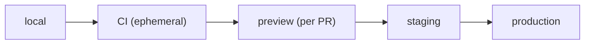
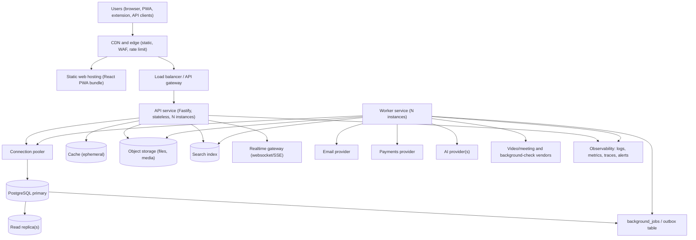
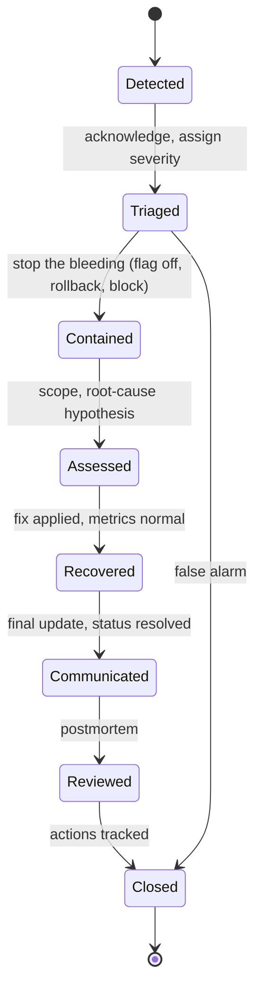
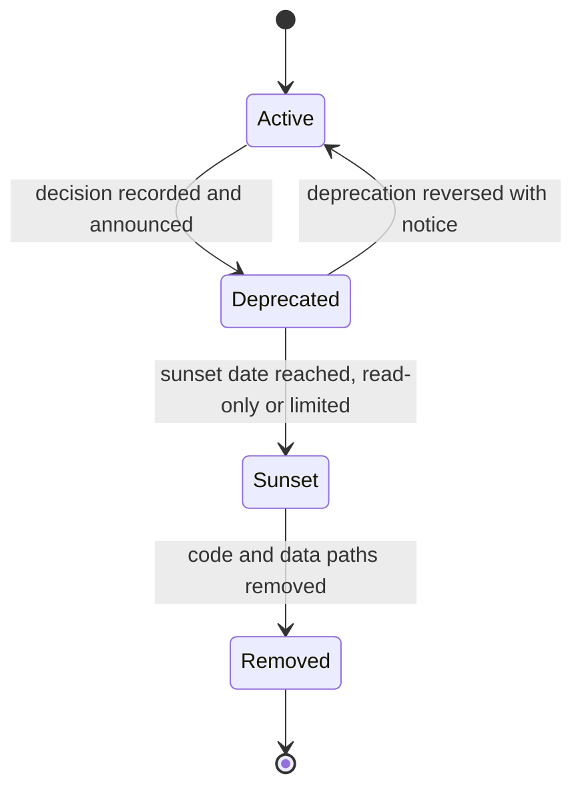

# Blueprint 07: DevOps and operations

> **Status.** Intent, not ratified. Nothing here claims anything is built; what is built is in `ARCHITECTURE.md` and `project-mindmap/`. Decision `DEC-001`: this blueprint does not supersede `SSOT.md` until `OD-PRD-31` defines ratification.
>
> **What this file holds.** Infrastructure and deployment, operations and support, maintenance and sustainability.
>
> **Merged on 2026-11-25** from the files listed below; each one is a section under its original title. Nothing was removed; the originals are in git history at commit `08387ec`.

| Section | Former file |
|---|---|
| Infrastructure and Deployment | `PRODUCT_BLUEPRINT/07_DEVOPS_AND_OPERATIONS/01_INFRASTRUCTURE_AND_DEPLOYMENT.md` |
| Operations and Support | `PRODUCT_BLUEPRINT/07_DEVOPS_AND_OPERATIONS/02_OPERATIONS_AND_SUPPORT.md` |
| Maintenance and Sustainability | `PRODUCT_BLUEPRINT/07_DEVOPS_AND_OPERATIONS/03_MAINTENANCE_AND_SUSTAINABILITY.md` |

## Infrastructure and Deployment

_Former file: `PRODUCT_BLUEPRINT/07_DEVOPS_AND_OPERATIONS/01_INFRASTRUCTURE_AND_DEPLOYMENT.md`._

Status: intended infrastructure and delivery design for the complete product. Nothing here claims that any environment, pipeline or provider exists. Inputs: [OPERATIONS.md](../quality/OPERATIONS.md), [TARGET_ARCHITECTURE.md](../engineering/TARGET_ARCHITECTURE.md), [TRD.md](../engineering/TARGET_ARCHITECTURE.md#talentsphere--trdmd-v60), [HOSTED_SUPABASE_MIGRATION_GATE.md](../engineering/DATABASE.md#hosted-supabase-migration-gate-and-dependency-audit), CLAUDE.md stack notes (React/Vite PWA, Fastify API, worker with `FOR UPDATE SKIP LOCKED`, Postgres via `pg`, Stripe and Brevo opt-in). Evidence tags per [CONVENTIONS](README.md#blueprint-conventions). No numbers for volume, price or headcount are invented; parameters carry `[PROP]` defaults and `OD-OPS-` ids (section 21). Build and deployment files (`.github/`, `deploy/`, Dockerfiles) are read-only for AI agents and need human owner approval. [SRC: CLAUDE.md Rules]

Vendor names below are examples of a capability class, not selections; selection is `OD-OPS-01`.

### 1. Design goals

1. Boring, reproducible, reversible deploys; any production change can be undone by the documented rollback. [DER]
2. Tenant isolation, secret hygiene and least privilege by default. [SRC: OPERATIONS §1 separate secrets/config per environment]
3. Operable by a small team: managed services preferred over self-hosting where equal. [PROP]
4. Honest degradation: every optional dependency can fail without losing user data (see doc 06/02 section 4.11).
5. Cost visible and bounded per component (section 17).

### 2. Environments

[SRC: OPERATIONS §1 `local -> CI -> preview -> staging -> production`]

| Environment | Purpose                                                     | Data                                 | Scale                                                    | Access                       | Lifetime                                     |
| ----------- | ----------------------------------------------------------- | ------------------------------------ | -------------------------------------------------------- | ---------------------------- | -------------------------------------------- |
| local       | developer loop with Postgres, API, worker, web dev server   | synthetic seeds                      | single instance                                          | developer                    | permanent per dev                            |
| CI          | automated tests on ephemeral Postgres service container     | synthetic per job                    | minimal                                                  | pipeline                     | per job                                      |
| preview     | full stack per pull request for review, e2e smoke, UAT-lite | `seed:standard`                      | minimal                                                  | team plus invited reviewers  | auto-destroyed on PR close, with idle expiry |
| staging     | production-shaped release candidate soak, perf, chaos, UAT  | `seed:volume` plus synthetic traffic | same topology as production, scaled by ratio `OD-OPS-02` | team, UAT users              | permanent                                    |
| production  | live                                                        | real                                 | autoscaled within limits                                 | least privilege, break-glass | permanent                                    |

Rules:

- Each environment has its own secrets, database, storage buckets, queues, domains and provider accounts or sandboxes. No credential is shared across environments. [SRC: OPERATIONS §1]
- Production data never flows downward. A debugging need uses a scrubbed, consented reproduction.
- Parity register: a living table of differences between staging and production, reviewed at each release (doc 06/02 section 6).
- Custom environments (beta tenant, demo, sales sandbox) are labelled with an environment banner so synthetic data cannot be mistaken for real; the demo environment uses a different domain and cannot send real email or payments. [SRC: CLAUDE.md "labelled dev outbox"]

### 3. Reference architecture

The system stays a modular monolith: one API deployable and one worker deployable from the same repository, scaled independently. Extraction of a module into its own service requires an ADR and a measured need. [SRC: CLAUDE.md "Fastify 5 modular monolith"]

### 4. Infrastructure components

| Component                                                     | Responsibility                                                                                                                                 | Requirements `[PROP]`                                                                                                                           | Failure behavior                                                     |
| ------------------------------------------------------------- | ---------------------------------------------------------------------------------------------------------------------------------------------- | ----------------------------------------------------------------------------------------------------------------------------------------------- | -------------------------------------------------------------------- |
| Web hosting and CDN                                           | serve versioned immutable PWA assets, edge caching, TLS, HTTP/3, security headers, WAF and bot rules, edge rate limiting                       | static assets content-hashed with long cache; `index.html` and service worker short cache; CSP, HSTS, COOP/COEP as per security docs            | last good version served from edge; stale-while-revalidate           |
| API                                                           | stateless Fastify instances behind load balancer; health, readiness endpoints                                                                  | horizontal autoscale on CPU and request concurrency; graceful shutdown draining; min 2 instances in production for availability                 | instance loss tolerated; readiness removes unhealthy                 |
| Worker                                                        | claims `background_jobs` with `FOR UPDATE SKIP LOCKED`, runs email, webhooks, retention sweeps, backfills, scoring, indexing                   | horizontal; per-queue concurrency limits; lease with heartbeat; idempotent handlers                                                             | lease expiry re-queues; poison jobs go to `dead` with alert          |
| Scheduler                                                     | triggers periodic jobs (sweeps, digests, reconciliation) by enqueueing rows once                                                               | single-leader or database advisory lock to avoid duplicate schedules                                                                            | missed ticks caught up idempotently                                  |
| PostgreSQL                                                    | system of record                                                                                                                               | managed service, same major version across envs, point-in-time recovery, automated backups, TLS, private network only, extension allow-list     | failover per section 16; connection pool protects against saturation |
| Connection pooler                                             | multiplex connections for many API and worker instances                                                                                        | transaction pooling compatible with `pg` usage; limits per service                                                                              | saturation alert; shed load with 503 + `Retry-After`                 |
| Read replica(s)                                               | offload analytics and heavy reads when needed                                                                                                  | introduced only on measured need; replica lag metric and staleness-tolerant routes only                                                         | fall back to primary                                                 |
| Object storage                                                | files: evidence, resumes, course media, attachments, exports                                                                                   | private buckets, signed short-lived URLs, server-side encryption, lifecycle rules, versioning on, malware scan on upload, per-tenant key prefix | resumable uploads; orphan cleanup job                                |
| Media pipeline (module PLT/LRN)                               | transcoding, thumbnails, HLS packaging, captions                                                                                               | queue-driven, outputs to object storage, cost caps                                                                                              | job retry; original preserved                                        |
| Search                                                        | full-text and faceted search for jobs, candidates, courses, people (module SRC)                                                                | start with Postgres full-text and trigram; dedicated engine only after ADR with measured need `OD-OPS-03`                                       | degrade to database search with label                                |
| Cache                                                         | rate limit counters, short-lived computed data, session denylist                                                                               | ephemeral by design; never source of truth; TTL on every key                                                                                    | miss is safe; no correctness dependency                              |
| Queues                                                        | durable work: Postgres `background_jobs` as the baseline; a broker only after ADR                                                              | at-least-once delivery, idempotent consumers, dead-letter, visibility metrics                                                                   | replay tooling                                                       |
| Realtime                                                      | messaging, notifications, live interview presence (MSG, NTF, INT)                                                                              | websocket or SSE gateway, horizontally scalable, backed by pub/sub if multi-instance, auth on connect, reconnect with resume token              | falls back to polling                                                |
| Email                                                         | transactional and notification email through the provider-independent service; development uses the labelled dev outbox [SRC: CLAUDE.md Stack] | SPF, DKIM, DMARC aligned; separate sending domains for transactional vs marketing; bounce and complaint webhooks; suppression list              | queue and retry; dead-letter                                         |
| SMS/push                                                      | optional channels (NTF)                                                                                                                        | provider adapter, opt-in only, per-country rules                                                                                                | queue and retry                                                      |
| Payments                                                      | Stripe Checkout, Customer Portal, signed webhook, active only with `BILLING_MODE=stripe` [SRC: CLAUDE.md Stack]                                | webhook endpoint isolated, verified, idempotent                                                                                                 | reconcile job compares provider and local state                      |
| AI providers                                                  | model calls for AIC and others                                                                                                                 | adapter with timeout, cost cap, fallback, redaction, per-tenant quota                                                                           | non-AI fallback with label                                           |
| Video / meeting, calendar, background-check, identity vendors | INT, BGV, LRN live sessions                                                                                                                    | adapters with sandbox in non-production                                                                                                         | graceful "unavailable" states                                        |
| Observability                                                 | logs, metrics, traces, error tracking, RUM, uptime probes, alert routing, status page                                                          | per doc 03 section 11; retention parameters `OD-OPS-04`                                                                                         | telemetry loss never blocks requests (async, bounded buffers)        |
| Secrets manager                                               | store and rotate secrets                                                                                                                       | per-environment, audit logged, no secrets in images or repository                                                                               | see section 9                                                        |
| DNS and certificates                                          | domains, TLS automation, CAA, DNSSEC where supported                                                                                           | automated renewal with expiry alerts                                                                                                            | alert at expiry horizon                                              |
| Backup store                                                  | backups in a separate account/region from primary                                                                                              | immutable retention window, encryption keys separate                                                                                            | restore drills (section 16)                                          |

### 5. Infrastructure as code (IaC) principles

1. **Everything reproducible from the repository.** Environments, networking, databases, buckets, queues, DNS, alert rules, dashboards, and IAM are defined as code in `deploy/` (human-owned path); no click-ops in staging or production except a declared break-glass, which is followed by a code change the same working cycle. [DER]
2. **Declarative and idempotent.** Plan then apply; the plan output is attached to the change record and reviewed.
3. **Modules and environments.** Shared modules; environment differences expressed only as variables. A diff of variable files is the complete list of environment differences.
4. **State handling.** Remote state with locking and encryption, access restricted, backed up.
5. **Drift detection.** Scheduled plan against live to detect drift; drift opens a defect and is resolved by code or by revert.
6. **Policy as code.** Automated checks: no public buckets, no `0.0.0.0/0` on databases, encryption on, required tags, approved regions, instance classes within caps.
7. **Least privilege.** Separate deploy roles per environment; production apply requires approval and short-lived credentials from CI via federation, not stored keys.
8. **Immutable artifacts.** One build produces one artifact (container image, static bundle) promoted unchanged through environments; configuration is injected at runtime.
9. **Tagging.** Every resource tagged `env`, `service`, `owner`, `cost-center` to support cost attribution (section 17).
10. **Review.** IaC changes follow the review process in doc 03 section 5, with repository owner approval for `deploy/`.
11. **Disaster rebuild.** The full production stack can be recreated from code plus restored data; this is exercised in the DR drill (section 16.5).

### 6. CI/CD pipeline

#### 6.1 Stages

| #   | Stage              | Actions                                                                                                                                          | Gate (see doc 06/02 section 13) | Failure action                  |
| --- | ------------------ | ------------------------------------------------------------------------------------------------------------------------------------------------ | ------------------------------- | ------------------------------- |
| 1   | Validate           | install with frozen lockfile, Prettier lint, typecheck, doc link check, generated-artifact freshness, import-boundary and dependency-cycle check | G1                              | fail PR                         |
| 2   | Build              | build contracts, domain, api, worker, web; produce artifact with build id and SBOM                                                               | G1                              | fail                            |
| 3   | Test               | unit, component, contract, in-memory API; Postgres integration with fresh DB; migration apply-from-empty and upgrade tests; RLS tests            | G1, G2                          | fail                            |
| 4   | Security           | secret scan, SAST, dependency audit, license check, container image scan, IaC policy scan                                                        | G2                              | block on high/critical          |
| 5   | Package            | build container images (API, worker), sign and attest provenance, push to registry with immutable tag = build id                                 | n/a                             | fail                            |
| 6   | Deploy preview     | create per-PR environment, run migrations on its database, deploy artifacts                                                                      | n/a                             | comment link; teardown on close |
| 7   | Verify preview     | Playwright smoke, axe, visual diff, DAST baseline                                                                                                | G3                              | fail PR                         |
| 8   | Deploy staging     | on merge to `main` or release tag; run migrations (expand phase), deploy, flags mirrored                                                         | n/a                             | halt pipeline                   |
| 9   | Release gates      | full regression, performance, chaos for changed areas, upgrade test on production-shaped data, UAT, traceability                                 | G4, G5, G6                      | block promotion                 |
| 10  | Deploy production  | approval, migration, rollout strategy (section 13), flag settings                                                                                | approval                        | auto-halt                       |
| 11  | Post-deploy verify | synthetic probes, canary metrics, smoke journeys                                                                                                 | G7                              | auto-rollback per section 14    |
| 12  | Observe and close  | release record, changelog publish, status communication, error-budget check                                                                      | n/a                             | follow-up tasks                 |

#### 6.2 Pipeline rules

- The pipeline definition is under `.github/` or equivalent and is a build file: owner-approved changes only. [SRC: CLAUDE.md Rules]
- Required checks are enforced by branch protection; no manual deploy from a laptop to staging or production.
- Pipelines are idempotent and re-runnable; a failed stage can be retried without side effects.
- Flaky pipeline steps follow the flaky policy; retries are visible, not hidden. (doc 06/02 section 17)
- Concurrency control: one production deploy at a time; a freeze switch (change freeze) blocks production deploys and is recorded (doc 07/02 section 17).
- Artifact provenance: production runs only images built and signed by the pipeline from a reviewed commit; the deployed build id and commit are displayed in an operator-visible version endpoint.
- Pipeline duration budget `[PROP]`: G1 and G2 complete within a developer-tolerable window; measured as p50 and p90 and reviewed monthly (doc 06/02 metric). `OD-OPS-05`.
- Secrets in CI come from the secrets manager through short-lived credentials; PRs from forks get no secrets.
- Preview environments for external contributors require maintainer approval before secrets or data access.

#### 6.3 Database change in the pipeline

1. CI applies all migrations to an empty DB and to the previous-release schema snapshot.
2. Staging applies the pending migrations first, then deploys the new code (expand-compatible).
3. Production applies migrations with lock and statement timeouts, monitored by the migration runner, then deploys code. A destructive step (contract) never ships in the same release as the code change that stops needing the old shape (doc 03 section 4.3).
4. Hosted database applies follow the gate in [HOSTED_SUPABASE_MIGRATION_GATE.md](../engineering/DATABASE.md#hosted-supabase-migration-gate-and-dependency-audit) while that provider applies; the gate steps are a checklist in the change record. [SRC]

### 7. Application runtime

- Containers: one image for API, one for worker, both from the same build; non-root user, read-only root filesystem where possible, minimal base image, no shell tools beyond need, resource requests and limits set.
- Health: `/healthz` liveness (process only), `/readyz` readiness (database reachable, required config present), `/version` (build id, commit, migration version). Health endpoints expose no sensitive data.
- Graceful shutdown: stop accepting, drain in-flight requests within a parameter, finish or release job leases, close pool.
- Startup checks: configuration validated by a Zod schema at boot; the process refuses to start with missing or malformed required config (fail fast). Integrations enabled by mode flags (`BILLING_MODE`, email provider mode) must report their mode in `/version` so the honesty labels match reality. [SRC: CLAUDE.md Stack]
- Statelessness: no local disk state; uploads stream to object storage; sessions are self-issued HMAC tokens, so no sticky sessions are needed. [SRC: CLAUDE.md Auth]
- Web: PWA service worker versioning ties to build id; the update flow prompts users and handles API version skew (doc 06/02 TC-PLT-006).

### 8. Networking and security perimeter

- Private networking for database, cache, workers; only the load balancer and CDN are internet-facing.
- WAF with managed rule set and custom rules for authentication endpoints; bot management on registration, login and application endpoints.
- Egress controls: workers and API reach only allow-listed provider hosts; SSRF guard for user-supplied URLs (link previews, webhooks) with deny of private ranges.
- TLS 1.2+ everywhere; internal service-to-service TLS where the platform supports it.
- Administrative access (database, consoles) only through an authenticated bastion or provider-managed access with MFA, per-person identities and session logging; no shared accounts.
- Tenant isolation is application and RLS enforced; there is no per-tenant infrastructure by default; dedicated-tenant deployment is an enterprise option under `OD-OPS-06`.
- Detailed controls are in `05_SECURITY_PRIVACY`.

### 9. Configuration and secrets

#### 9.1 Configuration

1. Twelve-factor style: configuration through environment variables validated at boot by schema; no environment-specific code branches.
2. Config classes: **static** (build-time, such as API base path), **runtime** (env vars), **dynamic** (feature flags and kill switches evaluated at runtime, doc 03 section 10), **secret** (section 9.2).
3. A configuration catalogue (name, purpose, type, default, required-per-environment, secret yes/no, owner) is a versioned document generated from the schema; undocumented variables fail CI.
4. Mode variables (for example `BILLING_MODE`) default to the safe, disabled value; production enabling is a change record item.
5. Configuration changes in production are audited changes (doc 07/02 section 16).

#### 9.2 Secrets

- Stored in the secrets manager; injected at runtime; never in repository, images, logs, build output or client bundles. Client bundles contain only public identifiers.
- Per environment, per service; least privilege read.
- Rotation: all secret classes have a rotation procedure and cadence name (session-signing key: quarterly cadence `[PROP]`; provider API keys: on staff change and on schedule; database credentials: scheduled). Rotation without downtime via dual-key acceptance for HMAC session keys (old key verifies only until expiry).
- Compromise response: documented in runbook RB-SEC-01 (doc 07/02 section 3), including revoke, rotate, invalidate sessions, audit access.
- Secret scanning on every push; a leaked secret is treated as compromised immediately regardless of repository privacy.
- Break-glass access to production secrets requires two-person approval and is logged.

### 10. Zero-downtime migrations

1. **Expand/contract** (doc 03 section 4.3) is the only permitted way to change a populated schema.
2. **Backward compatibility window:** the previous release's code MUST run against the new schema, and the new code MUST run against the previous schema during rollout. CI verifies both directions (upgrade test plus "N-1 code on N schema" test).
3. **Locking discipline:** `lock_timeout` set low with retry; `CREATE INDEX CONCURRENTLY`; add columns nullable without volatile defaults; add constraints as `NOT VALID` then `VALIDATE` separately; avoid table rewrites; large backfills are chunked worker jobs with throttling based on replica lag and database load, resumable, and idempotent.
4. **Backfill monitoring:** progress metric, ETA, abort switch; backfills never run inside the deploy transaction.
5. **Rollback plan per migration:** forward fix preferred; destructive migrations are preceded by a verified backup point and a dry run on a production-shaped copy.
6. **Dual-write period** for data model changes, with a reconciliation query run before switching reads.
7. **Queue compatibility:** job payload schemas are versioned; workers accept N and N-1 payloads; new job types are deployed to workers before producers enqueue them.
8. **Search and cache:** index mappings versioned; reindex into a new index and swap alias; caches keyed with schema version.
9. **Web and API skew:** the API stays compatible with the previous web bundle for at least one release (service worker clients may lag).

### 11. Release and rollout strategy

#### 11.1 Strategy by risk class

| Risk class | Examples                                                                                   | Strategy                                                                   |
| ---------- | ------------------------------------------------------------------------------------------ | -------------------------------------------------------------------------- |
| Low        | copy changes, internal tools, additive endpoints                                           | rolling deploy, post-deploy smoke                                          |
| Medium     | new feature behind a flag, UI changes                                                      | rolling deploy, feature flag off, enable by cohort                         |
| High       | auth, billing, tenant isolation, migrations with backfill, search ranking, AI model change | canary plus flag, staged exposure, extended observation, explicit approver |
| Emergency  | security fix, outage fix                                                                   | hotfix path with reduced gates recorded (doc 03 section 6.5)               |

#### 11.2 Canary

1. Deploy new version to a small share of API instances (parameter `CANARY_SHARE`, `[PROP]` smallest meaningful share) while the worker is updated in a separate step.
2. Compare canary vs baseline on error rate, latency p95, saturation, business KPIs (login success, application submit success).
3. Automated promotion steps with hold intervals; any breached threshold triggers automatic rollback (section 14).
4. Stateful side effects are safe during mixed-version operation by the compatibility rules in section 10.

#### 11.3 Flags and staged exposure

- New capability ships dark, then is enabled for internal tenants, then beta cohort, then a percentage ramp, then everyone; each step has an entry criterion (metrics healthy) and a hold period. Flag lifecycle in doc 03 section 10.
- Exposure cohorts are by tenant or user id hash so a user sees a consistent experience.
- Every ramp step is recorded in the change log; kill switch ownership is named in the runbook.

#### 11.4 Blue/green option

For major infrastructure changes (database engine upgrade, runtime upgrade) a parallel stack is built, validated with replayed or mirrored traffic, and traffic is switched at the load balancer with the old stack kept warm for the rollback window.

#### 11.5 Release communications

Release notes (user-facing and operator-facing), scheduled-maintenance notices when user impact is possible, and status page entries when applicable (doc 07/02 section 7). Release timing avoids declared change-freeze windows; the freeze calendar is a parameter, not hard-coded dates (`OD-OPS-07`).

### 12. Release record

Every production release produces a record: build id, commit range, FR ids shipped, flags and their states, migrations applied, config changes, risk class, approver, gate evidence links (G1 to G7), rollback plan, observation window result, incidents attributed. Stored as a document in the repository or ticket system and referenced from the changelog.

### 13. Rollback

#### 13.1 Rollback levels (fastest first)

| Level | Mechanism                                               | When                                | Time-to-effect target `[PROP]`      |
| ----- | ------------------------------------------------------- | ----------------------------------- | ----------------------------------- |
| L0    | turn off feature flag / kill switch                     | feature misbehaving                 | minutes (flag propagation budget)   |
| L1    | route traffic back (canary abort or blue/green switch)  | bad deploy detected early           | minutes                             |
| L2    | redeploy previous immutable artifact (N-1)              | regression found after full rollout | within the incident clock for Sev 1 |
| L3    | forward fix                                             | data-shape changes already applied  | per fix                             |
| L4    | restore data (point-in-time recovery or backup restore) | data corruption                     | per RTO (section 16)                |

#### 13.2 Rules

- Every production change states its rollback level in the change record; if only L3 or L4 apply, the change needs higher approval and a rehearsal.
- Rollback of code never rolls back an expand-phase migration (it is compatible by design); contract-phase migrations are irreversible and need a verified restore point first.
- Automatic rollback triggers `[PROP]`: error rate above threshold relative to baseline, p95 latency breach, failed readiness, failed synthetic critical journey, queue age breach. Thresholds finalized in `OD-OPS-08`.
- After any rollback: freeze further promotions until a root-cause note exists; add a regression test.
- Jobs in flight during rollback: handlers are idempotent and payload schema compatible, so N-1 workers can finish N jobs or the jobs are paused and replayed.

### 14. Service level objectives

SLOs are set after baseline measurement. [SRC: OPERATIONS §3] Initial candidate SLIs and `[PROP]` targets as parameters, not commitments:

| Capability                  | SLI                                       | Candidate target parameter | Window          |
| --------------------------- | ----------------------------------------- | -------------------------- | --------------- |
| Sign-in and session         | successful auth requests / valid attempts | `SLO_AUTH_AVAIL`           | rolling 30 days |
| Core API availability       | non-5xx / total, excluding client errors  | `SLO_API_AVAIL`            | rolling 30 days |
| Core API latency            | p95 under budget (doc 06/02 section 14)   | `SLO_API_LAT`              | rolling 30 days |
| Application submit          | successful submits / attempts             | `SLO_APPLY_SUCCESS`        | rolling 30 days |
| Search                      | p95 latency, availability                 | `SLO_SEARCH`               | rolling 30 days |
| Messaging delivery          | message delivered within threshold        | `SLO_MSG_DELIV`            | rolling 30 days |
| Transactional email         | queued-to-sent age                        | `SLO_EMAIL_AGE`            | rolling 30 days |
| Webhook delivery (outbound) | delivered within retry policy             | `SLO_WEBHOOK`              | rolling 30 days |
| Assessment taking           | session start success and timer integrity | `SLO_ASSESS`               | rolling 30 days |

Error budgets: burn-rate alerts (fast and slow window) page on-call; budget exhaustion pauses feature releases for the affected service until restored. Targets are decided in `OD-OPS-09` after baseline.

### 15. Capacity planning

1. **Inputs (parameters, not invented numbers):** registered users, monthly active users, concurrent peak, jobs posted, applications per day, course video hours streamed, assessments started concurrently (campus events), messages per day, AI calls per active user, storage growth per user. Names: `CAP_MAU`, `CAP_PEAK_CONCURRENT`, `CAP_APPS_PER_DAY`, `CAP_VIDEO_HOURS`, `CAP_ASSESS_BURST`, `CAP_MSGS_PER_DAY`, `CAP_AI_CALLS_PER_USER`, `CAP_STORAGE_PER_USER`. Values come from stakeholders (`OD-OPS-10`); until then scale tests use relative multiples of the measured staging baseline.
2. **Method:** model load per feature -> derive requests and database load -> test with the performance suite (doc 06/02 section 4.9) -> choose instance counts and database class with 2x peak headroom `[PROP]` -> set autoscale min/max.
3. **Known burst patterns:** campus-wide assessment start, job-fair/hackathon registration opening, email-driven spikes after digest sends, end-of-term enrollments, big-employer job posts triggering alert fan-out. Each has a pre-scale or queue-smoothing plan.
4. **Database:** monitor connections, CPU, IOPS, storage growth, bloat, replication lag, slow queries, lock waits; scale vertically first, then read replicas, then partitioning of large time-series tables (events, audit, messages) by time; sharding is out of scope until an ADR shows need.
5. **Storage:** lifecycle policies move cold objects to cheaper classes; per-tenant quotas by plan (BIL).
6. **Queues:** monitor oldest-job age and depth per queue; autoscale workers on age.
7. **Quotas and limits:** provider rate limits (email, AI, video) are tracked and have headroom alerts.
8. **Review cadence:** capacity review in the quarterly health review (doc 07/03) and before each tier release; results feed cost forecast.
9. **Load shedding:** when saturated, shed in this order: analytics refresh, recommendations refresh, search facets, non-critical notifications; never auth, application submit, assessment saving or payments.

### 16. Backup, restore and disaster recovery

#### 16.1 RPO and RTO parameters

RPO is the maximum acceptable data loss window; RTO is the maximum acceptable downtime. Both are open decisions with proposed defaults tied to data class. `OD-OPS-11`.

| Tier | Data / service                                                                                        | `RPO` `[PROP]`                           | `RTO` `[PROP]` | Rationale                            |
| ---- | ----------------------------------------------------------------------------------------------------- | ---------------------------------------- | -------------- | ------------------------------------ |
| T0   | Authentication, tenant data, applications, payments and entitlements, verification records, audit log | 5 minutes (point-in-time recovery)       | 1 hour         | integrity and legal/financial impact |
| T1   | Profiles, evidence metadata, messaging, learning progress, assessment attempts                        | 15 minutes                               | 4 hours        | user-visible core, high trust cost   |
| T2   | Object storage files (resumes, evidence, media originals)                                             | 24 hours via versioning plus replication | 8 hours        | recoverable, versioned               |
| T3   | Search index, caches, analytics aggregates, recommendations                                           | rebuildable (no RPO)                     | 24 hours       | derived data                         |
| T4   | Logs, metrics                                                                                         | per retention policy                     | best effort    | observability                        |

Parameters in config catalogue: `DR_RPO_T0`, `DR_RTO_T0`, and so on. Values above are `[PROP]` placeholders pending stakeholder decision, not commitments.

#### 16.2 Backup design

- Database: continuous WAL archiving with point-in-time recovery plus scheduled base backups; backups encrypted, stored in a separate account and region from the primary; immutable (write-once) retention window `[PROP]` set by `OD-OPS-12`; backup success is monitored and an alert fires on any missed backup.
- Object storage: versioning with delete markers protected, cross-region replication for T2 `[PROP]`, lifecycle retention aligned with the retention schedule (05 privacy documents).
- Configuration and IaC state: repository plus state backups; secrets manager export procedure that never stores plaintext in the repository.
- Queue/jobs: the `background_jobs` table is in the database backup; in-flight jobs are idempotent so a restore replays safely.
- Third-party data of record (payments provider, email provider suppression lists) has an export or reconciliation procedure so the platform can rebuild local state.

#### 16.3 Restore procedures

1. **Point-in-time restore** into a new instance, validated with integrity queries and a smoke run, then traffic switched (or tables selectively copied back for partial corruption).
2. **Single-tenant or single-record restore:** restore to a side instance, extract rows, re-import via a reviewed script with audit; never restore over live production for a partial problem.
3. **Object restore:** by version id or from the replica.
4. **Right-to-erasure interaction:** deletions processed since the backup are re-applied after any restore (deletion ledger replay) so erased users do not reappear; the ledger is stored separately from the backup. [DER, privacy requirement]
5. Each procedure has a runbook (RB-DB-02, RB-DB-03, RB-STO-01 in doc 07/02) with step list, owner, validation queries and communications.

#### 16.4 Disaster scenarios

| Scenario                                           | Response                                                                  |
| -------------------------------------------------- | ------------------------------------------------------------------------- |
| Primary database failure                           | automatic failover to standby within the platform; verify; RTO tier T0    |
| Data corruption / bad migration / malicious delete | point-in-time restore to before the event; replay safe writes if possible |
| Region or zone outage                              | multi-zone resilience by default; cross-region recovery per section 16.6  |
| Provider outage (email, payments, AI, video)       | degrade features with labelled states; queue and replay                   |
| Credential compromise                              | rotate, revoke, audit (RB-SEC-01)                                         |
| Ransomware or account takeover of cloud account    | restore from immutable separate-account backups; rebuild from IaC         |
| Loss of key personnel or vendor lockout            | break-glass access and documented rebuild (doc 07/03 section 9)           |

#### 16.5 Drills

- Restore drill: restore latest backup to an isolated environment, run integrity checks and a smoke suite, record achieved RPO and RTO versus targets. Cadence: quarterly cadence `[PROP]` for database, semiannual for full rebuild from IaC; results reported in the quarterly health review. A backup that has not been restored in a drill is treated as unverified.
- Game days for resilience experiments (doc 06/02 section 4.11).
- Findings become tracked tasks with owners.

#### 16.6 Multi-region question

Decision `OD-OPS-13` (`[DEC-REQ]`): single region with multi-zone vs active-passive multi-region vs active-active.

| Option                                             | Pros                                         | Cons                                                                          |
| -------------------------------------------------- | -------------------------------------------- | ----------------------------------------------------------------------------- |
| A. Single region, multi-zone, cross-region backups | simplest, lowest cost, data residency simple | regional outage means restoring elsewhere (RTO hours)                         |
| B. Active-passive (warm standby region)            | much lower RTO for regional loss             | doubled infrastructure cost, replication lag defines RPO, failover complexity |
| C. Active-active                                   | lowest latency and RTO globally              | write conflicts, data residency complexity, highest cost and risk             |

Default proposal `[PROP]`: Option A for the first release tiers, with the architecture avoiding region-specific assumptions so B is possible. Data residency (candidate and institution data in specific jurisdictions) is a separate open decision `OD-OPS-14` owned with the privacy lead: options are single global region, regional deployments per jurisdiction, or tenant-pinned storage. Both decisions block infrastructure selection beyond staging.

### 17. Cost controls

1. **Attribution:** tagging by service and environment (IaC rule 9); dashboards per component showing spend, unit cost (per MAU, per application, per video hour, per AI call), and trend.
2. **Budgets and alerts:** monthly budget parameter per environment `COST_BUDGET_<ENV>` (values from `OD-OPS-15`); alert at progress thresholds and on anomaly detection; preview and staging have auto-shutdown schedules and idle expiry.
3. **Guardrails in code:** AI per-user and per-tenant caps; media transcoding caps; export size limits; email volume caps per tenant; search and API rate limits (also abuse controls).
4. **Hygiene:** automated cleanup of orphan objects, expired previews, old images, unused volumes; lifecycle rules on storage; log retention and sampling limits.
5. **Commit and rightsizing:** quarterly rightsizing and reserved-capacity review in the FinOps review (doc 07/03 section 10).
6. **Make-or-buy review:** costs of each third-party vendor compared with usage tiers during vendor review (doc 07/02 section 14).
7. **Cost in design:** an ADR for a new component includes a cost estimate by the capacity parameters; a feature with material cost has a cost KPI in its module metrics.

### 18. Operational readiness checklist (new service or major feature)

1. Health endpoints, structured logs with correlation, metrics, traces (doc 03 section 11).
2. SLI and alert defined with runbook link; alert tested.
3. Dashboards for golden signals and business KPIs.
4. Capacity estimate and load test result.
5. Rollback level documented and rehearsed for high risk.
6. Backup and restore coverage confirmed for new data.
7. Secrets and config catalogued; least privilege roles created.
8. Dependency failure behavior tested (chaos).
9. Cost estimate and budget alert.
10. On-call briefed; support articles and macros prepared (doc 07/02).
11. Data retention and deletion paths implemented.
12. Security review and threat model note complete.

### 19. Environment and platform parity with current repository

Today's repository defines scripts for local dev (`pnpm dev`), tests, lint, typecheck, build and migrations, plus a worker that claims jobs. The environments, hosting, IaC and pipeline described here are intended design; no deployment is claimed. The existing `deploy/` and `.github/` content, if any, is an input to be reconciled with this design by the repository owner. [SRC: CLAUDE.md Commands; DER]

### 20. Acceptance criteria for this design (testable)

1. A new engineer can recreate preview from a clean clone using only repository docs and a documented set of credentials.
2. A synthetic production-shaped restore drill produces measured RPO and RTO and records them against targets.
3. A deliberately failing canary (injected error rate) triggers automatic rollback within the configured detection window, and the release record captures it.
4. A deploy of N+1 code against N schema and N code against N+1 schema both pass the compatibility test.
5. A secret rotation of the session-signing key completes with zero failed valid sessions during the overlap window.
6. Negative: a pipeline run that attempts to deploy an unsigned or untested image to production is rejected.
7. Negative: a configuration with a missing required secret causes the process to refuse to start and `/readyz` to remain not ready.

### 21. Open decisions

| Id        | Question                                           | Options                             | Default proposal `[PROP]`                                                                     | Decides                           | Blocks             |
| --------- | -------------------------------------------------- | ----------------------------------- | --------------------------------------------------------------------------------------------- | --------------------------------- | ------------------ |
| OD-OPS-01 | Cloud and vendor selection per component class     | single cloud / multi-vendor managed | managed Postgres, managed container platform, S3-compatible storage, one observability vendor | architecture owner, finance       | all infrastructure |
| OD-OPS-02 | Staging scale ratio to production                  | 10 percent / 50 percent / full      | enough to run perf tests proportionally                                                       | SRE, finance                      | G4                 |
| OD-OPS-03 | Dedicated search engine vs Postgres full-text      | Postgres first / dedicated          | Postgres first, ADR on measured need                                                          | architecture owner                | SRC module         |
| OD-OPS-04 | Observability retention periods                    | per data class                      | logs short, metrics longer, audit per security policy                                         | SRE, security officer             | observability cost |
| OD-OPS-05 | Pipeline duration budget                           | as measured                         | set after first baseline                                                                      | engineering lead                  | CI design          |
| OD-OPS-06 | Dedicated single-tenant deployments for enterprise | not offered / offered               | not offered initially                                                                         | product owner                     | EMP, ENT modules   |
| OD-OPS-07 | Change-freeze calendar                             | cadence rules                       | freeze around declared high-traffic periods, defined by cadence name                          | product owner, SRE                | release planning   |
| OD-OPS-08 | Auto-rollback thresholds                           | tune after baseline                 | relative to baseline error and latency                                                        | SRE                               | G7                 |
| OD-OPS-09 | SLO targets and error budget policy                | after baseline                      | per section 14 parameters                                                                     | product owner, SRE                | alerting           |
| OD-OPS-10 | Capacity input values                              | stakeholder estimates               | relative multiples until supplied                                                             | product owner                     | capacity plan      |
| OD-OPS-11 | RPO and RTO per tier                               | tiers as proposed / custom          | section 16.1                                                                                  | product owner, SRE, legal         | backup design      |
| OD-OPS-12 | Backup retention and immutability window           | per regulation                      | set with privacy lead                                                                         | security officer, legal           | backup cost        |
| OD-OPS-13 | Multi-region strategy                              | A / B / C                           | A                                                                                             | architecture owner, product owner | infrastructure     |
| OD-OPS-14 | Data residency model                               | global / regional / tenant-pinned   | global initially, residency-aware design                                                      | legal, privacy lead               | database topology  |
| OD-OPS-15 | Cost budgets per environment                       | stakeholder                         | supplied by finance                                                                           | finance                           | cost alerts        |

### 22. Risks

| Id         | Risk                                              | Mitigation                                                            |
| ---------- | ------------------------------------------------- | --------------------------------------------------------------------- |
| RSK-OPS-01 | Backups exist but restores fail                   | scheduled restore drills with recorded RPO/RTO                        |
| RSK-OPS-02 | Long-locking migration causes outage              | lock timeouts, expand/contract, production-shaped upgrade test        |
| RSK-OPS-03 | Provider outage cascades into user-facing failure | adapters with timeouts, queues, degraded labelled states, chaos tests |
| RSK-OPS-04 | Cost overrun from media or AI usage               | caps, budgets, anomaly alerts                                         |
| RSK-OPS-05 | Staging not representative                        | parity register, volume seed                                          |
| RSK-OPS-06 | Single operator knowledge                         | runbooks, rebuild-from-IaC drill, bus-factor controls (doc 07/03)     |
| RSK-OPS-07 | Region lock-in or residency violations            | residency-aware design, OD-OPS-14                                     |

### 23. Legacy trace

Informed by OPERATIONS.md (environments, observability, alerts, backups, incident lifecycle), TARGET_ARCHITECTURE.md, TRD.md, hosted Supabase migration gate, CLAUDE.md (stack, worker, Stripe, Brevo, dev outbox). Dropped: claims about hosting or deployment status. Added `[PROP]`: canary and flag ramp strategy, RPO/RTO tiering, capacity parameters, IaC principles, deletion-ledger replay after restore.

## Operations and Support

_Former file: `PRODUCT_BLUEPRINT/07_DEVOPS_AND_OPERATIONS/02_OPERATIONS_AND_SUPPORT.md`._

Status: intended operating model for the complete product. No on-call rotation, status page, support desk or runbook is claimed to exist. Inputs: [OPERATIONS.md](../quality/OPERATIONS.md) (observability, alerts, incident lifecycle `detect -> contain -> assess -> recover -> communicate -> postmortem`, runbook minimum list), [SECURITY.md](../quality/SECURITY.md), [PROJECT_MAINTENANCE.md](../engineering/PROJECT_MAINTENANCE.md). Evidence tags per [CONVENTIONS](README.md#blueprint-conventions). No team sizes, response-time commitments or customer promises are invented: every time target is a `[PROP]` parameter with an `OD-SUP-` id (section 19). Related: [infrastructure](#infrastructure-and-deployment), [maintenance](#maintenance-and-sustainability), [engineering standards](06_QUALITY_AND_PERFORMANCE.md#engineering-standards).

### 1. Operating principles

1. You build it, you run it: the team owning a module owns its alerts, runbooks and first response; central SRE provides platform, tooling and escalation. [PROP]
2. Every alert is actionable and linked to a runbook; every incident ends in learning, not blame.
3. Users are told the truth early: status communication does not wait for root cause.
4. Operators act with least privilege, with reasons, and leave audit trails; support never sees more data than the task needs.
5. Manual operations that happen more than twice become tooling.

### 2. Operating roles

| Role                                  | Operates                                                 | Notes                                                                       |
| ------------------------------------- | -------------------------------------------------------- | --------------------------------------------------------------------------- |
| On-call engineer (primary, secondary) | first response to pages                                  | one person may hold several roles; rotation size is a parameter `OD-SUP-01` |
| Incident commander (IC)               | runs the incident, decides, delegates                    | assigned per incident from trained pool                                     |
| Communications lead                   | status page, stakeholder and customer updates            | may be the IC in small incidents                                            |
| Scribe                                | timeline                                                 | optional for Sev 3                                                          |
| Subject-matter responder              | module expertise                                         | paged by IC                                                                 |
| Release manager                       | release record, gate enforcement (doc 06/02 section 13)  | rotating                                                                    |
| Support agent (`SUP`)                 | tiers 1 to 2                                             | product role in `ADM` module                                                |
| Moderator (`MOD`)                     | trust and safety queue                                   | not an operations pager role unless abuse surge                             |
| Platform admin (`PAD`)                | configuration, flags, tenant admin actions               | audited                                                                     |
| Security officer (`SAD`)              | security incidents, access reviews, break-glass approver |                                                                             |
| Finance operator (`FIN`)              | billing support, refunds, reconciliation                 |                                                                             |
| Privacy lead                          | data subject requests, breach assessment                 | named role, parameter `OD-SUP-02`                                           |

### 3. Runbook catalogue

Runbooks are Markdown in `docs/runbooks/` (proposed), one per id, using the template in section 3.2. Each is tested (a dry run or game day) and has "last verified" metadata (doc 03 section 8 documentation upkeep). Alert-to-runbook links are mandatory (doc 03 observability standard).

#### 3.1 Catalogue

| Id         | Runbook                                                   | Trigger / alert           | Severity default |
| ---------- | --------------------------------------------------------- | ------------------------- | ---------------- |
| RB-GEN-01  | Triage a page: first five minutes                         | any page                  | n/a              |
| RB-GEN-02  | Declare, run and close an incident                        | Sev 1 to 3                | n/a              |
| RB-GEN-03  | Rollback a release (levels L0 to L4)                      | failed canary, regression | Sev 2            |
| RB-GEN-04  | Toggle kill switch / feature flag                         | feature incident          | Sev 2            |
| RB-GEN-05  | Emergency change and hotfix                               | urgent fix                | Sev 1 to 2       |
| RB-GEN-06  | Maintenance mode and graceful degradation                 | planned or emergency      | Sev 2            |
| RB-API-01  | Elevated 5xx rate                                         | error-rate alert          | Sev 2            |
| RB-API-02  | Latency SLO burn                                          | latency alert             | Sev 2            |
| RB-API-03  | Rate-limit false positives or abuse surge                 | 429 spike                 | Sev 3            |
| RB-API-04  | Instance crash loop or failed readiness                   | readiness alert           | Sev 2            |
| RB-WEB-01  | Bad frontend release (white screen, service worker stuck) | RUM error spike           | Sev 2            |
| RB-WEB-02  | CDN or WAF misconfiguration                               | edge errors               | Sev 2            |
| RB-WEB-03  | Certificate or DNS problem                                | expiry/DNS alert          | Sev 1            |
| RB-DB-01   | Database saturation (connections, CPU, locks)             | DB alert                  | Sev 1 to 2       |
| RB-DB-02   | Point-in-time restore                                     | corruption, bad migration | Sev 1            |
| RB-DB-03   | Partial restore of a tenant or record set                 | user data loss            | Sev 2            |
| RB-DB-04   | Failed or slow migration                                  | deploy alert              | Sev 2            |
| RB-DB-05   | Replica lag / replica failure                             | lag alert                 | Sev 3            |
| RB-DB-06   | Disk growth, bloat, vacuum problems                       | storage alert             | Sev 3            |
| RB-JOB-01  | Queue backlog or oldest-job age breach                    | queue age alert           | Sev 2            |
| RB-JOB-02  | Dead-letter inspection and replay                         | dead-job alert            | Sev 3            |
| RB-JOB-03  | Duplicate job execution suspicion (idempotency check)     | anomaly                   | Sev 2            |
| RB-JOB-04  | Worker lease storm / stuck leases                         | lease alert               | Sev 2            |
| RB-STO-01  | Object storage failure or restore by version              | storage errors            | Sev 2            |
| RB-STO-02  | Malware scan backlog or false positive                    | scanner alert             | Sev 3            |
| RB-EML-01  | Email provider outage or deliverability drop              | bounce/complaint spike    | Sev 2            |
| RB-EML-02  | Domain reputation / blocklisting                          | deliverability            | Sev 2            |
| RB-PAY-01  | Payment webhook failures or backlog                       | webhook alert             | Sev 1 to 2       |
| RB-PAY-02  | Entitlement mismatch reconciliation                       | reconcile job             | Sev 2            |
| RB-PAY-03  | Refund, dispute and chargeback handling                   | finance request           | Sev 3            |
| RB-SEC-01  | Secret leak or credential compromise                      | scan or report            | Sev 1            |
| RB-SEC-02  | Account takeover wave / credential stuffing               | auth anomaly              | Sev 1 to 2       |
| RB-SEC-03  | Tenant isolation / RLS violation suspicion                | isolation signal          | Sev 1            |
| RB-SEC-04  | Personal data breach assessment and notification          | suspected breach          | Sev 1            |
| RB-SEC-05  | Vulnerability disclosure intake and fix                   | report                    | per severity     |
| RB-SEC-06  | Impersonation or admin abuse investigation                | audit anomaly             | Sev 2            |
| RB-AUTH-01 | Login or token failures, session key rotation             | auth alert                | Sev 1 to 2       |
| RB-SRC-01  | Search degraded or index rebuild                          | search alert              | Sev 3            |
| RB-RT-01   | Realtime gateway failure (messaging, live sessions)       | realtime alert            | Sev 2            |
| RB-ASM-01  | Assessment platform incident during live cohort exam      | exam alert                | Sev 1            |
| RB-ASM-02  | Integrity-signal anomaly (false flag wave)                | anomaly                   | Sev 2            |
| RB-AI-01   | AI provider outage, cost spike or policy anomaly          | AI alert                  | Sev 3            |
| RB-AI-02   | Harmful or biased AI output report                        | report                    | Sev 2            |
| RB-INT-01  | Calendar or video provider failure during interviews      | provider alert            | Sev 2            |
| RB-BGV-01  | Background-check vendor outage or wrong report            | vendor alert              | Sev 2            |
| RB-TSF-01  | Abuse surge (spam, fake employers, scam jobs)             | moderation backlog        | Sev 2            |
| RB-TSF-02  | Content removal and legal takedown                        | legal request             | Sev 2            |
| RB-PRV-01  | Data subject access / export request                      | request                   | n/a              |
| RB-PRV-02  | Erasure request and deletion-ledger handling              | request                   | n/a              |
| RB-PRV-03  | Legal hold placement and release                          | legal                     | n/a              |
| RB-DAT-01  | Run a backfill safely                                     | planned                   | n/a              |
| RB-DAT-02  | Retention sweep failure or dry-run review                 | sweep alert               | Sev 3            |
| RB-DAT-03  | Bulk data correction with approval                        | planned                   | n/a              |
| RB-OPS-01  | Capacity scale-up before known burst                      | planned event             | n/a              |
| RB-OPS-02  | Cost anomaly                                              | cost alert                | Sev 3            |
| RB-OPS-03  | Region or zone loss                                       | cloud alert               | Sev 1            |
| RB-OPS-04  | Full rebuild from IaC                                     | DR drill or disaster      | Sev 1            |
| RB-OPS-05  | Status page publishing and templates                      | incident                  | n/a              |
| RB-OPS-06  | Break-glass access procedure                              | emergency                 | n/a              |
| RB-SUP-01  | Support escalation to engineering                         | ticket                    | n/a              |
| RB-SUP-02  | Account recovery with identity checks                     | ticket                    | n/a              |
| RB-SUP-03  | Mass-impact ticket surge handling                         | ticket spike              | Sev 2            |

#### 3.2 Runbook template (MUST)

Title and id; purpose; when to use (alerts and symptoms); severity guidance; prerequisites and access; step-by-step with commands/links and expected output after each step; decision points; verification (how to know it worked); rollback/abort; communications (who to tell, template links); data-protection notes; escalation path; related alerts, dashboards, ADRs; last verified date and verifier; owner.

#### 3.3 Runbook quality rules

- A runbook is verified by someone other than the author through a dry run or game day before it is marked active.
- Steps are copy-paste safe and state their blast radius; destructive steps require a confirmation line.
- Runbooks do not contain secrets; they reference the secrets manager entry names.
- Every Sev 1 or Sev 2 postmortem checks whether a runbook existed and worked; gaps create tasks.

### 4. On-call

1. **Rotation:** primary and secondary; handoff meeting or written handoff each rotation; rotation length and size are parameters (`OD-SUP-01`). No one is on-call without completed training and a shadow rotation.
2. **Escalation chain:** primary -> secondary -> module owner -> engineering lead -> executive on-call for Sev 1 when needed. Unacknowledged page escalates automatically after the acknowledgment window `[PROP]` 5 minutes for Sev 1, 15 minutes otherwise (`OD-SUP-03`).
3. **Paging policy:** only symptom-based, user-impacting or error-budget-burning conditions page; everything else creates a ticket. Page volume per shift is a health metric; sustained excess triggers an alert-tuning task. (doc 03 observability standard noise budget)
4. **Fairness and wellbeing:** compensation and time-off policy for on-call is an HR matter outside this document; the engineering policy is: no one is paged for non-actionable alerts, follow-the-sun or backup coverage for sleep recovery after a major night incident is arranged by the lead.
5. **Tooling:** paging service with schedules, overrides and escalation policies; chat channel per incident auto-created; runbook links in pages; mobile access with MFA.
6. **Access:** on-call has pre-granted, time-boxed elevated access via the access process (section 15); production data access still follows least privilege and audit.
7. **Coverage gaps:** a gap in coverage is a Sev 3 operational risk and is reported to the engineering lead immediately.
8. **Training:** each on-call completes runbook walkthroughs and one simulated incident per cadence period (quarterly cadence `[PROP]`).

### 5. Incident process

#### 5.1 Lifecycle [SRC: OPERATIONS §6]

#### 5.2 Procedure

1. **Detect:** alert, synthetic probe, user report via support, internal report, security report.
2. **Triage (target within acknowledgment window):** acknowledge the page, assess impact (who, how many, what flows, data at risk), assign severity per section 6, declare an incident for Sev 1 to 3 (chat channel, ticket, IC named).
3. **Contain:** prefer the fastest safe mitigation: kill switch, rollback, rate-limit or block, pause worker queue, fail over, put feature in maintenance state. Containment before diagnosis.
4. **Communicate:** first status update within the communication target for the severity (section 7); internal updates on a fixed cadence; support is briefed with a macro and known-issue note.
5. **Assess and recover:** diagnose with dashboards, traces, logs by `requestId`; apply fix or restore; verify with synthetic probes and business metrics.
6. **Resolve:** IC declares resolved only when user-visible metrics are normal for an observation window; final status update.
7. **Review:** blameless postmortem for every Sev 1 and Sev 2 and for near misses that revealed a control gap; draft within the postmortem target `[PROP]` (cadence name: "within one working cycle"), published internally, actions tracked with owners.
8. **Security incidents** additionally: preserve evidence (no destructive cleanup before snapshot), involve `SAD` and the privacy lead, assess breach notification duties with legal; the clock for regulatory notification starts at awareness and is tracked in the incident ticket. Regulatory timeframes are a legal decision (`OD-SUP-04`).
9. **Customer data loss or exposure:** affected-user notification content and channel approved by the privacy lead and legal before sending; support receives a prepared script.

#### 5.3 Roles during an incident

IC decides and coordinates, does not debug; responders debug; scribe keeps timeline with timestamps; comms lead owns external text. The IC may be changed on handoff with an explicit "you are now IC" message. Conflicts of decision go to the IC; the IC may escalate to the engineering lead.

#### 5.4 Postmortem template

Summary; impact (users, duration, data, revenue-adjacent effects stated without invented figures); timeline (UTC); detection (how and delay); root cause and contributing factors (technical, process, human factors without blame); what went well; what went badly; where we got lucky; action items (owner, priority, due by cadence name, tracked ticket id); detection and prevention coverage: "which test, alert or review should have caught this" (feeds escape analysis, doc 06/02 section 7.4); linked runbook and ADR updates.

#### 5.5 Problem management

Recurring incidents (same signature twice) get a problem record, owned by a module owner, with a permanent-fix action prioritized in the tech-debt backlog (doc 07/03 section 5).

### 6. Severity levels

| Severity | Definition                                                                                                                                        | Examples                                                                                    | Response `[PROP]`                                                 | Comms                                                        |
| -------- | ------------------------------------------------------------------------------------------------------------------------------------------------- | ------------------------------------------------------------------------------------------- | ----------------------------------------------------------------- | ------------------------------------------------------------ |
| Sev 1    | critical: widespread outage of core flows, data loss or corruption, security or privacy breach, cross-tenant exposure, payments wrongly processed | login down for all; applications not saving; database restore needed; leaked candidate data | page immediately, IC assigned, 24x7 response, all hands as needed | status page within the Sev 1 target; exec and legal informed |
| Sev 2    | major: significant degradation or a core feature unavailable for a segment, no workaround                                                         | search down; email delayed hours; assessments failing for one institution                   | page, response within business and out-of-hours as parameter      | status page if user-visible; support briefed                 |
| Sev 3    | moderate: partial impairment with workaround, non-core feature failure                                                                            | recommendations stale; one provider degraded with fallback                                  | ticket and next-business-cycle response; page only if worsening   | support note; status page optional                           |
| Sev 4    | minor: cosmetic, single-user issues                                                                                                               | UI glitch                                                                                   | normal backlog                                                    | none                                                         |

Rules:

- Severity is set by impact, not cause, and re-assessed during the incident; it may only be lowered by the IC with a stated reason.
- Any suspected security or privacy breach starts at Sev 1 until assessed.
- Severity aligns with defect severity S1 to S5 (doc 06/02 section 7) for production defects: S1 maps to Sev 1, S2 to Sev 2, S3 to Sev 3, S4/S5 to Sev 4.
- Acknowledgment, first-update and resolution-target numbers are parameters `OPS_ACK_SEV1`, `OPS_FIRSTUPDATE_SEV1`, and so on; defaults in this table are qualitative until `OD-SUP-03` sets values.

### 7. Status page and communications

1. **Status page** is hosted outside the primary infrastructure (separate provider and domain) so it survives a platform outage. Components mirror user-visible capabilities (web app, API, sign-in, search, messaging, email notifications, assessments, payments, integrations/webhooks).
2. **States:** operational, degraded performance, partial outage, major outage, under maintenance. Incident updates use: Investigating, Identified, Monitoring, Resolved, each with a timestamp.
3. **Update cadence:** while an incident is open, an update every cadence interval `[PROP]` (30 minutes for Sev 1, 60 for Sev 2) even if the update is "no change". `OD-SUP-03`.
4. **Content rules:** plain language, impact first, workaround if any, no speculation, no blame, no personal data, no internal system names beyond what helps users. Templates in RB-OPS-05.
5. **Subscriptions:** users and API customers can subscribe by email, RSS or webhook.
6. **Scheduled maintenance** is announced in advance for a lead time `[PROP]` set by `OD-SUP-05`, with window, impact and rollback plan.
7. **In-app banner** for degraded features driven by the same incident record (platform admin console, module ADM) so the web app and PWA show honest labels without a deploy.
8. **Postmortem publication:** public summaries for Sev 1 incidents with user impact, after legal review.
9. **Channel for enterprise and institution customers:** named contact notification by the account owner for incidents affecting their tenant, including assessment-day incidents (RB-ASM-01).
10. **Status accuracy metric:** time from detection to first public update; reviewed in the health review.

### 8. Support tiers

| Tier                | Who                                                       | Handles                                                                                                               | Tools                                    | Escalates when                                       |
| ------------------- | --------------------------------------------------------- | --------------------------------------------------------------------------------------------------------------------- | ---------------------------------------- | ---------------------------------------------------- |
| Tier 0 self-service | users                                                     | help center, in-app guidance, status page, chatbot with honest AI label, account self-service (reset, export, delete) | knowledge base                           | no answer found                                      |
| Tier 1              | support agents (`SUP`)                                    | how-to, account access, billing questions, known-issue handling, reports triage                                       | ticketing, macros, read-only admin view  | cannot resolve with playbook, or severity indicators |
| Tier 2              | senior support / specialists (`SUP` senior, `FIN`, `MOD`) | complex account issues, refunds, verification disputes, moderation appeals, data corrections within policy            | admin console with scoped actions, audit | requires code or data fix                            |
| Tier 3              | engineering on rotation (support engineer role)           | bugs, data repairs, performance issues, integration failures                                                          | logs by `requestId`, runbooks, scripts   | confirmed defect -> defect process                   |
| Tier 4              | module owner, security officer, privacy lead, legal       | security, privacy, legal and compliance cases                                                                         |                                          | decision-level                                       |

Routing queues: Accounts and access, Billing, Jobs and applications (candidate), Employer and recruiter, Institutions, Learning and certificates, Assessments (with priority lane during scheduled exams), Verification and background checks, Trust and safety reports, Privacy requests, Integrations and API, Accessibility feedback.

#### 8.1 Support SLAs

Targets are parameters, differentiated by plan (BIL) and severity, not invented here: `SUP_FIRST_RESPONSE_<PLAN>_<PRIORITY>`, `SUP_RESOLUTION_<PLAN>_<PRIORITY>`. Default proposal `[PROP]`: a first-response target per priority band, a business-hours coverage window, and faster bands for assessment-day issues, payment failures and security reports. `OD-SUP-06`.

#### 8.2 Ticket priorities

P1 impacts many users or security/payment/data risk -> linked to an incident; P2 blocks one user's core task; P3 impaired with workaround; P4 question or feedback. Priority mapping to incident severity is in section 6.

### 9. Support workflows

#### 9.1 Ticket lifecycle

`New -> Triaged (category, priority, queue) -> Assigned -> Waiting on user -> In progress -> Escalated -> Resolved -> Closed (auto after confirmation window) -> Reopened`. Merge duplicates; link to incident or defect; satisfaction survey on resolve.

#### 9.2 Channels

In-app help and contact form (attaches `requestId`, app version, role, environment banner, with user consent for diagnostic data), email, public community Q&A, enterprise dedicated channel. Phone and live chat are options under `OD-SUP-06`.

#### 9.3 Standard workflows

| Workflow                | Steps and controls                                                                                                                                                                                                                |
| ----------------------- | --------------------------------------------------------------------------------------------------------------------------------------------------------------------------------------------------------------------------------- |
| Account recovery        | verify identity with allowed factors; never reveal whether an email exists; no password handling by agents; MFA reset requires stronger verification and notifies the account owner (RB-SUP-02)                                   |
| Impersonation / view-as | agent requests with reason and ticket id; user consent where feasible; time-boxed read-only by default; every action audited; banner shown to user session; prohibited for sensitive classes unless consent (module ADM controls) |
| Billing issue           | confirm entitlement state; refund or credit via `FIN` with approval threshold `OD-SUP-07`; reconcile with provider (RB-PAY-02)                                                                                                    |
| Verification dispute    | route to verification queue with evidence; outcome recorded; employer verifier contact templates                                                                                                                                  |
| Content report          | route to moderation (TSF); support updates reporter with outcome class only                                                                                                                                                       |
| Privacy request         | identity verification, route to privacy lead, deadline tracked on the ticket per legal timeframe (`OD-SUP-04`), outcome logged (RB-PRV-01/02)                                                                                     |
| Bug report              | reproduce, collect `requestId`, link to defect with severity (doc 06/02 section 7), tell the user the workaround and keep them updated at status changes                                                                          |
| Feature request         | recorded with demand count; reviewed by product on cadence                                                                                                                                                                        |
| Accessibility help      | priority queue; response by a trained agent; defects get an accessibility label                                                                                                                                                   |
| Assessment-day support  | pre-registered institution contact, priority lane, incident runbook RB-ASM-01, accommodation questions to ASM owner                                                                                                               |
| Mass issue              | create parent incident; macro; auto-link new tickets; proactive outreach after resolution                                                                                                                                         |

#### 9.4 Knowledge base

Articles are owned (named role), reviewed by cadence, linked to features by `FR-` id, and updated by the release process (a user-visible change that alters workflow requires a KB update before rollout). Search analytics on "no result" queries feed the content backlog. Deprecated features get redirects and sunset articles (doc 07/03 section 7).

#### 9.5 Support data protection

Agents see the minimum necessary fields by role; sensitive fields (identity documents, background-check results, messages) are masked unless the ticket category requires them and access is logged; screen recordings and ticket attachments follow retention rules; support exports are prohibited.

### 10. Data operations

General rules (all data operations): written request with business reason, approver per section 10.5, dry run first with a reported row count, bounded batch size, idempotent and resumable, audit event per run, post-run verification query, ability to stop, and a restore point for destructive operations. Operations run through the worker or a reviewed script in the repository, never ad hoc SQL against production; emergency exceptions follow break-glass and become reviewed code afterward. [SRC: CODE_STYLE §7 "no ad hoc production schema edits"; DER]

#### 10.1 Backfills (RB-DAT-01)

1. Defined by a ticket with purpose, source and target, expected volume, idempotency key, and verification query.
2. Implemented as a worker job: chunked by primary-key range, throttled by database load and replica lag, resumable from a stored cursor, safe to re-run.
3. Run first in staging against volume seed, then in production with progress metric and abort switch.
4. Verification: counts and checksums before and after; spot checks; reconciliation report attached to the ticket.
5. Does not run during a declared change freeze or peak window unless approved.

#### 10.2 Retention sweeps (RB-DAT-02)

1. Driven by the retention schedule of data classes defined in the privacy documents (`ENT-` retention class values); each class has: retention period parameter, trigger event (account closure, application closed, end of course), action (delete, anonymize, archive), exceptions (legal hold, open dispute).
2. A scheduled sweep selects eligible rows in dry-run mode first on a recurring cadence, writes a report (class, count, sample ids), and requires a platform admin acknowledgment for any run whose count exceeds a threshold relative to the previous run (anomaly guard) before executing.
3. Execution deletes in batches, writes audit events (counts and class, not content), emits `*.retention.purged` events for downstream search and cache cleanup, and updates the deletion ledger.
4. Legal hold: held subjects are excluded; hold placement and release are audited (RB-PRV-03).
5. Failure: the sweep is resumable; partial runs alert (Sev 3); never "fix" by widening the selection.
6. Backups: data deleted from the live database remains in backups until backup expiry; restore procedures replay the deletion ledger (doc 07/01 section 16.3).

#### 10.3 Data subject operations

Export and erasure are product features (SET module); the operational side is: queue health, deadline tracking, verification of completeness against the export and deletion maps, and monthly sampling audit by the privacy lead. A failed export or deletion is a Sev 3 incident with a deadline timer.

#### 10.4 Reconciliations

Scheduled reconciliation jobs with alerting on mismatch: payments provider vs local entitlements; email provider events vs local delivery state; search index vs database counts; storage objects vs file metadata; verification vendor results vs local status; webhook delivery logs vs events. Mismatches create tickets with the discrepancy report; auto-repair only for classes approved in the runbook.

#### 10.5 Approvals for data operations

| Operation                                          | Approver                                                        |
| -------------------------------------------------- | --------------------------------------------------------------- |
| Read-only analytics extraction with personal data  | privacy lead + data owner                                       |
| Non-destructive backfill                           | module owner + SRE                                              |
| Destructive backfill, bulk correction, bulk delete | module owner + SRE + `SAD` or privacy lead                      |
| Retention policy change                            | privacy lead + legal                                            |
| Production data copy to lower environment          | not permitted; synthetic or scrubbed only (doc 06/02 section 5) |
| Tenant data export for a customer contract         | account owner + privacy lead + legal                            |

#### 10.6 Operational data hygiene

Orphan file cleanup; expired token and session purge; expired invitation cleanup; stale preview environment cleanup; outbox and job table pruning with retention for forensic needs; index and vacuum maintenance; archival of large append-only tables (audit, events, messages) by time partitions.

### 11. Release management

1. **Cadence:** release cadence is a parameter, not a date (`OD-SUP-08`); the platform supports continuous delivery of low-risk changes and scheduled releases for high-risk ones.
2. **Roles:** release manager (rotating), approvers per risk class (doc 07/01 section 11.1).
3. **Process:** scope freeze for the release candidate; gates G4 to G6; release record (doc 07/01 section 12); rollout by strategy; G7; observation window; closure.
4. **Release train hygiene:** no unreviewed changes enter the candidate; late additions require release manager approval and re-run of affected gates.
5. **Communication:** internal release notes (operators and support: what changed, flags, known issues, KB links) before rollout; external changelog after; scheduled maintenance notice when needed.
6. **Compatibility commitments:** API versions and deprecations follow doc 07/03 section 7.
7. **Hotfix and emergency path:** doc 03 section 6.5; reduced gates are recorded as exceptions with the approver.
8. **Release health metrics:** change failure rate, rollback count, time to restore, lead time, deployment frequency (doc 06/02 section 21).
9. **Tier releases (R0 to R6):** a tier is released when its exit criteria are met: journeys and Must ACs passing (G6), SLOs baselined, runbooks verified for the tier's modules, support trained, KB articles live, capacity validated. Tier exit review is a formal meeting with a checklist and signed record.

### 12. Operational reviews and cadences

| Review                   | Cadence name                              | Inputs                                    | Outputs                        |
| ------------------------ | ----------------------------------------- | ----------------------------------------- | ------------------------------ |
| Alert review             | weekly                                    | page volume, noisy alerts                 | tuned or deleted alerts        |
| Incident review          | after each Sev 1/2 plus monthly aggregate | postmortems                               | action tracking, trend         |
| Error-budget review      | monthly                                   | SLO burn                                  | release pacing decisions       |
| Capacity and cost review | monthly                                   | utilization and spend                     | scaling actions                |
| Support review           | monthly                                   | ticket categories, SLA, CSAT, top defects | KB and product actions         |
| Access review            | quarterly                                 | privileged roles, break-glass use         | revoke or recertify            |
| Vendor review            | quarterly                                 | vendor health, cost, incidents            | continue, renegotiate, replace |
| DR and restore drill     | quarterly                                 | drill results                             | RPO/RTO vs target              |
| Quarterly health review  | quarterly                                 | doc 07/03 section 11 checklist            | health report                  |

### 13. Postmortem learning loop

Action items from postmortems enter the same backlog as tech debt; actions older than the overdue threshold `[PROP]` are escalated in the monthly incident review; "repeat incident" is tracked as a metric; learnings are summarized in a searchable index and fed into new runbooks, alerts and tests (doc 06/02 escape analysis).

### 14. Vendor management

#### 14.1 Vendor register

A register lists every third-party service that touches production or personal data: vendor, purpose, module(s), data categories processed, location, contract and DPA status, security attestation status, owner role, cost model, SLA, exit plan, last review. Capability classes: cloud hosting, database, CDN/WAF, email, SMS/push, payments, AI model providers, video/meeting, calendar, background-check and identity verification, search, observability, status page, support desk, analytics, code hosting and CI, secrets manager, paging, e-signature (if used), translation (if used).

#### 14.2 Onboarding a vendor

1. Business justification and alternatives (including do-nothing).
2. Security and privacy review: data minimization, subprocessors, data location, encryption, access controls, incident notification terms, certifications evidence requested (the specific attestations required are `OD-SUP-09`).
3. Contract: data processing agreement, SLA, termination and data return/deletion terms, liability, audit rights.
4. Technical: adapter behind the provider-independent interface; sandbox environment; timeouts, retries, circuit breaking; cost caps; fallback behavior; observability of calls (doc 03 section 11.3 provider metrics); secret handling.
5. Approval by security officer and privacy lead, budget owner, and architecture owner; recorded as ADR for material vendors (doc 03 section 7).

#### 14.3 Ongoing management

- Quarterly vendor review: availability and incidents vs SLA, support responsiveness, cost vs usage, security posture changes, roadmap and deprecations, subprocessor changes (notified, reviewed, objections handled per DPA).
- Vendor status feeds subscribed by on-call; provider incident links appear in our incident record.
- Concentration risk review: no single vendor outage should take down sign-in plus payments plus data (RSK-SUP-04).
- Contract renewals tracked by cadence name; renewal decision requires a review at least one review cycle before expiry.

#### 14.4 Exit plan

Each vendor has a documented exit plan: data export method, replacement candidates, migration effort class, abstraction boundary in code (adapter), and the trigger conditions (sustained SLA breach, security event, price change, deprecation). A vendor without an exit plan is flagged in the health review. Exit rehearsals for critical vendors (email, payments, AI) are tabletop exercises once per year cadence `[PROP]`.

#### 14.5 Vendor incidents

Treated as our incident if user impact exists: IC runs it, status page references the third party, support macro prepared; after resolution, claim SLA credits where contractually available and record in the register.

### 15. Access management and break-glass

1. Production access is granted by role through the identity provider with MFA, time-boxed requests for elevated access with reason and ticket reference, auto-expiry, and approval by the resource owner.
2. Break-glass (RB-OPS-06): emergency elevated access when normal approval is unavailable; requires two-person approval or post-hoc review within the review target; every command is logged; use triggers an automatic security officer notification and a mandatory review.
3. Quarterly access review recertifies privileged roles; joiner-mover-leaver process revokes access the same working cycle as departure.
4. Admin console actions (ADM) are audit logged with actor, reason, target; bulk actions need a second approver where configured; no shared accounts.
5. Service accounts have narrow scopes, owner, expiry and rotation (doc 07/01 section 9).

### 16. Change management

#### 16.1 Change types

| Type      | Definition                                                  | Approval                                                                      | Examples                                                                                                     |
| --------- | ----------------------------------------------------------- | ----------------------------------------------------------------------------- | ------------------------------------------------------------------------------------------------------------ |
| Standard  | pre-approved, low risk, repeatable, with a runbook          | none beyond pipeline gates                                                    | normal deploys of reviewed low-risk code, flag ramp steps within an approved plan, scheduled retention sweep |
| Normal    | requires review of risk and rollback                        | change approver per risk class                                                | new feature enablement, config change, infrastructure change, migration with backfill                        |
| Major     | high blast radius or irreversible                           | change advisory group: engineering lead, SRE, security officer, product owner | database engine upgrade, auth model change, region move, vendor switch                                       |
| Emergency | urgent to restore service or close a critical vulnerability | IC approval, retrospective review                                             | hotfix, emergency config                                                                                     |

#### 16.2 Change record (MUST for Normal, Major, Emergency)

Description and reason; linked `FR-`/ADR/ticket; risk class and blast radius; test evidence and gate results; rollout plan (canary, flags, hold times); rollback level and verified steps (doc 07/01 section 13); communications (status page, support brief); window; approver; implementer; outcome (success, rolled back, partial) and follow-ups. Stored with the release record.

#### 16.3 Rules

- Every production change is traceable to a commit, a pipeline run, and a change record; configuration, flag and infrastructure changes are changes too.
- Changes are scheduled to avoid overlap on the same component; the change calendar is visible to on-call.
- No Friday-style rule by date: instead a risk-based rule: a High-risk change requires on-call coverage and an observation window that fit before a change-freeze window or reduced-coverage period (cadence names defined by `OD-SUP-08`).
- Post-implementation review for Major and failed changes; change failure rate reviewed monthly.
- Unauthorized changes (outside the process) are treated as incidents of class security/process and reviewed.

### 17. Change freeze

1. A change freeze blocks production deploys, flag ramps and configuration changes except emergency changes approved by the IC or engineering lead.
2. Triggers (declared by the product owner or SRE, recorded with start and end conditions, not hard-coded dates): periods of expected peak load (institution term starts, campus assessment windows, large hiring events), reduced operations coverage, an ongoing Sev 1/2 incident, an unresolved error-budget exhaustion, compliance audits or high-stakes customer events.
3. The pipeline reads the freeze flag and refuses production deploys; override requires the named approver and is logged.
4. Freeze calendar and criteria are reviewed in the quarterly health review. `OD-SUP-08`.

### 18. Operations metrics

| Metric                                     | Definition / formula                                      | Owner role       |
| ------------------------------------------ | --------------------------------------------------------- | ---------------- |
| Time to acknowledge                        | page time to ack, p50 and p90 by severity                 | on-call lead     |
| Time to mitigate                           | incident start to containment                             | IC pool          |
| Time to restore (MTTR)                     | detection to recovery for Sev 1/2                         | SRE              |
| Incident count by severity and cause class | counts per period                                         | SRE              |
| Repeat incident rate                       | incidents with an existing problem record / all incidents | engineering lead |
| Postmortem completion                      | Sev 1/2 with published postmortem inside target / all     | engineering lead |
| Action item closure                        | closed within target / opened                             | engineering lead |
| Pages per on-call shift                    | pages received per rotation; share non-actionable         | SRE              |
| Alert precision                            | actionable pages / total pages                            | SRE              |
| Detection source mix                       | alerts vs customer-reported incidents                     | SRE              |
| Status communication latency               | detection to first public update                          | comms lead       |
| Support first-response                     | median and p90 per priority                               | support lead     |
| Support resolution                         | median per priority; reopen rate                          | support lead     |
| Backlog age                                | open tickets older than target                            | support lead     |
| Customer satisfaction                      | survey score per ticket                                   | support lead     |
| Escalation rate                            | tickets reaching Tier 3 / all                             | support lead     |
| Runbook coverage                           | alerts with verified runbook / all paging alerts          | SRE              |
| Restore drill result                       | achieved RPO and RTO vs targets                           | SRE              |
| Change failure rate                        | failed or rolled-back changes / all changes               | release manager  |
| Data operation success                     | operations completed and verified without rollback / all  | module owner     |
| Vendor SLA attainment                      | per vendor                                                | vendor owner     |

Targets for these are proposed after baseline (`OD-SUP-10`), not invented here.

### 19. Open decisions

| Id        | Question                                                   | Options                                      | Default proposal `[PROP]`                                                                                 | Decides                         | Blocks                         |
| --------- | ---------------------------------------------------------- | -------------------------------------------- | --------------------------------------------------------------------------------------------------------- | ------------------------------- | ------------------------------ |
| OD-SUP-01 | On-call rotation structure and sizing                      | follow-the-sun / single region / best-effort | primary plus secondary, size set by actual team                                                           | engineering lead, HR            | on-call launch                 |
| OD-SUP-02 | Named privacy lead and security officer roles              | assign internal / external                   | internal named roles                                                                                      | leadership                      | incident and privacy workflows |
| OD-SUP-03 | Acknowledgment, update and resolution targets per severity | as section 6 qualitative / numeric           | Sev 1 ack 5 minutes, first update within 30 minutes, then every 30; Sev 2 ack 15 minutes, update every 60 | engineering lead, product owner | incident process, status page  |
| OD-SUP-04 | Breach notification and data-subject-request deadlines     | jurisdiction-specific                        | follow the strictest applicable legal timeframe, confirmed by legal                                       | legal, privacy lead             | RB-SEC-04, RB-PRV-\*           |
| OD-SUP-05 | Maintenance notice lead time                               | hours / days                                 | days for user-impacting maintenance                                                                       | product owner                   | status policy                  |
| OD-SUP-06 | Support channels, hours and per-plan SLAs                  | email only / plus chat and phone             | email and in-app first; chat for paid plans                                                               | product owner, finance          | support design                 |
| OD-SUP-07 | Refund and credit approval thresholds                      | by amount                                    | agent up to a low threshold, `FIN` above                                                                  | finance                         | billing workflow               |
| OD-SUP-08 | Release cadence and freeze criteria                        | continuous / scheduled                       | continuous for low risk, scheduled for high risk, freeze by declared conditions                           | product owner, SRE              | release plan                   |
| OD-SUP-09 | Vendor security attestations required                      | none / specific reports                      | evidence of recognized security attestation or equivalent questionnaire                                   | security officer, legal         | vendor onboarding              |
| OD-SUP-10 | Targets for operations metrics                             | after baseline                               | propose after two quarterly cycles                                                                        | engineering lead                | dashboards                     |
| OD-SUP-11 | In-house support vs outsourced tier 1                      | in-house / outsourced                        | in-house initially                                                                                        | product owner                   | staffing                       |

### 20. Risks

| Id         | Risk                                                    | Mitigation                                                   |
| ---------- | ------------------------------------------------------- | ------------------------------------------------------------ |
| RSK-SUP-01 | Alert fatigue leads to missed Sev 1                     | symptom-based paging, weekly alert review, precision metric  |
| RSK-SUP-02 | Runbooks rot                                            | verification metadata, game days, postmortem checks          |
| RSK-SUP-03 | Support access leaks personal data                      | role-scoped views, masking, audit, impersonation limits      |
| RSK-SUP-04 | Single vendor outage cascades                           | concentration review, fallbacks, exit plans                  |
| RSK-SUP-05 | Data operation damages production data                  | dry runs, approvals, restore point, idempotency, audit       |
| RSK-SUP-06 | Status page unavailable during platform outage          | separate hosting and domain                                  |
| RSK-SUP-07 | Support overwhelmed during assessment day or mass issue | priority lanes, pre-registered contacts, mass-issue workflow |
| RSK-SUP-08 | Breach notification deadline missed                     | clock tracked from awareness, legal on-call, RB-SEC-04       |

### 21. Acceptance criteria (testable)

1. Given a synthetic Sev 2 alert, when fired in game day, then page reaches primary, escalates after the unacknowledged window, and the incident channel and ticket are auto-created with the runbook link.
2. Given a retention sweep dry run whose count exceeds the anomaly threshold, when execution is attempted without acknowledgment, then it is refused and no rows change (negative case).
3. Given a support agent requests impersonation without a ticket and reason, then the request is rejected and logged (negative case).
4. Given a vendor outage simulated for the email adapter, then messages queue, status page shows the correct component state, and delivery resumes without duplicates.
5. Given a restore drill, then the report states achieved RPO and RTO against targets and the deletion ledger replay prevents erased users from reappearing.
6. Given a production change without a change record, then the pipeline blocks the production stage.

### 22. Legacy trace

Informed by OPERATIONS.md (alerts list, incident lifecycle, runbook minimum list: DB, auth, RLS/tenant isolation, storage and others), SECURITY.md, PROJECT_MAINTENANCE.md. Dropped: statements of implemented monitoring. Added `[PROP]`: full runbook catalogue, support tiers and workflows, vendor management, change types and freeze rules, data-operation controls, operational review cadences.

## Maintenance and Sustainability

_Former file: `PRODUCT_BLUEPRINT/07_DEVOPS_AND_OPERATIONS/03_MAINTENANCE_AND_SUSTAINABILITY.md`._

Status: intended plan for keeping the complete product healthy over its life. Nothing here claims a practice is in place. Inputs: [PROJECT_MAINTENANCE.md](../engineering/PROJECT_MAINTENANCE.md), [OPERATIONS.md](../quality/OPERATIONS.md), [CODE_STYLE.md](../engineering/CODE_STYLE.md), CLAUDE.md rules. Evidence tags per [CONVENTIONS](README.md#blueprint-conventions). No dates, team sizes or budgets are invented; schedules use cadence names only (`continuous`, `weekly`, `monthly`, `quarterly`, `semiannual`, `annual`, `per release`), and numeric thresholds are `[PROP]` parameters with `OD-MNT-` ids (section 15). Related: [infrastructure](#infrastructure-and-deployment), [operations](#operations-and-support), [engineering standards](06_QUALITY_AND_PERFORMANCE.md#engineering-standards), [QA strategy](06_QUALITY_AND_PERFORMANCE.md#qa-and-test-strategy).

### 1. Goals

1. The product remains buildable, testable, secure and operable by people who did not write it.
2. Maintenance is planned capacity, not leftover time: a share of every cycle is reserved (parameter `MNT_CAPACITY_SHARE`, `[PROP]` default proposal a fixed minority share of engineering capacity, `OD-MNT-01`).
3. Every decayed asset (dependency, doc, runbook, flag, test, vendor contract) has an owner and a review trigger.
4. Sustainability includes people (knowledge continuity) and money (FinOps), not just code.

### 2. Maintenance plan

#### 2.1 Maintenance classes

| Class       | Definition                       | Examples                                                                  | Planning                             |
| ----------- | -------------------------------- | ------------------------------------------------------------------------- | ------------------------------------ |
| Corrective  | fix defects                      | bug fixes, regressions                                                    | defect process (doc 06/02 section 7) |
| Preventive  | reduce future failures           | refactors with tests, alert tuning, flaky test fixes, query tuning        | tech-debt backlog (section 5)        |
| Adaptive    | respond to environment changes   | runtime/framework/browser/OS updates, provider API changes, legal changes | dependency and vendor calendars      |
| Perfective  | improve non-functional qualities | performance, accessibility, usability polish                              | quarterly health review              |
| Operational | keep running                     | certificate renewals, key rotation, capacity, backups, data operations    | runbooks and scheduled jobs          |

#### 2.2 Maintenance calendar (cadence names, no dates)

| Cadence     | Activities                                                                                                                                                                                                               | Owner role                                         |
| ----------- | ------------------------------------------------------------------------------------------------------------------------------------------------------------------------------------------------------------------------ | -------------------------------------------------- |
| continuous  | automated dependency alerts, vulnerability scanning, error tracking triage, secret scanning                                                                                                                              | engineering                                        |
| weekly      | alert review, flaky-test review, dependency update batch merge window, support top-issues review, stale PR sweep                                                                                                         | tech lead / SRE                                    |
| monthly     | error-budget review, capacity and cost review, incident aggregate review, vendor status review, documentation freshness report, defect aging review                                                                      | engineering lead, SRE                              |
| per release | release record, changelog, flag cleanup check, migration contract-phase scheduling                                                                                                                                       | release manager                                    |
| quarterly   | restore drill, access review, vendor review, FinOps review, quarterly health review (section 11), threat-model refresh for changed areas, performance baseline re-measure, suite health review, accessibility audit pass | engineering lead, SRE, security officer            |
| semiannual  | full rebuild-from-IaC drill, game day, key and certificate inventory audit, license audit                                                                                                                                | SRE, security officer                              |
| annual      | penetration test, architecture and ADR review, disaster recovery plan review, vendor exit tabletop, end-of-life review of the technology stack, policy review (privacy, retention, AI)                                   | architecture owner, security officer, privacy lead |

#### 2.3 Maintenance work intake

- Sources: scanners, alerts, postmortem actions, health review findings, support top issues, developer pain reports, audit findings.
- All items become tickets labelled `maintenance` with class, risk, effort class and owner; unowned items are listed in the health review.
- Prioritization: risk score = likelihood x impact (security, data loss, availability, compliance weigh highest), then cost of delay (does it get harder if postponed, such as end-of-support dates), then effort.

#### 2.4 Definition of healthy

The system is "healthy" when the quarterly health review checklist (section 11) passes with no red items older than one review cycle. Red items have an owner and a plan.

### 3. Platform baseline currency

Runtime and platform components tracked on a currency matrix (name, current version, support status, next support milestone, upgrade owner, last upgraded): Node.js runtime, pnpm, TypeScript, React, Vite, Fastify, Zod, `pg`, Vitest, Playwright, PostgreSQL major version, base container images, OS packages, browser support matrix, mobile OS support for the PWA, CDN/WAF rules, Terraform-class tooling, CI runner images, observability agents. The matrix is generated where possible (from lockfile and image manifests) and reviewed monthly. Rule: no component runs past its vendor end-of-support without a recorded exception with an owner and a mitigation (section 12).

### 4. Dependency upgrades

Applies with doc 03 (engineering standards) section 9. Build files (`package.json`, lockfiles, `tsconfig*`, `vite*`) are read-only for AI agents; every upgrade PR touching them needs the human repository owner's approval. [SRC: CLAUDE.md Rules]

#### 4.1 Classes and handling

| Class                                      | Handling                                                                                                                                    | Cadence                                                      |
| ------------------------------------------ | ------------------------------------------------------------------------------------------------------------------------------------------- | ------------------------------------------------------------ |
| Security patch (exploitable high/critical) | out-of-band, fast path with targeted tests; severity targets in doc 03 section 9.2                                                          | continuous                                                   |
| Patch and minor (non-security)             | automated PR batch, CI must be green, merged by reviewer in the weekly window; grouped by ecosystem to limit noise                          | weekly                                                       |
| Major version                              | planned task with ADR if architectural effect: read changelog and migration guide, spike in a branch, update tests, canary rollout          | scheduled by currency matrix, at least before end-of-support |
| Runtime (Node, PostgreSQL major, OS)       | project with staging soak, perf comparison, rollback plan; PostgreSQL major uses blue/green or logical replication (doc 07/01 section 11.4) | annual review, ahead of end-of-support                       |
| Transitive-only vulnerability              | resolved via override or parent upgrade; exception recorded if no fix exists                                                                | continuous                                                   |
| Provider SDK/API versions                  | tracked in vendor register; adapter tests against provider sandbox                                                                          | monthly review                                               |

#### 4.2 Upgrade procedure

1. Read release notes; classify risk (breaking changes, behavior changes, performance, license change).
2. Update in a dedicated PR with no unrelated changes; regenerate lockfile in the pipeline environment.
3. Run the full pipeline, including contract, integration with Postgres, migration, security, e2e smoke and performance comparison for runtime changes.
4. Review bundle size and install-script changes; new transitive dependencies are reviewed.
5. Roll out through normal release gates; major or runtime upgrades use canary and extended observation.
6. Record in the currency matrix and the changelog.

#### 4.3 Policies

- Upgrade-or-justify: any dependency more than the allowed lag behind the latest supported major `[PROP]` (one major version) appears on the health review with an owner and reason. `OD-MNT-02`.
- Freeze-and-pin for unstable periods only by recorded decision with expiry.
- Automated update tooling is configured in repository settings or CI files, which are owner-approved build files.
- Deprecation warnings from dependencies and runtimes are treated as work items, not noise: counted and trended.
- Abandoned or unmaintained dependencies trigger a replacement or vendoring decision (ADR).
- Test coverage must make upgrades safe: if a dependency upgrade breaks nothing because no test covers the feature, the coverage gap is the finding.

### 5. Technical debt policy

#### 5.1 Definition and classes

Technical debt is a known shortcut or decayed structure that raises the future cost or risk of change. Classes: design/architecture, code quality, test debt (missing or flaky), documentation debt, infrastructure debt, dependency debt, data debt (schema or data quality), security debt, accessibility debt, operational debt (missing runbook or alert).

#### 5.2 Rules

1. **Visible:** debt is a ticket with: description, class, location, interest (what it costs each cycle), risk, proposed fix, effort class, owner, and the trigger that makes it urgent. Untracked debt is not allowed in merged code: a `TODO` must carry a ticket id (doc 03 section 2.6).
2. **Intentional debt allowed** only with a recorded decision: why now, the payoff, and a repayment trigger or review date by cadence name (for example "review at next quarterly health review").
3. **Budget:** `MNT_CAPACITY_SHARE` of each cycle is reserved for maintenance and debt; unspent share does not roll into feature work without the engineering lead's explicit record. `OD-MNT-01`.
4. **Prioritization:** risk first (security, data integrity, tenant isolation, availability), then interest (items that slow most changes), then effort. Quick wins are taken opportunistically.
5. **Boy-scout rule within scope:** small improvements in files already touched are welcome only when they stay inside the "surgical changes" principle; large refactors require approval before starting. [SRC: CLAUDE.md Rules "Ask before any big refactor"]
6. **Debt ceilings:** guardrail metrics trigger a debt sprint-equivalent when exceeded: open high-risk debt count, oldest high-risk age, flaky test count, dependency lag, skipped test count, unowned runbook count (`OD-MNT-03` sets thresholds).
7. **No new debt in protected areas:** auth, RLS, rate limits, migrations, honesty tests (`persistence-honesty`, `database-migrations`) never accept weakening as debt. [SRC: CLAUDE.md Rules]
8. **Repayment is verified:** closing a debt item includes evidence (metric, test or review) and removal of related TODOs, flags and docs notes.
9. **Honesty debt:** surfaces labelled `ephemeral` or simulated that block a release tier's exit criteria are tracked as `Must` debt until converted to durable behavior (feature status record is the source of truth). [SRC: CLAUDE.md Rules]
10. **Debt review:** the backlog is reviewed monthly (top items) and fully reviewed in the quarterly health review; items with no progress for two review cycles are either scheduled, re-scoped, or explicitly accepted with a sign-off.

#### 5.3 Debt register fields

Id, title, class, module, linked `FR-`/ADR, risk (S1 to S4 style), interest description, trigger, effort class (S, M, L, XL), owner, created cadence marker, last reviewed, status (`Open`, `Scheduled`, `In progress`, `Accepted`, `Done`, `Withdrawn`).

### 6. Code and data hygiene tasks

| Task                                        | Cadence                            | Notes                                                                                   |
| ------------------------------------------- | ---------------------------------- | --------------------------------------------------------------------------------------- |
| Remove stale feature flags                  | per release, reported quarterly    | flag lifecycle (doc 03 section 10)                                                      |
| Remove dead code, unused exports and routes | quarterly                          | use coverage plus usage telemetry; unused public API versions follow deprecation policy |
| Remove unused tables and columns            | quarterly                          | contract phase of expand/contract only                                                  |
| Migrations squash/baseline                  | annual `[PROP]`, only with ADR     | history stays in repository; ledger helper still validates immutability                 |
| Index and query review                      | quarterly                          | slow query log, unused index report, bloat report                                       |
| Test suite health                           | quarterly                          | duplicates, slow tests, quarantined tests (doc 06/02 section 17)                        |
| Seed data and fixtures refresh              | per release when schema changes    | synthetic data only                                                                     |
| Content and taxonomy upkeep                 | per cadence in owning module       | skills taxonomy, job categories, countries, certificate definitions, translations       |
| Generated registers and docs freshness      | per release                        | stale generated file fails CI (doc 03 section 8)                                        |
| Secret and certificate rotation             | per cadence in doc 07/01 section 9 | inventory audit semiannual                                                              |
| Access recertification                      | quarterly                          | doc 07/02 section 15                                                                    |

### 7. Deprecation policy

Covers features (`FR-`), API versions and endpoints, events and webhook payload versions, SDK versions, integrations, browser/platform support, configuration options, and data exports.

#### 7.1 Principles

1. Nothing is removed silently. Users and integrators get notice, a migration path and a sunset date.
2. Removal needs a decision record (ADR or `DEC-`) naming the reason: low usage, replaced, security, cost, legal, vendor end-of-life.
3. The `FR-`, `API-` or `EVT-` id keeps its identity with status `Withdrawn` after removal (never reused). [SRC: CONVENTIONS §3]
4. Contracted customers (enterprise, institution) with agreed terms receive the longer of the policy notice and contract notice.

#### 7.2 Lifecycle

| Stage             | What happens                                                                                                                                              | Controls                                    |
| ----------------- | --------------------------------------------------------------------------------------------------------------------------------------------------------- | ------------------------------------------- |
| Announce          | changelog, in-app notice, email to affected users/integrators identified via usage telemetry, docs banner, status/developer announcement                  | announcement text reviewed by product owner |
| Deprecated        | feature works; new use discouraged or blocked for new tenants; API returns `Deprecation` and `Sunset` headers and logs usage per caller; warnings in SDKs | usage dashboard by caller                   |
| Migration support | migration guide, tooling or export, support macro, office hours for integrators                                                                           | tickets tagged `deprecation`                |
| Sunset            | feature read-only or limited, final reminder, final export offered                                                                                        | blocked only after remaining-usage review   |
| Removal           | code, routes, flags, jobs, tables or columns removed via contract phase; docs and KB redirected; data retained or deleted per retention policy            | removal PR links decision; export done      |

#### 7.3 Minimum notice periods `[PROP]`

Parameters `DEPR_NOTICE_UI_FEATURE`, `DEPR_NOTICE_API_VERSION`, `DEPR_NOTICE_WEBHOOK`, `DEPR_NOTICE_SECURITY` with default proposals: end-user features one release cycle plus a minimum notice period; public API versions a longer period than end-user features and not less than a full quarter of overlap with the successor; webhook payload versions as API versions; security-driven removals as fast as safe, with direct notice. Exact values `OD-MNT-04`.

#### 7.4 Rules

- A deprecated API version stays supported in security fixes until sunset.
- Telemetry on remaining usage gates removal: removal requires that remaining callers are contacted or that the decision-maker signs a documented override.
- User data in a removed feature is exported to the user or deleted per retention rules, with the privacy lead's sign-off.
- Browser/platform support drops follow the same notice and are tied to the browser support matrix in QA.
- Contract tests (doc 06/02 section 4.3) keep running for deprecated versions until removal.

### 8. Documentation upkeep

Applies doc 03 section 8 (documentation as code).

1. **Ownership:** every document names an owner role; docs with no owner appear in the quarterly health review.
2. **Freshness:** each runbook, ADR-status, API doc, and onboarding doc has "last verified" metadata updated only when verified; a freshness report lists documents past their verification interval by class (runbooks: quarterly cadence; onboarding: per hire and per quarter; API docs: per release; module specs: per release touching the module; policies: annual).
3. **Docs in the change path:** PR template asks which docs changed; CI blocks stale generated files; link and anchor check blocks broken links.
4. **Registers and traceability:** generated from module specs (`09_REGISTERS`) and tests; regenerating is part of each release.
5. **Status honesty:** only `ARCHITECTURE.md` and feature-status reports describe what is built; module specs describe intent. A feature moves to "implemented" only with verification evidence. [SRC: CLAUDE.md Rules]
6. **Divergence handling:** if code and spec diverge, either fix the code or amend the spec through a PR with rationale; no silent drift. An `OD-` records unresolved divergence.
7. **Knowledge base and help center** follow the support process (doc 07/02 section 9.4).
8. **Archive policy:** superseded documents are moved with a pointer, not deleted, unless they contain personal or secret data.
9. **Docs quality checks:** a new engineer's onboarding is a test of docs: each onboarding finding becomes a documentation fix.

### 9. Knowledge continuity and bus-factor controls

#### 9.1 Bus factor definition

Bus factor of an area = the minimum number of people whose absence would stall it. Target `[PROP]`: at least two people able to operate, deploy, restore and modify every critical area. `OD-MNT-05`.

#### 9.2 Critical areas register

A register per area (authentication and session keys, database and migrations, payments and entitlements, email deliverability, worker and queues, search, assessment integrity, AI provider integration, infrastructure and IaC, CI/CD, domain/DNS/certificates, secrets manager, vendor accounts, security and privacy operations) with: primary owner, secondary owner, last cross-training date marker, runbook ids, ADR ids, access status. Any area with a single named person is a red item in the health review.

#### 9.3 Controls

1. **Pairing and rotation:** non-trivial changes in critical areas involve a second person (review is not enough: the second person must be able to explain the change); on-call rotation covers critical areas widely.
2. **Runbooks and rebuild drills:** the full rebuild-from-IaC drill is performed by someone other than the usual operator (doc 07/01 section 16.5).
3. **Decision memory:** ADRs and `DEC-` records capture the why; postmortems capture operational lessons; the blueprint modules capture product intent. Tribal knowledge discovered in a conversation is written down within the working cycle.
4. **Onboarding path:** a documented path (environment setup, architecture tour, first PR, first on-call shadow) is kept current by the most recent joiner; time-to-first-merged-PR is a metric.
5. **Access continuity:** all accounts are organizational (no personal accounts for vendors or cloud); at least two administrators per system; credentials in the secrets manager with break-glass (doc 07/02 section 15); recovery contacts for domains and registrars are role-based mailboxes.
6. **Departure protocol:** knowledge handoff meeting and document, access revocation the same working cycle, key rotation if the person held shared secrets, review of unfinished work and on-call coverage.
7. **Vendor and contractor continuity:** contractor work follows the same repository, review and documentation rules; escrow of access (not code ownership issues) and exit documentation in contracts.
8. **AI-agent continuity:** instructions for agents (CLAUDE.md, AGENTS.md) are kept current; agent-written work follows the same review and DoD; agents do not hold unique knowledge: any context worth keeping is committed to docs or ADRs. [SRC: CLAUDE.md]
9. **Single points of failure beyond people:** one provider account, one domain registrar, one CI provider, one secrets store: each listed with a recovery plan.
10. **Tests of continuity:** an annual "key-person-out" exercise where the primary owner of a critical area is excluded and the secondary performs a deploy, a restore or an incident drill; findings become tasks.

### 10. Cost and FinOps review

Reviewed in the monthly capacity and cost review and in depth quarterly. Inputs: tagged cost data (doc 07/01 section 17), usage metrics, vendor register.

#### 10.1 Quarterly FinOps checklist

1. Spend by service, environment and tenant tier versus budget (`COST_BUDGET_<ENV>`); variance explained.
2. Unit economics: cost per monthly active user, per application, per video hour, per assessment, per AI call, per email; trend and outliers.
3. Top cost drivers (compute, database, storage, egress, media transcoding, AI tokens, search, observability, third-party licenses) with a reduction or acceptance decision each.
4. Waste: idle and orphaned resources, over-provisioned instances, unused indices and replicas, stale preview environments, log volume.
5. Commitments: reserved capacity or savings plans versus actual baseline use.
6. Data lifecycle: storage tiers, retention sweeps effectiveness, backup size growth.
7. Observability cost: log and metric cardinality and retention versus value; sampling adjustments.
8. AI cost guardrails: per-user and per-tenant caps effective, prompt and model efficiency, cache hit rates; model choice versus quality (eval results, doc 06/02 section 16).
9. Vendor costs vs usage tiers; renegotiation or replacement candidates.
10. Forecast against capacity parameters (doc 07/01 section 15) and planned tier releases.
11. Cost of reliability: DR and multi-region cost versus RPO/RTO benefits.
12. Report to the product owner and finance with actions, owners and expected savings stated as ranges, not fabricated figures.

#### 10.2 Rules

- Any new infrastructure component or vendor includes a cost model in its ADR.
- Cost anomaly alerts open a ticket (RB-OPS-02).
- Cost-reducing changes follow normal change control; never cut backups, security controls or monitoring to save cost without an approved risk acceptance.
- Pricing and plan decisions for customers belong to the commercial module and product owner, not this process.

### 11. Quarterly health review checklist

Held once per quarterly cadence. Output: a health report with red, amber and green status per area, an action list with owners, and decisions recorded. No dates in this document: the report carries its own cadence marker.

#### 11.1 Security and compliance

- [ ] Open vulnerabilities: none exploitable high/critical past target; exceptions have owner and expiry.
- [ ] Privileged access recertified; break-glass uses reviewed; leavers' access removed.
- [ ] Secret and certificate inventory current; rotations performed on cadence.
- [ ] Penetration test and DAST findings tracked; threat models refreshed for changed areas.
- [ ] Privacy: data subject request deadlines met; retention sweeps ran and anomalies reviewed; legal holds reviewed; vendor DPAs current.
- [ ] Audit logs complete and tamper-evident check passed.
- [ ] AI governance: bias, safety and cost reports reviewed; model/provider changes recorded.

#### 11.2 Reliability and operations

- [ ] SLO attainment and error budgets reviewed; release pacing decisions recorded.
- [ ] Incident trends, repeat incidents, postmortem action closure.
- [ ] Alert precision and paging load reviewed; noisy alerts removed.
- [ ] Runbooks verified inside interval; coverage of paging alerts complete.
- [ ] Restore drill performed; achieved RPO/RTO versus targets recorded; backup success rate reviewed.
- [ ] Capacity headroom versus forecast; known burst plans current.
- [ ] Synthetic probes cover all critical journeys.
- [ ] Status page accuracy and communication latency reviewed.

#### 11.3 Quality and engineering health

- [ ] Defect aging and escape rate; S1/S2 regression tests present.
- [ ] Flaky test rate; quarantine list age; skipped tests list.
- [ ] AC traceability coverage for shipped scope; BR and SM coverage.
- [ ] Performance baselines re-measured; budgets vs actuals; regression list.
- [ ] Accessibility audit pass; open a11y debt.
- [ ] Dependency currency matrix reviewed; items past lag limit have owners; end-of-support horizon list.
- [ ] Tech-debt register reviewed; debt ceilings checked; stale items resolved or accepted.
- [ ] Stale flags removed; flag inventory current.
- [ ] Generated registers and docs fresh; unowned docs assigned.
- [ ] Persistence honesty: labelled-ephemeral and simulated surfaces listed against release-tier exit criteria.

#### 11.4 People and continuity

- [ ] Bus-factor register: areas with a single owner listed; cross-training plan.
- [ ] Onboarding path walked or updated; time-to-first-merge reviewed.
- [ ] On-call load and training status.
- [ ] Vendor and account continuity: two admins per system confirmed.

#### 11.5 Vendors and cost

- [ ] Vendor register reviewed; SLA attainment; incidents; subprocessor changes; renewals ahead; exit plans current.
- [ ] FinOps checklist (section 10.1) completed.
- [ ] Concentration-risk review.

#### 11.6 Product and platform lifecycle

- [ ] Deprecation list: active deprecations, remaining usage, removal readiness.
- [ ] Feature usage review: candidates for deprecation or investment.
- [ ] Support top issues and KB gaps; user satisfaction trends.
- [ ] Open decisions (`OD-`) older than one review cycle: decide, re-scope or escalate.
- [ ] Risk register (`RSK-`) review: new, changed, retired risks.
- [ ] End-of-life horizon scan (section 12) updated.

#### 11.7 Review rules

- Any red item older than one cycle is escalated to leadership with a decision request (fix, accept risk with sign-off, or stop).
- The checklist itself is reviewed annually for relevance.

### 12. End-of-life (EOL) planning

#### 12.1 Horizon scan

A living register of end-of-support and end-of-life milestones for: runtimes (Node, PostgreSQL), frameworks and libraries (React, Fastify, Vite and others), operating systems and container base images, browsers and mobile OS versions in the support matrix, cloud services and instance types, provider APIs (payments, email, AI models, video, background-check, identity), SDKs, protocols and standards (TLS versions, authentication standards), certificates and domains, and licenses. For each: milestone cadence marker (as published by the vendor), impact, owner, planned action, and lead time needed. Items within the lead-time horizon are red in the health review.

#### 12.2 Lead-time rule

Every EOL item has a required lead time (effort class plus testing and rollout) and must be started when the remaining time reaches `1.5 x` lead time `[PROP]` (`OD-MNT-06`). Missing this threshold escalates automatically.

#### 12.3 AI model and provider EOL

Models and provider APIs are deprecated frequently: each AI capability pins a model version in configuration, has a documented fallback model, and a re-evaluation path through the evaluation gate G8 (doc 06/02 section 16) so a forced migration is a routine change, not an emergency.

#### 12.4 Product, feature and module EOL

1. Decision criteria: sustained low usage with no strategic role, cost exceeds value, replaced by a better module, legal/security cause, vendor end-of-life with no replacement.
2. Follow the deprecation lifecycle (section 7), including data export and deletion plans and customer communications; modules marked "OS expansion" (MEN, GIG, EVT, MKT, ENT) are gated by `DEC-002` and may be descoped through this process without loss of the specs, which stay as `Withdrawn` or `Won't-now`.
3. Dependencies: before removal, a dependency scan lists modules, events, jobs, tables, integrations and docs that reference the item; each is handled in the removal plan.
4. Contractual and legal obligations (data retention after termination, notice to enterprise customers) are checked by legal before announcement.

#### 12.5 Platform sunset

A plan template exists for a hypothetical full wind-down so obligations are known in advance: customer notice, data export for all users and institutions, deletion of personal data per retention policy, vendor contract terminations, secret and domain handling, archive of source and documentation, financial records retention, status communications. It is reviewed annually and is not a commitment about the product's future. `OD-MNT-07` decides whether to maintain this template.

#### 12.6 Repository and tooling EOL

Build tooling, CI providers and package registries are on the horizon register; migration to a replacement follows the ADR and dual-run approach (doc 03 section 7) with the build-file approval path for configuration changes. [SRC: CLAUDE.md Rules]

### 13. Sustainability metrics

| Metric                                 | Definition / formula                                                     | Owner role       |
| -------------------------------------- | ------------------------------------------------------------------------ | ---------------- |
| Maintenance capacity share             | maintenance and debt effort / total engineering effort per cycle         | engineering lead |
| Dependency lag                         | dependencies behind latest supported major / total                       | tech lead        |
| Items past end-of-support              | EOL register entries beyond milestone without exception                  | tech lead        |
| Mean time to patch (security)          | disclosure to production per severity                                    | security officer |
| Debt backlog age                       | median and p90 age of open high-risk debt                                | engineering lead |
| Debt interest trend                    | tickets labelled debt-slowdown per cycle                                 | tech lead        |
| Docs freshness                         | docs within verification interval / total owned docs                     | doc owners       |
| Runbook currency                       | runbooks verified within interval / total                                | SRE              |
| Bus-factor coverage                    | critical areas with at least two qualified people / total critical areas | engineering lead |
| Time to first merged PR (new joiner)   | join to first merged change                                              | engineering lead |
| Flag debt                              | release flags past removal criteria / active release flags               | tech lead        |
| Cost per MAU trend                     | monthly spend / MAU                                                      | finance, SRE     |
| Waste ratio                            | identified waste spend / total spend                                     | SRE              |
| Deprecation completion                 | deprecations reaching Removed on plan / total                            | product owner    |
| Health review red items open > 1 cycle | count                                                                    | engineering lead |

Targets are set after baseline (`OD-MNT-08`).

### 14. Roles

| Role                          | Responsibility                                                  |
| ----------------------------- | --------------------------------------------------------------- |
| Engineering lead              | owns maintenance capacity, debt policy, health review           |
| Tech lead(s) per module group | dependency upgrades, debt register, flags, module docs          |
| SRE                           | currency of platform, drills, capacity, FinOps data             |
| Security officer (`SAD`)      | vulnerability policy, access review, pen test                   |
| Privacy lead                  | retention, DPAs, data operations approvals                      |
| Product owner                 | deprecation decisions, EOL of features, health review decisions |
| Finance partner               | FinOps review, budgets                                          |
| Doc owners                    | freshness of their documents                                    |

One person may hold several roles; no headcount is implied.

### 15. Open decisions

| Id        | Question                                                    | Options                             | Default proposal `[PROP]`                                    | Decides                         | Blocks              |
| --------- | ----------------------------------------------------------- | ----------------------------------- | ------------------------------------------------------------ | ------------------------------- | ------------------- |
| OD-MNT-01 | Reserved maintenance capacity share                         | fixed share / per-cycle negotiation | fixed minority share, reviewed quarterly                     | engineering lead, product owner | planning            |
| OD-MNT-02 | Allowed dependency lag                                      | one major / two majors / n.a.       | one major behind latest supported                            | tech lead                       | health review       |
| OD-MNT-03 | Debt ceiling thresholds                                     | numeric after baseline              | set after first quarterly review                             | engineering lead                | debt policy         |
| OD-MNT-04 | Deprecation notice periods                                  | per class                           | section 7.3 defaults, contract terms override                | product owner, legal            | deprecation process |
| OD-MNT-05 | Bus-factor target                                           | two / three for critical            | two for all, three for security and database                 | engineering lead                | continuity plan     |
| OD-MNT-06 | EOL start threshold                                         | multiplier                          | 1.5 x lead time                                              | tech lead                       | horizon register    |
| OD-MNT-07 | Maintain a platform wind-down template                      | yes / no                            | yes, annual review                                           | leadership                      | EOL planning        |
| OD-MNT-08 | Targets for sustainability metrics                          | after baseline                      | propose after two quarterly cycles                           | engineering lead                | dashboards          |
| OD-MNT-09 | Dependency update automation and its configuration location | tool choice                         | automated PR batches; config as an owner-approved build file | repository owner                | upgrade flow        |

### 16. Risks

| Id         | Risk                                                  | Mitigation                                                         |
| ---------- | ----------------------------------------------------- | ------------------------------------------------------------------ |
| RSK-MNT-01 | Maintenance squeezed out by feature pressure          | reserved capacity, health review escalation of red items           |
| RSK-MNT-02 | Unnoticed end-of-support of a runtime or provider API | horizon register with lead time rule, model/provider pinning       |
| RSK-MNT-03 | Knowledge concentrated in few people                  | bus-factor register, pairing, key-person-out exercise              |
| RSK-MNT-04 | Documentation drifts from intent and from code        | docs-as-code checks, freshness reports, divergence rule            |
| RSK-MNT-05 | Deprecations break integrators                        | notice periods, usage telemetry, contract tests until removal      |
| RSK-MNT-06 | Build-file restriction delays urgent upgrades         | owner-approved fast path for security patches, pre-agreed approver |
| RSK-MNT-07 | Cost drift unnoticed in media and AI usage            | monthly review, unit economics, caps                               |
| RSK-MNT-08 | Quarterly review becomes ritual without action        | red-item escalation rule, annual checklist review                  |

### 17. Acceptance criteria (testable)

1. Given a vendor end-of-support milestone within 1.5 x the recorded lead time, when the monthly review runs, then the item is flagged red with an owner; absent owner fails the review (negative case).
2. Given a security patch for a high-severity exploitable dependency, when it is merged via the fast path, then it reaches production within the severity target and the currency matrix is updated.
3. Given a feature marked Deprecated, when a caller requests its API, then responses carry `Deprecation` and `Sunset` headers and usage by that caller is logged.
4. Given a removal PR for a deprecated API with remaining callers and no sign-off, then the review check blocks merge (negative case).
5. Given a critical area with one named owner, when the bus-factor report is generated, then it appears red in the quarterly checklist.
6. Given a stale generated register, when CI runs, then the pipeline fails.

### 18. Legacy trace

Informed by PROJECT_MAINTENANCE.md, OPERATIONS.md, CODE_STYLE.md and the ADR practice in `docs/engineering/DECISIONS.md`. Dropped: any assertion of existing maintenance procedures. Added `[PROP]`: reserved maintenance capacity, debt ceilings, deprecation lifecycle with notice parameters, EOL horizon register with lead-time rule, bus-factor register and key-person-out exercise, quarterly health review checklist, platform wind-down template.
