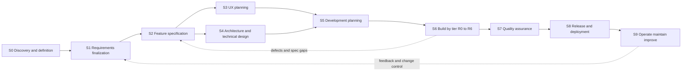
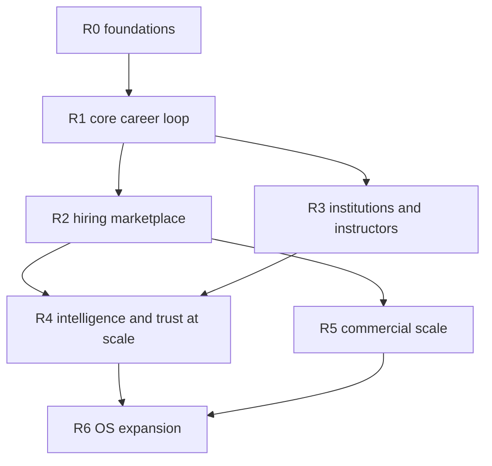
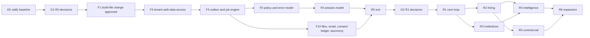

# Blueprint 08: roadmap

> **Status.** Intent, not ratified. Nothing here claims anything is built; what is built is in `docs/ARCHITECTURE.md` and `docs/mindmap/`. Decision `DEC-001`: this blueprint does not supersede `docs/SSOT.md` until `OD-PRD-31` defines ratification.
>
> **What this file holds.** Lifecycle roadmap, tier plan, decision gates and critical path.
>
> **Merged on 2026-11-25** from the files listed below; each one is a section under its original title. Nothing was removed; the originals are in git history at commit `08387ec`.

| Section | Former file |
|---|---|
| Lifecycle Roadmap | `PRODUCT_BLUEPRINT/08_ROADMAP/01_LIFECYCLE_ROADMAP.md` |
| Tier Plan (R0 to R6) | `PRODUCT_BLUEPRINT/08_ROADMAP/02_TIER_PLAN.md` |
| Decision Gates and Critical Path | `PRODUCT_BLUEPRINT/08_ROADMAP/03_DECISION_GATES_AND_CRITICAL_PATH.md` |

## Lifecycle Roadmap

_Former file: `PRODUCT_BLUEPRINT/08_ROADMAP/01_LIFECYCLE_ROADMAP.md`._

The dependency-aware plan from product definition to long-term maintenance. It contains no dates, durations, team sizes or cost estimates: none were provided, and inventing them would be a business assumption. Order comes from dependencies and from the decisions that gate each step.

Related: [Tier plan](#tier-plan-r0-to-r6) · [Decision gates and critical path](#decision-gates-and-critical-path) · [Build order from architecture](04_ARCHITECTURE.md#08--technical-specification-index) · [Feature register by tier](09_REGISTERS/OTHER_REGISTERS.md#features_by_release_tiermd)

### 1. Lifecycle stages

| Stage                                | Purpose                                                                         | Status of this stage in the blueprint                                                                                                 |
| ------------------------------------ | ------------------------------------------------------------------------------- | ------------------------------------------------------------------------------------------------------------------------------------- |
| S0 Discovery and definition          | Vision, scope, roles, journeys, business rules, unknowns                        | Drafted in [`01_PRODUCT`](01_PRODUCT.md). Needs owner ratification (`OD-PRD-31`).                                                    |
| S1 Requirements finalization         | Close the open decisions that block building; freeze the baseline for R0 and R1 | Not started. 38 high-level decisions and every module `OD-` are open: see the [register](09_REGISTERS/OPEN_DECISIONS_REGISTER.md). |
| S2 Feature specification             | Feature-level specs a team can build from                                       | Drafted for all 30 modules in [`02_MODULES`](02_MODULES/).                                                                         |
| S3 UX planning                       | Information architecture, design system, interaction rules, screen specs        | Drafted in [`03_EXPERIENCE`](03_EXPERIENCE.md). Visual design and prototypes not started.                                            |
| S4 Architecture and technical design | Target architecture, data, API, events, AI, security                            | Drafted in [`04_ARCHITECTURE`](04_ARCHITECTURE.md) and [`05_SECURITY_PRIVACY`](05_SECURITY_PRIVACY.md).                             |
| S5 Development planning              | Slice the baseline into buildable work, assign ownership, set up environments   | Not started. Depends on S1 and the owner-approved build-file change (F1).                                                             |
| S6 Build                             | Implement tier by tier                                                          | Not started. See [tier plan](#tier-plan-r0-to-r6).                                                                                        |
| S7 Quality assurance                 | Verify every acceptance criterion and quality target                            | Strategy drafted in [`06_QUALITY_AND_PERFORMANCE`](06_QUALITY_AND_PERFORMANCE.md).                                                   |
| S8 Release and deployment            | Controlled rollout with rollback                                                | Drafted in [`07_DEVOPS_AND_OPERATIONS`](07_DEVOPS_AND_OPERATIONS.md).                                                                |
| S9 Operate, maintain, improve        | Run, support, evolve, retire                                                    | Drafted in [`07_DEVOPS_AND_OPERATIONS`](07_DEVOPS_AND_OPERATIONS.md).                                                                |

### 2. Stage detail

#### S0 Discovery and definition

- **Deliverables:** vision and strategy; scope and boundaries; personas and roles; permission matrix; user journeys; business model and cross-module rules; module map; stakeholder decisions list.
- **Inputs:** `SSOT.md`, `docs/`, `Yash_Final_Project_Document/`, owner direction (career operating system, learning in scope).
- **Exit criteria:** every role has goals, permissions and at least one journey; every module has an owner role and a boundary; every unknown is an `OD-`.
- **Risks:** scope creep from the OS goal (`DEC-002`); non-goal conflicts with `SSOT.md` §4.2 (`OD-PRD-02`).

#### S1 Requirements finalization

- **Deliverables:** recorded `DEC-` entries for every U1 decision; a frozen baseline version of the blueprint for R0 and R1; a ratification record (`OD-PRD-31`).
- **Activities:** stakeholder review of the [open decisions register](09_REGISTERS/OPEN_DECISIONS_REGISTER.md) by urgency class; resolve cross-module conflicts listed in the [integrity report](09_REGISTERS/OTHER_REGISTERS.md#integrity_reportmd); counsel review of the [compliance map](05_SECURITY_PRIVACY.md#compliance-map); user research before R1 (`OD-PRD-25`).
- **Exit criteria:** zero open U1 decisions; R0 and R1 features have no unresolved `[DEC-REQ]` tags.
- **Dependencies:** owner and legal availability; this stage gates S5.

#### S2 Feature specification

- **Deliverables:** feature specs, business rules, state machines, screens, entities and events per module ([register](09_REGISTERS/FEATURE_REGISTER.md)).
- **Change control:** a spec change keeps the id, bumps the module file history, and re-runs the registers and integrity report.
- **Exit criteria (per module):** all 15 sections present; every feature has at least three acceptance cases including a negative case ([coverage report](09_REGISTERS/OTHER_REGISTERS.md#acceptance_criteria_coveragemd)); no dangling ids.

#### S3 UX planning

- **Deliverables:** information architecture, design system, interaction patterns, accessibility rules, responsive and PWA rules, microcopy guide, screen checklist.
- **Still needed (not produced by this blueprint):** visual identity, high-fidelity screens, clickable prototypes, usability tests, accessibility audit of designs.
- **Exit criteria:** every `SCR-` screen in R0 and R1 has a screen spec using the [checklist](03_EXPERIENCE.md#07-screen-and-state-checklist) and a usability test result.

#### S4 Architecture and technical design

- **Deliverables:** system architecture, data model, API design, event and job design, integration adapters, AI architecture, search, media and realtime architecture, security and privacy architecture.
- **Exit criteria:** foundational decisions `DEC-ARC-001`, `002`, `005`, `006`, `008`, `009`, `010`, `018` ratified or replaced; architecture-versus-module conflicts (C-01 to C-08 in the technical index) closed.

#### S5 Development planning

- **Deliverables:** the batched build-file change (F1) approved by the owner; work slices per feature; environments; CI gates restored (`OD-PRD-32`); definition of done adopted.
- **Rule:** no build file is changed without explicit owner approval (`AGENTS.md`).
- **Exit criteria:** a green CI baseline; the foundation steps F1 to F10 sequenced.

#### S6 Build

Build proceeds foundation first, then tier by tier as in the [tier plan](#tier-plan-r0-to-r6). Each feature is a vertical slice: contract, domain rule, migration, repository, use case with events, route, web feature, tests, verification in the running app.

#### S7 Quality assurance

Continuous, per slice and per tier: unit, contract, integration, security, end-to-end, accessibility, performance and resilience tests as defined in the [QA strategy](06_QUALITY_AND_PERFORMANCE.md#qa-and-test-strategy). A tier cannot exit while a Must feature has a failing acceptance case.

#### S8 Release and deployment

Progressive rollout behind feature flags with a rollback path per release, following [infrastructure and deployment](07_DEVOPS_AND_OPERATIONS.md#infrastructure-and-deployment). Release gates: tier exit criteria, security and privacy review, accessibility conformance, backup and restore proven, runbooks present.

#### S9 Operate, maintain, improve

Support, incident response, dependency and debt management, deprecation, cost review and the quarterly health review in [maintenance and sustainability](07_DEVOPS_AND_OPERATIONS.md#maintenance-and-sustainability). Product feedback re-enters at S1 through change control.

### 3. Cross-cutting tracks

| Track                | Runs through | Owner role                | Output                                                                                  |
| -------------------- | ------------ | ------------------------- | --------------------------------------------------------------------------------------- |
| Decision management  | S0 to S9     | Product owner             | Decision register kept current                                                          |
| Security and privacy | S1 to S9     | Security and privacy lead | Threat models, DPIAs, reviews                                                           |
| Accessibility        | S3 to S9     | Design lead and QA        | Conformance evidence                                                                    |
| Documentation        | S0 to S9     | Documentation owner       | Blueprint kept in step with built behavior; "implemented" only from executable evidence |
| Cost and capacity    | S4 to S9     | Engineering lead          | Budgets and reviews against `OD-` parameters                                            |

### 4. Change control for this blueprint

1. Propose the change as an edit to the owning file; keep ids stable; never reuse a retired id.
2. Record a `DEC-` entry for any decision that changes scope, money, law or trust.
3. Regenerate the registers and read the integrity report; fix new dangling references.
4. Update dependent files named in the module's dependency section.
5. The ratification owner approves baseline changes after S1 (`OD-PRD-31`).

## Tier Plan (R0 to R6)

_Former file: `PRODUCT_BLUEPRINT/08_ROADMAP/02_TIER_PLAN.md`._

Each tier states its goal, entering capabilities, prerequisites, deliverables, exit criteria (observable), acceptance, risks and the decisions that gate it. Tiers follow dependencies and carry no dates. The authoritative scope map is [`01_PRODUCT/02_SCOPE_AND_BOUNDARIES.md` §4](01_PRODUCT.md#02--scope-and-boundaries); per-feature tiers are in the [feature register](09_REGISTERS/OTHER_REGISTERS.md#features_by_release_tiermd). Foundation steps F1 to F10 are in the [technical index §4.1](04_ARCHITECTURE.md#08--technical-specification-index).

### Rules that apply to every tier

1. **Foundation first.** No module feature starts before its foundation dependency (F1 to F10 for R0) exists.
2. **Exit criteria are observable.** A tier exits when its exit scenario passes in the running application and every Must feature has passing acceptance cases ([QA strategy](06_QUALITY_AND_PERFORMANCE.md#qa-and-test-strategy)).
3. **R0 controls are never bypassed:** consent, audit, tenancy, accessibility.
4. **Gated scope stays gated.** A feature whose scope decision is open ships off by default and is denied by policy until the decision closes in favor.
5. **Status comes from evidence.** Nothing is called implemented from documentation.

### R0 Foundations

| Item             | Detail                                                                                                                                                                                                                                |
| ---------------- | ------------------------------------------------------------------------------------------------------------------------------------------------------------------------------------------------------------------------------------- |
| Goal             | Anyone can hold a safe account, control privacy and receive messages.                                                                                                                                                                 |
| Modules entering | IDN, SET, NTF (transactional), ADM (audit, scoped support, flags), PLT (files, malware scan, outbox, worker), ANL (consented capture), PWA (shell, offline read cache), TSF (intake, manual moderation), BIL (free entitlement stub). |
| Prerequisites    | Owner-approved build-file change (F1); ratified foundation decisions (F2); green CI baseline (`OD-PRD-32`).                                                                                                                           |
| Deliverables     | Tenant-safe data access, outbox and job engine, policy package, session model, consent ledger, audit store, upload pipeline, email delivery, accessibility baseline.                                                                  |
| Exit scenario    | A user registers, sets visibility, grants and revokes a consent, exports data and requests erasure; every step is audited and tenant-isolated.                                                                                        |
| Acceptance       | Cross-tenant test suite green; kill-the-worker test shows no lost or duplicated effects; keyboard-only and screen-reader pass on R0 screens; no token readable by page script.                                                        |
| Risks            | Foundation work delays all later tiers; migration off the as-built session and data access model. See `RSK-ARC-*`.                                                                                                                    |
| Gating decisions | `OD-PRD-10`, `OD-PRD-11`, `OD-PRD-13`, `OD-PRD-30` to `OD-PRD-35`, `OD-PRD-38`, `OD-ARC-01` to `OD-ARC-03`.                                                                                                                           |

### R1 Core career loop

| Item             | Detail                                                                                                                                                                                                                                                                                                                             |
| ---------------- | ---------------------------------------------------------------------------------------------------------------------------------------------------------------------------------------------------------------------------------------------------------------------------------------------------------------------------------- |
| Goal             | A candidate proves skills and work history, learns, applies and hears back.                                                                                                                                                                                                                                                        |
| Modules entering | PRF, EVD, BGV (referee and email-domain verification), SRC (lexical search, taxonomy), LRN (first-party free catalog), ASM (quizzes, projects, unverified code attempts), EMP (basic), JOB, ATS (single pipeline), INT (manual scheduling), MSG (application threads), AIC (explainable non-AI matching), REP (completion badges). |
| Prerequisites    | R0 complete; skills taxonomy sub-module (owner per `OD-ARC-07`).                                                                                                                                                                                                                                                                   |
| Deliverables     | The end-to-end loop Goal, Gap, Learn, Practice, Prove, Verify, Discover, Match, Apply, Interview, Outcome with evidence at Prove, Verify and Outcome.                                                                                                                                                                              |
| Exit scenario    | One candidate completes the loop with a real employer-side counterpart; evidence is produced and shareable under consent.                                                                                                                                                                                                          |
| Acceptance       | The relevant journeys (`JRN-CAN-*`, `JRN-REC-*`) pass end to end; acceptance cases for every Must feature pass; usability test on the loop.                                                                                                                                                                                        |
| Risks            | Cold start (no jobs, no candidates); evidence quality; scope inflation from the OS goal.                                                                                                                                                                                                                                           |
| Gating decisions | `OD-PRD-01`, `OD-PRD-06` (free tier), `OD-PRD-09` (pilot scope), `OD-PRD-25` (user research), `OD-PRD-14`.                                                                                                                                                                                                                         |

### R2 Hiring marketplace

| Item             | Detail                                                                                                                                                                                                                                                                                                          |
| ---------------- | --------------------------------------------------------------------------------------------------------------------------------------------------------------------------------------------------------------------------------------------------------------------------------------------------------------- |
| Goal             | Employers hire at volume with fair, efficient tools.                                                                                                                                                                                                                                                            |
| Modules entering | ATS (requisitions, approvals, offers), INT (loops, self-scheduling, calendar sync, scorecards), EMP (teams, roles, SSO, brand), SRC (consent-gated discovery), MSG (outreach with quotas, realtime), NET (connections, referrals), BIL (employer subscriptions, seats, dunning), BGV (employment confirmation). |
| Prerequisites    | R1; BIL entitlements for posting and recruiter search; PLT calendar and email ports.                                                                                                                                                                                                                            |
| Exit scenario    | A multi-recruiter organization runs requisition to offer to hire with scorecards and approvals; candidates are notified at every terminal state.                                                                                                                                                                |
| Acceptance       | Hiring journeys pass; adverse-impact reporting works on test data; human actor recorded on every consequential decision.                                                                                                                                                                                        |
| Risks            | Fairness and compliance exposure (hiring AI regulation); spam and abuse of outreach.                                                                                                                                                                                                                            |
| Gating decisions | `OD-PRD-06` (paid packaging), `OD-PRD-08`, `OD-PRD-12`, `OD-PRD-16`, `OD-PRD-17` (reviews), `OD-PRD-22`, `OD-PRD-23`.                                                                                                                                                                                           |

### R3 Institutions and instructors

| Item             | Detail                                                                                                                                                |
| ---------------- | ----------------------------------------------------------------------------------------------------------------------------------------------------- |
| Goal             | Institutions and instructors teach, assess and place.                                                                                                 |
| Modules entering | INS, STU, LRN (institution catalogs, assignments), ASM (rubric grading, peer review, attestations), BIL (institution licences), PLT (media pipeline). |
| Prerequisites    | R1 (and R2 for placement drives with employers).                                                                                                      |
| Exit scenario    | A cohort is provisioned, taught, assessed and graduates; credentials stay with the graduate's independent identity.                                   |
| Acceptance       | Institution journeys pass; k-anonymous analytics suppress small cohorts; minors only through institutions with restricted defaults.                   |
| Risks            | Minors and education-record law; instructor content quality and copyright.                                                                            |
| Gating decisions | `OD-PRD-07`, `OD-PRD-11`, `OD-PRD-37`.                                                                                                                |

### R4 Intelligence and trust at scale

| Item             | Detail                                                                                                                                                                                                                                           |
| ---------------- | ------------------------------------------------------------------------------------------------------------------------------------------------------------------------------------------------------------------------------------------------ |
| Goal             | Guidance gets smarter while trust controls scale.                                                                                                                                                                                                |
| Modules entering | AIC (gateway, assistant, tailoring, recommendations), TSF (automated triage, appeals), BGV (vendor checks), REP (contextual reputation), ANL (organization and institution dashboards), ASM (isolated code runner; proctoring only if admitted). |
| Prerequisites    | R2 and R3; AI funding decision; fairness controls from [`04_FAIRNESS_AND_AI_GOVERNANCE.md`](05_SECURITY_PRIVACY.md#fairness-and-ai-governance).                                                                                            |
| Exit scenario    | AI features run only with consent and cost policy; adverse-impact review is held; integrity flags are reviewed by humans.                                                                                                                        |
| Acceptance       | Model cards and evaluation gates pass; non-AI fallback works when the provider is down; bias monitoring reports run.                                                                                                                             |
| Risks            | Regulatory classification of hiring AI; cost; false integrity flags.                                                                                                                                                                             |
| Gating decisions | `OD-PRD-14`, `OD-PRD-15`, `OD-PRD-19`, `OD-PRD-21`, `OD-PRD-26`.                                                                                                                                                                                 |

### R5 Commercial scale

| Item             | Detail                                                                                                                                                            |
| ---------------- | ----------------------------------------------------------------------------------------------------------------------------------------------------------------- |
| Goal             | The business scales across segments and partners.                                                                                                                 |
| Modules entering | BIL (invoicing, tax, paid courses, candidate premium), PLT (public API, OAuth clients, webhooks, integrations), IDN (SCIM), PWA (browser extension), co-branding. |
| Prerequisites    | R2.                                                                                                                                                               |
| Exit scenario    | A partner system syncs through the API with scoped keys; paid plans reconcile monthly.                                                                            |
| Acceptance       | API contract, rate limits and webhook replay verified; payment reconciliation has no unexplained differences.                                                     |
| Risks            | Tax and payment compliance; abuse of public API.                                                                                                                  |
| Gating decisions | `OD-PRD-04`, `OD-PRD-05`, `OD-PRD-18`, `OD-PRD-24`, `OD-PRD-27`, `OD-PRD-36`.                                                                                     |

### R6 OS expansion

| Item             | Detail                                                                                  |
| ---------------- | --------------------------------------------------------------------------------------- |
| Goal             | Career services beyond hiring and learning.                                             |
| Modules entering | MEN, GIG, EVT, MKT (beyond taxonomy), ENT; third-party marketplace payouts.             |
| Prerequisites    | R4 and R5, plus each module's admission decision (`OD-PRD-02`) and its own scope `OD-`. |
| Exit scenario    | Each admitted module writes completed outcomes into the evidence ledger (EVD).          |
| Acceptance       | Per module; none ships without its scope decision.                                      |
| Risks            | Non-goal territory (marketplace, HR, ads); money-flow compliance.                       |
| Gating decisions | `OD-PRD-02`, `OD-PRD-03`, `OD-PRD-17` (salary), `OD-PRD-20`, `OD-PRD-29`.               |

### Per-tier counts

Feature counts per tier and module are generated: [`FEATURES_BY_RELEASE_TIER.md`](09_REGISTERS/OTHER_REGISTERS.md#features_by_release_tiermd).

## Decision Gates and Critical Path

_Former file: `PRODUCT_BLUEPRINT/08_ROADMAP/03_DECISION_GATES_AND_CRITICAL_PATH.md`._

What must be decided before each stage can proceed, and the order work depends on. No durations are stated.

### 1. Gate list

| Gate                         | Blocks         | Decisions that must close                                                                                                                                                                                                                              | Owner                      |
| ---------------------------- | -------------- | ------------------------------------------------------------------------------------------------------------------------------------------------------------------------------------------------------------------------------------------------------ | -------------------------- |
| G0 Baseline ratification     | S1 exit        | `OD-PRD-31` (how the blueprint becomes authoritative), `OD-PRD-30` (what happens to legacy code and documents)                                                                                                                                         | Owner                      |
| G1 R0 start                  | S5, F1 to F10  | `OD-PRD-10` jurisdictions, `OD-PRD-11` minors, `OD-PRD-13` erasure clocks, `OD-PRD-32` green CI, `OD-PRD-33` accessibility commitment, `OD-PRD-34` support model, `OD-PRD-35` moderation model, `OD-PRD-38` locales; foundation `DEC-ARC` ratification | Owner, legal, architecture |
| G2 R1 start                  | R1 build       | `OD-PRD-01` north star, `OD-PRD-06` free tier, `OD-PRD-09` pilot scope, `OD-PRD-25` user research                                                                                                                                                      | Owner, product             |
| G3 R2 start                  | R2 build       | `OD-PRD-06` paid packaging, `OD-PRD-08` billing owner, `OD-PRD-12` cohort size, `OD-PRD-22` realtime video, `OD-PRD-23` integrations                                                                                                                   | Owner, product             |
| G4 R3 start                  | R3 build       | `OD-PRD-07` institution licensing, `OD-PRD-37` managed learners applying                                                                                                                                                                               | Owner, institutions lead   |
| G5 R4 start                  | R4 build       | `OD-PRD-14` automated hiring decisions, `OD-PRD-15` proctoring, `OD-PRD-19` background checks, `OD-PRD-21` AI funding, `OD-PRD-26` government identity                                                                                                 | Owner, legal, security     |
| G6 R5 start                  | R5 build       | `OD-PRD-04` seller of record, `OD-PRD-05` premium tier, `OD-PRD-18` promoted placements, `OD-PRD-24` white label, `OD-PRD-27` referral bonuses, `OD-PRD-36` native apps                                                                                | Owner, finance             |
| G7 R6 admission (per module) | each R6 module | `OD-PRD-02` plus the module's own scope `OD-` (`OD-MEN-01`, `OD-GIG-01`, `OD-EVT-01`, `OD-MKT-01`, `OD-ENT-01`)                                                                                                                                        | Owner                      |

The full list with options and default proposals is in [`08_STAKEHOLDER_DECISIONS_NEEDED.md`](01_PRODUCT.md#08--stakeholder-decisions-needed); module-level decisions are in the [register](09_REGISTERS/OPEN_DECISIONS_REGISTER.md).

### 2. Critical path

Longest dependency chain: ratification, R0 decisions, build-file approval, tenant-safe data access, outbox and jobs, policy, sessions, then the R1 loop. Anything on this chain delays everything after it; items off the chain (for example UX research, vendor evaluations, counsel review) should start in parallel.

### 3. Work that can run in parallel with the critical path

| Track                                                | Starts when | Needed by                             |
| ---------------------------------------------------- | ----------- | ------------------------------------- |
| User research and usability testing                  | S1          | R1 start                              |
| Counsel review of compliance map and consent copy    | S1          | R0 exit                               |
| Visual design and prototypes for R0 and R1 screens   | S3          | R0 build of each screen               |
| Vendor evaluation (email, video, identity, payments) | S1          | The tier that first needs the adapter |
| Taxonomy content sourcing                            | S1          | R1 search and matching                |
| Test data and fakes for adapters                     | F4          | Each module's tests                   |

### 4. Known cross-module conflicts to close before building

Conflicts found while writing the specs are recorded as open decisions, not resolved. The ones that change structure:

| Topic                      | Decision or conflict                                                     | Where recorded                        |
| -------------------------- | ------------------------------------------------------------------------ | ------------------------------------- |
| Skills taxonomy ownership  | Claimed by MKT and SRC; needed at R1 although MKT is expansion scope     | `OD-ARC-07`                           |
| Organization entities      | EMP, INS and ENT each own an org-like entity; the data model centralizes | `OD-ARC-37`                           |
| Session model              | Rotating refresh token versus opaque server session cookie               | `OD-ARC-03`, `OD-IDN-01`              |
| Event name prefixes        | Six modules deviate from the module-code rule                            | `OD-ARC-36`                           |
| Error and pagination shape | As-built envelope versus RFC 9457 and cursors                            | `OD-ARC-02`                           |
| Erasure clocks             | 30-day cancel window versus 30-day completion                            | `OD-PRD-13`, `OD-PRV-02`, `OD-SET-01` |
| Camera and microphone      | Blocked app-wide in legacy rules versus interviews and proctoring        | `OD-SEC-11`                           |
| Automated actions          | Legacy auto-apply at confidence threshold versus human-gate rule         | `OD-AIG-01`                           |
| Minimum cohort size        | Legacy values 3 and 5 versus default 10                                  | `OD-PRD-12`, `OD-PRV-12`, `OD-MKT-05` |
| Plan names                 | Free, Pro, Team, Enterprise versus as-built plan names                   | `OD-BIL-14`                           |
