# Blueprint 10: intended-product mind maps

> **Status.** Intent, not ratified. Nothing here claims anything is built; what is built is in `ARCHITECTURE.md` and `project-mindmap/`. Decision `DEC-001`: this blueprint does not supersede `SSOT.md` until `OD-PRD-31` defines ratification.
>
> **What this file holds.** Mermaid mind maps of the intended product. For what the code actually contains, see `project-mindmap/`.
>
> **Merged on 2026-11-25** from the files listed below; each one is a section under its original title. Nothing was removed; the originals are in git history at commit `08387ec`.

| Section | Former file |
|---|---|
| Mind maps | `PRODUCT_BLUEPRINT/10_MINDMAPS/README.md` |
| 00_MASTER_MINDMAP.md | `PRODUCT_BLUEPRINT/10_MINDMAPS/00_MASTER_MINDMAP.md` |
| 01_FOUNDATION.md | `PRODUCT_BLUEPRINT/10_MINDMAPS/01_FOUNDATION.md` |
| 02_CAREER_IDENTITY.md | `PRODUCT_BLUEPRINT/10_MINDMAPS/02_CAREER_IDENTITY.md` |
| 03_LEARNING.md | `PRODUCT_BLUEPRINT/10_MINDMAPS/03_LEARNING.md` |
| 04_HIRING.md | `PRODUCT_BLUEPRINT/10_MINDMAPS/04_HIRING.md` |
| 05_SOCIAL_AI_TRUST.md | `PRODUCT_BLUEPRINT/10_MINDMAPS/05_SOCIAL_AI_TRUST.md` |
| 06_INSTITUTIONS_COMMERCIAL.md | `PRODUCT_BLUEPRINT/10_MINDMAPS/06_INSTITUTIONS_COMMERCIAL.md` |
| 07_OS_EXPANSION.md | `PRODUCT_BLUEPRINT/10_MINDMAPS/07_OS_EXPANSION.md` |
| 08_PLATFORM.md | `PRODUCT_BLUEPRINT/10_MINDMAPS/08_PLATFORM.md` |
| 11_VISION_BUSINESS.md | `PRODUCT_BLUEPRINT/10_MINDMAPS/11_VISION_BUSINESS.md` |
| 12_ROLES_PERMISSIONS_JOURNEYS.md | `PRODUCT_BLUEPRINT/10_MINDMAPS/12_ROLES_PERMISSIONS_JOURNEYS.md` |
| 13_UX_NAVIGATION.md | `PRODUCT_BLUEPRINT/10_MINDMAPS/13_UX_NAVIGATION.md` |
| 14_ARCHITECTURE_DATA_API.md | `PRODUCT_BLUEPRINT/10_MINDMAPS/14_ARCHITECTURE_DATA_API.md` |
| 15_SECURITY_PRIVACY_PERFORMANCE.md | `PRODUCT_BLUEPRINT/10_MINDMAPS/15_SECURITY_PRIVACY_PERFORMANCE.md` |
| 16_QA_ENGINEERING.md | `PRODUCT_BLUEPRINT/10_MINDMAPS/16_QA_ENGINEERING.md` |
| 17_DEVOPS_OPERATIONS.md | `PRODUCT_BLUEPRINT/10_MINDMAPS/17_DEVOPS_OPERATIONS.md` |
| 18_ROADMAP.md | `PRODUCT_BLUEPRINT/10_MINDMAPS/18_ROADMAP.md` |
| 19_REGISTERS_TRACEABILITY.md | `PRODUCT_BLUEPRINT/10_MINDMAPS/19_REGISTERS_TRACEABILITY.md` |

## Mind maps

_Former file: `PRODUCT_BLUEPRINT/10_MINDMAPS/README.md`._

Start at [00_MASTER_MINDMAP.md](#00_master_mindmapmd). Maps render as Mermaid on GitHub. Domain maps (`01`-`08`) are generated from the module specs and list every sub-module and feature; cross-cutting maps (`11`-`19`) are generated from the section structure of the other documents.

These maps show the **intended** product. The map of what the code actually contains is [`project-mindmap/`](../../project-mindmap/master/MASTER_PROJECT_MINDMAP.md); the [documentation map](../../project-mindmap/DOCUMENTATION_MAP.md) explains how the two relate.

## 00_MASTER_MINDMAP.md

_Former file: `PRODUCT_BLUEPRINT/10_MINDMAPS/00_MASTER_MINDMAP.md`._

<!-- Generated from PRODUCT_BLUEPRINT sources. Regenerate instead of editing by hand. -->

## Master mind map

The whole intended product on one page. Each branch has a detailed map; follow the links below. Nothing in this map is built; it describes the blueprint.

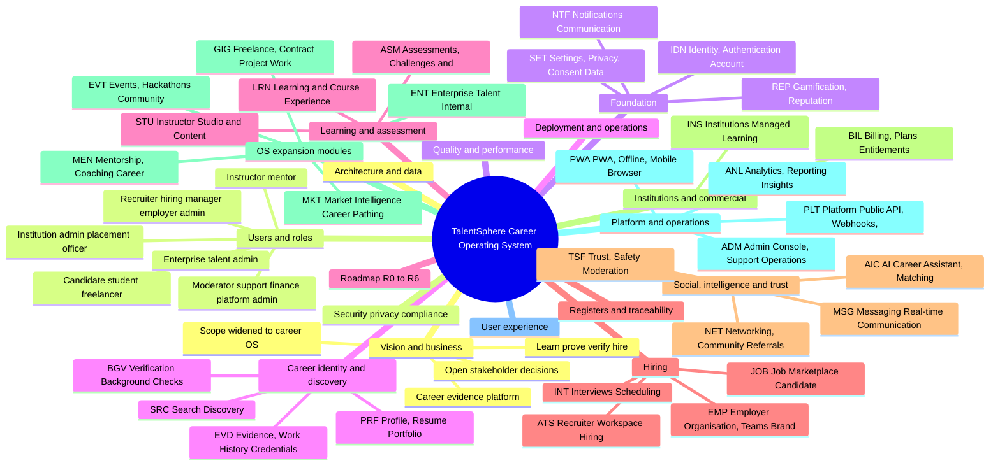

### Detailed maps

| Map                                                                           | Covers                                      |
| ----------------------------------------------------------------------------- | ------------------------------------------- |
| [Foundation](#01_foundationmd)                                                | 128 features across IDN, SET, NTF, REP      |
| [Career identity and discovery](#02_career_identitymd)                        | 136 features across PRF, EVD, BGV, SRC      |
| [Learning and assessment](#03_learningmd)                                     | 188 features across LRN, STU, ASM           |
| [Hiring](#04_hiringmd)                                                        | 162 features across JOB, ATS, INT, EMP      |
| [Social, intelligence and trust](#05_social_ai_trustmd)                       | 138 features across NET, MSG, AIC, TSF      |
| [Institutions and commercial](#06_institutions_commercialmd)                  | 66 features across INS, BIL                 |
| [OS expansion modules](#07_os_expansionmd)                                    | 167 features across MEN, GIG, EVT, MKT, ENT |
| [Platform and operations](#08_platformmd)                                     | 159 features across ANL, ADM, PWA, PLT      |
| [Vision, scope and business](#11_vision_businessmd)                           | Documents and section structure             |
| [Users, roles, permissions and journeys](#12_roles_permissions_journeysmd)    | Documents and section structure             |
| [UI/UX and navigation](#13_ux_navigationmd)                                   | Documents and section structure             |
| [System architecture, database and API](#14_architecture_data_apimd)          | Documents and section structure             |
| [Security, privacy, performance and NFRs](#15_security_privacy_performancemd) | Documents and section structure             |
| [QA and engineering standards](#16_qa_engineeringmd)                          | Documents and section structure             |
| [Deployment, infrastructure and maintenance](#17_devops_operationsmd)         | Documents and section structure             |
| [Implementation roadmap](#18_roadmapmd)                                       | Documents and section structure             |
| [Documentation, registers and traceability](#19_registers_traceabilitymd)     | Documents and section structure             |

### Where the detail lives

- Specifications: [`../02_MODULES/`](02_MODULES/)
- Registers (features, rules, decisions, risks, dependencies): [`../09_REGISTERS/`](09_REGISTERS/)
- Entry point: [`../00_START_HERE/README.md`](README.md#talentsphere-product-blueprint-1)

## 01_FOUNDATION.md

_Former file: `PRODUCT_BLUEPRINT/10_MINDMAPS/01_FOUNDATION.md`._

<!-- Generated from PRODUCT_BLUEPRINT sources. Regenerate instead of editing by hand. -->

## Mind map: Foundation

Every module, sub-module and feature in this domain (128 features). Feature labels carry the id suffix; the owning module file has the full specification.

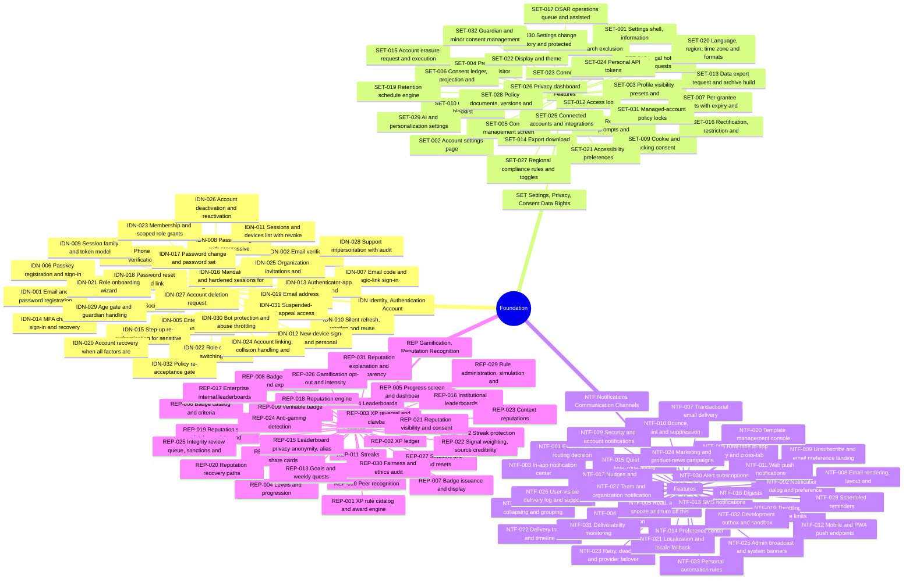

### Specifications

- [IDN — Identity, Authentication & Account](02_MODULES/IDN_Identity_Authentication_Account.md)
- [SET — Settings, Privacy, Consent & Data Rights](02_MODULES/SET_Settings_Privacy_Consent.md)
- [NTF — Notifications & Communication Channels](02_MODULES/NTF_Notifications_Communication.md)
- [REP — Gamification, Reputation & Recognition](02_MODULES/REP_Gamification_Reputation.md)

## 02_CAREER_IDENTITY.md

_Former file: `PRODUCT_BLUEPRINT/10_MINDMAPS/02_CAREER_IDENTITY.md`._

<!-- Generated from PRODUCT_BLUEPRINT sources. Regenerate instead of editing by hand. -->

## Mind map: Career identity and discovery

Every module, sub-module and feature in this domain (136 features). Feature labels carry the id suffix; the owning module file has the full specification.

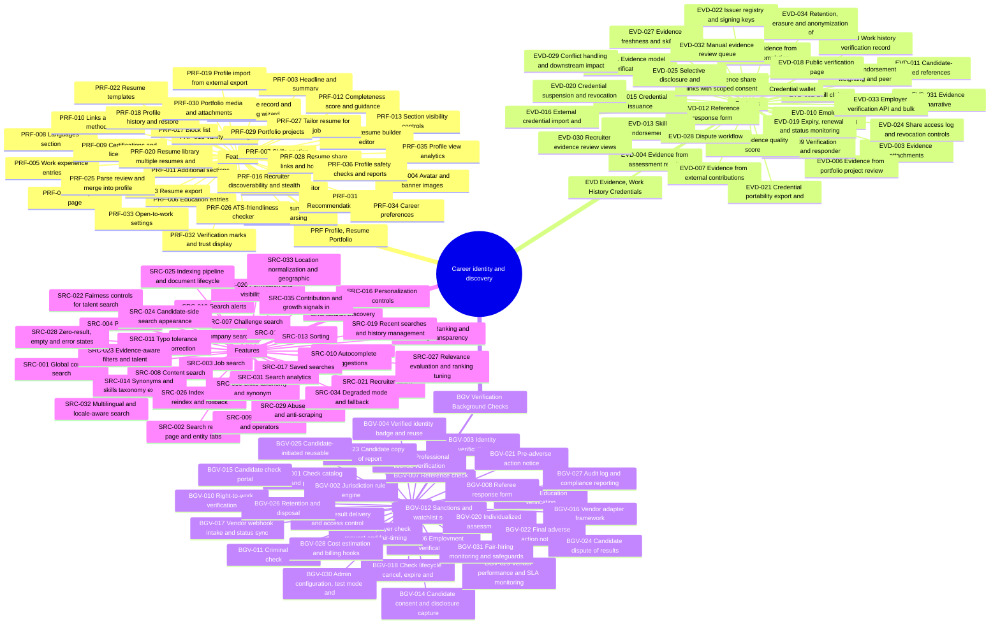

### Specifications

- [PRF — Profile, Resume & Portfolio](02_MODULES/PRF_Profile_Resume_Portfolio.md)
- [EVD — Evidence, Work History & Credentials](02_MODULES/EVD_Evidence_Work_History_Credentials.md)
- [BGV — Verification & Background Checks](02_MODULES/BGV_Verification_Background_Checks.md)
- [SRC — Search & Discovery](02_MODULES/SRC_Search_Discovery.md)

## 03_LEARNING.md

_Former file: `PRODUCT_BLUEPRINT/10_MINDMAPS/03_LEARNING.md`._

<!-- Generated from PRODUCT_BLUEPRINT sources. Regenerate instead of editing by hand. -->

## Mind map: Learning and assessment

Every module, sub-module and feature in this domain (188 features). Feature labels carry the id suffix; the owning module file has the full specification.

```mermaid
mindmap
  root((Learning and assessment))
    LRN Learning and Course Experience
      Catalog and discovery
        LRN-001 Course catalog listing
        LRN-002 Taxonomy categories, tags, levels and
        LRN-003 Catalog search with typeahead
        LRN-004 Catalog filters, facets and sorting
        LRN-005 Skill-based and goal-based browse
        LRN-006 Course comparison
        LRN-007 Saved courses
      Course detail
        LRN-008 Course detail page
        LRN-009 Curriculum presentation and free
        LRN-010 Prerequisites and readiness check
        LRN-011 Instructor and ownership display
        LRN-012 Course versions and change log
      Enrollment and access
        LRN-013 Eligibility gate and lock reasons
        LRN-014 Free enrollment
        LRN-015 Paid enrollment and checkout hand-off
        LRN-016 Institution-managed enrollment
        LRN-017 Invite links and access codes
        LRN-018 Plan-entitled access
        LRN-019 Access window, expiry and extension
        LRN-020 Drop, pause and re-enroll
        LRN-021 Refund request and access revocation
      Paths and tracks
        LRN-022 Learning path and track catalog
        LRN-023 Path enrollment and progression
        LRN-024 Programs, capstone and program
        LRN-025 Personal learning plan
      Player and media
        LRN-026 Learning player shell
        LRN-027 Video core controls
        LRN-028 Playback speed
        LRN-029 Quality selection, adaptive streaming
        LRN-030 Captions and subtitles
        LRN-031 Interactive transcript
        LRN-032 Fullscreen, theater mode and
        LRN-033 Keyboard shortcuts
        LRN-034 Resume playback and cross-device
        LRN-035 Chapters and scrub previews
        LRN-036 Video completion tracking
        LRN-037 Offline download rules
        LRN-038 Accessible player
        LRN-039 Protected playback session
        LRN-040 External-provider media and fallback
      Lesson types
        LRN-041 Reading lessons and downloadable
        LRN-042 In-lesson quizzes
        LRN-043 Interactive coding exercises
        LRN-044 Assignment submission
        LRN-045 Peer review
        LRN-046 Projects and capstone work
        LRN-047 Live sessions
        LRN-048 Cohorts and cohort calendar
        LRN-049 Pacing, deadlines and drip release
      Social learning
        LRN-050 Course Q A
        LRN-051 Discussion forums
        LRN-052 Notes and bookmarks
        LRN-053 Instructor announcements
        LRN-054 Study groups
      Progress and credentials
        LRN-055 Progress tracking
        LRN-056 Learning history
        LRN-057 Lesson completion rules
        LRN-058 Course completion engine
        LRN-059 Certificate issuance
        LRN-060 Certificate verification and sharing
        LRN-061 Learning achievements
        LRN-062 Gradebook for learners
      Reviews
        LRN-063 Submit course review
        LRN-064 Review display and instructor response
        LRN-065 Review reporting and moderation hand-off
      Personalization and engagement
        LRN-066 Course recommendations
        LRN-067 Learner dashboard
        LRN-068 Goals and weekly commitment
        LRN-069 Streaks
        LRN-070 Reminders, nudges and calendar export
      Skills and analytics
        LRN-071 Skill mapping and evidence hand-off
        LRN-072 Learner analytics
        LRN-073 Adaptive review and spaced repetition
        LRN-074 Learning data export and deletion
        LRN-075 Report a content problem
        LRN-076 Industry learning hubs
    STU Instructor Studio and Content
      Instructor onboarding and identity
        STU-001 Instructor application
        STU-002 Instructor identity and expertise
        STU-003 Instructor agreement and policy
        STU-004 Instructor public profile
        STU-005 Payout and tax profile
        STU-006 Studio home and course list
      Course authoring
        STU-007 Course creation wizard
        STU-008 Curriculum builder
        STU-009 Video lesson authoring
        STU-010 Text lesson authoring
        STU-011 Resources and attachments
        STU-012 Learning objectives and skill tagging
        STU-013 Prerequisites and completion rule
        STU-014 Course landing page editor
        STU-015 Autosave, drafts and edit locking
        STU-016 Co-instructors and ownership
        STU-017 Course import
        STU-018 Course duplication and templates
        STU-019 Course versioning
        STU-020 Preview as learner
      Media production pipeline
        STU-021 Media upload
        STU-022 Transcoding, renditions and thumbnails
        STU-023 Captions and transcript generation and
        STU-024 Content protection signed URLs and DRM
        STU-025 Media library
        STU-026 Media processing status, failure and
        STU-027 External media validation
        STU-028 Accessibility tracks authoring
      Assessment authoring and grading
        STU-029 Quiz authoring in lessons
        STU-030 Assignment and rubric authoring
        STU-031 Grading queue and feedback
        STU-032 Peer review configuration
      Commerce
        STU-033 Pricing
        STU-034 Coupons and promotions
        STU-035 Revenue share and earnings statements
        STU-036 Payouts
        STU-037 Refunds and disputes visibility
      Publishing workflow
        STU-038 Submit for review
        STU-039 Review queue and reviewer workflow
        STU-040 Automated content quality checks
        STU-041 Publish, schedule, unpublish and archive
        STU-042 Completion sign-off
      Learner interaction
        STU-043 Learner Q A inbox
        STU-044 Announcements authoring
        STU-045 Review management for instructors
        STU-046 Learner roster and progress
        STU-047 Live session hosting
      Analytics and governance
        STU-048 Instructor analytics
        STU-049 Content moderation and strikes
        STU-050 Copyright and DMCA handling
        STU-051 Content localization
        STU-052 IP attestation and licensing
        STU-053 Instructor quality score
    ASM Assessments, Challenges and Integrity
      Challenges arena
        ASM-001 Challenge catalog
        ASM-002 Challenge detail and start screen
        ASM-003 Coding workspace
        ASM-004 Run against public tests
        ASM-005 Objective question challenges
        ASM-006 Scenario challenges
        ASM-007 Project challenges
        ASM-008 System design challenges
        ASM-009 SQL challenges
        ASM-010 Data challenges
        ASM-011 Practice mode
        ASM-012 Hints and solutions
        ASM-013 Challenge discussion and shared
        ASM-014 Challenge sets and interview prep
        ASM-015 Contests
      Authoring and question bank
        ASM-016 Assessment builder
        ASM-017 Question authoring
        ASM-018 Question bank
        ASM-019 Test suite authoring
        ASM-020 Rubric builder
        ASM-021 Assessment composition and randomization
        ASM-022 Assessment versioning and publishing
      Execution and grading
        ASM-023 Sandbox execution service
        ASM-024 Language and runtime catalog
        ASM-025 Judge queue, async grading and honest
        ASM-026 Objective auto-grading
        ASM-027 Manual and rubric grading
        ASM-028 AI-assisted grading suggestions
      Integrity and proctoring
        ASM-029 Attempt session management
        ASM-030 Server-authoritative timer and time
        ASM-031 Integrity policy configuration
        ASM-032 Browser integrity signals
        ASM-033 Plagiarism and code similarity detection
        ASM-034 AI-assist policy modes and enforcement
        ASM-035 Identity verification for high-stakes
        ASM-036 Remote proctoring
        ASM-037 Integrity case review and decisions
        ASM-038 Appeals
        ASM-039 Item security and exposure control
      Attempt policy
        ASM-040 Attempts, retakes and cooldowns
        ASM-041 Accommodations
        ASM-042 Exam scheduling and registration
      Scoring, calibration and skill mapping
        ASM-043 Scoring models and pass thresholds
        ASM-044 Calibration and item analysis
        ASM-045 Skill-level mapping
      Employer-assigned and certification
        ASM-046 Employer-assigned assessments
        ASM-047 Employer assessment templates
        ASM-048 Certification exams
        ASM-049 Certification validity, renewal and
      Results, sharing and leaderboards
        ASM-050 Results and feedback
        ASM-051 Results sharing with consent
        ASM-052 Leaderboards
        ASM-053 Assessment history and score reports
      Fairness, accessibility and operations
        ASM-054 Accessible assessment delivery
        ASM-055 Fairness and bias monitoring
        ASM-056 Author analytics
        ASM-057 Item and challenge issue reports and
        ASM-058 Assessment data retention
        ASM-059 Code review challenges
```

### Specifications

- [LRN — Learning and Course Experience](02_MODULES/LRN_Learning_Course_Experience.md)
- [STU — Instructor Studio and Content Production](02_MODULES/STU_Instructor_Studio_Content_Production.md)
- [ASM — Assessments, Challenges and Integrity](02_MODULES/ASM_Assessments_Challenges_Integrity.md)

## 04_HIRING.md

_Former file: `PRODUCT_BLUEPRINT/10_MINDMAPS/04_HIRING.md`._

<!-- Generated from PRODUCT_BLUEPRINT sources. Regenerate instead of editing by hand. -->

## Mind map: Hiring

Every module, sub-module and feature in this domain (162 features). Feature labels carry the id suffix; the owning module file has the full specification.

```mermaid
mindmap
  root((Hiring))
    JOB Job Marketplace Candidate Applications
      Features
        JOB-001 Job feed
        JOB-002 Keyword search
        JOB-003 Filter panel
        JOB-004 Sorting and ranking transparency
        JOB-005 Location search, radius and commute
        JOB-006 Remote, hybrid and work-authorization
        JOB-007 Salary transparency and pay display
        JOB-008 Job detail page
        JOB-009 Similar jobs
        JOB-010 Save job and saved list
        JOB-011 Hide job and hide company
        JOB-012 Report a job
        JOB-013 Share job
        JOB-014 Saved searches
        JOB-015 Job alert delivery
        JOB-016 Alert preferences and unsubscribe
        JOB-017 Easy apply
        JOB-018 Application form and custom questions
        JOB-019 Screening questions and knockout rules
        JOB-020 Documents and attachments
        JOB-021 Application draft autosave and recovery
        JOB-022 Eligibility gates
        JOB-023 Review, submit and confirmation
        JOB-024 Apply with referral
        JOB-025 Application tracker
        JOB-026 Application detail and status timeline
        JOB-027 Withdraw application
        JOB-028 Update a submitted application
        JOB-029 Rejection feedback and feedback requests
        JOB-030 Respond to interview invites
        JOB-031 Offers received
        JOB-032 Offer decision accept, decline, request
        JOB-033 Job recommendations
        JOB-034 Fit explanation and skills gap
        JOB-035 Ghost-job and freshness controls
        JOB-036 Scam and fraud protection
        JOB-037 External job import
        JOB-038 External application tracking
        JOB-039 Company follow
        JOB-040 Closed listing experience and deadline
        JOB-041 Job search preferences and
        JOB-042 Application history export and deletion
        JOB-043 Offer comparison
        JOB-044 Offer negotiation guidance
        JOB-045 Pre-start preparation
    ATS Recruiter Workspace Hiring Pipeline
      Features
        ATS-001 Requisition creation
        ATS-002 Requisition approval chain
        ATS-003 Headcount and budget tracking
        ATS-004 Job authoring studio
        ATS-005 Job templates and snippets
        ATS-006 Pay, compliance and inclusive-language
        ATS-007 Screening question builder
        ATS-008 Posting review, approval, scheduling
        ATS-009 Multi-posting and job board distribution
        ATS-010 Posting lifecycle controls
        ATS-011 Pipeline templates and stage
        ATS-012 Stage automation rules
        ATS-013 Application inbox and Kanban pipeline
        ATS-014 Table view and saved views
        ATS-015 Candidate application detail
        ATS-016 Evidence panel
        ATS-017 Resume parsing and document viewer
        ATS-018 Applicant search and filters
        ATS-019 Candidate comparison
        ATS-020 Stage transitions and dispositions
        ATS-021 Bulk actions
        ATS-022 Rejection reasons and dispositions
        ATS-023 Templated candidate communications
        ATS-024 Candidate communication log
        ATS-025 Notes and mentions
        ATS-026 Scorecard templates and rubrics
        ATS-027 Scorecard submission, blind review and
        ATS-028 Hiring team and job-level permissions
        ATS-029 Hiring manager workspace
        ATS-030 Recruiter home and tasks
        ATS-031 Talent pools and CRM
        ATS-032 Sourcing search
        ATS-033 Outreach campaigns and sequences
        ATS-034 Duplicate detection and merge
        ATS-035 Agency and referral submissions
        ATS-036 Offer creation and compensation package
        ATS-037 Offer approval chain
        ATS-038 Offer letter generation and e-sign hooks
        ATS-039 Offer negotiation and tracking
        ATS-040 Hire and handoff
        ATS-041 SLA, aging and stuck-candidate alerts
        ATS-042 Voluntary self-identification and
        ATS-043 Audit trail and decision log
        ATS-044 Data retention and purge policies
        ATS-045 Candidate rights requests
        ATS-046 Hiring reporting and analytics
        ATS-047 AI-assist governance
        ATS-048 Blind screening mode
    INT Interviews Scheduling
      Features
        INT-001 Interview plan builder
        INT-002 Interview kits and question bank
        INT-003 Interviewer pool and qualification
        INT-004 Calendar connection
        INT-005 Availability rules
        INT-006 Free/busy aggregation and conflict
        INT-007 Recruiter-initiated scheduling
        INT-008 Self-scheduling link
        INT-009 Slot negotiation
        INT-010 Panel scheduling and interviewer
        INT-011 Time zone handling
        INT-012 Reschedule
        INT-013 Cancel
        INT-014 Calendar events and invites
        INT-015 Scheduling automation
        INT-016 In-person and phone interview logistics
        INT-017 Reminders
        INT-018 Candidate interview hub
        INT-019 Room provisioning, lobby and join
        INT-020 In-room controls
        INT-021 Recording consent and recording
        INT-022 Whiteboard and collaborative code editor
        INT-023 Live notes and markers
        INT-024 AI transcript with consent
        INT-025 AI summary and question coverage
        INT-026 Async video interview setup
        INT-027 Async candidate experience
        INT-028 Async review
        INT-029 Interview feedback forms and deadlines
        INT-030 Debrief sessions
        INT-031 No-show handling
        INT-032 Accessibility accommodations
        INT-033 Recording and transcript retention,
        INT-034 Interview operations dashboard
    EMP Employer Organisation, Teams Brand
      Features
        EMP-001 Employer sign-up and onboarding wizard
        EMP-002 Organisation verification
        EMP-003 Recruiter identity and domain
        EMP-004 Company profile editor
        EMP-005 Public company page
        EMP-006 Careers page
        EMP-007 Employer brand content
        EMP-008 Embeddable job widget and jobs feed
        EMP-009 Company claim and dispute
        EMP-010 Team invitations and member lifecycle
        EMP-011 Seat management
        EMP-012 Roles and permissions inside the
        EMP-013 Departments, locations and cost centres
        EMP-014 Approval policy configuration
        EMP-015 Organisation hiring policies
        EMP-016 Sub-organisations and brands
        EMP-017 Agency accounts and client relationships
        EMP-018 Agency workspace
        EMP-019 Employer reviews
        EMP-020 Company responses to reviews
        EMP-021 Candidate experience ratings
        EMP-022 Reputation score and trust badges
        EMP-023 Billing hooks and entitlement checks
        EMP-024 Data processing agreement and
        EMP-025 Webhooks
        EMP-026 ATS connectors and API keys
        EMP-027 SSO and SCIM provisioning
        EMP-028 Security settings and employer audit log
        EMP-029 Impersonation and lookalike protection
        EMP-030 Suspension and appeals
        EMP-031 Employer notification preferences
        EMP-032 Brand analytics and follower insights
        EMP-033 Data export and account closure
        EMP-034 Interview experience repository
        EMP-035 Company culture survey
```

### Specifications

- [JOB — Job Marketplace & Candidate Applications](02_MODULES/JOB_Job_Marketplace_Candidate_Applications.md)
- [ATS — Recruiter Workspace & Hiring Pipeline](02_MODULES/ATS_Recruiter_Workspace_Hiring_Pipeline.md)
- [INT — Interviews & Scheduling](02_MODULES/INT_Interviews_Scheduling.md)
- [EMP — Employer Organisation, Teams & Brand](02_MODULES/EMP_Employer_Organisation_Teams_Brand.md)

## 05_SOCIAL_AI_TRUST.md

_Former file: `PRODUCT_BLUEPRINT/10_MINDMAPS/05_SOCIAL_AI_TRUST.md`._

<!-- Generated from PRODUCT_BLUEPRINT sources. Regenerate instead of editing by hand. -->

## Mind map: Social, intelligence and trust

Every module, sub-module and feature in this domain (138 features). Feature labels carry the id suffix; the owning module file has the full specification.

```mermaid
mindmap
  root((Social, intelligence and trust))
    NET Networking, Community Referrals
      Features
        NET-001 Send connection request
        NET-002 Respond to connection request
        NET-003 Stale-request nudges and expiry
        NET-004 Manage connections
        NET-005 Follow and unfollow
        NET-006 Block, mute and restrict
        NET-007 Network privacy controls
        NET-008 People you may know and people discovery
        NET-009 Hashed-contact mutual discovery
        NET-010 Warm introductions
        NET-011 Endorsements
        NET-012 Written recommendations
        NET-013 Profile view insights
        NET-014 Compose and publish post
        NET-015 Edit, version history, delete and
        NET-016 Comments and replies
        NET-017 Reactions, reposts and bookmarks
        NET-018 Mentions and topics
        NET-019 Home feed
        NET-020 Why am I seeing this
        NET-021 Feed controls
        NET-022 Long-form articles and newsletters
        NET-023 Sponsored content labelling
        NET-024 Share links and external previews
        NET-025 Create and configure group
        NET-026 Join, invite and approve members
        NET-027 Group roles and group moderation
        NET-028 Alumni and affinity groups
        NET-029 Candidate referral request
        NET-030 Referrer response
        NET-031 Employee-initiated referral of an
        NET-032 Referral delivery, tagging and
        NET-033 Referral rewards and bonuses
        NET-034 Referral limits and integrity controls
        NET-035 Referral program settings
        NET-036 Ranking configuration, experiments and
        NET-037 Social data lifecycle on deactivation
    MSG Messaging Real-time Communication
      Features
        MSG-001 Start a direct conversation
        MSG-002 Compose, send, edit, delete and react
        MSG-003 Attachments and media
        MSG-004 Group conversations
        MSG-005 Conversation list, folders and states
        MSG-006 Search in conversations
        MSG-007 Read receipts, delivery status, typing
        MSG-008 Conversation lifecycle
        MSG-009 Message requests inbox
        MSG-010 Recruiter outreach
        MSG-011 Outreach limits, credits and plan
        MSG-012 Candidate messaging and outreach
        MSG-013 Context threads
        MSG-014 Employer shared inbox, disclosure and
        MSG-015 Saved replies and templates
        MSG-016 Broadcast announcements
        MSG-017 Spam and abuse throttles
        MSG-018 Report, block and mute inside
        MSG-019 Scam and off-platform warnings
        MSG-020 Encryption and confidentiality posture
        MSG-021 Content scanning boundary
        MSG-022 Realtime transport and fallbacks
        MSG-023 Ordering, delivery guarantees and resume
        MSG-024 Message notifications
        MSG-025 Offline queue and sync
        MSG-026 Multi-device sync and read state
        MSG-027 Retention, deletion and legal hold
        MSG-028 Conversation export
        MSG-029 Staff access, support tooling and
        MSG-030 Messaging quotas by plan
        MSG-031 Safe link handling and previews
        MSG-032 Accessible messaging experience
        MSG-033 Availability sharing and meeting links
    AIC AI Career Assistant, Matching
      Features
        AIC-001 Career assistant chat
        AIC-002 Assistant context, memory and My AI
        AIC-003 Resume feedback and rewrite suggestions
        AIC-004 Interview practice
        AIC-005 Career plan builder
        AIC-006 Skill-gap analysis
        AIC-007 Drafting assistant
        AIC-008 Suggested actions and apply-with-review
        AIC-009 Assistant scope, refusals and
        AIC-010 Candidate-side job fit
        AIC-011 Recruiter-side candidate matching
        AIC-012 Match explanation panel
        AIC-013 Match preferences and hard constraints
        AIC-014 Skill extraction and normalization
        AIC-015 Match feedback and human review request
        AIC-016 Matching fairness monitoring
        AIC-017 Job recommendations
        AIC-018 Learning recommendations
        AIC-019 People and mentor recommendations
        AIC-020 Recommendation cards, why , dismissal,
        AIC-021 Engine pluggability and non-AI fallback
        AIC-022 AI Gateway and policy engine
        AIC-023 Human-in-the-loop enforcement and
        AIC-024 Model registry and model cards
        AIC-025 Prompt, output and data logging policy
        AIC-026 PII redaction and prompt-injection
        AIC-027 Cost metering, quotas and plan
        AIC-028 Provider routing, fallback and outage
        AIC-029 Output safety filters
        AIC-030 AI transparency and user controls
        AIC-031 Assessment integrity hook
        AIC-032 Evaluation program and bias audit
        AIC-033 AI incident management and user AI-harm
        AIC-034 On-device models and user-authorized
        AIC-035 Open-source contribution recommendations
    TSF Trust, Safety Moderation
      Features
        TSF-001 Report content or account
        TSF-002 Report entry points and categories for
        TSF-003 Reporter status and follow-up
        TSF-004 Trusted flagger channel and bulk reports
        TSF-005 Report-abuse controls
        TSF-006 Policy catalogue, taxonomy and
        TSF-007 Enforcement matrix and severity mapping
        TSF-008 Moderation queue and triage
        TSF-009 Case workspace and decisions
        TSF-010 Quorum review for severe actions
        TSF-011 Moderator tooling
        TSF-012 Pre-moderation of high-risk
        TSF-013 Detection platform and signal registry
        TSF-014 Content abuse detection
        TSF-015 Spam and scam pattern detection
        TSF-016 Fake job and fake employer detection
        TSF-017 Fake credential and document fraud
        TSF-018 Fake account, duplicate identity and
        TSF-019 Content actions
        TSF-020 Account sanctions ladder
        TSF-021 Statements of reasons and notices to
        TSF-022 Appeals
        TSF-023 Ban evasion and repeat-offender handling
        TSF-024 Minors safety
        TSF-025 Imminent harm and crisis escalation
        TSF-026 Scam warnings and safety education
        TSF-027 Evidence preservation and legal hold
        TSF-028 Legal requests handling
        TSF-029 Transparency reporting
        TSF-030 DSA and online-safety compliance
        TSF-031 Moderator wellbeing
        TSF-032 Moderator QA and calibration
        TSF-033 Moderation analytics and SLA monitoring
```

### Specifications

- [NET — Networking, Community & Referrals](02_MODULES/NET_Networking_Community_Referrals.md)
- [MSG — Messaging & Real-time Communication](02_MODULES/MSG_Messaging_Realtime_Communication.md)
- [AIC — AI Career Assistant, Matching & Recommendations](02_MODULES/AIC_AI_Career_Assistant_Matching_Recommendations.md)
- [TSF — Trust, Safety & Moderation](02_MODULES/TSF_Trust_Safety_Moderation.md)

## 06_INSTITUTIONS_COMMERCIAL.md

_Former file: `PRODUCT_BLUEPRINT/10_MINDMAPS/06_INSTITUTIONS_COMMERCIAL.md`._

<!-- Generated from PRODUCT_BLUEPRINT sources. Regenerate instead of editing by hand. -->

## Mind map: Institutions and commercial

Every module, sub-module and feature in this domain (66 features). Feature labels carry the id suffix; the owning module file has the full specification.

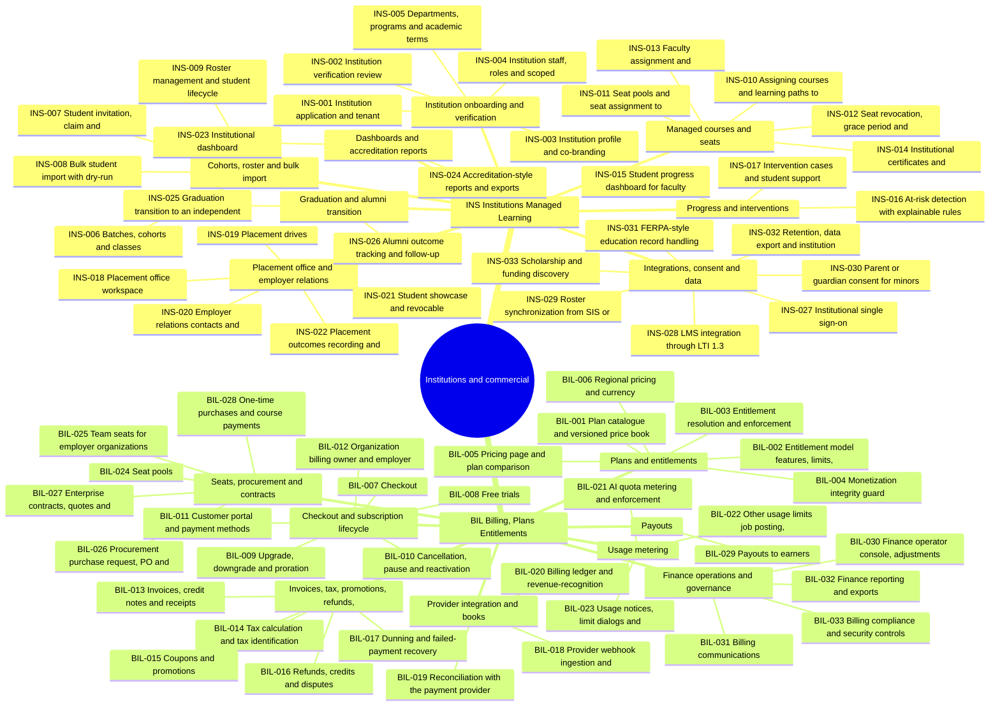

### Specifications

- [INS — Institutions & Managed Learning](02_MODULES/INS_Institutions_Managed_Learning.md)
- [BIL — Billing, Plans & Entitlements](02_MODULES/BIL_Billing_Plans_Entitlements.md)

## 07_OS_EXPANSION.md

_Former file: `PRODUCT_BLUEPRINT/10_MINDMAPS/07_OS_EXPANSION.md`._

<!-- Generated from PRODUCT_BLUEPRINT sources. Regenerate instead of editing by hand. -->

## Mind map: OS expansion modules

Every module, sub-module and feature in this domain (167 features). Feature labels carry the id suffix; the owning module file has the full specification.

```mermaid
mindmap
  root((OS expansion modules))
    MEN Mentorship, Coaching Career Services
      Mentor onboarding and trust
        MEN-001 Mentor application and profile
        MEN-002 Mentor verification and vetting
        MEN-003 Availability, rates and calendar
      Discovery, matching and requests
        MEN-004 Mentor directory and search
        MEN-005 Mentee intake and goals
        MEN-006 Explainable mentor matching
        MEN-007 Mentorship request, intro call and
      Sessions
        MEN-008 Session booking, rescheduling and
        MEN-009 Session payment and mentor fees
        MEN-010 Session room, logistics and recording
        MEN-011 Session notes and shared action items
        MEN-012 Feedback and ratings
      Programs and peer mentorship
        MEN-013 Mentorship program creation
        MEN-014 Program enrollment and pairing
        MEN-015 Program progress, milestones and
        MEN-016 Peer and alumni mentorship
      Goals and relationships
        MEN-017 Mentorship goals and action plans
        MEN-018 Mentorship relationship lifecycle
      Career services
        MEN-019 Resume review service
        MEN-020 Mock interview service
        MEN-021 Coaching packages
        MEN-022 Group sessions, office hours and expert
      Marketplace rules, safety and quality
        MEN-023 Coaching marketplace rules and fees
        MEN-024 Safeguarding and conduct reporting
        MEN-025 Mentor quality management and reputation
        MEN-026 Session disputes and refunds
        MEN-027 Mentor and mentee dashboards
        MEN-028 Conflict of interest disclosure and
    GIG Freelance, Contract Project Work
      Freelancer mode and profile
        GIG-001 Freelancer mode activation
        GIG-002 Freelancer profile, services and
        GIG-003 Freelancer eligibility identity, payout
      Project listings and discovery
        GIG-004 Project brief creation
        GIG-005 Listing review, publication and scope
        GIG-006 Project discovery and search
        GIG-007 Client invitations to freelancers
      Proposals and award
        GIG-008 Submit and manage a proposal
        GIG-009 Proposal quotas and anti-spam
        GIG-010 Shortlisting, comparison and pre-award
        GIG-011 Award and contract offer
      Contracts, milestones and deliverables
        GIG-012 Contract terms and templates
        GIG-013 Milestones and deliverable submission
        GIG-014 Milestone review accept, request
        GIG-015 Change requests and scope amendments
        GIG-016 Contract completion, cancellation and
        GIG-017 Project workroom messages, files and
      Money escrow gate, time tracking gate,
        GIG-018 Payment modes and the escrow decision
        GIG-019 Hourly contracts and time tracking
        GIG-020 Payment release, fees and payouts
      Compliance tax, classification,
        GIG-021 Tax documents and reporting constraints
        GIG-022 Worker classification guard
        GIG-023 Cross-border, sanctions and currency
      Trust reviews, disputes, reputation,
        GIG-024 Mutual reviews and client-confirmed
        GIG-025 Disputes and mediation
        GIG-026 Freelancer and client reputation metrics
        GIG-027 Circumvention, fraud and abuse controls
        GIG-028 Conduct, reporting and account actions
        GIG-029 Intellectual property, confidentiality
      Conversion, learning projects,
        GIG-030 Hire conversion project to job
        GIG-031 Learning projects and apprenticeship
        GIG-032 Freelancer and client dashboards
    EVT Events, Hackathons Community
      Features
        EVT-001 Create event draft
        EVT-002 Event templates and cloning
        EVT-003 Agenda, sessions and tracks
        EVT-004 Publishing and review gate
        EVT-005 Event edit, postpone, and cancel after
        EVT-006 Event discovery and detail page
        EVT-007 Register for an event
        EVT-008 Custom registration questions
        EVT-009 Ticket types and pricing
        EVT-010 Capacity and waitlist with
        EVT-011 Cancel, transfer and refund a
        EVT-012 Approval-required registration and
        EVT-013 Calendar export and timezone handling
        EVT-014 Reminders
        EVT-015 Virtual room and provider link
        EVT-016 Hosts, co-hosts and speakers
        EVT-017 Attendance and check-in
        EVT-018 Live Q A, polls and chat
        EVT-019 Recordings and replays
        EVT-020 Sponsor and employer participation
        EVT-021 Virtual career fair booths and halls
        EVT-022 Career fair candidate interactions and
        EVT-023 In-person career fair logistics
        EVT-024 Hackathon setup tracks, rules, timeline
        EVT-025 Hackathon registration and eligibility
        EVT-026 Team formation and team finder
        EVT-027 Project submission
        EVT-028 Judges and scoring
        EVT-029 Results, leaderboard and prizes
        EVT-030 Hackathon mentors and office hours
        EVT-031 Post-event follow-up and feedback survey
        EVT-032 Attendance certificates and event badges
        EVT-033 Post-event talent sourcing hand-off
        EVT-034 Attendee data-sharing consents
        EVT-035 Event moderation, reports and admin
        EVT-036 Organizer analytics
        EVT-037 Event series and community programmes
        EVT-038 Attendee announcements and messaging
    MKT Market Intelligence Career Pathing
      Features
        MKT-001 Canonical skill catalogue
        MKT-002 Skill aliases and free-text
        MKT-003 Skill relationship graph
        MKT-004 Taxonomy versioning and impact migration
        MKT-005 Emerging skill detection and promotion
        MKT-006 External taxonomy mappings
        MKT-007 Role catalogue and proficiency scales
        MKT-008 Market signal ingestion
        MKT-009 External data source registry and
        MKT-010 Provenance, lineage and methodology
        MKT-011 Data quality, outlier and anomaly
        MKT-012 Skill demand index
        MKT-013 Skill supply index
        MKT-014 Supply-demand gap and regional heat maps
        MKT-015 Trends and forecasts
        MKT-016 Personal market insights
        MKT-017 Salary report submission, verification
        MKT-018 Salary aggregation and benchmark
        MKT-019 Salary benchmark display and job-page
        MKT-020 Offer calibration and pay-equity
        MKT-021 Equity and total compensation benchmarks
        MKT-022 Career transition data opt-in
        MKT-023 Role transition graph and career path
        MKT-024 Skill-gap analysis for a target role
        MKT-025 Readiness estimate and
        MKT-026 Action plan from gap
        MKT-027 Compare career paths
        MKT-028 Institution labor-market dashboard
        MKT-029 Employer workforce-planning view
        MKT-030 Platform market-intelligence console
        MKT-031 Exports and citations
        MKT-032 Partner market API
        MKT-033 Minimum-sample privacy engine
        MKT-034 Market data consent centre
        MKT-035 Corrections, disputes and methodology
        MKT-036 Fairness review of market insights
        MKT-037 Company skill profiles
    ENT Enterprise Talent Internal Mobility,
      Features
        ENT-001 Enterprise workspace setup
        ENT-002 Single sign-on
        ENT-003 SCIM provisioning and deprovisioning
        ENT-004 HRIS integration
        ENT-005 Employee account linking and
        ENT-006 Enterprise roles, permission sets and
        ENT-007 Employee skills inventory
        ENT-008 Organization skills map and capability
        ENT-009 Workforce skill-gap analysis
        ENT-010 Internal job architecture and role
        ENT-011 Internal job board and posting
        ENT-012 Confidential internal application
        ENT-013 Internal talent matching suggestions
        ENT-014 Internal gigs and short-term assignments
        ENT-015 Internal mobility pipeline and transfer
        ENT-016 Employee career development plan
        ENT-017 Mobility preferences and visibility
        ENT-018 Learning assignment
        ENT-019 Compliance training tracking
        ENT-020 Enterprise learning paths
        ENT-021 Learning requests and approvals
        ENT-022 External learning record import
        ENT-023 L D reporting and impact
        ENT-024 Talent review cycle
        ENT-025 Succession planning for critical roles
        ENT-026 Manager workspace
        ENT-027 Employee career hub
        ENT-028 Offboarding and personal data separation
        ENT-029 Data-access log and employee
        ENT-030 Enterprise reporting and compliance
        ENT-031 Regional policy and works-council
        ENT-032 Enterprise notifications and
```

### Specifications

- [MEN — Mentorship, Coaching & Career Services](02_MODULES/MEN_Mentorship_Coaching_Career_Services.md)
- [GIG — Freelance, Contract & Project Work](02_MODULES/GIG_Freelance_Contract_Project_Work.md)
- [EVT — Events, Hackathons & Community Programmes](02_MODULES/EVT_Events_Hackathons_Community_Programmes.md)
- [MKT — Market Intelligence & Career Pathing](02_MODULES/MKT_Market_Intelligence_Career_Pathing.md)
- [ENT — Enterprise Talent: Internal Mobility, Skills & L&D](02_MODULES/ENT_Enterprise_Talent_Internal_Mobility.md)

## 08_PLATFORM.md

_Former file: `PRODUCT_BLUEPRINT/10_MINDMAPS/08_PLATFORM.md`._

<!-- Generated from PRODUCT_BLUEPRINT sources. Regenerate instead of editing by hand. -->

## Mind map: Platform and operations

Every module, sub-module and feature in this domain (159 features). Feature labels carry the id suffix; the owning module file has the full specification.

```mermaid
mindmap
  root((Platform and operations))
    ANL Analytics, Reporting Insights
      Features
        ANL-001 Metric registry
        ANL-002 Event pipeline and warehouse boundary
        ANL-003 Semantic layer and KPI rollups
        ANL-004 Data classification and PII minimization
        ANL-005 Aggregation thresholds and suppression
        ANL-006 Analytics consent and user preferences
        ANL-007 Product analytics event taxonomy and
        ANL-008 Data quality and reconciliation monitors
        ANL-009 Retention, erasure and de-identification
        ANL-010 Dashboard framework
        ANL-011 Candidate dashboard
        ANL-012 Instructor dashboard
        ANL-013 Recruiter dashboard
        ANL-014 Hiring manager dashboard
        ANL-015 Employer admin dashboard
        ANL-016 Institution admin dashboard
        ANL-017 Placement officer dashboard
        ANL-018 Enterprise admin dashboard
        ANL-019 Platform executive and product-health
        ANL-020 Operations, support and trust dashboards
        ANL-021 Fairness and adverse-impact monitoring
        ANL-022 Funnel analysis
        ANL-023 Cohort analysis and retention
        ANL-024 Learning-to-outcome analytics
        ANL-025 Hiring outcome and quality-of-hire
        ANL-026 Report builder
        ANL-027 Scheduled reports and subscriptions
        ANL-028 Governed exports and downloads
        ANL-029 Metric alerts and anomaly detection
        ANL-030 Experiment registry and guardrails
        ANL-031 Assignment, exposure logging and flags
        ANL-032 Experiment analysis and decision log
        ANL-033 Analyst workspace and identity-join
        ANL-034 Embedded analytics and partner API
        ANL-035 Metric change management and dashboard
        ANL-036 Unit economics and cost analytics
        ANL-037 Career workbench tasks, saved items and
    ADM Admin Console, Support Operations
      Console foundation and access
        ADM-001 Admin console shell and information
        ADM-002 Admin authentication hardening and
        ADM-003 Command palette and global admin search
        ADM-004 Admin notes, reason codes and action
      Entity administration
        ADM-005 User directory and account lookup
        ADM-006 Account lifecycle administration actions
        ADM-007 Admin role and permission administration
        ADM-008 Organization and institution
      Privileged access and approvals
        ADM-009 Time-boxed privileged access grants
        ADM-010 Two-person approval engine
        ADM-011 Break-glass access
        ADM-012 Periodic access review and
        ADM-013 Admin activity monitoring and anomaly
      Platform controls
        ADM-014 Feature flag console
        ADM-015 Kill switches
        ADM-016 Configuration management
        ADM-017 Announcements and banners
        ADM-018 Maintenance mode and scheduled
        ADM-019 Change calendar and change freeze
      Support desk
        ADM-020 Ticket intake from every channel
        ADM-021 Ticket workspace, queues and assignment
        ADM-022 SLA policies and timers
        ADM-023 Macros and canned responses
        ADM-024 Support impersonation with consent and
        ADM-025 Knowledge base and help center
        ADM-026 CSAT and support quality review
        ADM-027 Escalation, problem linking and
        ADM-028 Requester verification checklist
      Content CMS
        ADM-029 CMS for landing, help and system pages
        ADM-030 Legal documents versioning and
        ADM-031 Content localization and translation
      Oversight and compliance
        ADM-032 Audit log store and viewer
        ADM-033 Data request handling console
        ADM-034 Bulk operations with dry-run and safe
      Finance and operations
        ADM-035 Finance operations refunds, disputes
        ADM-036 Admin exports, saved views and
        ADM-037 Job queue and dead-letter console
        ADM-038 Incident management tooling and public
        ADM-039 Platform health dashboard
        ADM-040 Public landing page
    PWA PWA, Offline, Mobile Browser Extension
      Installability and shell
        PWA-001 Web app manifest and installability
        PWA-002 Install prompt experience
        PWA-003 App shell and navigation fallback
        PWA-004 Service worker registration and
        PWA-005 App update flow
        PWA-006 Caching strategy per surface
        PWA-007 Static asset precache and runtime cache
        PWA-008 Cache partitioning, never-cache list
        PWA-009 Storage quota, persistence and eviction
      Offline and sync
        PWA-010 Connectivity detection and indicator
        PWA-011 Offline reading of own data with as of
        PWA-012 Offline capability registry
        PWA-013 Local unsent drafts
        PWA-014 Outbox queued writes for safe actions
        PWA-015 Operation identifiers, idempotency and
        PWA-016 Conflict detection and resolution
        PWA-017 Background sync and periodic refresh
        PWA-018 Sync center
        PWA-019 Offline fallback page and
        PWA-020 Offline course downloads
      Push and re-engagement
        PWA-021 Web push permission and subscription
        PWA-022 Push payload rules and deep links
        PWA-023 Per-device push preferences and channel
        PWA-024 App badging, launch shortcuts and
      Mobile experience and distribution
        PWA-025 Responsive layout system and breakpoints
        PWA-026 Touch, gesture and mobile input rules
        PWA-027 Low-bandwidth and data-saver mode
        PWA-028 Share target, deep links and file
        PWA-029 Device capability detection and media
        PWA-030 Native wrapper decision gate
        PWA-031 Store listing and distribution
      Browser extension companion
        PWA-032 Extension installation, pairing and
        PWA-033 Job page scanner
        PWA-034 Local resume match preview
        PWA-035 Save job to TalentSphere from any site
        PWA-036 Application form autofill
        PWA-037 Extension privacy controls and
        PWA-038 Extension updates, minimum version and
      Health and measurement
        PWA-039 PWA and extension health telemetry
    PLT Platform Public API, Webhooks,
      Public API foundation
        PLT-001 API versioning and deprecation policy
        PLT-002 OAuth 2.0 authorization for API clients
        PLT-003 API keys and personal access tokens
        PLT-004 Scopes, consent screen and permission
        PLT-005 Rate limits and quotas
        PLT-006 Pagination, filtering, sorting and
        PLT-007 Idempotency keys
        PLT-008 Error model, request identifiers and
        PLT-009 OpenAPI contract, SDKs and developer
        PLT-010 API request logs and usage analytics
      Webhooks and events
        PLT-011 Webhook endpoint management and event
        PLT-012 Webhook signing and verification
        PLT-013 Webhook delivery, retries and circuit
        PLT-014 Webhook delivery log and replay
      Integrations
        PLT-015 Integration catalog and connection
        PLT-016 Provider adapter framework and
        PLT-017 Calendar integrations
        PLT-018 ATS import and export adapters
        PLT-019 HRIS sync
        PLT-020 LMS integration and LTI 1.3
        PLT-021 Single sign-on and SCIM provisioning
        PLT-022 Payment provider port
        PLT-023 Email and SMS provider ports
        PLT-024 Video meeting providers
        PLT-025 Identity verification vendor port
        PLT-026 Integration health monitoring and
        PLT-027 Integration marketplace decision gate
      Developer experience
        PLT-028 Developer portal and application
        PLT-029 Sandbox environment and test data
      Files and media
        PLT-030 File upload service
        PLT-031 Virus scanning, content validation and
        PLT-032 Storage quotas and usage
        PLT-033 File retention, deletion and legal hold
        PLT-034 Signed URLs and file access control
        PLT-035 Media transcoding and processing
        PLT-036 CDN delivery and cache management
        PLT-043 External media embeds and provider
      Data movement, background work and
        PLT-037 Import tooling
        PLT-038 Export tooling and data portability
        PLT-039 Background job platform and dead-letter
        PLT-040 Scheduler and recurring job registry
        PLT-041 SSRF-safe outbound HTTP and egress
        PLT-042 Transactional outbox and domain event
```

### Specifications

- [ANL — Analytics, Reporting & Insights](02_MODULES/ANL_Analytics_Reporting_Insights.md)
- [ADM — Admin Console, Support & Operations](02_MODULES/ADM_Admin_Console_Support_Operations.md)
- [PWA — PWA, Offline, Mobile & Browser Extension](02_MODULES/PWA_PWA_Offline_Mobile_Extension.md)
- [PLT — Platform: Public API, Webhooks, Integrations, Media & Files](02_MODULES/PLT_Platform_API_Integrations_Media_Files.md)

## 11_VISION_BUSINESS.md

_Former file: `PRODUCT_BLUEPRINT/10_MINDMAPS/11_VISION_BUSINESS.md`._

<!-- Generated from PRODUCT_BLUEPRINT sources. Regenerate instead of editing by hand. -->

## Mind map: Vision, scope and business

Vision, scope, business model, cross-module rules and decisions needed from stakeholders.

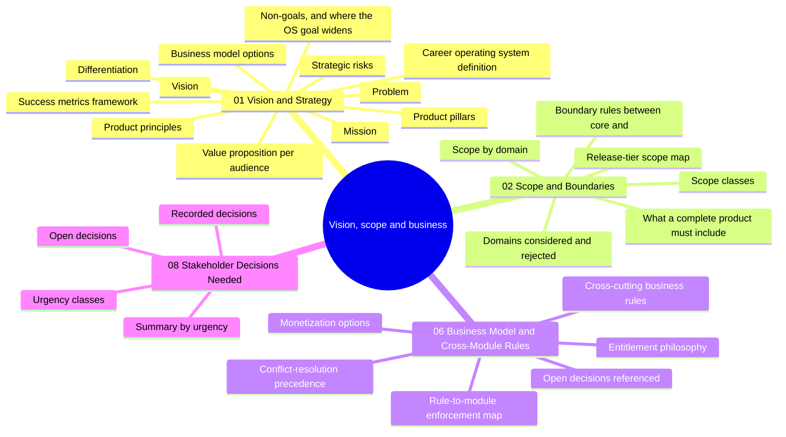

### Documents

- [01 — Vision and Strategy](01_PRODUCT.md#01--vision-and-strategy)
- [02 — Scope and Boundaries](01_PRODUCT.md#02--scope-and-boundaries)
- [06 — Business Model and Cross-Module Rules](01_PRODUCT.md#06--business-model-and-cross-module-rules)
- [08 — Stakeholder Decisions Needed](01_PRODUCT.md#08--stakeholder-decisions-needed)

## 12_ROLES_PERMISSIONS_JOURNEYS.md

_Former file: `PRODUCT_BLUEPRINT/10_MINDMAPS/12_ROLES_PERMISSIONS_JOURNEYS.md`._

<!-- Generated from PRODUCT_BLUEPRINT sources. Regenerate instead of editing by hand. -->

## Mind map: Users roles and journeys

Personas, the permission matrix and the end-to-end user journeys.

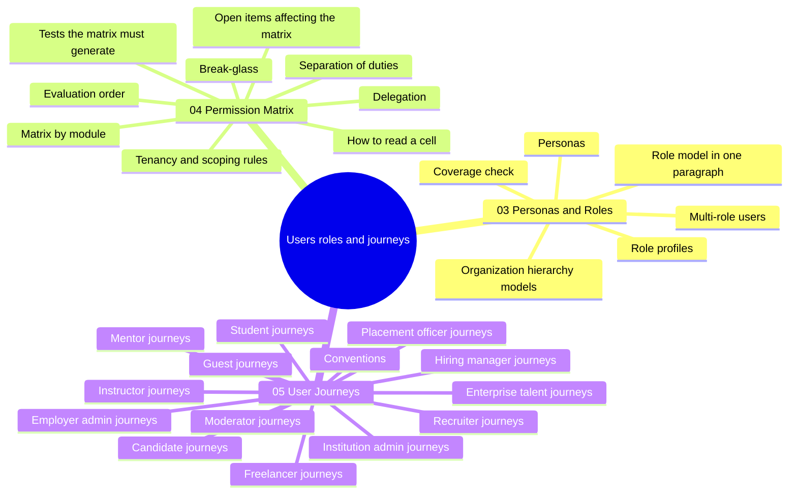

### Documents

- [03 — Personas and Roles](01_PRODUCT.md#03--personas-and-roles)
- [04 — Permission Matrix](01_PRODUCT.md#04--permission-matrix)
- [05 — User Journeys](01_PRODUCT.md#05--user-journeys)

## 13_UX_NAVIGATION.md

_Former file: `PRODUCT_BLUEPRINT/10_MINDMAPS/13_UX_NAVIGATION.md`._

<!-- Generated from PRODUCT_BLUEPRINT sources. Regenerate instead of editing by hand. -->

## Mind map: Experience and navigation

Information architecture, design system, interaction, accessibility, responsive and content rules.

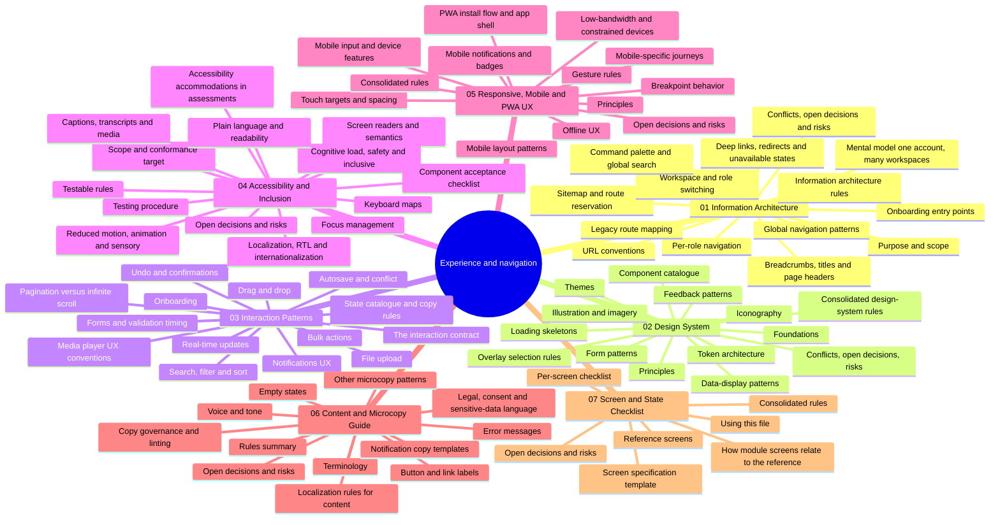

### Documents

- [01 Information Architecture](03_EXPERIENCE.md#01-information-architecture)
- [02 Design System](03_EXPERIENCE.md#02-design-system)
- [03 Interaction Patterns](03_EXPERIENCE.md#03-interaction-patterns)
- [04 Accessibility and Inclusion](03_EXPERIENCE.md#04-accessibility-and-inclusion)
- [05 Responsive, Mobile and PWA UX](03_EXPERIENCE.md#05-responsive-mobile-and-pwa-ux)
- [06 Content and Microcopy Guide](03_EXPERIENCE.md#06-content-and-microcopy-guide)
- [07 Screen and State Checklist](03_EXPERIENCE.md#07-screen-and-state-checklist)

## 14_ARCHITECTURE_DATA_API.md

_Former file: `PRODUCT_BLUEPRINT/10_MINDMAPS/14_ARCHITECTURE_DATA_API.md`._

<!-- Generated from PRODUCT_BLUEPRINT sources. Regenerate instead of editing by hand. -->

## Mind map: Architecture data and API

System architecture, data model, API, events, integrations, AI, search and module dependencies.

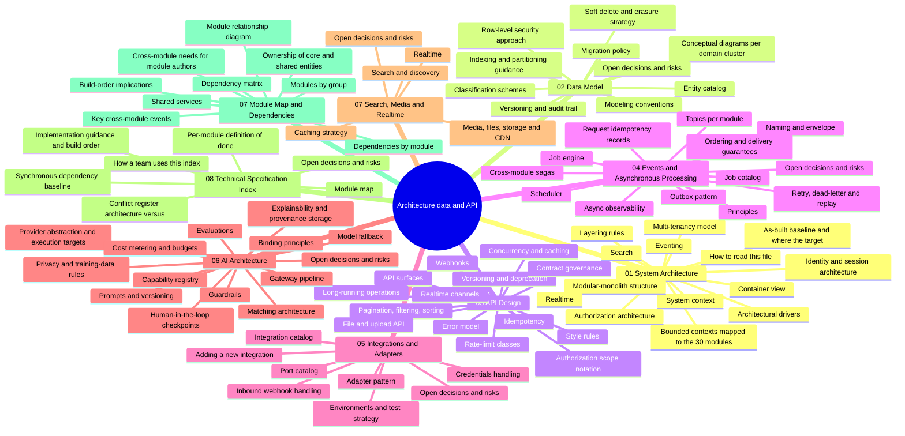

### Documents

- [01 — System Architecture](04_ARCHITECTURE.md#01--system-architecture)
- [02 — Data Model](04_ARCHITECTURE.md#02--data-model)
- [03 — API Design](04_ARCHITECTURE.md#03--api-design)
- [04 — Events and Asynchronous Processing](04_ARCHITECTURE.md#04--events-and-asynchronous-processing)
- [05 — Integrations and Adapters](04_ARCHITECTURE.md#05--integrations-and-adapters)
- [06 — AI Architecture](04_ARCHITECTURE.md#06--ai-architecture)
- [07 — Search, Media and Realtime Architecture](04_ARCHITECTURE.md#07--search-media-and-realtime-architecture)
- [08 — Technical Specification Index](04_ARCHITECTURE.md#08--technical-specification-index)
- [07 — Module Map and Dependencies](01_PRODUCT.md#07--module-map-and-dependencies)

## 15_SECURITY_PRIVACY_PERFORMANCE.md

_Former file: `PRODUCT_BLUEPRINT/10_MINDMAPS/15_SECURITY_PRIVACY_PERFORMANCE.md`._

<!-- Generated from PRODUCT_BLUEPRINT sources. Regenerate instead of editing by hand. -->

## Mind map: Security privacy and performance

Security, privacy, compliance, AI fairness and non-functional requirements.

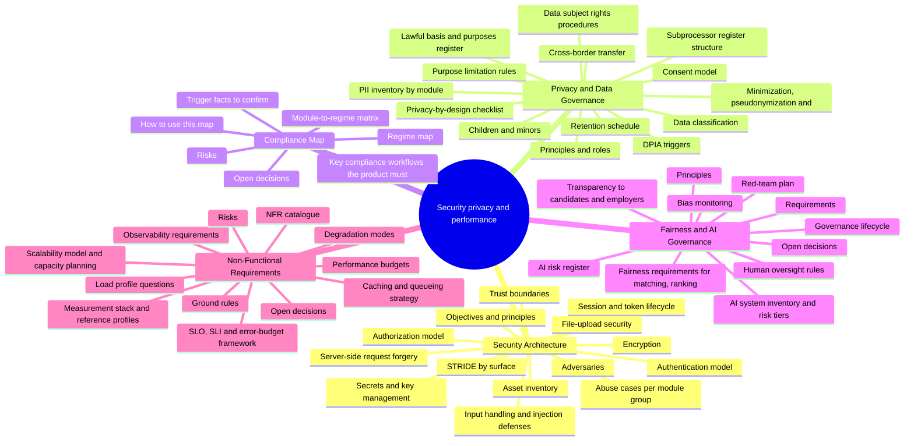

### Documents

- [Security Architecture](05_SECURITY_PRIVACY.md#security-architecture)
- [Privacy and Data Governance](05_SECURITY_PRIVACY.md#privacy-and-data-governance)
- [Compliance Map](05_SECURITY_PRIVACY.md#compliance-map)
- [Fairness and AI Governance](05_SECURITY_PRIVACY.md#fairness-and-ai-governance)
- [Non-Functional Requirements](06_QUALITY_AND_PERFORMANCE.md#non-functional-requirements)

## 16_QA_ENGINEERING.md

_Former file: `PRODUCT_BLUEPRINT/10_MINDMAPS/16_QA_ENGINEERING.md`._

<!-- Generated from PRODUCT_BLUEPRINT sources. Regenerate instead of editing by hand. -->

## Mind map: Quality and engineering

Test strategy and engineering standards.

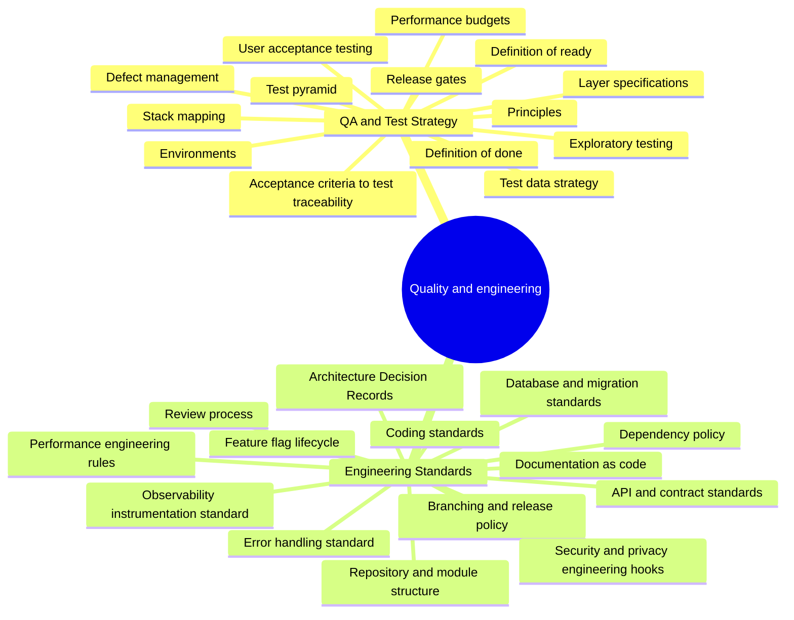

### Documents

- [QA and Test Strategy](06_QUALITY_AND_PERFORMANCE.md#qa-and-test-strategy)
- [Engineering Standards](06_QUALITY_AND_PERFORMANCE.md#engineering-standards)

## 17_DEVOPS_OPERATIONS.md

_Former file: `PRODUCT_BLUEPRINT/10_MINDMAPS/17_DEVOPS_OPERATIONS.md`._

<!-- Generated from PRODUCT_BLUEPRINT sources. Regenerate instead of editing by hand. -->

## Mind map: Deployment and operations

Infrastructure, release, operations, support and long-term maintenance.

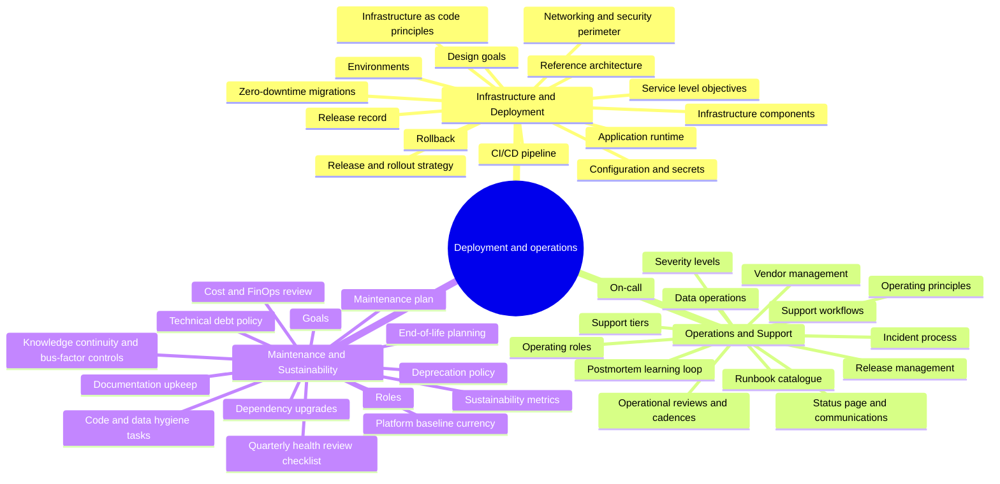

### Documents

- [Infrastructure and Deployment](07_DEVOPS_AND_OPERATIONS.md#infrastructure-and-deployment)
- [Operations and Support](07_DEVOPS_AND_OPERATIONS.md#operations-and-support)
- [Maintenance and Sustainability](07_DEVOPS_AND_OPERATIONS.md#maintenance-and-sustainability)

## 18_ROADMAP.md

_Former file: `PRODUCT_BLUEPRINT/10_MINDMAPS/18_ROADMAP.md`._

<!-- Generated from PRODUCT_BLUEPRINT sources. Regenerate instead of editing by hand. -->

## Mind map: Roadmap and decisions

Lifecycle stages, release tiers and decision gates.

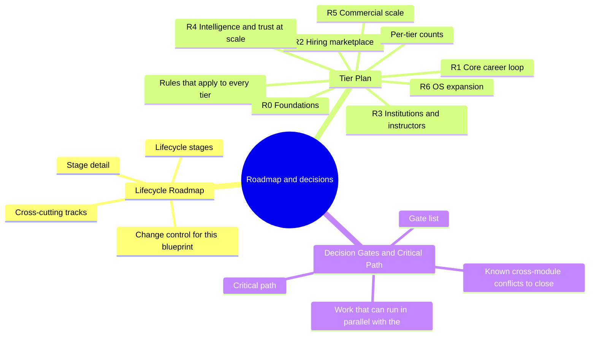

### Documents

- [Lifecycle Roadmap](08_ROADMAP.md#lifecycle-roadmap)
- [Tier Plan (R0 to R6)](08_ROADMAP.md#tier-plan-r0-to-r6)
- [Decision Gates and Critical Path](08_ROADMAP.md#decision-gates-and-critical-path)

## 19_REGISTERS_TRACEABILITY.md

_Former file: `PRODUCT_BLUEPRINT/10_MINDMAPS/19_REGISTERS_TRACEABILITY.md`._

<!-- Generated from PRODUCT_BLUEPRINT sources. Regenerate instead of editing by hand. -->

## Mind map: Registers and traceability

Conventions, glossary and legacy traceability. The generated registers themselves are in 09_REGISTERS.

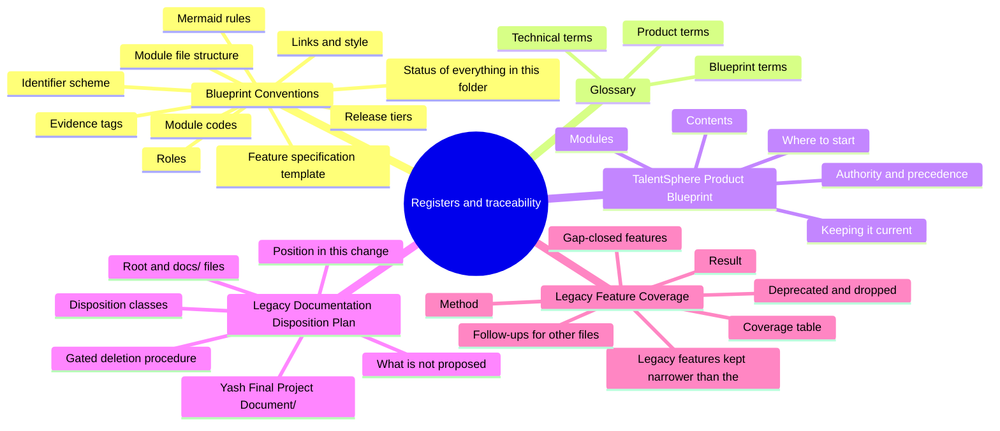

### Documents

- [Blueprint Conventions](README.md#blueprint-conventions)
- [Glossary](README.md#glossary)
- [TalentSphere Product Blueprint](README.md#talentsphere-product-blueprint-1)
- [Legacy Documentation Disposition Plan](11_LEGACY_DISPOSITION.md#legacy-documentation-disposition-plan)
- [Legacy Feature Coverage (F-01 to F-173)](11_LEGACY_DISPOSITION.md#legacy-feature-coverage-f-01-to-f-173)
