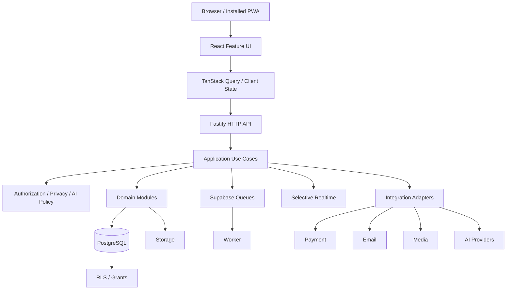

# TalentSphere — TARGET_ARCHITECTURE.md v6.0

**Scope:** the intended target architecture. It is not a description of the running code. For what is built today, and for the rules agents must follow before changing it, read the root [`ARCHITECTURE.md`](../../ARCHITECTURE.md). Where the two disagree about what exists, the root file governs.

## 1. Decision

Build a **modular monolith first**.

The system must remain:
- domain-oriented;
- contract-first;
- auditable;
- replaceable at provider boundaries;
- capable of later extraction.

## 2. Runtime Architecture



## 3. Repository

```text
/
├── apps/
│   ├── web/
│   │   └── src/
│   │       ├── app/
│   │       ├── features/
│   │       ├── pages/
│   │       ├── shared/
│   │       ├── pwa/
│   │       └── config/
│   ├── api/
│   │   └── src/
│   │       ├── modules/
│   │       ├── routes/
│   │       ├── middleware/
│   │       ├── policies/
│   │       ├── adapters/
│   │       └── server.ts
│   └── worker/
│       └── src/
│           ├── jobs/
│           ├── consumers/
│           └── worker.ts
├── packages/
│   ├── ui/
│   ├── contracts/
│   ├── domain/
│   ├── observability/
│   ├── config/
│   └── testing/
├── supabase/
│   ├── migrations/
│   ├── functions/
│   ├── tests/
│   └── seed/
├── scripts/
├── tests/
├── docs/
├── .github/
├── package.json
└── SSOT.md
```

## 4. Domain Boundaries

Core domains:
`identity`, `profile`, `ontology`, `evidence`, `verification`, `learning`, `assessment`, `credential`, `opportunity`, `application`, `hiring`, `interview`, `matching`, `recommendation`, `career`, `networking`, `messaging`, `organization`, `institution`, `reputation`, `notification`, `billing`, `analytics`, `moderation`, `trust`, `ai`, `integration`, `admin`, `audit`.

## 5. Import Rules

```text
UI → application API
Application → domain
Infrastructure → ports
Domain → no framework/provider dependency
Feature → own local components first
Cross-domain → application interface/event
```

Circular dependencies are prohibited.

### 5.1 Intra-package import rule (barrel cycles)

`packages/domain/src/index.ts` is a **barrel only**: it re-exports sibling modules and
declares nothing. A module inside a package must never import that package's own
barrel (`from './index.js'`), because the barrel re-exports the importing module and
the edge becomes a cycle (`auth.ts → index.ts → auth.ts`).

Rule: intra-package imports target the module that **declares** the symbol.

- `core.ts` is the leaf foundation and must never import anything. It holds the shared
  primitives that have no owning feature module: `Role`, `User`, `UserStatus`, `Profile`,
  `ProfilePrivacy`, `Evidence`, `EvidenceType`, `VerificationLevel`, `EvidenceStatus`,
  `ApplicationState`, `ALLOWED_APPLICATION_TRANSITIONS`, `canTransitionApplication`,
  `AssessmentPolicyMode`, `AssessmentSession`, `isAIAssistanceAllowed`,
  `DomainErrorCode`, `DomainError`.
- Feature modules import from `core.ts` for the above, and from the specific sibling
  that owns anything else (e.g. `gamification.ts → assessment.js` for `XpTransaction`,
  `instructor-reputation.ts → reputation-engine.js` for `ReputationBand`).
- Consumers outside the package (`apps/*`, `tests/*`) continue to import the public
  surface via `@talentsphere/domain`. The public API is unchanged by this layering.

Enforcement: `tsc` does not detect cycles, so this rule is checked by review plus a
dependency-graph scan. Any new `from './index.js'` inside `packages/domain/src/` is a
regression.

## 6. Persistence

Postgres is authoritative for relational state. Storage is authoritative for binary objects. Queue state is operational state, not business truth.

## 7. API Boundary

Browser calls application APIs. Direct table access is not the primary application contract.

## 8. Async

Use queue for:
- file processing;
- media processing;
- notification fan-out;
- recommendation refresh;
- analytics aggregation;
- plagiarism/similarity;
- credential propagation;
- scheduled maintenance.

## 9. Realtime

Use for:
- messaging;
- presence;
- non-critical live progress;
- selected dashboards.

Do not use realtime as the only path for:
- payment state;
- authorization;
- assessment scoring;
- credential issuance;
- audit persistence.

## 10. Scale Evolution

Do not introduce microservices by default. Extraction requires:
- measurable load/latency evidence;
- domain ownership;
- failure-isolation need;
- operational readiness;
- migration plan.

---

## 11. Source-Derived Detailed Architecture Corpus (superseded)

This section was an older copy of [`SSOT.md`](../../SSOT.md) §12.6 to §12.12: the system context, logical architecture, authentication flow, AI safety flow, bounded contexts, domain boundary rules (ARCH-013 to ARCH-020) and the ADR-001 to ADR-013 list. SSOT carries the refined version of each, so read it there. The old text, including its earlier ADR wording, was moved on 2026-11-26 to [`history/PROJECT_HISTORY.md`](../history/PROJECT_HISTORY.md#superseded-target-architecture-corpus-former-target_architecturemd-11). The ADR numbering conflict with the root `ARCHITECTURE.md` register is still open: [GOVERNANCE.md](../governance/GOVERNANCE.md#documentation-conflicts-open-2026-10-21) C-13.

---

## 12. V6 Corrections to Historical Architecture
- Browser/PWA domain mutations use the Fastify application API.
- Supabase RLS remains the database authorization boundary, not the complete business authorization model.
- `shared/platform` remains intentionally small; no business domain moves into a generic shared kernel merely to avoid imports.
- The previous Web OS concept is represented as a Career Workspace feature boundary.
- AI is accessed through the central AI Gateway/Orchestrator.
- Search/realtime/cache infrastructure remains measurement-gated.

---

## TalentSphere — TRD.md v6.0

_Former file: `docs/engineering/TRD.md`._

### 1. Purpose

Translate product requirements into technical requirements without duplicating the full architecture.

### 2. Technical Baseline

> **Target baseline.** The built system differs in several places: sessions are self-issued HMAC tokens rather than Supabase Auth, the web app uses plain React state and `fetch` rather than TanStack Query, and background jobs run on Postgres `background_jobs` rather than Supabase Queues. The root [`ARCHITECTURE.md`](../../ARCHITECTURE.md) §20 and §24 record what exists. Open question: [`GAP_ANALYSIS.md`](../governance/GOVERNANCE.md#talentsphere--gap_analysismd-v60) conflict C-5.

| Area | Standard |
|---|---|
| Frontend | React + TypeScript + Vite |
| PWA | Service Worker + offline capability layer |
| Routing | React Router |
| Server state | TanStack Query |
| Backend | Node.js + Fastify + TypeScript |
| Validation | Zod |
| API | REST/JSON + OpenAPI 3.1 |
| Database | PostgreSQL |
| Platform | Supabase |
| Auth | Supabase Auth behind an application identity boundary |
| Storage | Supabase Storage |
| Queue | Supabase Queues |
| Workers | Dedicated worker process |
| Search | PostgreSQL FTS + trigram initially |
| Realtime | Selective |
| Telemetry | OpenTelemetry-compatible |
| Product analytics | Event pipeline with privacy controls |
| AI | Central AI Gateway / Orchestrator |
| Tests | Vitest/React Testing Library/Playwright-compatible stack |

### 3. Architecture Requirements

#### Frontend
- Feature-oriented modules.
- Shared UI only after demonstrated reuse.
- No domain mutation directly from presentation components.
- Server state separated from UI state.
- URL state for shareable filters/search.

#### Backend
- Thin routes.
- Use-case/application services.
- Domain invariants in domain layer.
- Repository ports in domain/application boundary.
- Infrastructure adapters implement ports.
- No duplicated business logic across controllers.

#### Database
- SQL migrations are authoritative.
- Foreign keys, unique/check constraints and transaction boundaries are explicit.
- RLS is mandatory where Supabase/Data API exposure exists.
- Sensitive tables have deny-by-default access.
- Important lifecycle history is auditable.

#### API
- Consistent error contract.
- Idempotency on retriable side effects.
- Cursor pagination.
- Allow-listed filters/sorts.
- Rate limiting.
- Request/trace IDs.

### 4. Non-Functional Requirements

#### Security
- No critical unresolved security findings at release.
- Server-side authorization for every protected mutation.
- Tenant isolation tests required.

#### Accessibility
- WCAG 2.2 AA target.

#### Reliability
- Service-specific SLOs.
- Explicit retry/timeout policies.
- Provider outage fallback.

#### Performance
- Measure real p75/p95/p99 behavior.
- Define route-specific budgets after baseline measurement.
- Avoid false precision before measurement.

#### Scalability
Evolution path:
`modular monolith → worker scaling → cache → search extraction → replicas → selective service extraction`.

### 5. Data Rules

- UTC timestamps.
- Integer minor units for money + ISO 4217.
- Opaque external identifiers.
- Optimistic concurrency for high-value editable records.
- Append-only audit/event semantics where required.

### 6. AI Technical Requirements

```text
Feature
→ Identity
→ Entitlement
→ Data classification
→ Policy
→ Assessment context
→ Provider selection
→ Execution
→ Output validation
→ Provenance
```

No paid free-user cloud inference outside policy.

### 7. Assessment Technical Requirements

Active assessment session must carry policy context. The AI gateway checks that context on every AI invocation.

### 8. Offline Technical Requirements

Each feature declares:

`READ_OFFLINE`, `WRITE_OFFLINE`, `QUEUE`, `SYNC`, `CONFLICT`, `SERVER_REQUIRED`.

No secure assessment or other explicitly server-authoritative decision relies on offline authority.

### 9. Release Technical Requirements

CI must run:
- lint/format;
- typecheck;
- unit/component;
- build;
- migration checks;
- authorization/RLS tests;
- API contract tests;
- security scans;
- critical E2E;
- accessibility smoke;
- performance checks for release-critical paths.
