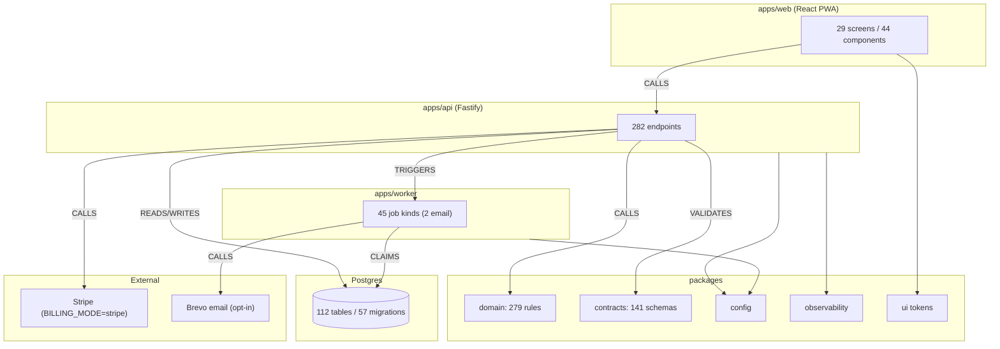

# System Dependency Graph

## 1. Layers

## 2. API module → domain / store / table / screen matrix

Derived from `CALLS`, `WRITES` and rule-ownership edges. Tables listed are only those reached through a persist kind (see [data flows](../data/END_TO_END_DATA_FLOWS.md)); stores that run their own SQL appear under "store".

| API module    | Domain modules used                                                              | Stores                                                                                       | Tables (persist kinds)                                                                                                                   | Screens calling it                                            |
| ------------- | -------------------------------------------------------------------------------- | -------------------------------------------------------------------------------------------- | ---------------------------------------------------------------------------------------------------------------------------------------- | ------------------------------------------------------------- |
| jobs          | core, saved-searches, application-drafts, jobs                                   | core-store.ts, saved-job-store.ts, saved-search-store.ts                                     | application_evidence, job_applications, job_skills, jobs, notifications                                                                  | /dashboard, /hiring, /hiring/jobs/:id, /jobs, /jobs/:id       |
| skills        | core, skill-forecasting, skill-decay, peer-credibility                           | core-store.ts                                                                                | skills                                                                                                                                   | /career, /hiring                                              |
| reputation    | core, reputation-engine, instructor-reputation, employer-reputation              |                                                                                              |                                                                                                                                          |                                                               |
| interviews    | core, technical-interview                                                        | core-store.ts                                                                                | application_evidence, job_applications                                                                                                   |                                                               |
| recruiter     | core, talent-pool-intelligence, talent-segmentation, behavioral-talent-discovery |                                                                                              |                                                                                                                                          |                                                               |
| billing       | billing, core                                                                    | billing-store.ts                                                                             |                                                                                                                                          |                                                               |
| alumni        | core, alumni-networks                                                            |                                                                                              |                                                                                                                                          |                                                               |
| moderation    | moderation, core                                                                 | core-store.ts                                                                                | job_skills, jobs, users                                                                                                                  |                                                               |
| evidence      | evidence, core, profile                                                          | core-store.ts                                                                                | evidence, evidence_skills                                                                                                                | /dashboard, /jobs/:id                                         |
| candidates    | work-history-graph, core, profile                                                | background-jobs.ts, core-store.ts                                                            | employment_references, notifications, verified_work_histories, work_history_email_challenges                                             | /career, /dashboard, /evidence, /reference/:id                |
| networking    | core, warm-introductions                                                         |                                                                                              |                                                                                                                                          |                                                               |
| settings      | settings, core, auth, stripe-billing                                             | account-store.ts, core-store.ts, erasure-store.ts, saved-job-store.ts, saved-search-store.ts | application_evidence, evidence, job_applications, messages, notifications, profiles, thread_participants, users, verified_work_histories | /profile, /settings                                           |
| admin         | admin, core                                                                      | admin-audit-store.ts, background-jobs.ts, core-store.ts, feature-flag-store.ts               | users                                                                                                                                    | /admin                                                        |
| organizations | core, billing, stripe-billing, application-feedback                              | core-store.ts                                                                                | org_memberships, organizations                                                                                                           | /dashboard, /hiring                                           |
| applications  | core, applications, application-feedback, notifications                          | core-store.ts                                                                                | application_evidence, job_applications, notifications                                                                                    | /applications, /dashboard, /hiring/jobs/:id, /jobs, /jobs/:id |
| courses       | core, lms                                                                        |                                                                                              |                                                                                                                                          | /learning, /learning/:id                                      |
| resumes       | core, resumes, networking                                                        |                                                                                              |                                                                                                                                          | /resumes                                                      |
| auth          | auth, core, profile                                                              | core-store.ts                                                                                | profiles, revoked_sessions, users                                                                                                        | /login, /signup                                               |
| job-templates | core, job-templates                                                              | core-store.ts                                                                                | job_skills, jobs                                                                                                                         |                                                               |
| ai            | ai-gateway, core, assessment                                                     |                                                                                              |                                                                                                                                          |                                                               |
| connections   | networking, core                                                                 |                                                                                              |                                                                                                                                          | /network                                                      |
| referrals     | core, referral-requests                                                          | core-store.ts                                                                                | application_evidence, job_applications                                                                                                   |                                                               |
| career        | career-trajectory, core                                                          |                                                                                              |                                                                                                                                          | /career                                                       |
| portfolio     | portfolio, core, networking, gamification                                        |                                                                                              |                                                                                                                                          | /portfolio                                                    |
| salaries      | salary-intelligence, core                                                        |                                                                                              |                                                                                                                                          |                                                               |
| challenges    | core, challenges, assessment                                                     | core-store.ts                                                                                | evidence, evidence_skills                                                                                                                | /assessments                                                  |
| threads       | messaging, core                                                                  | core-store.ts                                                                                | message_threads, notifications, thread_participants                                                                                      | /hiring/jobs/:id, /messages, /messages/:id                    |
| notifications | core, notifications                                                              | core-store.ts                                                                                | notification_preferences, notifications                                                                                                  | /notifications                                                |
| activity      | activity-contributions, core, profile                                            |                                                                                              |                                                                                                                                          |                                                               |
| gamification  | gamification, settings                                                           | account-store.ts                                                                             |                                                                                                                                          |                                                               |
| search        | search, profile                                                                  |                                                                                              |                                                                                                                                          | /network                                                      |
| certificates  | core, lms                                                                        | core-store.ts                                                                                | messages, notifications, thread_participants                                                                                             |                                                               |
| learning      | learning-impact, core                                                            |                                                                                              |                                                                                                                                          |                                                               |
| profile       | core, profile, notifications, analytics                                          | core-store.ts                                                                                | notifications, profiles                                                                                                                  | /profile                                                      |
| analytics     | analytics, admin                                                                 |                                                                                              |                                                                                                                                          |                                                               |
| health        |                                                                                  | core-store.ts                                                                                |                                                                                                                                          |                                                               |
| ready         |                                                                                  |                                                                                              |                                                                                                                                          |                                                               |
| feature-flags | auth, core                                                                       | feature-flag-store.ts                                                                        |                                                                                                                                          |                                                               |
| feedback      | application-feedback                                                             |                                                                                              |                                                                                                                                          |                                                               |
| xp            |                                                                                  |                                                                                              |                                                                                                                                          |                                                               |
| modules       | core                                                                             |                                                                                              |                                                                                                                                          |                                                               |
| lessons       | lms, assessment, core, evidence                                                  | core-store.ts                                                                                | evidence, evidence_skills                                                                                                                | /learning/:id                                                 |
| verify        | core, evidence, lms                                                              |                                                                                              |                                                                                                                                          | /verify/:hash                                                 |
| references    | core, work-history-graph                                                         |                                                                                              |                                                                                                                                          | /reference/:id                                                |
| internal      |                                                                                  | background-jobs.ts                                                                           |                                                                                                                                          |                                                               |

## 3. Package dependencies

Workspace imports found in `src` (`from '@talentsphere/*'`), computed by scan:

| Package/app            | Imports workspace packages |
| ---------------------- | -------------------------- |
| apps/api               | config, contracts, domain  |
| apps/web               | ui                         |
| apps/worker            | domain, observability      |
| packages/config        | none                       |
| packages/contracts     | none                       |
| packages/domain        | none                       |
| packages/observability | none                       |
| packages/ui            | none                       |
| packages/testing       | domain                     |

The graph holds the edges `apps/api DEPENDS_ON domain/*` (48 edges). The web app imports **no** domain or contracts package: request/response types are re-declared in `apps/web/src/lib/types.ts` and pages, so API contract drift is not caught by the compiler.

## 4. Table dependency graph (foreign keys)

See [database entity map](../data/DATABASE_ENTITY_MAP.md) section 4.

Per-module detail diagrams: [MODULE_GRAPHS.md](MODULE_GRAPHS.md).
