# API and Dependency Graph

Generated from the graph at `eb166ea`. Back to the [feature catalog](FEATURE_CATALOG.md). Per-endpoint detail is in each module file and in [`architecture/API_ARCHITECTURE.md`](../architecture/API_ARCHITECTURE.md).

## API module to domain module (edge label = calls from endpoints)

```mermaid
flowchart LR
  api_activity["api/activity"]
  api_activity -->|6| domain_activity_contributions["domain/activity-contributions"]
  api_activity -->|1| domain_core["domain/core"]
  api_activity -->|1| domain_profile["domain/profile"]
  api_admin["api/admin"]
  api_admin -->|15| domain_admin["domain/admin"]
  api_admin -->|2| domain_core["domain/core"]
  api_ai["api/ai"]
  api_ai -->|10| domain_ai_gateway["domain/ai-gateway"]
  api_ai -->|2| domain_assessment["domain/assessment"]
  api_ai -->|3| domain_core["domain/core"]
  api_alumni["api/alumni"]
  api_alumni -->|8| domain_alumni_networks["domain/alumni-networks"]
  api_alumni -->|9| domain_core["domain/core"]
  api_analytics["api/analytics"]
  api_analytics -->|2| domain_admin["domain/admin"]
  api_analytics -->|4| domain_analytics["domain/analytics"]
  api_applications["api/applications"]
  api_applications -->|3| domain_application_feedback["domain/application-feedback"]
  api_applications -->|3| domain_applications["domain/applications"]
  api_applications -->|7| domain_core["domain/core"]
  api_applications -->|1| domain_notifications["domain/notifications"]
  api_auth["api/auth"]
  api_auth -->|13| domain_auth["domain/auth"]
  api_auth -->|4| domain_core["domain/core"]
  api_auth -->|1| domain_profile["domain/profile"]
  api_billing["api/billing"]
  api_billing -->|6| domain_billing["domain/billing"]
  api_billing -->|5| domain_core["domain/core"]
  api_candidates["api/candidates"]
  api_candidates -->|6| domain_core["domain/core"]
  api_candidates -->|1| domain_profile["domain/profile"]
  api_candidates -->|10| domain_work_history_graph["domain/work-history-graph"]
  api_career["api/career"]
  api_career -->|6| domain_career_trajectory["domain/career-trajectory"]
  api_career -->|3| domain_core["domain/core"]
  api_certificates["api/certificates"]
  api_certificates -->|4| domain_core["domain/core"]
  api_certificates -->|2| domain_lms["domain/lms"]
  api_challenges["api/challenges"]
  api_challenges -->|3| domain_assessment["domain/assessment"]
  api_challenges -->|3| domain_challenges["domain/challenges"]
  api_challenges -->|4| domain_core["domain/core"]
  api_connections["api/connections"]
  api_connections -->|4| domain_core["domain/core"]
  api_connections -->|5| domain_networking["domain/networking"]
  api_courses["api/courses"]
  api_courses -->|6| domain_core["domain/core"]
  api_courses -->|3| domain_lms["domain/lms"]
  api_evidence["api/evidence"]
  api_evidence -->|7| domain_core["domain/core"]
  api_evidence -->|8| domain_evidence["domain/evidence"]
  api_evidence -->|2| domain_profile["domain/profile"]
  api_feature_flags["api/feature-flags"]
  api_feature_flags -->|3| domain_auth["domain/auth"]
  api_feature_flags -->|1| domain_core["domain/core"]
  api_feedback["api/feedback"]
  api_feedback -->|1| domain_application_feedback["domain/application-feedback"]
  api_gamification["api/gamification"]
  api_gamification -->|4| domain_gamification["domain/gamification"]
  api_gamification -->|2| domain_settings["domain/settings"]
  api_health["api/health"]
  api_internal["api/internal"]
  api_interviews["api/interviews"]
  api_interviews -->|14| domain_core["domain/core"]
  api_interviews -->|10| domain_technical_interview["domain/technical-interview"]
  api_job_templates["api/job-templates"]
  api_job_templates -->|6| domain_core["domain/core"]
  api_job_templates -->|4| domain_job_templates["domain/job-templates"]
  api_jobs["api/jobs"]
  api_jobs -->|3| domain_application_drafts["domain/application-drafts"]
  api_jobs -->|1| domain_applications["domain/applications"]
  api_jobs -->|15| domain_core["domain/core"]
  api_jobs -->|1| domain_evidence["domain/evidence"]
  api_jobs -->|1| domain_job_templates["domain/job-templates"]
  api_jobs -->|2| domain_jobs["domain/jobs"]
  api_jobs -->|5| domain_saved_searches["domain/saved-searches"]
  api_learning["api/learning"]
  api_learning -->|2| domain_core["domain/core"]
  api_learning -->|5| domain_learning_impact["domain/learning-impact"]
  api_lessons["api/lessons"]
  api_lessons -->|1| domain_assessment["domain/assessment"]
  api_lessons -->|1| domain_core["domain/core"]
  api_lessons -->|1| domain_evidence["domain/evidence"]
  api_lessons -->|4| domain_lms["domain/lms"]
  api_moderation["api/moderation"]
  api_moderation -->|5| domain_core["domain/core"]
  api_moderation -->|8| domain_moderation["domain/moderation"]
  api_modules["api/modules"]
  api_modules -->|1| domain_core["domain/core"]
  api_networking["api/networking"]
  api_networking -->|3| domain_core["domain/core"]
  api_networking -->|3| domain_warm_introductions["domain/warm-introductions"]
  api_notifications["api/notifications"]
  api_notifications -->|4| domain_core["domain/core"]
  api_notifications -->|4| domain_notifications["domain/notifications"]
  api_organizations["api/organizations"]
  api_organizations -->|1| domain_application_feedback["domain/application-feedback"]
  api_organizations -->|1| domain_billing["domain/billing"]
  api_organizations -->|6| domain_core["domain/core"]
  api_organizations -->|1| domain_stripe_billing["domain/stripe-billing"]
  api_portfolio["api/portfolio"]
  api_portfolio -->|3| domain_core["domain/core"]
  api_portfolio -->|1| domain_gamification["domain/gamification"]
  api_portfolio -->|2| domain_networking["domain/networking"]
  api_portfolio -->|4| domain_portfolio["domain/portfolio"]
  api_profile["api/profile"]
  api_profile -->|1| domain_analytics["domain/analytics"]
  api_profile -->|3| domain_core["domain/core"]
  api_profile -->|2| domain_notifications["domain/notifications"]
  api_profile -->|2| domain_profile["domain/profile"]
  api_ready["api/ready"]
  api_recruiter["api/recruiter"]
  api_recruiter -->|3| domain_behavioral_talent_discovery["domain/behavioral-talent-discovery"]
  api_recruiter -->|13| domain_core["domain/core"]
  api_recruiter -->|1| domain_profile["domain/profile"]
  api_recruiter -->|4| domain_talent_pool_intelligence["domain/talent-pool-intelligence"]
  api_recruiter -->|4| domain_talent_segmentation["domain/talent-segmentation"]
  api_references["api/references"]
  api_references -->|1| domain_core["domain/core"]
  api_references -->|1| domain_work_history_graph["domain/work-history-graph"]
  api_referrals["api/referrals"]
  api_referrals -->|4| domain_core["domain/core"]
  api_referrals -->|2| domain_referral_requests["domain/referral-requests"]
  api_reputation["api/reputation"]
  api_reputation -->|1| domain_admin["domain/admin"]
  api_reputation -->|12| domain_core["domain/core"]
  api_reputation -->|5| domain_employer_reputation["domain/employer-reputation"]
  api_reputation -->|6| domain_instructor_reputation["domain/instructor-reputation"]
  api_reputation -->|8| domain_reputation_engine["domain/reputation-engine"]
  api_resumes["api/resumes"]
  api_resumes -->|5| domain_core["domain/core"]
  api_resumes -->|1| domain_networking["domain/networking"]
  api_resumes -->|4| domain_resumes["domain/resumes"]
  api_salaries["api/salaries"]
  api_salaries -->|2| domain_core["domain/core"]
  api_salaries -->|4| domain_salary_intelligence["domain/salary-intelligence"]
  api_search["api/search"]
  api_search -->|2| domain_profile["domain/profile"]
  api_search -->|7| domain_search["domain/search"]
  api_settings["api/settings"]
  api_settings -->|2| domain_auth["domain/auth"]
  api_settings -->|3| domain_core["domain/core"]
  api_settings -->|5| domain_settings["domain/settings"]
  api_settings -->|1| domain_stripe_billing["domain/stripe-billing"]
  api_skills["api/skills"]
  api_skills -->|1| domain_admin["domain/admin"]
  api_skills -->|12| domain_core["domain/core"]
  api_skills -->|3| domain_peer_credibility["domain/peer-credibility"]
  api_skills -->|4| domain_skill_decay["domain/skill-decay"]
  api_skills -->|5| domain_skill_forecasting["domain/skill-forecasting"]
  api_skills -->|2| domain_skills["domain/skills"]
  api_threads["api/threads"]
  api_threads -->|5| domain_core["domain/core"]
  api_threads -->|8| domain_messaging["domain/messaging"]
  api_verify["api/verify"]
  api_verify -->|1| domain_core["domain/core"]
  api_verify -->|1| domain_evidence["domain/evidence"]
  api_verify -->|1| domain_lms["domain/lms"]
  api_xp["api/xp"]
```

## Web module to API module (requests sent from UI interactions and screens)

```mermaid
flowchart LR
  web_admin["web/admin"] -->|8| api_admin["api/admin"]
  web_applications["web/applications"] -->|4| api_applications["api/applications"]
  web_assessments["web/assessments"] -->|6| api_challenges["api/challenges"]
  web_career["web/career"] -->|2| api_candidates["api/candidates"]
  web_career["web/career"] -->|2| api_career["api/career"]
  web_career["web/career"] -->|4| api_skills["api/skills"]
  web_dashboard["web/dashboard"] -->|1| api_applications["api/applications"]
  web_dashboard["web/dashboard"] -->|1| api_candidates["api/candidates"]
  web_dashboard["web/dashboard"] -->|1| api_evidence["api/evidence"]
  web_dashboard["web/dashboard"] -->|1| api_jobs["api/jobs"]
  web_dashboard["web/dashboard"] -->|2| api_organizations["api/organizations"]
  web_evidence["web/evidence"] -->|17| api_candidates["api/candidates"]
  web_hiring["web/hiring"] -->|3| api_applications["api/applications"]
  web_hiring["web/hiring"] -->|16| api_jobs["api/jobs"]
  web_hiring["web/hiring"] -->|5| api_organizations["api/organizations"]
  web_hiring["web/hiring"] -->|1| api_skills["api/skills"]
  web_hiring["web/hiring"] -->|2| api_threads["api/threads"]
  web_jobs["web/jobs"] -->|4| api_applications["api/applications"]
  web_jobs["web/jobs"] -->|1| api_evidence["api/evidence"]
  web_jobs["web/jobs"] -->|4| api_jobs["api/jobs"]
  web_learning["web/learning"] -->|10| api_courses["api/courses"]
  web_learning["web/learning"] -->|2| api_lessons["api/lessons"]
  web_login["web/login"] -->|2| api_auth["api/auth"]
  web_messages["web/messages"] -->|7| api_threads["api/threads"]
  web_network["web/network"] -->|9| api_connections["api/connections"]
  web_network["web/network"] -->|2| api_search["api/search"]
  web_notifications["web/notifications"] -->|3| api_notifications["api/notifications"]
  web_portfolio["web/portfolio"] -->|3| api_portfolio["api/portfolio"]
  web_profile["web/profile"] -->|2| api_profile["api/profile"]
  web_profile["web/profile"] -->|4| api_settings["api/settings"]
  web_reference["web/reference"] -->|2| api_candidates["api/candidates"]
  web_reference["web/reference"] -->|1| api_references["api/references"]
  web_resumes["web/resumes"] -->|3| api_resumes["api/resumes"]
  web_settings["web/settings"] -->|3| api_settings["api/settings"]
  web_shared_components["web/shared-components"] -->|2| api_auth["api/auth"]
  web_shared_components["web/shared-components"] -->|2| api_billing["api/billing"]
  web_shared_components["web/shared-components"] -->|1| api_candidates["api/candidates"]
  web_shared_components["web/shared-components"] -->|2| api_career["api/career"]
  web_shared_components["web/shared-components"] -->|1| api_certificates["api/certificates"]
  web_shared_components["web/shared-components"] -->|2| api_evidence["api/evidence"]
  web_shared_components["web/shared-components"] -->|7| api_skills["api/skills"]
  web_signup["web/signup"] -->|2| api_auth["api/auth"]
  web_verify["web/verify"] -->|2| api_verify["api/verify"]
```

## API module to tables written

| Module            | Tables (writing endpoints)                                                                                                                                                   |
| ----------------- | ---------------------------------------------------------------------------------------------------------------------------------------------------------------------------- |
| api/activity      | none (ephemeral or read-only)                                                                                                                                                |
| api/admin         | users (2)                                                                                                                                                                    |
| api/ai            | none (ephemeral or read-only)                                                                                                                                                |
| api/alumni        | none (ephemeral or read-only)                                                                                                                                                |
| api/analytics     | none (ephemeral or read-only)                                                                                                                                                |
| api/applications  | application_evidence (1), job_applications (1), notifications (1)                                                                                                            |
| api/auth          | profiles (1), revoked_sessions (1), users (4)                                                                                                                                |
| api/billing       | none (ephemeral or read-only)                                                                                                                                                |
| api/candidates    | employment_references (3), notifications (1), verified_work_histories (4), work_history_email_challenges (2)                                                                 |
| api/career        | none (ephemeral or read-only)                                                                                                                                                |
| api/certificates  | messages (1), notifications (1), thread_participants (1)                                                                                                                     |
| api/challenges    | evidence (1), evidence_skills (1)                                                                                                                                            |
| api/connections   | none (ephemeral or read-only)                                                                                                                                                |
| api/courses       | none (ephemeral or read-only)                                                                                                                                                |
| api/evidence      | evidence (4), evidence_skills (4)                                                                                                                                            |
| api/feature-flags | none (ephemeral or read-only)                                                                                                                                                |
| api/feedback      | none (ephemeral or read-only)                                                                                                                                                |
| api/gamification  | none (ephemeral or read-only)                                                                                                                                                |
| api/health        | none (ephemeral or read-only)                                                                                                                                                |
| api/internal      | none (ephemeral or read-only)                                                                                                                                                |
| api/interviews    | application_evidence (1), job_applications (1)                                                                                                                               |
| api/job-templates | job_skills (1), jobs (1)                                                                                                                                                     |
| api/jobs          | application_evidence (1), job_applications (1), job_skills (2), jobs (2), notifications (1)                                                                                  |
| api/learning      | none (ephemeral or read-only)                                                                                                                                                |
| api/lessons       | evidence (1), evidence_skills (1)                                                                                                                                            |
| api/moderation    | job_skills (1), jobs (1), users (2)                                                                                                                                          |
| api/modules       | none (ephemeral or read-only)                                                                                                                                                |
| api/networking    | none (ephemeral or read-only)                                                                                                                                                |
| api/notifications | notification_preferences (1), notifications (1)                                                                                                                              |
| api/organizations | org_memberships (2), organizations (1)                                                                                                                                       |
| api/portfolio     | none (ephemeral or read-only)                                                                                                                                                |
| api/profile       | notifications (1), profiles (1)                                                                                                                                              |
| api/ready         | none (ephemeral or read-only)                                                                                                                                                |
| api/recruiter     | none (ephemeral or read-only)                                                                                                                                                |
| api/references    | none (ephemeral or read-only)                                                                                                                                                |
| api/referrals     | application_evidence (1), job_applications (1)                                                                                                                               |
| api/reputation    | none (ephemeral or read-only)                                                                                                                                                |
| api/resumes       | none (ephemeral or read-only)                                                                                                                                                |
| api/salaries      | none (ephemeral or read-only)                                                                                                                                                |
| api/search        | none (ephemeral or read-only)                                                                                                                                                |
| api/settings      | application_evidence (1), evidence (1), job_applications (1), messages (1), notifications (1), profiles (2), thread_participants (1), users (1), verified_work_histories (1) |
| api/skills        | skills (1)                                                                                                                                                                   |
| api/threads       | message_threads (2), notifications (1), thread_participants (4)                                                                                                              |
| api/verify        | none (ephemeral or read-only)                                                                                                                                                |
| api/xp            | none (ephemeral or read-only)                                                                                                                                                |
