# Database Relationship Graph

Generated from the graph at `eb166ea` (112 tables, 147 foreign-key relationships, from `supabase/migrations`). Back to the [feature catalog](FEATURE_CATALOG.md). Columns, RLS and indexes are in [`data/DATABASE_ENTITY_MAP.md`](../data/DATABASE_ENTITY_MAP.md).

```mermaid
erDiagram
  profiles ||--o{ evidence : references
  organizations ||--o{ org_memberships : references
  organizations ||--o{ jobs : references
  profiles ||--o{ job_applications : references
  jobs ||--o{ job_applications : references
  skills ||--o{ skill_relationships : references
  evidence ||--o{ evidence_skills : references
  skills ||--o{ evidence_skills : references
  jobs ||--o{ job_skills : references
  skills ||--o{ job_skills : references
  evidence ||--o{ application_evidence : references
  job_applications ||--o{ application_evidence : references
  profiles ||--o{ assessment_sessions : references
  challenges ||--o{ assessment_sessions : references
  profiles ||--o{ challenge_submissions : references
  challenges ||--o{ challenge_submissions : references
  assessment_sessions ||--o{ challenge_submissions : references
  profiles ||--o{ courses : references
  courses ||--o{ course_modules : references
  course_modules ||--o{ lessons : references
  lessons ||--o{ lessons : references
  profiles ||--o{ course_enrollments : references
  courses ||--o{ course_enrollments : references
  lessons ||--o{ lesson_progress : references
  course_enrollments ||--o{ lesson_progress : references
  profiles ||--o{ course_certificates : references
  evidence ||--o{ course_certificates : references
  courses ||--o{ course_certificates : references
  course_enrollments ||--o{ course_certificates : references
  skills ||--o{ course_skills : references
  courses ||--o{ course_skills : references
  profiles ||--o{ thread_participants : references
  message_threads ||--o{ thread_participants : references
  profiles ||--o{ messages : references
  message_threads ||--o{ messages : references
  profiles ||--o{ notifications : references
  profiles ||--o{ notification_preferences : references
  users ||--o{ ai_conversations : references
  ai_conversations ||--o{ ai_messages : references
  users ||--o{ ai_usage_meters : references
  users ||--o{ resumes : references
  users ||--o{ resume_exports : references
  resumes ||--o{ resume_exports : references
  users ||--o{ connections : references
  users ||--o{ portfolio_projects : references
  skills ||--o{ portfolio_project_skills : references
  portfolio_projects ||--o{ portfolio_project_skills : references
  portfolio_projects ||--o{ portfolio_project_media : references
  evidence ||--o{ portfolio_project_evidence : references
  portfolio_projects ||--o{ portfolio_project_evidence : references
  users ||--o{ user_gamification_profiles : references
  users ||--o{ user_badges : references
  gamification_badges ||--o{ user_badges : references
  users ||--o{ user_settings : references
  users ||--o{ data_erasure_requests : references
  users ||--o{ data_export_requests : references
  users ||--o{ subscriptions : references
  users ||--o{ invoices : references
  subscriptions ||--o{ invoices : references
  users ||--o{ entitlements : references
  users ||--o{ billing_events : references
  users ||--o{ platform_config : references
  users ||--o{ search_history : references
  profiles ||--o{ moderation_reports : references
  profiles ||--o{ moderation_appeals : references
  moderation_reports ||--o{ moderation_appeals : references
  users ||--o{ saved_searches : references
  users ||--o{ job_alerts : references
  jobs ||--o{ job_alerts : references
  saved_searches ||--o{ job_alerts : references
  users ||--o{ saved_jobs : references
  jobs ||--o{ saved_jobs : references
  profiles ||--o{ application_drafts : references
  jobs ||--o{ application_drafts : references
  resumes ||--o{ application_drafts : references
  application_drafts ||--o{ application_draft_versions : references
  users ||--o{ analytics_events : references
  users ||--o{ certificate_revocations : references
  course_certificates ||--o{ certificate_revocations : references
  users ||--o{ job_templates : references
  organizations ||--o{ job_templates : references
  users ||--o{ salary_reports : references
  users ||--o{ interview_questions : references
  organizations ||--o{ interview_questions : references
  users ||--o{ interview_assessments : references
  profiles ||--o{ interview_assessments : references
  organizations ||--o{ interview_assessments : references
  job_applications ||--o{ interview_assessments : references
  users ||--o{ interview_scorecards : references
  interview_assessments ||--o{ interview_scorecards : references
  interview_scorecards ||--o{ interview_scorecards : references
  interview_assessments ||--o{ interview_ai_feedbacks : references
  users ||--o{ reputation_scores : references
  users ||--o{ reputation_signals : references
  users ||--o{ reputation_history : references
  users ||--o{ reputation_recovery_plans : references
  reputation_signals ||--o{ reputation_recovery_plans : references
  users ||--o{ warm_introduction_preferences : references
  users ||--o{ warm_introduction_requests : references
  users ||--o{ referral_requests : references
  organizations ||--o{ referral_requests : references
  jobs ||--o{ referral_requests : references
  resumes ||--o{ referral_requests : references
  users ||--o{ referral_outcomes : references
  organizations ||--o{ referral_outcomes : references
  jobs ||--o{ referral_outcomes : references
  referral_requests ||--o{ referral_outcomes : references
  users ||--o{ activity_events : references
  users ||--o{ contribution_scores : references
  users ||--o{ instructor_reputation_breakdown : references
  users ||--o{ instructor_endorsements : references
  users ||--o{ skill_endorsements : references
  skills ||--o{ skill_endorsements : references
  skill_endorsements ||--o{ endorsement_weights : references
  users ||--o{ alumni_affiliations : references
  organizations ||--o{ alumni_affiliations : references
  users ||--o{ alumni_groups : references
  organizations ||--o{ alumni_groups : references
  users ||--o{ alumni_group_members : references
  alumni_groups ||--o{ alumni_group_members : references
  users ||--o{ alumni_mentorship : references
  organizations ||--o{ alumni_mentorship : references
  organizations ||--o{ employer_reputation_breakdown : references
  users ||--o{ employer_reviews : references
  organizations ||--o{ employer_reviews : references
  skills ||--o{ skill_market_signals : references
  skills ||--o{ skill_forecasts : references
  profiles ||--o{ career_transitions : references
  organizations ||--o{ career_transitions : references
  profiles ||--o{ career_milestone_evaluations : references
  profiles ||--o{ learning_outcomes : references
  courses ||--o{ learning_outcomes : references
  courses ||--o{ learning_impact_metrics : references
  profiles ||--o{ talent_pools : references
  organizations ||--o{ talent_pools : references
  profiles ||--o{ talent_pool_members : references
  organizations ||--o{ talent_pool_members : references
  talent_pools ||--o{ talent_pool_members : references
  profiles ||--o{ behavioral_talent_profiles : references
  profiles ||--o{ candidate_segmentations : references
  profiles ||--o{ verified_work_histories : references
  organizations ||--o{ verified_work_histories : references
  profiles ||--o{ employment_references : references
  verified_work_histories ||--o{ employment_references : references
  verified_work_histories ||--o{ work_history_email_challenges : references
  users ||--o{ revoked_sessions : references
  users ||--o{ stripe_customers : references
```

## Tables and the features that write them

| ID     | Table                           | Created in                                    | RLS | Status          | Written by (MIN-)                                                               |
| ------ | ------------------------------- | --------------------------------------------- | --- | --------------- | ------------------------------------------------------------------------------- |
| DB-082 | activity_events                 | 00030_activity_contributions_schema.sql       | yes | NOT_IMPLEMENTED | no endpoint writes it                                                           |
| DB-111 | admin_audit_logs                | 00050_admin_audit_logs.sql                    | yes | IMPLEMENTED     | no endpoint writes it                                                           |
| DB-031 | ai_conversations                | 00008_ai_gateway_schema.sql                   | yes | NOT_IMPLEMENTED | no endpoint writes it                                                           |
| DB-032 | ai_messages                     | 00008_ai_gateway_schema.sql                   | yes | NOT_IMPLEMENTED | no endpoint writes it                                                           |
| DB-033 | ai_usage_meters                 | 00008_ai_gateway_schema.sql                   | yes | NOT_IMPLEMENTED | no endpoint writes it                                                           |
| DB-088 | alumni_affiliations             | 00033_alumni_networks_schema.sql              | yes | NOT_IMPLEMENTED | no endpoint writes it                                                           |
| DB-090 | alumni_group_members            | 00033_alumni_networks_schema.sql              | yes | NOT_IMPLEMENTED | no endpoint writes it                                                           |
| DB-089 | alumni_groups                   | 00033_alumni_networks_schema.sql              | yes | NOT_IMPLEMENTED | no endpoint writes it                                                           |
| DB-091 | alumni_mentorship               | 00033_alumni_networks_schema.sql              | yes | NOT_IMPLEMENTED | no endpoint writes it                                                           |
| DB-061 | analytics_daily_kpis            | 00020_product_analytics_schema.sql            | yes | NOT_IMPLEMENTED | no endpoint writes it                                                           |
| DB-060 | analytics_events                | 00020_product_analytics_schema.sql            | yes | NOT_IMPLEMENTED | no endpoint writes it                                                           |
| DB-059 | application_draft_versions      | 00019_application_drafts_schema.sql           | yes | IMPLEMENTED     | no endpoint writes it                                                           |
| DB-058 | application_drafts              | 00019_application_drafts_schema.sql           | yes | IMPLEMENTED     | no endpoint writes it                                                           |
| DB-014 | application_evidence            | 00003_jobs_applications_schema.sql            | yes | IMPLEMENTED     | MIN-224, MIN-173, MIN-218, MIN-252, MIN-267                                     |
| DB-067 | application_feedback            | 00024_application_feedback_schema.sql         | yes | NOT_IMPLEMENTED | no endpoint writes it                                                           |
| DB-016 | assessment_sessions             | 00004_challenges_assessment_schema.sql        | yes | NOT_IMPLEMENTED | no endpoint writes it                                                           |
| DB-008 | audit_logs                      | 00001_core_schema.sql                         | yes | NOT_IMPLEMENTED | no endpoint writes it                                                           |
| DB-107 | background_jobs                 | 00042_background_jobs_schema.sql              | yes | IMPLEMENTED     | no endpoint writes it                                                           |
| DB-103 | behavioral_talent_profiles      | 00039_behavioral_talent_discovery_schema.sql  | yes | NOT_IMPLEMENTED | no endpoint writes it                                                           |
| DB-050 | billing_events                  | 00014_billing_subscriptions_schema.sql        | yes | IMPLEMENTED     | no endpoint writes it                                                           |
| DB-104 | candidate_segmentations         | 00040_talent_segmentation_schema.sql          | yes | NOT_IMPLEMENTED | no endpoint writes it                                                           |
| DB-098 | career_milestone_evaluations    | 00036_career_trajectory_schema.sql            | yes | NOT_IMPLEMENTED | no endpoint writes it                                                           |
| DB-096 | career_transitions              | 00036_career_trajectory_schema.sql            | yes | NOT_IMPLEMENTED | no endpoint writes it                                                           |
| DB-062 | certificate_revocations         | 00021_certificate_verification_schema.sql     | yes | NOT_IMPLEMENTED | no endpoint writes it                                                           |
| DB-017 | challenge_submissions           | 00004_challenges_assessment_schema.sql        | yes | NOT_IMPLEMENTED | no endpoint writes it                                                           |
| DB-015 | challenges                      | 00004_challenges_assessment_schema.sql        | yes | NOT_IMPLEMENTED | no endpoint writes it                                                           |
| DB-036 | connections                     | 00010_networking_connections_schema.sql       | yes | IMPLEMENTED     | no endpoint writes it                                                           |
| DB-083 | contribution_scores             | 00030_activity_contributions_schema.sql       | yes | NOT_IMPLEMENTED | no endpoint writes it                                                           |
| DB-024 | course_certificates             | 00005_lms_courses_schema.sql                  | yes | NOT_IMPLEMENTED | no endpoint writes it                                                           |
| DB-022 | course_enrollments              | 00005_lms_courses_schema.sql                  | yes | NOT_IMPLEMENTED | no endpoint writes it                                                           |
| DB-020 | course_modules                  | 00005_lms_courses_schema.sql                  | yes | NOT_IMPLEMENTED | no endpoint writes it                                                           |
| DB-025 | course_skills                   | 00005_lms_courses_schema.sql                  | yes | NOT_IMPLEMENTED | no endpoint writes it                                                           |
| DB-019 | courses                         | 00005_lms_courses_schema.sql                  | yes | NOT_IMPLEMENTED | no endpoint writes it                                                           |
| DB-045 | data_erasure_requests           | 00013_account_settings_privacy_schema.sql     | yes | IMPLEMENTED     | no endpoint writes it                                                           |
| DB-046 | data_export_requests            | 00013_account_settings_privacy_schema.sql     | yes | IMPLEMENTED     | no endpoint writes it                                                           |
| DB-092 | employer_reputation_breakdown   | 00034_employer_reputation_schema.sql          | yes | NOT_IMPLEMENTED | no endpoint writes it                                                           |
| DB-093 | employer_reviews                | 00034_employer_reputation_schema.sql          | yes | NOT_IMPLEMENTED | no endpoint writes it                                                           |
| DB-106 | employment_references           | 00041_verified_work_history_schema.sql        | yes | IMPLEMENTED     | MIN-189, MIN-191                                                                |
| DB-087 | endorsement_weights             | 00032_peer_credibility_schema.sql             | yes | NOT_IMPLEMENTED | no endpoint writes it                                                           |
| DB-049 | entitlements                    | 00014_billing_subscriptions_schema.sql        | yes | IMPLEMENTED     | no endpoint writes it                                                           |
| DB-003 | evidence                        | 00001_core_schema.sql                         | yes | IMPLEMENTED     | MIN-206, MIN-209, MIN-207, MIN-208, MIN-198, MIN-232, MIN-267                   |
| DB-012 | evidence_skills                 | 00002_evidence_skills_schema.sql              | yes | IMPLEMENTED     | MIN-206, MIN-209, MIN-207, MIN-208, MIN-198, MIN-232                            |
| DB-009 | feature_flags                   | 00001_core_schema.sql                         | yes | IMPLEMENTED     | no endpoint writes it                                                           |
| DB-066 | feedback_templates              | 00024_application_feedback_schema.sql         | yes | NOT_IMPLEMENTED | no endpoint writes it                                                           |
| DB-042 | gamification_badges             | 00012_gamification_xp_ledger_schema.sql       | yes | NOT_IMPLEMENTED | no endpoint writes it                                                           |
| DB-085 | instructor_endorsements         | 00031_instructor_reputation_schema.sql        | yes | NOT_IMPLEMENTED | no endpoint writes it                                                           |
| DB-084 | instructor_reputation_breakdown | 00031_instructor_reputation_schema.sql        | yes | NOT_IMPLEMENTED | no endpoint writes it                                                           |
| DB-073 | interview_ai_feedbacks          | 00026_technical_interview_platform_schema.sql | yes | NOT_IMPLEMENTED | no endpoint writes it                                                           |
| DB-071 | interview_assessments           | 00026_technical_interview_platform_schema.sql | yes | NOT_IMPLEMENTED | no endpoint writes it                                                           |
| DB-070 | interview_questions             | 00026_technical_interview_platform_schema.sql | yes | NOT_IMPLEMENTED | no endpoint writes it                                                           |
| DB-072 | interview_scorecards            | 00026_technical_interview_platform_schema.sql | yes | NOT_IMPLEMENTED | no endpoint writes it                                                           |
| DB-048 | invoices                        | 00014_billing_subscriptions_schema.sql        | yes | IMPLEMENTED     | no endpoint writes it                                                           |
| DB-056 | job_alerts                      | 00018_saved_searches_job_alerts_schema.sql    | yes | IMPLEMENTED     | no endpoint writes it                                                           |
| DB-007 | job_applications                | 00001_core_schema.sql                         | yes | IMPLEMENTED     | MIN-224, MIN-173, MIN-218, MIN-252, MIN-267                                     |
| DB-013 | job_skills                      | 00003_jobs_applications_schema.sql            | yes | IMPLEMENTED     | MIN-223, MIN-148, MIN-222, MIN-236                                              |
| DB-063 | job_templates                   | 00022_job_templates_schema.sql                | yes | NOT_IMPLEMENTED | no endpoint writes it                                                           |
| DB-006 | jobs                            | 00001_core_schema.sql                         | yes | IMPLEMENTED     | MIN-223, MIN-148, MIN-222, MIN-236                                              |
| DB-100 | learning_impact_metrics         | 00037_learning_impact_schema.sql              | yes | NOT_IMPLEMENTED | no endpoint writes it                                                           |
| DB-099 | learning_outcomes               | 00037_learning_impact_schema.sql              | yes | NOT_IMPLEMENTED | no endpoint writes it                                                           |
| DB-023 | lesson_progress                 | 00005_lms_courses_schema.sql                  | yes | NOT_IMPLEMENTED | no endpoint writes it                                                           |
| DB-021 | lessons                         | 00005_lms_courses_schema.sql                  | yes | NOT_IMPLEMENTED | no endpoint writes it                                                           |
| DB-026 | message_threads                 | 00006_messaging_schema.sql                    | yes | IMPLEMENTED     | MIN-278, MIN-279                                                                |
| DB-028 | messages                        | 00006_messaging_schema.sql                    | yes | IMPLEMENTED     | MIN-195, MIN-267                                                                |
| DB-054 | moderation_appeals              | 00017_moderation_trust_safety_schema.sql      | yes | NOT_IMPLEMENTED | no endpoint writes it                                                           |
| DB-053 | moderation_reports              | 00017_moderation_trust_safety_schema.sql      | yes | NOT_IMPLEMENTED | no endpoint writes it                                                           |
| DB-030 | notification_preferences        | 00007_notifications_schema.sql                | yes | IMPLEMENTED     | MIN-152                                                                         |
| DB-029 | notifications                   | 00007_notifications_schema.sql                | yes | IMPLEMENTED     | MIN-099, MIN-224, MIN-173, MIN-195, MIN-140, MIN-242, MIN-267, MIN-191          |
| DB-005 | org_memberships                 | 00001_core_schema.sql                         | yes | IMPLEMENTED     | MIN-243, MIN-244                                                                |
| DB-004 | organizations                   | 00001_core_schema.sql                         | yes | IMPLEMENTED     | MIN-243                                                                         |
| DB-051 | platform_config                 | 00015_admin_governance_schema.sql             | yes | NOT_IMPLEMENTED | no endpoint writes it                                                           |
| DB-040 | portfolio_project_evidence      | 00011_portfolio_showcase_schema.sql           | yes | NOT_IMPLEMENTED | no endpoint writes it                                                           |
| DB-039 | portfolio_project_media         | 00011_portfolio_showcase_schema.sql           | yes | NOT_IMPLEMENTED | no endpoint writes it                                                           |
| DB-038 | portfolio_project_skills        | 00011_portfolio_showcase_schema.sql           | yes | NOT_IMPLEMENTED | no endpoint writes it                                                           |
| DB-037 | portfolio_projects              | 00011_portfolio_showcase_schema.sql           | yes | NOT_IMPLEMENTED | no endpoint writes it                                                           |
| DB-002 | profiles                        | 00001_core_schema.sql                         | yes | IMPLEMENTED     | MIN-176, MIN-154, MIN-157, MIN-267                                              |
| DB-097 | progression_benchmarks          | 00036_career_trajectory_schema.sql            | yes | NOT_IMPLEMENTED | no endpoint writes it                                                           |
| DB-081 | referral_outcomes               | 00029_referral_requests_schema.sql            | yes | NOT_IMPLEMENTED | no endpoint writes it                                                           |
| DB-080 | referral_requests               | 00029_referral_requests_schema.sql            | yes | NOT_IMPLEMENTED | no endpoint writes it                                                           |
| DB-076 | reputation_history              | 00027_reputation_engine_schema.sql            | yes | NOT_IMPLEMENTED | no endpoint writes it                                                           |
| DB-077 | reputation_recovery_plans       | 00027_reputation_engine_schema.sql            | yes | NOT_IMPLEMENTED | no endpoint writes it                                                           |
| DB-074 | reputation_scores               | 00027_reputation_engine_schema.sql            | yes | NOT_IMPLEMENTED | no endpoint writes it                                                           |
| DB-075 | reputation_signals              | 00027_reputation_engine_schema.sql            | yes | NOT_IMPLEMENTED | no endpoint writes it                                                           |
| DB-035 | resume_exports                  | 00009_resumes_schema.sql                      | yes | NOT_IMPLEMENTED | no endpoint writes it                                                           |
| DB-034 | resumes                         | 00009_resumes_schema.sql                      | yes | NOT_IMPLEMENTED | no endpoint writes it                                                           |
| DB-109 | revoked_sessions                | 00046_session_sign_out.sql                    | yes | IMPLEMENTED     | MIN-177                                                                         |
| DB-065 | salary_aggregates               | 00023_salary_intelligence_schema.sql          | yes | NOT_IMPLEMENTED | no endpoint writes it                                                           |
| DB-064 | salary_reports                  | 00023_salary_intelligence_schema.sql          | yes | NOT_IMPLEMENTED | no endpoint writes it                                                           |
| DB-057 | saved_jobs                      | 00018_saved_searches_job_alerts_schema.sql    | yes | IMPLEMENTED     | no endpoint writes it                                                           |
| DB-055 | saved_searches                  | 00018_saved_searches_job_alerts_schema.sql    | yes | IMPLEMENTED     | no endpoint writes it                                                           |
| DB-052 | search_history                  | 00016_search_discovery_schema.sql             | yes | NOT_IMPLEMENTED | no endpoint writes it                                                           |
| DB-086 | skill_endorsements              | 00032_peer_credibility_schema.sql             | yes | NOT_IMPLEMENTED | no endpoint writes it                                                           |
| DB-095 | skill_forecasts                 | 00035_skill_forecasting_schema.sql            | yes | NOT_IMPLEMENTED | no endpoint writes it                                                           |
| DB-068 | skill_freshness                 | 00025_skill_decay_schema.sql                  | yes | NOT_IMPLEMENTED | no endpoint writes it                                                           |
| DB-069 | skill_freshness_history         | 00025_skill_decay_schema.sql                  | yes | NOT_IMPLEMENTED | no endpoint writes it                                                           |
| DB-094 | skill_market_signals            | 00035_skill_forecasting_schema.sql            | yes | NOT_IMPLEMENTED | no endpoint writes it                                                           |
| DB-011 | skill_relationships             | 00002_evidence_skills_schema.sql              | yes | NOT_IMPLEMENTED | no endpoint writes it                                                           |
| DB-010 | skills                          | 00002_evidence_skills_schema.sql              | yes | IMPLEMENTED     | MIN-270                                                                         |
| DB-112 | stripe_customers                | 00052_billing_persistence_and_stripe.sql      | yes | IMPLEMENTED     | no endpoint writes it                                                           |
| DB-047 | subscriptions                   | 00014_billing_subscriptions_schema.sql        | yes | IMPLEMENTED     | no endpoint writes it                                                           |
| DB-102 | talent_pool_members             | 00038_talent_pool_intelligence_schema.sql     | yes | NOT_IMPLEMENTED | no endpoint writes it                                                           |
| DB-101 | talent_pools                    | 00038_talent_pool_intelligence_schema.sql     | yes | NOT_IMPLEMENTED | no endpoint writes it                                                           |
| DB-027 | thread_participants             | 00006_messaging_schema.sql                    | yes | IMPLEMENTED     | MIN-195, MIN-278, MIN-140, MIN-279, MIN-280, MIN-267                            |
| DB-043 | user_badges                     | 00012_gamification_xp_ledger_schema.sql       | yes | NOT_IMPLEMENTED | no endpoint writes it                                                           |
| DB-041 | user_gamification_profiles      | 00012_gamification_xp_ledger_schema.sql       | yes | NOT_IMPLEMENTED | no endpoint writes it                                                           |
| DB-044 | user_settings                   | 00013_account_settings_privacy_schema.sql     | yes | IMPLEMENTED     | no endpoint writes it                                                           |
| DB-001 | users                           | 00001_core_schema.sql                         | yes | IMPLEMENTED     | MIN-176, MIN-174, MIN-175, MIN-178, MIN-267, MIN-146, MIN-145, MIN-236, MIN-233 |
| DB-105 | verified_work_histories         | 00041_verified_work_history_schema.sql        | yes | IMPLEMENTED     | MIN-267, MIN-188, MIN-190, MIN-191, MIN-001                                     |
| DB-078 | warm_introduction_preferences   | 00028_warm_introductions_schema.sql           | yes | NOT_IMPLEMENTED | no endpoint writes it                                                           |
| DB-079 | warm_introduction_requests      | 00028_warm_introductions_schema.sql           | yes | NOT_IMPLEMENTED | no endpoint writes it                                                           |
| DB-108 | work_history_email_challenges   | 00043_core_persistence_alignment.sql          | yes | IMPLEMENTED     | MIN-190                                                                         |
| DB-110 | worker_health                   | 00049_worker_liveness.sql                     | yes | IMPLEMENTED     | no endpoint writes it                                                           |
| DB-018 | xp_transactions                 | 00004_challenges_assessment_schema.sql        | yes | NOT_IMPLEMENTED | no endpoint writes it                                                           |
