# Data-Flow Graphs

Generated from the graph at `eb166ea`. Each FLOW- node is one request the web app sends: UI, enclosing function, `apiFetch`, endpoint, validation, domain rules, persistence, background jobs, HTTP reply, state update. Grouped by API module. Back to the [feature catalog](FEATURE_CATALOG.md).

96 flows; 27 end in process memory (ephemeral).

## admin

```mermaid
flowchart LR
  FLOW_021_0["UI /admin"]
  FLOW_021_1["loadUsers"]
  FLOW_021_0 --> FLOW_021_1
  FLOW_021_2["apiFetch"]
  FLOW_021_1 --> FLOW_021_2
  FLOW_021_3["GET /api/v1/admin/users"]
  FLOW_021_2 --> FLOW_021_3
  FLOW_021_4["assertPlatformAdmin"]
  FLOW_021_3 --> FLOW_021_4
  FLOW_021_5["memory"]
  FLOW_021_4 --> FLOW_021_5
  FLOW_021_6["HTTP 200"]
  FLOW_021_5 --> FLOW_021_6
  FLOW_021_7["state update + UI"]
  FLOW_021_6 --> FLOW_021_7
  FLOW_022_0["UI /admin"]
  FLOW_022_1["loadLogs"]
  FLOW_022_0 --> FLOW_022_1
  FLOW_022_2["apiFetch"]
  FLOW_022_1 --> FLOW_022_2
  FLOW_022_3["GET /api/v1/admin/audit-logs"]
  FLOW_022_2 --> FLOW_022_3
  FLOW_022_4["validate AdminQueryAuditLogsSchema"]
  FLOW_022_3 --> FLOW_022_4
  FLOW_022_5["assertPlatformAdmin"]
  FLOW_022_4 --> FLOW_022_5
  FLOW_022_6["DB store"]
  FLOW_022_5 --> FLOW_022_6
  FLOW_022_7["HTTP 200"]
  FLOW_022_6 --> FLOW_022_7
  FLOW_022_8["state update + UI"]
  FLOW_022_7 --> FLOW_022_8
  FLOW_023_0["UI /admin"]
  FLOW_023_1["loadHealth"]
  FLOW_023_0 --> FLOW_023_1
  FLOW_023_2["apiFetch"]
  FLOW_023_1 --> FLOW_023_2
  FLOW_023_3["GET /api/v1/admin/health-diagnostics"]
  FLOW_023_2 --> FLOW_023_3
  FLOW_023_4["assertPlatformAdmin"]
  FLOW_023_3 --> FLOW_023_4
  FLOW_023_5["computeSystemHealth"]
  FLOW_023_4 --> FLOW_023_5
  FLOW_023_6["memory"]
  FLOW_023_5 --> FLOW_023_6
  FLOW_023_7["HTTP 200"]
  FLOW_023_6 --> FLOW_023_7
  FLOW_023_8["state update + UI"]
  FLOW_023_7 --> FLOW_023_8
  FLOW_024_0["UI /admin"]
  FLOW_024_1["changeStatus"]
  FLOW_024_0 --> FLOW_024_1
  FLOW_024_2["apiFetch"]
  FLOW_024_1 --> FLOW_024_2
  FLOW_024_3["PATCH /api/v1/admin/users/:id/status"]
  FLOW_024_2 --> FLOW_024_3
  FLOW_024_4["validate AdminUpdateUserStatusInputSchema"]
  FLOW_024_3 --> FLOW_024_4
  FLOW_024_5["assertPlatformAdmin"]
  FLOW_024_4 --> FLOW_024_5
  FLOW_024_6["validateUserStatusTransition"]
  FLOW_024_5 --> FLOW_024_6
  FLOW_024_7["createAdminAuditLog"]
  FLOW_024_6 --> FLOW_024_7
  FLOW_024_8["DB users"]
  FLOW_024_7 --> FLOW_024_8
  FLOW_024_9["jobs admin.user.status_updated"]
  FLOW_024_8 --> FLOW_024_9
  FLOW_024_10["HTTP 200"]
  FLOW_024_9 --> FLOW_024_10
  FLOW_024_11["state update + UI"]
  FLOW_024_10 --> FLOW_024_11
  FLOW_025_0["UI /admin"]
  FLOW_025_1["toggleMaintenance"]
  FLOW_025_0 --> FLOW_025_1
  FLOW_025_2["apiFetch"]
  FLOW_025_1 --> FLOW_025_2
  FLOW_025_3["POST /api/v1/admin/maintenance"]
  FLOW_025_2 --> FLOW_025_3
  FLOW_025_4["validate AdminSetMaintenanceModeInputSchema"]
  FLOW_025_3 --> FLOW_025_4
  FLOW_025_5["assertPlatformAdmin"]
  FLOW_025_4 --> FLOW_025_5
  FLOW_025_6["createAdminAuditLog"]
  FLOW_025_5 --> FLOW_025_6
  FLOW_025_7["memory"]
  FLOW_025_6 --> FLOW_025_7
  FLOW_025_8["HTTP 200"]
  FLOW_025_7 --> FLOW_025_8
  FLOW_025_9["state update + UI"]
  FLOW_025_8 --> FLOW_025_9
```

| Flow     | From                                 | Chain                                                                                                                                                                                                                                                                                     | Status      | Verification |
| -------- | ------------------------------------ | ----------------------------------------------------------------------------------------------------------------------------------------------------------------------------------------------------------------------------------------------------------------------------------------- | ----------- | ------------ |
| FLOW-021 | apps/web/src/pages/AdminPage.tsx:98  | UI /admin -> loadUsers() -> apiFetch -> GET /api/v1/admin/users -> assertPlatformAdmin -> memory -> HTTP 200 -> state update + UI                                                                                                                                                         | IMPLEMENTED | VERIFIED     |
| FLOW-022 | apps/web/src/pages/AdminPage.tsx:108 | UI /admin -> loadLogs() -> apiFetch -> GET /api/v1/admin/audit-logs -> validate AdminQueryAuditLogsSchema -> assertPlatformAdmin -> DB (store) -> HTTP 200 -> state update + UI                                                                                                           | IMPLEMENTED | VERIFIED     |
| FLOW-023 | apps/web/src/pages/AdminPage.tsx:118 | UI /admin -> loadHealth() -> apiFetch -> GET /api/v1/admin/health-diagnostics -> assertPlatformAdmin -> computeSystemHealth -> memory -> HTTP 200 -> state update + UI                                                                                                                    | IMPLEMENTED | VERIFIED     |
| FLOW-024 | apps/web/src/pages/AdminPage.tsx:144 | UI /admin -> changeStatus() -> apiFetch -> PATCH /api/v1/admin/users/:id/status -> validate AdminUpdateUserStatusInputSchema -> assertPlatformAdmin -> validateUserStatusTransition -> createAdminAuditLog -> DB users -> jobs admin.user.status_updated -> HTTP 200 -> state update + UI | IMPLEMENTED | VERIFIED     |
| FLOW-025 | apps/web/src/pages/AdminPage.tsx:160 | UI /admin -> toggleMaintenance() -> apiFetch -> POST /api/v1/admin/maintenance -> validate AdminSetMaintenanceModeInputSchema -> assertPlatformAdmin -> createAdminAuditLog -> memory -> HTTP 200 -> state update + UI                                                                    | IMPLEMENTED | VERIFIED     |

## ai

```mermaid
flowchart LR
  FLOW_011_0["UI PaidPlans"]
  FLOW_011_1["PaidPlans"]
  FLOW_011_0 --> FLOW_011_1
  FLOW_011_2["apiFetch"]
  FLOW_011_1 --> FLOW_011_2
  FLOW_011_3["GET /api/v1/ai/usage"]
  FLOW_011_2 --> FLOW_011_3
  FLOW_011_4["aiQuotaForEntitlements"]
  FLOW_011_3 --> FLOW_011_4
  FLOW_011_5["aiTierForPlan"]
  FLOW_011_4 --> FLOW_011_5
  FLOW_011_6["memory"]
  FLOW_011_5 --> FLOW_011_6
  FLOW_011_7["HTTP 200"]
  FLOW_011_6 --> FLOW_011_7
  FLOW_011_8["state update + UI"]
  FLOW_011_7 --> FLOW_011_8
```

| Flow     | From                                     | Chain                                                                                                                                                 | Status      | Verification |
| -------- | ---------------------------------------- | ----------------------------------------------------------------------------------------------------------------------------------------------------- | ----------- | ------------ |
| FLOW-011 | apps/web/src/components/PaidPlans.tsx:95 | UI PaidPlans -> PaidPlans() -> apiFetch -> GET /api/v1/ai/usage -> aiQuotaForEntitlements -> aiTierForPlan -> memory -> HTTP 200 -> state update + UI | IMPLEMENTED | VERIFIED     |

## applications

```mermaid
flowchart LR
  FLOW_026_0["UI /applications"]
  FLOW_026_1["load"]
  FLOW_026_0 --> FLOW_026_1
  FLOW_026_2["apiFetch"]
  FLOW_026_1 --> FLOW_026_2
  FLOW_026_3["GET /api/v1/applications/my"]
  FLOW_026_2 --> FLOW_026_3
  FLOW_026_4["applicationForCandidate"]
  FLOW_026_3 --> FLOW_026_4
  FLOW_026_5["DB store"]
  FLOW_026_4 --> FLOW_026_5
  FLOW_026_6["HTTP 200"]
  FLOW_026_5 --> FLOW_026_6
  FLOW_026_7["state update + UI"]
  FLOW_026_6 --> FLOW_026_7
  FLOW_027_0["UI /applications"]
  FLOW_027_1["confirmWithdraw"]
  FLOW_027_0 --> FLOW_027_1
  FLOW_027_2["apiFetch"]
  FLOW_027_1 --> FLOW_027_2
  FLOW_027_3["POST /api/v1/applications/:id/transition"]
  FLOW_027_2 --> FLOW_027_3
  FLOW_027_4["validate TransitionApplicationInputSchema"]
  FLOW_027_3 --> FLOW_027_4
  FLOW_027_5["transitionApplicationState"]
  FLOW_027_4 --> FLOW_027_5
  FLOW_027_6["candidateApplicationUpdate"]
  FLOW_027_5 --> FLOW_027_6
  FLOW_027_7["DB job_applications, application_evidence, noti..."]
  FLOW_027_6 --> FLOW_027_7
  FLOW_027_8["jobs application.status_changed"]
  FLOW_027_7 --> FLOW_027_8
  FLOW_027_9["HTTP 200"]
  FLOW_027_8 --> FLOW_027_9
  FLOW_027_10["state update + UI"]
  FLOW_027_9 --> FLOW_027_10
  FLOW_042_0["UI /dashboard"]
  FLOW_042_1["CandidateDashboard"]
  FLOW_042_0 --> FLOW_042_1
  FLOW_042_2["apiFetch"]
  FLOW_042_1 --> FLOW_042_2
  FLOW_042_3["GET /api/v1/applications/my"]
  FLOW_042_2 --> FLOW_042_3
  FLOW_042_4["applicationForCandidate"]
  FLOW_042_3 --> FLOW_042_4
  FLOW_042_5["DB store"]
  FLOW_042_4 --> FLOW_042_5
  FLOW_042_6["HTTP 200"]
  FLOW_042_5 --> FLOW_042_6
  FLOW_042_7["state update + UI"]
  FLOW_042_6 --> FLOW_042_7
  FLOW_057_0["UI /hiring/jobs/:id"]
  FLOW_057_1["move"]
  FLOW_057_0 --> FLOW_057_1
  FLOW_057_2["apiFetch"]
  FLOW_057_1 --> FLOW_057_2
  FLOW_057_3["POST /api/v1/applications/:id/transition"]
  FLOW_057_2 --> FLOW_057_3
  FLOW_057_4["validate TransitionApplicationInputSchema"]
  FLOW_057_3 --> FLOW_057_4
  FLOW_057_5["transitionApplicationState"]
  FLOW_057_4 --> FLOW_057_5
  FLOW_057_6["candidateApplicationUpdate"]
  FLOW_057_5 --> FLOW_057_6
  FLOW_057_7["DB job_applications, application_evidence, noti..."]
  FLOW_057_6 --> FLOW_057_7
  FLOW_057_8["jobs application.status_changed"]
  FLOW_057_7 --> FLOW_057_8
  FLOW_057_9["HTTP 200"]
  FLOW_057_8 --> FLOW_057_9
  FLOW_057_10["state update + UI"]
  FLOW_057_9 --> FLOW_057_10
  FLOW_068_0["UI /jobs/:id"]
  FLOW_068_1["JobDetailPage"]
  FLOW_068_0 --> FLOW_068_1
  FLOW_068_2["apiFetch"]
  FLOW_068_1 --> FLOW_068_2
  FLOW_068_3["GET /api/v1/applications/my"]
  FLOW_068_2 --> FLOW_068_3
  FLOW_068_4["applicationForCandidate"]
  FLOW_068_3 --> FLOW_068_4
  FLOW_068_5["DB store"]
  FLOW_068_4 --> FLOW_068_5
  FLOW_068_6["HTTP 200"]
  FLOW_068_5 --> FLOW_068_6
  FLOW_068_7["state update + UI"]
  FLOW_068_6 --> FLOW_068_7
  FLOW_071_0["UI /jobs/:id"]
  FLOW_071_1["apply"]
  FLOW_071_0 --> FLOW_071_1
  FLOW_071_2["apiFetch"]
  FLOW_071_1 --> FLOW_071_2
  FLOW_071_3["GET /api/v1/applications/my"]
  FLOW_071_2 --> FLOW_071_3
  FLOW_071_4["applicationForCandidate"]
  FLOW_071_3 --> FLOW_071_4
  FLOW_071_5["DB store"]
  FLOW_071_4 --> FLOW_071_5
  FLOW_071_6["HTTP 200"]
  FLOW_071_5 --> FLOW_071_6
  FLOW_071_7["state update + UI"]
  FLOW_071_6 --> FLOW_071_7
  FLOW_073_0["UI /jobs"]
  FLOW_073_1["JobsPage"]
  FLOW_073_0 --> FLOW_073_1
  FLOW_073_2["apiFetch"]
  FLOW_073_1 --> FLOW_073_2
  FLOW_073_3["GET /api/v1/applications/my"]
  FLOW_073_2 --> FLOW_073_3
  FLOW_073_4["applicationForCandidate"]
  FLOW_073_3 --> FLOW_073_4
  FLOW_073_5["DB store"]
  FLOW_073_4 --> FLOW_073_5
  FLOW_073_6["HTTP 200"]
  FLOW_073_5 --> FLOW_073_6
  FLOW_073_7["state update + UI"]
  FLOW_073_6 --> FLOW_073_7
```

| Flow     | From                                       | Chain                                                                                                                                                                                                                                                                                                                                  | Status      | Verification |
| -------- | ------------------------------------------ | -------------------------------------------------------------------------------------------------------------------------------------------------------------------------------------------------------------------------------------------------------------------------------------------------------------------------------------- | ----------- | ------------ |
| FLOW-026 | apps/web/src/pages/ApplicationsPage.tsx:42 | UI /applications -> load() -> apiFetch -> GET /api/v1/applications/my -> applicationForCandidate -> DB (store) -> HTTP 200 -> state update + UI                                                                                                                                                                                        | IMPLEMENTED | VERIFIED     |
| FLOW-027 | apps/web/src/pages/ApplicationsPage.tsx:59 | UI /applications -> confirmWithdraw() -> apiFetch -> POST /api/v1/applications/:id/transition -> validate TransitionApplicationInputSchema -> transitionApplicationState -> candidateApplicationUpdate -> DB job_applications, application_evidence, notifications -> jobs application.status_changed -> HTTP 200 -> state update + UI | IMPLEMENTED | VERIFIED     |
| FLOW-042 | apps/web/src/pages/DashboardPage.tsx:128   | UI /dashboard -> CandidateDashboard() -> apiFetch -> GET /api/v1/applications/my -> applicationForCandidate -> DB (store) -> HTTP 200 -> state update + UI                                                                                                                                                                             | IMPLEMENTED | VERIFIED     |
| FLOW-057 | apps/web/src/pages/HiringJobPage.tsx:102   | UI /hiring/jobs/:id -> move() -> apiFetch -> POST /api/v1/applications/:id/transition -> validate TransitionApplicationInputSchema -> transitionApplicationState -> candidateApplicationUpdate -> DB job_applications, application_evidence, notifications -> jobs application.status_changed -> HTTP 200 -> state update + UI         | IMPLEMENTED | VERIFIED     |
| FLOW-068 | apps/web/src/pages/JobDetailPage.tsx:80    | UI /jobs/:id -> JobDetailPage() -> apiFetch -> GET /api/v1/applications/my -> applicationForCandidate -> DB (store) -> HTTP 200 -> state update + UI                                                                                                                                                                                   | IMPLEMENTED | VERIFIED     |
| FLOW-071 | apps/web/src/pages/JobDetailPage.tsx:118   | UI /jobs/:id -> apply() -> apiFetch -> GET /api/v1/applications/my -> applicationForCandidate -> DB (store) -> HTTP 200 -> state update + UI                                                                                                                                                                                           | IMPLEMENTED | VERIFIED     |
| FLOW-073 | apps/web/src/pages/JobsPage.tsx:50         | UI /jobs -> JobsPage() -> apiFetch -> GET /api/v1/applications/my -> applicationForCandidate -> DB (store) -> HTTP 200 -> state update + UI                                                                                                                                                                                            | IMPLEMENTED | VERIFIED     |

## auth

```mermaid
flowchart LR
  FLOW_004_0["UI ChangePasswordForm"]
  FLOW_004_1["submit"]
  FLOW_004_0 --> FLOW_004_1
  FLOW_004_2["apiFetch"]
  FLOW_004_1 --> FLOW_004_2
  FLOW_004_3["POST /api/v1/auth/password"]
  FLOW_004_2 --> FLOW_004_3
  FLOW_004_4["validate ChangePasswordInputSchema"]
  FLOW_004_3 --> FLOW_004_4
  FLOW_004_5["hashPassword"]
  FLOW_004_4 --> FLOW_004_5
  FLOW_004_6["verifyPassword"]
  FLOW_004_5 --> FLOW_004_6
  FLOW_004_7["createSessionToken"]
  FLOW_004_6 --> FLOW_004_7
  FLOW_004_8["DB users"]
  FLOW_004_7 --> FLOW_004_8
  FLOW_004_9["HTTP 200"]
  FLOW_004_8 --> FLOW_004_9
  FLOW_004_10["state update + UI"]
  FLOW_004_9 --> FLOW_004_10
  FLOW_014_0["UI SignOutOtherDevices"]
  FLOW_014_1["run"]
  FLOW_014_0 --> FLOW_014_1
  FLOW_014_2["apiFetch"]
  FLOW_014_1 --> FLOW_014_2
  FLOW_014_3["POST /api/v1/auth/sign-out-others"]
  FLOW_014_2 --> FLOW_014_3
  FLOW_014_4["createSessionToken"]
  FLOW_014_3 --> FLOW_014_4
  FLOW_014_5["DB users"]
  FLOW_014_4 --> FLOW_014_5
  FLOW_014_6["HTTP 200"]
  FLOW_014_5 --> FLOW_014_6
  FLOW_014_7["state update + UI"]
  FLOW_014_6 --> FLOW_014_7
  FLOW_019_0["UI apps/web/src/lib/SessionContext.tsx"]
  FLOW_019_1["refresh"]
  FLOW_019_0 --> FLOW_019_1
  FLOW_019_2["apiFetch"]
  FLOW_019_1 --> FLOW_019_2
  FLOW_019_3["GET /api/v1/auth/session"]
  FLOW_019_2 --> FLOW_019_3
  FLOW_019_4["DB store"]
  FLOW_019_3 --> FLOW_019_4
  FLOW_019_5["HTTP 200"]
  FLOW_019_4 --> FLOW_019_5
  FLOW_019_6["state update + UI"]
  FLOW_019_5 --> FLOW_019_6
  FLOW_020_0["UI apps/web/src/lib/session.ts"]
  FLOW_020_1["signOut"]
  FLOW_020_0 --> FLOW_020_1
  FLOW_020_2["apiFetch"]
  FLOW_020_1 --> FLOW_020_2
  FLOW_020_3["POST /api/v1/auth/sign-out"]
  FLOW_020_2 --> FLOW_020_3
  FLOW_020_4["DB revoked_sessions"]
  FLOW_020_3 --> FLOW_020_4
  FLOW_020_5["HTTP 200"]
  FLOW_020_4 --> FLOW_020_5
  FLOW_020_6["state update + UI"]
  FLOW_020_5 --> FLOW_020_6
  FLOW_076_0["UI /login"]
  FLOW_076_1["handleSubmit"]
  FLOW_076_0 --> FLOW_076_1
  FLOW_076_2["apiFetch"]
  FLOW_076_1 --> FLOW_076_2
  FLOW_076_3["POST /api/v1/auth/login"]
  FLOW_076_2 --> FLOW_076_3
  FLOW_076_4["validate LoginInputSchema"]
  FLOW_076_3 --> FLOW_076_4
  FLOW_076_5["hashPassword"]
  FLOW_076_4 --> FLOW_076_5
  FLOW_076_6["verifyPassword"]
  FLOW_076_5 --> FLOW_076_6
  FLOW_076_7["passwordNeedsRehash"]
  FLOW_076_6 --> FLOW_076_7
  FLOW_076_8["DB users"]
  FLOW_076_7 --> FLOW_076_8
  FLOW_076_9["HTTP 200"]
  FLOW_076_8 --> FLOW_076_9
  FLOW_076_10["state update + UI"]
  FLOW_076_9 --> FLOW_076_10
  FLOW_095_0["UI /signup"]
  FLOW_095_1["handleSubmit"]
  FLOW_095_0 --> FLOW_095_1
  FLOW_095_2["apiFetch"]
  FLOW_095_1 --> FLOW_095_2
  FLOW_095_3["POST /api/v1/auth/register"]
  FLOW_095_2 --> FLOW_095_3
  FLOW_095_4["validate RegisterInputSchema"]
  FLOW_095_3 --> FLOW_095_4
  FLOW_095_5["hashPassword"]
  FLOW_095_4 --> FLOW_095_5
  FLOW_095_6["createSessionToken"]
  FLOW_095_5 --> FLOW_095_6
  FLOW_095_7["createProfileEntity"]
  FLOW_095_6 --> FLOW_095_7
  FLOW_095_8["DB users, profiles"]
  FLOW_095_7 --> FLOW_095_8
  FLOW_095_9["HTTP 201"]
  FLOW_095_8 --> FLOW_095_9
  FLOW_095_10["state update + UI"]
  FLOW_095_9 --> FLOW_095_10
```

| Flow     | From                                               | Chain                                                                                                                                                                                                                      | Status      | Verification |
| -------- | -------------------------------------------------- | -------------------------------------------------------------------------------------------------------------------------------------------------------------------------------------------------------------------------- | ----------- | ------------ |
| FLOW-004 | apps/web/src/components/ChangePasswordForm.tsx:39  | UI ChangePasswordForm -> submit() -> apiFetch -> POST /api/v1/auth/password -> validate ChangePasswordInputSchema -> hashPassword -> verifyPassword -> createSessionToken -> DB users -> HTTP 200 -> state update + UI     | IMPLEMENTED | VERIFIED     |
| FLOW-014 | apps/web/src/components/SignOutOtherDevices.tsx:23 | UI SignOutOtherDevices -> run() -> apiFetch -> POST /api/v1/auth/sign-out-others -> createSessionToken -> DB users -> HTTP 200 -> state update + UI                                                                        | IMPLEMENTED | VERIFIED     |
| FLOW-019 | apps/web/src/lib/SessionContext.tsx:78             | UI apps/web/src/lib/SessionContext.tsx -> refresh() -> apiFetch -> GET /api/v1/auth/session -> DB (store) -> HTTP 200 -> state update + UI                                                                                 | IMPLEMENTED | VERIFIED     |
| FLOW-020 | apps/web/src/lib/session.ts:111                    | UI apps/web/src/lib/session.ts -> signOut() -> apiFetch -> POST /api/v1/auth/sign-out -> DB revoked_sessions -> HTTP 200 -> state update + UI                                                                              | IMPLEMENTED | VERIFIED     |
| FLOW-076 | apps/web/src/pages/LoginPage.tsx:62                | UI /login -> handleSubmit() -> apiFetch -> POST /api/v1/auth/login -> validate LoginInputSchema -> hashPassword -> verifyPassword -> passwordNeedsRehash -> DB users -> HTTP 200 -> state update + UI                      | IMPLEMENTED | VERIFIED     |
| FLOW-095 | apps/web/src/pages/SignUpPage.tsx:66               | UI /signup -> handleSubmit() -> apiFetch -> POST /api/v1/auth/register -> validate RegisterInputSchema -> hashPassword -> createSessionToken -> createProfileEntity -> DB users, profiles -> HTTP 201 -> state update + UI | IMPLEMENTED | VERIFIED     |

## billing

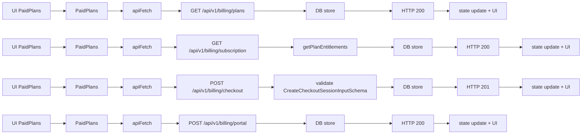

| Flow     | From                                      | Chain                                                                                                                                                                | Status      | Verification |
| -------- | ----------------------------------------- | -------------------------------------------------------------------------------------------------------------------------------------------------------------------- | ----------- | ------------ |
| FLOW-009 | apps/web/src/components/PaidPlans.tsx:61  | UI PaidPlans -> PaidPlans() -> apiFetch -> GET /api/v1/billing/plans -> DB (store) -> HTTP 200 -> state update + UI                                                  | IMPLEMENTED | VERIFIED     |
| FLOW-010 | apps/web/src/components/PaidPlans.tsx:80  | UI PaidPlans -> PaidPlans() -> apiFetch -> GET /api/v1/billing/subscription -> getPlanEntitlements -> DB (store) -> HTTP 200 -> state update + UI                    | IMPLEMENTED | VERIFIED     |
| FLOW-012 | apps/web/src/components/PaidPlans.tsx:256 | UI PaidPlans -> PaidPlans() -> apiFetch -> POST /api/v1/billing/checkout -> validate CreateCheckoutSessionInputSchema -> DB (store) -> HTTP 201 -> state update + UI | IMPLEMENTED | VERIFIED     |
| FLOW-013 | apps/web/src/components/PaidPlans.tsx:338 | UI PaidPlans -> PaidPlans() -> apiFetch -> POST /api/v1/billing/portal -> DB (store) -> HTTP 200 -> state update + UI                                                | IMPLEMENTED | UNKNOWN      |

## candidates

```mermaid
flowchart LR
  FLOW_002_0["UI CareerPaths"]
  FLOW_002_1["load"]
  FLOW_002_0 --> FLOW_002_1
  FLOW_002_2["apiFetch"]
  FLOW_002_1 --> FLOW_002_2
  FLOW_002_3["GET /api/v1/candidates/:candidateId/work-history"]
  FLOW_002_2 --> FLOW_002_3
  FLOW_002_4["DB store"]
  FLOW_002_3 --> FLOW_002_4
  FLOW_002_5["HTTP 200"]
  FLOW_002_4 --> FLOW_002_5
  FLOW_002_6["state update + UI"]
  FLOW_002_5 --> FLOW_002_6
  FLOW_033_0["UI /career"]
  FLOW_033_1["load"]
  FLOW_033_0 --> FLOW_033_1
  FLOW_033_2["apiFetch"]
  FLOW_033_1 --> FLOW_033_2
  FLOW_033_3["GET /api/v1/candidates/:candidateId/work-history"]
  FLOW_033_2 --> FLOW_033_3
  FLOW_033_4["DB store"]
  FLOW_033_3 --> FLOW_033_4
  FLOW_033_5["HTTP 200"]
  FLOW_033_4 --> FLOW_033_5
  FLOW_033_6["state update + UI"]
  FLOW_033_5 --> FLOW_033_6
  FLOW_043_0["UI /dashboard"]
  FLOW_043_1["CandidateDashboard"]
  FLOW_043_0 --> FLOW_043_1
  FLOW_043_2["apiFetch"]
  FLOW_043_1 --> FLOW_043_2
  FLOW_043_3["GET /api/v1/candidates/:candidateId/work-history"]
  FLOW_043_2 --> FLOW_043_3
  FLOW_043_4["DB store"]
  FLOW_043_3 --> FLOW_043_4
  FLOW_043_5["HTTP 200"]
  FLOW_043_4 --> FLOW_043_5
  FLOW_043_6["state update + UI"]
  FLOW_043_5 --> FLOW_043_6
  FLOW_048_0["UI /evidence"]
  FLOW_048_1["send"]
  FLOW_048_0 --> FLOW_048_1
  FLOW_048_2["apiFetch"]
  FLOW_048_1 --> FLOW_048_2
  FLOW_048_3["POST /api/v1/candidates/work-history/:id/verify..."]
  FLOW_048_2 --> FLOW_048_3
  FLOW_048_4["validate VerifyWorkHistoryEmailInputSchema"]
  FLOW_048_3 --> FLOW_048_4
  FLOW_048_5["assertCorporateEmailEligible"]
  FLOW_048_4 --> FLOW_048_5
  FLOW_048_6["assertEmailCodeIssuable"]
  FLOW_048_5 --> FLOW_048_6
  FLOW_048_7["verifyCorporateEmail"]
  FLOW_048_6 --> FLOW_048_7
  FLOW_048_8["DB verified_work_histories, work_history_email_..."]
  FLOW_048_7 --> FLOW_048_8
  FLOW_048_9["HTTP 200, 202"]
  FLOW_048_8 --> FLOW_048_9
  FLOW_048_10["state update + UI"]
  FLOW_048_9 --> FLOW_048_10
  FLOW_049_0["UI /evidence"]
  FLOW_049_1["confirm"]
  FLOW_049_0 --> FLOW_049_1
  FLOW_049_2["apiFetch"]
  FLOW_049_1 --> FLOW_049_2
  FLOW_049_3["POST /api/v1/candidates/work-history/:id/verify..."]
  FLOW_049_2 --> FLOW_049_3
  FLOW_049_4["validate VerifyWorkHistoryEmailInputSchema"]
  FLOW_049_3 --> FLOW_049_4
  FLOW_049_5["assertCorporateEmailEligible"]
  FLOW_049_4 --> FLOW_049_5
  FLOW_049_6["assertEmailCodeIssuable"]
  FLOW_049_5 --> FLOW_049_6
  FLOW_049_7["verifyCorporateEmail"]
  FLOW_049_6 --> FLOW_049_7
  FLOW_049_8["DB verified_work_histories, work_history_email_..."]
  FLOW_049_7 --> FLOW_049_8
  FLOW_049_9["HTTP 200, 202"]
  FLOW_049_8 --> FLOW_049_9
  FLOW_049_10["state update + UI"]
  FLOW_049_9 --> FLOW_049_10
  FLOW_050_0["UI /evidence"]
  FLOW_050_1["loadEntries"]
  FLOW_050_0 --> FLOW_050_1
  FLOW_050_2["apiFetch"]
  FLOW_050_1 --> FLOW_050_2
  FLOW_050_3["GET /api/v1/candidates/:candidateId/work-history"]
  FLOW_050_2 --> FLOW_050_3
  FLOW_050_4["DB store"]
  FLOW_050_3 --> FLOW_050_4
  FLOW_050_5["HTTP 200"]
  FLOW_050_4 --> FLOW_050_5
  FLOW_050_6["state update + UI"]
  FLOW_050_5 --> FLOW_050_6
  FLOW_051_0["UI /evidence"]
  FLOW_051_1["handleAddSubmit"]
  FLOW_051_0 --> FLOW_051_1
  FLOW_051_2["apiFetch"]
  FLOW_051_1 --> FLOW_051_2
  FLOW_051_3["POST /api/v1/candidates/work-history"]
  FLOW_051_2 --> FLOW_051_3
  FLOW_051_4["validate CreateWorkHistoryInputSchema"]
  FLOW_051_3 --> FLOW_051_4
  FLOW_051_5["createWorkHistory"]
  FLOW_051_4 --> FLOW_051_5
  FLOW_051_6["DB verified_work_histories"]
  FLOW_051_5 --> FLOW_051_6
  FLOW_051_7["HTTP 200, 201"]
  FLOW_051_6 --> FLOW_051_7
  FLOW_051_8["state update + UI"]
  FLOW_051_7 --> FLOW_051_8
  FLOW_052_0["UI /evidence"]
  FLOW_052_1["handleAddSubmit"]
  FLOW_052_0 --> FLOW_052_1
  FLOW_052_2["apiFetch"]
  FLOW_052_1 --> FLOW_052_2
  FLOW_052_3["POST /api/v1/candidates/work-history/:id/verify..."]
  FLOW_052_2 --> FLOW_052_3
  FLOW_052_4["validate VerifyWorkHistoryEmailInputSchema"]
  FLOW_052_3 --> FLOW_052_4
  FLOW_052_5["assertCorporateEmailEligible"]
  FLOW_052_4 --> FLOW_052_5
  FLOW_052_6["assertEmailCodeIssuable"]
  FLOW_052_5 --> FLOW_052_6
  FLOW_052_7["verifyCorporateEmail"]
  FLOW_052_6 --> FLOW_052_7
  FLOW_052_8["DB verified_work_histories, work_history_email_..."]
  FLOW_052_7 --> FLOW_052_8
  FLOW_052_9["HTTP 200, 202"]
  FLOW_052_8 --> FLOW_052_9
  FLOW_052_10["state update + UI"]
  FLOW_052_9 --> FLOW_052_10
  FLOW_053_0["UI /evidence"]
  FLOW_053_1["handleReferenceSubmit"]
  FLOW_053_0 --> FLOW_053_1
  FLOW_053_2["apiFetch"]
  FLOW_053_1 --> FLOW_053_2
  FLOW_053_3["POST /api/v1/candidates/work-history/:id/refere..."]
  FLOW_053_2 --> FLOW_053_3
  FLOW_053_4["validate RequestEmploymentReferenceInputSchema"]
  FLOW_053_3 --> FLOW_053_4
  FLOW_053_5["assertReferenceRequestAllowed"]
  FLOW_053_4 --> FLOW_053_5
  FLOW_053_6["requestEmploymentReference"]
  FLOW_053_5 --> FLOW_053_6
  FLOW_053_7["DB employment_references"]
  FLOW_053_6 --> FLOW_053_7
  FLOW_053_8["HTTP 200, 201"]
  FLOW_053_7 --> FLOW_053_8
  FLOW_053_9["state update + UI"]
  FLOW_053_8 --> FLOW_053_9
  FLOW_054_0["UI /evidence"]
  FLOW_054_1["handleRemove"]
  FLOW_054_0 --> FLOW_054_1
  FLOW_054_2["apiFetch"]
  FLOW_054_1 --> FLOW_054_2
  FLOW_054_3["DELETE /api/v1/candidates/work-history/:id"]
  FLOW_054_2 --> FLOW_054_3
  FLOW_054_4["DB verified_work_histories"]
  FLOW_054_3 --> FLOW_054_4
  FLOW_054_5["HTTP 200"]
  FLOW_054_4 --> FLOW_054_5
  FLOW_054_6["state update + UI"]
  FLOW_054_5 --> FLOW_054_6
  FLOW_090_0["UI /reference/:id"]
  FLOW_090_1["submit"]
  FLOW_090_0 --> FLOW_090_1
  FLOW_090_2["apiFetch"]
  FLOW_090_1 --> FLOW_090_2
  FLOW_090_3["POST /api/v1/candidates/work-history/references..."]
  FLOW_090_2 --> FLOW_090_3
  FLOW_090_4["validate SubmitEmploymentReferenceInputSchema"]
  FLOW_090_3 --> FLOW_090_4
  FLOW_090_5["canViewProfile"]
  FLOW_090_4 --> FLOW_090_5
  FLOW_090_6["calculateVerificationScoreAndBadge"]
  FLOW_090_5 --> FLOW_090_6
  FLOW_090_7["referenceLinkExpired"]
  FLOW_090_6 --> FLOW_090_7
  FLOW_090_8["DB notifications, verified_work_histories, empl..."]
  FLOW_090_7 --> FLOW_090_8
  FLOW_090_9["HTTP 200"]
  FLOW_090_8 --> FLOW_090_9
  FLOW_090_10["state update + UI"]
  FLOW_090_9 --> FLOW_090_10
```

| Flow     | From                                       | Chain                                                                                                                                                                                                                                                                                                                                            | Status      | Verification |
| -------- | ------------------------------------------ | ------------------------------------------------------------------------------------------------------------------------------------------------------------------------------------------------------------------------------------------------------------------------------------------------------------------------------------------------ | ----------- | ------------ |
| FLOW-002 | apps/web/src/components/CareerPaths.tsx:44 | UI CareerPaths -> load() -> apiFetch -> GET /api/v1/candidates/:candidateId/work-history -> DB (store) -> HTTP 200 -> state update + UI                                                                                                                                                                                                          | IMPLEMENTED | VERIFIED     |
| FLOW-033 | apps/web/src/pages/CareerPage.tsx:81       | UI /career -> load() -> apiFetch -> GET /api/v1/candidates/:candidateId/work-history -> DB (store) -> HTTP 200 -> state update + UI                                                                                                                                                                                                              | IMPLEMENTED | VERIFIED     |
| FLOW-043 | apps/web/src/pages/DashboardPage.tsx:130   | UI /dashboard -> CandidateDashboard() -> apiFetch -> GET /api/v1/candidates/:candidateId/work-history -> DB (store) -> HTTP 200 -> state update + UI                                                                                                                                                                                             | IMPLEMENTED | VERIFIED     |
| FLOW-048 | apps/web/src/pages/EvidencePage.tsx:128    | UI /evidence -> send() -> apiFetch -> POST /api/v1/candidates/work-history/:id/verify-email -> validate VerifyWorkHistoryEmailInputSchema -> assertCorporateEmailEligible -> assertEmailCodeIssuable -> verifyCorporateEmail -> DB verified_work_histories, work_history_email_challenges -> HTTP 200, 202 -> state update + UI                  | IMPLEMENTED | VERIFIED     |
| FLOW-049 | apps/web/src/pages/EvidencePage.tsx:147    | UI /evidence -> confirm() -> apiFetch -> POST /api/v1/candidates/work-history/:id/verify-email -> validate VerifyWorkHistoryEmailInputSchema -> assertCorporateEmailEligible -> assertEmailCodeIssuable -> verifyCorporateEmail -> DB verified_work_histories, work_history_email_challenges -> HTTP 200, 202 -> state update + UI               | IMPLEMENTED | VERIFIED     |
| FLOW-050 | apps/web/src/pages/EvidencePage.tsx:345    | UI /evidence -> loadEntries() -> apiFetch -> GET /api/v1/candidates/:candidateId/work-history -> DB (store) -> HTTP 200 -> state update + UI                                                                                                                                                                                                     | IMPLEMENTED | VERIFIED     |
| FLOW-051 | apps/web/src/pages/EvidencePage.tsx:402    | UI /evidence -> handleAddSubmit() -> apiFetch -> POST /api/v1/candidates/work-history -> validate CreateWorkHistoryInputSchema -> createWorkHistory -> DB verified_work_histories -> HTTP 200, 201 -> state update + UI                                                                                                                          | IMPLEMENTED | VERIFIED     |
| FLOW-052 | apps/web/src/pages/EvidencePage.tsx:414    | UI /evidence -> handleAddSubmit() -> apiFetch -> POST /api/v1/candidates/work-history/:id/verify-email -> validate VerifyWorkHistoryEmailInputSchema -> assertCorporateEmailEligible -> assertEmailCodeIssuable -> verifyCorporateEmail -> DB verified_work_histories, work_history_email_challenges -> HTTP 200, 202 -> state update + UI       | IMPLEMENTED | VERIFIED     |
| FLOW-053 | apps/web/src/pages/EvidencePage.tsx:466    | UI /evidence -> handleReferenceSubmit() -> apiFetch -> POST /api/v1/candidates/work-history/:id/references/request -> validate RequestEmploymentReferenceInputSchema -> assertReferenceRequestAllowed -> requestEmploymentReference -> DB employment_references -> HTTP 200, 201 -> state update + UI                                            | IMPLEMENTED | VERIFIED     |
| FLOW-054 | apps/web/src/pages/EvidencePage.tsx:509    | UI /evidence -> handleRemove() -> apiFetch -> DELETE /api/v1/candidates/work-history/:id -> DB verified_work_histories -> HTTP 200 -> state update + UI                                                                                                                                                                                          | IMPLEMENTED | VERIFIED     |
| FLOW-090 | apps/web/src/pages/ReferencePage.tsx:108   | UI /reference/:id -> submit() -> apiFetch -> POST /api/v1/candidates/work-history/references/:refId/submit -> validate SubmitEmploymentReferenceInputSchema -> canViewProfile -> calculateVerificationScoreAndBadge -> referenceLinkExpired -> DB notifications, verified_work_histories, employment_references -> HTTP 200 -> state update + UI | IMPLEMENTED | VERIFIED     |

## career

```mermaid
flowchart LR
  FLOW_001_0["UI CareerPaths"]
  FLOW_001_1["load"]
  FLOW_001_0 --> FLOW_001_1
  FLOW_001_2["apiFetch"]
  FLOW_001_1 --> FLOW_001_2
  FLOW_001_3["GET /api/v1/career/benchmarks"]
  FLOW_001_2 --> FLOW_001_3
  FLOW_001_4["validate QueryCareerBenchmarksQuerySchema"]
  FLOW_001_3 --> FLOW_001_4
  FLOW_001_5["calculateCareerTransitionProbability"]
  FLOW_001_4 --> FLOW_001_5
  FLOW_001_6["memory"]
  FLOW_001_5 --> FLOW_001_6
  FLOW_001_7["HTTP 200"]
  FLOW_001_6 --> FLOW_001_7
  FLOW_001_8["state update + UI"]
  FLOW_001_7 --> FLOW_001_8
  FLOW_003_0["UI CareerPaths"]
  FLOW_003_1["show"]
  FLOW_003_0 --> FLOW_003_1
  FLOW_003_2["apiFetch"]
  FLOW_003_1 --> FLOW_003_2
  FLOW_003_3["GET /api/v1/career/pathways"]
  FLOW_003_2 --> FLOW_003_3
  FLOW_003_4["validate CareerProgressionPathwaysQuerySchema"]
  FLOW_003_3 --> FLOW_003_4
  FLOW_003_5["generateProgressionPathways"]
  FLOW_003_4 --> FLOW_003_5
  FLOW_003_6["projectSalaryTrajectory"]
  FLOW_003_5 --> FLOW_003_6
  FLOW_003_7["memory"]
  FLOW_003_6 --> FLOW_003_7
  FLOW_003_8["HTTP 200"]
  FLOW_003_7 --> FLOW_003_8
  FLOW_003_9["state update + UI"]
  FLOW_003_8 --> FLOW_003_9
  FLOW_034_0["UI /career"]
  FLOW_034_1["check"]
  FLOW_034_0 --> FLOW_034_1
  FLOW_034_2["apiFetch"]
  FLOW_034_1 --> FLOW_034_2
  FLOW_034_3["POST /api/v1/career/milestones/readiness"]
  FLOW_034_2 --> FLOW_034_3
  FLOW_034_4["validate EvaluateMilestoneReadinessInputSchema"]
  FLOW_034_3 --> FLOW_034_4
  FLOW_034_5["evaluateMilestoneReadiness"]
  FLOW_034_4 --> FLOW_034_5
  FLOW_034_6["memory"]
  FLOW_034_5 --> FLOW_034_6
  FLOW_034_7["HTTP 200"]
  FLOW_034_6 --> FLOW_034_7
  FLOW_034_8["state update + UI"]
  FLOW_034_7 --> FLOW_034_8
```

| Flow     | From                                       | Chain                                                                                                                                                                                                                     | Status      | Verification |
| -------- | ------------------------------------------ | ------------------------------------------------------------------------------------------------------------------------------------------------------------------------------------------------------------------------- | ----------- | ------------ |
| FLOW-001 | apps/web/src/components/CareerPaths.tsx:42 | UI CareerPaths -> load() -> apiFetch -> GET /api/v1/career/benchmarks -> validate QueryCareerBenchmarksQuerySchema -> calculateCareerTransitionProbability -> memory -> HTTP 200 -> state update + UI                     | IMPLEMENTED | VERIFIED     |
| FLOW-003 | apps/web/src/components/CareerPaths.tsx:76 | UI CareerPaths -> show() -> apiFetch -> GET /api/v1/career/pathways -> validate CareerProgressionPathwaysQuerySchema -> generateProgressionPathways -> projectSalaryTrajectory -> memory -> HTTP 200 -> state update + UI | IMPLEMENTED | VERIFIED     |
| FLOW-034 | apps/web/src/pages/CareerPage.tsx:107      | UI /career -> check() -> apiFetch -> POST /api/v1/career/milestones/readiness -> validate EvaluateMilestoneReadinessInputSchema -> evaluateMilestoneReadiness -> memory -> HTTP 200 -> state update + UI                  | IMPLEMENTED | VERIFIED     |

## certificates

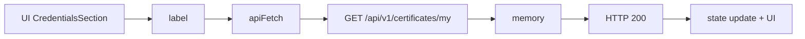

| Flow     | From                                              | Chain                                                                                                                  | Status      | Verification |
| -------- | ------------------------------------------------- | ---------------------------------------------------------------------------------------------------------------------- | ----------- | ------------ |
| FLOW-005 | apps/web/src/components/CredentialsSection.tsx:51 | UI CredentialsSection -> label() -> apiFetch -> GET /api/v1/certificates/my -> memory -> HTTP 200 -> state update + UI | IMPLEMENTED | VERIFIED     |

## challenges

```mermaid
flowchart LR
  FLOW_028_0["UI /assessments"]
  FLOW_028_1["load"]
  FLOW_028_0 --> FLOW_028_1
  FLOW_028_2["apiFetch"]
  FLOW_028_1 --> FLOW_028_2
  FLOW_028_3["GET /api/v1/challenges"]
  FLOW_028_2 --> FLOW_028_3
  FLOW_028_4["filterChallengeForCandidate"]
  FLOW_028_3 --> FLOW_028_4
  FLOW_028_5["memory"]
  FLOW_028_4 --> FLOW_028_5
  FLOW_028_6["HTTP 200"]
  FLOW_028_5 --> FLOW_028_6
  FLOW_028_7["state update + UI"]
  FLOW_028_6 --> FLOW_028_7
  FLOW_029_0["UI /assessments"]
  FLOW_029_1["start"]
  FLOW_029_0 --> FLOW_029_1
  FLOW_029_2["apiFetch"]
  FLOW_029_1 --> FLOW_029_2
  FLOW_029_3["POST /api/v1/challenges/:id/start-session"]
  FLOW_029_2 --> FLOW_029_3
  FLOW_029_4["startAssessmentSession"]
  FLOW_029_3 --> FLOW_029_4
  FLOW_029_5["memory"]
  FLOW_029_4 --> FLOW_029_5
  FLOW_029_6["HTTP 201"]
  FLOW_029_5 --> FLOW_029_6
  FLOW_029_7["state update + UI"]
  FLOW_029_6 --> FLOW_029_7
  FLOW_030_0["UI /assessments"]
  FLOW_030_1["submit"]
  FLOW_030_0 --> FLOW_030_1
  FLOW_030_2["apiFetch"]
  FLOW_030_1 --> FLOW_030_2
  FLOW_030_3["POST /api/v1/challenges/:id/submit"]
  FLOW_030_2 --> FLOW_030_3
  FLOW_030_4["validate SubmitChallengeSolutionInputSchema"]
  FLOW_030_3 --> FLOW_030_4
  FLOW_030_5["evaluateChallengeSubmission"]
  FLOW_030_4 --> FLOW_030_5
  FLOW_030_6["calculateCappedXp"]
  FLOW_030_5 --> FLOW_030_6
  FLOW_030_7["DB evidence, evidence_skills"]
  FLOW_030_6 --> FLOW_030_7
  FLOW_030_8["jobs evidence.propagate"]
  FLOW_030_7 --> FLOW_030_8
  FLOW_030_9["HTTP 200"]
  FLOW_030_8 --> FLOW_030_9
  FLOW_030_10["state update + UI"]
  FLOW_030_9 --> FLOW_030_10
```

| Flow     | From                                       | Chain                                                                                                                                                                                                                                                                        | Status      | Verification |
| -------- | ------------------------------------------ | ---------------------------------------------------------------------------------------------------------------------------------------------------------------------------------------------------------------------------------------------------------------------------- | ----------- | ------------ |
| FLOW-028 | apps/web/src/pages/AssessmentsPage.tsx:74  | UI /assessments -> load() -> apiFetch -> GET /api/v1/challenges -> filterChallengeForCandidate -> memory -> HTTP 200 -> state update + UI                                                                                                                                    | IMPLEMENTED | VERIFIED     |
| FLOW-029 | apps/web/src/pages/AssessmentsPage.tsx:92  | UI /assessments -> start() -> apiFetch -> POST /api/v1/challenges/:id/start-session -> startAssessmentSession -> memory -> HTTP 201 -> state update + UI                                                                                                                     | IMPLEMENTED | VERIFIED     |
| FLOW-030 | apps/web/src/pages/AssessmentsPage.tsx:115 | UI /assessments -> submit() -> apiFetch -> POST /api/v1/challenges/:id/submit -> validate SubmitChallengeSolutionInputSchema -> evaluateChallengeSubmission -> calculateCappedXp -> DB evidence, evidence_skills -> jobs evidence.propagate -> HTTP 200 -> state update + UI | IMPLEMENTED | VERIFIED     |

## connections

```mermaid
flowchart LR
  FLOW_078_0["UI /network"]
  FLOW_078_1["load"]
  FLOW_078_0 --> FLOW_078_1
  FLOW_078_2["apiFetch"]
  FLOW_078_1 --> FLOW_078_2
  FLOW_078_3["GET /api/v1/connections"]
  FLOW_078_2 --> FLOW_078_3
  FLOW_078_4["DB store"]
  FLOW_078_3 --> FLOW_078_4
  FLOW_078_5["HTTP 200"]
  FLOW_078_4 --> FLOW_078_5
  FLOW_078_6["state update + UI"]
  FLOW_078_5 --> FLOW_078_6
  FLOW_079_0["UI /network"]
  FLOW_079_1["act"]
  FLOW_079_0 --> FLOW_079_1
  FLOW_079_2["apiFetch"]
  FLOW_079_1 --> FLOW_079_2
  FLOW_079_3["POST /api/v1/connections/:id/respond"]
  FLOW_079_2 --> FLOW_079_3
  FLOW_079_4["validate RespondConnectionInputSchema"]
  FLOW_079_3 --> FLOW_079_4
  FLOW_079_5["acceptConnection"]
  FLOW_079_4 --> FLOW_079_5
  FLOW_079_6["rejectConnection"]
  FLOW_079_5 --> FLOW_079_6
  FLOW_079_7["DB store"]
  FLOW_079_6 --> FLOW_079_7
  FLOW_079_8["jobs connection.accepted, connection.rejected"]
  FLOW_079_7 --> FLOW_079_8
  FLOW_079_9["HTTP 200"]
  FLOW_079_8 --> FLOW_079_9
  FLOW_079_10["state update + UI"]
  FLOW_079_9 --> FLOW_079_10
  FLOW_080_0["UI /network"]
  FLOW_080_1["requestConnection"]
  FLOW_080_0 --> FLOW_080_1
  FLOW_080_2["apiFetch"]
  FLOW_080_1 --> FLOW_080_2
  FLOW_080_3["POST /api/v1/connections/request"]
  FLOW_080_2 --> FLOW_080_3
  FLOW_080_4["validate RequestConnectionInputSchema"]
  FLOW_080_3 --> FLOW_080_4
  FLOW_080_5["requestConnection"]
  FLOW_080_4 --> FLOW_080_5
  FLOW_080_6["DB store"]
  FLOW_080_5 --> FLOW_080_6
  FLOW_080_7["jobs connection.requested"]
  FLOW_080_6 --> FLOW_080_7
  FLOW_080_8["HTTP 201"]
  FLOW_080_7 --> FLOW_080_8
  FLOW_080_9["state update + UI"]
  FLOW_080_8 --> FLOW_080_9
```

| Flow     | From                                   | Chain                                                                                                                                                                                                                                                     | Status      | Verification |
| -------- | -------------------------------------- | --------------------------------------------------------------------------------------------------------------------------------------------------------------------------------------------------------------------------------------------------------- | ----------- | ------------ |
| FLOW-078 | apps/web/src/pages/NetworkPage.tsx:79  | UI /network -> load() -> apiFetch -> GET /api/v1/connections -> DB (store) -> HTTP 200 -> state update + UI                                                                                                                                               | IMPLEMENTED | VERIFIED     |
| FLOW-079 | apps/web/src/pages/NetworkPage.tsx:103 | UI /network -> act() -> apiFetch -> POST /api/v1/connections/:id/respond -> validate RespondConnectionInputSchema -> acceptConnection -> rejectConnection -> DB (store) -> jobs connection.accepted, connection.rejected -> HTTP 200 -> state update + UI | IMPLEMENTED | VERIFIED     |
| FLOW-080 | apps/web/src/pages/NetworkPage.tsx:124 | UI /network -> requestConnection() -> apiFetch -> POST /api/v1/connections/request -> validate RequestConnectionInputSchema -> requestConnection -> DB (store) -> jobs connection.requested -> HTTP 201 -> state update + UI                              | IMPLEMENTED | VERIFIED     |

## courses

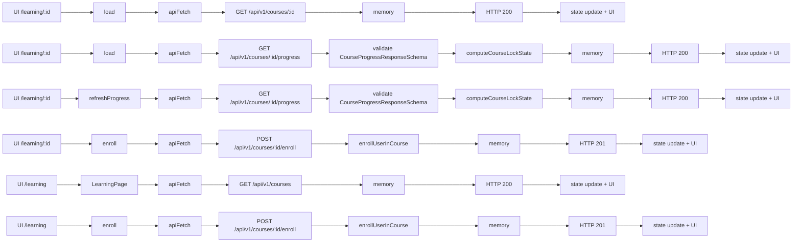

| Flow     | From                                   | Chain                                                                                                                                                                                               | Status      | Verification |
| -------- | -------------------------------------- | --------------------------------------------------------------------------------------------------------------------------------------------------------------------------------------------------- | ----------- | ------------ |
| FLOW-037 | apps/web/src/pages/CoursePage.tsx:57   | UI /learning/:id -> load() -> apiFetch -> GET /api/v1/courses/:id -> memory -> HTTP 200 -> state update + UI                                                                                        | IMPLEMENTED | VERIFIED     |
| FLOW-038 | apps/web/src/pages/CoursePage.tsx:58   | UI /learning/:id -> load() -> apiFetch -> GET /api/v1/courses/:id/progress -> validate CourseProgressResponseSchema -> computeCourseLockState -> memory -> HTTP 200 -> state update + UI            | IMPLEMENTED | VERIFIED     |
| FLOW-039 | apps/web/src/pages/CoursePage.tsx:79   | UI /learning/:id -> refreshProgress() -> apiFetch -> GET /api/v1/courses/:id/progress -> validate CourseProgressResponseSchema -> computeCourseLockState -> memory -> HTTP 200 -> state update + UI | IMPLEMENTED | VERIFIED     |
| FLOW-040 | apps/web/src/pages/CoursePage.tsx:89   | UI /learning/:id -> enroll() -> apiFetch -> POST /api/v1/courses/:id/enroll -> enrollUserInCourse -> memory -> HTTP 201 -> state update + UI                                                        | IMPLEMENTED | VERIFIED     |
| FLOW-074 | apps/web/src/pages/LearningPage.tsx:54 | UI /learning -> LearningPage() -> apiFetch -> GET /api/v1/courses -> memory -> HTTP 200 -> state update + UI                                                                                        | IMPLEMENTED | VERIFIED     |
| FLOW-075 | apps/web/src/pages/LearningPage.tsx:72 | UI /learning -> enroll() -> apiFetch -> POST /api/v1/courses/:id/enroll -> enrollUserInCourse -> memory -> HTTP 201 -> state update + UI                                                            | IMPLEMENTED | VERIFIED     |

## evidence

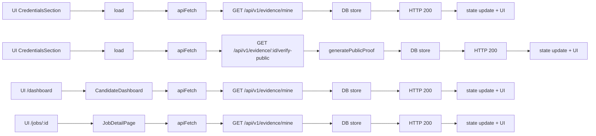

| Flow     | From                                              | Chain                                                                                                                                                       | Status      | Verification |
| -------- | ------------------------------------------------- | ----------------------------------------------------------------------------------------------------------------------------------------------------------- | ----------- | ------------ |
| FLOW-006 | apps/web/src/components/CredentialsSection.tsx:52 | UI CredentialsSection -> load() -> apiFetch -> GET /api/v1/evidence/mine -> DB (store) -> HTTP 200 -> state update + UI                                     | IMPLEMENTED | VERIFIED     |
| FLOW-007 | apps/web/src/components/CredentialsSection.tsx:62 | UI CredentialsSection -> load() -> apiFetch -> GET /api/v1/evidence/:id/verify-public -> generatePublicProof -> DB (store) -> HTTP 200 -> state update + UI | IMPLEMENTED | VERIFIED     |
| FLOW-044 | apps/web/src/pages/DashboardPage.tsx:132          | UI /dashboard -> CandidateDashboard() -> apiFetch -> GET /api/v1/evidence/mine -> DB (store) -> HTTP 200 -> state update + UI                               | IMPLEMENTED | VERIFIED     |
| FLOW-069 | apps/web/src/pages/JobDetailPage.tsx:86           | UI /jobs/:id -> JobDetailPage() -> apiFetch -> GET /api/v1/evidence/mine -> DB (store) -> HTTP 200 -> state update + UI                                     | IMPLEMENTED | VERIFIED     |

## jobs

```mermaid
flowchart LR
  FLOW_045_0["UI /dashboard"]
  FLOW_045_1["CandidateDashboard"]
  FLOW_045_0 --> FLOW_045_1
  FLOW_045_2["apiFetch"]
  FLOW_045_1 --> FLOW_045_2
  FLOW_045_3["GET /api/v1/jobs"]
  FLOW_045_2 --> FLOW_045_3
  FLOW_045_4["DB store"]
  FLOW_045_3 --> FLOW_045_4
  FLOW_045_5["HTTP 200"]
  FLOW_045_4 --> FLOW_045_5
  FLOW_045_6["state update + UI"]
  FLOW_045_5 --> FLOW_045_6
  FLOW_055_0["UI /hiring/jobs/:id"]
  FLOW_055_1["load"]
  FLOW_055_0 --> FLOW_055_1
  FLOW_055_2["apiFetch"]
  FLOW_055_1 --> FLOW_055_2
  FLOW_055_3["GET /api/v1/jobs/:id"]
  FLOW_055_2 --> FLOW_055_3
  FLOW_055_4["DB store"]
  FLOW_055_3 --> FLOW_055_4
  FLOW_055_5["HTTP 200"]
  FLOW_055_4 --> FLOW_055_5
  FLOW_055_6["state update + UI"]
  FLOW_055_5 --> FLOW_055_6
  FLOW_056_0["UI /hiring/jobs/:id"]
  FLOW_056_1["load"]
  FLOW_056_0 --> FLOW_056_1
  FLOW_056_2["apiFetch"]
  FLOW_056_1 --> FLOW_056_2
  FLOW_056_3["GET /api/v1/jobs/:id/applications"]
  FLOW_056_2 --> FLOW_056_3
  FLOW_056_4["DB store"]
  FLOW_056_3 --> FLOW_056_4
  FLOW_056_5["HTTP 200"]
  FLOW_056_4 --> FLOW_056_5
  FLOW_056_6["state update + UI"]
  FLOW_056_5 --> FLOW_056_6
  FLOW_059_0["UI /hiring/jobs/:id"]
  FLOW_059_1["changeJobStatus"]
  FLOW_059_0 --> FLOW_059_1
  FLOW_059_2["apiFetch"]
  FLOW_059_1 --> FLOW_059_2
  FLOW_059_3["PATCH /api/v1/jobs/:id/status"]
  FLOW_059_2 --> FLOW_059_3
  FLOW_059_4["validate UpdateJobStatusInputSchema"]
  FLOW_059_3 --> FLOW_059_4
  FLOW_059_5["transitionJobStatus"]
  FLOW_059_4 --> FLOW_059_5
  FLOW_059_6["evaluateJobAlertsForPublishedJob"]
  FLOW_059_5 --> FLOW_059_6
  FLOW_059_7["DB jobs, job_skills"]
  FLOW_059_6 --> FLOW_059_7
  FLOW_059_8["HTTP 200"]
  FLOW_059_7 --> FLOW_059_8
  FLOW_059_9["state update + UI"]
  FLOW_059_8 --> FLOW_059_9
  FLOW_061_0["UI /hiring"]
  FLOW_061_1["submit"]
  FLOW_061_0 --> FLOW_061_1
  FLOW_061_2["apiFetch"]
  FLOW_061_1 --> FLOW_061_2
  FLOW_061_3["POST /api/v1/jobs"]
  FLOW_061_2 --> FLOW_061_3
  FLOW_061_4["validate CreateJobInputSchema"]
  FLOW_061_3 --> FLOW_061_4
  FLOW_061_5["createJobPosting"]
  FLOW_061_4 --> FLOW_061_5
  FLOW_061_6["evaluateJobAlertsForPublishedJob"]
  FLOW_061_5 --> FLOW_061_6
  FLOW_061_7["DB jobs, job_skills"]
  FLOW_061_6 --> FLOW_061_7
  FLOW_061_8["HTTP 201"]
  FLOW_061_7 --> FLOW_061_8
  FLOW_061_9["state update + UI"]
  FLOW_061_8 --> FLOW_061_9
  FLOW_062_0["UI /hiring"]
  FLOW_062_1["submit"]
  FLOW_062_0 --> FLOW_062_1
  FLOW_062_2["apiFetch"]
  FLOW_062_1 --> FLOW_062_2
  FLOW_062_3["PATCH /api/v1/jobs/:id/status"]
  FLOW_062_2 --> FLOW_062_3
  FLOW_062_4["validate UpdateJobStatusInputSchema"]
  FLOW_062_3 --> FLOW_062_4
  FLOW_062_5["transitionJobStatus"]
  FLOW_062_4 --> FLOW_062_5
  FLOW_062_6["evaluateJobAlertsForPublishedJob"]
  FLOW_062_5 --> FLOW_062_6
  FLOW_062_7["DB jobs, job_skills"]
  FLOW_062_6 --> FLOW_062_7
  FLOW_062_8["HTTP 200"]
  FLOW_062_7 --> FLOW_062_8
  FLOW_062_9["state update + UI"]
  FLOW_062_8 --> FLOW_062_9
  FLOW_066_0["UI /hiring"]
  FLOW_066_1["changeStatus"]
  FLOW_066_0 --> FLOW_066_1
  FLOW_066_2["apiFetch"]
  FLOW_066_1 --> FLOW_066_2
  FLOW_066_3["PATCH /api/v1/jobs/:id/status"]
  FLOW_066_2 --> FLOW_066_3
  FLOW_066_4["validate UpdateJobStatusInputSchema"]
  FLOW_066_3 --> FLOW_066_4
  FLOW_066_5["transitionJobStatus"]
  FLOW_066_4 --> FLOW_066_5
  FLOW_066_6["evaluateJobAlertsForPublishedJob"]
  FLOW_066_5 --> FLOW_066_6
  FLOW_066_7["DB jobs, job_skills"]
  FLOW_066_6 --> FLOW_066_7
  FLOW_066_8["HTTP 200"]
  FLOW_066_7 --> FLOW_066_8
  FLOW_066_9["state update + UI"]
  FLOW_066_8 --> FLOW_066_9
  FLOW_067_0["UI /jobs/:id"]
  FLOW_067_1["JobDetailPage"]
  FLOW_067_0 --> FLOW_067_1
  FLOW_067_2["apiFetch"]
  FLOW_067_1 --> FLOW_067_2
  FLOW_067_3["GET /api/v1/jobs/:id"]
  FLOW_067_2 --> FLOW_067_3
  FLOW_067_4["DB store"]
  FLOW_067_3 --> FLOW_067_4
  FLOW_067_5["HTTP 200"]
  FLOW_067_4 --> FLOW_067_5
  FLOW_067_6["state update + UI"]
  FLOW_067_5 --> FLOW_067_6
  FLOW_070_0["UI /jobs/:id"]
  FLOW_070_1["stillHere"]
  FLOW_070_0 --> FLOW_070_1
  FLOW_070_2["apiFetch"]
  FLOW_070_1 --> FLOW_070_2
  FLOW_070_3["POST /api/v1/jobs/:id/apply"]
  FLOW_070_2 --> FLOW_070_3
  FLOW_070_4["validate SubmitApplicationInputSchema"]
  FLOW_070_3 --> FLOW_070_4
  FLOW_070_5["markDraftSubmitted"]
  FLOW_070_4 --> FLOW_070_5
  FLOW_070_6["submitJobApplication"]
  FLOW_070_5 --> FLOW_070_6
  FLOW_070_7["assertAttachableEvidence"]
  FLOW_070_6 --> FLOW_070_7
  FLOW_070_8["DB job_applications, application_evidence, noti..."]
  FLOW_070_7 --> FLOW_070_8
  FLOW_070_9["jobs application.submitted"]
  FLOW_070_8 --> FLOW_070_9
  FLOW_070_10["HTTP 201"]
  FLOW_070_9 --> FLOW_070_10
  FLOW_070_11["state update + UI"]
  FLOW_070_10 --> FLOW_070_11
  FLOW_072_0["UI /jobs"]
  FLOW_072_1["JobsPage"]
  FLOW_072_0 --> FLOW_072_1
  FLOW_072_2["apiFetch"]
  FLOW_072_1 --> FLOW_072_2
  FLOW_072_3["GET /api/v1/jobs"]
  FLOW_072_2 --> FLOW_072_3
  FLOW_072_4["DB store"]
  FLOW_072_3 --> FLOW_072_4
  FLOW_072_5["HTTP 200"]
  FLOW_072_4 --> FLOW_072_5
  FLOW_072_6["state update + UI"]
  FLOW_072_5 --> FLOW_072_6
```

| Flow     | From                                     | Chain                                                                                                                                                                                                                                                                                                                | Status      | Verification |
| -------- | ---------------------------------------- | -------------------------------------------------------------------------------------------------------------------------------------------------------------------------------------------------------------------------------------------------------------------------------------------------------------------- | ----------- | ------------ |
| FLOW-045 | apps/web/src/pages/DashboardPage.tsx:133 | UI /dashboard -> CandidateDashboard() -> apiFetch -> GET /api/v1/jobs -> DB (store) -> HTTP 200 -> state update + UI                                                                                                                                                                                                 | IMPLEMENTED | VERIFIED     |
| FLOW-055 | apps/web/src/pages/HiringJobPage.tsx:76  | UI /hiring/jobs/:id -> load() -> apiFetch -> GET /api/v1/jobs/:id -> DB (store) -> HTTP 200 -> state update + UI                                                                                                                                                                                                     | IMPLEMENTED | VERIFIED     |
| FLOW-056 | apps/web/src/pages/HiringJobPage.tsx:78  | UI /hiring/jobs/:id -> load() -> apiFetch -> GET /api/v1/jobs/:id/applications -> DB (store) -> HTTP 200 -> state update + UI                                                                                                                                                                                        | IMPLEMENTED | VERIFIED     |
| FLOW-059 | apps/web/src/pages/HiringJobPage.tsx:152 | UI /hiring/jobs/:id -> changeJobStatus() -> apiFetch -> PATCH /api/v1/jobs/:id/status -> validate UpdateJobStatusInputSchema -> transitionJobStatus -> evaluateJobAlertsForPublishedJob -> DB jobs, job_skills -> HTTP 200 -> state update + UI                                                                      | IMPLEMENTED | VERIFIED     |
| FLOW-061 | apps/web/src/pages/HiringPage.tsx:218    | UI /hiring -> submit() -> apiFetch -> POST /api/v1/jobs -> validate CreateJobInputSchema -> createJobPosting -> evaluateJobAlertsForPublishedJob -> DB jobs, job_skills -> HTTP 201 -> state update + UI                                                                                                             | IMPLEMENTED | VERIFIED     |
| FLOW-062 | apps/web/src/pages/HiringPage.tsx:237    | UI /hiring -> submit() -> apiFetch -> PATCH /api/v1/jobs/:id/status -> validate UpdateJobStatusInputSchema -> transitionJobStatus -> evaluateJobAlertsForPublishedJob -> DB jobs, job_skills -> HTTP 200 -> state update + UI                                                                                        | IMPLEMENTED | VERIFIED     |
| FLOW-066 | apps/web/src/pages/HiringPage.tsx:462    | UI /hiring -> changeStatus() -> apiFetch -> PATCH /api/v1/jobs/:id/status -> validate UpdateJobStatusInputSchema -> transitionJobStatus -> evaluateJobAlertsForPublishedJob -> DB jobs, job_skills -> HTTP 200 -> state update + UI                                                                                  | IMPLEMENTED | VERIFIED     |
| FLOW-067 | apps/web/src/pages/JobDetailPage.tsx:60  | UI /jobs/:id -> JobDetailPage() -> apiFetch -> GET /api/v1/jobs/:id -> DB (store) -> HTTP 200 -> state update + UI                                                                                                                                                                                                   | IMPLEMENTED | VERIFIED     |
| FLOW-070 | apps/web/src/pages/JobDetailPage.tsx:105 | UI /jobs/:id -> stillHere() -> apiFetch -> POST /api/v1/jobs/:id/apply -> validate SubmitApplicationInputSchema -> markDraftSubmitted -> submitJobApplication -> assertAttachableEvidence -> DB job_applications, application_evidence, notifications -> jobs application.submitted -> HTTP 201 -> state update + UI | IMPLEMENTED | VERIFIED     |
| FLOW-072 | apps/web/src/pages/JobsPage.tsx:38       | UI /jobs -> JobsPage() -> apiFetch -> GET /api/v1/jobs -> DB (store) -> HTTP 200 -> state update + UI                                                                                                                                                                                                                | IMPLEMENTED | VERIFIED     |

## lessons

```mermaid
flowchart LR
  FLOW_041_0["UI /learning/:id"]
  FLOW_041_1["complete"]
  FLOW_041_0 --> FLOW_041_1
  FLOW_041_2["apiFetch"]
  FLOW_041_1 --> FLOW_041_2
  FLOW_041_3["POST /api/v1/lessons/:id/complete"]
  FLOW_041_2 --> FLOW_041_3
  FLOW_041_4["calculateCappedXp"]
  FLOW_041_3 --> FLOW_041_4
  FLOW_041_5["courseCompletionEvidence"]
  FLOW_041_4 --> FLOW_041_5
  FLOW_041_6["verifySequentialModuleProgress"]
  FLOW_041_5 --> FLOW_041_6
  FLOW_041_7["DB evidence, evidence_skills"]
  FLOW_041_6 --> FLOW_041_7
  FLOW_041_8["jobs evidence.propagate, lms.course.completed"]
  FLOW_041_7 --> FLOW_041_8
  FLOW_041_9["HTTP 200"]
  FLOW_041_8 --> FLOW_041_9
  FLOW_041_10["state update + UI"]
  FLOW_041_9 --> FLOW_041_10
```

| Flow     | From                                  | Chain                                                                                                                                                                                                                                                                                | Status      | Verification |
| -------- | ------------------------------------- | ------------------------------------------------------------------------------------------------------------------------------------------------------------------------------------------------------------------------------------------------------------------------------------ | ----------- | ------------ |
| FLOW-041 | apps/web/src/pages/CoursePage.tsx:103 | UI /learning/:id -> complete() -> apiFetch -> POST /api/v1/lessons/:id/complete -> calculateCappedXp -> courseCompletionEvidence -> verifySequentialModuleProgress -> DB evidence, evidence_skills -> jobs evidence.propagate, lms.course.completed -> HTTP 200 -> state update + UI | IMPLEMENTED | VERIFIED     |

## notifications

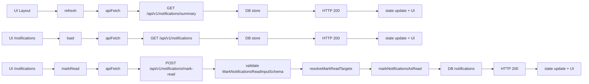

| Flow     | From                                        | Chain                                                                                                                                                                                                                                      | Status      | Verification |
| -------- | ------------------------------------------- | ------------------------------------------------------------------------------------------------------------------------------------------------------------------------------------------------------------------------------------------ | ----------- | ------------ |
| FLOW-008 | apps/web/src/components/Layout.tsx:125      | UI Layout -> refresh() -> apiFetch -> GET /api/v1/notifications/summary -> DB (store) -> HTTP 200 -> state update + UI                                                                                                                     | IMPLEMENTED | VERIFIED     |
| FLOW-082 | apps/web/src/pages/NotificationsPage.tsx:26 | UI /notifications -> load() -> apiFetch -> GET /api/v1/notifications -> DB (store) -> HTTP 200 -> state update + UI                                                                                                                        | IMPLEMENTED | VERIFIED     |
| FLOW-083 | apps/web/src/pages/NotificationsPage.tsx:39 | UI /notifications -> markRead() -> apiFetch -> POST /api/v1/notifications/mark-read -> validate MarkNotificationsReadInputSchema -> resolveMarkReadTargets -> markNotificationsAsRead -> DB notifications -> HTTP 200 -> state update + UI | IMPLEMENTED | VERIFIED     |

## organizations

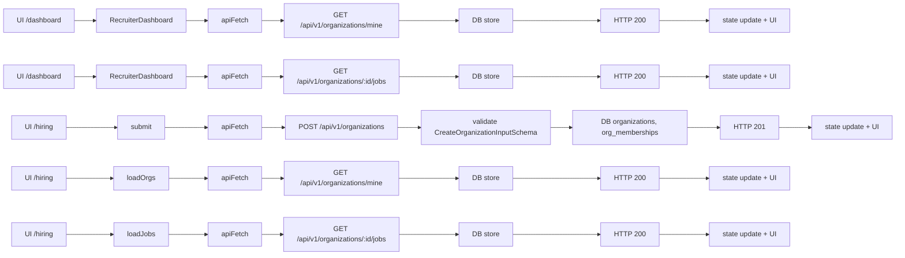

| Flow     | From                                     | Chain                                                                                                                                                                            | Status      | Verification |
| -------- | ---------------------------------------- | -------------------------------------------------------------------------------------------------------------------------------------------------------------------------------- | ----------- | ------------ |
| FLOW-046 | apps/web/src/pages/DashboardPage.tsx:306 | UI /dashboard -> RecruiterDashboard() -> apiFetch -> GET /api/v1/organizations/mine -> DB (store) -> HTTP 200 -> state update + UI                                               | IMPLEMENTED | UNKNOWN      |
| FLOW-047 | apps/web/src/pages/DashboardPage.tsx:312 | UI /dashboard -> RecruiterDashboard() -> apiFetch -> GET /api/v1/organizations/:id/jobs -> DB (store) -> HTTP 200 -> state update + UI                                           | IMPLEMENTED | VERIFIED     |
| FLOW-060 | apps/web/src/pages/HiringPage.tsx:86     | UI /hiring -> submit() -> apiFetch -> POST /api/v1/organizations -> validate CreateOrganizationInputSchema -> DB organizations, org_memberships -> HTTP 201 -> state update + UI | IMPLEMENTED | VERIFIED     |
| FLOW-063 | apps/web/src/pages/HiringPage.tsx:428    | UI /hiring -> loadOrgs() -> apiFetch -> GET /api/v1/organizations/mine -> DB (store) -> HTTP 200 -> state update + UI                                                            | IMPLEMENTED | UNKNOWN      |
| FLOW-064 | apps/web/src/pages/HiringPage.tsx:439    | UI /hiring -> loadJobs() -> apiFetch -> GET /api/v1/organizations/:id/jobs -> DB (store) -> HTTP 200 -> state update + UI                                                        | IMPLEMENTED | VERIFIED     |

## portfolio

```mermaid
flowchart LR
  FLOW_084_0["UI /portfolio"]
  FLOW_084_1["PortfolioPage"]
  FLOW_084_0 --> FLOW_084_1
  FLOW_084_2["apiFetch"]
  FLOW_084_1 --> FLOW_084_2
  FLOW_084_3["GET /api/v1/portfolio/projects"]
  FLOW_084_2 --> FLOW_084_3
  FLOW_084_4["memory"]
  FLOW_084_3 --> FLOW_084_4
  FLOW_084_5["HTTP 200"]
  FLOW_084_4 --> FLOW_084_5
  FLOW_084_6["state update + UI"]
  FLOW_084_5 --> FLOW_084_6
  FLOW_085_0["UI /portfolio"]
  FLOW_085_1["create"]
  FLOW_085_0 --> FLOW_085_1
  FLOW_085_2["apiFetch"]
  FLOW_085_1 --> FLOW_085_2
  FLOW_085_3["POST /api/v1/portfolio/projects"]
  FLOW_085_2 --> FLOW_085_3
  FLOW_085_4["validate CreatePortfolioProjectInputSchema"]
  FLOW_085_3 --> FLOW_085_4
  FLOW_085_5["createPortfolioProject"]
  FLOW_085_4 --> FLOW_085_5
  FLOW_085_6["memory"]
  FLOW_085_5 --> FLOW_085_6
  FLOW_085_7["jobs portfolio.project.created"]
  FLOW_085_6 --> FLOW_085_7
  FLOW_085_8["HTTP 201"]
  FLOW_085_7 --> FLOW_085_8
  FLOW_085_9["state update + UI"]
  FLOW_085_8 --> FLOW_085_9
```

| Flow     | From                                    | Chain                                                                                                                                                                                                                         | Status      | Verification |
| -------- | --------------------------------------- | ----------------------------------------------------------------------------------------------------------------------------------------------------------------------------------------------------------------------------- | ----------- | ------------ |
| FLOW-084 | apps/web/src/pages/PortfolioPage.tsx:58 | UI /portfolio -> PortfolioPage() -> apiFetch -> GET /api/v1/portfolio/projects -> memory -> HTTP 200 -> state update + UI                                                                                                     | UNKNOWN     | VERIFIED     |
| FLOW-085 | apps/web/src/pages/PortfolioPage.tsx:93 | UI /portfolio -> create() -> apiFetch -> POST /api/v1/portfolio/projects -> validate CreatePortfolioProjectInputSchema -> createPortfolioProject -> memory -> jobs portfolio.project.created -> HTTP 201 -> state update + UI | IMPLEMENTED | VERIFIED     |

## profile

```mermaid
flowchart LR
  FLOW_086_0["UI /profile"]
  FLOW_086_1["save"]
  FLOW_086_0 --> FLOW_086_1
  FLOW_086_2["apiFetch"]
  FLOW_086_1 --> FLOW_086_2
  FLOW_086_3["PATCH /api/v1/profile/me"]
  FLOW_086_2 --> FLOW_086_3
  FLOW_086_4["validate UpdateProfileInputSchema"]
  FLOW_086_3 --> FLOW_086_4
  FLOW_086_5["updateProfileEntity"]
  FLOW_086_4 --> FLOW_086_5
  FLOW_086_6["DB profiles"]
  FLOW_086_5 --> FLOW_086_6
  FLOW_086_7["HTTP 200"]
  FLOW_086_6 --> FLOW_086_7
  FLOW_086_8["state update + UI"]
  FLOW_086_7 --> FLOW_086_8
```

| Flow     | From                                  | Chain                                                                                                                                                                     | Status      | Verification |
| -------- | ------------------------------------- | ------------------------------------------------------------------------------------------------------------------------------------------------------------------------- | ----------- | ------------ |
| FLOW-086 | apps/web/src/pages/ProfilePage.tsx:95 | UI /profile -> save() -> apiFetch -> PATCH /api/v1/profile/me -> validate UpdateProfileInputSchema -> updateProfileEntity -> DB profiles -> HTTP 200 -> state update + UI | IMPLEMENTED | VERIFIED     |

## references

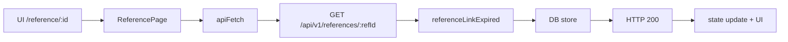

| Flow     | From                                    | Chain                                                                                                                                                    | Status      | Verification |
| -------- | --------------------------------------- | -------------------------------------------------------------------------------------------------------------------------------------------------------- | ----------- | ------------ |
| FLOW-089 | apps/web/src/pages/ReferencePage.tsx:72 | UI /reference/:id -> ReferencePage() -> apiFetch -> GET /api/v1/references/:refId -> referenceLinkExpired -> DB (store) -> HTTP 200 -> state update + UI | IMPLEMENTED | VERIFIED     |

## resumes

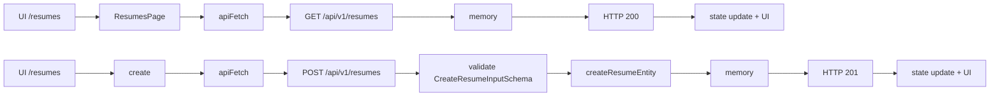

| Flow     | From                                  | Chain                                                                                                                                                            | Status      | Verification |
| -------- | ------------------------------------- | ---------------------------------------------------------------------------------------------------------------------------------------------------------------- | ----------- | ------------ |
| FLOW-091 | apps/web/src/pages/ResumesPage.tsx:53 | UI /resumes -> ResumesPage() -> apiFetch -> GET /api/v1/resumes -> memory -> HTTP 200 -> state update + UI                                                       | UNKNOWN     | VERIFIED     |
| FLOW-092 | apps/web/src/pages/ResumesPage.tsx:84 | UI /resumes -> create() -> apiFetch -> POST /api/v1/resumes -> validate CreateResumeInputSchema -> createResumeEntity -> memory -> HTTP 201 -> state update + UI | IMPLEMENTED | VERIFIED     |

## search

```mermaid
flowchart LR
  FLOW_081_0["UI /network"]
  FLOW_081_1["search"]
  FLOW_081_0 --> FLOW_081_1
  FLOW_081_2["apiFetch"]
  FLOW_081_1 --> FLOW_081_2
  FLOW_081_3["GET /api/v1/search"]
  FLOW_081_2 --> FLOW_081_3
  FLOW_081_4["validate SearchQueryInputSchema"]
  FLOW_081_3 --> FLOW_081_4
  FLOW_081_5["canViewProfile"]
  FLOW_081_4 --> FLOW_081_5
  FLOW_081_6["scoreSearchMatch"]
  FLOW_081_5 --> FLOW_081_6
  FLOW_081_7["rankSearchResults"]
  FLOW_081_6 --> FLOW_081_7
  FLOW_081_8["memory"]
  FLOW_081_7 --> FLOW_081_8
  FLOW_081_9["jobs search.queried"]
  FLOW_081_8 --> FLOW_081_9
  FLOW_081_10["HTTP 200"]
  FLOW_081_9 --> FLOW_081_10
  FLOW_081_11["state update + UI"]
  FLOW_081_10 --> FLOW_081_11
```

| Flow     | From                                   | Chain                                                                                                                                                                                                                     | Status      | Verification |
| -------- | -------------------------------------- | ------------------------------------------------------------------------------------------------------------------------------------------------------------------------------------------------------------------------- | ----------- | ------------ |
| FLOW-081 | apps/web/src/pages/NetworkPage.tsx:155 | UI /network -> search() -> apiFetch -> GET /api/v1/search -> validate SearchQueryInputSchema -> canViewProfile -> scoreSearchMatch -> rankSearchResults -> memory -> jobs search.queried -> HTTP 200 -> state update + UI | IMPLEMENTED | VERIFIED     |

## settings

```mermaid
flowchart LR
  FLOW_087_0["UI /profile"]
  FLOW_087_1["deleteAccount"]
  FLOW_087_0 --> FLOW_087_1
  FLOW_087_2["apiFetch"]
  FLOW_087_1 --> FLOW_087_2
  FLOW_087_3["POST /api/v1/settings/erasure/execute"]
  FLOW_087_2 --> FLOW_087_3
  FLOW_087_4["validate ExecuteErasureInputSchema"]
  FLOW_087_3 --> FLOW_087_4
  FLOW_087_5["verifyPassword"]
  FLOW_087_4 --> FLOW_087_5
  FLOW_087_6["verifySessionToken"]
  FLOW_087_5 --> FLOW_087_6
  FLOW_087_7["executeLogicalAnonymization"]
  FLOW_087_6 --> FLOW_087_7
  FLOW_087_8["DB users, profiles, evidence, job_applications,..."]
  FLOW_087_7 --> FLOW_087_8
  FLOW_087_9["jobs gdpr.erasure.completed"]
  FLOW_087_8 --> FLOW_087_9
  FLOW_087_10["HTTP 200"]
  FLOW_087_9 --> FLOW_087_10
  FLOW_087_11["state update + UI"]
  FLOW_087_10 --> FLOW_087_11
  FLOW_088_0["UI /profile"]
  FLOW_088_1["exportData"]
  FLOW_088_0 --> FLOW_088_1
  FLOW_088_2["apiFetch"]
  FLOW_088_1 --> FLOW_088_2
  FLOW_088_3["POST /api/v1/settings/export"]
  FLOW_088_2 --> FLOW_088_3
  FLOW_088_4["validate RequestDataExportInputSchema"]
  FLOW_088_3 --> FLOW_088_4
  FLOW_088_5["withProfileVisibility"]
  FLOW_088_4 --> FLOW_088_5
  FLOW_088_6["compileDataExportArchive"]
  FLOW_088_5 --> FLOW_088_6
  FLOW_088_7["memory"]
  FLOW_088_6 --> FLOW_088_7
  FLOW_088_8["jobs gdpr.data.exported"]
  FLOW_088_7 --> FLOW_088_8
  FLOW_088_9["HTTP 200"]
  FLOW_088_8 --> FLOW_088_9
  FLOW_088_10["state update + UI"]
  FLOW_088_9 --> FLOW_088_10
  FLOW_093_0["UI /settings"]
  FLOW_093_1["SettingsPage"]
  FLOW_093_0 --> FLOW_093_1
  FLOW_093_2["apiFetch"]
  FLOW_093_1 --> FLOW_093_2
  FLOW_093_3["GET /api/v1/settings"]
  FLOW_093_2 --> FLOW_093_3
  FLOW_093_4["DB store"]
  FLOW_093_3 --> FLOW_093_4
  FLOW_093_5["HTTP 200"]
  FLOW_093_4 --> FLOW_093_5
  FLOW_093_6["state update + UI"]
  FLOW_093_5 --> FLOW_093_6
  FLOW_094_0["UI /settings"]
  FLOW_094_1["save"]
  FLOW_094_0 --> FLOW_094_1
  FLOW_094_2["apiFetch"]
  FLOW_094_1 --> FLOW_094_2
  FLOW_094_3["PATCH /api/v1/settings"]
  FLOW_094_2 --> FLOW_094_3
  FLOW_094_4["validate UpdateUserSettingsInputSchema"]
  FLOW_094_3 --> FLOW_094_4
  FLOW_094_5["updateUserSettings"]
  FLOW_094_4 --> FLOW_094_5
  FLOW_094_6["DB profiles"]
  FLOW_094_5 --> FLOW_094_6
  FLOW_094_7["jobs user.settings.updated"]
  FLOW_094_6 --> FLOW_094_7
  FLOW_094_8["HTTP 200"]
  FLOW_094_7 --> FLOW_094_8
  FLOW_094_9["state update + UI"]
  FLOW_094_8 --> FLOW_094_9
```

| Flow     | From                                    | Chain                                                                                                                                                                                                                                                                                                                                                                                                           | Status      | Verification |
| -------- | --------------------------------------- | --------------------------------------------------------------------------------------------------------------------------------------------------------------------------------------------------------------------------------------------------------------------------------------------------------------------------------------------------------------------------------------------------------------- | ----------- | ------------ |
| FLOW-087 | apps/web/src/pages/ProfilePage.tsx:121  | UI /profile -> deleteAccount() -> apiFetch -> POST /api/v1/settings/erasure/execute -> validate ExecuteErasureInputSchema -> verifyPassword -> verifySessionToken -> executeLogicalAnonymization -> DB users, profiles, evidence, job_applications, application_evidence, thread_participants, messages, notifications, verified_work_histories -> jobs gdpr.erasure.completed -> HTTP 200 -> state update + UI | IMPLEMENTED | VERIFIED     |
| FLOW-088 | apps/web/src/pages/ProfilePage.tsx:152  | UI /profile -> exportData() -> apiFetch -> POST /api/v1/settings/export -> validate RequestDataExportInputSchema -> withProfileVisibility -> compileDataExportArchive -> memory -> jobs gdpr.data.exported -> HTTP 200 -> state update + UI                                                                                                                                                                     | IMPLEMENTED | VERIFIED     |
| FLOW-093 | apps/web/src/pages/SettingsPage.tsx:123 | UI /settings -> SettingsPage() -> apiFetch -> GET /api/v1/settings -> DB (store) -> HTTP 200 -> state update + UI                                                                                                                                                                                                                                                                                               | IMPLEMENTED | VERIFIED     |
| FLOW-094 | apps/web/src/pages/SettingsPage.tsx:157 | UI /settings -> save() -> apiFetch -> PATCH /api/v1/settings -> validate UpdateUserSettingsInputSchema -> updateUserSettings -> DB profiles -> jobs user.settings.updated -> HTTP 200 -> state update + UI                                                                                                                                                                                                      | IMPLEMENTED | VERIFIED     |

## skills

```mermaid
flowchart LR
  FLOW_015_0["UI SkillsSection"]
  FLOW_015_1["load"]
  FLOW_015_0 --> FLOW_015_1
  FLOW_015_2["apiFetch"]
  FLOW_015_1 --> FLOW_015_2
  FLOW_015_3["GET /api/v1/skills"]
  FLOW_015_2 --> FLOW_015_3
  FLOW_015_4["DB store"]
  FLOW_015_3 --> FLOW_015_4
  FLOW_015_5["HTTP 200"]
  FLOW_015_4 --> FLOW_015_5
  FLOW_015_6["state update + UI"]
  FLOW_015_5 --> FLOW_015_6
  FLOW_016_0["UI SkillsSection"]
  FLOW_016_1["load"]
  FLOW_016_0 --> FLOW_016_1
  FLOW_016_2["apiFetch"]
  FLOW_016_1 --> FLOW_016_2
  FLOW_016_3["GET /api/v1/skills/freshness/my"]
  FLOW_016_2 --> FLOW_016_3
  FLOW_016_4["memory"]
  FLOW_016_3 --> FLOW_016_4
  FLOW_016_5["HTTP 200"]
  FLOW_016_4 --> FLOW_016_5
  FLOW_016_6["state update + UI"]
  FLOW_016_5 --> FLOW_016_6
  FLOW_017_0["UI SkillsSection"]
  FLOW_017_1["load"]
  FLOW_017_0 --> FLOW_017_1
  FLOW_017_2["apiFetch"]
  FLOW_017_1 --> FLOW_017_2
  FLOW_017_3["GET /api/v1/skills/:id/graph"]
  FLOW_017_2 --> FLOW_017_3
  FLOW_017_4["traverseSkillGraph"]
  FLOW_017_3 --> FLOW_017_4
  FLOW_017_5["memory"]
  FLOW_017_4 --> FLOW_017_5
  FLOW_017_6["HTTP 200"]
  FLOW_017_5 --> FLOW_017_6
  FLOW_017_7["state update + UI"]
  FLOW_017_6 --> FLOW_017_7
  FLOW_018_0["UI SkillsSection"]
  FLOW_018_1["addSkill"]
  FLOW_018_0 --> FLOW_018_1
  FLOW_018_2["apiFetch"]
  FLOW_018_1 --> FLOW_018_2
  FLOW_018_3["POST /api/v1/skills/freshness"]
  FLOW_018_2 --> FLOW_018_3
  FLOW_018_4["validate RegisterSkillFreshnessInputSchema"]
  FLOW_018_3 --> FLOW_018_4
  FLOW_018_5["createSkillFreshnessRecord"]
  FLOW_018_4 --> FLOW_018_5
  FLOW_018_6["memory"]
  FLOW_018_5 --> FLOW_018_6
  FLOW_018_7["HTTP 201"]
  FLOW_018_6 --> FLOW_018_7
  FLOW_018_8["state update + UI"]
  FLOW_018_7 --> FLOW_018_8
  FLOW_031_0["UI /career"]
  FLOW_031_1["load"]
  FLOW_031_0 --> FLOW_031_1
  FLOW_031_2["apiFetch"]
  FLOW_031_1 --> FLOW_031_2
  FLOW_031_3["GET /api/v1/skills"]
  FLOW_031_2 --> FLOW_031_3
  FLOW_031_4["DB store"]
  FLOW_031_3 --> FLOW_031_4
  FLOW_031_5["HTTP 200"]
  FLOW_031_4 --> FLOW_031_5
  FLOW_031_6["state update + UI"]
  FLOW_031_5 --> FLOW_031_6
  FLOW_032_0["UI /career"]
  FLOW_032_1["load"]
  FLOW_032_0 --> FLOW_032_1
  FLOW_032_2["apiFetch"]
  FLOW_032_1 --> FLOW_032_2
  FLOW_032_3["GET /api/v1/skills/freshness/my"]
  FLOW_032_2 --> FLOW_032_3
  FLOW_032_4["memory"]
  FLOW_032_3 --> FLOW_032_4
  FLOW_032_5["HTTP 200"]
  FLOW_032_4 --> FLOW_032_5
  FLOW_032_6["state update + UI"]
  FLOW_032_5 --> FLOW_032_6
  FLOW_065_0["UI /hiring"]
  FLOW_065_1["HiringPage"]
  FLOW_065_0 --> FLOW_065_1
  FLOW_065_2["apiFetch"]
  FLOW_065_1 --> FLOW_065_2
  FLOW_065_3["GET /api/v1/skills"]
  FLOW_065_2 --> FLOW_065_3
  FLOW_065_4["DB store"]
  FLOW_065_3 --> FLOW_065_4
  FLOW_065_5["HTTP 200"]
  FLOW_065_4 --> FLOW_065_5
  FLOW_065_6["state update + UI"]
  FLOW_065_5 --> FLOW_065_6
```

| Flow     | From                                         | Chain                                                                                                                                                                                              | Status      | Verification |
| -------- | -------------------------------------------- | -------------------------------------------------------------------------------------------------------------------------------------------------------------------------------------------------- | ----------- | ------------ |
| FLOW-015 | apps/web/src/components/SkillsSection.tsx:55 | UI SkillsSection -> load() -> apiFetch -> GET /api/v1/skills -> DB (store) -> HTTP 200 -> state update + UI                                                                                        | UNKNOWN     | VERIFIED     |
| FLOW-016 | apps/web/src/components/SkillsSection.tsx:56 | UI SkillsSection -> load() -> apiFetch -> GET /api/v1/skills/freshness/my -> memory -> HTTP 200 -> state update + UI                                                                               | IMPLEMENTED | VERIFIED     |
| FLOW-017 | apps/web/src/components/SkillsSection.tsx:63 | UI SkillsSection -> load() -> apiFetch -> GET /api/v1/skills/:id/graph -> traverseSkillGraph -> memory -> HTTP 200 -> state update + UI                                                            | IMPLEMENTED | VERIFIED     |
| FLOW-018 | apps/web/src/components/SkillsSection.tsx:99 | UI SkillsSection -> addSkill() -> apiFetch -> POST /api/v1/skills/freshness -> validate RegisterSkillFreshnessInputSchema -> createSkillFreshnessRecord -> memory -> HTTP 201 -> state update + UI | IMPLEMENTED | VERIFIED     |
| FLOW-031 | apps/web/src/pages/CareerPage.tsx:79         | UI /career -> load() -> apiFetch -> GET /api/v1/skills -> DB (store) -> HTTP 200 -> state update + UI                                                                                              | UNKNOWN     | VERIFIED     |
| FLOW-032 | apps/web/src/pages/CareerPage.tsx:80         | UI /career -> load() -> apiFetch -> GET /api/v1/skills/freshness/my -> memory -> HTTP 200 -> state update + UI                                                                                     | IMPLEMENTED | VERIFIED     |
| FLOW-065 | apps/web/src/pages/HiringPage.tsx:448        | UI /hiring -> HiringPage() -> apiFetch -> GET /api/v1/skills -> DB (store) -> HTTP 200 -> state update + UI                                                                                        | UNKNOWN     | VERIFIED     |

## threads

```mermaid
flowchart LR
  FLOW_035_0["UI /messages/:id"]
  FLOW_035_1["load"]
  FLOW_035_0 --> FLOW_035_1
  FLOW_035_2["apiFetch"]
  FLOW_035_1 --> FLOW_035_2
  FLOW_035_3["GET /api/v1/threads/:id"]
  FLOW_035_2 --> FLOW_035_3
  FLOW_035_4["assertThreadParticipant"]
  FLOW_035_3 --> FLOW_035_4
  FLOW_035_5["calculateUnreadCount"]
  FLOW_035_4 --> FLOW_035_5
  FLOW_035_6["DB thread_participants, notifications"]
  FLOW_035_5 --> FLOW_035_6
  FLOW_035_7["HTTP 200"]
  FLOW_035_6 --> FLOW_035_7
  FLOW_035_8["state update + UI"]
  FLOW_035_7 --> FLOW_035_8
  FLOW_036_0["UI /messages/:id"]
  FLOW_036_1["send"]
  FLOW_036_0 --> FLOW_036_1
  FLOW_036_2["apiFetch"]
  FLOW_036_1 --> FLOW_036_2
  FLOW_036_3["POST /api/v1/threads/:id/messages"]
  FLOW_036_2 --> FLOW_036_3
  FLOW_036_4["validate SendMessageInputSchema"]
  FLOW_036_3 --> FLOW_036_4
  FLOW_036_5["assertThreadParticipant"]
  FLOW_036_4 --> FLOW_036_5
  FLOW_036_6["createMessageEntity"]
  FLOW_036_5 --> FLOW_036_6
  FLOW_036_7["DB message_threads, thread_participants"]
  FLOW_036_6 --> FLOW_036_7
  FLOW_036_8["jobs messaging.message.sent"]
  FLOW_036_7 --> FLOW_036_8
  FLOW_036_9["HTTP 200, 201"]
  FLOW_036_8 --> FLOW_036_9
  FLOW_036_10["state update + UI"]
  FLOW_036_9 --> FLOW_036_10
  FLOW_058_0["UI /hiring/jobs/:id"]
  FLOW_058_1["sendFirstMessage"]
  FLOW_058_0 --> FLOW_058_1
  FLOW_058_2["apiFetch"]
  FLOW_058_1 --> FLOW_058_2
  FLOW_058_3["POST /api/v1/threads"]
  FLOW_058_2 --> FLOW_058_3
  FLOW_058_4["validate CreateThreadInputSchema"]
  FLOW_058_3 --> FLOW_058_4
  FLOW_058_5["createThreadEntities"]
  FLOW_058_4 --> FLOW_058_5
  FLOW_058_6["createMessageEntity"]
  FLOW_058_5 --> FLOW_058_6
  FLOW_058_7["DB message_threads, thread_participants"]
  FLOW_058_6 --> FLOW_058_7
  FLOW_058_8["jobs messaging.message.sent"]
  FLOW_058_7 --> FLOW_058_8
  FLOW_058_9["HTTP 200"]
  FLOW_058_8 --> FLOW_058_9
  FLOW_058_10["state update + UI"]
  FLOW_058_9 --> FLOW_058_10
  FLOW_077_0["UI /messages"]
  FLOW_077_1["load"]
  FLOW_077_0 --> FLOW_077_1
  FLOW_077_2["apiFetch"]
  FLOW_077_1 --> FLOW_077_2
  FLOW_077_3["GET /api/v1/threads"]
  FLOW_077_2 --> FLOW_077_3
  FLOW_077_4["calculateUnreadCount"]
  FLOW_077_3 --> FLOW_077_4
  FLOW_077_5["DB store"]
  FLOW_077_4 --> FLOW_077_5
  FLOW_077_6["HTTP 200"]
  FLOW_077_5 --> FLOW_077_6
  FLOW_077_7["state update + UI"]
  FLOW_077_6 --> FLOW_077_7
```

| Flow     | From                                       | Chain                                                                                                                                                                                                                                                                            | Status      | Verification |
| -------- | ------------------------------------------ | -------------------------------------------------------------------------------------------------------------------------------------------------------------------------------------------------------------------------------------------------------------------------------- | ----------- | ------------ |
| FLOW-035 | apps/web/src/pages/ConversationPage.tsx:52 | UI /messages/:id -> load() -> apiFetch -> GET /api/v1/threads/:id -> assertThreadParticipant -> calculateUnreadCount -> DB thread_participants, notifications -> HTTP 200 -> state update + UI                                                                                   | IMPLEMENTED | VERIFIED     |
| FLOW-036 | apps/web/src/pages/ConversationPage.tsx:95 | UI /messages/:id -> send() -> apiFetch -> POST /api/v1/threads/:id/messages -> validate SendMessageInputSchema -> assertThreadParticipant -> createMessageEntity -> DB message_threads, thread_participants -> jobs messaging.message.sent -> HTTP 200, 201 -> state update + UI | IMPLEMENTED | VERIFIED     |
| FLOW-058 | apps/web/src/pages/HiringJobPage.tsx:131   | UI /hiring/jobs/:id -> sendFirstMessage() -> apiFetch -> POST /api/v1/threads -> validate CreateThreadInputSchema -> createThreadEntities -> createMessageEntity -> DB message_threads, thread_participants -> jobs messaging.message.sent -> HTTP 200 -> state update + UI      | IMPLEMENTED | VERIFIED     |
| FLOW-077 | apps/web/src/pages/MessagesPage.tsx:24     | UI /messages -> load() -> apiFetch -> GET /api/v1/threads -> calculateUnreadCount -> DB (store) -> HTTP 200 -> state update + UI                                                                                                                                                 | IMPLEMENTED | VERIFIED     |

## verify

```mermaid
flowchart LR
  FLOW_096_0["UI /verify/:hash"]
  FLOW_096_1["load"]
  FLOW_096_0 --> FLOW_096_1
  FLOW_096_2["apiFetch"]
  FLOW_096_1 --> FLOW_096_2
  FLOW_096_3["GET /api/v1/verify/:hash"]
  FLOW_096_2 --> FLOW_096_3
  FLOW_096_4["generatePublicProof"]
  FLOW_096_3 --> FLOW_096_4
  FLOW_096_5["verifyPublicCertificateProof"]
  FLOW_096_4 --> FLOW_096_5
  FLOW_096_6["memory"]
  FLOW_096_5 --> FLOW_096_6
  FLOW_096_7["HTTP 200"]
  FLOW_096_6 --> FLOW_096_7
  FLOW_096_8["state update + UI"]
  FLOW_096_7 --> FLOW_096_8
```

| Flow     | From                                 | Chain                                                                                                                                                                | Status      | Verification |
| -------- | ------------------------------------ | -------------------------------------------------------------------------------------------------------------------------------------------------------------------- | ----------- | ------------ |
| FLOW-096 | apps/web/src/pages/VerifyPage.tsx:63 | UI /verify/:hash -> load() -> apiFetch -> GET /api/v1/verify/:hash -> generatePublicProof -> verifyPublicCertificateProof -> memory -> HTTP 200 -> state update + UI | IMPLEMENTED | VERIFIED     |
