# Journey Graphs

Generated from the graph at `eb166ea`. One flowchart per e2e spec: each journey (JOUR-) points to the screens (FEAT-) and endpoint capabilities (MIN-) it exercises, found from its `goto` targets and request paths. Documented target journeys (J-) are in [`journeys/USER_JOURNEYS.md`](../journeys/USER_JOURNEYS.md). Back to the [feature catalog](FEATURE_CATALOG.md).

## tests/e2e/accessibility.spec.ts

7 journeys.

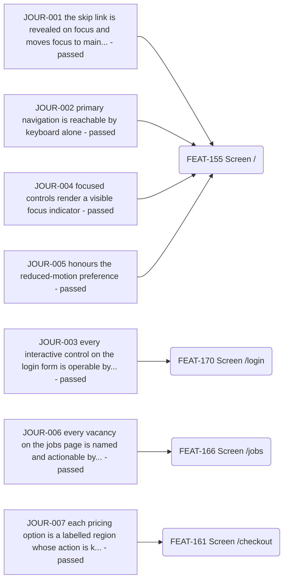

| Journey  | Title                                                                       | Outcome | Exercises |
| -------- | --------------------------------------------------------------------------- | ------- | --------- |
| JOUR-001 | the skip link is revealed on focus and moves focus to main content          | passed  | FEAT-155  |
| JOUR-002 | primary navigation is reachable by keyboard alone                           | passed  | FEAT-155  |
| JOUR-003 | every interactive control on the login form is operable by keyboard         | passed  | FEAT-170  |
| JOUR-004 | focused controls render a visible focus indicator                           | passed  | FEAT-155  |
| JOUR-005 | honours the reduced-motion preference                                       | passed  | FEAT-155  |
| JOUR-006 | every vacancy on the jobs page is named and actionable by keyboard          | passed  | FEAT-166  |
| JOUR-007 | each pricing option is a labelled region whose action is keyboard reachable | passed  | FEAT-161  |

## tests/e2e/account-deletion.spec.ts

3 journeys.

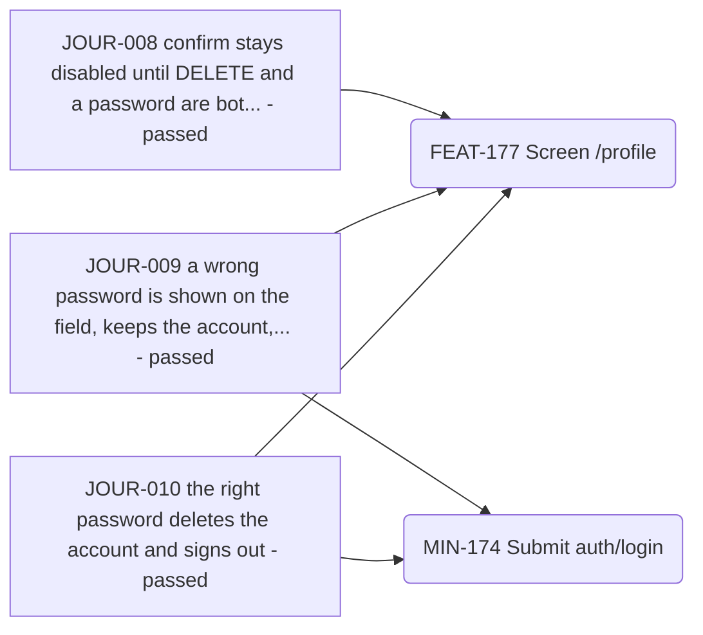

| Journey  | Title                                                                                  | Outcome | Exercises         |
| -------- | -------------------------------------------------------------------------------------- | ------- | ----------------- |
| JOUR-008 | confirm stays disabled until DELETE and a password are both entered                    | passed  | FEAT-177          |
| JOUR-009 | a wrong password is shown on the field, keeps the account, and is gone after reopening | passed  | FEAT-177, MIN-174 |
| JOUR-010 | the right password deletes the account and signs out                                   | passed  | FEAT-177, MIN-174 |

## tests/e2e/account-security.spec.ts

3 journeys.

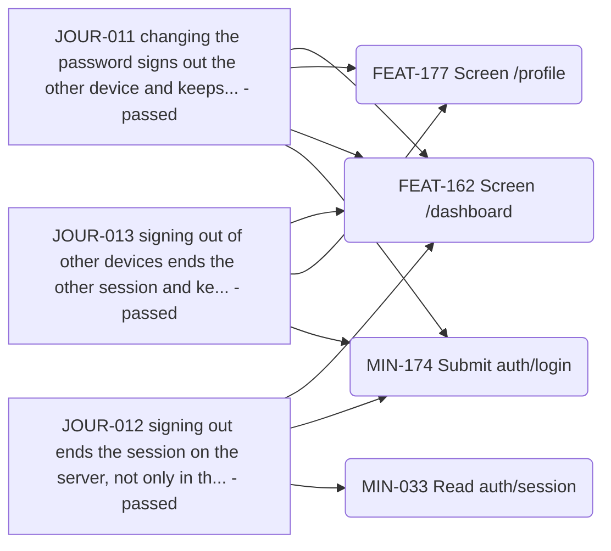

| Journey  | Title                                                                  | Outcome | Exercises                             |
| -------- | ---------------------------------------------------------------------- | ------- | ------------------------------------- |
| JOUR-011 | changing the password signs out the other device and keeps this one    | passed  | FEAT-162, FEAT-177, FEAT-162, MIN-174 |
| JOUR-012 | signing out ends the session on the server, not only in this browser   | passed  | FEAT-162, MIN-174, MIN-033            |
| JOUR-013 | signing out of other devices ends the other session and keeps this one | passed  | FEAT-162, FEAT-177, MIN-174           |

## tests/e2e/career-readiness.spec.ts

3 journeys.

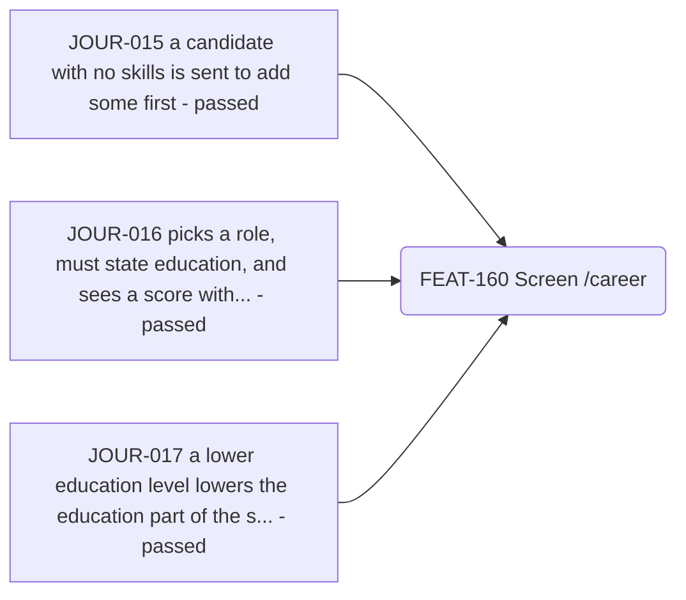

| Journey  | Title                                                                            | Outcome | Exercises |
| -------- | -------------------------------------------------------------------------------- | ------- | --------- |
| JOUR-015 | a candidate with no skills is sent to add some first                             | passed  | FEAT-160  |
| JOUR-016 | picks a role, must state education, and sees a score with the missing milestones | passed  | FEAT-160  |
| JOUR-017 | a lower education level lowers the education part of the score                   | passed  | FEAT-160  |

## tests/e2e/challenges.spec.ts

2 journeys.

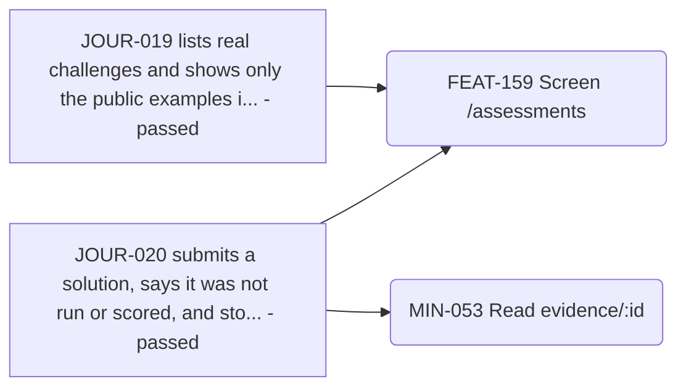

| Journey  | Title                                                                          | Outcome | Exercises         |
| -------- | ------------------------------------------------------------------------------ | ------- | ----------------- |
| JOUR-019 | lists real challenges and shows only the public examples in a session          | passed  | FEAT-159          |
| JOUR-020 | submits a solution, says it was not run or scored, and stores it as unverified | passed  | FEAT-159, MIN-053 |

## tests/e2e/checkout-idempotency.spec.ts

1 journeys.

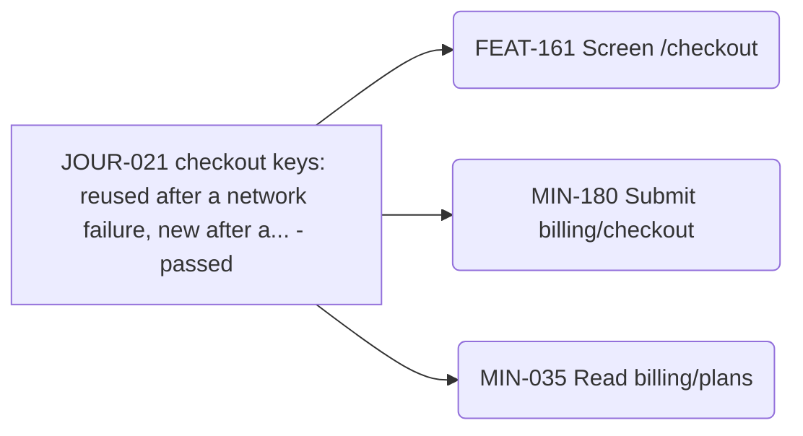

| Journey  | Title                                                                                          | Outcome | Exercises                  |
| -------- | ---------------------------------------------------------------------------------------------- | ------- | -------------------------- |
| JOUR-021 | checkout keys: reused after a network failure, new after an answered failure or a cycle change | passed  | FEAT-161, MIN-180, MIN-035 |

## tests/e2e/core-loop.spec.ts

7 journeys.

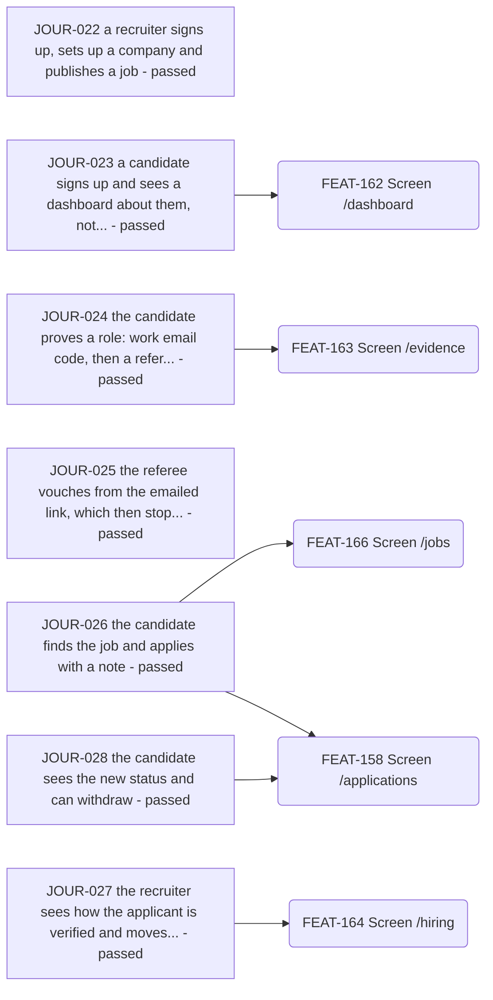

| Journey  | Title                                                                   | Outcome | Exercises                     |
| -------- | ----------------------------------------------------------------------- | ------- | ----------------------------- |
| JOUR-022 | a recruiter signs up, sets up a company and publishes a job             | passed  | no screen or endpoint matched |
| JOUR-023 | a candidate signs up and sees a dashboard about them, not a demo        | passed  | FEAT-162                      |
| JOUR-024 | the candidate proves a role: work email code, then a reference          | passed  | FEAT-163                      |
| JOUR-025 | the referee vouches from the emailed link, which then stops working     | passed  | no screen or endpoint matched |
| JOUR-026 | the candidate finds the job and applies with a note                     | passed  | FEAT-166, FEAT-158            |
| JOUR-027 | the recruiter sees how the applicant is verified and moves them forward | passed  | FEAT-164                      |
| JOUR-028 | the candidate sees the new status and can withdraw                      | passed  | FEAT-158                      |

## tests/e2e/credentials.spec.ts

5 journeys.

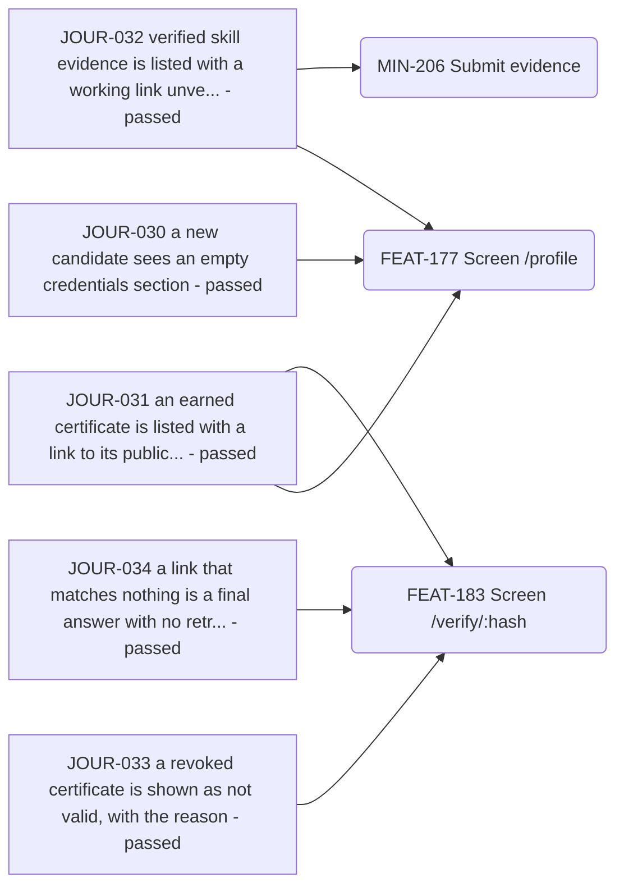

| Journey  | Title                                                                             | Outcome | Exercises          |
| -------- | --------------------------------------------------------------------------------- | ------- | ------------------ |
| JOUR-030 | a new candidate sees an empty credentials section                                 | passed  | FEAT-177           |
| JOUR-031 | an earned certificate is listed with a link to its public verification            | passed  | FEAT-177, FEAT-183 |
| JOUR-032 | verified skill evidence is listed with a working link; unverified evidence is not | passed  | FEAT-177, MIN-206  |
| JOUR-033 | a revoked certificate is shown as not valid, with the reason                      | passed  | FEAT-183           |
| JOUR-034 | a link that matches nothing is a final answer with no retry button                | passed  | FEAT-183           |

## tests/e2e/frontend-fixes.spec.ts

6 journeys.

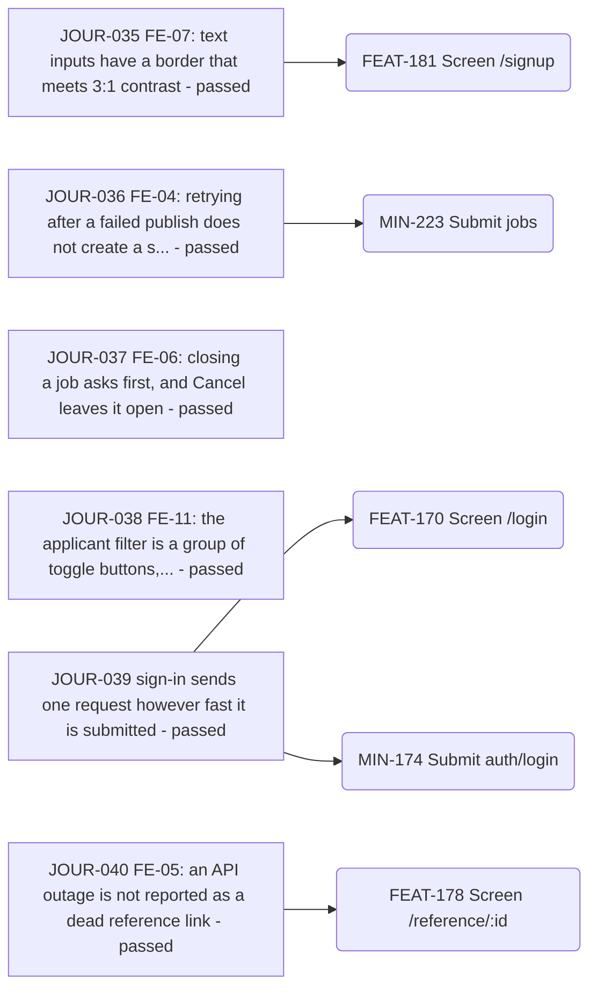

| Journey  | Title                                                                   | Outcome | Exercises                     |
| -------- | ----------------------------------------------------------------------- | ------- | ----------------------------- |
| JOUR-035 | FE-07: text inputs have a border that meets 3:1 contrast                | passed  | FEAT-181                      |
| JOUR-036 | FE-04: retrying after a failed publish does not create a second job     | passed  | MIN-223                       |
| JOUR-037 | FE-06: closing a job asks first, and Cancel leaves it open              | passed  | no screen or endpoint matched |
| JOUR-038 | FE-11: the applicant filter is a group of toggle buttons, not fake tabs | passed  | no screen or endpoint matched |
| JOUR-039 | sign-in sends one request however fast it is submitted                  | passed  | FEAT-170, MIN-174             |
| JOUR-040 | FE-05: an API outage is not reported as a dead reference link           | passed  | FEAT-178                      |

## tests/e2e/hostile-user.spec.ts

5 journeys.

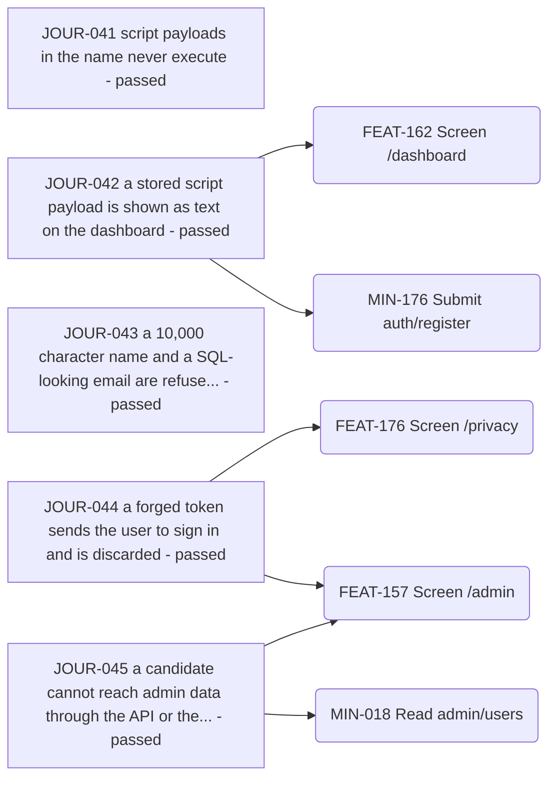

| Journey  | Title                                                                       | Outcome | Exercises                     |
| -------- | --------------------------------------------------------------------------- | ------- | ----------------------------- |
| JOUR-041 | script payloads in the name never execute                                   | passed  | no screen or endpoint matched |
| JOUR-042 | a stored script payload is shown as text on the dashboard                   | passed  | FEAT-162, MIN-176             |
| JOUR-043 | a 10,000 character name and a SQL-looking email are refused without a crash | passed  | no screen or endpoint matched |
| JOUR-044 | a forged token sends the user to sign in and is discarded                   | passed  | FEAT-176, FEAT-157            |
| JOUR-045 | a candidate cannot reach admin data through the API or the page             | passed  | FEAT-157, MIN-018             |

## tests/e2e/learning-page.spec.ts

1 journeys.

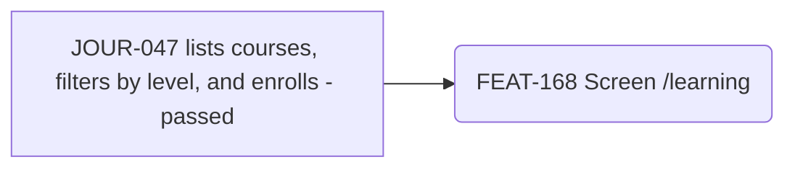

| Journey  | Title                                        | Outcome | Exercises |
| -------- | -------------------------------------------- | ------- | --------- |
| JOUR-047 | lists courses, filters by level, and enrolls | passed  | FEAT-168  |

## tests/e2e/lesson-player.spec.ts

2 journeys.

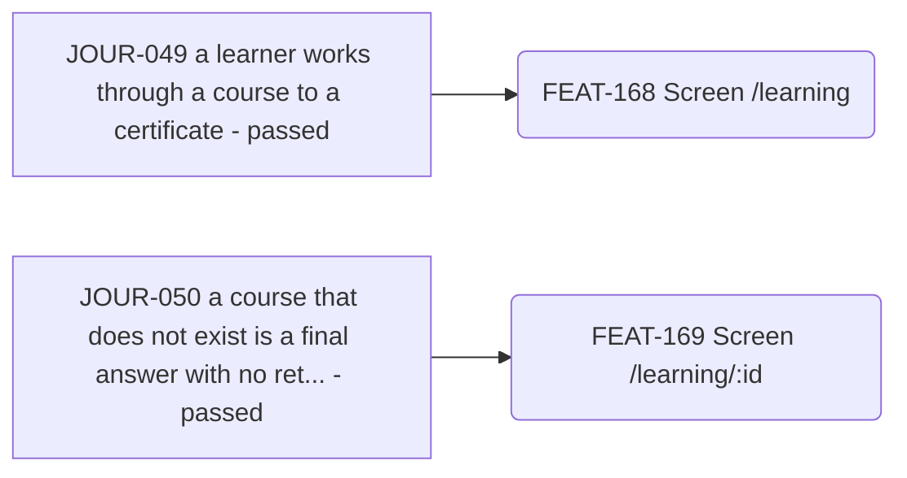

| Journey  | Title                                                               | Outcome | Exercises |
| -------- | ------------------------------------------------------------------- | ------- | --------- |
| JOUR-049 | a learner works through a course to a certificate                   | passed  | FEAT-168  |
| JOUR-050 | a course that does not exist is a final answer with no retry button | passed  | FEAT-169  |

## tests/e2e/messaging.spec.ts

1 journeys.

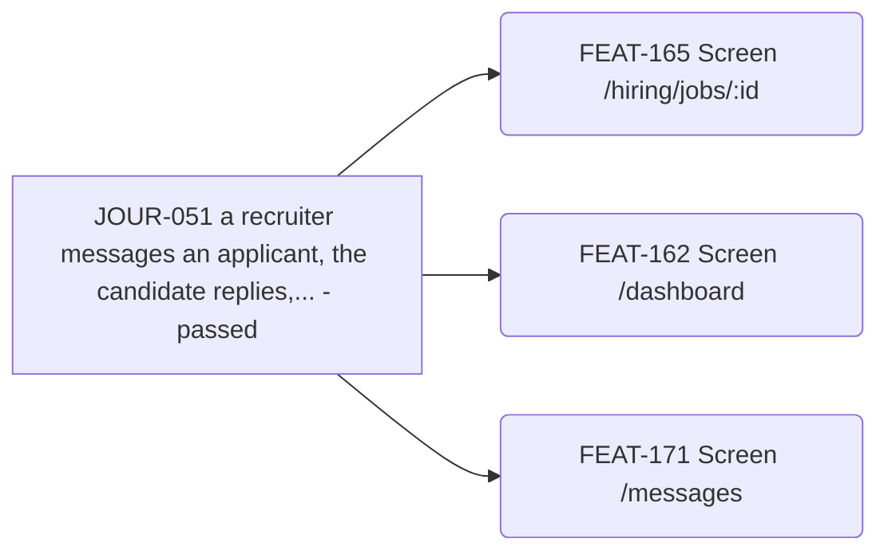

| Journey  | Title                                                                               | Outcome | Exercises                    |
| -------- | ----------------------------------------------------------------------------------- | ------- | ---------------------------- |
| JOUR-051 | a recruiter messages an applicant, the candidate replies, both see the conversation | passed  | FEAT-165, FEAT-162, FEAT-171 |

## tests/e2e/mutation-feedback.spec.ts

14 journeys.

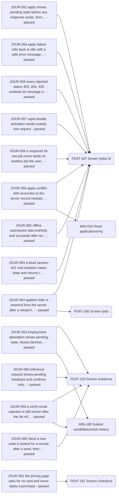

| Journey  | Title                                                                               | Outcome | Exercises          |
| -------- | ----------------------------------------------------------------------------------- | ------- | ------------------ |
| JOUR-052 | apply shows pending state before any response exists, then reconciles on 201        | passed  | FEAT-167           |
| JOUR-053 | employment attestation shows pending state, blocks dismissal, and survives retry    | passed  | FEAT-163, MIN-188  |
| JOUR-054 | apply failure rolls back to idle with a safe error message, then retry succeeds     | passed  | FEAT-167           |
| JOUR-055 | apply conflict (409) reconciles to the server record instead of a dead Apply        | passed  | FEAT-167, MIN-032  |
| JOUR-056 | every rejected status (403, 404, 429) surfaces its message and stays idle           | passed  | FEAT-167           |
| JOUR-057 | rapid double activation sends exactly one request                                   | passed  | FEAT-167           |
| JOUR-058 | a response for one job never lands on another job the user moved to                 | passed  | FEAT-167           |
| JOUR-059 | a verify-email rejection is still shown after the list refetch (regression)         | passed  | FEAT-163, MIN-188  |
| JOUR-060 | reference request shows pending feedback and confirms only from the server          | passed  | FEAT-163           |
| JOUR-061 | the pricing page asks for no card and never starts a purchase                       | passed  | FEAT-161           |
| JOUR-062 | offline submission fails truthfully and succeeds after reconnect                    | passed  | FEAT-167           |
| JOUR-063 | a dead session (401) mid-mutation clears state and returns to sign-in with ?return= | passed  | FEAT-167           |
| JOUR-064 | applied state is restored from the server after a reload (hydration)                | passed  | FEAT-167, FEAT-166 |
| JOUR-065 | "Send a new code" is locked for a minute after a send, then unlocks                 | passed  | FEAT-163           |

## tests/e2e/navigation.spec.ts

9 journeys.

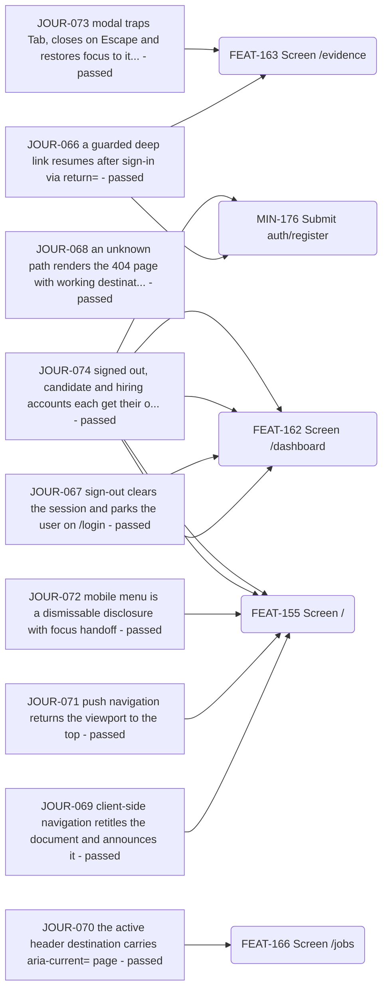

| Journey  | Title                                                                     | Outcome | Exercises                                       |
| -------- | ------------------------------------------------------------------------- | ------- | ----------------------------------------------- |
| JOUR-066 | a guarded deep link resumes after sign-in via ?return=                    | passed  | FEAT-163, MIN-176                               |
| JOUR-067 | sign-out clears the session and parks the user on /login                  | passed  | FEAT-162, FEAT-162                              |
| JOUR-068 | an unknown path renders the 404 page with working destinations            | passed  | no screen or endpoint matched                   |
| JOUR-069 | client-side navigation retitles the document and announces it             | passed  | FEAT-155                                        |
| JOUR-070 | the active header destination carries aria-current="page"                 | passed  | FEAT-166                                        |
| JOUR-071 | push navigation returns the viewport to the top                           | passed  | FEAT-155                                        |
| JOUR-072 | mobile menu is a dismissable disclosure with focus handoff                | passed  | FEAT-155                                        |
| JOUR-073 | modal traps Tab, closes on Escape and restores focus to its opener        | passed  | FEAT-163                                        |
| JOUR-074 | signed out, candidate and hiring accounts each get their own destinations | passed  | FEAT-155, FEAT-162, FEAT-155, FEAT-162, MIN-176 |

## tests/e2e/network-page.spec.ts

3 journeys.

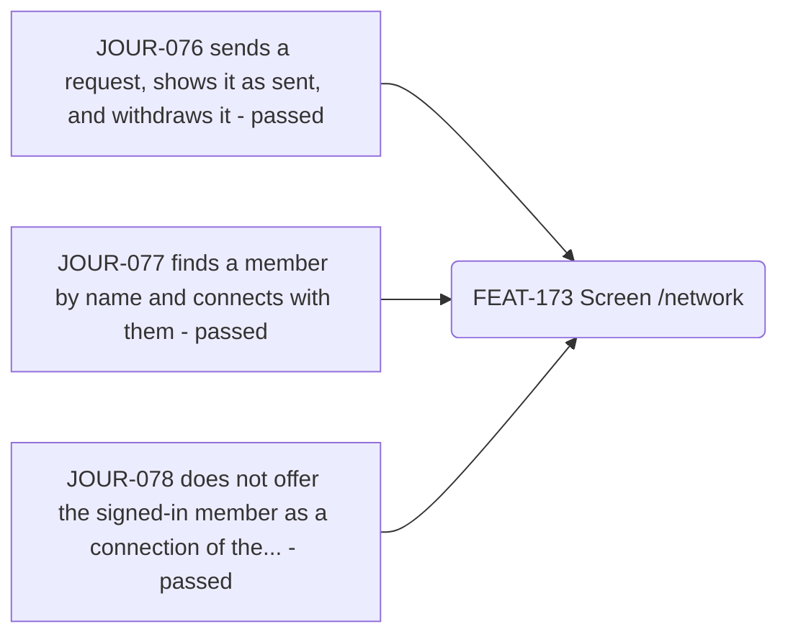

| Journey  | Title                                                            | Outcome | Exercises |
| -------- | ---------------------------------------------------------------- | ------- | --------- |
| JOUR-076 | sends a request, shows it as sent, and withdraws it              | passed  | FEAT-173  |
| JOUR-077 | finds a member by name and connects with them                    | passed  | FEAT-173  |
| JOUR-078 | does not offer the signed-in member as a connection of their own | passed  | FEAT-173  |

## tests/e2e/notifications.spec.ts

3 journeys.

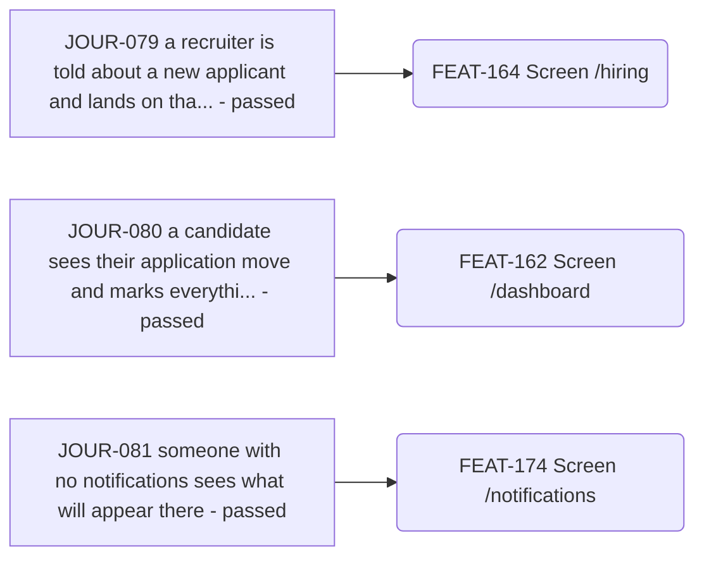

| Journey  | Title                                                                      | Outcome | Exercises |
| -------- | -------------------------------------------------------------------------- | ------- | --------- |
| JOUR-079 | a recruiter is told about a new applicant and lands on that job’s pipeline | passed  | FEAT-164  |
| JOUR-080 | a candidate sees their application move and marks everything read          | passed  | FEAT-162  |
| JOUR-081 | someone with no notifications sees what will appear there                  | passed  | FEAT-174  |

## tests/e2e/performance.spec.ts

2 journeys.

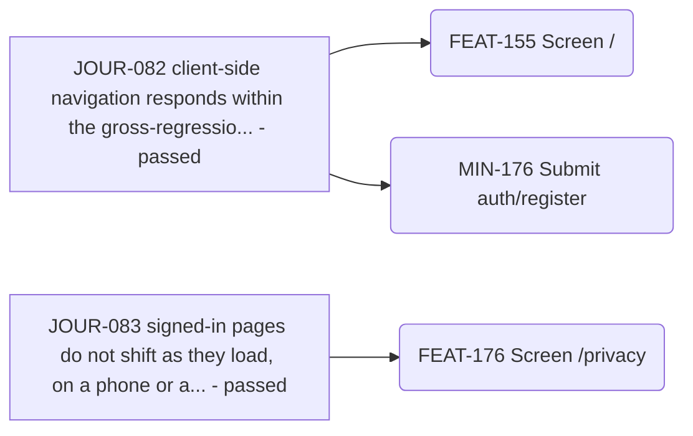

| Journey  | Title                                                              | Outcome | Exercises         |
| -------- | ------------------------------------------------------------------ | ------- | ----------------- |
| JOUR-082 | client-side navigation responds within the gross-regression guard  | passed  | FEAT-155, MIN-176 |
| JOUR-083 | signed-in pages do not shift as they load, on a phone or a desktop | passed  | FEAT-176          |

## tests/e2e/portfolio-resumes.spec.ts

2 journeys.

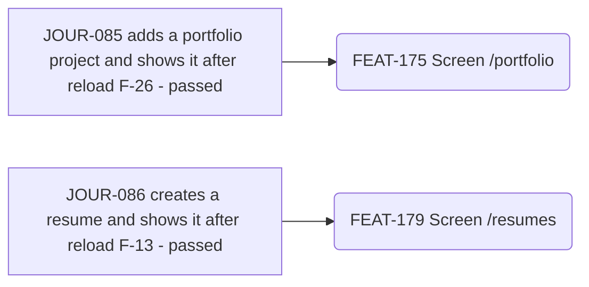

| Journey  | Title                                                     | Outcome | Exercises |
| -------- | --------------------------------------------------------- | ------- | --------- |
| JOUR-085 | adds a portfolio project and shows it after reload (F-26) | passed  | FEAT-175  |
| JOUR-086 | creates a resume and shows it after reload (F-13)         | passed  | FEAT-179  |

## tests/e2e/privacy-contact.spec.ts

1 journeys.

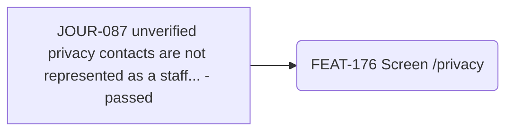

| Journey  | Title                                                                      | Outcome | Exercises |
| -------- | -------------------------------------------------------------------------- | ------- | --------- |
| JOUR-087 | unverified privacy contacts are not represented as a staffed DPO or an SLA | passed  | FEAT-176  |

## tests/e2e/responsive.spec.ts

2 journeys.

```mermaid
flowchart LR
  JOUR_088["JOUR-088 the header is one row, and the menu that holds navigation... - passed"]
  FEAT_165("FEAT-165 Screen /hiring/jobs/:id")
  JOUR_088 --> FEAT_165
  JOUR_089["JOUR-089 a dialog is a bottom sheet on phones and a centred panel f... - passed"]
  JOUR_089 --> FEAT_165
```

| Journey  | Title                                                                         | Outcome | Exercises |
| -------- | ----------------------------------------------------------------------------- | ------- | --------- |
| JOUR-088 | the header is one row, and the menu that holds navigation fits at every width | passed  | FEAT-165  |
| JOUR-089 | a dialog is a bottom sheet on phones and a centred panel from 640 px          | passed  | FEAT-165  |

## tests/e2e/restricted-account.spec.ts

1 journeys.

```mermaid
flowchart LR
  JOUR_090["JOUR-090 shows an honest notice, reduced navigation and no refused... - passed"]
  FEAT_162("FEAT-162 Screen /dashboard")
  JOUR_090 --> FEAT_162
```

| Journey  | Title                                                              | Outcome | Exercises |
| -------- | ------------------------------------------------------------------ | ------- | --------- |
| JOUR-090 | shows an honest notice, reduced navigation and no refused requests | passed  | FEAT-162  |

## tests/e2e/session-resilience.spec.ts

1 journeys.

```mermaid
flowchart LR
  JOUR_091["JOUR-091 a throttled session check explains itself and recovers wit... - passed"]
  FEAT_162("FEAT-162 Screen /dashboard")
  JOUR_091 --> FEAT_162
  MIN_033("MIN-033 Read auth/session")
  JOUR_091 --> MIN_033
```

| Journey  | Title                                                                 | Outcome | Exercises         |
| -------- | --------------------------------------------------------------------- | ------- | ----------------- |
| JOUR-091 | a throttled session check explains itself and recovers with Try again | passed  | FEAT-162, MIN-033 |

## tests/e2e/settings-page.spec.ts

5 journeys.

```mermaid
flowchart LR
  JOUR_093["JOUR-093 saves a preference and keeps it after reload F-15 - passed"]
  FEAT_180("FEAT-180 Screen /settings")
  JOUR_093 --> FEAT_180
  MIN_174("MIN-174 Submit auth/login")
  JOUR_093 --> MIN_174
  MIN_129("MIN-129 Read settings")
  JOUR_093 --> MIN_129
  JOUR_094["JOUR-094 offers only controls the product acts on C-29, K-15 - passed"]
  JOUR_094 --> FEAT_180
  JOUR_095["JOUR-095 connections-only visibility saved in Settings is what the... - passed"]
  JOUR_095 --> FEAT_180
  FEAT_177("FEAT-177 Screen /profile")
  JOUR_095 --> FEAT_177
  JOUR_096["JOUR-096 command search opens with Ctrl+K, filters, and navigates F-20 - passed"]
  FEAT_162("FEAT-162 Screen /dashboard")
  JOUR_096 --> FEAT_162
  JOUR_097["JOUR-097 command search closes on Escape and returns focus F-20 - passed"]
  JOUR_097 --> FEAT_162
```

| Journey  | Title                                                                          | Outcome | Exercises                  |
| -------- | ------------------------------------------------------------------------------ | ------- | -------------------------- |
| JOUR-093 | saves a preference and keeps it after reload (F-15)                            | passed  | FEAT-180, MIN-174, MIN-129 |
| JOUR-094 | offers only controls the product acts on (C-29, K-15)                          | passed  | FEAT-180                   |
| JOUR-095 | connections-only visibility saved in Settings is what the profile shows (K-15) | passed  | FEAT-180, FEAT-177         |
| JOUR-096 | command search opens with Ctrl+K, filters, and navigates (F-20)                | passed  | FEAT-162                   |
| JOUR-097 | command search closes on Escape and returns focus (F-20)                       | passed  | FEAT-162                   |

## tests/e2e/skills-graph.spec.ts

1 journeys.

```mermaid
flowchart LR
  JOUR_099["JOUR-099 adding a skill shows it with its related skills, and it ca... - passed"]
  FEAT_177("FEAT-177 Screen /profile")
  JOUR_099 --> FEAT_177
```

| Journey  | Title                                                                         | Outcome | Exercises |
| -------- | ----------------------------------------------------------------------------- | ------- | --------- |
| JOUR-099 | adding a skill shows it with its related skills, and it cannot be added twice | passed  | FEAT-177  |

## tests/e2e/ui-sweep.spec.ts

1 journeys.

```mermaid
flowchart LR
  JOUR_100["JOUR-100 sign-in with return= target stays on this site - passed"]
  FEAT_170("FEAT-170 Screen /login")
  JOUR_100 --> FEAT_170
```

| Journey  | Title                                            | Outcome | Exercises |
| -------- | ------------------------------------------------ | ------- | --------- |
| JOUR-100 | sign-in with return=${target} stays on this site | passed  | FEAT-170  |

## tests/e2e/web-ui.spec.ts

8 journeys.

```mermaid
flowchart LR
  JOUR_101["JOUR-101 renders landing page with accessibility skip-link and trut... - passed"]
  FEAT_155("FEAT-155 Screen /")
  JOUR_101 --> FEAT_155
  JOUR_102["JOUR-102 guards the dashboard and displays career cockpit after rea... - passed"]
  FEAT_162("FEAT-162 Screen /dashboard")
  JOUR_102 --> FEAT_162
  JOUR_102 --> FEAT_155
  MIN_176("MIN-176 Submit auth/register")
  JOUR_102 --> MIN_176
  JOUR_103["JOUR-103 authenticates candidate via login page and redirects to da... - passed"]
  FEAT_170("FEAT-170 Screen /login")
  JOUR_103 --> FEAT_170
  JOUR_103 --> MIN_176
  JOUR_104["JOUR-104 pricing is truthful: free, no card, and paid plans cannot... - passed"]
  FEAT_161("FEAT-161 Screen /checkout")
  JOUR_104 --> FEAT_161
  MIN_036("MIN-036 Read billing/subscription")
  JOUR_104 --> MIN_036
  JOUR_105["JOUR-105 navigates to evidence page and validates work history atte... - passed"]
  FEAT_163("FEAT-163 Screen /evidence")
  JOUR_105 --> FEAT_163
  JOUR_105 --> FEAT_170
  JOUR_105 --> FEAT_163
  JOUR_105 --> MIN_176
  MIN_064("MIN-064 Read internal/worker-jobs")
  JOUR_105 --> MIN_064
  JOUR_106["JOUR-106 takes a challenge in a session and is told plainly that no... - passed"]
  JOUR_106 --> FEAT_170
  FEAT_159("FEAT-159 Screen /assessments")
  JOUR_106 --> FEAT_159
  JOUR_106 --> MIN_176
  JOUR_107["JOUR-107 browses real job postings, is asked to sign in, then appli... - passed"]
  FEAT_166("FEAT-166 Screen /jobs")
  JOUR_107 --> FEAT_166
  FEAT_167("FEAT-167 Screen /jobs/:id")
  JOUR_107 --> FEAT_167
  FEAT_158("FEAT-158 Screen /applications")
  JOUR_107 --> FEAT_158
  JOUR_108["JOUR-108 renders privacy policy and terms of service pre-launch gates - passed"]
  FEAT_176("FEAT-176 Screen /privacy")
  JOUR_108 --> FEAT_176
  FEAT_182("FEAT-182 Screen /terms")
  JOUR_108 --> FEAT_182
```

| Journey  | Title                                                                                     | Outcome | Exercises                                      |
| -------- | ----------------------------------------------------------------------------------------- | ------- | ---------------------------------------------- |
| JOUR-101 | renders landing page with accessibility skip-link and truthful PWA capability status      | passed  | FEAT-155                                       |
| JOUR-102 | guards the dashboard and displays career cockpit after real sign-in                       | passed  | FEAT-162, FEAT-155, MIN-176                    |
| JOUR-103 | authenticates candidate via login page and redirects to dashboard (F-01)                  | passed  | FEAT-170, MIN-176                              |
| JOUR-104 | pricing is truthful: free, no card, and paid plans cannot be bought (F-16)                | passed  | FEAT-161, MIN-036                              |
| JOUR-105 | navigates to evidence page and validates work history attestations with anti-fraud checks | passed  | FEAT-163, FEAT-170, FEAT-163, MIN-176, MIN-064 |
| JOUR-106 | takes a challenge in a session and is told plainly that nothing was run or scored         | passed  | FEAT-170, FEAT-159, MIN-176                    |
| JOUR-107 | browses real job postings, is asked to sign in, then applies and tracks it                | passed  | FEAT-166, FEAT-167, FEAT-158                   |
| JOUR-108 | renders privacy policy and terms of service pre-launch gates                              | passed  | FEAT-176, FEAT-182                             |

## tests/e2e/work-history-removal.spec.ts

1 journeys.

```mermaid
flowchart LR
  JOUR_109["JOUR-109 removes a mistaken role after saying what goes with it, an... - passed"]
  FEAT_163("FEAT-163 Screen /evidence")
  JOUR_109 --> FEAT_163
  MIN_188("MIN-188 Submit candidates/work-history")
  JOUR_109 --> MIN_188
```

| Journey  | Title                                                                      | Outcome | Exercises         |
| -------- | -------------------------------------------------------------------------- | ------- | ----------------- |
| JOUR-109 | removes a mistaken role after saying what goes with it, and keeps the rest | passed  | FEAT-163, MIN-188 |
