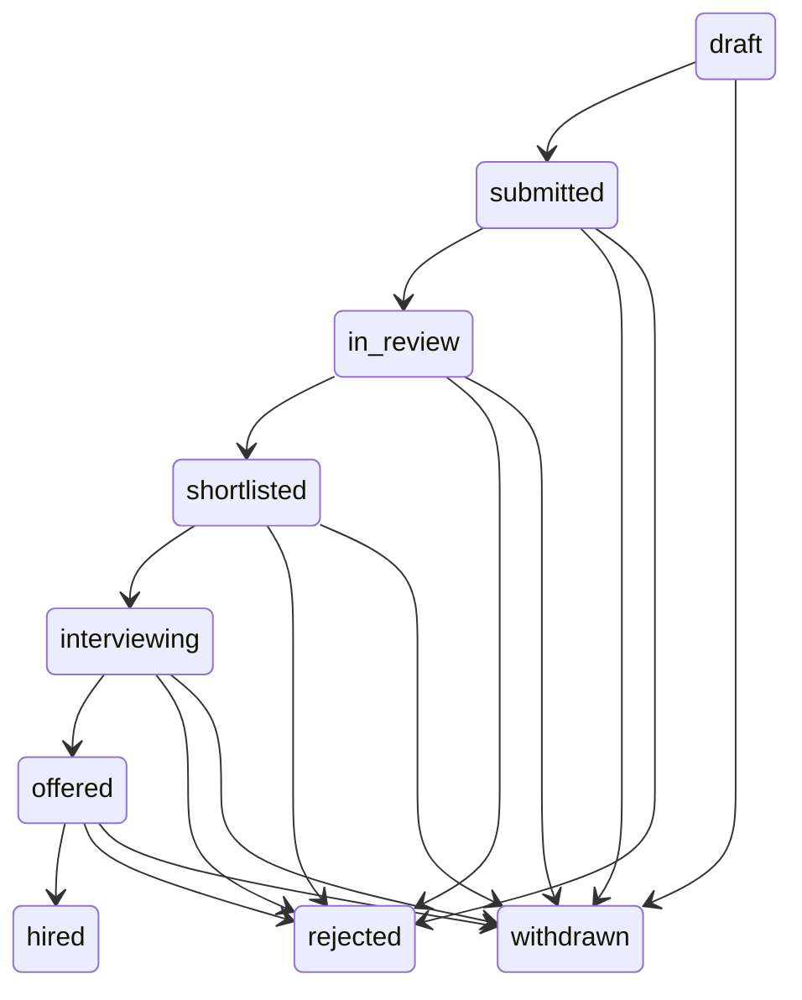
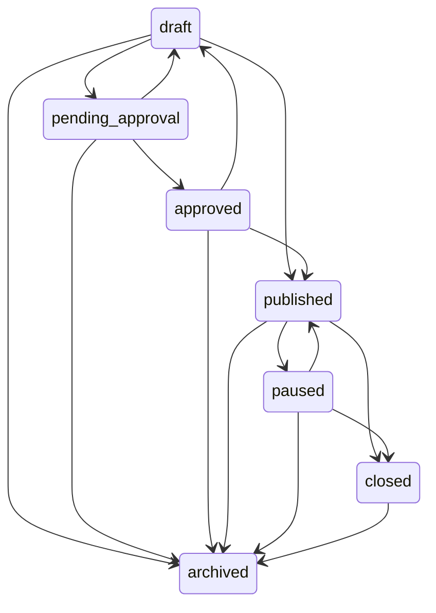

# State Transition Graphs

Generated from the graph at `eb166ea`. Back to the [feature catalog](FEATURE_CATALOG.md).

## Transition tables in packages/domain

### STATE-012 ALLOWED_APPLICATION_TRANSITIONS (packages/domain/src/core.ts:99)

### STATE-014 ALLOWED_JOB_TRANSITIONS (packages/domain/src/jobs.ts:25)

## Status types without a transition table

These union types, contract enums and Postgres enums define states, but no allowed-transition table was found for them, so any change between values is decided in the handler code.

| ID        | Name                                             | Kind          | Values                                                                                                                                                        | Location                                          |
| --------- | ------------------------------------------------ | ------------- | ------------------------------------------------------------------------------------------------------------------------------------------------------------- | ------------------------------------------------- |
| STATE-001 | AdminUserStatus                                  | union-type    | active, suspended, deactivated                                                                                                                                | packages/domain/src/admin.ts:9                    |
| STATE-002 | SystemHealthStatus                               | union-type    | healthy, degraded, maintenance, not_configured                                                                                                                | packages/domain/src/admin.ts:10                   |
| STATE-003 | AlumniVerificationStatus                         | union-type    | unverified, pending, verified, rejected                                                                                                                       | packages/domain/src/alumni-networks.ts:16         |
| STATE-004 | AlumniMentorshipStatus                           | union-type    | requested, active, completed, declined                                                                                                                        | packages/domain/src/alumni-networks.ts:49         |
| STATE-005 | FeedbackStatus                                   | union-type    | pending, provided, viewed, requested, responded, skipped                                                                                                      | packages/domain/src/application-feedback.ts:12    |
| STATE-006 | BackgroundJobStatus                              | union-type    | queued, running, succeeded, failed, dead, canceled                                                                                                            | packages/domain/src/background-jobs.ts:12         |
| STATE-007 | SubscriptionStatus                               | union-type    | active, past_due, canceled, incomplete, trialing                                                                                                              | packages/domain/src/billing.ts:11                 |
| STATE-008 | InvoiceStatus                                    | union-type    | draft, open, paid, void, uncollectible                                                                                                                        | packages/domain/src/billing.ts:12                 |
| STATE-009 | UserStatus                                       | union-type    | active, suspended, pending_verification, deactivated                                                                                                          | packages/domain/src/core.ts:26                    |
| STATE-010 | EvidenceStatus                                   | union-type    | pending, verified, disputed, revoked, expired                                                                                                                 | packages/domain/src/core.ts:66                    |
| STATE-011 | ApplicationState                                 | union-type    | draft, submitted, in_review, shortlisted, interviewing, offered, hired, rejected, withdrawn, expired                                                          | packages/domain/src/core.ts:87                    |
| STATE-013 | JobStatus                                        | union-type    | draft, pending_approval, approved, published, paused, closed, archived                                                                                        | packages/domain/src/jobs.ts:3                     |
| STATE-015 | CourseStatus                                     | union-type    | draft, published, archived                                                                                                                                    | packages/domain/src/lms.ts:4                      |
| STATE-016 | EnrollmentStatus                                 | union-type    | enrolled, completed, dropped, expired                                                                                                                         | packages/domain/src/lms.ts:7                      |
| STATE-017 | CertificateStatus                                | union-type    | verified, revoked, expired                                                                                                                                    | packages/domain/src/lms.ts:8                      |
| STATE-018 | MessageStatus                                    | union-type    | sent, delivered, read                                                                                                                                         | packages/domain/src/messaging.ts:3                |
| STATE-019 | ModerationReportStatus                           | union-type    | pending, under_review, resolved, dismissed                                                                                                                    | packages/domain/src/moderation.ts:15              |
| STATE-020 | ModerationAppealStatus                           | union-type    | pending, under_review, upheld, denied                                                                                                                         | packages/domain/src/moderation.ts:22              |
| STATE-021 | ConnectionStatus                                 | union-type    | pending, accepted, rejected, withdrawn                                                                                                                        | packages/domain/src/networking.ts:9               |
| STATE-022 | ReferralRequestStatus                            | union-type    | pending, approved, forwarded, declined, expired                                                                                                               | packages/domain/src/referral-requests.ts:4        |
| STATE-023 | ReferralOutcomeStatus                            | union-type    | referred, interviewing, hired, rejected                                                                                                                       | packages/domain/src/referral-requests.ts:5        |
| STATE-024 | SalaryReportStatus                               | union-type    | submitted, verified, flagged_outlier, withdrawn                                                                                                               | packages/domain/src/salary-intelligence.ts:7      |
| STATE-025 | ErasureRequestStatus                             | union-type    | pending, grace_period, processing, completed, cancelled                                                                                                       | packages/domain/src/settings.ts:36                |
| STATE-026 | ExportStatus                                     | union-type    | pending, processing, completed, failed                                                                                                                        | packages/domain/src/settings.ts:54                |
| STATE-027 | StripeSubscriptionStatus                         | union-type    | incomplete, incomplete_expired, trialing, active, past_due, canceled, unpaid, paused                                                                          | packages/domain/src/stripe-billing.ts:24          |
| STATE-028 | TalentPoolStatus                                 | union-type    | sourced, contacted, screening, interviewing, offered, hired, archived                                                                                         | packages/domain/src/talent-pool-intelligence.ts:6 |
| STATE-029 | InterviewAssessmentStatus                        | union-type    | scheduled, in_progress, completed, cancelled, no_show, scored, reviewed                                                                                       | packages/domain/src/technical-interview.ts:6      |
| STATE-030 | RecordingStatus                                  | union-type    | disabled, consented, active, completed                                                                                                                        | packages/domain/src/technical-interview.ts:8      |
| STATE-031 | WarmIntroStatus                                  | union-type    | pending_introducer, approved, declined, completed, cancelled                                                                                                  | packages/domain/src/warm-introductions.ts:4       |
| STATE-032 | VerificationStatus                               | union-type    | unverified, pending_verification, verified, disputed, rejected                                                                                                | packages/domain/src/work-history-graph.ts:12      |
| STATE-033 | ReferenceStatus                                  | union-type    | requested, submitted, declined, flagged                                                                                                                       | packages/domain/src/work-history-graph.ts:19      |
| STATE-034 | UpdateJobStatusInputSchema.status                | contract-enum | draft, pending_approval, approved, published, paused, closed, archived                                                                                        | packages/contracts/src/index.ts:258               |
| STATE-035 | TransitionApplicationInputSchema.targetState     | contract-enum | draft, submitted, in_review, shortlisted, interviewing, offered, hired, rejected, withdrawn                                                                   | packages/contracts/src/index.ts:283               |
| STATE-036 | AdminUpdateUserStatusInputSchema.status          | contract-enum | active, suspended, deactivated                                                                                                                                | packages/contracts/src/index.ts:721               |
| STATE-037 | UpdateModerationReportStatusInputSchema.status   | contract-enum | pending, under_review, resolved, dismissed                                                                                                                    | packages/contracts/src/index.ts:839               |
| STATE-038 | SubmitEmployerReviewInputSchema.employmentStatus | contract-enum | current, former, candidate                                                                                                                                    | packages/contracts/src/index.ts:1439              |
| STATE-039 | UpdatePoolMemberStatusInputSchema.status         | contract-enum | sourced, contacted, screening, interviewing, offered, hired, archived                                                                                         | packages/contracts/src/index.ts:1628              |
| STATE-040 | pg:user_role                                     | postgres-enum | candidate, recruiter, hiring_manager, course_author, instructor, institution_admin, platform_admin                                                            | supabase/migrations/00001_core_schema.sql         |
| STATE-041 | pg:profile_privacy                               | postgres-enum | public, connections_only, recruiters_only, private                                                                                                            | supabase/migrations/00001_core_schema.sql         |
| STATE-042 | pg:application_status                            | postgres-enum | draft, submitted, in_review, shortlisted, interviewing, offered, hired, rejected, withdrawn, expired                                                          | supabase/migrations/00001_core_schema.sql         |
| STATE-043 | pg:evidence_type                                 | postgres-enum | self_declaration, course_completion, assessment, project, work_experience, contribution, employer_verification, institution_credential, external_verification | supabase/migrations/00001_core_schema.sql         |
| STATE-044 | pg:verification_level                            | postgres-enum | unverified, peer_reviewed, institution_verified, authority_verified                                                                                           | supabase/migrations/00001_core_schema.sql         |
| STATE-045 | pg:evidence_status                               | postgres-enum | pending, verified, disputed, revoked, expired                                                                                                                 | supabase/migrations/00001_core_schema.sql         |
