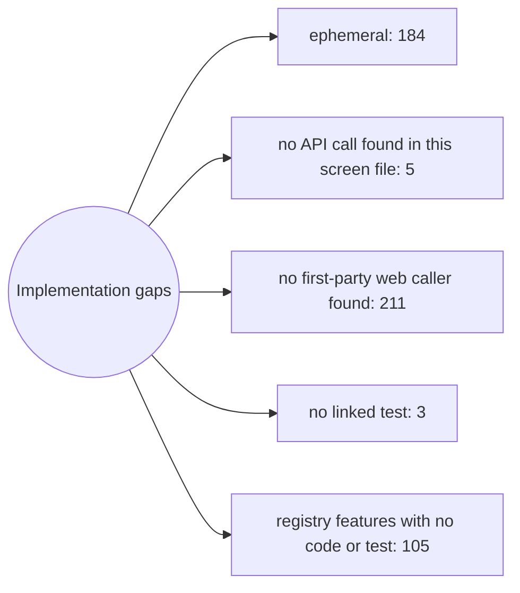

# Test Traceability and Gaps

Generated from the graph at `eb166ea`; test results from `9b3032f`. Back to the [feature catalog](FEATURE_CATALOG.md). Path-level test links are described in [`quality/TEST_COVERAGE_MAP.md`](../quality/TEST_COVERAGE_MAP.md).

## Verification by module

| Module                     | Feature nodes | Verified | Path-level | Not run | Failing | Unknown | Verified % |
| -------------------------- | ------------- | -------- | ---------- | ------- | ------- | ------- | ---------- |
| api/activity               | 67            | 12       | 55         | 0       | 0       | 0       | 18%        |
| api/admin                  | 126           | 23       | 102        | 0       | 0       | 1       | 18%        |
| api/ai                     | 92            | 19       | 72         | 0       | 0       | 1       | 21%        |
| api/alumni                 | 203           | 19       | 181        | 0       | 0       | 3       | 9%         |
| api/analytics              | 45            | 9        | 36         | 0       | 0       | 0       | 20%        |
| api/applications           | 126           | 14       | 110        | 0       | 0       | 2       | 11%        |
| api/auth                   | 106           | 20       | 85         | 0       | 0       | 1       | 19%        |
| api/billing                | 176           | 16       | 141        | 0       | 0       | 19      | 9%         |
| api/candidates             | 200           | 17       | 181        | 0       | 0       | 2       | 8%         |
| api/career                 | 153           | 12       | 140        | 0       | 0       | 1       | 8%         |
| api/certificates           | 48            | 6        | 42         | 0       | 0       | 0       | 12%        |
| api/challenges             | 107           | 12       | 94         | 0       | 0       | 1       | 11%        |
| api/connections            | 80            | 11       | 64         | 0       | 0       | 5       | 14%        |
| api/courses                | 133           | 10       | 123        | 0       | 0       | 0       | 8%         |
| api/evidence               | 141           | 16       | 120        | 0       | 0       | 5       | 11%        |
| api/feature-flags          | 20            | 6        | 13         | 0       | 0       | 1       | 30%        |
| api/feedback               | 9             | 2        | 7          | 0       | 0       | 0       | 22%        |
| api/gamification           | 72            | 11       | 59         | 0       | 0       | 2       | 15%        |
| api/health                 | 16            | 2        | 14         | 0       | 0       | 0       | 12%        |
| api/internal               | 7             | 1        | 6          | 0       | 0       | 0       | 14%        |
| api/interviews             | 301           | 24       | 277        | 0       | 0       | 0       | 8%         |
| api/job-templates          | 186           | 10       | 176        | 0       | 0       | 0       | 5%         |
| api/jobs                   | 333           | 35       | 297        | 0       | 0       | 1       | 11%        |
| api/learning               | 90            | 9        | 80         | 0       | 0       | 1       | 10%        |
| api/lessons                | 25            | 7        | 16         | 0       | 0       | 2       | 28%        |
| api/moderation             | 162           | 19       | 139        | 0       | 0       | 4       | 12%        |
| api/modules                | 36            | 1        | 35         | 0       | 0       | 0       | 3%         |
| api/networking             | 98            | 11       | 87         | 0       | 0       | 0       | 11%        |
| api/notifications          | 73            | 9        | 64         | 0       | 0       | 0       | 12%        |
| api/organizations          | 117           | 9        | 101        | 0       | 0       | 7       | 8%         |
| api/portfolio              | 102           | 13       | 86         | 0       | 0       | 3       | 13%        |
| api/profile                | 55            | 7        | 47         | 0       | 0       | 1       | 13%        |
| api/ready                  | 8             | 1        | 7          | 0       | 0       | 0       | 12%        |
| api/recruiter              | 331           | 25       | 306        | 0       | 0       | 0       | 8%         |
| api/references             | 11            | 1        | 9          | 0       | 0       | 1       | 9%         |
| api/referrals              | 81            | 8        | 73         | 0       | 0       | 0       | 10%        |
| api/reputation             | 306           | 35       | 269        | 0       | 0       | 2       | 11%        |
| api/resumes                | 122           | 12       | 109        | 0       | 0       | 1       | 10%        |
| api/salaries               | 111           | 10       | 101        | 0       | 0       | 0       | 9%         |
| api/search                 | 90            | 14       | 75         | 0       | 0       | 1       | 16%        |
| api/settings               | 166           | 16       | 144        | 0       | 0       | 6       | 10%        |
| api/skills                 | 287           | 32       | 252        | 0       | 0       | 3       | 11%        |
| api/threads                | 97            | 13       | 82         | 0       | 0       | 2       | 13%        |
| api/verify                 | 12            | 3        | 9          | 0       | 0       | 0       | 25%        |
| api/xp                     | 7             | 1        | 6          | 0       | 0       | 0       | 14%        |
| web/landing                | 4             | 1        | 1          | 0       | 0       | 2       | 25%        |
| web/*                      | 2             | 0        | 0          | 0       | 0       | 2       | 0%         |
| web/admin                  | 28            | 1        | 14         | 0       | 0       | 13      | 4%         |
| web/applications           | 25            | 1        | 14         | 0       | 0       | 10      | 4%         |
| web/assessments            | 31            | 1        | 14         | 0       | 0       | 16      | 3%         |
| web/career                 | 30            | 1        | 12         | 0       | 0       | 17      | 3%         |
| web/checkout               | 2             | 1        | 0          | 0       | 0       | 1       | 50%        |
| web/dashboard              | 16            | 1        | 5          | 0       | 0       | 10      | 6%         |
| web/evidence               | 113           | 1        | 34         | 0       | 0       | 78      | 1%         |
| web/hiring                 | 154           | 2        | 64         | 0       | 0       | 88      | 1%         |
| web/jobs                   | 43            | 2        | 19         | 0       | 0       | 22      | 5%         |
| web/learning               | 41            | 2        | 20         | 0       | 0       | 19      | 5%         |
| web/login                  | 24            | 1        | 10         | 0       | 0       | 13      | 4%         |
| web/messages               | 41            | 1        | 10         | 0       | 0       | 30      | 2%         |
| web/network                | 40            | 1        | 18         | 0       | 0       | 21      | 2%         |
| web/notifications          | 15            | 1        | 10         | 0       | 0       | 4       | 7%         |
| web/portfolio              | 25            | 1        | 13         | 0       | 0       | 11      | 4%         |
| web/privacy                | 2             | 1        | 0          | 0       | 0       | 1       | 50%        |
| web/profile                | 60            | 1        | 22         | 0       | 0       | 37      | 2%         |
| web/reference              | 25            | 1        | 12         | 0       | 0       | 12      | 4%         |
| web/resumes                | 24            | 1        | 12         | 0       | 0       | 11      | 4%         |
| web/settings               | 23            | 1        | 12         | 0       | 0       | 10      | 4%         |
| web/signup                 | 27            | 1        | 12         | 0       | 0       | 14      | 4%         |
| web/terms                  | 2             | 1        | 0          | 0       | 0       | 1       | 50%        |
| web/verify                 | 13            | 1        | 6          | 0       | 0       | 6       | 8%         |
| web/shared-components      | 130           | 0        | 0          | 0       | 0       | 130     | 0%         |
| worker/admin               | 3             | 0        | 0          | 0       | 0       | 3       | 0%         |
| worker/ai                  | 3             | 0        | 0          | 0       | 0       | 3       | 0%         |
| worker/alumni              | 7             | 0        | 0          | 0       | 0       | 7       | 0%         |
| worker/application         | 7             | 0        | 0          | 0       | 0       | 7       | 0%         |
| worker/billing             | 9             | 0        | 0          | 0       | 0       | 9       | 0%         |
| worker/career              | 3             | 0        | 0          | 0       | 0       | 3       | 0%         |
| worker/connection          | 11            | 0        | 0          | 0       | 0       | 11      | 0%         |
| worker/employer            | 3             | 0        | 0          | 0       | 0       | 3       | 0%         |
| worker/evidence            | 3             | 0        | 0          | 0       | 0       | 3       | 0%         |
| worker/gamification        | 5             | 0        | 0          | 0       | 0       | 5       | 0%         |
| worker/gdpr                | 9             | 0        | 0          | 0       | 0       | 9       | 0%         |
| worker/instructor          | 3             | 0        | 0          | 0       | 0       | 3       | 0%         |
| worker/learning            | 3             | 0        | 0          | 0       | 0       | 3       | 0%         |
| worker/lms                 | 3             | 0        | 0          | 0       | 0       | 3       | 0%         |
| worker/messaging           | 3             | 0        | 0          | 0       | 0       | 3       | 0%         |
| worker/moderation          | 9             | 0        | 0          | 0       | 0       | 9       | 0%         |
| worker/portfolio           | 7             | 0        | 0          | 0       | 0       | 7       | 0%         |
| worker/reference           | 3             | 0        | 0          | 0       | 0       | 3       | 0%         |
| worker/resume              | 3             | 0        | 0          | 0       | 0       | 3       | 0%         |
| worker/search              | 3             | 0        | 0          | 0       | 0       | 3       | 0%         |
| worker/skill               | 7             | 0        | 0          | 0       | 0       | 7       | 0%         |
| worker/user                | 3             | 0        | 0          | 0       | 0       | 3       | 0%         |
| worker/work_history        | 3             | 0        | 0          | 0       | 0       | 3       | 0%         |
| documented/Identity        | 1             | 0        | 0          | 0       | 0       | 1       | 0%         |
| documented/Shell           | 1             | 0        | 0          | 0       | 0       | 1       | 0%         |
| documented/Marketplace     | 1             | 0        | 0          | 0       | 0       | 1       | 0%         |
| documented/Recruiting      | 1             | 0        | 0          | 0       | 0       | 1       | 0%         |
| documented/Learning        | 1             | 0        | 0          | 0       | 0       | 1       | 0%         |
| documented/Assessment      | 1             | 0        | 0          | 0       | 0       | 1       | 0%         |
| documented/Social          | 1             | 0        | 0          | 0       | 0       | 1       | 0%         |
| documented/Communication   | 1             | 0        | 0          | 0       | 0       | 1       | 0%         |
| documented/Gamification    | 1             | 0        | 0          | 0       | 0       | 1       | 0%         |
| documented/Hiring          | 1             | 0        | 0          | 0       | 0       | 1       | 0%         |
| documented/Analytics       | 1             | 0        | 0          | 0       | 0       | 1       | 0%         |
| documented/Networking      | 1             | 0        | 0          | 0       | 0       | 1       | 0%         |
| documented/Career          | 1             | 0        | 0          | 0       | 0       | 1       | 0%         |
| documented/AI              | 1             | 0        | 0          | 0       | 0       | 1       | 0%         |
| documented/Verification    | 1             | 0        | 0          | 0       | 0       | 1       | 0%         |
| documented/Candidate       | 1             | 0        | 0          | 0       | 0       | 1       | 0%         |
| documented/Platform        | 1             | 0        | 0          | 0       | 0       | 1       | 0%         |
| documented/Intelligence    | 1             | 0        | 0          | 0       | 0       | 1       | 0%         |
| documented/Jobs            | 1             | 0        | 0          | 0       | 0       | 1       | 0%         |
| documented/Careers         | 1             | 0        | 0          | 0       | 0       | 1       | 0%         |
| documented/Companies       | 1             | 0        | 0          | 0       | 0       | 1       | 0%         |
| documented/Community       | 1             | 0        | 0          | 0       | 0       | 1       | 0%         |
| documented/Skills          | 1             | 0        | 0          | 0       | 0       | 1       | 0%         |
| documented/Portfolio       | 1             | 0        | 0          | 0       | 0       | 1       | 0%         |
| documented/Reputation      | 1             | 0        | 0          | 0       | 0       | 1       | 0%         |
| documented/Personalization | 1             | 0        | 0          | 0       | 0       | 1       | 0%         |
| documented/Discovery       | 1             | 0        | 0          | 0       | 0       | 1       | 0%         |
| documented/Monetization    | 1             | 0        | 0          | 0       | 0       | 1       | 0%         |
| documented/Enterprise      | 1             | 0        | 0          | 0       | 0       | 1       | 0%         |
| documented/Credential      | 1             | 0        | 0          | 0       | 0       | 1       | 0%         |
| documented/Governance      | 1             | 0        | 0          | 0       | 0       | 1       | 0%         |
| documented/Company         | 1             | 0        | 0          | 0       | 0       | 1       | 0%         |
| documented/Edge            | 1             | 0        | 0          | 0       | 0       | 1       | 0%         |
| documented/Telemetry       | 1             | 0        | 0          | 0       | 0       | 1       | 0%         |
| documented/Engagement      | 1             | 0        | 0          | 0       | 0       | 1       | 0%         |
| documented/Safety          | 1             | 0        | 0          | 0       | 0       | 1       | 0%         |
| documented/Administration  | 1             | 0        | 0          | 0       | 0       | 1       | 0%         |
| documented/Institutions    | 1             | 0        | 0          | 0       | 0       | 1       | 0%         |
| documented/OS              | 1             | 0        | 0          | 0       | 0       | 1       | 0%         |
| documented/Business        | 1             | 0        | 0          | 0       | 0       | 1       | 0%         |
| documented/Integration     | 1             | 0        | 0          | 0       | 0       | 1       | 0%         |
| documented/Foundation      | 1             | 0        | 0          | 0       | 0       | 1       | 0%         |
| documented/Profile         | 1             | 0        | 0          | 0       | 0       | 1       | 0%         |

## Endpoint capabilities with no linked test (3)

| ID      | Capability              | Route                                       | Status      |
| ------- | ----------------------- | ------------------------------------------- | ----------- |
| MIN-095 | Read organizations/mine | GET /api/v1/organizations/mine              | IMPLEMENTED |
| MIN-182 | Submit billing/portal   | POST /api/v1/billing/portal                 | IMPLEMENTED |
| MIN-183 | Submit billing/portal   | POST /api/v1/billing/portal [disabled-mode] | UNKNOWN     |

## Failure branches (368)

Asserted by message text in a passing test: 6. Only the endpoint is tested: 361. No evidence: 1. Not run: 0.

## Ephemeral endpoint capabilities (184 of 282)

Their state lives in API process memory and is lost on restart. Grouped by module.

| Module        | Count | Capabilities                                                                                                                          |
| ------------- | ----- | ------------------------------------------------------------------------------------------------------------------------------------- |
| activity      | 5     | MIN-012, MIN-013, MIN-014, MIN-158, MIN-159                                                                                           |
| admin         | 5     | MIN-017, MIN-018, MIN-145, MIN-146, MIN-160                                                                                           |
| ai            | 6     | MIN-019, MIN-020, MIN-021, MIN-161, MIN-162, MIN-163                                                                                  |
| alumni        | 11    | MIN-022, MIN-023, MIN-024, MIN-025, MIN-026, MIN-164, MIN-165, MIN-166, MIN-167, MIN-168, MIN-169                                     |
| analytics     | 3     | MIN-027, MIN-028, MIN-170                                                                                                             |
| applications  | 3     | MIN-030, MIN-171, MIN-172                                                                                                             |
| candidates    | 1     | MIN-039                                                                                                                               |
| career        | 6     | MIN-040, MIN-041, MIN-042, MIN-192, MIN-193, MIN-194                                                                                  |
| certificates  | 4     | MIN-043, MIN-044, MIN-045, MIN-195                                                                                                    |
| challenges    | 5     | MIN-046, MIN-047, MIN-196, MIN-197, MIN-198                                                                                           |
| courses       | 7     | MIN-050, MIN-051, MIN-052, MIN-202, MIN-203, MIN-204, MIN-205                                                                         |
| feedback      | 1     | MIN-058                                                                                                                               |
| gamification  | 5     | MIN-059, MIN-060, MIN-061, MIN-062, MIN-210                                                                                           |
| internal      | 1     | MIN-064                                                                                                                               |
| interviews    | 13    | MIN-065, MIN-066, MIN-067, MIN-211, MIN-212, MIN-213, MIN-214, MIN-215, MIN-216, MIN-217, MIN-218, MIN-219, MIN-220                   |
| job-templates | 6     | MIN-003, MIN-068, MIN-069, MIN-147, MIN-221, MIN-222                                                                                  |
| jobs          | 1     | MIN-226                                                                                                                               |
| learning      | 4     | MIN-078, MIN-079, MIN-230, MIN-231                                                                                                    |
| lessons       | 1     | MIN-232                                                                                                                               |
| moderation    | 10    | MIN-080, MIN-081, MIN-082, MIN-083, MIN-151, MIN-233, MIN-234, MIN-235, MIN-236, MIN-237                                              |
| modules       | 1     | MIN-238                                                                                                                               |
| networking    | 8     | MIN-084, MIN-085, MIN-086, MIN-087, MIN-088, MIN-239, MIN-240, MIN-241                                                                |
| organizations | 2     | MIN-094, MIN-245                                                                                                                      |
| portfolio     | 6     | MIN-007, MIN-096, MIN-097, MIN-098, MIN-153, MIN-246                                                                                  |
| recruiter     | 13    | MIN-101, MIN-102, MIN-103, MIN-104, MIN-105, MIN-106, MIN-107, MIN-108, MIN-155, MIN-247, MIN-248, MIN-249, MIN-250                   |
| referrals     | 6     | MIN-110, MIN-111, MIN-112, MIN-113, MIN-251, MIN-252                                                                                  |
| reputation    | 15    | MIN-114, MIN-115, MIN-116, MIN-117, MIN-118, MIN-253, MIN-254, MIN-255, MIN-256, MIN-257, MIN-258, MIN-259, MIN-260, MIN-261, MIN-262 |
| resumes       | 7     | MIN-008, MIN-119, MIN-120, MIN-121, MIN-156, MIN-263, MIN-264                                                                         |
| salaries      | 5     | MIN-009, MIN-122, MIN-123, MIN-124, MIN-265                                                                                           |
| search        | 5     | MIN-010, MIN-125, MIN-126, MIN-127, MIN-128                                                                                           |
| settings      | 2     | MIN-267, MIN-269                                                                                                                      |
| skills        | 14    | MIN-011, MIN-133, MIN-134, MIN-135, MIN-136, MIN-137, MIN-138, MIN-271, MIN-272, MIN-273, MIN-274, MIN-275, MIN-276, MIN-277          |
| verify        | 1     | MIN-141                                                                                                                               |
| xp            | 1     | MIN-142                                                                                                                               |

## Gap graph

