# apps/api modules, part 1 of 6

Generated by `docs/mindmap/tools/catalog.py` from `master/MASTER_PROJECT_GRAPH.json` at commit `eb166ea`. Do not edit by hand. Back to the [feature catalog](../FEATURE_CATALOG.md). Other parts: [part 2](api-2.md), [part 3](api-3.md), [part 4](api-4.md), [part 5](api-5.md), [part 6](api-6.md).

| Module                                       | ID      |
| -------------------------------------------- | ------- |
| [api/activity](#apiactivity-mod-086)         | MOD-086 |
| [api/admin](#apiadmin-mod-091)               | MOD-091 |
| [api/ai](#apiai-mod-069)                     | MOD-069 |
| [api/alumni](#apialumni-mod-085)             | MOD-085 |
| [api/analytics](#apianalytics-mod-094)       | MOD-094 |
| [api/applications](#apiapplications-mod-063) | MOD-063 |
| [api/auth](#apiauth-mod-055)                 | MOD-055 |
| [api/billing](#apibilling-mod-090)           | MOD-090 |

## api/activity (MOD-086)

**Application:** apps/api (MOD-001). **Purpose:** API module: routes under /api/v1/activity in apps/api/src/server.ts.

**Nodes by level:** MODULE 1, MAJOR 4, MINOR 5, SUB 20, SMALL 14, TINY 5, NANO 23. **Status:** IMPLEMENTED 67, PARTIALLY_IMPLEMENTED 5. **Verification:** PATH_LEVEL 55, VERIFIED 12.

**User roles that reach it:** authenticated.

**Known gaps:** MIN-012 ephemeral: state held in process memory, lost on restart; MIN-012 no first-party web caller found; MIN-158 ephemeral: state held in process memory, lost on restart; MIN-158 no first-party web caller found; MIN-159 ephemeral: state held in process memory, lost on restart; MIN-159 no first-party web caller found; MIN-013 ephemeral: state held in process memory, lost on restart; MIN-013 no first-party web caller found; MIN-014 ephemeral: state held in process memory, lost on restart; MIN-014 no first-party web caller found.

### Module map (to minor features)

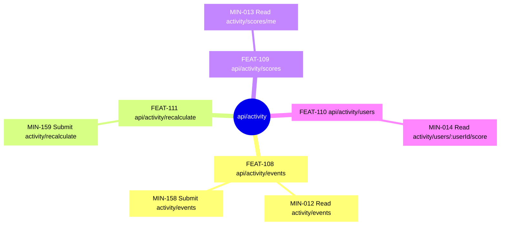

### FEAT-108 api/activity/events

api/activity/events

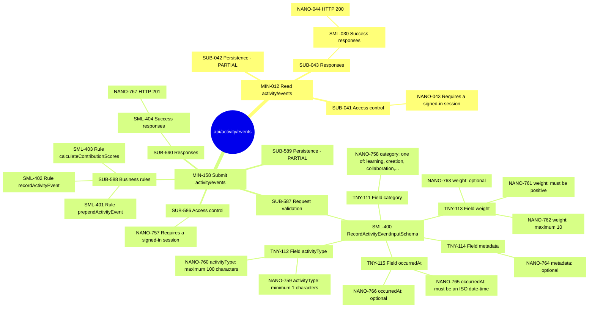

| ID       | Level | Parent   | Name                                                        | Description                                                                                                                                                                                                                                                                                                               | Status                | Verification | Evidence                                          | Related                     |
| -------- | ----- | -------- | ----------------------------------------------------------- | ------------------------------------------------------------------------------------------------------------------------------------------------------------------------------------------------------------------------------------------------------------------------------------------------------------------------- | --------------------- | ------------ | ------------------------------------------------- | --------------------------- |
| FEAT-108 | MAJOR | MOD-086  | api/activity/events                                         |                                                                                                                                                                                                                                                                                                                           | IMPLEMENTED           |              | apps/api/src/server.ts:9572                       |                             |
| MIN-012  | MINOR | FEAT-108 | Read activity/events                                        | GET /api/v1/activity/events for any signed-in session; ephemeral (process memory); responds 200. Gaps: ephemeral: state held in process memory, lost on restart; no first-party web caller found                                                                                                                          | IMPLEMENTED           | VERIFIED     | apps/api/src/server.ts:9603                       | API-197, TEST-082, TEST-165 |
| SUB-041  | SUB   | MIN-012  | Access control                                              | Who may call GET /api/v1/activity/events: any signed-in session.                                                                                                                                                                                                                                                          | IMPLEMENTED           | PATH_LEVEL   | apps/api/src/server.ts:9603                       |                             |
| NANO-043 | NANO  | SUB-041  | Requires a signed-in session                                | Requests without a valid session token are rejected with 401 UNAUTHENTICATED.                                                                                                                                                                                                                                             | IMPLEMENTED           | PATH_LEVEL   | apps/api/src/server.ts:9603                       | ROLE-001                    |
| SUB-042  | SUB   | MIN-012  | Persistence                                                 | Ephemeral: state lives in API process memory and is lost on restart.                                                                                                                                                                                                                                                      | PARTIALLY_IMPLEMENTED | PATH_LEVEL   | apps/api/src/server.ts:9603                       |                             |
| SUB-043  | SUB   | MIN-012  | Responses                                                   | Success 200; 0 explicit failure branch(es) besides validation and access errors.                                                                                                                                                                                                                                          | IMPLEMENTED           | PATH_LEVEL   | apps/api/src/server.ts:9603                       |                             |
| SML-030  | SMALL | SUB-043  | Success responses                                           | HTTP 200.                                                                                                                                                                                                                                                                                                                 | IMPLEMENTED           | PATH_LEVEL   | apps/api/src/server.ts:9603                       |                             |
| NANO-044 | NANO  | SML-030  | HTTP 200                                                    | Replies 200 when the operation succeeds.                                                                                                                                                                                                                                                                                  | IMPLEMENTED           | PATH_LEVEL   | apps/api/src/server.ts:9603                       |                             |
| MIN-158  | MINOR | FEAT-108 | Submit activity/events                                      | POST /api/v1/activity/events for any signed-in session; validates RecordActivityEventInputSchema; calls prependActivityEvent, recordActivityEvent, calculateContributionScores; ephemeral (process memory); responds 201. Gaps: ephemeral: state held in process memory, lost on restart; no first-party web caller found | IMPLEMENTED           | VERIFIED     | apps/api/src/server.ts:9572                       | API-196, TEST-082, TEST-165 |
| SUB-586  | SUB   | MIN-158  | Access control                                              | Who may call POST /api/v1/activity/events: any signed-in session.                                                                                                                                                                                                                                                         | IMPLEMENTED           | PATH_LEVEL   | apps/api/src/server.ts:9572                       |                             |
| NANO-757 | NANO  | SUB-586  | Requires a signed-in session                                | Requests without a valid session token are rejected with 401 UNAUTHENTICATED.                                                                                                                                                                                                                                             | IMPLEMENTED           | PATH_LEVEL   | apps/api/src/server.ts:9572                       | ROLE-001                    |
| SUB-587  | SUB   | MIN-158  | Request validation                                          | The request is parsed with RecordActivityEventInputSchema; a failure returns 400 with field details before any business logic runs.                                                                                                                                                                                       | IMPLEMENTED           | PATH_LEVEL   | apps/api/src/server.ts:9572                       |                             |
| SML-400  | SMALL | SUB-587  | RecordActivityEventInputSchema                              | RecordActivityEventInputSchema: 5 field(s)                                                                                                                                                                                                                                                                                | IMPLEMENTED           | PATH_LEVEL   | packages/contracts/src/index.ts:1310              | SCH-101                     |
| TNY-111  | TINY  | SML-400  | Field category                                              | category (enum, required): one of: learning, creation, collaboration, social                                                                                                                                                                                                                                              | IMPLEMENTED           | PATH_LEVEL   | packages/contracts/src/index.ts:1311              |                             |
| NANO-758 | NANO  | TNY-111  | category: one of: learning, creation, collaboration, social | category one of: learning, creation, collaboration, social.                                                                                                                                                                                                                                                               | IMPLEMENTED           | PATH_LEVEL   | packages/contracts/src/index.ts:1311              |                             |
| TNY-112  | TINY  | SML-400  | Field activityType                                          | activityType (string, required): minimum 1 characters; maximum 100 characters                                                                                                                                                                                                                                             | IMPLEMENTED           | PATH_LEVEL   | packages/contracts/src/index.ts:1312              |                             |
| NANO-759 | NANO  | TNY-112  | activityType: minimum 1 characters                          | activityType minimum 1 characters.                                                                                                                                                                                                                                                                                        | IMPLEMENTED           | PATH_LEVEL   | packages/contracts/src/index.ts:1312              |                             |
| NANO-760 | NANO  | TNY-112  | activityType: maximum 100 characters                        | activityType maximum 100 characters.                                                                                                                                                                                                                                                                                      | IMPLEMENTED           | PATH_LEVEL   | packages/contracts/src/index.ts:1312              |                             |
| TNY-113  | TINY  | SML-400  | Field weight                                                | weight (number, optional): must be positive; maximum 10; optional                                                                                                                                                                                                                                                         | IMPLEMENTED           | PATH_LEVEL   | packages/contracts/src/index.ts:1313              |                             |
| NANO-761 | NANO  | TNY-113  | weight: must be positive                                    | weight must be positive.                                                                                                                                                                                                                                                                                                  | IMPLEMENTED           | PATH_LEVEL   | packages/contracts/src/index.ts:1313              |                             |
| NANO-762 | NANO  | TNY-113  | weight: maximum 10                                          | weight maximum 10.                                                                                                                                                                                                                                                                                                        | IMPLEMENTED           | PATH_LEVEL   | packages/contracts/src/index.ts:1313              |                             |
| NANO-763 | NANO  | TNY-113  | weight: optional                                            | weight optional.                                                                                                                                                                                                                                                                                                          | IMPLEMENTED           | PATH_LEVEL   | packages/contracts/src/index.ts:1313              |                             |
| TNY-114  | TINY  | SML-400  | Field metadata                                              | metadata (record, optional): optional                                                                                                                                                                                                                                                                                     | IMPLEMENTED           | PATH_LEVEL   | packages/contracts/src/index.ts:1314              |                             |
| NANO-764 | NANO  | TNY-114  | metadata: optional                                          | metadata optional.                                                                                                                                                                                                                                                                                                        | IMPLEMENTED           | PATH_LEVEL   | packages/contracts/src/index.ts:1314              |                             |
| TNY-115  | TINY  | SML-400  | Field occurredAt                                            | occurredAt (string, optional): must be an ISO date-time; optional                                                                                                                                                                                                                                                         | IMPLEMENTED           | PATH_LEVEL   | packages/contracts/src/index.ts:1315              |                             |
| NANO-765 | NANO  | TNY-115  | occurredAt: must be an ISO date-time                        | occurredAt must be an ISO date-time.                                                                                                                                                                                                                                                                                      | IMPLEMENTED           | PATH_LEVEL   | packages/contracts/src/index.ts:1315              |                             |
| NANO-766 | NANO  | TNY-115  | occurredAt: optional                                        | occurredAt optional.                                                                                                                                                                                                                                                                                                      | IMPLEMENTED           | PATH_LEVEL   | packages/contracts/src/index.ts:1315              |                             |
| SUB-588  | SUB   | MIN-158  | Business rules                                              | Domain functions from packages/domain called by the handler (3).                                                                                                                                                                                                                                                          | IMPLEMENTED           | PATH_LEVEL   | apps/api/src/server.ts:9572                       |                             |
| SML-401  | SMALL | SUB-588  | Rule prependActivityEvent                                   | Calls prependActivityEvent (packages/domain/src/activity-contributions.ts). Rule status IMPLEMENTED; its own tests: VERIFIED.                                                                                                                                                                                             | IMPLEMENTED           | VERIFIED     | packages/domain/src/activity-contributions.ts:16  | RULE-001                    |
| SML-402  | SMALL | SUB-588  | Rule recordActivityEvent                                    | Calls recordActivityEvent (packages/domain/src/activity-contributions.ts). Rule status IMPLEMENTED; its own tests: VERIFIED.                                                                                                                                                                                              | IMPLEMENTED           | VERIFIED     | packages/domain/src/activity-contributions.ts:69  | RULE-003                    |
| SML-403  | SMALL | SUB-588  | Rule calculateContributionScores                            | Calls calculateContributionScores (packages/domain/src/activity-contributions.ts). Rule status IMPLEMENTED; its own tests: VERIFIED.                                                                                                                                                                                      | IMPLEMENTED           | VERIFIED     | packages/domain/src/activity-contributions.ts:112 | RULE-004                    |
| SUB-589  | SUB   | MIN-158  | Persistence                                                 | Ephemeral: state lives in API process memory and is lost on restart.                                                                                                                                                                                                                                                      | PARTIALLY_IMPLEMENTED | PATH_LEVEL   | apps/api/src/server.ts:9572                       |                             |
| SUB-590  | SUB   | MIN-158  | Responses                                                   | Success 201; 0 explicit failure branch(es) besides validation and access errors.                                                                                                                                                                                                                                          | IMPLEMENTED           | PATH_LEVEL   | apps/api/src/server.ts:9572                       |                             |
| SML-404  | SMALL | SUB-590  | Success responses                                           | HTTP 201.                                                                                                                                                                                                                                                                                                                 | IMPLEMENTED           | PATH_LEVEL   | apps/api/src/server.ts:9572                       |                             |
| NANO-767 | NANO  | SML-404  | HTTP 201                                                    | Replies 201 when the operation succeeds.                                                                                                                                                                                                                                                                                  | IMPLEMENTED           | PATH_LEVEL   | apps/api/src/server.ts:9572                       |                             |

### FEAT-111 api/activity/recalculate

api/activity/recalculate

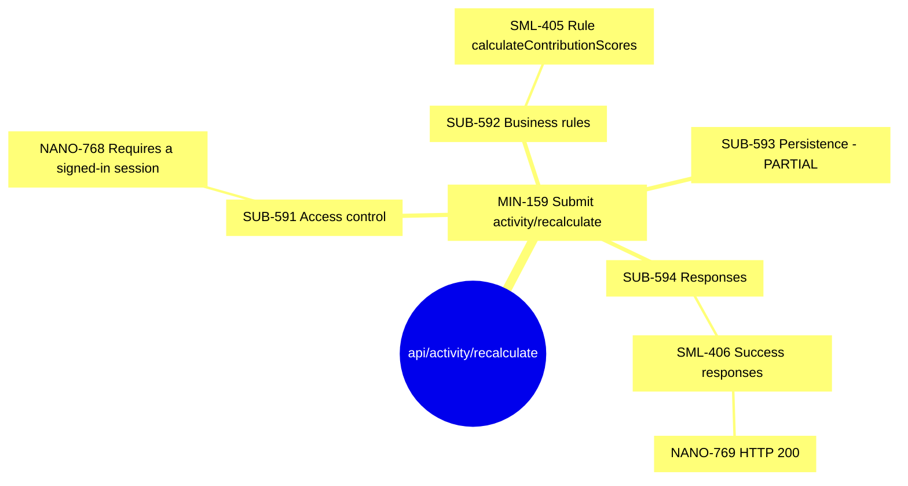

| ID       | Level | Parent   | Name                             | Description                                                                                                                                                                                                                               | Status                | Verification | Evidence                                          | Related           |
| -------- | ----- | -------- | -------------------------------- | ----------------------------------------------------------------------------------------------------------------------------------------------------------------------------------------------------------------------------------------- | --------------------- | ------------ | ------------------------------------------------- | ----------------- |
| FEAT-111 | MAJOR | MOD-086  | api/activity/recalculate         |                                                                                                                                                                                                                                           | IMPLEMENTED           |              | apps/api/src/server.ts:9688                       |                   |
| MIN-159  | MINOR | FEAT-111 | Submit activity/recalculate      | POST /api/v1/activity/recalculate for any signed-in session; calls calculateContributionScores; ephemeral (process memory); responds 200. Gaps: ephemeral: state held in process memory, lost on restart; no first-party web caller found | IMPLEMENTED           | VERIFIED     | apps/api/src/server.ts:9688                       | API-200, TEST-082 |
| SUB-591  | SUB   | MIN-159  | Access control                   | Who may call POST /api/v1/activity/recalculate: any signed-in session.                                                                                                                                                                    | IMPLEMENTED           | PATH_LEVEL   | apps/api/src/server.ts:9688                       |                   |
| NANO-768 | NANO  | SUB-591  | Requires a signed-in session     | Requests without a valid session token are rejected with 401 UNAUTHENTICATED.                                                                                                                                                             | IMPLEMENTED           | PATH_LEVEL   | apps/api/src/server.ts:9688                       | ROLE-001          |
| SUB-592  | SUB   | MIN-159  | Business rules                   | Domain functions from packages/domain called by the handler (1).                                                                                                                                                                          | IMPLEMENTED           | PATH_LEVEL   | apps/api/src/server.ts:9688                       |                   |
| SML-405  | SMALL | SUB-592  | Rule calculateContributionScores | Calls calculateContributionScores (packages/domain/src/activity-contributions.ts). Rule status IMPLEMENTED; its own tests: VERIFIED.                                                                                                      | IMPLEMENTED           | VERIFIED     | packages/domain/src/activity-contributions.ts:112 | RULE-004          |
| SUB-593  | SUB   | MIN-159  | Persistence                      | Ephemeral: state lives in API process memory and is lost on restart.                                                                                                                                                                      | PARTIALLY_IMPLEMENTED | PATH_LEVEL   | apps/api/src/server.ts:9688                       |                   |
| SUB-594  | SUB   | MIN-159  | Responses                        | Success 200; 0 explicit failure branch(es) besides validation and access errors.                                                                                                                                                          | IMPLEMENTED           | PATH_LEVEL   | apps/api/src/server.ts:9688                       |                   |
| SML-406  | SMALL | SUB-594  | Success responses                | HTTP 200.                                                                                                                                                                                                                                 | IMPLEMENTED           | PATH_LEVEL   | apps/api/src/server.ts:9688                       |                   |
| NANO-769 | NANO  | SML-406  | HTTP 200                         | Replies 200 when the operation succeeds.                                                                                                                                                                                                  | IMPLEMENTED           | PATH_LEVEL   | apps/api/src/server.ts:9688                       |                   |

### FEAT-109 api/activity/scores

api/activity/scores

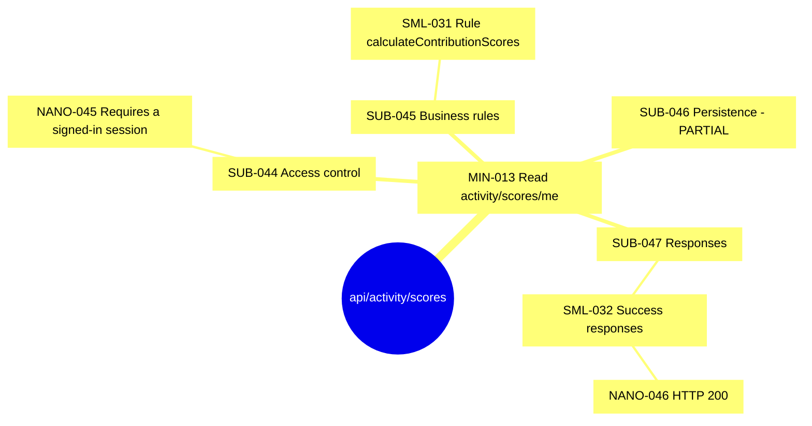

| ID       | Level | Parent   | Name                             | Description                                                                                                                                                                                                                            | Status                | Verification | Evidence                                          | Related                     |
| -------- | ----- | -------- | -------------------------------- | -------------------------------------------------------------------------------------------------------------------------------------------------------------------------------------------------------------------------------------- | --------------------- | ------------ | ------------------------------------------------- | --------------------------- |
| FEAT-109 | MAJOR | MOD-086  | api/activity/scores              |                                                                                                                                                                                                                                        | IMPLEMENTED           |              | apps/api/src/server.ts:9628                       |                             |
| MIN-013  | MINOR | FEAT-109 | Read activity/scores/me          | GET /api/v1/activity/scores/me for any signed-in session; calls calculateContributionScores; ephemeral (process memory); responds 200. Gaps: ephemeral: state held in process memory, lost on restart; no first-party web caller found | IMPLEMENTED           | VERIFIED     | apps/api/src/server.ts:9628                       | API-198, TEST-082, TEST-165 |
| SUB-044  | SUB   | MIN-013  | Access control                   | Who may call GET /api/v1/activity/scores/me: any signed-in session.                                                                                                                                                                    | IMPLEMENTED           | PATH_LEVEL   | apps/api/src/server.ts:9628                       |                             |
| NANO-045 | NANO  | SUB-044  | Requires a signed-in session     | Requests without a valid session token are rejected with 401 UNAUTHENTICATED.                                                                                                                                                          | IMPLEMENTED           | PATH_LEVEL   | apps/api/src/server.ts:9628                       | ROLE-001                    |
| SUB-045  | SUB   | MIN-013  | Business rules                   | Domain functions from packages/domain called by the handler (1).                                                                                                                                                                       | IMPLEMENTED           | PATH_LEVEL   | apps/api/src/server.ts:9628                       |                             |
| SML-031  | SMALL | SUB-045  | Rule calculateContributionScores | Calls calculateContributionScores (packages/domain/src/activity-contributions.ts). Rule status IMPLEMENTED; its own tests: VERIFIED.                                                                                                   | IMPLEMENTED           | VERIFIED     | packages/domain/src/activity-contributions.ts:112 | RULE-004                    |
| SUB-046  | SUB   | MIN-013  | Persistence                      | Ephemeral: state lives in API process memory and is lost on restart.                                                                                                                                                                   | PARTIALLY_IMPLEMENTED | PATH_LEVEL   | apps/api/src/server.ts:9628                       |                             |
| SUB-047  | SUB   | MIN-013  | Responses                        | Success 200; 0 explicit failure branch(es) besides validation and access errors.                                                                                                                                                       | IMPLEMENTED           | PATH_LEVEL   | apps/api/src/server.ts:9628                       |                             |
| SML-032  | SMALL | SUB-047  | Success responses                | HTTP 200.                                                                                                                                                                                                                              | IMPLEMENTED           | PATH_LEVEL   | apps/api/src/server.ts:9628                       |                             |
| NANO-046 | NANO  | SML-032  | HTTP 200                         | Replies 200 when the operation succeeds.                                                                                                                                                                                               | IMPLEMENTED           | PATH_LEVEL   | apps/api/src/server.ts:9628                       |                             |

### FEAT-110 api/activity/users

api/activity/users

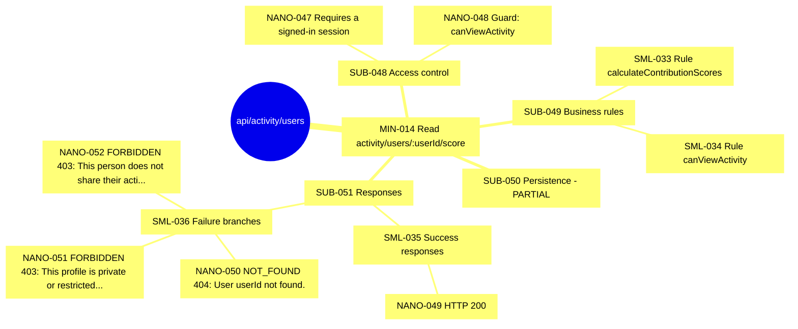

| ID       | Level | Parent   | Name                                                                      | Description                                                                                                                                                                                                                                                                             | Status                | Verification | Evidence                                          | Related                               |
| -------- | ----- | -------- | ------------------------------------------------------------------------- | --------------------------------------------------------------------------------------------------------------------------------------------------------------------------------------------------------------------------------------------------------------------------------------- | --------------------- | ------------ | ------------------------------------------------- | ------------------------------------- |
| FEAT-110 | MAJOR | MOD-086  | api/activity/users                                                        |                                                                                                                                                                                                                                                                                         | IMPLEMENTED           |              | apps/api/src/server.ts:9637                       |                                       |
| MIN-014  | MINOR | FEAT-110 | Read activity/users/:userId/score                                         | GET /api/v1/activity/users/:userId/score for any signed-in session; calls calculateContributionScores, canViewActivity; ephemeral (process memory); responds 200; 3 failure branch(es). Gaps: ephemeral: state held in process memory, lost on restart; no first-party web caller found | IMPLEMENTED           | VERIFIED     | apps/api/src/server.ts:9637                       | API-199, TEST-082, TEST-096, TEST-165 |
| SUB-048  | SUB   | MIN-014  | Access control                                                            | Who may call GET /api/v1/activity/users/:userId/score: any signed-in session.                                                                                                                                                                                                           | IMPLEMENTED           | PATH_LEVEL   | apps/api/src/server.ts:9637                       |                                       |
| NANO-047 | NANO  | SUB-048  | Requires a signed-in session                                              | Requests without a valid session token are rejected with 401 UNAUTHENTICATED.                                                                                                                                                                                                           | IMPLEMENTED           | PATH_LEVEL   | apps/api/src/server.ts:9637                       | ROLE-001                              |
| NANO-048 | NANO  | SUB-048  | Guard: canViewActivity                                                    | Guard canViewActivity must pass before the handler runs.                                                                                                                                                                                                                                | IMPLEMENTED           | PATH_LEVEL   | apps/api/src/server.ts:9637                       |                                       |
| SUB-049  | SUB   | MIN-014  | Business rules                                                            | Domain functions from packages/domain called by the handler (2).                                                                                                                                                                                                                        | IMPLEMENTED           | PATH_LEVEL   | apps/api/src/server.ts:9637                       |                                       |
| SML-033  | SMALL | SUB-049  | Rule calculateContributionScores                                          | Calls calculateContributionScores (packages/domain/src/activity-contributions.ts). Rule status IMPLEMENTED; its own tests: VERIFIED.                                                                                                                                                    | IMPLEMENTED           | VERIFIED     | packages/domain/src/activity-contributions.ts:112 | RULE-004                              |
| SML-034  | SMALL | SUB-049  | Rule canViewActivity                                                      | Calls canViewActivity (packages/domain/src/profile.ts). Rule status IMPLEMENTED; its own tests: VERIFIED.                                                                                                                                                                               | IMPLEMENTED           | VERIFIED     | packages/domain/src/profile.ts:76                 | RULE-179                              |
| SUB-050  | SUB   | MIN-014  | Persistence                                                               | Ephemeral: state lives in API process memory and is lost on restart.                                                                                                                                                                                                                    | PARTIALLY_IMPLEMENTED | PATH_LEVEL   | apps/api/src/server.ts:9637                       |                                       |
| SUB-051  | SUB   | MIN-014  | Responses                                                                 | Success 200; 3 explicit failure branch(es) besides validation and access errors.                                                                                                                                                                                                        | IMPLEMENTED           | PATH_LEVEL   | apps/api/src/server.ts:9637                       |                                       |
| SML-035  | SMALL | SUB-051  | Success responses                                                         | HTTP 200.                                                                                                                                                                                                                                                                               | IMPLEMENTED           | PATH_LEVEL   | apps/api/src/server.ts:9637                       |                                       |
| NANO-049 | NANO  | SML-035  | HTTP 200                                                                  | Replies 200 when the operation succeeds.                                                                                                                                                                                                                                                | IMPLEMENTED           | PATH_LEVEL   | apps/api/src/server.ts:9637                       |                                       |
| SML-036  | SMALL | SUB-051  | Failure branches                                                          | 3 DomainError branch(es) in the handler, mapped to HTTP by the global error handler.                                                                                                                                                                                                    | IMPLEMENTED           | PATH_LEVEL   | apps/api/src/server.ts:9637                       |                                       |
| NANO-050 | NANO  | SML-036  | NOT_FOUND 404: User ${userId} not found.                                  | Throws DomainError(NOT_FOUND) "User ${userId} not found." -> HTTP 404.                                                                                                                                                                                                                  | IMPLEMENTED           | PATH_LEVEL   | apps/api/src/server.ts:9646                       | ERR-088                               |
| NANO-051 | NANO  | SML-036  | FORBIDDEN 403: This profile is private or restricted to authorized roles. | Throws DomainError(FORBIDDEN) "This profile is private or restricted to authorized roles." -> HTTP 403.                                                                                                                                                                                 | IMPLEMENTED           | PATH_LEVEL   | apps/api/src/server.ts:9660                       | ERR-017                               |
| NANO-052 | NANO  | SML-036  | FORBIDDEN 403: This person does not share their activity.                 | Throws DomainError(FORBIDDEN) "This person does not share their activity." -> HTTP 403.                                                                                                                                                                                                 | IMPLEMENTED           | PATH_LEVEL   | apps/api/src/server.ts:9666                       | ERR-199                               |

## api/admin (MOD-091)

**Application:** apps/api (MOD-001). **Purpose:** API module: routes under /api/v1/admin in apps/api/src/server.ts.

**Nodes by level:** MODULE 1, MAJOR 5, MINOR 8, SUB 38, SMALL 33, TINY 10, NANO 37. **Status:** IMPLEMENTED 126, PARTIALLY_IMPLEMENTED 6. **Verification:** PATH_LEVEL 102, UNKNOWN 1, VERIFIED 23.

**User roles that reach it:** authenticated, platform_admin.

**Known gaps:** MIN-016 no first-party web caller found; MIN-281 no first-party web caller found; MIN-017 ephemeral: state held in process memory, lost on restart; MIN-160 ephemeral: state held in process memory, lost on restart; MIN-018 ephemeral: state held in process memory, lost on restart; MIN-145 ephemeral: state held in process memory, lost on restart; MIN-145 no first-party web caller found; MIN-146 ephemeral: state held in process memory, lost on restart.

**Called from (web screens and components):** FEAT-157 Screen /admin

### Module map (to minor features)

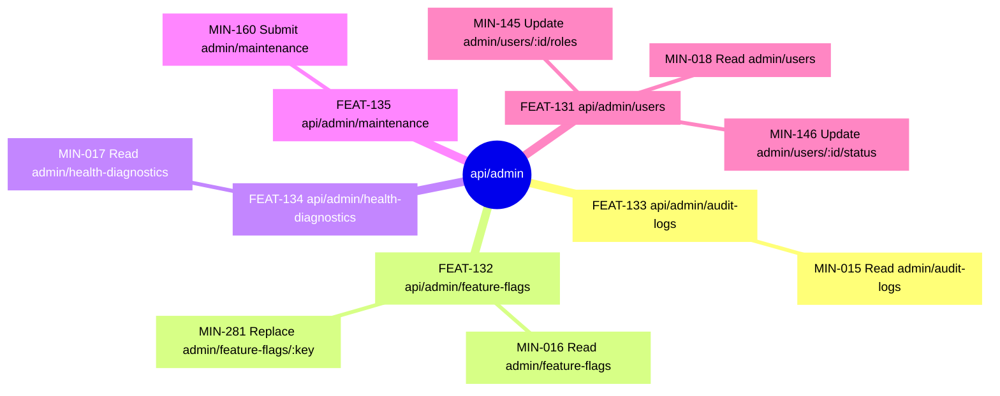

### FEAT-133 api/admin/audit-logs

api/admin/audit-logs

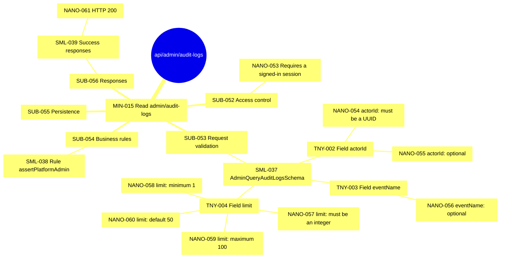

| ID       | Level | Parent   | Name                         | Description                                                                                                                                                                                    | Status      | Verification | Evidence                            | Related           |
| -------- | ----- | -------- | ---------------------------- | ---------------------------------------------------------------------------------------------------------------------------------------------------------------------------------------------- | ----------- | ------------ | ----------------------------------- | ----------------- |
| FEAT-133 | MAJOR | MOD-091  | api/admin/audit-logs         |                                                                                                                                                                                                | IMPLEMENTED |              | apps/api/src/server.ts:11398        |                   |
| MIN-015  | MINOR | FEAT-133 | Read admin/audit-logs        | 6. Query admin audit logs (BR-067) GET /api/v1/admin/audit-logs for any signed-in session; validates AdminQueryAuditLogsSchema; calls assertPlatformAdmin; durable (PostgreSQL); responds 200. | IMPLEMENTED | VERIFIED     | apps/api/src/server.ts:11398        | API-234, TEST-083 |
| SUB-052  | SUB   | MIN-015  | Access control               | Who may call GET /api/v1/admin/audit-logs: any signed-in session.                                                                                                                              | IMPLEMENTED | PATH_LEVEL   | apps/api/src/server.ts:11398        |                   |
| NANO-053 | NANO  | SUB-052  | Requires a signed-in session | Requests without a valid session token are rejected with 401 UNAUTHENTICATED.                                                                                                                  | IMPLEMENTED | PATH_LEVEL   | apps/api/src/server.ts:11398        | ROLE-001          |
| SUB-053  | SUB   | MIN-015  | Request validation           | The request is parsed with AdminQueryAuditLogsSchema; a failure returns 400 with field details before any business logic runs.                                                                 | IMPLEMENTED | PATH_LEVEL   | apps/api/src/server.ts:11398        |                   |
| SML-037  | SMALL | SUB-053  | AdminQueryAuditLogsSchema    | AdminQueryAuditLogsSchema: 3 field(s)                                                                                                                                                          | IMPLEMENTED | PATH_LEVEL   | packages/contracts/src/index.ts:765 | SCH-059           |
| TNY-002  | TINY  | SML-037  | Field actorId                | actorId (string, optional): must be a UUID; optional                                                                                                                                           | IMPLEMENTED | PATH_LEVEL   | packages/contracts/src/index.ts:766 |                   |
| NANO-054 | NANO  | TNY-002  | actorId: must be a UUID      | actorId must be a UUID.                                                                                                                                                                        | IMPLEMENTED | PATH_LEVEL   | packages/contracts/src/index.ts:766 |                   |
| NANO-055 | NANO  | TNY-002  | actorId: optional            | actorId optional.                                                                                                                                                                              | IMPLEMENTED | PATH_LEVEL   | packages/contracts/src/index.ts:766 |                   |
| TNY-003  | TINY  | SML-037  | Field eventName              | eventName (string, optional): optional                                                                                                                                                         | IMPLEMENTED | PATH_LEVEL   | packages/contracts/src/index.ts:767 |                   |
| NANO-056 | NANO  | TNY-003  | eventName: optional          | eventName optional.                                                                                                                                                                            | IMPLEMENTED | PATH_LEVEL   | packages/contracts/src/index.ts:767 |                   |
| TNY-004  | TINY  | SML-037  | Field limit                  | limit (number, optional): must be an integer; minimum 1; maximum 100; default 50                                                                                                               | IMPLEMENTED | PATH_LEVEL   | packages/contracts/src/index.ts:768 |                   |
| NANO-057 | NANO  | TNY-004  | limit: must be an integer    | limit must be an integer.                                                                                                                                                                      | IMPLEMENTED | PATH_LEVEL   | packages/contracts/src/index.ts:768 |                   |
| NANO-058 | NANO  | TNY-004  | limit: minimum 1             | limit minimum 1.                                                                                                                                                                               | IMPLEMENTED | PATH_LEVEL   | packages/contracts/src/index.ts:768 |                   |
| NANO-059 | NANO  | TNY-004  | limit: maximum 100           | limit maximum 100.                                                                                                                                                                             | IMPLEMENTED | PATH_LEVEL   | packages/contracts/src/index.ts:768 |                   |
| NANO-060 | NANO  | TNY-004  | limit: default 50            | limit default 50.                                                                                                                                                                              | IMPLEMENTED | PATH_LEVEL   | packages/contracts/src/index.ts:768 |                   |
| SUB-054  | SUB   | MIN-015  | Business rules               | Domain functions from packages/domain called by the handler (1).                                                                                                                               | IMPLEMENTED | PATH_LEVEL   | apps/api/src/server.ts:11398        |                   |
| SML-038  | SMALL | SUB-054  | Rule assertPlatformAdmin     | Calls assertPlatformAdmin (packages/domain/src/admin.ts). Rule status IMPLEMENTED; its own tests: VERIFIED.                                                                                    | IMPLEMENTED | VERIFIED     | packages/domain/src/admin.ts:44     | RULE-005          |
| SUB-055  | SUB   | MIN-015  | Persistence                  | Durable: writes go through the PostgreSQL store; store calls adminAudit.list.                                                                                                                  | IMPLEMENTED | PATH_LEVEL   | apps/api/src/server.ts:11398        |                   |
| SUB-056  | SUB   | MIN-015  | Responses                    | Success 200; 0 explicit failure branch(es) besides validation and access errors.                                                                                                               | IMPLEMENTED | PATH_LEVEL   | apps/api/src/server.ts:11398        |                   |
| SML-039  | SMALL | SUB-056  | Success responses            | HTTP 200.                                                                                                                                                                                      | IMPLEMENTED | PATH_LEVEL   | apps/api/src/server.ts:11398        |                   |
| NANO-061 | NANO  | SML-039  | HTTP 200                     | Replies 200 when the operation succeeds.                                                                                                                                                       | IMPLEMENTED | PATH_LEVEL   | apps/api/src/server.ts:11398        |                   |

### FEAT-132 api/admin/feature-flags

api/admin/feature-flags

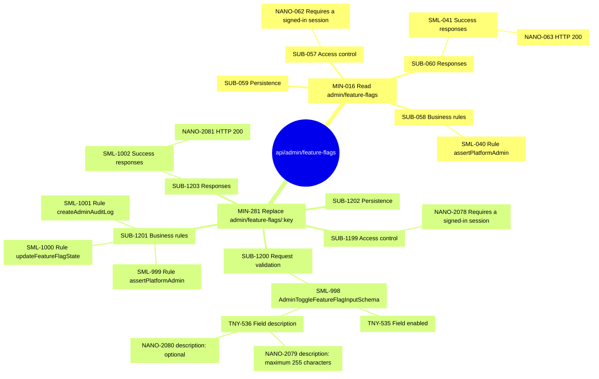

| ID        | Level | Parent   | Name                                | Description                                                                                                                                                                                                                                                                                          | Status      | Verification | Evidence                            | Related                     |
| --------- | ----- | -------- | ----------------------------------- | ---------------------------------------------------------------------------------------------------------------------------------------------------------------------------------------------------------------------------------------------------------------------------------------------------- | ----------- | ------------ | ----------------------------------- | --------------------------- |
| FEAT-132  | MAJOR | MOD-091  | api/admin/feature-flags             |                                                                                                                                                                                                                                                                                                      | IMPLEMENTED |              | apps/api/src/server.ts:11344        |                             |
| MIN-016   | MINOR | FEAT-132 | Read admin/feature-flags            | 4. List feature flags (Admin) GET /api/v1/admin/feature-flags for any signed-in session; calls assertPlatformAdmin; durable (PostgreSQL); responds 200. Gaps: no first-party web caller found                                                                                                        | IMPLEMENTED | VERIFIED     | apps/api/src/server.ts:11344        | API-232, TEST-083, TEST-141 |
| SUB-057   | SUB   | MIN-016  | Access control                      | Who may call GET /api/v1/admin/feature-flags: any signed-in session.                                                                                                                                                                                                                                 | IMPLEMENTED | PATH_LEVEL   | apps/api/src/server.ts:11344        |                             |
| NANO-062  | NANO  | SUB-057  | Requires a signed-in session        | Requests without a valid session token are rejected with 401 UNAUTHENTICATED.                                                                                                                                                                                                                        | IMPLEMENTED | PATH_LEVEL   | apps/api/src/server.ts:11344        | ROLE-001                    |
| SUB-058   | SUB   | MIN-016  | Business rules                      | Domain functions from packages/domain called by the handler (1).                                                                                                                                                                                                                                     | IMPLEMENTED | PATH_LEVEL   | apps/api/src/server.ts:11344        |                             |
| SML-040   | SMALL | SUB-058  | Rule assertPlatformAdmin            | Calls assertPlatformAdmin (packages/domain/src/admin.ts). Rule status IMPLEMENTED; its own tests: VERIFIED.                                                                                                                                                                                          | IMPLEMENTED | VERIFIED     | packages/domain/src/admin.ts:44     | RULE-005                    |
| SUB-059   | SUB   | MIN-016  | Persistence                         | Durable: writes go through the PostgreSQL store; store calls featureFlags.list.                                                                                                                                                                                                                      | IMPLEMENTED | PATH_LEVEL   | apps/api/src/server.ts:11344        |                             |
| SUB-060   | SUB   | MIN-016  | Responses                           | Success 200; 0 explicit failure branch(es) besides validation and access errors.                                                                                                                                                                                                                     | IMPLEMENTED | PATH_LEVEL   | apps/api/src/server.ts:11344        |                             |
| SML-041   | SMALL | SUB-060  | Success responses                   | HTTP 200.                                                                                                                                                                                                                                                                                            | IMPLEMENTED | PATH_LEVEL   | apps/api/src/server.ts:11344        |                             |
| NANO-063  | NANO  | SML-041  | HTTP 200                            | Replies 200 when the operation succeeds.                                                                                                                                                                                                                                                             | IMPLEMENTED | PATH_LEVEL   | apps/api/src/server.ts:11344        |                             |
| MIN-281   | MINOR | FEAT-132 | Replace admin/feature-flags/:key    | 5. Update/toggle feature flag (Admin) PUT /api/v1/admin/feature-flags/:key for any signed-in session; validates AdminToggleFeatureFlagInputSchema; calls assertPlatformAdmin, updateFeatureFlagState, createAdminAuditLog; durable (PostgreSQL); responds 200. Gaps: no first-party web caller found | IMPLEMENTED | VERIFIED     | apps/api/src/server.ts:11356        | API-233, TEST-083, TEST-183 |
| SUB-1199  | SUB   | MIN-281  | Access control                      | Who may call PUT /api/v1/admin/feature-flags/:key: any signed-in session.                                                                                                                                                                                                                            | IMPLEMENTED | PATH_LEVEL   | apps/api/src/server.ts:11356        |                             |
| NANO-2078 | NANO  | SUB-1199 | Requires a signed-in session        | Requests without a valid session token are rejected with 401 UNAUTHENTICATED.                                                                                                                                                                                                                        | IMPLEMENTED | PATH_LEVEL   | apps/api/src/server.ts:11356        | ROLE-001                    |
| SUB-1200  | SUB   | MIN-281  | Request validation                  | The request is parsed with AdminToggleFeatureFlagInputSchema; a failure returns 400 with field details before any business logic runs.                                                                                                                                                               | IMPLEMENTED | PATH_LEVEL   | apps/api/src/server.ts:11356        |                             |
| SML-998   | SMALL | SUB-1200 | AdminToggleFeatureFlagInputSchema   | AdminToggleFeatureFlagInputSchema: 2 field(s)                                                                                                                                                                                                                                                        | IMPLEMENTED | PATH_LEVEL   | packages/contracts/src/index.ts:751 | SCH-057                     |
| TNY-535   | TINY  | SML-998  | Field enabled                       | enabled (boolean, required)                                                                                                                                                                                                                                                                          | IMPLEMENTED | PATH_LEVEL   | packages/contracts/src/index.ts:752 |                             |
| TNY-536   | TINY  | SML-998  | Field description                   | description (string, optional): maximum 255 characters; optional                                                                                                                                                                                                                                     | IMPLEMENTED | PATH_LEVEL   | packages/contracts/src/index.ts:753 |                             |
| NANO-2079 | NANO  | TNY-536  | description: maximum 255 characters | description maximum 255 characters.                                                                                                                                                                                                                                                                  | IMPLEMENTED | PATH_LEVEL   | packages/contracts/src/index.ts:753 |                             |
| NANO-2080 | NANO  | TNY-536  | description: optional               | description optional.                                                                                                                                                                                                                                                                                | IMPLEMENTED | PATH_LEVEL   | packages/contracts/src/index.ts:753 |                             |
| SUB-1201  | SUB   | MIN-281  | Business rules                      | Domain functions from packages/domain called by the handler (3).                                                                                                                                                                                                                                     | IMPLEMENTED | PATH_LEVEL   | apps/api/src/server.ts:11356        |                             |
| SML-999   | SMALL | SUB-1201 | Rule assertPlatformAdmin            | Calls assertPlatformAdmin (packages/domain/src/admin.ts). Rule status IMPLEMENTED; its own tests: VERIFIED.                                                                                                                                                                                          | IMPLEMENTED | VERIFIED     | packages/domain/src/admin.ts:44     | RULE-005                    |
| SML-1000  | SMALL | SUB-1201 | Rule updateFeatureFlagState         | Calls updateFeatureFlagState (packages/domain/src/admin.ts). Rule status IMPLEMENTED; its own tests: VERIFIED.                                                                                                                                                                                       | IMPLEMENTED | VERIFIED     | packages/domain/src/admin.ts:95     | RULE-008                    |
| SML-1001  | SMALL | SUB-1201 | Rule createAdminAuditLog            | Calls createAdminAuditLog (packages/domain/src/admin.ts). Rule status IMPLEMENTED; its own tests: VERIFIED.                                                                                                                                                                                          | IMPLEMENTED | VERIFIED     | packages/domain/src/admin.ts:112    | RULE-009                    |
| SUB-1202  | SUB   | MIN-281  | Persistence                         | Durable: writes go through the PostgreSQL store; store calls adminAudit.append, featureFlags.get, featureFlags.upsert.                                                                                                                                                                               | IMPLEMENTED | PATH_LEVEL   | apps/api/src/server.ts:11356        |                             |
| SUB-1203  | SUB   | MIN-281  | Responses                           | Success 200; 0 explicit failure branch(es) besides validation and access errors.                                                                                                                                                                                                                     | IMPLEMENTED | PATH_LEVEL   | apps/api/src/server.ts:11356        |                             |
| SML-1002  | SMALL | SUB-1203 | Success responses                   | HTTP 200.                                                                                                                                                                                                                                                                                            | IMPLEMENTED | PATH_LEVEL   | apps/api/src/server.ts:11356        |                             |
| NANO-2081 | NANO  | SML-1002 | HTTP 200                            | Replies 200 when the operation succeeds.                                                                                                                                                                                                                                                             | IMPLEMENTED | PATH_LEVEL   | apps/api/src/server.ts:11356        |                             |

### FEAT-134 api/admin/health-diagnostics

api/admin/health-diagnostics

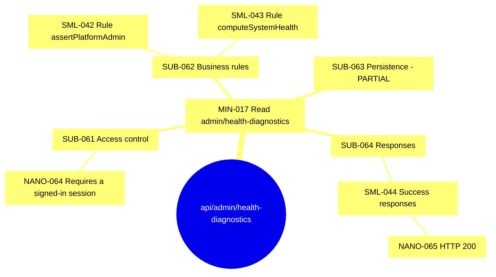

| ID       | Level | Parent   | Name                          | Description                                                                                                                                                                                                                                                     | Status                | Verification | Evidence                        | Related                                                       |
| -------- | ----- | -------- | ----------------------------- | --------------------------------------------------------------------------------------------------------------------------------------------------------------------------------------------------------------------------------------------------------------- | --------------------- | ------------ | ------------------------------- | ------------------------------------------------------------- |
| FEAT-134 | MAJOR | MOD-091  | api/admin/health-diagnostics  |                                                                                                                                                                                                                                                                 | IMPLEMENTED           |              | apps/api/src/server.ts:11420    |                                                               |
| MIN-017  | MINOR | FEAT-134 | Read admin/health-diagnostics | 7. System health & diagnostics (BR-28) GET /api/v1/admin/health-diagnostics for any signed-in session; calls assertPlatformAdmin, computeSystemHealth; ephemeral (process memory); responds 200. Gaps: ephemeral: state held in process memory, lost on restart | IMPLEMENTED           | VERIFIED     | apps/api/src/server.ts:11420    | API-235, TEST-042, TEST-083, TEST-107, TEST-133, TEST-141 ... |
| SUB-061  | SUB   | MIN-017  | Access control                | Who may call GET /api/v1/admin/health-diagnostics: any signed-in session.                                                                                                                                                                                       | IMPLEMENTED           | PATH_LEVEL   | apps/api/src/server.ts:11420    |                                                               |
| NANO-064 | NANO  | SUB-061  | Requires a signed-in session  | Requests without a valid session token are rejected with 401 UNAUTHENTICATED.                                                                                                                                                                                   | IMPLEMENTED           | PATH_LEVEL   | apps/api/src/server.ts:11420    | ROLE-001                                                      |
| SUB-062  | SUB   | MIN-017  | Business rules                | Domain functions from packages/domain called by the handler (2).                                                                                                                                                                                                | IMPLEMENTED           | PATH_LEVEL   | apps/api/src/server.ts:11420    |                                                               |
| SML-042  | SMALL | SUB-062  | Rule assertPlatformAdmin      | Calls assertPlatformAdmin (packages/domain/src/admin.ts). Rule status IMPLEMENTED; its own tests: VERIFIED.                                                                                                                                                     | IMPLEMENTED           | VERIFIED     | packages/domain/src/admin.ts:44 | RULE-005                                                      |
| SML-043  | SMALL | SUB-062  | Rule computeSystemHealth      | Calls computeSystemHealth (packages/domain/src/admin.ts). Rule status IMPLEMENTED; its own tests: VERIFIED.                                                                                                                                                     | IMPLEMENTED           | VERIFIED     | packages/domain/src/admin.ts:56 | RULE-006                                                      |
| SUB-063  | SUB   | MIN-017  | Persistence                   | Ephemeral: state lives in API process memory and is lost on restart; store calls jobs.countActive.                                                                                                                                                              | PARTIALLY_IMPLEMENTED | PATH_LEVEL   | apps/api/src/server.ts:11420    |                                                               |
| SUB-064  | SUB   | MIN-017  | Responses                     | Success 200; 0 explicit failure branch(es) besides validation and access errors.                                                                                                                                                                                | IMPLEMENTED           | PATH_LEVEL   | apps/api/src/server.ts:11420    |                                                               |
| SML-044  | SMALL | SUB-064  | Success responses             | HTTP 200.                                                                                                                                                                                                                                                       | IMPLEMENTED           | PATH_LEVEL   | apps/api/src/server.ts:11420    |                                                               |
| NANO-065 | NANO  | SML-044  | HTTP 200                      | Replies 200 when the operation succeeds.                                                                                                                                                                                                                        | IMPLEMENTED           | PATH_LEVEL   | apps/api/src/server.ts:11420    |                                                               |

### FEAT-135 api/admin/maintenance

api/admin/maintenance

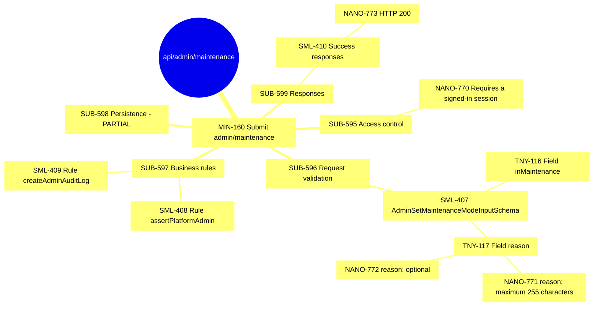

| ID       | Level | Parent   | Name                               | Description                                                                                                                                                                                                                                                                                 | Status                | Verification | Evidence                            | Related                     |
| -------- | ----- | -------- | ---------------------------------- | ------------------------------------------------------------------------------------------------------------------------------------------------------------------------------------------------------------------------------------------------------------------------------------------- | --------------------- | ------------ | ----------------------------------- | --------------------------- |
| FEAT-135 | MAJOR | MOD-091  | api/admin/maintenance              |                                                                                                                                                                                                                                                                                             | IMPLEMENTED           |              | apps/api/src/server.ts:11472        |                             |
| MIN-160  | MINOR | FEAT-135 | Submit admin/maintenance           | 8. Toggle maintenance mode POST /api/v1/admin/maintenance for any signed-in session; validates AdminSetMaintenanceModeInputSchema; calls assertPlatformAdmin, createAdminAuditLog; ephemeral (process memory); responds 200. Gaps: ephemeral: state held in process memory, lost on restart | IMPLEMENTED           | VERIFIED     | apps/api/src/server.ts:11472        | API-236, TEST-083, TEST-145 |
| SUB-595  | SUB   | MIN-160  | Access control                     | Who may call POST /api/v1/admin/maintenance: any signed-in session.                                                                                                                                                                                                                         | IMPLEMENTED           | PATH_LEVEL   | apps/api/src/server.ts:11472        |                             |
| NANO-770 | NANO  | SUB-595  | Requires a signed-in session       | Requests without a valid session token are rejected with 401 UNAUTHENTICATED.                                                                                                                                                                                                               | IMPLEMENTED           | PATH_LEVEL   | apps/api/src/server.ts:11472        | ROLE-001                    |
| SUB-596  | SUB   | MIN-160  | Request validation                 | The request is parsed with AdminSetMaintenanceModeInputSchema; a failure returns 400 with field details before any business logic runs.                                                                                                                                                     | IMPLEMENTED           | PATH_LEVEL   | apps/api/src/server.ts:11472        |                             |
| SML-407  | SMALL | SUB-596  | AdminSetMaintenanceModeInputSchema | AdminSetMaintenanceModeInputSchema: 2 field(s)                                                                                                                                                                                                                                              | IMPLEMENTED           | PATH_LEVEL   | packages/contracts/src/index.ts:758 | SCH-058                     |
| TNY-116  | TINY  | SML-407  | Field inMaintenance                | inMaintenance (boolean, required)                                                                                                                                                                                                                                                           | IMPLEMENTED           | PATH_LEVEL   | packages/contracts/src/index.ts:759 |                             |
| TNY-117  | TINY  | SML-407  | Field reason                       | reason (string, optional): maximum 255 characters; optional                                                                                                                                                                                                                                 | IMPLEMENTED           | PATH_LEVEL   | packages/contracts/src/index.ts:760 |                             |
| NANO-771 | NANO  | TNY-117  | reason: maximum 255 characters     | reason maximum 255 characters.                                                                                                                                                                                                                                                              | IMPLEMENTED           | PATH_LEVEL   | packages/contracts/src/index.ts:760 |                             |
| NANO-772 | NANO  | TNY-117  | reason: optional                   | reason optional.                                                                                                                                                                                                                                                                            | IMPLEMENTED           | PATH_LEVEL   | packages/contracts/src/index.ts:760 |                             |
| SUB-597  | SUB   | MIN-160  | Business rules                     | Domain functions from packages/domain called by the handler (2).                                                                                                                                                                                                                            | IMPLEMENTED           | PATH_LEVEL   | apps/api/src/server.ts:11472        |                             |
| SML-408  | SMALL | SUB-597  | Rule assertPlatformAdmin           | Calls assertPlatformAdmin (packages/domain/src/admin.ts). Rule status IMPLEMENTED; its own tests: VERIFIED.                                                                                                                                                                                 | IMPLEMENTED           | VERIFIED     | packages/domain/src/admin.ts:44     | RULE-005                    |
| SML-409  | SMALL | SUB-597  | Rule createAdminAuditLog           | Calls createAdminAuditLog (packages/domain/src/admin.ts). Rule status IMPLEMENTED; its own tests: VERIFIED.                                                                                                                                                                                 | IMPLEMENTED           | VERIFIED     | packages/domain/src/admin.ts:112    | RULE-009                    |
| SUB-598  | SUB   | MIN-160  | Persistence                        | Ephemeral: state lives in API process memory and is lost on restart; store calls adminAudit.append.                                                                                                                                                                                         | PARTIALLY_IMPLEMENTED | PATH_LEVEL   | apps/api/src/server.ts:11472        |                             |
| SUB-599  | SUB   | MIN-160  | Responses                          | Success 200; 0 explicit failure branch(es) besides validation and access errors.                                                                                                                                                                                                            | IMPLEMENTED           | PATH_LEVEL   | apps/api/src/server.ts:11472        |                             |
| SML-410  | SMALL | SUB-599  | Success responses                  | HTTP 200.                                                                                                                                                                                                                                                                                   | IMPLEMENTED           | PATH_LEVEL   | apps/api/src/server.ts:11472        |                             |
| NANO-773 | NANO  | SML-410  | HTTP 200                           | Replies 200 when the operation succeeds.                                                                                                                                                                                                                                                    | IMPLEMENTED           | PATH_LEVEL   | apps/api/src/server.ts:11472        |                             |

### FEAT-131 api/admin/users

api/admin/users

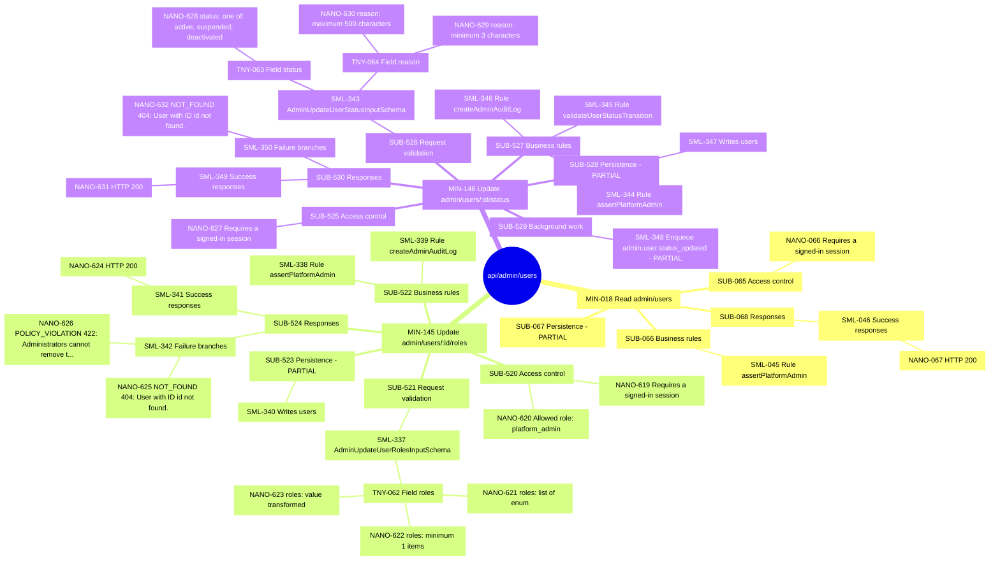

| ID       | Level | Parent   | Name                                                                                         | Description                                                                                                                                                                                                                                                                                                                                                                                            | Status                | Verification | Evidence                                     | Related                                                       |
| -------- | ----- | -------- | -------------------------------------------------------------------------------------------- | ------------------------------------------------------------------------------------------------------------------------------------------------------------------------------------------------------------------------------------------------------------------------------------------------------------------------------------------------------------------------------------------------------ | --------------------- | ------------ | -------------------------------------------- | ------------------------------------------------------------- |
| FEAT-131 | MAJOR | MOD-091  | api/admin/users                                                                              |                                                                                                                                                                                                                                                                                                                                                                                                        | IMPLEMENTED           |              | apps/api/src/server.ts:11196                 |                                                               |
| MIN-018  | MINOR | FEAT-131 | Read admin/users                                                                             | 1. List users (Admin) GET /api/v1/admin/users for any signed-in session; calls assertPlatformAdmin; ephemeral (process memory); responds 200. Gaps: ephemeral: state held in process memory, lost on restart                                                                                                                                                                                           | IMPLEMENTED           | VERIFIED     | apps/api/src/server.ts:11196                 | API-229, TEST-083, TEST-141, TEST-183, TEST-184               |
| SUB-065  | SUB   | MIN-018  | Access control                                                                               | Who may call GET /api/v1/admin/users: any signed-in session.                                                                                                                                                                                                                                                                                                                                           | IMPLEMENTED           | PATH_LEVEL   | apps/api/src/server.ts:11196                 |                                                               |
| NANO-066 | NANO  | SUB-065  | Requires a signed-in session                                                                 | Requests without a valid session token are rejected with 401 UNAUTHENTICATED.                                                                                                                                                                                                                                                                                                                          | IMPLEMENTED           | PATH_LEVEL   | apps/api/src/server.ts:11196                 | ROLE-001                                                      |
| SUB-066  | SUB   | MIN-018  | Business rules                                                                               | Domain functions from packages/domain called by the handler (1).                                                                                                                                                                                                                                                                                                                                       | IMPLEMENTED           | PATH_LEVEL   | apps/api/src/server.ts:11196                 |                                                               |
| SML-045  | SMALL | SUB-066  | Rule assertPlatformAdmin                                                                     | Calls assertPlatformAdmin (packages/domain/src/admin.ts). Rule status IMPLEMENTED; its own tests: VERIFIED.                                                                                                                                                                                                                                                                                            | IMPLEMENTED           | VERIFIED     | packages/domain/src/admin.ts:44              | RULE-005                                                      |
| SUB-067  | SUB   | MIN-018  | Persistence                                                                                  | Ephemeral: state lives in API process memory and is lost on restart.                                                                                                                                                                                                                                                                                                                                   | PARTIALLY_IMPLEMENTED | PATH_LEVEL   | apps/api/src/server.ts:11196                 |                                                               |
| SUB-068  | SUB   | MIN-018  | Responses                                                                                    | Success 200; 0 explicit failure branch(es) besides validation and access errors.                                                                                                                                                                                                                                                                                                                       | IMPLEMENTED           | PATH_LEVEL   | apps/api/src/server.ts:11196                 |                                                               |
| SML-046  | SMALL | SUB-068  | Success responses                                                                            | HTTP 200.                                                                                                                                                                                                                                                                                                                                                                                              | IMPLEMENTED           | PATH_LEVEL   | apps/api/src/server.ts:11196                 |                                                               |
| NANO-067 | NANO  | SML-046  | HTTP 200                                                                                     | Replies 200 when the operation succeeds.                                                                                                                                                                                                                                                                                                                                                               | IMPLEMENTED           | PATH_LEVEL   | apps/api/src/server.ts:11196                 |                                                               |
| MIN-145  | MINOR | FEAT-131 | Update admin/users/:id/roles                                                                 | 3. Update user roles (Admin) PATCH /api/v1/admin/users/:id/roles for roles platform_admin; validates AdminUpdateUserRolesInputSchema; calls assertPlatformAdmin, createAdminAuditLog; ephemeral (process memory); writes users; responds 200; 2 failure branch(es). Gaps: ephemeral: state held in process memory, lost on restart; no first-party web caller found                                    | IMPLEMENTED           | VERIFIED     | apps/api/src/server.ts:11289                 | API-231, TEST-083, TEST-111, TEST-114, TEST-126, TEST-142 ... |
| SUB-520  | SUB   | MIN-145  | Access control                                                                               | Who may call PATCH /api/v1/admin/users/:id/roles: roles platform_admin.                                                                                                                                                                                                                                                                                                                                | IMPLEMENTED           | PATH_LEVEL   | apps/api/src/server.ts:11289                 |                                                               |
| NANO-619 | NANO  | SUB-520  | Requires a signed-in session                                                                 | Requests without a valid session token are rejected with 401 UNAUTHENTICATED.                                                                                                                                                                                                                                                                                                                          | IMPLEMENTED           | PATH_LEVEL   | apps/api/src/server.ts:11289                 | ROLE-001                                                      |
| NANO-620 | NANO  | SUB-520  | Allowed role: platform_admin                                                                 | platform_admin is one of the roles allowed here (platform_admin); a caller holding none of them is rejected with 403.                                                                                                                                                                                                                                                                                  | IMPLEMENTED           | PATH_LEVEL   | apps/api/src/server.ts:11289                 | ROLE-008                                                      |
| SUB-521  | SUB   | MIN-145  | Request validation                                                                           | The request is parsed with AdminUpdateUserRolesInputSchema; a failure returns 400 with field details before any business logic runs.                                                                                                                                                                                                                                                                   | IMPLEMENTED           | PATH_LEVEL   | apps/api/src/server.ts:11289                 |                                                               |
| SML-337  | SMALL | SUB-521  | AdminUpdateUserRolesInputSchema                                                              | AdminUpdateUserRolesInputSchema: 1 field(s)                                                                                                                                                                                                                                                                                                                                                            | IMPLEMENTED           | PATH_LEVEL   | packages/contracts/src/index.ts:741          | SCH-056                                                       |
| TNY-062  | TINY  | SML-337  | Field roles                                                                                  | roles (array, required): list of enum; minimum 1 items; value transformed                                                                                                                                                                                                                                                                                                                              | IMPLEMENTED           | PATH_LEVEL   | packages/contracts/src/index.ts:743          |                                                               |
| NANO-621 | NANO  | TNY-062  | roles: list of enum                                                                          | roles list of enum.                                                                                                                                                                                                                                                                                                                                                                                    | IMPLEMENTED           | PATH_LEVEL   | packages/contracts/src/index.ts:743          |                                                               |
| NANO-622 | NANO  | TNY-062  | roles: minimum 1 items                                                                       | roles minimum 1 items.                                                                                                                                                                                                                                                                                                                                                                                 | IMPLEMENTED           | PATH_LEVEL   | packages/contracts/src/index.ts:743          |                                                               |
| NANO-623 | NANO  | TNY-062  | roles: value transformed                                                                     | roles value transformed.                                                                                                                                                                                                                                                                                                                                                                               | IMPLEMENTED           | PATH_LEVEL   | packages/contracts/src/index.ts:743          |                                                               |
| SUB-522  | SUB   | MIN-145  | Business rules                                                                               | Domain functions from packages/domain called by the handler (2).                                                                                                                                                                                                                                                                                                                                       | IMPLEMENTED           | PATH_LEVEL   | apps/api/src/server.ts:11289                 |                                                               |
| SML-338  | SMALL | SUB-522  | Rule assertPlatformAdmin                                                                     | Calls assertPlatformAdmin (packages/domain/src/admin.ts). Rule status IMPLEMENTED; its own tests: VERIFIED.                                                                                                                                                                                                                                                                                            | IMPLEMENTED           | VERIFIED     | packages/domain/src/admin.ts:44              | RULE-005                                                      |
| SML-339  | SMALL | SUB-522  | Rule createAdminAuditLog                                                                     | Calls createAdminAuditLog (packages/domain/src/admin.ts). Rule status IMPLEMENTED; its own tests: VERIFIED.                                                                                                                                                                                                                                                                                            | IMPLEMENTED           | VERIFIED     | packages/domain/src/admin.ts:112             | RULE-009                                                      |
| SUB-523  | SUB   | MIN-145  | Persistence                                                                                  | Ephemeral: state lives in API process memory and is lost on restart; store calls adminAudit.append.                                                                                                                                                                                                                                                                                                    | PARTIALLY_IMPLEMENTED | PATH_LEVEL   | apps/api/src/server.ts:11289                 |                                                               |
| SML-340  | SMALL | SUB-523  | Writes users                                                                                 | Writes table users (00001_core_schema.sql).                                                                                                                                                                                                                                                                                                                                                            | IMPLEMENTED           | PATH_LEVEL   | supabase/migrations/00001_core_schema.sql:96 | DB-001                                                        |
| SUB-524  | SUB   | MIN-145  | Responses                                                                                    | Success 200; 2 explicit failure branch(es) besides validation and access errors.                                                                                                                                                                                                                                                                                                                       | IMPLEMENTED           | PATH_LEVEL   | apps/api/src/server.ts:11289                 |                                                               |
| SML-341  | SMALL | SUB-524  | Success responses                                                                            | HTTP 200.                                                                                                                                                                                                                                                                                                                                                                                              | IMPLEMENTED           | PATH_LEVEL   | apps/api/src/server.ts:11289                 |                                                               |
| NANO-624 | NANO  | SML-341  | HTTP 200                                                                                     | Replies 200 when the operation succeeds.                                                                                                                                                                                                                                                                                                                                                               | IMPLEMENTED           | PATH_LEVEL   | apps/api/src/server.ts:11289                 |                                                               |
| SML-342  | SMALL | SUB-524  | Failure branches                                                                             | 2 DomainError branch(es) in the handler, mapped to HTTP by the global error handler.                                                                                                                                                                                                                                                                                                                   | IMPLEMENTED           | PATH_LEVEL   | apps/api/src/server.ts:11289                 |                                                               |
| NANO-625 | NANO  | SML-342  | NOT_FOUND 404: User with ID "${id}" not found.                                               | Throws DomainError(NOT_FOUND) "User with ID "${id}" not found." -> HTTP 404.                                                                                                                                                                                                                                                                                                                           | IMPLEMENTED           | PATH_LEVEL   | apps/api/src/server.ts:11298                 | ERR-217                                                       |
| NANO-626 | NANO  | SML-342  | POLICY_VIOLATION 422: Administrators cannot remove their own platform_admin role (governance | Throws DomainError(POLICY_VIOLATION) "Administrators cannot remove their own platform_admin role (governance lockout)." -> HTTP 422.                                                                                                                                                                                                                                                                   | IMPLEMENTED           | PATH_LEVEL   | apps/api/src/server.ts:11309                 | ERR-218                                                       |
| MIN-146  | MINOR | FEAT-131 | Update admin/users/:id/status                                                                | 2. Update user status (Admin - with anti-lockout BR-29, BR-068) PATCH /api/v1/admin/users/:id/status for any signed-in session; validates AdminUpdateUserStatusInputSchema; calls assertPlatformAdmin, validateUserStatusTransition, createAdminAuditLog; ephemeral (process memory); writes users; responds 200; 1 failure branch(es). Gaps: ephemeral: state held in process memory, lost on restart | IMPLEMENTED           | VERIFIED     | apps/api/src/server.ts:11232                 | API-230, TEST-083, TEST-142, TEST-146, TEST-183, TEST-205     |
| SUB-525  | SUB   | MIN-146  | Access control                                                                               | Who may call PATCH /api/v1/admin/users/:id/status: any signed-in session.                                                                                                                                                                                                                                                                                                                              | IMPLEMENTED           | PATH_LEVEL   | apps/api/src/server.ts:11232                 |                                                               |
| NANO-627 | NANO  | SUB-525  | Requires a signed-in session                                                                 | Requests without a valid session token are rejected with 401 UNAUTHENTICATED.                                                                                                                                                                                                                                                                                                                          | IMPLEMENTED           | PATH_LEVEL   | apps/api/src/server.ts:11232                 | ROLE-001                                                      |
| SUB-526  | SUB   | MIN-146  | Request validation                                                                           | The request is parsed with AdminUpdateUserStatusInputSchema; a failure returns 400 with field details before any business logic runs.                                                                                                                                                                                                                                                                  | IMPLEMENTED           | PATH_LEVEL   | apps/api/src/server.ts:11232                 |                                                               |
| SML-343  | SMALL | SUB-526  | AdminUpdateUserStatusInputSchema                                                             | AdminUpdateUserStatusInputSchema: 2 field(s)                                                                                                                                                                                                                                                                                                                                                           | IMPLEMENTED           | PATH_LEVEL   | packages/contracts/src/index.ts:720          | SCH-055                                                       |
| TNY-063  | TINY  | SML-343  | Field status                                                                                 | status (enum, required): one of: active, suspended, deactivated                                                                                                                                                                                                                                                                                                                                        | IMPLEMENTED           | PATH_LEVEL   | packages/contracts/src/index.ts:721          |                                                               |
| NANO-628 | NANO  | TNY-063  | status: one of: active, suspended, deactivated                                               | status one of: active, suspended, deactivated.                                                                                                                                                                                                                                                                                                                                                         | IMPLEMENTED           | PATH_LEVEL   | packages/contracts/src/index.ts:721          |                                                               |
| TNY-064  | TINY  | SML-343  | Field reason                                                                                 | reason (string, required): minimum 3 characters; maximum 500 characters                                                                                                                                                                                                                                                                                                                                | IMPLEMENTED           | PATH_LEVEL   | packages/contracts/src/index.ts:722          |                                                               |
| NANO-629 | NANO  | TNY-064  | reason: minimum 3 characters                                                                 | reason minimum 3 characters.                                                                                                                                                                                                                                                                                                                                                                           | IMPLEMENTED           | PATH_LEVEL   | packages/contracts/src/index.ts:722          |                                                               |
| NANO-630 | NANO  | TNY-064  | reason: maximum 500 characters                                                               | reason maximum 500 characters.                                                                                                                                                                                                                                                                                                                                                                         | IMPLEMENTED           | PATH_LEVEL   | packages/contracts/src/index.ts:722          |                                                               |
| SUB-527  | SUB   | MIN-146  | Business rules                                                                               | Domain functions from packages/domain called by the handler (3).                                                                                                                                                                                                                                                                                                                                       | IMPLEMENTED           | PATH_LEVEL   | apps/api/src/server.ts:11232                 |                                                               |
| SML-344  | SMALL | SUB-527  | Rule assertPlatformAdmin                                                                     | Calls assertPlatformAdmin (packages/domain/src/admin.ts). Rule status IMPLEMENTED; its own tests: VERIFIED.                                                                                                                                                                                                                                                                                            | IMPLEMENTED           | VERIFIED     | packages/domain/src/admin.ts:44              | RULE-005                                                      |
| SML-345  | SMALL | SUB-527  | Rule validateUserStatusTransition                                                            | Calls validateUserStatusTransition (packages/domain/src/admin.ts). Rule status IMPLEMENTED; its own tests: VERIFIED.                                                                                                                                                                                                                                                                                   | IMPLEMENTED           | VERIFIED     | packages/domain/src/admin.ts:74              | RULE-007                                                      |
| SML-346  | SMALL | SUB-527  | Rule createAdminAuditLog                                                                     | Calls createAdminAuditLog (packages/domain/src/admin.ts). Rule status IMPLEMENTED; its own tests: VERIFIED.                                                                                                                                                                                                                                                                                            | IMPLEMENTED           | VERIFIED     | packages/domain/src/admin.ts:112             | RULE-009                                                      |
| SUB-528  | SUB   | MIN-146  | Persistence                                                                                  | Ephemeral: state lives in API process memory and is lost on restart; store calls adminAudit.append.                                                                                                                                                                                                                                                                                                    | PARTIALLY_IMPLEMENTED | PATH_LEVEL   | apps/api/src/server.ts:11232                 |                                                               |
| SML-347  | SMALL | SUB-528  | Writes users                                                                                 | Writes table users (00001_core_schema.sql).                                                                                                                                                                                                                                                                                                                                                            | IMPLEMENTED           | PATH_LEVEL   | supabase/migrations/00001_core_schema.sql:96 | DB-001                                                        |
| SUB-529  | SUB   | MIN-146  | Background work                                                                              | Enqueues 1 background job kind(s) in background_jobs for apps/worker.                                                                                                                                                                                                                                                                                                                                  | IMPLEMENTED           | PATH_LEVEL   | apps/api/src/server.ts:11232                 |                                                               |
| SML-348  | SMALL | SUB-529  | Enqueue admin.user.status_updated                                                            | Dispatches job:admin.user.status_updated; worker handler: recordEvent (no-op: marks the event recorded).                                                                                                                                                                                                                                                                                               | PARTIALLY_IMPLEMENTED | UNKNOWN      | packages/domain/src/background-jobs.ts:171   | SVC-001                                                       |
| SUB-530  | SUB   | MIN-146  | Responses                                                                                    | Success 200; 1 explicit failure branch(es) besides validation and access errors.                                                                                                                                                                                                                                                                                                                       | IMPLEMENTED           | PATH_LEVEL   | apps/api/src/server.ts:11232                 |                                                               |
| SML-349  | SMALL | SUB-530  | Success responses                                                                            | HTTP 200.                                                                                                                                                                                                                                                                                                                                                                                              | IMPLEMENTED           | PATH_LEVEL   | apps/api/src/server.ts:11232                 |                                                               |
| NANO-631 | NANO  | SML-349  | HTTP 200                                                                                     | Replies 200 when the operation succeeds.                                                                                                                                                                                                                                                                                                                                                               | IMPLEMENTED           | PATH_LEVEL   | apps/api/src/server.ts:11232                 |                                                               |
| SML-350  | SMALL | SUB-530  | Failure branches                                                                             | 1 DomainError branch(es) in the handler, mapped to HTTP by the global error handler.                                                                                                                                                                                                                                                                                                                   | IMPLEMENTED           | PATH_LEVEL   | apps/api/src/server.ts:11232                 |                                                               |
| NANO-632 | NANO  | SML-350  | NOT_FOUND 404: User with ID "${id}" not found.                                               | Throws DomainError(NOT_FOUND) "User with ID "${id}" not found." -> HTTP 404.                                                                                                                                                                                                                                                                                                                           | IMPLEMENTED           | PATH_LEVEL   | apps/api/src/server.ts:11241                 | ERR-217                                                       |

## api/ai (MOD-069)

**Application:** apps/api (MOD-001). **Purpose:** API module: routes under /api/v1/ai in apps/api/src/server.ts.

**Nodes by level:** MODULE 1, MAJOR 4, MINOR 6, SUB 26, SMALL 25, TINY 5, NANO 30. **Status:** IMPLEMENTED 87, PARTIALLY_IMPLEMENTED 9, UNKNOWN 1. **Verification:** PATH_LEVEL 72, UNKNOWN 1, VERIFIED 19.

**User roles that reach it:** authenticated.

**Known gaps:** MIN-161 ephemeral: state held in process memory, lost on restart; MIN-161 no first-party web caller found; MIN-162 ephemeral: state held in process memory, lost on restart; MIN-162 no first-party web caller found; MIN-019 ephemeral: state held in process memory, lost on restart; MIN-019 no first-party web caller found; MIN-020 ephemeral: state held in process memory, lost on restart; MIN-020 no first-party web caller found; MIN-163 ephemeral: state held in process memory, lost on restart; MIN-163 no first-party web caller found; MIN-021 ephemeral: state held in process memory, lost on restart.

### Module map (to minor features)

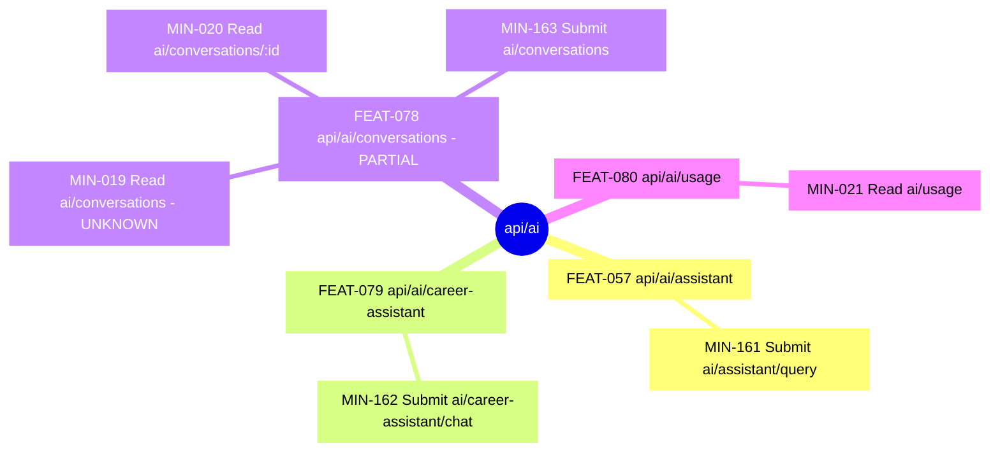

### FEAT-057 api/ai/assistant

api/ai/assistant

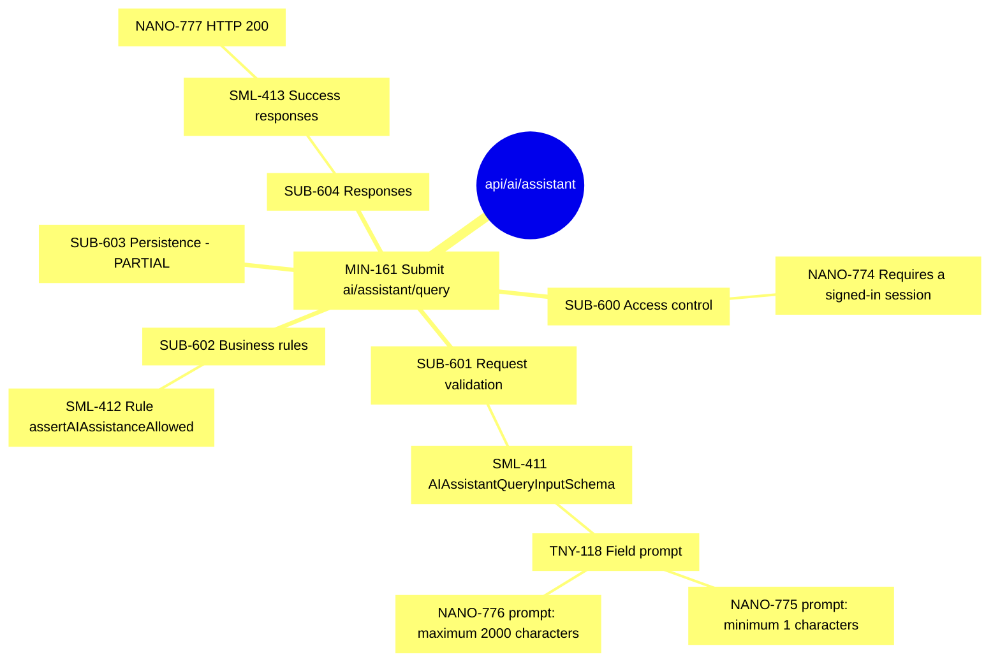

| ID       | Level | Parent   | Name                            | Description                                                                                                                                                                                                                                                                                                                                                        | Status                | Verification | Evidence                             | Related                               |
| -------- | ----- | -------- | ------------------------------- | ------------------------------------------------------------------------------------------------------------------------------------------------------------------------------------------------------------------------------------------------------------------------------------------------------------------------------------------------------------------ | --------------------- | ------------ | ------------------------------------ | ------------------------------------- |
| FEAT-057 | MAJOR | MOD-069  | api/ai/assistant                |                                                                                                                                                                                                                                                                                                                                                                    | IMPLEMENTED           |              | apps/api/src/server.ts:4913          |                                       |
| MIN-161  | MINOR | FEAT-057 | Submit ai/assistant/query       | AI Assistant & Gateway Entry Point (SSOT Section D: Strict AI_PROHIBITED Enforcement) POST /api/v1/ai/assistant/query for any signed-in session; validates AIAssistantQueryInputSchema; calls assertAIAssistanceAllowed; ephemeral (process memory); responds 200. Gaps: ephemeral: state held in process memory, lost on restart; no first-party web caller found | IMPLEMENTED           | VERIFIED     | apps/api/src/server.ts:4913          | API-096, TEST-095, TEST-170, TEST-176 |
| SUB-600  | SUB   | MIN-161  | Access control                  | Who may call POST /api/v1/ai/assistant/query: any signed-in session.                                                                                                                                                                                                                                                                                               | IMPLEMENTED           | PATH_LEVEL   | apps/api/src/server.ts:4913          |                                       |
| NANO-774 | NANO  | SUB-600  | Requires a signed-in session    | Requests without a valid session token are rejected with 401 UNAUTHENTICATED.                                                                                                                                                                                                                                                                                      | IMPLEMENTED           | PATH_LEVEL   | apps/api/src/server.ts:4913          | ROLE-001                              |
| SUB-601  | SUB   | MIN-161  | Request validation              | The request is parsed with AIAssistantQueryInputSchema; a failure returns 400 with field details before any business logic runs.                                                                                                                                                                                                                                   | IMPLEMENTED           | PATH_LEVEL   | apps/api/src/server.ts:4913          |                                       |
| SML-411  | SMALL | SUB-601  | AIAssistantQueryInputSchema     | AIAssistantQueryInputSchema: 1 field(s)                                                                                                                                                                                                                                                                                                                            | IMPLEMENTED           | PATH_LEVEL   | packages/contracts/src/index.ts:343  | SCH-022                               |
| TNY-118  | TINY  | SML-411  | Field prompt                    | prompt (string, required): minimum 1 characters; maximum 2000 characters                                                                                                                                                                                                                                                                                           | IMPLEMENTED           | PATH_LEVEL   | packages/contracts/src/index.ts:344  |                                       |
| NANO-775 | NANO  | TNY-118  | prompt: minimum 1 characters    | prompt minimum 1 characters.                                                                                                                                                                                                                                                                                                                                       | IMPLEMENTED           | PATH_LEVEL   | packages/contracts/src/index.ts:344  |                                       |
| NANO-776 | NANO  | TNY-118  | prompt: maximum 2000 characters | prompt maximum 2000 characters.                                                                                                                                                                                                                                                                                                                                    | IMPLEMENTED           | PATH_LEVEL   | packages/contracts/src/index.ts:344  |                                       |
| SUB-602  | SUB   | MIN-161  | Business rules                  | Domain functions from packages/domain called by the handler (1).                                                                                                                                                                                                                                                                                                   | IMPLEMENTED           | PATH_LEVEL   | apps/api/src/server.ts:4913          |                                       |
| SML-412  | SMALL | SUB-602  | Rule assertAIAssistanceAllowed  | Calls assertAIAssistanceAllowed (packages/domain/src/assessment.ts). Rule status IMPLEMENTED; its own tests: VERIFIED.                                                                                                                                                                                                                                             | IMPLEMENTED           | VERIFIED     | packages/domain/src/assessment.ts:33 | RULE-044                              |
| SUB-603  | SUB   | MIN-161  | Persistence                     | Ephemeral: state lives in API process memory and is lost on restart.                                                                                                                                                                                                                                                                                               | PARTIALLY_IMPLEMENTED | PATH_LEVEL   | apps/api/src/server.ts:4913          |                                       |
| SUB-604  | SUB   | MIN-161  | Responses                       | Success 200; 0 explicit failure branch(es) besides validation and access errors.                                                                                                                                                                                                                                                                                   | IMPLEMENTED           | PATH_LEVEL   | apps/api/src/server.ts:4913          |                                       |
| SML-413  | SMALL | SUB-604  | Success responses               | HTTP 200.                                                                                                                                                                                                                                                                                                                                                          | IMPLEMENTED           | PATH_LEVEL   | apps/api/src/server.ts:4913          |                                       |
| NANO-777 | NANO  | SML-413  | HTTP 200                        | Replies 200 when the operation succeeds.                                                                                                                                                                                                                                                                                                                           | IMPLEMENTED           | PATH_LEVEL   | apps/api/src/server.ts:4913          |                                       |

### FEAT-079 api/ai/career-assistant

api/ai/career-assistant

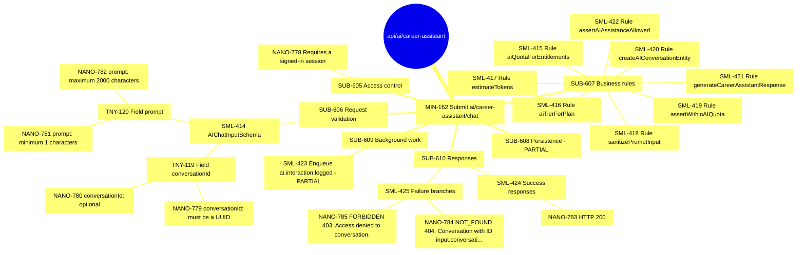

| ID       | Level | Parent   | Name                                                                     | Description                                                                                                                                                                                                                                                                                                                                         | Status                | Verification | Evidence                                   | Related                                         |
| -------- | ----- | -------- | ------------------------------------------------------------------------ | --------------------------------------------------------------------------------------------------------------------------------------------------------------------------------------------------------------------------------------------------------------------------------------------------------------------------------------------------- | --------------------- | ------------ | ------------------------------------------ | ----------------------------------------------- |
| FEAT-079 | MAJOR | MOD-069  | api/ai/career-assistant                                                  |                                                                                                                                                                                                                                                                                                                                                     | IMPLEMENTED           |              | apps/api/src/server.ts:6163                |                                                 |
| MIN-162  | MINOR | FEAT-079 | Submit ai/career-assistant/chat                                          | POST /api/v1/ai/career-assistant/chat for any signed-in session; validates AIChatInputSchema; calls aiQuotaForEntitlements, aiTierForPlan, estimateTokens, sanitizePromptInput ...; ephemeral (process memory); responds 200; 2 failure branch(es). Gaps: ephemeral: state held in process memory, lost on restart; no first-party web caller found | IMPLEMENTED           | VERIFIED     | apps/api/src/server.ts:6163                | API-125, TEST-084, TEST-118, TEST-143, TEST-191 |
| SUB-605  | SUB   | MIN-162  | Access control                                                           | Who may call POST /api/v1/ai/career-assistant/chat: any signed-in session.                                                                                                                                                                                                                                                                          | IMPLEMENTED           | PATH_LEVEL   | apps/api/src/server.ts:6163                |                                                 |
| NANO-778 | NANO  | SUB-605  | Requires a signed-in session                                             | Requests without a valid session token are rejected with 401 UNAUTHENTICATED.                                                                                                                                                                                                                                                                       | IMPLEMENTED           | PATH_LEVEL   | apps/api/src/server.ts:6163                | ROLE-001                                        |
| SUB-606  | SUB   | MIN-162  | Request validation                                                       | The request is parsed with AIChatInputSchema; a failure returns 400 with field details before any business logic runs.                                                                                                                                                                                                                              | IMPLEMENTED           | PATH_LEVEL   | apps/api/src/server.ts:6163                |                                                 |
| SML-414  | SMALL | SUB-606  | AIChatInputSchema                                                        | AIChatInputSchema: 2 field(s)                                                                                                                                                                                                                                                                                                                       | IMPLEMENTED           | PATH_LEVEL   | packages/contracts/src/index.ts:452        | SCH-032                                         |
| TNY-119  | TINY  | SML-414  | Field conversationId                                                     | conversationId (string, optional): must be a UUID; optional                                                                                                                                                                                                                                                                                         | IMPLEMENTED           | PATH_LEVEL   | packages/contracts/src/index.ts:453        |                                                 |
| NANO-779 | NANO  | TNY-119  | conversationId: must be a UUID                                           | conversationId must be a UUID.                                                                                                                                                                                                                                                                                                                      | IMPLEMENTED           | PATH_LEVEL   | packages/contracts/src/index.ts:453        |                                                 |
| NANO-780 | NANO  | TNY-119  | conversationId: optional                                                 | conversationId optional.                                                                                                                                                                                                                                                                                                                            | IMPLEMENTED           | PATH_LEVEL   | packages/contracts/src/index.ts:453        |                                                 |
| TNY-120  | TINY  | SML-414  | Field prompt                                                             | prompt (string, required): minimum 1 characters; maximum 2000 characters                                                                                                                                                                                                                                                                            | IMPLEMENTED           | PATH_LEVEL   | packages/contracts/src/index.ts:454        |                                                 |
| NANO-781 | NANO  | TNY-120  | prompt: minimum 1 characters                                             | prompt minimum 1 characters.                                                                                                                                                                                                                                                                                                                        | IMPLEMENTED           | PATH_LEVEL   | packages/contracts/src/index.ts:454        |                                                 |
| NANO-782 | NANO  | TNY-120  | prompt: maximum 2000 characters                                          | prompt maximum 2000 characters.                                                                                                                                                                                                                                                                                                                     | IMPLEMENTED           | PATH_LEVEL   | packages/contracts/src/index.ts:454        |                                                 |
| SUB-607  | SUB   | MIN-162  | Business rules                                                           | Domain functions from packages/domain called by the handler (8).                                                                                                                                                                                                                                                                                    | IMPLEMENTED           | PATH_LEVEL   | apps/api/src/server.ts:6163                |                                                 |
| SML-415  | SMALL | SUB-607  | Rule aiQuotaForEntitlements                                              | Calls aiQuotaForEntitlements (packages/domain/src/ai-gateway.ts). Rule status IMPLEMENTED; its own tests: VERIFIED.                                                                                                                                                                                                                                 | IMPLEMENTED           | VERIFIED     | packages/domain/src/ai-gateway.ts:73       | RULE-010                                        |
| SML-416  | SMALL | SUB-607  | Rule aiTierForPlan                                                       | Calls aiTierForPlan (packages/domain/src/ai-gateway.ts). Rule status IMPLEMENTED; its own tests: VERIFIED.                                                                                                                                                                                                                                          | IMPLEMENTED           | VERIFIED     | packages/domain/src/ai-gateway.ts:78       | RULE-011                                        |
| SML-417  | SMALL | SUB-607  | Rule estimateTokens                                                      | Calls estimateTokens (packages/domain/src/ai-gateway.ts). Rule status IMPLEMENTED; its own tests: VERIFIED.                                                                                                                                                                                                                                         | IMPLEMENTED           | VERIFIED     | packages/domain/src/ai-gateway.ts:88       | RULE-012                                        |
| SML-418  | SMALL | SUB-607  | Rule sanitizePromptInput                                                 | Calls sanitizePromptInput (packages/domain/src/ai-gateway.ts). Rule status IMPLEMENTED; its own tests: VERIFIED.                                                                                                                                                                                                                                    | IMPLEMENTED           | VERIFIED     | packages/domain/src/ai-gateway.ts:97       | RULE-013                                        |
| SML-419  | SMALL | SUB-607  | Rule assertWithinAIQuota                                                 | Calls assertWithinAIQuota (packages/domain/src/ai-gateway.ts). Rule status IMPLEMENTED; its own tests: VERIFIED.                                                                                                                                                                                                                                    | IMPLEMENTED           | VERIFIED     | packages/domain/src/ai-gateway.ts:160      | RULE-014                                        |
| SML-420  | SMALL | SUB-607  | Rule createAIConversationEntity                                          | Calls createAIConversationEntity (packages/domain/src/ai-gateway.ts). Rule status IMPLEMENTED; its own tests: VERIFIED.                                                                                                                                                                                                                             | IMPLEMENTED           | VERIFIED     | packages/domain/src/ai-gateway.ts:188      | RULE-015                                        |
| SML-421  | SMALL | SUB-607  | Rule generateCareerAssistantResponse                                     | Calls generateCareerAssistantResponse (packages/domain/src/ai-gateway.ts). Rule status IMPLEMENTED; its own tests: VERIFIED.                                                                                                                                                                                                                        | IMPLEMENTED           | VERIFIED     | packages/domain/src/ai-gateway.ts:210      | RULE-016                                        |
| SML-422  | SMALL | SUB-607  | Rule assertAIAssistanceAllowed                                           | Calls assertAIAssistanceAllowed (packages/domain/src/assessment.ts). Rule status IMPLEMENTED; its own tests: VERIFIED.                                                                                                                                                                                                                              | IMPLEMENTED           | VERIFIED     | packages/domain/src/assessment.ts:33       | RULE-044                                        |
| SUB-608  | SUB   | MIN-162  | Persistence                                                              | Ephemeral: state lives in API process memory and is lost on restart.                                                                                                                                                                                                                                                                                | PARTIALLY_IMPLEMENTED | PATH_LEVEL   | apps/api/src/server.ts:6163                |                                                 |
| SUB-609  | SUB   | MIN-162  | Background work                                                          | Enqueues 1 background job kind(s) in background_jobs for apps/worker.                                                                                                                                                                                                                                                                               | IMPLEMENTED           | PATH_LEVEL   | apps/api/src/server.ts:6163                |                                                 |
| SML-423  | SMALL | SUB-609  | Enqueue ai.interaction.logged                                            | Dispatches job:ai.interaction.logged; worker handler: recordEvent (no-op: marks the event recorded).                                                                                                                                                                                                                                                | PARTIALLY_IMPLEMENTED | UNKNOWN      | packages/domain/src/background-jobs.ts:171 | SVC-002                                         |
| SUB-610  | SUB   | MIN-162  | Responses                                                                | Success 200; 2 explicit failure branch(es) besides validation and access errors.                                                                                                                                                                                                                                                                    | IMPLEMENTED           | PATH_LEVEL   | apps/api/src/server.ts:6163                |                                                 |
| SML-424  | SMALL | SUB-610  | Success responses                                                        | HTTP 200.                                                                                                                                                                                                                                                                                                                                           | IMPLEMENTED           | PATH_LEVEL   | apps/api/src/server.ts:6163                |                                                 |
| NANO-783 | NANO  | SML-424  | HTTP 200                                                                 | Replies 200 when the operation succeeds.                                                                                                                                                                                                                                                                                                            | IMPLEMENTED           | PATH_LEVEL   | apps/api/src/server.ts:6163                |                                                 |
| SML-425  | SMALL | SUB-610  | Failure branches                                                         | 2 DomainError branch(es) in the handler, mapped to HTTP by the global error handler.                                                                                                                                                                                                                                                                | IMPLEMENTED           | PATH_LEVEL   | apps/api/src/server.ts:6163                |                                                 |
| NANO-784 | NANO  | SML-425  | NOT_FOUND 404: Conversation with ID "${input.conversationId}" not found. | Throws DomainError(NOT_FOUND) "Conversation with ID "${input.conversationId}" not found." -> HTTP 404.                                                                                                                                                                                                                                              | IMPLEMENTED           | PATH_LEVEL   | apps/api/src/server.ts:6193                | ERR-133                                         |
| NANO-785 | NANO  | SML-425  | FORBIDDEN 403: Access denied to conversation.                            | Throws DomainError(FORBIDDEN) "Access denied to conversation." -> HTTP 403.                                                                                                                                                                                                                                                                         | IMPLEMENTED           | PATH_LEVEL   | apps/api/src/server.ts:6199                | ERR-132                                         |

### FEAT-078 api/ai/conversations

api/ai/conversations

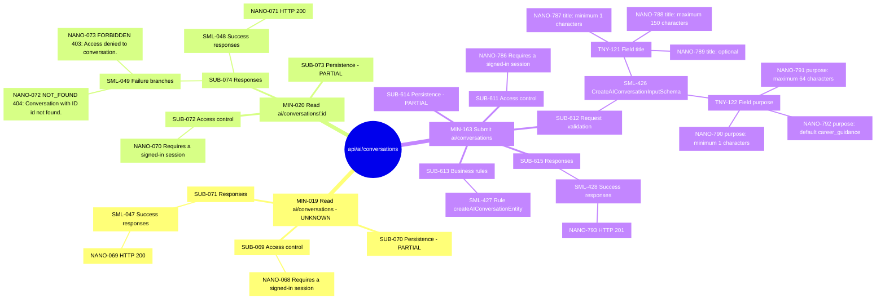

| ID       | Level | Parent   | Name                                                   | Description                                                                                                                                                                                                                                                                                                  | Status                | Verification | Evidence                              | Related                     |
| -------- | ----- | -------- | ------------------------------------------------------ | ------------------------------------------------------------------------------------------------------------------------------------------------------------------------------------------------------------------------------------------------------------------------------------------------------------ | --------------------- | ------------ | ------------------------------------- | --------------------------- |
| FEAT-078 | MAJOR | MOD-069  | api/ai/conversations                                   |                                                                                                                                                                                                                                                                                                              | PARTIALLY_IMPLEMENTED |              | apps/api/src/server.ts:6123           |                             |
| MIN-019  | MINOR | FEAT-078 | Read ai/conversations                                  | GET /api/v1/ai/conversations for any signed-in session; ephemeral (process memory); responds 200. Gaps: ephemeral: state held in process memory, lost on restart; no first-party web caller found                                                                                                            | UNKNOWN               | VERIFIED     | apps/api/src/server.ts:6137           | API-123, TEST-125           |
| SUB-069  | SUB   | MIN-019  | Access control                                         | Who may call GET /api/v1/ai/conversations: any signed-in session.                                                                                                                                                                                                                                            | IMPLEMENTED           | PATH_LEVEL   | apps/api/src/server.ts:6137           |                             |
| NANO-068 | NANO  | SUB-069  | Requires a signed-in session                           | Requests without a valid session token are rejected with 401 UNAUTHENTICATED.                                                                                                                                                                                                                                | IMPLEMENTED           | PATH_LEVEL   | apps/api/src/server.ts:6137           | ROLE-001                    |
| SUB-070  | SUB   | MIN-019  | Persistence                                            | Ephemeral: state lives in API process memory and is lost on restart.                                                                                                                                                                                                                                         | PARTIALLY_IMPLEMENTED | PATH_LEVEL   | apps/api/src/server.ts:6137           |                             |
| SUB-071  | SUB   | MIN-019  | Responses                                              | Success 200; 0 explicit failure branch(es) besides validation and access errors.                                                                                                                                                                                                                             | IMPLEMENTED           | PATH_LEVEL   | apps/api/src/server.ts:6137           |                             |
| SML-047  | SMALL | SUB-071  | Success responses                                      | HTTP 200.                                                                                                                                                                                                                                                                                                    | IMPLEMENTED           | PATH_LEVEL   | apps/api/src/server.ts:6137           |                             |
| NANO-069 | NANO  | SML-047  | HTTP 200                                               | Replies 200 when the operation succeeds.                                                                                                                                                                                                                                                                     | IMPLEMENTED           | PATH_LEVEL   | apps/api/src/server.ts:6137           |                             |
| MIN-020  | MINOR | FEAT-078 | Read ai/conversations/:id                              | GET /api/v1/ai/conversations/:id for any signed-in session; ephemeral (process memory); responds 200; 2 failure branch(es). Gaps: ephemeral: state held in process memory, lost on restart; no first-party web caller found                                                                                  | IMPLEMENTED           | VERIFIED     | apps/api/src/server.ts:6143           | API-124, TEST-084           |
| SUB-072  | SUB   | MIN-020  | Access control                                         | Who may call GET /api/v1/ai/conversations/:id: any signed-in session.                                                                                                                                                                                                                                        | IMPLEMENTED           | PATH_LEVEL   | apps/api/src/server.ts:6143           |                             |
| NANO-070 | NANO  | SUB-072  | Requires a signed-in session                           | Requests without a valid session token are rejected with 401 UNAUTHENTICATED.                                                                                                                                                                                                                                | IMPLEMENTED           | PATH_LEVEL   | apps/api/src/server.ts:6143           | ROLE-001                    |
| SUB-073  | SUB   | MIN-020  | Persistence                                            | Ephemeral: state lives in API process memory and is lost on restart.                                                                                                                                                                                                                                         | PARTIALLY_IMPLEMENTED | PATH_LEVEL   | apps/api/src/server.ts:6143           |                             |
| SUB-074  | SUB   | MIN-020  | Responses                                              | Success 200; 2 explicit failure branch(es) besides validation and access errors.                                                                                                                                                                                                                             | IMPLEMENTED           | PATH_LEVEL   | apps/api/src/server.ts:6143           |                             |
| SML-048  | SMALL | SUB-074  | Success responses                                      | HTTP 200.                                                                                                                                                                                                                                                                                                    | IMPLEMENTED           | PATH_LEVEL   | apps/api/src/server.ts:6143           |                             |
| NANO-071 | NANO  | SML-048  | HTTP 200                                               | Replies 200 when the operation succeeds.                                                                                                                                                                                                                                                                     | IMPLEMENTED           | PATH_LEVEL   | apps/api/src/server.ts:6143           |                             |
| SML-049  | SMALL | SUB-074  | Failure branches                                       | 2 DomainError branch(es) in the handler, mapped to HTTP by the global error handler.                                                                                                                                                                                                                         | IMPLEMENTED           | PATH_LEVEL   | apps/api/src/server.ts:6143           |                             |
| NANO-072 | NANO  | SML-049  | NOT_FOUND 404: Conversation with ID "${id}" not found. | Throws DomainError(NOT_FOUND) "Conversation with ID "${id}" not found." -> HTTP 404.                                                                                                                                                                                                                         | IMPLEMENTED           | PATH_LEVEL   | apps/api/src/server.ts:6151           | ERR-131                     |
| NANO-073 | NANO  | SML-049  | FORBIDDEN 403: Access denied to conversation.          | Throws DomainError(FORBIDDEN) "Access denied to conversation." -> HTTP 403.                                                                                                                                                                                                                                  | IMPLEMENTED           | PATH_LEVEL   | apps/api/src/server.ts:6155           | ERR-132                     |
| MIN-163  | MINOR | FEAT-078 | Submit ai/conversations                                | Central AI Gateway Endpoints POST /api/v1/ai/conversations for any signed-in session; validates CreateAIConversationInputSchema; calls createAIConversationEntity; ephemeral (process memory); responds 201. Gaps: ephemeral: state held in process memory, lost on restart; no first-party web caller found | IMPLEMENTED           | VERIFIED     | apps/api/src/server.ts:6123           | API-122, TEST-084, TEST-125 |
| SUB-611  | SUB   | MIN-163  | Access control                                         | Who may call POST /api/v1/ai/conversations: any signed-in session.                                                                                                                                                                                                                                           | IMPLEMENTED           | PATH_LEVEL   | apps/api/src/server.ts:6123           |                             |
| NANO-786 | NANO  | SUB-611  | Requires a signed-in session                           | Requests without a valid session token are rejected with 401 UNAUTHENTICATED.                                                                                                                                                                                                                                | IMPLEMENTED           | PATH_LEVEL   | apps/api/src/server.ts:6123           | ROLE-001                    |
| SUB-612  | SUB   | MIN-163  | Request validation                                     | The request is parsed with CreateAIConversationInputSchema; a failure returns 400 with field details before any business logic runs.                                                                                                                                                                         | IMPLEMENTED           | PATH_LEVEL   | apps/api/src/server.ts:6123           |                             |
| SML-426  | SMALL | SUB-612  | CreateAIConversationInputSchema                        | CreateAIConversationInputSchema: 2 field(s)                                                                                                                                                                                                                                                                  | IMPLEMENTED           | PATH_LEVEL   | packages/contracts/src/index.ts:445   | SCH-031                     |
| TNY-121  | TINY  | SML-426  | Field title                                            | title (string, optional): minimum 1 characters; maximum 150 characters; optional                                                                                                                                                                                                                             | IMPLEMENTED           | PATH_LEVEL   | packages/contracts/src/index.ts:446   |                             |
| NANO-787 | NANO  | TNY-121  | title: minimum 1 characters                            | title minimum 1 characters.                                                                                                                                                                                                                                                                                  | IMPLEMENTED           | PATH_LEVEL   | packages/contracts/src/index.ts:446   |                             |
| NANO-788 | NANO  | TNY-121  | title: maximum 150 characters                          | title maximum 150 characters.                                                                                                                                                                                                                                                                                | IMPLEMENTED           | PATH_LEVEL   | packages/contracts/src/index.ts:446   |                             |
| NANO-789 | NANO  | TNY-121  | title: optional                                        | title optional.                                                                                                                                                                                                                                                                                              | IMPLEMENTED           | PATH_LEVEL   | packages/contracts/src/index.ts:446   |                             |
| TNY-122  | TINY  | SML-426  | Field purpose                                          | purpose (string, optional): minimum 1 characters; maximum 64 characters; default 'career_guidance'                                                                                                                                                                                                           | IMPLEMENTED           | PATH_LEVEL   | packages/contracts/src/index.ts:447   |                             |
| NANO-790 | NANO  | TNY-122  | purpose: minimum 1 characters                          | purpose minimum 1 characters.                                                                                                                                                                                                                                                                                | IMPLEMENTED           | PATH_LEVEL   | packages/contracts/src/index.ts:447   |                             |
| NANO-791 | NANO  | TNY-122  | purpose: maximum 64 characters                         | purpose maximum 64 characters.                                                                                                                                                                                                                                                                               | IMPLEMENTED           | PATH_LEVEL   | packages/contracts/src/index.ts:447   |                             |
| NANO-792 | NANO  | TNY-122  | purpose: default 'career_guidance'                     | purpose default 'career_guidance'; message "career_guidance".                                                                                                                                                                                                                                                | IMPLEMENTED           | VERIFIED     | packages/contracts/src/index.ts:447   | TEST-004                    |
| SUB-613  | SUB   | MIN-163  | Business rules                                         | Domain functions from packages/domain called by the handler (1).                                                                                                                                                                                                                                             | IMPLEMENTED           | PATH_LEVEL   | apps/api/src/server.ts:6123           |                             |
| SML-427  | SMALL | SUB-613  | Rule createAIConversationEntity                        | Calls createAIConversationEntity (packages/domain/src/ai-gateway.ts). Rule status IMPLEMENTED; its own tests: VERIFIED.                                                                                                                                                                                      | IMPLEMENTED           | VERIFIED     | packages/domain/src/ai-gateway.ts:188 | RULE-015                    |
| SUB-614  | SUB   | MIN-163  | Persistence                                            | Ephemeral: state lives in API process memory and is lost on restart.                                                                                                                                                                                                                                         | PARTIALLY_IMPLEMENTED | PATH_LEVEL   | apps/api/src/server.ts:6123           |                             |
| SUB-615  | SUB   | MIN-163  | Responses                                              | Success 201; 0 explicit failure branch(es) besides validation and access errors.                                                                                                                                                                                                                             | IMPLEMENTED           | PATH_LEVEL   | apps/api/src/server.ts:6123           |                             |
| SML-428  | SMALL | SUB-615  | Success responses                                      | HTTP 201.                                                                                                                                                                                                                                                                                                    | IMPLEMENTED           | PATH_LEVEL   | apps/api/src/server.ts:6123           |                             |
| NANO-793 | NANO  | SML-428  | HTTP 201                                               | Replies 201 when the operation succeeds.                                                                                                                                                                                                                                                                     | IMPLEMENTED           | PATH_LEVEL   | apps/api/src/server.ts:6123           |                             |

### FEAT-080 api/ai/usage

api/ai/usage

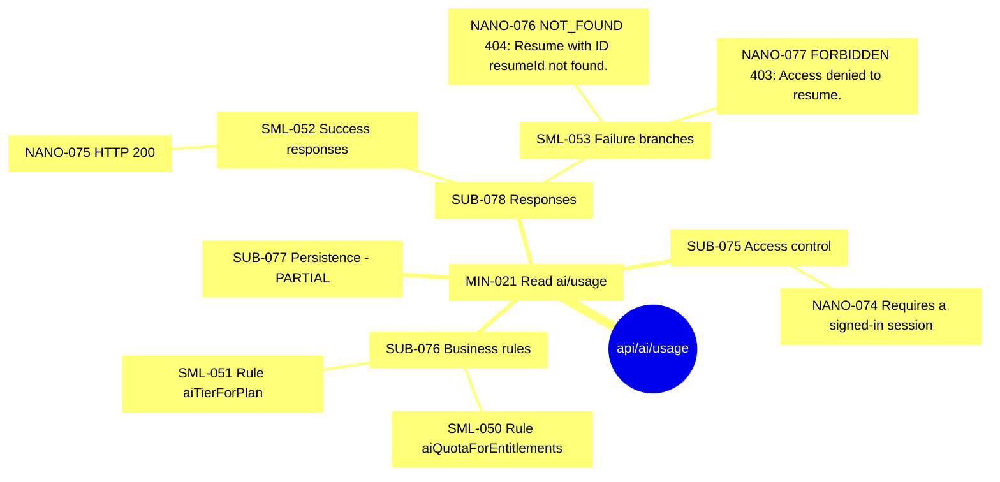

| ID       | Level | Parent   | Name                                                   | Description                                                                                                                                                                                                                 | Status                | Verification | Evidence                             | Related                               |
| -------- | ----- | -------- | ------------------------------------------------------ | --------------------------------------------------------------------------------------------------------------------------------------------------------------------------------------------------------------------------- | --------------------- | ------------ | ------------------------------------ | ------------------------------------- |
| FEAT-080 | MAJOR | MOD-069  | api/ai/usage                                           |                                                                                                                                                                                                                             | IMPLEMENTED           |              | apps/api/src/server.ts:6266          |                                       |
| MIN-021  | MINOR | FEAT-080 | Read ai/usage                                          | GET /api/v1/ai/usage for any signed-in session; calls aiQuotaForEntitlements, aiTierForPlan; ephemeral (process memory); responds 200; 2 failure branch(es). Gaps: ephemeral: state held in process memory, lost on restart | IMPLEMENTED           | VERIFIED     | apps/api/src/server.ts:6266          | API-126, TEST-084, TEST-118, TEST-191 |
| SUB-075  | SUB   | MIN-021  | Access control                                         | Who may call GET /api/v1/ai/usage: any signed-in session.                                                                                                                                                                   | IMPLEMENTED           | PATH_LEVEL   | apps/api/src/server.ts:6266          |                                       |
| NANO-074 | NANO  | SUB-075  | Requires a signed-in session                           | Requests without a valid session token are rejected with 401 UNAUTHENTICATED.                                                                                                                                               | IMPLEMENTED           | PATH_LEVEL   | apps/api/src/server.ts:6266          | ROLE-001                              |
| SUB-076  | SUB   | MIN-021  | Business rules                                         | Domain functions from packages/domain called by the handler (2).                                                                                                                                                            | IMPLEMENTED           | PATH_LEVEL   | apps/api/src/server.ts:6266          |                                       |
| SML-050  | SMALL | SUB-076  | Rule aiQuotaForEntitlements                            | Calls aiQuotaForEntitlements (packages/domain/src/ai-gateway.ts). Rule status IMPLEMENTED; its own tests: VERIFIED.                                                                                                         | IMPLEMENTED           | VERIFIED     | packages/domain/src/ai-gateway.ts:73 | RULE-010                              |
| SML-051  | SMALL | SUB-076  | Rule aiTierForPlan                                     | Calls aiTierForPlan (packages/domain/src/ai-gateway.ts). Rule status IMPLEMENTED; its own tests: VERIFIED.                                                                                                                  | IMPLEMENTED           | VERIFIED     | packages/domain/src/ai-gateway.ts:78 | RULE-011                              |
| SUB-077  | SUB   | MIN-021  | Persistence                                            | Ephemeral: state lives in API process memory and is lost on restart.                                                                                                                                                        | PARTIALLY_IMPLEMENTED | PATH_LEVEL   | apps/api/src/server.ts:6266          |                                       |
| SUB-078  | SUB   | MIN-021  | Responses                                              | Success 200; 2 explicit failure branch(es) besides validation and access errors.                                                                                                                                            | IMPLEMENTED           | PATH_LEVEL   | apps/api/src/server.ts:6266          |                                       |
| SML-052  | SMALL | SUB-078  | Success responses                                      | HTTP 200.                                                                                                                                                                                                                   | IMPLEMENTED           | PATH_LEVEL   | apps/api/src/server.ts:6266          |                                       |
| NANO-075 | NANO  | SML-052  | HTTP 200                                               | Replies 200 when the operation succeeds.                                                                                                                                                                                    | IMPLEMENTED           | PATH_LEVEL   | apps/api/src/server.ts:6266          |                                       |
| SML-053  | SMALL | SUB-078  | Failure branches                                       | 2 DomainError branch(es) in the handler, mapped to HTTP by the global error handler.                                                                                                                                        | IMPLEMENTED           | PATH_LEVEL   | apps/api/src/server.ts:6266          |                                       |
| NANO-076 | NANO  | SML-053  | NOT_FOUND 404: Resume with ID "${resumeId}" not found. | Throws DomainError(NOT_FOUND) "Resume with ID "${resumeId}" not found." -> HTTP 404.                                                                                                                                        | IMPLEMENTED           | PATH_LEVEL   | apps/api/src/server.ts:6288          | ERR-134                               |
| NANO-077 | NANO  | SML-053  | FORBIDDEN 403: Access denied to resume.                | Throws DomainError(FORBIDDEN) "Access denied to resume." -> HTTP 403.                                                                                                                                                       | IMPLEMENTED           | PATH_LEVEL   | apps/api/src/server.ts:6291          | ERR-135                               |

## api/alumni (MOD-085)

**Application:** apps/api (MOD-001). **Purpose:** API module: routes under /api/v1/alumni in apps/api/src/server.ts.

**Nodes by level:** MODULE 1, MAJOR 4, MINOR 11, SUB 50, SMALL 38, TINY 21, NANO 83. **Status:** IMPLEMENTED 194, PARTIALLY_IMPLEMENTED 14. **Verification:** PATH_LEVEL 181, UNKNOWN 3, VERIFIED 19.

**User roles that reach it:** authenticated, platform_admin.

**Known gaps:** MIN-022 ephemeral: state held in process memory, lost on restart; MIN-022 no first-party web caller found; MIN-164 ephemeral: state held in process memory, lost on restart; MIN-164 no first-party web caller found; MIN-165 ephemeral: state held in process memory, lost on restart; MIN-165 no first-party web caller found; MIN-023 ephemeral: state held in process memory, lost on restart; MIN-023 no first-party web caller found; MIN-166 ephemeral: state held in process memory, lost on restart; MIN-166 no first-party web caller found; MIN-024 ephemeral: state held in process memory, lost on restart; MIN-024 no first-party web caller found; MIN-025 ephemeral: state held in process memory, lost on restart; MIN-025 no first-party web caller found; MIN-167 ephemeral: state held in process memory, lost on restart; MIN-167 no first-party web caller found; MIN-026 ephemeral: state held in process memory, lost on restart; MIN-026 no first-party web caller found; MIN-168 ephemeral: state held in process memory, lost on restart; MIN-168 no first-party web caller found; MIN-169 ephemeral: state held in process memory, lost on restart; MIN-169 no first-party web caller found.

### Module map (to minor features)

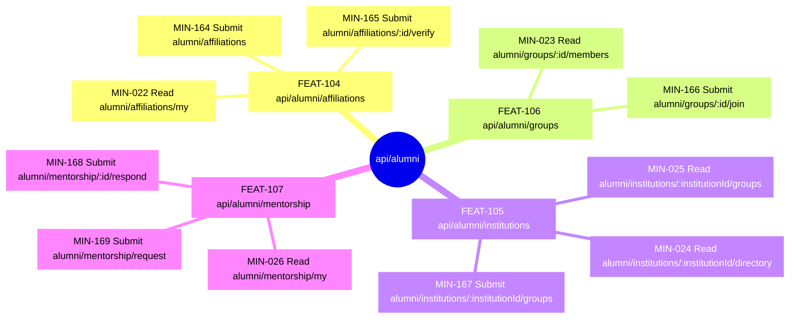

### FEAT-104 api/alumni/affiliations

api/alumni/affiliations

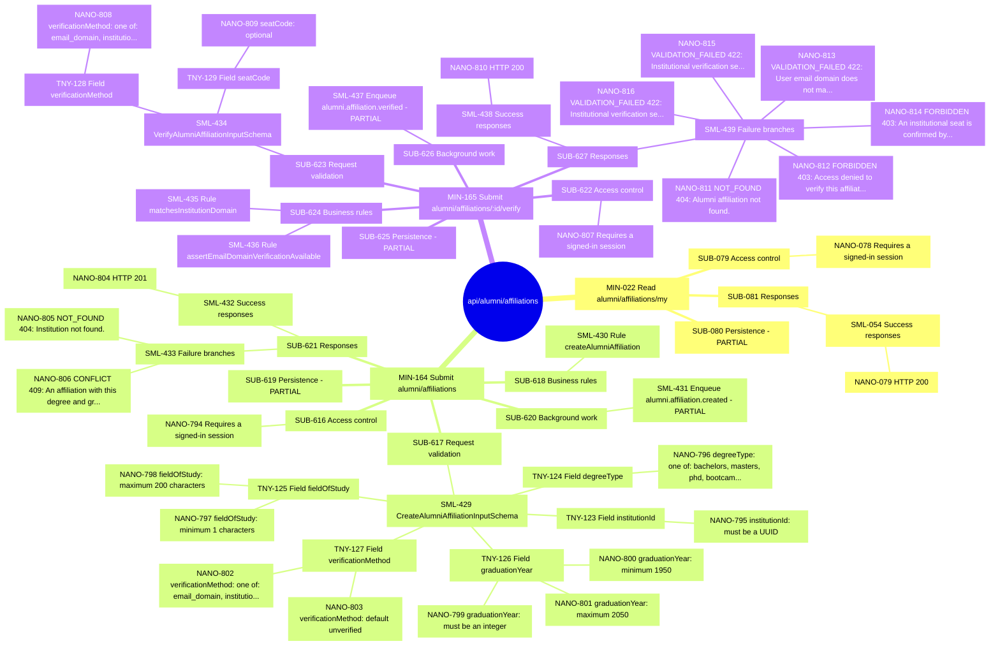

| ID       | Level | Parent   | Name                                                                                    | Description                                                                                                                                                                                                                                                                                                                                                                                                                    | Status                | Verification | Evidence                                   | Related                                         |
| -------- | ----- | -------- | --------------------------------------------------------------------------------------- | ------------------------------------------------------------------------------------------------------------------------------------------------------------------------------------------------------------------------------------------------------------------------------------------------------------------------------------------------------------------------------------------------------------------------------ | --------------------- | ------------ | ------------------------------------------ | ----------------------------------------------- |
| FEAT-104 | MAJOR | MOD-085  | api/alumni/affiliations                                                                 |                                                                                                                                                                                                                                                                                                                                                                                                                                | IMPLEMENTED           |              | apps/api/src/server.ts:9084                |                                                 |
| MIN-022  | MINOR | FEAT-104 | Read alumni/affiliations/my                                                             | 3. Get Authenticated User's Alumni Affiliations GET /api/v1/alumni/affiliations/my for any signed-in session; ephemeral (process memory); responds 200. Gaps: ephemeral: state held in process memory, lost on restart; no first-party web caller found                                                                                                                                                                        | IMPLEMENTED           | VERIFIED     | apps/api/src/server.ts:9239                | API-187, TEST-085, TEST-125                     |
| SUB-079  | SUB   | MIN-022  | Access control                                                                          | Who may call GET /api/v1/alumni/affiliations/my: any signed-in session.                                                                                                                                                                                                                                                                                                                                                        | IMPLEMENTED           | PATH_LEVEL   | apps/api/src/server.ts:9239                |                                                 |
| NANO-078 | NANO  | SUB-079  | Requires a signed-in session                                                            | Requests without a valid session token are rejected with 401 UNAUTHENTICATED.                                                                                                                                                                                                                                                                                                                                                  | IMPLEMENTED           | PATH_LEVEL   | apps/api/src/server.ts:9239                | ROLE-001                                        |
| SUB-080  | SUB   | MIN-022  | Persistence                                                                             | Ephemeral: state lives in API process memory and is lost on restart.                                                                                                                                                                                                                                                                                                                                                           | PARTIALLY_IMPLEMENTED | PATH_LEVEL   | apps/api/src/server.ts:9239                |                                                 |
| SUB-081  | SUB   | MIN-022  | Responses                                                                               | Success 200; 0 explicit failure branch(es) besides validation and access errors.                                                                                                                                                                                                                                                                                                                                               | IMPLEMENTED           | PATH_LEVEL   | apps/api/src/server.ts:9239                |                                                 |
| SML-054  | SMALL | SUB-081  | Success responses                                                                       | HTTP 200.                                                                                                                                                                                                                                                                                                                                                                                                                      | IMPLEMENTED           | PATH_LEVEL   | apps/api/src/server.ts:9239                |                                                 |
| NANO-079 | NANO  | SML-054  | HTTP 200                                                                                | Replies 200 when the operation succeeds.                                                                                                                                                                                                                                                                                                                                                                                       | IMPLEMENTED           | PATH_LEVEL   | apps/api/src/server.ts:9239                |                                                 |
| MIN-164  | MINOR | FEAT-104 | Submit alumni/affiliations                                                              | POST /api/v1/alumni/affiliations for any signed-in session; validates CreateAlumniAffiliationInputSchema; calls createAlumniAffiliation; ephemeral (process memory); responds 201; 2 failure branch(es). Gaps: ephemeral: state held in process memory, lost on restart; no first-party web caller found                                                                                                                       | IMPLEMENTED           | VERIFIED     | apps/api/src/server.ts:9084                | API-185, TEST-085, TEST-101, TEST-125, TEST-166 |
| SUB-616  | SUB   | MIN-164  | Access control                                                                          | Who may call POST /api/v1/alumni/affiliations: any signed-in session.                                                                                                                                                                                                                                                                                                                                                          | IMPLEMENTED           | PATH_LEVEL   | apps/api/src/server.ts:9084                |                                                 |
| NANO-794 | NANO  | SUB-616  | Requires a signed-in session                                                            | Requests without a valid session token are rejected with 401 UNAUTHENTICATED.                                                                                                                                                                                                                                                                                                                                                  | IMPLEMENTED           | PATH_LEVEL   | apps/api/src/server.ts:9084                | ROLE-001                                        |
| SUB-617  | SUB   | MIN-164  | Request validation                                                                      | The request is parsed with CreateAlumniAffiliationInputSchema; a failure returns 400 with field details before any business logic runs.                                                                                                                                                                                                                                                                                        | IMPLEMENTED           | PATH_LEVEL   | apps/api/src/server.ts:9084                |                                                 |
| SML-429  | SMALL | SUB-617  | CreateAlumniAffiliationInputSchema                                                      | CreateAlumniAffiliationInputSchema: 5 field(s)                                                                                                                                                                                                                                                                                                                                                                                 | IMPLEMENTED           | PATH_LEVEL   | packages/contracts/src/index.ts:1375       | SCH-106                                         |
| TNY-123  | TINY  | SML-429  | Field institutionId                                                                     | institutionId (string, required): must be a UUID                                                                                                                                                                                                                                                                                                                                                                               | IMPLEMENTED           | PATH_LEVEL   | packages/contracts/src/index.ts:1376       |                                                 |
| NANO-795 | NANO  | TNY-123  | institutionId: must be a UUID                                                           | institutionId must be a UUID.                                                                                                                                                                                                                                                                                                                                                                                                  | IMPLEMENTED           | PATH_LEVEL   | packages/contracts/src/index.ts:1376       |                                                 |
| TNY-124  | TINY  | SML-429  | Field degreeType                                                                        | degreeType (enum, required): one of: bachelors, masters, phd, bootcamp, certification, other                                                                                                                                                                                                                                                                                                                                   | IMPLEMENTED           | PATH_LEVEL   | packages/contracts/src/index.ts:1377       |                                                 |
| NANO-796 | NANO  | TNY-124  | degreeType: one of: bachelors, masters, phd, bootcamp, certification, other             | degreeType one of: bachelors, masters, phd, bootcamp, certification, other.                                                                                                                                                                                                                                                                                                                                                    | IMPLEMENTED           | PATH_LEVEL   | packages/contracts/src/index.ts:1377       |                                                 |
| TNY-125  | TINY  | SML-429  | Field fieldOfStudy                                                                      | fieldOfStudy (string, required): minimum 1 characters; maximum 200 characters                                                                                                                                                                                                                                                                                                                                                  | IMPLEMENTED           | PATH_LEVEL   | packages/contracts/src/index.ts:1378       |                                                 |
| NANO-797 | NANO  | TNY-125  | fieldOfStudy: minimum 1 characters                                                      | fieldOfStudy minimum 1 characters.                                                                                                                                                                                                                                                                                                                                                                                             | IMPLEMENTED           | PATH_LEVEL   | packages/contracts/src/index.ts:1378       |                                                 |
| NANO-798 | NANO  | TNY-125  | fieldOfStudy: maximum 200 characters                                                    | fieldOfStudy maximum 200 characters.                                                                                                                                                                                                                                                                                                                                                                                           | IMPLEMENTED           | PATH_LEVEL   | packages/contracts/src/index.ts:1378       |                                                 |
| TNY-126  | TINY  | SML-429  | Field graduationYear                                                                    | graduationYear (number, required): must be an integer; minimum 1950; maximum 2050                                                                                                                                                                                                                                                                                                                                              | IMPLEMENTED           | PATH_LEVEL   | packages/contracts/src/index.ts:1379       |                                                 |
| NANO-799 | NANO  | TNY-126  | graduationYear: must be an integer                                                      | graduationYear must be an integer.                                                                                                                                                                                                                                                                                                                                                                                             | IMPLEMENTED           | PATH_LEVEL   | packages/contracts/src/index.ts:1379       |                                                 |
| NANO-800 | NANO  | TNY-126  | graduationYear: minimum 1950                                                            | graduationYear minimum 1950.                                                                                                                                                                                                                                                                                                                                                                                                   | IMPLEMENTED           | PATH_LEVEL   | packages/contracts/src/index.ts:1379       |                                                 |
| NANO-801 | NANO  | TNY-126  | graduationYear: maximum 2050                                                            | graduationYear maximum 2050.                                                                                                                                                                                                                                                                                                                                                                                                   | IMPLEMENTED           | PATH_LEVEL   | packages/contracts/src/index.ts:1379       |                                                 |
| TNY-127  | TINY  | SML-429  | Field verificationMethod                                                                | verificationMethod (enum, optional): one of: email_domain, institutional_seat, manual_review, unverified; default 'unverified'                                                                                                                                                                                                                                                                                                 | IMPLEMENTED           | PATH_LEVEL   | packages/contracts/src/index.ts:1380       |                                                 |
| NANO-802 | NANO  | TNY-127  | verificationMethod: one of: email_domain, institutional_seat, manual_review, unverified | verificationMethod one of: email_domain, institutional_seat, manual_review, unverified.                                                                                                                                                                                                                                                                                                                                        | IMPLEMENTED           | PATH_LEVEL   | packages/contracts/src/index.ts:1380       |                                                 |
| NANO-803 | NANO  | TNY-127  | verificationMethod: default 'unverified'                                                | verificationMethod default 'unverified'; message "unverified".                                                                                                                                                                                                                                                                                                                                                                 | IMPLEMENTED           | PATH_LEVEL   | packages/contracts/src/index.ts:1380       |                                                 |
| SUB-618  | SUB   | MIN-164  | Business rules                                                                          | Domain functions from packages/domain called by the handler (1).                                                                                                                                                                                                                                                                                                                                                               | IMPLEMENTED           | PATH_LEVEL   | apps/api/src/server.ts:9084                |                                                 |
| SML-430  | SMALL | SUB-618  | Rule createAlumniAffiliation                                                            | Calls createAlumniAffiliation (packages/domain/src/alumni-networks.ts). Rule status IMPLEMENTED; its own tests: VERIFIED.                                                                                                                                                                                                                                                                                                      | IMPLEMENTED           | VERIFIED     | packages/domain/src/alumni-networks.ts:156 | RULE-020                                        |
| SUB-619  | SUB   | MIN-164  | Persistence                                                                             | Ephemeral: state lives in API process memory and is lost on restart.                                                                                                                                                                                                                                                                                                                                                           | PARTIALLY_IMPLEMENTED | PATH_LEVEL   | apps/api/src/server.ts:9084                |                                                 |
| SUB-620  | SUB   | MIN-164  | Background work                                                                         | Enqueues 1 background job kind(s) in background_jobs for apps/worker.                                                                                                                                                                                                                                                                                                                                                          | IMPLEMENTED           | PATH_LEVEL   | apps/api/src/server.ts:9084                |                                                 |
| SML-431  | SMALL | SUB-620  | Enqueue alumni.affiliation.created                                                      | Dispatches job:alumni.affiliation.created; worker handler: recordEvent (no-op: marks the event recorded).                                                                                                                                                                                                                                                                                                                      | PARTIALLY_IMPLEMENTED | UNKNOWN      | packages/domain/src/background-jobs.ts:171 | SVC-003                                         |
| SUB-621  | SUB   | MIN-164  | Responses                                                                               | Success 201; 2 explicit failure branch(es) besides validation and access errors.                                                                                                                                                                                                                                                                                                                                               | IMPLEMENTED           | PATH_LEVEL   | apps/api/src/server.ts:9084                |                                                 |
| SML-432  | SMALL | SUB-621  | Success responses                                                                       | HTTP 201.                                                                                                                                                                                                                                                                                                                                                                                                                      | IMPLEMENTED           | PATH_LEVEL   | apps/api/src/server.ts:9084                |                                                 |
| NANO-804 | NANO  | SML-432  | HTTP 201                                                                                | Replies 201 when the operation succeeds.                                                                                                                                                                                                                                                                                                                                                                                       | IMPLEMENTED           | PATH_LEVEL   | apps/api/src/server.ts:9084                |                                                 |
| SML-433  | SMALL | SUB-621  | Failure branches                                                                        | 2 DomainError branch(es) in the handler, mapped to HTTP by the global error handler.                                                                                                                                                                                                                                                                                                                                           | IMPLEMENTED           | PATH_LEVEL   | apps/api/src/server.ts:9084                |                                                 |
| NANO-805 | NANO  | SML-433  | NOT_FOUND 404: Institution not found.                                                   | Throws DomainError(NOT_FOUND) "Institution not found." -> HTTP 404.                                                                                                                                                                                                                                                                                                                                                            | IMPLEMENTED           | PATH_LEVEL   | apps/api/src/server.ts:9090                | ERR-184                                         |
| NANO-806 | NANO  | SML-433  | CONFLICT 409: An affiliation with this degree and graduation year already exists for    | Throws DomainError(CONFLICT) "An affiliation with this degree and graduation year already exists for this institution." -> HTTP 409.                                                                                                                                                                                                                                                                                           | IMPLEMENTED           | PATH_LEVEL   | apps/api/src/server.ts:9101                | ERR-185                                         |
| MIN-165  | MINOR | FEAT-104 | Submit alumni/affiliations/:id/verify                                                   | 2. Verify Alumni Affiliation (by email domain match or seat code) POST /api/v1/alumni/affiliations/:id/verify for any signed-in session; validates VerifyAlumniAffiliationInputSchema; calls matchesInstitutionDomain, assertEmailDomainVerificationAvailable; ephemeral (process memory); responds 200; 6 failure branch(es). Gaps: ephemeral: state held in process memory, lost on restart; no first-party web caller found | IMPLEMENTED           | VERIFIED     | apps/api/src/server.ts:9158                | API-186, TEST-085, TEST-101, TEST-125, TEST-166 |
| SUB-622  | SUB   | MIN-165  | Access control                                                                          | Who may call POST /api/v1/alumni/affiliations/:id/verify: any signed-in session.                                                                                                                                                                                                                                                                                                                                               | IMPLEMENTED           | PATH_LEVEL   | apps/api/src/server.ts:9158                |                                                 |
| NANO-807 | NANO  | SUB-622  | Requires a signed-in session                                                            | Requests without a valid session token are rejected with 401 UNAUTHENTICATED.                                                                                                                                                                                                                                                                                                                                                  | IMPLEMENTED           | PATH_LEVEL   | apps/api/src/server.ts:9158                | ROLE-001                                        |
| SUB-623  | SUB   | MIN-165  | Request validation                                                                      | The request is parsed with VerifyAlumniAffiliationInputSchema; a failure returns 400 with field details before any business logic runs.                                                                                                                                                                                                                                                                                        | IMPLEMENTED           | PATH_LEVEL   | apps/api/src/server.ts:9158                |                                                 |
| SML-434  | SMALL | SUB-623  | VerifyAlumniAffiliationInputSchema                                                      | VerifyAlumniAffiliationInputSchema: 2 field(s)                                                                                                                                                                                                                                                                                                                                                                                 | IMPLEMENTED           | PATH_LEVEL   | packages/contracts/src/index.ts:1387       | SCH-107                                         |
| TNY-128  | TINY  | SML-434  | Field verificationMethod                                                                | verificationMethod (enum, required): one of: email_domain, institutional_seat                                                                                                                                                                                                                                                                                                                                                  | IMPLEMENTED           | PATH_LEVEL   | packages/contracts/src/index.ts:1388       |                                                 |
| NANO-808 | NANO  | TNY-128  | verificationMethod: one of: email_domain, institutional_seat                            | verificationMethod one of: email_domain, institutional_seat.                                                                                                                                                                                                                                                                                                                                                                   | IMPLEMENTED           | PATH_LEVEL   | packages/contracts/src/index.ts:1388       |                                                 |
| TNY-129  | TINY  | SML-434  | Field seatCode                                                                          | seatCode (string, optional): optional                                                                                                                                                                                                                                                                                                                                                                                          | IMPLEMENTED           | PATH_LEVEL   | packages/contracts/src/index.ts:1389       |                                                 |
| NANO-809 | NANO  | TNY-129  | seatCode: optional                                                                      | seatCode optional.                                                                                                                                                                                                                                                                                                                                                                                                             | IMPLEMENTED           | PATH_LEVEL   | packages/contracts/src/index.ts:1389       |                                                 |
| SUB-624  | SUB   | MIN-165  | Business rules                                                                          | Domain functions from packages/domain called by the handler (2).                                                                                                                                                                                                                                                                                                                                                               | IMPLEMENTED           | PATH_LEVEL   | apps/api/src/server.ts:9158                |                                                 |
| SML-435  | SMALL | SUB-624  | Rule matchesInstitutionDomain                                                           | Calls matchesInstitutionDomain (packages/domain/src/alumni-networks.ts). Rule status IMPLEMENTED; its own tests: VERIFIED.                                                                                                                                                                                                                                                                                                     | IMPLEMENTED           | VERIFIED     | packages/domain/src/alumni-networks.ts:123 | RULE-018                                        |
| SML-436  | SMALL | SUB-624  | Rule assertEmailDomainVerificationAvailable                                             | Calls assertEmailDomainVerificationAvailable (packages/domain/src/alumni-networks.ts). Rule status IMPLEMENTED; its own tests: VERIFIED.                                                                                                                                                                                                                                                                                       | IMPLEMENTED           | VERIFIED     | packages/domain/src/alumni-networks.ts:144 | RULE-019                                        |
| SUB-625  | SUB   | MIN-165  | Persistence                                                                             | Ephemeral: state lives in API process memory and is lost on restart.                                                                                                                                                                                                                                                                                                                                                           | PARTIALLY_IMPLEMENTED | PATH_LEVEL   | apps/api/src/server.ts:9158                |                                                 |
| SUB-626  | SUB   | MIN-165  | Background work                                                                         | Enqueues 1 background job kind(s) in background_jobs for apps/worker.                                                                                                                                                                                                                                                                                                                                                          | IMPLEMENTED           | PATH_LEVEL   | apps/api/src/server.ts:9158                |                                                 |
| SML-437  | SMALL | SUB-626  | Enqueue alumni.affiliation.verified                                                     | Dispatches job:alumni.affiliation.verified; worker handler: recordEvent (no-op: marks the event recorded).                                                                                                                                                                                                                                                                                                                     | PARTIALLY_IMPLEMENTED | UNKNOWN      | packages/domain/src/background-jobs.ts:171 | SVC-004                                         |
| SUB-627  | SUB   | MIN-165  | Responses                                                                               | Success 200; 6 explicit failure branch(es) besides validation and access errors.                                                                                                                                                                                                                                                                                                                                               | IMPLEMENTED           | PATH_LEVEL   | apps/api/src/server.ts:9158                |                                                 |
| SML-438  | SMALL | SUB-627  | Success responses                                                                       | HTTP 200.                                                                                                                                                                                                                                                                                                                                                                                                                      | IMPLEMENTED           | PATH_LEVEL   | apps/api/src/server.ts:9158                |                                                 |
| NANO-810 | NANO  | SML-438  | HTTP 200                                                                                | Replies 200 when the operation succeeds.                                                                                                                                                                                                                                                                                                                                                                                       | IMPLEMENTED           | PATH_LEVEL   | apps/api/src/server.ts:9158                |                                                 |
| SML-439  | SMALL | SUB-627  | Failure branches                                                                        | 6 DomainError branch(es) in the handler, mapped to HTTP by the global error handler.                                                                                                                                                                                                                                                                                                                                           | IMPLEMENTED           | PATH_LEVEL   | apps/api/src/server.ts:9158                |                                                 |
| NANO-811 | NANO  | SML-439  | NOT_FOUND 404: Alumni affiliation not found.                                            | Throws DomainError(NOT_FOUND) "Alumni affiliation not found." -> HTTP 404.                                                                                                                                                                                                                                                                                                                                                     | IMPLEMENTED           | PATH_LEVEL   | apps/api/src/server.ts:9167                | ERR-186                                         |
| NANO-812 | NANO  | SML-439  | FORBIDDEN 403: Access denied to verify this affiliation.                                | Throws DomainError(FORBIDDEN) "Access denied to verify this affiliation." -> HTTP 403.                                                                                                                                                                                                                                                                                                                                         | IMPLEMENTED           | PATH_LEVEL   | apps/api/src/server.ts:9173                | ERR-187                                         |
| NANO-813 | NANO  | SML-439  | VALIDATION_FAILED 422: User email domain does not match institution domain.             | Throws DomainError(VALIDATION_FAILED) "User email domain does not match institution domain." -> HTTP 422.                                                                                                                                                                                                                                                                                                                      | IMPLEMENTED           | PATH_LEVEL   | apps/api/src/server.ts:9183                | ERR-188                                         |
| NANO-814 | NANO  | SML-439  | FORBIDDEN 403: An institutional seat is confirmed by an administrator of that institu   | Throws DomainError(FORBIDDEN) "An institutional seat is confirmed by an administrator of that institution." -> HTTP 403.                                                                                                                                                                                                                                                                                                       | IMPLEMENTED           | PATH_LEVEL   | apps/api/src/server.ts:9196                | ERR-189                                         |
| NANO-815 | NANO  | SML-439  | VALIDATION_FAILED 422: Institutional verification seat code is required.                | Throws DomainError(VALIDATION_FAILED) "Institutional verification seat code is required." -> HTTP 422.                                                                                                                                                                                                                                                                                                                         | IMPLEMENTED           | PATH_LEVEL   | apps/api/src/server.ts:9202                | ERR-190                                         |
| NANO-816 | NANO  | SML-439  | VALIDATION_FAILED 422: Institutional verification seat code is invalid.                 | Throws DomainError(VALIDATION_FAILED) "Institutional verification seat code is invalid." -> HTTP 422.                                                                                                                                                                                                                                                                                                                          | IMPLEMENTED           | PATH_LEVEL   | apps/api/src/server.ts:9208                | ERR-191                                         |

### FEAT-106 api/alumni/groups

api/alumni/groups

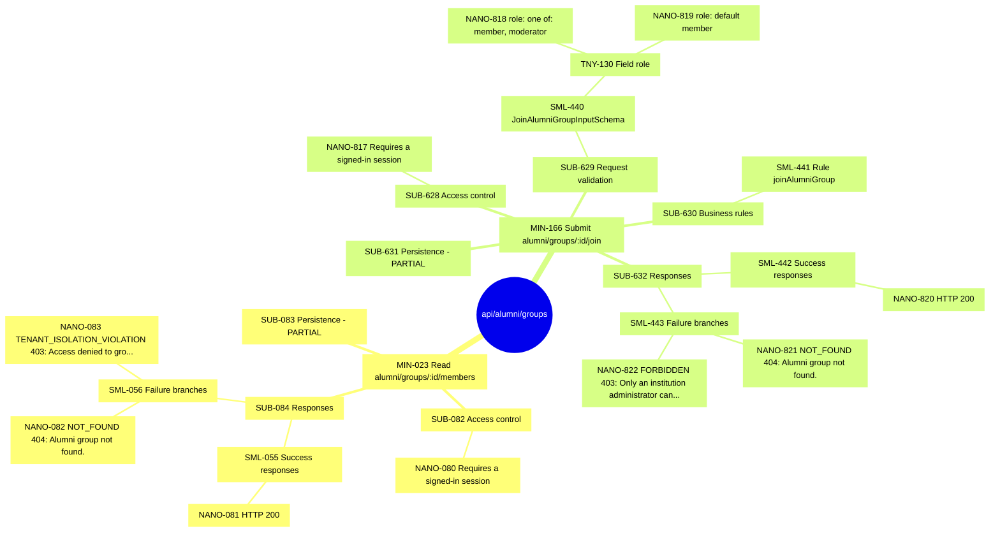

| ID       | Level | Parent   | Name                                                                              | Description                                                                                                                                                                                                                                                                                                      | Status                | Verification | Evidence                                   | Related                               |
| -------- | ----- | -------- | --------------------------------------------------------------------------------- | ---------------------------------------------------------------------------------------------------------------------------------------------------------------------------------------------------------------------------------------------------------------------------------------------------------------- | --------------------- | ------------ | ------------------------------------------ | ------------------------------------- |
| FEAT-106 | MAJOR | MOD-085  | api/alumni/groups                                                                 |                                                                                                                                                                                                                                                                                                                  | IMPLEMENTED           |              | apps/api/src/server.ts:9388                |                                       |
| MIN-023  | MINOR | FEAT-106 | Read alumni/groups/:id/members                                                    | 8. List Members of Alumni Group GET /api/v1/alumni/groups/:id/members for any signed-in session; ephemeral (process memory); responds 200; 2 failure branch(es). Gaps: ephemeral: state held in process memory, lost on restart; no first-party web caller found                                                 | IMPLEMENTED           | VERIFIED     | apps/api/src/server.ts:9442                | API-192, TEST-085, TEST-101, TEST-166 |
| SUB-082  | SUB   | MIN-023  | Access control                                                                    | Who may call GET /api/v1/alumni/groups/:id/members: any signed-in session.                                                                                                                                                                                                                                       | IMPLEMENTED           | PATH_LEVEL   | apps/api/src/server.ts:9442                |                                       |
| NANO-080 | NANO  | SUB-082  | Requires a signed-in session                                                      | Requests without a valid session token are rejected with 401 UNAUTHENTICATED.                                                                                                                                                                                                                                    | IMPLEMENTED           | PATH_LEVEL   | apps/api/src/server.ts:9442                | ROLE-001                              |
| SUB-083  | SUB   | MIN-023  | Persistence                                                                       | Ephemeral: state lives in API process memory and is lost on restart.                                                                                                                                                                                                                                             | PARTIALLY_IMPLEMENTED | PATH_LEVEL   | apps/api/src/server.ts:9442                |                                       |
| SUB-084  | SUB   | MIN-023  | Responses                                                                         | Success 200; 2 explicit failure branch(es) besides validation and access errors.                                                                                                                                                                                                                                 | IMPLEMENTED           | PATH_LEVEL   | apps/api/src/server.ts:9442                |                                       |
| SML-055  | SMALL | SUB-084  | Success responses                                                                 | HTTP 200.                                                                                                                                                                                                                                                                                                        | IMPLEMENTED           | PATH_LEVEL   | apps/api/src/server.ts:9442                |                                       |
| NANO-081 | NANO  | SML-055  | HTTP 200                                                                          | Replies 200 when the operation succeeds.                                                                                                                                                                                                                                                                         | IMPLEMENTED           | PATH_LEVEL   | apps/api/src/server.ts:9442                |                                       |
| SML-056  | SMALL | SUB-084  | Failure branches                                                                  | 2 DomainError branch(es) in the handler, mapped to HTTP by the global error handler.                                                                                                                                                                                                                             | IMPLEMENTED           | PATH_LEVEL   | apps/api/src/server.ts:9442                |                                       |
| NANO-082 | NANO  | SML-056  | NOT_FOUND 404: Alumni group not found.                                            | Throws DomainError(NOT_FOUND) "Alumni group not found." -> HTTP 404.                                                                                                                                                                                                                                             | IMPLEMENTED           | PATH_LEVEL   | apps/api/src/server.ts:9450                | ERR-194                               |
| NANO-083 | NANO  | SML-056  | TENANT_ISOLATION_VIOLATION 403: Access denied to group members.                   | Throws DomainError(TENANT_ISOLATION_VIOLATION) "Access denied to group members." -> HTTP 403.                                                                                                                                                                                                                    | IMPLEMENTED           | PATH_LEVEL   | apps/api/src/server.ts:9456                | ERR-196                               |
| MIN-166  | MINOR | FEAT-106 | Submit alumni/groups/:id/join                                                     | 7. Join Alumni Group POST /api/v1/alumni/groups/:id/join for any signed-in session; validates JoinAlumniGroupInputSchema; calls joinAlumniGroup; ephemeral (process memory); responds 200; 2 failure branch(es). Gaps: ephemeral: state held in process memory, lost on restart; no first-party web caller found | IMPLEMENTED           | VERIFIED     | apps/api/src/server.ts:9388                | API-191, TEST-085, TEST-101, TEST-166 |
| SUB-628  | SUB   | MIN-166  | Access control                                                                    | Who may call POST /api/v1/alumni/groups/:id/join: any signed-in session.                                                                                                                                                                                                                                         | IMPLEMENTED           | PATH_LEVEL   | apps/api/src/server.ts:9388                |                                       |
| NANO-817 | NANO  | SUB-628  | Requires a signed-in session                                                      | Requests without a valid session token are rejected with 401 UNAUTHENTICATED.                                                                                                                                                                                                                                    | IMPLEMENTED           | PATH_LEVEL   | apps/api/src/server.ts:9388                | ROLE-001                              |
| SUB-629  | SUB   | MIN-166  | Request validation                                                                | The request is parsed with JoinAlumniGroupInputSchema; a failure returns 400 with field details before any business logic runs.                                                                                                                                                                                  | IMPLEMENTED           | PATH_LEVEL   | apps/api/src/server.ts:9388                |                                       |
| SML-440  | SMALL | SUB-629  | JoinAlumniGroupInputSchema                                                        | JoinAlumniGroupInputSchema: 1 field(s)                                                                                                                                                                                                                                                                           | IMPLEMENTED           | PATH_LEVEL   | packages/contracts/src/index.ts:1415       | SCH-110                               |
| TNY-130  | TINY  | SML-440  | Field role                                                                        | role (enum, optional): one of: member, moderator; default 'member'                                                                                                                                                                                                                                               | IMPLEMENTED           | PATH_LEVEL   | packages/contracts/src/index.ts:1416       |                                       |
| NANO-818 | NANO  | TNY-130  | role: one of: member, moderator                                                   | role one of: member, moderator.                                                                                                                                                                                                                                                                                  | IMPLEMENTED           | PATH_LEVEL   | packages/contracts/src/index.ts:1416       |                                       |
| NANO-819 | NANO  | TNY-130  | role: default 'member'                                                            | role default 'member'; message "member".                                                                                                                                                                                                                                                                         | IMPLEMENTED           | PATH_LEVEL   | packages/contracts/src/index.ts:1416       |                                       |
| SUB-630  | SUB   | MIN-166  | Business rules                                                                    | Domain functions from packages/domain called by the handler (1).                                                                                                                                                                                                                                                 | IMPLEMENTED           | PATH_LEVEL   | apps/api/src/server.ts:9388                |                                       |
| SML-441  | SMALL | SUB-630  | Rule joinAlumniGroup                                                              | Calls joinAlumniGroup (packages/domain/src/alumni-networks.ts). Rule status IMPLEMENTED; its own tests: VERIFIED.                                                                                                                                                                                                | IMPLEMENTED           | VERIFIED     | packages/domain/src/alumni-networks.ts:329 | RULE-024                              |
| SUB-631  | SUB   | MIN-166  | Persistence                                                                       | Ephemeral: state lives in API process memory and is lost on restart.                                                                                                                                                                                                                                             | PARTIALLY_IMPLEMENTED | PATH_LEVEL   | apps/api/src/server.ts:9388                |                                       |
| SUB-632  | SUB   | MIN-166  | Responses                                                                         | Success 200; 2 explicit failure branch(es) besides validation and access errors.                                                                                                                                                                                                                                 | IMPLEMENTED           | PATH_LEVEL   | apps/api/src/server.ts:9388                |                                       |
| SML-442  | SMALL | SUB-632  | Success responses                                                                 | HTTP 200.                                                                                                                                                                                                                                                                                                        | IMPLEMENTED           | PATH_LEVEL   | apps/api/src/server.ts:9388                |                                       |
| NANO-820 | NANO  | SML-442  | HTTP 200                                                                          | Replies 200 when the operation succeeds.                                                                                                                                                                                                                                                                         | IMPLEMENTED           | PATH_LEVEL   | apps/api/src/server.ts:9388                |                                       |
| SML-443  | SMALL | SUB-632  | Failure branches                                                                  | 2 DomainError branch(es) in the handler, mapped to HTTP by the global error handler.                                                                                                                                                                                                                             | IMPLEMENTED           | PATH_LEVEL   | apps/api/src/server.ts:9388                |                                       |
| NANO-821 | NANO  | SML-443  | NOT_FOUND 404: Alumni group not found.                                            | Throws DomainError(NOT_FOUND) "Alumni group not found." -> HTTP 404.                                                                                                                                                                                                                                             | IMPLEMENTED           | PATH_LEVEL   | apps/api/src/server.ts:9396                | ERR-194                               |
| NANO-822 | NANO  | SML-443  | FORBIDDEN 403: Only an institution administrator can join a group as a moderator. | Throws DomainError(FORBIDDEN) "Only an institution administrator can join a group as a moderator." -> HTTP 403.                                                                                                                                                                                                  | IMPLEMENTED           | PATH_LEVEL   | apps/api/src/server.ts:9404                | ERR-195                               |

### FEAT-105 api/alumni/institutions

api/alumni/institutions

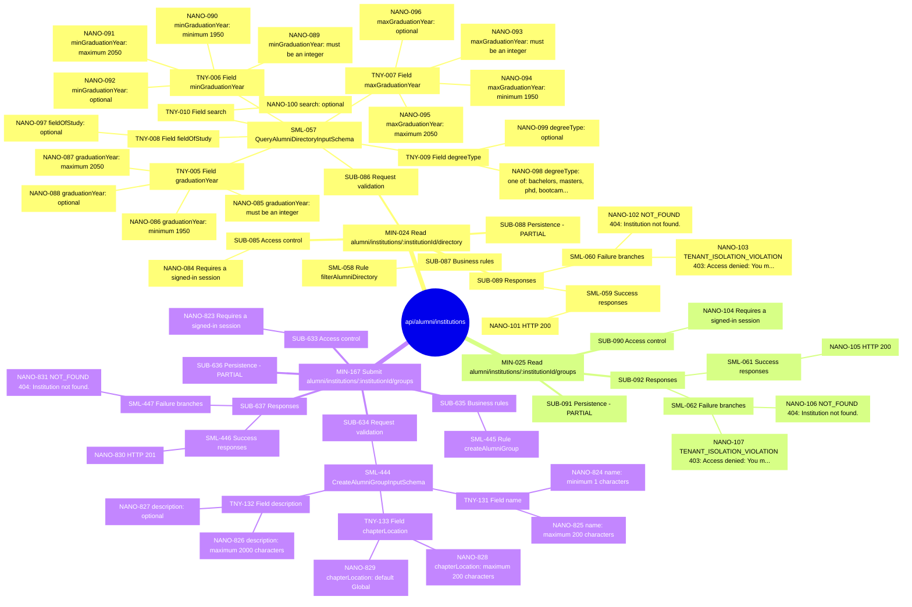

| ID       | Level | Parent   | Name                                                                                                   | Description                                                                                                                                                                                                                                                                                                                                                                                                             | Status                | Verification | Evidence                                   | Related                                         |
| -------- | ----- | -------- | ------------------------------------------------------------------------------------------------------ | ----------------------------------------------------------------------------------------------------------------------------------------------------------------------------------------------------------------------------------------------------------------------------------------------------------------------------------------------------------------------------------------------------------------------- | --------------------- | ------------ | ------------------------------------------ | ----------------------------------------------- |
| FEAT-105 | MAJOR | MOD-085  | api/alumni/institutions                                                                                |                                                                                                                                                                                                                                                                                                                                                                                                                         | IMPLEMENTED           |              | apps/api/src/server.ts:9249                |                                                 |
| MIN-024  | MINOR | FEAT-105 | Read alumni/institutions/:institutionId/directory                                                      | 4. Institutional Alumni Directory Discovery (Strict Cross-Institution Isolation BR-F125-03) GET /api/v1/alumni/institutions/:institutionId/directory for any signed-in session; validates QueryAlumniDirectoryInputSchema; calls filterAlumniDirectory; ephemeral (process memory); responds 200; 2 failure branch(es). Gaps: ephemeral: state held in process memory, lost on restart; no first-party web caller found | IMPLEMENTED           | VERIFIED     | apps/api/src/server.ts:9249                | API-188, TEST-085, TEST-101, TEST-166           |
| SUB-085  | SUB   | MIN-024  | Access control                                                                                         | Who may call GET /api/v1/alumni/institutions/:institutionId/directory: any signed-in session.                                                                                                                                                                                                                                                                                                                           | IMPLEMENTED           | PATH_LEVEL   | apps/api/src/server.ts:9249                |                                                 |
| NANO-084 | NANO  | SUB-085  | Requires a signed-in session                                                                           | Requests without a valid session token are rejected with 401 UNAUTHENTICATED.                                                                                                                                                                                                                                                                                                                                           | IMPLEMENTED           | PATH_LEVEL   | apps/api/src/server.ts:9249                | ROLE-001                                        |
| SUB-086  | SUB   | MIN-024  | Request validation                                                                                     | The request is parsed with QueryAlumniDirectoryInputSchema; a failure returns 400 with field details before any business logic runs.                                                                                                                                                                                                                                                                                    | IMPLEMENTED           | PATH_LEVEL   | apps/api/src/server.ts:9249                |                                                 |
| SML-057  | SMALL | SUB-086  | QueryAlumniDirectoryInputSchema                                                                        | QueryAlumniDirectoryInputSchema: 6 field(s)                                                                                                                                                                                                                                                                                                                                                                             | IMPLEMENTED           | PATH_LEVEL   | packages/contracts/src/index.ts:1394       | SCH-108                                         |
| TNY-005  | TINY  | SML-057  | Field graduationYear                                                                                   | graduationYear (number, optional): must be an integer; minimum 1950; maximum 2050; optional                                                                                                                                                                                                                                                                                                                             | IMPLEMENTED           | PATH_LEVEL   | packages/contracts/src/index.ts:1395       |                                                 |
| NANO-085 | NANO  | TNY-005  | graduationYear: must be an integer                                                                     | graduationYear must be an integer.                                                                                                                                                                                                                                                                                                                                                                                      | IMPLEMENTED           | PATH_LEVEL   | packages/contracts/src/index.ts:1395       |                                                 |
| NANO-086 | NANO  | TNY-005  | graduationYear: minimum 1950                                                                           | graduationYear minimum 1950.                                                                                                                                                                                                                                                                                                                                                                                            | IMPLEMENTED           | PATH_LEVEL   | packages/contracts/src/index.ts:1395       |                                                 |
| NANO-087 | NANO  | TNY-005  | graduationYear: maximum 2050                                                                           | graduationYear maximum 2050.                                                                                                                                                                                                                                                                                                                                                                                            | IMPLEMENTED           | PATH_LEVEL   | packages/contracts/src/index.ts:1395       |                                                 |
| NANO-088 | NANO  | TNY-005  | graduationYear: optional                                                                               | graduationYear optional.                                                                                                                                                                                                                                                                                                                                                                                                | IMPLEMENTED           | PATH_LEVEL   | packages/contracts/src/index.ts:1395       |                                                 |
| TNY-006  | TINY  | SML-057  | Field minGraduationYear                                                                                | minGraduationYear (number, optional): must be an integer; minimum 1950; maximum 2050; optional                                                                                                                                                                                                                                                                                                                          | IMPLEMENTED           | PATH_LEVEL   | packages/contracts/src/index.ts:1396       |                                                 |
| NANO-089 | NANO  | TNY-006  | minGraduationYear: must be an integer                                                                  | minGraduationYear must be an integer.                                                                                                                                                                                                                                                                                                                                                                                   | IMPLEMENTED           | PATH_LEVEL   | packages/contracts/src/index.ts:1396       |                                                 |
| NANO-090 | NANO  | TNY-006  | minGraduationYear: minimum 1950                                                                        | minGraduationYear minimum 1950.                                                                                                                                                                                                                                                                                                                                                                                         | IMPLEMENTED           | PATH_LEVEL   | packages/contracts/src/index.ts:1396       |                                                 |
| NANO-091 | NANO  | TNY-006  | minGraduationYear: maximum 2050                                                                        | minGraduationYear maximum 2050.                                                                                                                                                                                                                                                                                                                                                                                         | IMPLEMENTED           | PATH_LEVEL   | packages/contracts/src/index.ts:1396       |                                                 |
| NANO-092 | NANO  | TNY-006  | minGraduationYear: optional                                                                            | minGraduationYear optional.                                                                                                                                                                                                                                                                                                                                                                                             | IMPLEMENTED           | PATH_LEVEL   | packages/contracts/src/index.ts:1396       |                                                 |
| TNY-007  | TINY  | SML-057  | Field maxGraduationYear                                                                                | maxGraduationYear (number, optional): must be an integer; minimum 1950; maximum 2050; optional                                                                                                                                                                                                                                                                                                                          | IMPLEMENTED           | PATH_LEVEL   | packages/contracts/src/index.ts:1397       |                                                 |
| NANO-093 | NANO  | TNY-007  | maxGraduationYear: must be an integer                                                                  | maxGraduationYear must be an integer.                                                                                                                                                                                                                                                                                                                                                                                   | IMPLEMENTED           | PATH_LEVEL   | packages/contracts/src/index.ts:1397       |                                                 |
| NANO-094 | NANO  | TNY-007  | maxGraduationYear: minimum 1950                                                                        | maxGraduationYear minimum 1950.                                                                                                                                                                                                                                                                                                                                                                                         | IMPLEMENTED           | PATH_LEVEL   | packages/contracts/src/index.ts:1397       |                                                 |
| NANO-095 | NANO  | TNY-007  | maxGraduationYear: maximum 2050                                                                        | maxGraduationYear maximum 2050.                                                                                                                                                                                                                                                                                                                                                                                         | IMPLEMENTED           | PATH_LEVEL   | packages/contracts/src/index.ts:1397       |                                                 |
| NANO-096 | NANO  | TNY-007  | maxGraduationYear: optional                                                                            | maxGraduationYear optional.                                                                                                                                                                                                                                                                                                                                                                                             | IMPLEMENTED           | PATH_LEVEL   | packages/contracts/src/index.ts:1397       |                                                 |
| TNY-008  | TINY  | SML-057  | Field fieldOfStudy                                                                                     | fieldOfStudy (string, optional): optional                                                                                                                                                                                                                                                                                                                                                                               | IMPLEMENTED           | PATH_LEVEL   | packages/contracts/src/index.ts:1398       |                                                 |
| NANO-097 | NANO  | TNY-008  | fieldOfStudy: optional                                                                                 | fieldOfStudy optional.                                                                                                                                                                                                                                                                                                                                                                                                  | IMPLEMENTED           | PATH_LEVEL   | packages/contracts/src/index.ts:1398       |                                                 |
| TNY-009  | TINY  | SML-057  | Field degreeType                                                                                       | degreeType (enum, optional): one of: bachelors, masters, phd, bootcamp, certification, other; optional                                                                                                                                                                                                                                                                                                                  | IMPLEMENTED           | PATH_LEVEL   | packages/contracts/src/index.ts:1399       |                                                 |
| NANO-098 | NANO  | TNY-009  | degreeType: one of: bachelors, masters, phd, bootcamp, certification, other                            | degreeType one of: bachelors, masters, phd, bootcamp, certification, other.                                                                                                                                                                                                                                                                                                                                             | IMPLEMENTED           | PATH_LEVEL   | packages/contracts/src/index.ts:1399       |                                                 |
| NANO-099 | NANO  | TNY-009  | degreeType: optional                                                                                   | degreeType optional.                                                                                                                                                                                                                                                                                                                                                                                                    | IMPLEMENTED           | PATH_LEVEL   | packages/contracts/src/index.ts:1399       |                                                 |
| TNY-010  | TINY  | SML-057  | Field search                                                                                           | search (string, optional): optional                                                                                                                                                                                                                                                                                                                                                                                     | IMPLEMENTED           | PATH_LEVEL   | packages/contracts/src/index.ts:1402       |                                                 |
| NANO-100 | NANO  | TNY-010  | search: optional                                                                                       | search optional.                                                                                                                                                                                                                                                                                                                                                                                                        | IMPLEMENTED           | PATH_LEVEL   | packages/contracts/src/index.ts:1402       |                                                 |
| SUB-087  | SUB   | MIN-024  | Business rules                                                                                         | Domain functions from packages/domain called by the handler (1).                                                                                                                                                                                                                                                                                                                                                        | IMPLEMENTED           | PATH_LEVEL   | apps/api/src/server.ts:9249                |                                                 |
| SML-058  | SMALL | SUB-087  | Rule filterAlumniDirectory                                                                             | Calls filterAlumniDirectory (packages/domain/src/alumni-networks.ts). Rule status IMPLEMENTED; its own tests: VERIFIED.                                                                                                                                                                                                                                                                                                 | IMPLEMENTED           | VERIFIED     | packages/domain/src/alumni-networks.ts:220 | RULE-022                                        |
| SUB-088  | SUB   | MIN-024  | Persistence                                                                                            | Ephemeral: state lives in API process memory and is lost on restart.                                                                                                                                                                                                                                                                                                                                                    | PARTIALLY_IMPLEMENTED | PATH_LEVEL   | apps/api/src/server.ts:9249                |                                                 |
| SUB-089  | SUB   | MIN-024  | Responses                                                                                              | Success 200; 2 explicit failure branch(es) besides validation and access errors.                                                                                                                                                                                                                                                                                                                                        | IMPLEMENTED           | PATH_LEVEL   | apps/api/src/server.ts:9249                |                                                 |
| SML-059  | SMALL | SUB-089  | Success responses                                                                                      | HTTP 200.                                                                                                                                                                                                                                                                                                                                                                                                               | IMPLEMENTED           | PATH_LEVEL   | apps/api/src/server.ts:9249                |                                                 |
| NANO-101 | NANO  | SML-059  | HTTP 200                                                                                               | Replies 200 when the operation succeeds.                                                                                                                                                                                                                                                                                                                                                                                | IMPLEMENTED           | PATH_LEVEL   | apps/api/src/server.ts:9249                |                                                 |
| SML-060  | SMALL | SUB-089  | Failure branches                                                                                       | 2 DomainError branch(es) in the handler, mapped to HTTP by the global error handler.                                                                                                                                                                                                                                                                                                                                    | IMPLEMENTED           | PATH_LEVEL   | apps/api/src/server.ts:9249                |                                                 |
| NANO-102 | NANO  | SML-060  | NOT_FOUND 404: Institution not found.                                                                  | Throws DomainError(NOT_FOUND) "Institution not found." -> HTTP 404.                                                                                                                                                                                                                                                                                                                                                     | IMPLEMENTED           | PATH_LEVEL   | apps/api/src/server.ts:9257                | ERR-184                                         |
| NANO-103 | NANO  | SML-060  | TENANT_ISOLATION_VIOLATION 403: Access denied: You must be a verified alumni or member of this institu | Throws DomainError(TENANT_ISOLATION_VIOLATION) "Access denied: You must be a verified alumni or member of this institution to browse its directory." -> HTTP 403.                                                                                                                                                                                                                                                       | IMPLEMENTED           | PATH_LEVEL   | apps/api/src/server.ts:9265                | ERR-192                                         |
| MIN-025  | MINOR | FEAT-105 | Read alumni/institutions/:institutionId/groups                                                         | 6. List Alumni Groups for Institution GET /api/v1/alumni/institutions/:institutionId/groups for any signed-in session; ephemeral (process memory); responds 200; 2 failure branch(es). Gaps: ephemeral: state held in process memory, lost on restart; no first-party web caller found                                                                                                                                  | IMPLEMENTED           | VERIFIED     | apps/api/src/server.ts:9357                | API-190, TEST-101, TEST-125                     |
| SUB-090  | SUB   | MIN-025  | Access control                                                                                         | Who may call GET /api/v1/alumni/institutions/:institutionId/groups: any signed-in session.                                                                                                                                                                                                                                                                                                                              | IMPLEMENTED           | PATH_LEVEL   | apps/api/src/server.ts:9357                |                                                 |
| NANO-104 | NANO  | SUB-090  | Requires a signed-in session                                                                           | Requests without a valid session token are rejected with 401 UNAUTHENTICATED.                                                                                                                                                                                                                                                                                                                                           | IMPLEMENTED           | PATH_LEVEL   | apps/api/src/server.ts:9357                | ROLE-001                                        |
| SUB-091  | SUB   | MIN-025  | Persistence                                                                                            | Ephemeral: state lives in API process memory and is lost on restart.                                                                                                                                                                                                                                                                                                                                                    | PARTIALLY_IMPLEMENTED | PATH_LEVEL   | apps/api/src/server.ts:9357                |                                                 |
| SUB-092  | SUB   | MIN-025  | Responses                                                                                              | Success 200; 2 explicit failure branch(es) besides validation and access errors.                                                                                                                                                                                                                                                                                                                                        | IMPLEMENTED           | PATH_LEVEL   | apps/api/src/server.ts:9357                |                                                 |
| SML-061  | SMALL | SUB-092  | Success responses                                                                                      | HTTP 200.                                                                                                                                                                                                                                                                                                                                                                                                               | IMPLEMENTED           | PATH_LEVEL   | apps/api/src/server.ts:9357                |                                                 |
| NANO-105 | NANO  | SML-061  | HTTP 200                                                                                               | Replies 200 when the operation succeeds.                                                                                                                                                                                                                                                                                                                                                                                | IMPLEMENTED           | PATH_LEVEL   | apps/api/src/server.ts:9357                |                                                 |
| SML-062  | SMALL | SUB-092  | Failure branches                                                                                       | 2 DomainError branch(es) in the handler, mapped to HTTP by the global error handler.                                                                                                                                                                                                                                                                                                                                    | IMPLEMENTED           | PATH_LEVEL   | apps/api/src/server.ts:9357                |                                                 |
| NANO-106 | NANO  | SML-062  | NOT_FOUND 404: Institution not found.                                                                  | Throws DomainError(NOT_FOUND) "Institution not found." -> HTTP 404.                                                                                                                                                                                                                                                                                                                                                     | IMPLEMENTED           | PATH_LEVEL   | apps/api/src/server.ts:9365                | ERR-184                                         |
| NANO-107 | NANO  | SML-062  | TENANT_ISOLATION_VIOLATION 403: Access denied: You must be a verified alumni or member of this institu | Throws DomainError(TENANT_ISOLATION_VIOLATION) "Access denied: You must be a verified alumni or member of this institution to view groups." -> HTTP 403.                                                                                                                                                                                                                                                                | IMPLEMENTED           | PATH_LEVEL   | apps/api/src/server.ts:9372                | ERR-193                                         |
| MIN-167  | MINOR | FEAT-105 | Submit alumni/institutions/:institutionId/groups                                                       | 5. Create Alumni Group POST /api/v1/alumni/institutions/:institutionId/groups for any signed-in session; validates CreateAlumniGroupInputSchema; calls createAlumniGroup; ephemeral (process memory); responds 201; 1 failure branch(es). Gaps: ephemeral: state held in process memory, lost on restart; no first-party web caller found                                                                               | IMPLEMENTED           | VERIFIED     | apps/api/src/server.ts:9312                | API-189, TEST-085, TEST-101, TEST-125, TEST-166 |
| SUB-633  | SUB   | MIN-167  | Access control                                                                                         | Who may call POST /api/v1/alumni/institutions/:institutionId/groups: any signed-in session.                                                                                                                                                                                                                                                                                                                             | IMPLEMENTED           | PATH_LEVEL   | apps/api/src/server.ts:9312                |                                                 |
| NANO-823 | NANO  | SUB-633  | Requires a signed-in session                                                                           | Requests without a valid session token are rejected with 401 UNAUTHENTICATED.                                                                                                                                                                                                                                                                                                                                           | IMPLEMENTED           | PATH_LEVEL   | apps/api/src/server.ts:9312                | ROLE-001                                        |
| SUB-634  | SUB   | MIN-167  | Request validation                                                                                     | The request is parsed with CreateAlumniGroupInputSchema; a failure returns 400 with field details before any business logic runs.                                                                                                                                                                                                                                                                                       | IMPLEMENTED           | PATH_LEVEL   | apps/api/src/server.ts:9312                |                                                 |
| SML-444  | SMALL | SUB-634  | CreateAlumniGroupInputSchema                                                                           | CreateAlumniGroupInputSchema: 3 field(s)                                                                                                                                                                                                                                                                                                                                                                                | IMPLEMENTED           | PATH_LEVEL   | packages/contracts/src/index.ts:1407       | SCH-109                                         |
| TNY-131  | TINY  | SML-444  | Field name                                                                                             | name (string, required): minimum 1 characters; maximum 200 characters                                                                                                                                                                                                                                                                                                                                                   | IMPLEMENTED           | PATH_LEVEL   | packages/contracts/src/index.ts:1408       |                                                 |
| NANO-824 | NANO  | TNY-131  | name: minimum 1 characters                                                                             | name minimum 1 characters.                                                                                                                                                                                                                                                                                                                                                                                              | IMPLEMENTED           | PATH_LEVEL   | packages/contracts/src/index.ts:1408       |                                                 |
| NANO-825 | NANO  | TNY-131  | name: maximum 200 characters                                                                           | name maximum 200 characters.                                                                                                                                                                                                                                                                                                                                                                                            | IMPLEMENTED           | PATH_LEVEL   | packages/contracts/src/index.ts:1408       |                                                 |
| TNY-132  | TINY  | SML-444  | Field description                                                                                      | description (string, optional): maximum 2000 characters; optional                                                                                                                                                                                                                                                                                                                                                       | IMPLEMENTED           | PATH_LEVEL   | packages/contracts/src/index.ts:1409       |                                                 |
| NANO-826 | NANO  | TNY-132  | description: maximum 2000 characters                                                                   | description maximum 2000 characters.                                                                                                                                                                                                                                                                                                                                                                                    | IMPLEMENTED           | PATH_LEVEL   | packages/contracts/src/index.ts:1409       |                                                 |
| NANO-827 | NANO  | TNY-132  | description: optional                                                                                  | description optional.                                                                                                                                                                                                                                                                                                                                                                                                   | IMPLEMENTED           | PATH_LEVEL   | packages/contracts/src/index.ts:1409       |                                                 |
| TNY-133  | TINY  | SML-444  | Field chapterLocation                                                                                  | chapterLocation (string, optional): maximum 200 characters; default 'Global'                                                                                                                                                                                                                                                                                                                                            | IMPLEMENTED           | PATH_LEVEL   | packages/contracts/src/index.ts:1410       |                                                 |
| NANO-828 | NANO  | TNY-133  | chapterLocation: maximum 200 characters                                                                | chapterLocation maximum 200 characters.                                                                                                                                                                                                                                                                                                                                                                                 | IMPLEMENTED           | PATH_LEVEL   | packages/contracts/src/index.ts:1410       |                                                 |
| NANO-829 | NANO  | TNY-133  | chapterLocation: default 'Global'                                                                      | chapterLocation default 'Global'; message "Global".                                                                                                                                                                                                                                                                                                                                                                     | IMPLEMENTED           | PATH_LEVEL   | packages/contracts/src/index.ts:1410       |                                                 |
| SUB-635  | SUB   | MIN-167  | Business rules                                                                                         | Domain functions from packages/domain called by the handler (1).                                                                                                                                                                                                                                                                                                                                                        | IMPLEMENTED           | PATH_LEVEL   | apps/api/src/server.ts:9312                |                                                 |
| SML-445  | SMALL | SUB-635  | Rule createAlumniGroup                                                                                 | Calls createAlumniGroup (packages/domain/src/alumni-networks.ts). Rule status IMPLEMENTED; its own tests: VERIFIED.                                                                                                                                                                                                                                                                                                     | IMPLEMENTED           | VERIFIED     | packages/domain/src/alumni-networks.ts:281 | RULE-023                                        |
| SUB-636  | SUB   | MIN-167  | Persistence                                                                                            | Ephemeral: state lives in API process memory and is lost on restart.                                                                                                                                                                                                                                                                                                                                                    | PARTIALLY_IMPLEMENTED | PATH_LEVEL   | apps/api/src/server.ts:9312                |                                                 |
| SUB-637  | SUB   | MIN-167  | Responses                                                                                              | Success 201; 1 explicit failure branch(es) besides validation and access errors.                                                                                                                                                                                                                                                                                                                                        | IMPLEMENTED           | PATH_LEVEL   | apps/api/src/server.ts:9312                |                                                 |
| SML-446  | SMALL | SUB-637  | Success responses                                                                                      | HTTP 201.                                                                                                                                                                                                                                                                                                                                                                                                               | IMPLEMENTED           | PATH_LEVEL   | apps/api/src/server.ts:9312                |                                                 |
| NANO-830 | NANO  | SML-446  | HTTP 201                                                                                               | Replies 201 when the operation succeeds.                                                                                                                                                                                                                                                                                                                                                                                | IMPLEMENTED           | PATH_LEVEL   | apps/api/src/server.ts:9312                |                                                 |
| SML-447  | SMALL | SUB-637  | Failure branches                                                                                       | 1 DomainError branch(es) in the handler, mapped to HTTP by the global error handler.                                                                                                                                                                                                                                                                                                                                    | IMPLEMENTED           | PATH_LEVEL   | apps/api/src/server.ts:9312                |                                                 |
| NANO-831 | NANO  | SML-447  | NOT_FOUND 404: Institution not found.                                                                  | Throws DomainError(NOT_FOUND) "Institution not found." -> HTTP 404.                                                                                                                                                                                                                                                                                                                                                     | IMPLEMENTED           | PATH_LEVEL   | apps/api/src/server.ts:9320                | ERR-184                                         |

### FEAT-107 api/alumni/mentorship

api/alumni/mentorship

```mermaid
mindmap
  root((api/alumni/mentorship))
    MIN_026[MIN-026 Read alumni/mentorship/my]
      SUB_093[SUB-093 Access control]
        NANO_108[NANO-108 Requires a signed-in session]
      SUB_094[SUB-094 Persistence - PARTIAL]
      SUB_095[SUB-095 Responses]
        SML_063[SML-063 Success responses]
          NANO_109[NANO-109 HTTP 200]
    MIN_168[MIN-168 Submit alumni/mentorship/:id/respond]
      SUB_638[SUB-638 Access control]
        NANO_832[NANO-832 Requires a signed-in session]
      SUB_639[SUB-639 Request validation]
        SML_448[SML-448 RespondAlumniMentorshipInputSchema]
          TNY_134[TNY-134 Field action]
            NANO_833[NANO-833 action: one of: accept, decline, complete]
      SUB_640[SUB-640 Business rules]
        SML_449[SML-449 Rule respondToAlumniMentorship]
      SUB_641[SUB-641 Persistence - PARTIAL]
      SUB_642[SUB-642 Responses]
        SML_450[SML-450 Success responses]
          NANO_834[NANO-834 HTTP 200]
        SML_451[SML-451 Failure branches]
          NANO_835[NANO-835 NOT_FOUND 404: Mentorship request not found.]
    MIN_169[MIN-169 Submit alumni/mentorship/request]
      SUB_643[SUB-643 Access control]
        NANO_836[NANO-836 Requires a signed-in session]
        NANO_837[NANO-837 Allowed role: platform_admin]
      SUB_644[SUB-644 Request validation]
        SML_452[SML-452 RequestAlumniMentorshipInputSchema]
          TNY_135[TNY-135 Field mentorId]
            NANO_838[NANO-838 mentorId: must be a UUID]
          TNY_136[TNY-136 Field institutionId]
            NANO_839[NANO-839 institutionId: must be a UUID]
          TNY_137[TNY-137 Field focusAreas]
            NANO_840[NANO-840 focusAreas: list of string]
            NANO_841[NANO-841 focusAreas: maximum 10 items]
            NANO_842[NANO-842 focusAreas: optional]
      SUB_645[SUB-645 Business rules]
        SML_453[SML-453 Rule createAlumniMentorshipRequest]
      SUB_646[SUB-646 Persistence - PARTIAL]
      SUB_647[SUB-647 Background work]
        SML_454[SML-454 Enqueue alumni.mentorship.requested - PARTIAL]
      SUB_648[SUB-648 Responses]
        SML_455[SML-455 Success responses]
          NANO_843[NANO-843 HTTP 201]
        SML_456[SML-456 Failure branches]
          NANO_844[NANO-844 FORBIDDEN 403: Cannot request mentorship from oneself]
```

| ID       | Level | Parent   | Name                                                  | Description                                                                                                                                                                                                                                                                                                                                                                       | Status                | Verification | Evidence                                   | Related                     |
| -------- | ----- | -------- | ----------------------------------------------------- | --------------------------------------------------------------------------------------------------------------------------------------------------------------------------------------------------------------------------------------------------------------------------------------------------------------------------------------------------------------------------------- | --------------------- | ------------ | ------------------------------------------ | --------------------------- |
| FEAT-107 | MAJOR | MOD-085  | api/alumni/mentorship                                 |                                                                                                                                                                                                                                                                                                                                                                                   | IMPLEMENTED           |              | apps/api/src/server.ts:9469                |                             |
| MIN-026  | MINOR | FEAT-107 | Read alumni/mentorship/my                             | 11. List Authenticated User's Mentorship Requests GET /api/v1/alumni/mentorship/my for any signed-in session; ephemeral (process memory); responds 200. Gaps: ephemeral: state held in process memory, lost on restart; no first-party web caller found                                                                                                                           | IMPLEMENTED           | VERIFIED     | apps/api/src/server.ts:9548                | API-195, TEST-085           |
| SUB-093  | SUB   | MIN-026  | Access control                                        | Who may call GET /api/v1/alumni/mentorship/my: any signed-in session.                                                                                                                                                                                                                                                                                                             | IMPLEMENTED           | PATH_LEVEL   | apps/api/src/server.ts:9548                |                             |
| NANO-108 | NANO  | SUB-093  | Requires a signed-in session                          | Requests without a valid session token are rejected with 401 UNAUTHENTICATED.                                                                                                                                                                                                                                                                                                     | IMPLEMENTED           | PATH_LEVEL   | apps/api/src/server.ts:9548                | ROLE-001                    |
| SUB-094  | SUB   | MIN-026  | Persistence                                           | Ephemeral: state lives in API process memory and is lost on restart.                                                                                                                                                                                                                                                                                                              | PARTIALLY_IMPLEMENTED | PATH_LEVEL   | apps/api/src/server.ts:9548                |                             |
| SUB-095  | SUB   | MIN-026  | Responses                                             | Success 200; 0 explicit failure branch(es) besides validation and access errors.                                                                                                                                                                                                                                                                                                  | IMPLEMENTED           | PATH_LEVEL   | apps/api/src/server.ts:9548                |                             |
| SML-063  | SMALL | SUB-095  | Success responses                                     | HTTP 200.                                                                                                                                                                                                                                                                                                                                                                         | IMPLEMENTED           | PATH_LEVEL   | apps/api/src/server.ts:9548                |                             |
| NANO-109 | NANO  | SML-063  | HTTP 200                                              | Replies 200 when the operation succeeds.                                                                                                                                                                                                                                                                                                                                          | IMPLEMENTED           | PATH_LEVEL   | apps/api/src/server.ts:9548                |                             |
| MIN-168  | MINOR | FEAT-107 | Submit alumni/mentorship/:id/respond                  | 10. Respond to Alumni Mentorship (Accept, Decline, Complete) POST /api/v1/alumni/mentorship/:id/respond for any signed-in session; validates RespondAlumniMentorshipInputSchema; calls respondToAlumniMentorship; ephemeral (process memory); responds 200; 1 failure branch(es). Gaps: ephemeral: state held in process memory, lost on restart; no first-party web caller found | IMPLEMENTED           | VERIFIED     | apps/api/src/server.ts:9520                | API-194, TEST-085, TEST-166 |
| SUB-638  | SUB   | MIN-168  | Access control                                        | Who may call POST /api/v1/alumni/mentorship/:id/respond: any signed-in session.                                                                                                                                                                                                                                                                                                   | IMPLEMENTED           | PATH_LEVEL   | apps/api/src/server.ts:9520                |                             |
| NANO-832 | NANO  | SUB-638  | Requires a signed-in session                          | Requests without a valid session token are rejected with 401 UNAUTHENTICATED.                                                                                                                                                                                                                                                                                                     | IMPLEMENTED           | PATH_LEVEL   | apps/api/src/server.ts:9520                | ROLE-001                    |
| SUB-639  | SUB   | MIN-168  | Request validation                                    | The request is parsed with RespondAlumniMentorshipInputSchema; a failure returns 400 with field details before any business logic runs.                                                                                                                                                                                                                                           | IMPLEMENTED           | PATH_LEVEL   | apps/api/src/server.ts:9520                |                             |
| SML-448  | SMALL | SUB-639  | RespondAlumniMentorshipInputSchema                    | RespondAlumniMentorshipInputSchema: 1 field(s)                                                                                                                                                                                                                                                                                                                                    | IMPLEMENTED           | PATH_LEVEL   | packages/contracts/src/index.ts:1429       | SCH-112                     |
| TNY-134  | TINY  | SML-448  | Field action                                          | action (enum, required): one of: accept, decline, complete                                                                                                                                                                                                                                                                                                                        | IMPLEMENTED           | PATH_LEVEL   | packages/contracts/src/index.ts:1430       |                             |
| NANO-833 | NANO  | TNY-134  | action: one of: accept, decline, complete             | action one of: accept, decline, complete.                                                                                                                                                                                                                                                                                                                                         | IMPLEMENTED           | PATH_LEVEL   | packages/contracts/src/index.ts:1430       |                             |
| SUB-640  | SUB   | MIN-168  | Business rules                                        | Domain functions from packages/domain called by the handler (1).                                                                                                                                                                                                                                                                                                                  | IMPLEMENTED           | PATH_LEVEL   | apps/api/src/server.ts:9520                |                             |
| SML-449  | SMALL | SUB-640  | Rule respondToAlumniMentorship                        | Calls respondToAlumniMentorship (packages/domain/src/alumni-networks.ts). Rule status IMPLEMENTED; its own tests: VERIFIED.                                                                                                                                                                                                                                                       | IMPLEMENTED           | VERIFIED     | packages/domain/src/alumni-networks.ts:389 | RULE-026                    |
| SUB-641  | SUB   | MIN-168  | Persistence                                           | Ephemeral: state lives in API process memory and is lost on restart.                                                                                                                                                                                                                                                                                                              | PARTIALLY_IMPLEMENTED | PATH_LEVEL   | apps/api/src/server.ts:9520                |                             |
| SUB-642  | SUB   | MIN-168  | Responses                                             | Success 200; 1 explicit failure branch(es) besides validation and access errors.                                                                                                                                                                                                                                                                                                  | IMPLEMENTED           | PATH_LEVEL   | apps/api/src/server.ts:9520                |                             |
| SML-450  | SMALL | SUB-642  | Success responses                                     | HTTP 200.                                                                                                                                                                                                                                                                                                                                                                         | IMPLEMENTED           | PATH_LEVEL   | apps/api/src/server.ts:9520                |                             |
| NANO-834 | NANO  | SML-450  | HTTP 200                                              | Replies 200 when the operation succeeds.                                                                                                                                                                                                                                                                                                                                          | IMPLEMENTED           | PATH_LEVEL   | apps/api/src/server.ts:9520                |                             |
| SML-451  | SMALL | SUB-642  | Failure branches                                      | 1 DomainError branch(es) in the handler, mapped to HTTP by the global error handler.                                                                                                                                                                                                                                                                                              | IMPLEMENTED           | PATH_LEVEL   | apps/api/src/server.ts:9520                |                             |
| NANO-835 | NANO  | SML-451  | NOT_FOUND 404: Mentorship request not found.          | Throws DomainError(NOT_FOUND) "Mentorship request not found." -> HTTP 404.                                                                                                                                                                                                                                                                                                        | IMPLEMENTED           | PATH_LEVEL   | apps/api/src/server.ts:9529                | ERR-198                     |
| MIN-169  | MINOR | FEAT-107 | Submit alumni/mentorship/request                      | 9. Request Alumni Mentorship POST /api/v1/alumni/mentorship/request for roles platform_admin; validates RequestAlumniMentorshipInputSchema; calls createAlumniMentorshipRequest; ephemeral (process memory); responds 201; 1 failure branch(es). Gaps: ephemeral: state held in process memory, lost on restart; no first-party web caller found                                  | IMPLEMENTED           | VERIFIED     | apps/api/src/server.ts:9469                | API-193, TEST-085, TEST-166 |
| SUB-643  | SUB   | MIN-169  | Access control                                        | Who may call POST /api/v1/alumni/mentorship/request: roles platform_admin.                                                                                                                                                                                                                                                                                                        | IMPLEMENTED           | PATH_LEVEL   | apps/api/src/server.ts:9469                |                             |
| NANO-836 | NANO  | SUB-643  | Requires a signed-in session                          | Requests without a valid session token are rejected with 401 UNAUTHENTICATED.                                                                                                                                                                                                                                                                                                     | IMPLEMENTED           | PATH_LEVEL   | apps/api/src/server.ts:9469                | ROLE-001                    |
| NANO-837 | NANO  | SUB-643  | Allowed role: platform_admin                          | platform_admin is one of the roles allowed here (platform_admin); a caller holding none of them is rejected with 403.                                                                                                                                                                                                                                                             | IMPLEMENTED           | PATH_LEVEL   | apps/api/src/server.ts:9469                | ROLE-008                    |
| SUB-644  | SUB   | MIN-169  | Request validation                                    | The request is parsed with RequestAlumniMentorshipInputSchema; a failure returns 400 with field details before any business logic runs.                                                                                                                                                                                                                                           | IMPLEMENTED           | PATH_LEVEL   | apps/api/src/server.ts:9469                |                             |
| SML-452  | SMALL | SUB-644  | RequestAlumniMentorshipInputSchema                    | RequestAlumniMentorshipInputSchema: 3 field(s)                                                                                                                                                                                                                                                                                                                                    | IMPLEMENTED           | PATH_LEVEL   | packages/contracts/src/index.ts:1421       | SCH-111                     |
| TNY-135  | TINY  | SML-452  | Field mentorId                                        | mentorId (string, required): must be a UUID                                                                                                                                                                                                                                                                                                                                       | IMPLEMENTED           | PATH_LEVEL   | packages/contracts/src/index.ts:1422       |                             |
| NANO-838 | NANO  | TNY-135  | mentorId: must be a UUID                              | mentorId must be a UUID.                                                                                                                                                                                                                                                                                                                                                          | IMPLEMENTED           | PATH_LEVEL   | packages/contracts/src/index.ts:1422       |                             |
| TNY-136  | TINY  | SML-452  | Field institutionId                                   | institutionId (string, required): must be a UUID                                                                                                                                                                                                                                                                                                                                  | IMPLEMENTED           | PATH_LEVEL   | packages/contracts/src/index.ts:1423       |                             |
| NANO-839 | NANO  | TNY-136  | institutionId: must be a UUID                         | institutionId must be a UUID.                                                                                                                                                                                                                                                                                                                                                     | IMPLEMENTED           | PATH_LEVEL   | packages/contracts/src/index.ts:1423       |                             |
| TNY-137  | TINY  | SML-452  | Field focusAreas                                      | focusAreas (array, optional): list of string; maximum 10 items; optional                                                                                                                                                                                                                                                                                                          | IMPLEMENTED           | PATH_LEVEL   | packages/contracts/src/index.ts:1424       |                             |
| NANO-840 | NANO  | TNY-137  | focusAreas: list of string                            | focusAreas list of string.                                                                                                                                                                                                                                                                                                                                                        | IMPLEMENTED           | PATH_LEVEL   | packages/contracts/src/index.ts:1424       |                             |
| NANO-841 | NANO  | TNY-137  | focusAreas: maximum 10 items                          | focusAreas maximum 10 items.                                                                                                                                                                                                                                                                                                                                                      | IMPLEMENTED           | PATH_LEVEL   | packages/contracts/src/index.ts:1424       |                             |
| NANO-842 | NANO  | TNY-137  | focusAreas: optional                                  | focusAreas optional.                                                                                                                                                                                                                                                                                                                                                              | IMPLEMENTED           | PATH_LEVEL   | packages/contracts/src/index.ts:1424       |                             |
| SUB-645  | SUB   | MIN-169  | Business rules                                        | Domain functions from packages/domain called by the handler (1).                                                                                                                                                                                                                                                                                                                  | IMPLEMENTED           | PATH_LEVEL   | apps/api/src/server.ts:9469                |                             |
| SML-453  | SMALL | SUB-645  | Rule createAlumniMentorshipRequest                    | Calls createAlumniMentorshipRequest (packages/domain/src/alumni-networks.ts). Rule status IMPLEMENTED; its own tests: VERIFIED.                                                                                                                                                                                                                                                   | IMPLEMENTED           | VERIFIED     | packages/domain/src/alumni-networks.ts:356 | RULE-025                    |
| SUB-646  | SUB   | MIN-169  | Persistence                                           | Ephemeral: state lives in API process memory and is lost on restart.                                                                                                                                                                                                                                                                                                              | PARTIALLY_IMPLEMENTED | PATH_LEVEL   | apps/api/src/server.ts:9469                |                             |
| SUB-647  | SUB   | MIN-169  | Background work                                       | Enqueues 1 background job kind(s) in background_jobs for apps/worker.                                                                                                                                                                                                                                                                                                             | IMPLEMENTED           | PATH_LEVEL   | apps/api/src/server.ts:9469                |                             |
| SML-454  | SMALL | SUB-647  | Enqueue alumni.mentorship.requested                   | Dispatches job:alumni.mentorship.requested; worker handler: recordEvent (no-op: marks the event recorded).                                                                                                                                                                                                                                                                        | PARTIALLY_IMPLEMENTED | UNKNOWN      | packages/domain/src/background-jobs.ts:171 | SVC-005                     |
| SUB-648  | SUB   | MIN-169  | Responses                                             | Success 201; 1 explicit failure branch(es) besides validation and access errors.                                                                                                                                                                                                                                                                                                  | IMPLEMENTED           | PATH_LEVEL   | apps/api/src/server.ts:9469                |                             |
| SML-455  | SMALL | SUB-648  | Success responses                                     | HTTP 201.                                                                                                                                                                                                                                                                                                                                                                         | IMPLEMENTED           | PATH_LEVEL   | apps/api/src/server.ts:9469                |                             |
| NANO-843 | NANO  | SML-455  | HTTP 201                                              | Replies 201 when the operation succeeds.                                                                                                                                                                                                                                                                                                                                          | IMPLEMENTED           | PATH_LEVEL   | apps/api/src/server.ts:9469                |                             |
| SML-456  | SMALL | SUB-648  | Failure branches                                      | 1 DomainError branch(es) in the handler, mapped to HTTP by the global error handler.                                                                                                                                                                                                                                                                                              | IMPLEMENTED           | PATH_LEVEL   | apps/api/src/server.ts:9469                |                             |
| NANO-844 | NANO  | SML-456  | FORBIDDEN 403: Cannot request mentorship from oneself | Throws DomainError(FORBIDDEN) "Cannot request mentorship from oneself" -> HTTP 403.                                                                                                                                                                                                                                                                                               | IMPLEMENTED           | PATH_LEVEL   | apps/api/src/server.ts:9476                | ERR-197                     |

## api/analytics (MOD-094)

**Application:** apps/api (MOD-001). **Purpose:** API module: routes under /api/v1/analytics in apps/api/src/server.ts.

**Nodes by level:** MODULE 1, MAJOR 2, MINOR 3, SUB 13, SMALL 11, TINY 4, NANO 14. **Status:** IMPLEMENTED 45, PARTIALLY_IMPLEMENTED 3. **Verification:** PATH_LEVEL 36, VERIFIED 9.

**User roles that reach it:** authenticated.

**Known gaps:** MIN-027 ephemeral: state held in process memory, lost on restart; MIN-027 no first-party web caller found; MIN-170 ephemeral: state held in process memory, lost on restart; MIN-170 no first-party web caller found; MIN-028 ephemeral: state held in process memory, lost on restart; MIN-028 no first-party web caller found.

### Module map (to minor features)

```mermaid
mindmap
  root((api/analytics))
    FEAT_149[FEAT-149 api/analytics/events]
      MIN_027[MIN-027 Read analytics/events]
      MIN_170[MIN-170 Submit analytics/events]
    FEAT_150[FEAT-150 api/analytics/kpis]
      MIN_028[MIN-028 Read analytics/kpis]
```

### FEAT-149 api/analytics/events

api/analytics/events

```mermaid
mindmap
  root((api/analytics/events))
    MIN_027[MIN-027 Read analytics/events]
      SUB_096[SUB-096 Access control]
        NANO_110[NANO-110 Requires a signed-in session]
      SUB_097[SUB-097 Business rules]
        SML_064[SML-064 Rule assertPlatformAdmin]
      SUB_098[SUB-098 Persistence - PARTIAL]
      SUB_099[SUB-099 Responses]
        SML_065[SML-065 Success responses]
          NANO_111[NANO-111 HTTP 200]
    MIN_170[MIN-170 Submit analytics/events]
      SUB_649[SUB-649 Access control]
        NANO_845[NANO-845 Requires a signed-in session]
      SUB_650[SUB-650 Request validation]
        SML_457[SML-457 RecordAnalyticsEventBatchInputSchema]
          TNY_138[TNY-138 Field events]
            NANO_846[NANO-846 events: list of RecordAnalyticsEventInputSchema]
            NANO_847[NANO-847 events: minimum 1 items]
            NANO_848[NANO-848 events: maximum 100 items]
        SML_458[SML-458 RecordAnalyticsEventInputSchema]
          TNY_139[TNY-139 Field eventType]
            NANO_849[NANO-849 eventType: minimum 2 characters]
            NANO_850[NANO-850 eventType: maximum 100 characters]
          TNY_140[TNY-140 Field anonymousId]
            NANO_851[NANO-851 anonymousId: maximum 100 characters]
            NANO_852[NANO-852 anonymousId: optional]
          TNY_141[TNY-141 Field metadata]
            NANO_853[NANO-853 metadata: default]
      SUB_651[SUB-651 Business rules]
        SML_459[SML-459 Rule appendBounded]
        SML_460[SML-460 Rule telemetryConsentFrom]
        SML_461[SML-461 Rule recordAnalyticsEvent]
      SUB_652[SUB-652 Persistence - PARTIAL]
      SUB_653[SUB-653 Responses]
        SML_462[SML-462 Success responses]
          NANO_854[NANO-854 HTTP 201]
```

| ID       | Level | Parent   | Name                                            | Description                                                                                                                                                                                                                                                                                                                                          | Status                | Verification | Evidence                             | Related                                                   |
| -------- | ----- | -------- | ----------------------------------------------- | ---------------------------------------------------------------------------------------------------------------------------------------------------------------------------------------------------------------------------------------------------------------------------------------------------------------------------------------------------- | --------------------- | ------------ | ------------------------------------ | --------------------------------------------------------- |
| FEAT-149 | MAJOR | MOD-094  | api/analytics/events                            |                                                                                                                                                                                                                                                                                                                                                      | IMPLEMENTED           |              | apps/api/src/server.ts:12604         |                                                           |
| MIN-027  | MINOR | FEAT-149 | Read analytics/events                           | GET /api/v1/analytics/events for any signed-in session; calls assertPlatformAdmin; ephemeral (process memory); responds 200. Gaps: ephemeral: state held in process memory, lost on restart; no first-party web caller found                                                                                                                         | IMPLEMENTED           | VERIFIED     | apps/api/src/server.ts:12669         | API-269, TEST-086, TEST-101, TEST-145, TEST-167           |
| SUB-096  | SUB   | MIN-027  | Access control                                  | Who may call GET /api/v1/analytics/events: any signed-in session.                                                                                                                                                                                                                                                                                    | IMPLEMENTED           | PATH_LEVEL   | apps/api/src/server.ts:12669         |                                                           |
| NANO-110 | NANO  | SUB-096  | Requires a signed-in session                    | Requests without a valid session token are rejected with 401 UNAUTHENTICATED.                                                                                                                                                                                                                                                                        | IMPLEMENTED           | PATH_LEVEL   | apps/api/src/server.ts:12669         | ROLE-001                                                  |
| SUB-097  | SUB   | MIN-027  | Business rules                                  | Domain functions from packages/domain called by the handler (1).                                                                                                                                                                                                                                                                                     | IMPLEMENTED           | PATH_LEVEL   | apps/api/src/server.ts:12669         |                                                           |
| SML-064  | SMALL | SUB-097  | Rule assertPlatformAdmin                        | Calls assertPlatformAdmin (packages/domain/src/admin.ts). Rule status IMPLEMENTED; its own tests: VERIFIED.                                                                                                                                                                                                                                          | IMPLEMENTED           | VERIFIED     | packages/domain/src/admin.ts:44      | RULE-005                                                  |
| SUB-098  | SUB   | MIN-027  | Persistence                                     | Ephemeral: state lives in API process memory and is lost on restart.                                                                                                                                                                                                                                                                                 | PARTIALLY_IMPLEMENTED | PATH_LEVEL   | apps/api/src/server.ts:12669         |                                                           |
| SUB-099  | SUB   | MIN-027  | Responses                                       | Success 200; 0 explicit failure branch(es) besides validation and access errors.                                                                                                                                                                                                                                                                     | IMPLEMENTED           | PATH_LEVEL   | apps/api/src/server.ts:12669         |                                                           |
| SML-065  | SMALL | SUB-099  | Success responses                               | HTTP 200.                                                                                                                                                                                                                                                                                                                                            | IMPLEMENTED           | PATH_LEVEL   | apps/api/src/server.ts:12669         |                                                           |
| NANO-111 | NANO  | SML-065  | HTTP 200                                        | Replies 200 when the operation succeeds.                                                                                                                                                                                                                                                                                                             | IMPLEMENTED           | PATH_LEVEL   | apps/api/src/server.ts:12669         |                                                           |
| MIN-170  | MINOR | FEAT-149 | Submit analytics/events                         | POST /api/v1/analytics/events for any signed-in session; validates RecordAnalyticsEventBatchInputSchema, RecordAnalyticsEventInputSchema; calls appendBounded, telemetryConsentFrom, recordAnalyticsEvent; ephemeral (process memory); responds 201. Gaps: ephemeral: state held in process memory, lost on restart; no first-party web caller found | IMPLEMENTED           | VERIFIED     | apps/api/src/server.ts:12604         | API-268, TEST-086, TEST-101, TEST-145, TEST-148, TEST-167 |
| SUB-649  | SUB   | MIN-170  | Access control                                  | Who may call POST /api/v1/analytics/events: any signed-in session.                                                                                                                                                                                                                                                                                   | IMPLEMENTED           | PATH_LEVEL   | apps/api/src/server.ts:12604         |                                                           |
| NANO-845 | NANO  | SUB-649  | Requires a signed-in session                    | Requests without a valid session token are rejected with 401 UNAUTHENTICATED.                                                                                                                                                                                                                                                                        | IMPLEMENTED           | PATH_LEVEL   | apps/api/src/server.ts:12604         | ROLE-001                                                  |
| SUB-650  | SUB   | MIN-170  | Request validation                              | The request is parsed with RecordAnalyticsEventBatchInputSchema, RecordAnalyticsEventInputSchema; a failure returns 400 with field details before any business logic runs.                                                                                                                                                                           | IMPLEMENTED           | PATH_LEVEL   | apps/api/src/server.ts:12604         |                                                           |
| SML-457  | SMALL | SUB-650  | RecordAnalyticsEventBatchInputSchema            | RecordAnalyticsEventBatchInputSchema: 1 field(s)                                                                                                                                                                                                                                                                                                     | IMPLEMENTED           | PATH_LEVEL   | packages/contracts/src/index.ts:941  | SCH-075                                                   |
| TNY-138  | TINY  | SML-457  | Field events                                    | events (array, required): list of RecordAnalyticsEventInputSchema; minimum 1 items; maximum 100 items                                                                                                                                                                                                                                                | IMPLEMENTED           | PATH_LEVEL   | packages/contracts/src/index.ts:942  |                                                           |
| NANO-846 | NANO  | TNY-138  | events: list of RecordAnalyticsEventInputSchema | events list of RecordAnalyticsEventInputSchema.                                                                                                                                                                                                                                                                                                      | IMPLEMENTED           | PATH_LEVEL   | packages/contracts/src/index.ts:942  |                                                           |
| NANO-847 | NANO  | TNY-138  | events: minimum 1 items                         | events minimum 1 items.                                                                                                                                                                                                                                                                                                                              | IMPLEMENTED           | PATH_LEVEL   | packages/contracts/src/index.ts:942  |                                                           |
| NANO-848 | NANO  | TNY-138  | events: maximum 100 items                       | events maximum 100 items.                                                                                                                                                                                                                                                                                                                            | IMPLEMENTED           | PATH_LEVEL   | packages/contracts/src/index.ts:942  |                                                           |
| SML-458  | SMALL | SUB-650  | RecordAnalyticsEventInputSchema                 | RecordAnalyticsEventInputSchema: 3 field(s)                                                                                                                                                                                                                                                                                                          | IMPLEMENTED           | PATH_LEVEL   | packages/contracts/src/index.ts:933  | SCH-074                                                   |
| TNY-139  | TINY  | SML-458  | Field eventType                                 | eventType (string, required): minimum 2 characters; maximum 100 characters                                                                                                                                                                                                                                                                           | IMPLEMENTED           | PATH_LEVEL   | packages/contracts/src/index.ts:934  |                                                           |
| NANO-849 | NANO  | TNY-139  | eventType: minimum 2 characters                 | eventType minimum 2 characters.                                                                                                                                                                                                                                                                                                                      | IMPLEMENTED           | PATH_LEVEL   | packages/contracts/src/index.ts:934  |                                                           |
| NANO-850 | NANO  | TNY-139  | eventType: maximum 100 characters               | eventType maximum 100 characters.                                                                                                                                                                                                                                                                                                                    | IMPLEMENTED           | PATH_LEVEL   | packages/contracts/src/index.ts:934  |                                                           |
| TNY-140  | TINY  | SML-458  | Field anonymousId                               | anonymousId (string, optional): maximum 100 characters; optional                                                                                                                                                                                                                                                                                     | IMPLEMENTED           | PATH_LEVEL   | packages/contracts/src/index.ts:935  |                                                           |
| NANO-851 | NANO  | TNY-140  | anonymousId: maximum 100 characters             | anonymousId maximum 100 characters.                                                                                                                                                                                                                                                                                                                  | IMPLEMENTED           | PATH_LEVEL   | packages/contracts/src/index.ts:935  |                                                           |
| NANO-852 | NANO  | TNY-140  | anonymousId: optional                           | anonymousId optional.                                                                                                                                                                                                                                                                                                                                | IMPLEMENTED           | PATH_LEVEL   | packages/contracts/src/index.ts:935  |                                                           |
| TNY-141  | TINY  | SML-458  | Field metadata                                  | metadata (record, optional): default {}                                                                                                                                                                                                                                                                                                              | IMPLEMENTED           | PATH_LEVEL   | packages/contracts/src/index.ts:936  |                                                           |
| NANO-853 | NANO  | TNY-141  | metadata: default {}                            | metadata default {}.                                                                                                                                                                                                                                                                                                                                 | IMPLEMENTED           | PATH_LEVEL   | packages/contracts/src/index.ts:936  |                                                           |
| SUB-651  | SUB   | MIN-170  | Business rules                                  | Domain functions from packages/domain called by the handler (3).                                                                                                                                                                                                                                                                                     | IMPLEMENTED           | PATH_LEVEL   | apps/api/src/server.ts:12604         |                                                           |
| SML-459  | SMALL | SUB-651  | Rule appendBounded                              | Calls appendBounded (packages/domain/src/analytics.ts). Rule status IMPLEMENTED; its own tests: VERIFIED.                                                                                                                                                                                                                                            | IMPLEMENTED           | VERIFIED     | packages/domain/src/analytics.ts:183 | RULE-029                                                  |
| SML-460  | SMALL | SUB-651  | Rule telemetryConsentFrom                       | Calls telemetryConsentFrom (packages/domain/src/analytics.ts). Rule status IMPLEMENTED; its own tests: VERIFIED.                                                                                                                                                                                                                                     | IMPLEMENTED           | VERIFIED     | packages/domain/src/analytics.ts:193 | RULE-030                                                  |
| SML-461  | SMALL | SUB-651  | Rule recordAnalyticsEvent                       | Calls recordAnalyticsEvent (packages/domain/src/analytics.ts). Rule status IMPLEMENTED; its own tests: VERIFIED.                                                                                                                                                                                                                                     | IMPLEMENTED           | VERIFIED     | packages/domain/src/analytics.ts:200 | RULE-031                                                  |
| SUB-652  | SUB   | MIN-170  | Persistence                                     | Ephemeral: state lives in API process memory and is lost on restart.                                                                                                                                                                                                                                                                                 | PARTIALLY_IMPLEMENTED | PATH_LEVEL   | apps/api/src/server.ts:12604         |                                                           |
| SUB-653  | SUB   | MIN-170  | Responses                                       | Success 201; 0 explicit failure branch(es) besides validation and access errors.                                                                                                                                                                                                                                                                     | IMPLEMENTED           | PATH_LEVEL   | apps/api/src/server.ts:12604         |                                                           |
| SML-462  | SMALL | SUB-653  | Success responses                               | HTTP 201.                                                                                                                                                                                                                                                                                                                                            | IMPLEMENTED           | PATH_LEVEL   | apps/api/src/server.ts:12604         |                                                           |
| NANO-854 | NANO  | SML-462  | HTTP 201                                        | Replies 201 when the operation succeeds.                                                                                                                                                                                                                                                                                                             | IMPLEMENTED           | PATH_LEVEL   | apps/api/src/server.ts:12604         |                                                           |

### FEAT-150 api/analytics/kpis

api/analytics/kpis

```mermaid
mindmap
  root((api/analytics/kpis))
    MIN_028[MIN-028 Read analytics/kpis]
      SUB_100[SUB-100 Access control]
        NANO_112[NANO-112 Requires a signed-in session]
      SUB_101[SUB-101 Business rules]
        SML_066[SML-066 Rule assertPlatformAdmin]
        SML_067[SML-067 Rule computeKPIs]
      SUB_102[SUB-102 Persistence - PARTIAL]
      SUB_103[SUB-103 Responses]
        SML_068[SML-068 Success responses]
          NANO_113[NANO-113 HTTP 200]
```

| ID       | Level | Parent   | Name                         | Description                                                                                                                                                                                                                             | Status                | Verification | Evidence                             | Related                     |
| -------- | ----- | -------- | ---------------------------- | --------------------------------------------------------------------------------------------------------------------------------------------------------------------------------------------------------------------------------------- | --------------------- | ------------ | ------------------------------------ | --------------------------- |
| FEAT-150 | MAJOR | MOD-094  | api/analytics/kpis           |                                                                                                                                                                                                                                         | IMPLEMENTED           |              | apps/api/src/server.ts:12688         |                             |
| MIN-028  | MINOR | FEAT-150 | Read analytics/kpis          | GET /api/v1/analytics/kpis for any signed-in session; calls assertPlatformAdmin, computeKPIs; ephemeral (process memory); responds 200. Gaps: ephemeral: state held in process memory, lost on restart; no first-party web caller found | IMPLEMENTED           | VERIFIED     | apps/api/src/server.ts:12688         | API-270, TEST-086, TEST-167 |
| SUB-100  | SUB   | MIN-028  | Access control               | Who may call GET /api/v1/analytics/kpis: any signed-in session.                                                                                                                                                                         | IMPLEMENTED           | PATH_LEVEL   | apps/api/src/server.ts:12688         |                             |
| NANO-112 | NANO  | SUB-100  | Requires a signed-in session | Requests without a valid session token are rejected with 401 UNAUTHENTICATED.                                                                                                                                                           | IMPLEMENTED           | PATH_LEVEL   | apps/api/src/server.ts:12688         | ROLE-001                    |
| SUB-101  | SUB   | MIN-028  | Business rules               | Domain functions from packages/domain called by the handler (2).                                                                                                                                                                        | IMPLEMENTED           | PATH_LEVEL   | apps/api/src/server.ts:12688         |                             |
| SML-066  | SMALL | SUB-101  | Rule assertPlatformAdmin     | Calls assertPlatformAdmin (packages/domain/src/admin.ts). Rule status IMPLEMENTED; its own tests: VERIFIED.                                                                                                                             | IMPLEMENTED           | VERIFIED     | packages/domain/src/admin.ts:44      | RULE-005                    |
| SML-067  | SMALL | SUB-101  | Rule computeKPIs             | Calls computeKPIs (packages/domain/src/analytics.ts). Rule status IMPLEMENTED; its own tests: VERIFIED.                                                                                                                                 | IMPLEMENTED           | VERIFIED     | packages/domain/src/analytics.ts:229 | RULE-032                    |
| SUB-102  | SUB   | MIN-028  | Persistence                  | Ephemeral: state lives in API process memory and is lost on restart.                                                                                                                                                                    | PARTIALLY_IMPLEMENTED | PATH_LEVEL   | apps/api/src/server.ts:12688         |                             |
| SUB-103  | SUB   | MIN-028  | Responses                    | Success 200; 0 explicit failure branch(es) besides validation and access errors.                                                                                                                                                        | IMPLEMENTED           | PATH_LEVEL   | apps/api/src/server.ts:12688         |                             |
| SML-068  | SMALL | SUB-103  | Success responses            | HTTP 200.                                                                                                                                                                                                                               | IMPLEMENTED           | PATH_LEVEL   | apps/api/src/server.ts:12688         |                             |
| NANO-113 | NANO  | SML-068  | HTTP 200                     | Replies 200 when the operation succeeds.                                                                                                                                                                                                | IMPLEMENTED           | PATH_LEVEL   | apps/api/src/server.ts:12688         |                             |

## api/applications (MOD-063)

**Application:** apps/api (MOD-001). **Purpose:** API module: routes under /api/v1/applications in apps/api/src/server.ts.

**Nodes by level:** MODULE 1, MAJOR 5, MINOR 7, SUB 31, SMALL 28, TINY 11, NANO 49. **Status:** IMPLEMENTED 127, PARTIALLY_IMPLEMENTED 5. **Verification:** PATH_LEVEL 110, UNKNOWN 2, VERIFIED 14.

**User roles that reach it:** authenticated, platform_admin.

**Known gaps:** MIN-029 no first-party web caller found; MIN-031 no first-party web caller found; MIN-030 ephemeral: state held in process memory, lost on restart; MIN-030 no first-party web caller found; MIN-171 ephemeral: state held in process memory, lost on restart; MIN-171 no first-party web caller found; MIN-172 ephemeral: state held in process memory, lost on restart; MIN-172 no first-party web caller found.

**Called from (web screens and components):** FEAT-158 Screen /applications, FEAT-162 Screen /dashboard, FEAT-165 Screen /hiring/jobs/:id, FEAT-166 Screen /jobs, FEAT-167 Screen /jobs/:id

### Module map (to minor features)

```mermaid
mindmap
  root((api/applications))
    FEAT_036[FEAT-036 api/applications]
      MIN_029[MIN-029 Read applications/:id]
    FEAT_148[FEAT-148 api/applications/drafts]
      MIN_031[MIN-031 Read applications/drafts]
    FEAT_039[FEAT-039 api/applications/feedback]
      MIN_030[MIN-030 Read applications/:id/feedback]
      MIN_171[MIN-171 Submit applications/:id/feedback]
      MIN_172[MIN-172 Submit applications/:id/feedback/request]
    FEAT_035[FEAT-035 api/applications/my]
      MIN_032[MIN-032 Read applications/my]
    FEAT_038[FEAT-038 api/applications/transition]
      MIN_173[MIN-173 Submit applications/:id/transition]
```

### FEAT-036 api/applications

api/applications

```mermaid
mindmap
  root((api/applications))
    MIN_029[MIN-029 Read applications/:id]
      SUB_104[SUB-104 Access control]
        NANO_114[NANO-114 Requires a signed-in session]
        NANO_115[NANO-115 Allowed role: platform_admin]
      SUB_105[SUB-105 Business rules]
        SML_069[SML-069 Rule applicationForCandidate]
      SUB_106[SUB-106 Persistence]
      SUB_107[SUB-107 Responses]
        SML_070[SML-070 Success responses]
          NANO_116[NANO-116 HTTP 200]
        SML_071[SML-071 Failure branches]
          NANO_117[NANO-117 NOT_FOUND 404: Application id not found.]
          NANO_118[NANO-118 FORBIDDEN 403: Access to application is restricted.]
```

| ID       | Level | Parent   | Name                                                | Description                                                                                                                                                                           | Status      | Verification | Evidence                                | Related                                                       |
| -------- | ----- | -------- | --------------------------------------------------- | ------------------------------------------------------------------------------------------------------------------------------------------------------------------------------------- | ----------- | ------------ | --------------------------------------- | ------------------------------------------------------------- |
| FEAT-036 | MAJOR | MOD-063  | api/applications                                    |                                                                                                                                                                                       | IMPLEMENTED |              | apps/api/src/server.ts:2839             |                                                               |
| MIN-029  | MINOR | FEAT-036 | Read applications/:id                               | GET /api/v1/applications/:id for roles platform_admin; calls applicationForCandidate; durable (PostgreSQL); responds 200; 2 failure branch(es). Gaps: no first-party web caller found | IMPLEMENTED | VERIFIED     | apps/api/src/server.ts:2839             | API-049, TEST-088, TEST-097, TEST-120, TEST-137, TEST-142 ... |
| SUB-104  | SUB   | MIN-029  | Access control                                      | Who may call GET /api/v1/applications/:id: roles platform_admin.                                                                                                                      | IMPLEMENTED | PATH_LEVEL   | apps/api/src/server.ts:2839             |                                                               |
| NANO-114 | NANO  | SUB-104  | Requires a signed-in session                        | Requests without a valid session token are rejected with 401 UNAUTHENTICATED.                                                                                                         | IMPLEMENTED | PATH_LEVEL   | apps/api/src/server.ts:2839             | ROLE-001                                                      |
| NANO-115 | NANO  | SUB-104  | Allowed role: platform_admin                        | platform_admin is one of the roles allowed here (platform_admin); a caller holding none of them is rejected with 403.                                                                 | IMPLEMENTED | PATH_LEVEL   | apps/api/src/server.ts:2839             | ROLE-008                                                      |
| SUB-105  | SUB   | MIN-029  | Business rules                                      | Domain functions from packages/domain called by the handler (1).                                                                                                                      | IMPLEMENTED | PATH_LEVEL   | apps/api/src/server.ts:2839             |                                                               |
| SML-069  | SMALL | SUB-105  | Rule applicationForCandidate                        | Calls applicationForCandidate (packages/domain/src/applications.ts). Rule status IMPLEMENTED; its own tests: VERIFIED.                                                                | IMPLEMENTED | VERIFIED     | packages/domain/src/applications.ts:140 | RULE-043                                                      |
| SUB-106  | SUB   | MIN-029  | Persistence                                         | Durable: writes go through the PostgreSQL store.                                                                                                                                      | IMPLEMENTED | PATH_LEVEL   | apps/api/src/server.ts:2839             |                                                               |
| SUB-107  | SUB   | MIN-029  | Responses                                           | Success 200; 2 explicit failure branch(es) besides validation and access errors.                                                                                                      | IMPLEMENTED | PATH_LEVEL   | apps/api/src/server.ts:2839             |                                                               |
| SML-070  | SMALL | SUB-107  | Success responses                                   | HTTP 200.                                                                                                                                                                             | IMPLEMENTED | PATH_LEVEL   | apps/api/src/server.ts:2839             |                                                               |
| NANO-116 | NANO  | SML-070  | HTTP 200                                            | Replies 200 when the operation succeeds.                                                                                                                                              | IMPLEMENTED | PATH_LEVEL   | apps/api/src/server.ts:2839             |                                                               |
| SML-071  | SMALL | SUB-107  | Failure branches                                    | 2 DomainError branch(es) in the handler, mapped to HTTP by the global error handler.                                                                                                  | IMPLEMENTED | PATH_LEVEL   | apps/api/src/server.ts:2839             |                                                               |
| NANO-117 | NANO  | SML-071  | NOT_FOUND 404: Application ${id} not found.         | Throws DomainError(NOT_FOUND) "Application ${id} not found." -> HTTP 404.                                                                                                             | IMPLEMENTED | PATH_LEVEL   | apps/api/src/server.ts:2846             | ERR-051                                                       |
| NANO-118 | NANO  | SML-071  | FORBIDDEN 403: Access to application is restricted. | Throws DomainError(FORBIDDEN) "Access to application is restricted." -> HTTP 403.                                                                                                     | IMPLEMENTED | PATH_LEVEL   | apps/api/src/server.ts:2857             | ERR-052                                                       |

### FEAT-148 api/applications/drafts

api/applications/drafts

```mermaid
mindmap
  root((api/applications/drafts))
    MIN_031[MIN-031 Read applications/drafts]
      SUB_112[SUB-112 Access control]
        NANO_125[NANO-125 Requires a signed-in session]
      SUB_113[SUB-113 Persistence]
      SUB_114[SUB-114 Responses]
        SML_075[SML-075 Success responses]
          NANO_126[NANO-126 HTTP 200]
        SML_076[SML-076 Failure branches]
          NANO_127[NANO-127 NOT_FOUND 404: Candidate profile not found.]
```

| ID       | Level | Parent   | Name                                        | Description                                                                                                                                                | Status      | Verification | Evidence                     | Related                               |
| -------- | ----- | -------- | ------------------------------------------- | ---------------------------------------------------------------------------------------------------------------------------------------------------------- | ----------- | ------------ | ---------------------------- | ------------------------------------- |
| FEAT-148 | MAJOR | MOD-063  | api/applications/drafts                     |                                                                                                                                                            | IMPLEMENTED |              | apps/api/src/server.ts:12571 |                                       |
| MIN-031  | MINOR | FEAT-148 | Read applications/drafts                    | GET /api/v1/applications/drafts for any signed-in session; durable (PostgreSQL); responds 200; 1 failure branch(es). Gaps: no first-party web caller found | IMPLEMENTED | VERIFIED     | apps/api/src/server.ts:12571 | API-267, TEST-088, TEST-168, TEST-224 |
| SUB-112  | SUB   | MIN-031  | Access control                              | Who may call GET /api/v1/applications/drafts: any signed-in session.                                                                                       | IMPLEMENTED | PATH_LEVEL   | apps/api/src/server.ts:12571 |                                       |
| NANO-125 | NANO  | SUB-112  | Requires a signed-in session                | Requests without a valid session token are rejected with 401 UNAUTHENTICATED.                                                                              | IMPLEMENTED | PATH_LEVEL   | apps/api/src/server.ts:12571 | ROLE-001                              |
| SUB-113  | SUB   | MIN-031  | Persistence                                 | Durable: writes go through the PostgreSQL store; store calls applicationDrafts.listActive.                                                                 | IMPLEMENTED | PATH_LEVEL   | apps/api/src/server.ts:12571 |                                       |
| SUB-114  | SUB   | MIN-031  | Responses                                   | Success 200; 1 explicit failure branch(es) besides validation and access errors.                                                                           | IMPLEMENTED | PATH_LEVEL   | apps/api/src/server.ts:12571 |                                       |
| SML-075  | SMALL | SUB-114  | Success responses                           | HTTP 200.                                                                                                                                                  | IMPLEMENTED | PATH_LEVEL   | apps/api/src/server.ts:12571 |                                       |
| NANO-126 | NANO  | SML-075  | HTTP 200                                    | Replies 200 when the operation succeeds.                                                                                                                   | IMPLEMENTED | PATH_LEVEL   | apps/api/src/server.ts:12571 |                                       |
| SML-076  | SMALL | SUB-114  | Failure branches                            | 1 DomainError branch(es) in the handler, mapped to HTTP by the global error handler.                                                                       | IMPLEMENTED | PATH_LEVEL   | apps/api/src/server.ts:12571 |                                       |
| NANO-127 | NANO  | SML-076  | NOT_FOUND 404: Candidate profile not found. | Throws DomainError(NOT_FOUND) "Candidate profile not found." -> HTTP 404.                                                                                  | IMPLEMENTED | PATH_LEVEL   | apps/api/src/server.ts:12575 | ERR-158                               |

### FEAT-039 api/applications/feedback

api/applications/feedback

```mermaid
mindmap
  root((api/applications/feedback))
    MIN_030[MIN-030 Read applications/:id/feedback]
      SUB_108[SUB-108 Access control]
        NANO_119[NANO-119 Requires a signed-in session]
        NANO_120[NANO-120 Allowed role: platform_admin]
      SUB_109[SUB-109 Business rules]
        SML_072[SML-072 Rule markFeedbackViewed]
      SUB_110[SUB-110 Persistence - PARTIAL]
      SUB_111[SUB-111 Responses]
        SML_073[SML-073 Success responses]
          NANO_121[NANO-121 HTTP 200]
        SML_074[SML-074 Failure branches]
          NANO_122[NANO-122 NOT_FOUND 404: Application with ID id not found.]
          NANO_123[NANO-123 NOT_FOUND 404: No feedback recorded for application...]
          NANO_124[NANO-124 FORBIDDEN 403: Application feedback is private and v...]
    MIN_171[MIN-171 Submit applications/:id/feedback]
      SUB_654[SUB-654 Access control]
        NANO_855[NANO-855 Requires a signed-in session]
        NANO_856[NANO-856 Allowed role: platform_admin]
      SUB_655[SUB-655 Request validation]
        SML_463[SML-463 CreateApplicationFeedbackInputSchema]
          TNY_142[TNY-142 Field reasonCategory]
            NANO_857[NANO-857 reasonCategory: one of: skills_gap, experience_gap,...]
          TNY_143[TNY-143 Field stage]
            NANO_858[NANO-858 stage: minimum 2 characters]
            NANO_859[NANO-859 stage: maximum 50 characters]
            NANO_860[NANO-860 stage: default screening]
          TNY_144[TNY-144 Field strengths]
            NANO_861[NANO-861 strengths: minimum 5 characters]
            NANO_862[NANO-862 strengths: maximum 3000 characters]
          TNY_145[TNY-145 Field areasForImprovement]
            NANO_863[NANO-863 areasForImprovement: minimum 5 characters]
            NANO_864[NANO-864 areasForImprovement: maximum 3000 characters]
          TNY_146[TNY-146 Field actionableAdvice]
            NANO_865[NANO-865 actionableAdvice: minimum 5 characters]
            NANO_866[NANO-866 actionableAdvice: maximum 3000 characters]
          TNY_147[TNY-147 Field suggestedSkillIds]
            NANO_867[NANO-867 suggestedSkillIds: list of string]
            NANO_868[NANO-868 suggestedSkillIds: default]
          TNY_148[TNY-148 Field isAiAssisted]
            NANO_869[NANO-869 isAiAssisted: default false]
          TNY_149[TNY-149 Field humanReviewed]
            NANO_870[NANO-870 humanReviewed: default true]
      SUB_656[SUB-656 Business rules]
        SML_464[SML-464 Rule createApplicationFeedback]
      SUB_657[SUB-657 Persistence - PARTIAL]
      SUB_658[SUB-658 Background work]
        SML_465[SML-465 Enqueue application.feedback_delivered - PARTIAL]
      SUB_659[SUB-659 Responses]
        SML_466[SML-466 Success responses]
          NANO_871[NANO-871 HTTP 201]
        SML_467[SML-467 Failure branches]
          NANO_872[NANO-872 NOT_FOUND 404: Application with ID id not found.]
          NANO_873[NANO-873 NOT_FOUND 404: Associated job for application id not...]
          NANO_874[NANO-874 FORBIDDEN 403: Only recruiters of the hiring organiz...]
          NANO_875[NANO-875 VALIDATION_FAILED 422: Skill ID skillId is not a val...]
    MIN_172[MIN-172 Submit applications/:id/feedback/request]
      SUB_660[SUB-660 Access control]
        NANO_876[NANO-876 Requires a signed-in session]
      SUB_661[SUB-661 Business rules]
        SML_468[SML-468 Rule requestApplicationFeedback]
      SUB_662[SUB-662 Persistence - PARTIAL]
      SUB_663[SUB-663 Responses]
        SML_469[SML-469 Success responses]
          NANO_877[NANO-877 HTTP 200]
        SML_470[SML-470 Failure branches]
          NANO_878[NANO-878 NOT_FOUND 404: Application with ID id not found.]
          NANO_879[NANO-879 FORBIDDEN 403: Candidates may only request feedback...]
```

| ID       | Level | Parent   | Name                                                                                                                          | Description                                                                                                                                                                                                                                                                                                                                                                         | Status                | Verification | Evidence                                        | Related                     |
| -------- | ----- | -------- | ----------------------------------------------------------------------------------------------------------------------------- | ----------------------------------------------------------------------------------------------------------------------------------------------------------------------------------------------------------------------------------------------------------------------------------------------------------------------------------------------------------------------------------- | --------------------- | ------------ | ----------------------------------------------- | --------------------------- |
| FEAT-039 | MAJOR | MOD-063  | api/applications/feedback                                                                                                     |                                                                                                                                                                                                                                                                                                                                                                                     | IMPLEMENTED           |              | apps/api/src/server.ts:3013                     |                             |
| MIN-030  | MINOR | FEAT-039 | Read applications/:id/feedback                                                                                                | GET /api/v1/applications/:id/feedback for roles platform_admin; calls markFeedbackViewed; ephemeral (process memory); responds 200; 3 failure branch(es). Gaps: ephemeral: state held in process memory, lost on restart; no first-party web caller found                                                                                                                           | IMPLEMENTED           | VERIFIED     | apps/api/src/server.ts:3098                     | API-053, TEST-089, TEST-169 |
| SUB-108  | SUB   | MIN-030  | Access control                                                                                                                | Who may call GET /api/v1/applications/:id/feedback: roles platform_admin.                                                                                                                                                                                                                                                                                                           | IMPLEMENTED           | PATH_LEVEL   | apps/api/src/server.ts:3098                     |                             |
| NANO-119 | NANO  | SUB-108  | Requires a signed-in session                                                                                                  | Requests without a valid session token are rejected with 401 UNAUTHENTICATED.                                                                                                                                                                                                                                                                                                       | IMPLEMENTED           | PATH_LEVEL   | apps/api/src/server.ts:3098                     | ROLE-001                    |
| NANO-120 | NANO  | SUB-108  | Allowed role: platform_admin                                                                                                  | platform_admin is one of the roles allowed here (platform_admin); a caller holding none of them is rejected with 403.                                                                                                                                                                                                                                                               | IMPLEMENTED           | PATH_LEVEL   | apps/api/src/server.ts:3098                     | ROLE-008                    |
| SUB-109  | SUB   | MIN-030  | Business rules                                                                                                                | Domain functions from packages/domain called by the handler (1).                                                                                                                                                                                                                                                                                                                    | IMPLEMENTED           | PATH_LEVEL   | apps/api/src/server.ts:3098                     |                             |
| SML-072  | SMALL | SUB-109  | Rule markFeedbackViewed                                                                                                       | Calls markFeedbackViewed (packages/domain/src/application-feedback.ts). Rule status IMPLEMENTED; its own tests: VERIFIED.                                                                                                                                                                                                                                                           | IMPLEMENTED           | VERIFIED     | packages/domain/src/application-feedback.ts:216 | RULE-038                    |
| SUB-110  | SUB   | MIN-030  | Persistence                                                                                                                   | Ephemeral: state lives in API process memory and is lost on restart.                                                                                                                                                                                                                                                                                                                | PARTIALLY_IMPLEMENTED | PATH_LEVEL   | apps/api/src/server.ts:3098                     |                             |
| SUB-111  | SUB   | MIN-030  | Responses                                                                                                                     | Success 200; 3 explicit failure branch(es) besides validation and access errors.                                                                                                                                                                                                                                                                                                    | IMPLEMENTED           | PATH_LEVEL   | apps/api/src/server.ts:3098                     |                             |
| SML-073  | SMALL | SUB-111  | Success responses                                                                                                             | HTTP 200.                                                                                                                                                                                                                                                                                                                                                                           | IMPLEMENTED           | PATH_LEVEL   | apps/api/src/server.ts:3098                     |                             |
| NANO-121 | NANO  | SML-073  | HTTP 200                                                                                                                      | Replies 200 when the operation succeeds.                                                                                                                                                                                                                                                                                                                                            | IMPLEMENTED           | PATH_LEVEL   | apps/api/src/server.ts:3098                     |                             |
| SML-074  | SMALL | SUB-111  | Failure branches                                                                                                              | 3 DomainError branch(es) in the handler, mapped to HTTP by the global error handler.                                                                                                                                                                                                                                                                                                | IMPLEMENTED           | PATH_LEVEL   | apps/api/src/server.ts:3098                     |                             |
| NANO-122 | NANO  | SML-074  | NOT_FOUND 404: Application with ID ${id} not found.                                                                           | Throws DomainError(NOT_FOUND) "Application with ID ${id} not found." -> HTTP 404.                                                                                                                                                                                                                                                                                                   | IMPLEMENTED           | PATH_LEVEL   | apps/api/src/server.ts:3106                     | ERR-054                     |
| NANO-123 | NANO  | SML-074  | NOT_FOUND 404: No feedback recorded for application ${id}.                                                                    | Throws DomainError(NOT_FOUND) "No feedback recorded for application ${id}." -> HTTP 404.                                                                                                                                                                                                                                                                                            | IMPLEMENTED           | PATH_LEVEL   | apps/api/src/server.ts:3111                     | ERR-057                     |
| NANO-124 | NANO  | SML-074  | FORBIDDEN 403: Application feedback is private and visible only to the candidate (BR-                                         | Throws DomainError(FORBIDDEN) "Application feedback is private and visible only to the candidate (BR-219)." -> HTTP 403.                                                                                                                                                                                                                                                            | IMPLEMENTED           | PATH_LEVEL   | apps/api/src/server.ts:3123                     | ERR-058                     |
| MIN-171  | MINOR | FEAT-039 | Submit applications/:id/feedback                                                                                              | Application Feedback Loop Endpoints (F-122, BR-217..BR-224, P-02) POST /api/v1/applications/:id/feedback for roles platform_admin; validates CreateApplicationFeedbackInputSchema; calls createApplicationFeedback; ephemeral (process memory); responds 201; 4 failure branch(es). Gaps: ephemeral: state held in process memory, lost on restart; no first-party web caller found | IMPLEMENTED           | VERIFIED     | apps/api/src/server.ts:3013                     | API-052, TEST-089, TEST-169 |
| SUB-654  | SUB   | MIN-171  | Access control                                                                                                                | Who may call POST /api/v1/applications/:id/feedback: roles platform_admin.                                                                                                                                                                                                                                                                                                          | IMPLEMENTED           | PATH_LEVEL   | apps/api/src/server.ts:3013                     |                             |
| NANO-855 | NANO  | SUB-654  | Requires a signed-in session                                                                                                  | Requests without a valid session token are rejected with 401 UNAUTHENTICATED.                                                                                                                                                                                                                                                                                                       | IMPLEMENTED           | PATH_LEVEL   | apps/api/src/server.ts:3013                     | ROLE-001                    |
| NANO-856 | NANO  | SUB-654  | Allowed role: platform_admin                                                                                                  | platform_admin is one of the roles allowed here (platform_admin); a caller holding none of them is rejected with 403.                                                                                                                                                                                                                                                               | IMPLEMENTED           | PATH_LEVEL   | apps/api/src/server.ts:3013                     | ROLE-008                    |
| SUB-655  | SUB   | MIN-171  | Request validation                                                                                                            | The request is parsed with CreateApplicationFeedbackInputSchema; a failure returns 400 with field details before any business logic runs.                                                                                                                                                                                                                                           | IMPLEMENTED           | PATH_LEVEL   | apps/api/src/server.ts:3013                     |                             |
| SML-463  | SMALL | SUB-655  | CreateApplicationFeedbackInputSchema                                                                                          | CreateApplicationFeedbackInputSchema: 8 field(s)                                                                                                                                                                                                                                                                                                                                    | IMPLEMENTED           | PATH_LEVEL   | packages/contracts/src/index.ts:1065            | SCH-084                     |
| TNY-142  | TINY  | SML-463  | Field reasonCategory                                                                                                          | reasonCategory (enum, required): one of: skills_gap, experience_gap, culture_fit, overqualified, position_filled, compensation_mismatch, other                                                                                                                                                                                                                                      | IMPLEMENTED           | PATH_LEVEL   | packages/contracts/src/index.ts:1066            |                             |
| NANO-857 | NANO  | TNY-142  | reasonCategory: one of: skills_gap, experience_gap, culture_fit, overqualified, position_filled, compensation_mismatch, other | reasonCategory one of: skills_gap, experience_gap, culture_fit, overqualified, position_filled, compensation_mismatch, other.                                                                                                                                                                                                                                                       | IMPLEMENTED           | PATH_LEVEL   | packages/contracts/src/index.ts:1066            |                             |
| TNY-143  | TINY  | SML-463  | Field stage                                                                                                                   | stage (string, optional): minimum 2 characters; maximum 50 characters; default 'screening'                                                                                                                                                                                                                                                                                          | IMPLEMENTED           | PATH_LEVEL   | packages/contracts/src/index.ts:1075            |                             |
| NANO-858 | NANO  | TNY-143  | stage: minimum 2 characters                                                                                                   | stage minimum 2 characters.                                                                                                                                                                                                                                                                                                                                                         | IMPLEMENTED           | PATH_LEVEL   | packages/contracts/src/index.ts:1075            |                             |
| NANO-859 | NANO  | TNY-143  | stage: maximum 50 characters                                                                                                  | stage maximum 50 characters.                                                                                                                                                                                                                                                                                                                                                        | IMPLEMENTED           | PATH_LEVEL   | packages/contracts/src/index.ts:1075            |                             |
| NANO-860 | NANO  | TNY-143  | stage: default 'screening'                                                                                                    | stage default 'screening'; message "screening".                                                                                                                                                                                                                                                                                                                                     | IMPLEMENTED           | PATH_LEVEL   | packages/contracts/src/index.ts:1075            |                             |
| TNY-144  | TINY  | SML-463  | Field strengths                                                                                                               | strengths (string, required): minimum 5 characters; maximum 3000 characters                                                                                                                                                                                                                                                                                                         | IMPLEMENTED           | PATH_LEVEL   | packages/contracts/src/index.ts:1076            |                             |
| NANO-861 | NANO  | TNY-144  | strengths: minimum 5 characters                                                                                               | strengths minimum 5 characters.                                                                                                                                                                                                                                                                                                                                                     | IMPLEMENTED           | PATH_LEVEL   | packages/contracts/src/index.ts:1076            |                             |
| NANO-862 | NANO  | TNY-144  | strengths: maximum 3000 characters                                                                                            | strengths maximum 3000 characters.                                                                                                                                                                                                                                                                                                                                                  | IMPLEMENTED           | PATH_LEVEL   | packages/contracts/src/index.ts:1076            |                             |
| TNY-145  | TINY  | SML-463  | Field areasForImprovement                                                                                                     | areasForImprovement (string, required): minimum 5 characters; maximum 3000 characters                                                                                                                                                                                                                                                                                               | IMPLEMENTED           | PATH_LEVEL   | packages/contracts/src/index.ts:1077            |                             |
| NANO-863 | NANO  | TNY-145  | areasForImprovement: minimum 5 characters                                                                                     | areasForImprovement minimum 5 characters.                                                                                                                                                                                                                                                                                                                                           | IMPLEMENTED           | PATH_LEVEL   | packages/contracts/src/index.ts:1077            |                             |
| NANO-864 | NANO  | TNY-145  | areasForImprovement: maximum 3000 characters                                                                                  | areasForImprovement maximum 3000 characters.                                                                                                                                                                                                                                                                                                                                        | IMPLEMENTED           | PATH_LEVEL   | packages/contracts/src/index.ts:1077            |                             |
| TNY-146  | TINY  | SML-463  | Field actionableAdvice                                                                                                        | actionableAdvice (string, required): minimum 5 characters; maximum 3000 characters                                                                                                                                                                                                                                                                                                  | IMPLEMENTED           | PATH_LEVEL   | packages/contracts/src/index.ts:1078            |                             |
| NANO-865 | NANO  | TNY-146  | actionableAdvice: minimum 5 characters                                                                                        | actionableAdvice minimum 5 characters.                                                                                                                                                                                                                                                                                                                                              | IMPLEMENTED           | PATH_LEVEL   | packages/contracts/src/index.ts:1078            |                             |
| NANO-866 | NANO  | TNY-146  | actionableAdvice: maximum 3000 characters                                                                                     | actionableAdvice maximum 3000 characters.                                                                                                                                                                                                                                                                                                                                           | IMPLEMENTED           | PATH_LEVEL   | packages/contracts/src/index.ts:1078            |                             |
| TNY-147  | TINY  | SML-463  | Field suggestedSkillIds                                                                                                       | suggestedSkillIds (array, optional): list of string; default []                                                                                                                                                                                                                                                                                                                     | IMPLEMENTED           | PATH_LEVEL   | packages/contracts/src/index.ts:1079            |                             |
| NANO-867 | NANO  | TNY-147  | suggestedSkillIds: list of string                                                                                             | suggestedSkillIds list of string.                                                                                                                                                                                                                                                                                                                                                   | IMPLEMENTED           | PATH_LEVEL   | packages/contracts/src/index.ts:1079            |                             |
| NANO-868 | NANO  | TNY-147  | suggestedSkillIds: default []                                                                                                 | suggestedSkillIds default [].                                                                                                                                                                                                                                                                                                                                                       | IMPLEMENTED           | PATH_LEVEL   | packages/contracts/src/index.ts:1079            |                             |
| TNY-148  | TINY  | SML-463  | Field isAiAssisted                                                                                                            | isAiAssisted (boolean, optional): default false                                                                                                                                                                                                                                                                                                                                     | IMPLEMENTED           | PATH_LEVEL   | packages/contracts/src/index.ts:1080            |                             |
| NANO-869 | NANO  | TNY-148  | isAiAssisted: default false                                                                                                   | isAiAssisted default false.                                                                                                                                                                                                                                                                                                                                                         | IMPLEMENTED           | PATH_LEVEL   | packages/contracts/src/index.ts:1080            |                             |
| TNY-149  | TINY  | SML-463  | Field humanReviewed                                                                                                           | humanReviewed (boolean, optional): default true                                                                                                                                                                                                                                                                                                                                     | IMPLEMENTED           | PATH_LEVEL   | packages/contracts/src/index.ts:1081            |                             |
| NANO-870 | NANO  | TNY-149  | humanReviewed: default true                                                                                                   | humanReviewed default true.                                                                                                                                                                                                                                                                                                                                                         | IMPLEMENTED           | PATH_LEVEL   | packages/contracts/src/index.ts:1081            |                             |
| SUB-656  | SUB   | MIN-171  | Business rules                                                                                                                | Domain functions from packages/domain called by the handler (1).                                                                                                                                                                                                                                                                                                                    | IMPLEMENTED           | PATH_LEVEL   | apps/api/src/server.ts:3013                     |                             |
| SML-464  | SMALL | SUB-656  | Rule createApplicationFeedback                                                                                                | Calls createApplicationFeedback (packages/domain/src/application-feedback.ts). Rule status IMPLEMENTED; its own tests: VERIFIED.                                                                                                                                                                                                                                                    | IMPLEMENTED           | VERIFIED     | packages/domain/src/application-feedback.ts:88  | RULE-036                    |
| SUB-657  | SUB   | MIN-171  | Persistence                                                                                                                   | Ephemeral: state lives in API process memory and is lost on restart.                                                                                                                                                                                                                                                                                                                | PARTIALLY_IMPLEMENTED | PATH_LEVEL   | apps/api/src/server.ts:3013                     |                             |
| SUB-658  | SUB   | MIN-171  | Background work                                                                                                               | Enqueues 1 background job kind(s) in background_jobs for apps/worker.                                                                                                                                                                                                                                                                                                               | IMPLEMENTED           | PATH_LEVEL   | apps/api/src/server.ts:3013                     |                             |
| SML-465  | SMALL | SUB-658  | Enqueue application.feedback_delivered                                                                                        | Dispatches job:application.feedback_delivered; worker handler: recordEvent (no-op: marks the event recorded).                                                                                                                                                                                                                                                                       | PARTIALLY_IMPLEMENTED | UNKNOWN      | packages/domain/src/background-jobs.ts:171      | SVC-006                     |
| SUB-659  | SUB   | MIN-171  | Responses                                                                                                                     | Success 201; 4 explicit failure branch(es) besides validation and access errors.                                                                                                                                                                                                                                                                                                    | IMPLEMENTED           | PATH_LEVEL   | apps/api/src/server.ts:3013                     |                             |
| SML-466  | SMALL | SUB-659  | Success responses                                                                                                             | HTTP 201.                                                                                                                                                                                                                                                                                                                                                                           | IMPLEMENTED           | PATH_LEVEL   | apps/api/src/server.ts:3013                     |                             |
| NANO-871 | NANO  | SML-466  | HTTP 201                                                                                                                      | Replies 201 when the operation succeeds.                                                                                                                                                                                                                                                                                                                                            | IMPLEMENTED           | PATH_LEVEL   | apps/api/src/server.ts:3013                     |                             |
| SML-467  | SMALL | SUB-659  | Failure branches                                                                                                              | 4 DomainError branch(es) in the handler, mapped to HTTP by the global error handler.                                                                                                                                                                                                                                                                                                | IMPLEMENTED           | PATH_LEVEL   | apps/api/src/server.ts:3013                     |                             |
| NANO-872 | NANO  | SML-467  | NOT_FOUND 404: Application with ID ${id} not found.                                                                           | Throws DomainError(NOT_FOUND) "Application with ID ${id} not found." -> HTTP 404.                                                                                                                                                                                                                                                                                                   | IMPLEMENTED           | PATH_LEVEL   | apps/api/src/server.ts:3022                     | ERR-054                     |
| NANO-873 | NANO  | SML-467  | NOT_FOUND 404: Associated job for application ${id} not found.                                                                | Throws DomainError(NOT_FOUND) "Associated job for application ${id} not found." -> HTTP 404.                                                                                                                                                                                                                                                                                        | IMPLEMENTED           | PATH_LEVEL   | apps/api/src/server.ts:3027                     | ERR-055                     |
| NANO-874 | NANO  | SML-467  | FORBIDDEN 403: Only recruiters of the hiring organization can provide feedback (BR-12                                         | Throws DomainError(FORBIDDEN) "Only recruiters of the hiring organization can provide feedback (BR-12)." -> HTTP 403.                                                                                                                                                                                                                                                               | IMPLEMENTED           | PATH_LEVEL   | apps/api/src/server.ts:3035                     | ERR-056                     |
| NANO-875 | NANO  | SML-467  | VALIDATION_FAILED 422: Skill ID ${skillId} is not a valid canonical skill (BR-144).                                           | Throws DomainError(VALIDATION_FAILED) "Skill ID ${skillId} is not a valid canonical skill (BR-144)." -> HTTP 422.                                                                                                                                                                                                                                                                   | IMPLEMENTED           | PATH_LEVEL   | apps/api/src/server.ts:3044                     | ERR-039                     |
| MIN-172  | MINOR | FEAT-039 | Submit applications/:id/feedback/request                                                                                      | POST /api/v1/applications/:id/feedback/request for any signed-in session; calls requestApplicationFeedback; ephemeral (process memory); responds 200; 2 failure branch(es). Gaps: ephemeral: state held in process memory, lost on restart; no first-party web caller found                                                                                                         | IMPLEMENTED           | VERIFIED     | apps/api/src/server.ts:3139                     | API-054, TEST-089, TEST-169 |
| SUB-660  | SUB   | MIN-172  | Access control                                                                                                                | Who may call POST /api/v1/applications/:id/feedback/request: any signed-in session.                                                                                                                                                                                                                                                                                                 | IMPLEMENTED           | PATH_LEVEL   | apps/api/src/server.ts:3139                     |                             |
| NANO-876 | NANO  | SUB-660  | Requires a signed-in session                                                                                                  | Requests without a valid session token are rejected with 401 UNAUTHENTICATED.                                                                                                                                                                                                                                                                                                       | IMPLEMENTED           | PATH_LEVEL   | apps/api/src/server.ts:3139                     | ROLE-001                    |
| SUB-661  | SUB   | MIN-172  | Business rules                                                                                                                | Domain functions from packages/domain called by the handler (1).                                                                                                                                                                                                                                                                                                                    | IMPLEMENTED           | PATH_LEVEL   | apps/api/src/server.ts:3139                     |                             |
| SML-468  | SMALL | SUB-661  | Rule requestApplicationFeedback                                                                                               | Calls requestApplicationFeedback (packages/domain/src/application-feedback.ts). Rule status IMPLEMENTED; its own tests: VERIFIED.                                                                                                                                                                                                                                                   | IMPLEMENTED           | VERIFIED     | packages/domain/src/application-feedback.ts:185 | RULE-037                    |
| SUB-662  | SUB   | MIN-172  | Persistence                                                                                                                   | Ephemeral: state lives in API process memory and is lost on restart.                                                                                                                                                                                                                                                                                                                | PARTIALLY_IMPLEMENTED | PATH_LEVEL   | apps/api/src/server.ts:3139                     |                             |
| SUB-663  | SUB   | MIN-172  | Responses                                                                                                                     | Success 200; 2 explicit failure branch(es) besides validation and access errors.                                                                                                                                                                                                                                                                                                    | IMPLEMENTED           | PATH_LEVEL   | apps/api/src/server.ts:3139                     |                             |
| SML-469  | SMALL | SUB-663  | Success responses                                                                                                             | HTTP 200.                                                                                                                                                                                                                                                                                                                                                                           | IMPLEMENTED           | PATH_LEVEL   | apps/api/src/server.ts:3139                     |                             |
| NANO-877 | NANO  | SML-469  | HTTP 200                                                                                                                      | Replies 200 when the operation succeeds.                                                                                                                                                                                                                                                                                                                                            | IMPLEMENTED           | PATH_LEVEL   | apps/api/src/server.ts:3139                     |                             |
| SML-470  | SMALL | SUB-663  | Failure branches                                                                                                              | 2 DomainError branch(es) in the handler, mapped to HTTP by the global error handler.                                                                                                                                                                                                                                                                                                | IMPLEMENTED           | PATH_LEVEL   | apps/api/src/server.ts:3139                     |                             |
| NANO-878 | NANO  | SML-470  | NOT_FOUND 404: Application with ID ${id} not found.                                                                           | Throws DomainError(NOT_FOUND) "Application with ID ${id} not found." -> HTTP 404.                                                                                                                                                                                                                                                                                                   | IMPLEMENTED           | PATH_LEVEL   | apps/api/src/server.ts:3147                     | ERR-054                     |
| NANO-879 | NANO  | SML-470  | FORBIDDEN 403: Candidates may only request feedback for their own applications.                                               | Throws DomainError(FORBIDDEN) "Candidates may only request feedback for their own applications." -> HTTP 403.                                                                                                                                                                                                                                                                       | IMPLEMENTED           | PATH_LEVEL   | apps/api/src/server.ts:3152                     | ERR-059                     |

### FEAT-035 api/applications/my

api/applications/my

```mermaid
mindmap
  root((api/applications/my))
    MIN_032[MIN-032 Read applications/my]
      SUB_115[SUB-115 Access control]
        NANO_128[NANO-128 Requires a signed-in session]
      SUB_116[SUB-116 Business rules]
        SML_077[SML-077 Rule applicationForCandidate]
      SUB_117[SUB-117 Persistence]
      SUB_118[SUB-118 Responses]
        SML_078[SML-078 Success responses]
          NANO_129[NANO-129 HTTP 200]
        SML_079[SML-079 Failure branches]
          NANO_130[NANO-130 NOT_FOUND 404: Profile not found.]
```

| ID       | Level | Parent   | Name                              | Description                                                                                                                                     | Status      | Verification | Evidence                                | Related                                         |
| -------- | ----- | -------- | --------------------------------- | ----------------------------------------------------------------------------------------------------------------------------------------------- | ----------- | ------------ | --------------------------------------- | ----------------------------------------------- |
| FEAT-035 | MAJOR | MOD-063  | api/applications/my               |                                                                                                                                                 | IMPLEMENTED |              | apps/api/src/server.ts:2815             |                                                 |
| MIN-032  | MINOR | FEAT-035 | Read applications/my              | GET /api/v1/applications/my for any signed-in session; calls applicationForCandidate; durable (PostgreSQL); responds 200; 1 failure branch(es). | IMPLEMENTED | VERIFIED     | apps/api/src/server.ts:2815             | API-048, TEST-097, TEST-151, TEST-187, TEST-194 |
| SUB-115  | SUB   | MIN-032  | Access control                    | Who may call GET /api/v1/applications/my: any signed-in session.                                                                                | IMPLEMENTED | PATH_LEVEL   | apps/api/src/server.ts:2815             |                                                 |
| NANO-128 | NANO  | SUB-115  | Requires a signed-in session      | Requests without a valid session token are rejected with 401 UNAUTHENTICATED.                                                                   | IMPLEMENTED | PATH_LEVEL   | apps/api/src/server.ts:2815             | ROLE-001                                        |
| SUB-116  | SUB   | MIN-032  | Business rules                    | Domain functions from packages/domain called by the handler (1).                                                                                | IMPLEMENTED | PATH_LEVEL   | apps/api/src/server.ts:2815             |                                                 |
| SML-077  | SMALL | SUB-116  | Rule applicationForCandidate      | Calls applicationForCandidate (packages/domain/src/applications.ts). Rule status IMPLEMENTED; its own tests: VERIFIED.                          | IMPLEMENTED | VERIFIED     | packages/domain/src/applications.ts:140 | RULE-043                                        |
| SUB-117  | SUB   | MIN-032  | Persistence                       | Durable: writes go through the PostgreSQL store.                                                                                                | IMPLEMENTED | PATH_LEVEL   | apps/api/src/server.ts:2815             |                                                 |
| SUB-118  | SUB   | MIN-032  | Responses                         | Success 200; 1 explicit failure branch(es) besides validation and access errors.                                                                | IMPLEMENTED | PATH_LEVEL   | apps/api/src/server.ts:2815             |                                                 |
| SML-078  | SMALL | SUB-118  | Success responses                 | HTTP 200.                                                                                                                                       | IMPLEMENTED | PATH_LEVEL   | apps/api/src/server.ts:2815             |                                                 |
| NANO-129 | NANO  | SML-078  | HTTP 200                          | Replies 200 when the operation succeeds.                                                                                                        | IMPLEMENTED | PATH_LEVEL   | apps/api/src/server.ts:2815             |                                                 |
| SML-079  | SMALL | SUB-118  | Failure branches                  | 1 DomainError branch(es) in the handler, mapped to HTTP by the global error handler.                                                            | IMPLEMENTED | PATH_LEVEL   | apps/api/src/server.ts:2815             |                                                 |
| NANO-130 | NANO  | SML-079  | NOT_FOUND 404: Profile not found. | Throws DomainError(NOT_FOUND) "Profile not found." -> HTTP 404.                                                                                 | IMPLEMENTED | PATH_LEVEL   | apps/api/src/server.ts:2819             | ERR-015                                         |

### FEAT-038 api/applications/transition

api/applications/transition

```mermaid
mindmap
  root((api/applications/transition))
    MIN_173[MIN-173 Submit applications/:id/transition]
      SUB_664[SUB-664 Access control]
        NANO_880[NANO-880 Requires a signed-in session]
      SUB_665[SUB-665 Request validation]
        SML_471[SML-471 TransitionApplicationInputSchema]
          TNY_150[TNY-150 Field applicationId]
            NANO_881[NANO-881 applicationId: must be a UUID]
          TNY_151[TNY-151 Field targetState]
            NANO_882[NANO-882 targetState: one of: draft, submitted, in_review, sh...]
          TNY_152[TNY-152 Field reason]
            NANO_883[NANO-883 reason: maximum 500 characters]
            NANO_884[NANO-884 reason: optional]
      SUB_666[SUB-666 Business rules]
        SML_472[SML-472 Rule transitionApplicationState]
        SML_473[SML-473 Rule candidateApplicationUpdate]
      SUB_667[SUB-667 Persistence]
        SML_474[SML-474 Writes job_applications]
        SML_475[SML-475 Writes application_evidence]
        SML_476[SML-476 Writes notifications]
      SUB_668[SUB-668 Background work]
        SML_477[SML-477 Enqueue application.status_changed - PARTIAL]
      SUB_669[SUB-669 Responses]
        SML_478[SML-478 Success responses]
          NANO_885[NANO-885 HTTP 200]
        SML_479[SML-479 Failure branches]
          NANO_886[NANO-886 NOT_FOUND 404: Application with ID id not found.]
```

| ID       | Level | Parent   | Name                                                                                                             | Description                                                                                                                                                                                                                                                                                           | Status                | Verification | Evidence                                                  | Related                                                       |
| -------- | ----- | -------- | ---------------------------------------------------------------------------------------------------------------- | ----------------------------------------------------------------------------------------------------------------------------------------------------------------------------------------------------------------------------------------------------------------------------------------------------- | --------------------- | ------------ | --------------------------------------------------------- | ------------------------------------------------------------- |
| FEAT-038 | MAJOR | MOD-063  | api/applications/transition                                                                                      |                                                                                                                                                                                                                                                                                                       | IMPLEMENTED           |              | apps/api/src/server.ts:2923                               |                                                               |
| MIN-173  | MINOR | FEAT-038 | Submit applications/:id/transition                                                                               | POST /api/v1/applications/:id/transition for any signed-in session; validates TransitionApplicationInputSchema; calls transitionApplicationState, candidateApplicationUpdate; durable (PostgreSQL); writes job_applications, application_evidence, notifications; responds 200; 1 failure branch(es). | IMPLEMENTED           | VERIFIED     | apps/api/src/server.ts:2923                               | API-051, TEST-097, TEST-109, TEST-137, TEST-142, TEST-150 ... |
| SUB-664  | SUB   | MIN-173  | Access control                                                                                                   | Who may call POST /api/v1/applications/:id/transition: any signed-in session.                                                                                                                                                                                                                         | IMPLEMENTED           | PATH_LEVEL   | apps/api/src/server.ts:2923                               |                                                               |
| NANO-880 | NANO  | SUB-664  | Requires a signed-in session                                                                                     | Requests without a valid session token are rejected with 401 UNAUTHENTICATED.                                                                                                                                                                                                                         | IMPLEMENTED           | PATH_LEVEL   | apps/api/src/server.ts:2923                               | ROLE-001                                                      |
| SUB-665  | SUB   | MIN-173  | Request validation                                                                                               | The request is parsed with TransitionApplicationInputSchema; a failure returns 400 with field details before any business logic runs.                                                                                                                                                                 | IMPLEMENTED           | PATH_LEVEL   | apps/api/src/server.ts:2923                               |                                                               |
| SML-471  | SMALL | SUB-665  | TransitionApplicationInputSchema                                                                                 | TransitionApplicationInputSchema: 3 field(s)                                                                                                                                                                                                                                                          | IMPLEMENTED           | PATH_LEVEL   | packages/contracts/src/index.ts:281                       | SCH-019                                                       |
| TNY-150  | TINY  | SML-471  | Field applicationId                                                                                              | applicationId (string, required): must be a UUID                                                                                                                                                                                                                                                      | IMPLEMENTED           | PATH_LEVEL   | packages/contracts/src/index.ts:282                       |                                                               |
| NANO-881 | NANO  | TNY-150  | applicationId: must be a UUID                                                                                    | applicationId must be a UUID.                                                                                                                                                                                                                                                                         | IMPLEMENTED           | PATH_LEVEL   | packages/contracts/src/index.ts:282                       |                                                               |
| TNY-151  | TINY  | SML-471  | Field targetState                                                                                                | targetState (enum, required): one of: draft, submitted, in_review, shortlisted, interviewing, offered, hired, rejected, withdrawn                                                                                                                                                                     | IMPLEMENTED           | PATH_LEVEL   | packages/contracts/src/index.ts:283                       |                                                               |
| NANO-882 | NANO  | TNY-151  | targetState: one of: draft, submitted, in_review, shortlisted, interviewing, offered, hired, rejected, withdrawn | targetState one of: draft, submitted, in_review, shortlisted, interviewing, offered, hired, rejected, withdrawn.                                                                                                                                                                                      | IMPLEMENTED           | PATH_LEVEL   | packages/contracts/src/index.ts:283                       |                                                               |
| TNY-152  | TINY  | SML-471  | Field reason                                                                                                     | reason (string, optional): maximum 500 characters; optional                                                                                                                                                                                                                                           | IMPLEMENTED           | PATH_LEVEL   | packages/contracts/src/index.ts:294                       |                                                               |
| NANO-883 | NANO  | TNY-152  | reason: maximum 500 characters                                                                                   | reason maximum 500 characters.                                                                                                                                                                                                                                                                        | IMPLEMENTED           | PATH_LEVEL   | packages/contracts/src/index.ts:294                       |                                                               |
| NANO-884 | NANO  | TNY-152  | reason: optional                                                                                                 | reason optional.                                                                                                                                                                                                                                                                                      | IMPLEMENTED           | PATH_LEVEL   | packages/contracts/src/index.ts:294                       |                                                               |
| SUB-666  | SUB   | MIN-173  | Business rules                                                                                                   | Domain functions from packages/domain called by the handler (2).                                                                                                                                                                                                                                      | IMPLEMENTED           | PATH_LEVEL   | apps/api/src/server.ts:2923                               |                                                               |
| SML-472  | SMALL | SUB-666  | Rule transitionApplicationState                                                                                  | Calls transitionApplicationState (packages/domain/src/applications.ts). Rule status IMPLEMENTED; its own tests: VERIFIED.                                                                                                                                                                             | IMPLEMENTED           | VERIFIED     | packages/domain/src/applications.ts:82                    | RULE-042                                                      |
| SML-473  | SMALL | SUB-666  | Rule candidateApplicationUpdate                                                                                  | Calls candidateApplicationUpdate (packages/domain/src/notifications.ts). Rule status IMPLEMENTED; its own tests: VERIFIED.                                                                                                                                                                            | IMPLEMENTED           | VERIFIED     | packages/domain/src/notifications.ts:195                  | RULE-165                                                      |
| SUB-667  | SUB   | MIN-173  | Persistence                                                                                                      | Durable: writes go through the PostgreSQL store.                                                                                                                                                                                                                                                      | IMPLEMENTED           | PATH_LEVEL   | apps/api/src/server.ts:2923                               |                                                               |
| SML-474  | SMALL | SUB-667  | Writes job_applications                                                                                          | Writes table job_applications (00001_core_schema.sql).                                                                                                                                                                                                                                                | IMPLEMENTED           | PATH_LEVEL   | supabase/migrations/00001_core_schema.sql:179             | DB-007                                                        |
| SML-475  | SMALL | SUB-667  | Writes application_evidence                                                                                      | Writes table application_evidence (00003_jobs_applications_schema.sql).                                                                                                                                                                                                                               | IMPLEMENTED           | PATH_LEVEL   | supabase/migrations/00003_jobs_applications_schema.sql:33 | DB-014                                                        |
| SML-476  | SMALL | SUB-667  | Writes notifications                                                                                             | Writes table notifications (00007_notifications_schema.sql).                                                                                                                                                                                                                                          | IMPLEMENTED           | PATH_LEVEL   | supabase/migrations/00007_notifications_schema.sql:6      | DB-029                                                        |
| SUB-668  | SUB   | MIN-173  | Background work                                                                                                  | Enqueues 1 background job kind(s) in background_jobs for apps/worker.                                                                                                                                                                                                                                 | IMPLEMENTED           | PATH_LEVEL   | apps/api/src/server.ts:2923                               |                                                               |
| SML-477  | SMALL | SUB-668  | Enqueue application.status_changed                                                                               | Dispatches job:application.status_changed; worker handler: recordEvent (no-op: marks the event recorded).                                                                                                                                                                                             | PARTIALLY_IMPLEMENTED | UNKNOWN      | packages/domain/src/background-jobs.ts:171                | SVC-007                                                       |
| SUB-669  | SUB   | MIN-173  | Responses                                                                                                        | Success 200; 1 explicit failure branch(es) besides validation and access errors.                                                                                                                                                                                                                      | IMPLEMENTED           | PATH_LEVEL   | apps/api/src/server.ts:2923                               |                                                               |
| SML-478  | SMALL | SUB-669  | Success responses                                                                                                | HTTP 200.                                                                                                                                                                                                                                                                                             | IMPLEMENTED           | PATH_LEVEL   | apps/api/src/server.ts:2923                               |                                                               |
| NANO-885 | NANO  | SML-478  | HTTP 200                                                                                                         | Replies 200 when the operation succeeds.                                                                                                                                                                                                                                                              | IMPLEMENTED           | PATH_LEVEL   | apps/api/src/server.ts:2923                               |                                                               |
| SML-479  | SMALL | SUB-669  | Failure branches                                                                                                 | 1 DomainError branch(es) in the handler, mapped to HTTP by the global error handler.                                                                                                                                                                                                                  | IMPLEMENTED           | PATH_LEVEL   | apps/api/src/server.ts:2923                               |                                                               |
| NANO-886 | NANO  | SML-479  | NOT_FOUND 404: Application with ID ${id} not found.                                                              | Throws DomainError(NOT_FOUND) "Application with ID ${id} not found." -> HTTP 404.                                                                                                                                                                                                                     | IMPLEMENTED           | PATH_LEVEL   | apps/api/src/server.ts:2932                               | ERR-054                                                       |

## api/auth (MOD-055)

**Application:** apps/api (MOD-001). **Purpose:** API module: routes under /api/v1/auth in apps/api/src/server.ts.

**Nodes by level:** MODULE 1, MAJOR 6, MINOR 6, SUB 25, SMALL 33, TINY 8, NANO 34. **Status:** IMPLEMENTED 113. **Verification:** PATH_LEVEL 85, UNKNOWN 1, VERIFIED 20.

**User roles that reach it:** anonymous, authenticated.

**Known gaps:** MIN-033 no first-party web caller found; MIN-177 no first-party web caller found.

**Called from (web screens and components):** FEAT-170 Screen /login, FEAT-181 Screen /signup, FEAT-185 Component ChangePasswordForm, FEAT-194 Component SignOutOtherDevices

### Module map (to minor features)

```mermaid
mindmap
  root((api/auth))
    FEAT_005[FEAT-005 api/auth/login]
      MIN_174[MIN-174 Submit auth/login]
    FEAT_006[FEAT-006 api/auth/password]
      MIN_175[MIN-175 Submit auth/password]
    FEAT_004[FEAT-004 api/auth/register]
      MIN_176[MIN-176 Submit auth/register]
    FEAT_009[FEAT-009 api/auth/session]
      MIN_033[MIN-033 Read auth/session]
    FEAT_007[FEAT-007 api/auth/sign-out]
      MIN_177[MIN-177 Submit auth/sign-out]
    FEAT_008[FEAT-008 api/auth/sign-out-others]
      MIN_178[MIN-178 Submit auth/sign-out-others]
```

### FEAT-005 api/auth/login

api/auth/login

```mermaid
mindmap
  root((api/auth/login))
    MIN_174[MIN-174 Submit auth/login]
      SUB_670[SUB-670 Access control]
        NANO_887[NANO-887 Open to anonymous callers]
      SUB_671[SUB-671 Request validation]
        SML_480[SML-480 LoginInputSchema]
          TNY_153[TNY-153 Field email]
          TNY_154[TNY-154 Field password]
            NANO_888[NANO-888 password: minimum 1 characters]
            NANO_889[NANO-889 password: maximum 1024 characters]
      SUB_672[SUB-672 Business rules]
        SML_481[SML-481 Rule hashPassword]
        SML_482[SML-482 Rule verifyPassword]
        SML_483[SML-483 Rule passwordNeedsRehash]
        SML_484[SML-484 Rule recentLoginFailures]
        SML_485[SML-485 Rule loginFailureDecision]
        SML_486[SML-486 Rule createSessionToken]
      SUB_673[SUB-673 Persistence]
        SML_487[SML-487 Writes users]
      SUB_674[SUB-674 Responses]
        SML_488[SML-488 Success responses]
          NANO_890[NANO-890 HTTP 200]
        SML_489[SML-489 Failure branches]
          NANO_891[NANO-891 RATE_LIMIT_EXCEEDED 429: Too many sign-in attempts f...]
          NANO_892[NANO-892 UNAUTHENTICATED 401: Invalid email or password.]
          NANO_893[NANO-893 UNAUTHENTICATED 401: Invalid email or password.]
```

| ID       | Level | Parent   | Name                                                                                           | Description                                                                                                                                                                                                                        | Status      | Verification | Evidence                                     | Related                                                       |
| -------- | ----- | -------- | ---------------------------------------------------------------------------------------------- | ---------------------------------------------------------------------------------------------------------------------------------------------------------------------------------------------------------------------------------- | ----------- | ------------ | -------------------------------------------- | ------------------------------------------------------------- |
| FEAT-005 | MAJOR | MOD-055  | api/auth/login                                                                                 |                                                                                                                                                                                                                                    | IMPLEMENTED |              | apps/api/src/server.ts:1102                  |                                                               |
| MIN-174  | MINOR | FEAT-005 | Submit auth/login                                                                              | POST /api/v1/auth/login for anyone (public); validates LoginInputSchema; calls hashPassword, verifyPassword, passwordNeedsRehash, recentLoginFailures ...; durable (PostgreSQL); writes users; responds 200; 3 failure branch(es). | IMPLEMENTED | VERIFIED     | apps/api/src/server.ts:1102                  | API-006, TEST-087, TEST-090, TEST-102, TEST-130, TEST-141 ... |
| SUB-670  | SUB   | MIN-174  | Access control                                                                                 | Who may call POST /api/v1/auth/login: anyone (public).                                                                                                                                                                             | IMPLEMENTED | PATH_LEVEL   | apps/api/src/server.ts:1102                  |                                                               |
| NANO-887 | NANO  | SUB-670  | Open to anonymous callers                                                                      | auth: public.                                                                                                                                                                                                                      | IMPLEMENTED | PATH_LEVEL   | apps/api/src/server.ts:1102                  | ROLE-001                                                      |
| SUB-671  | SUB   | MIN-174  | Request validation                                                                             | The request is parsed with LoginInputSchema; a failure returns 400 with field details before any business logic runs.                                                                                                              | IMPLEMENTED | PATH_LEVEL   | apps/api/src/server.ts:1102                  |                                                               |
| SML-480  | SMALL | SUB-671  | LoginInputSchema                                                                               | LoginInputSchema: 2 field(s)                                                                                                                                                                                                       | IMPLEMENTED | PATH_LEVEL   | packages/contracts/src/index.ts:113          | SCH-005                                                       |
| TNY-153  | TINY  | SML-480  | Field email                                                                                    | email (emailAddress(), required)                                                                                                                                                                                                   | IMPLEMENTED | PATH_LEVEL   | packages/contracts/src/index.ts:114          |                                                               |
| TNY-154  | TINY  | SML-480  | Field password                                                                                 | password (string, required): minimum 1 characters; maximum 1024 characters                                                                                                                                                         | IMPLEMENTED | PATH_LEVEL   | packages/contracts/src/index.ts:115          |                                                               |
| NANO-888 | NANO  | TNY-154  | password: minimum 1 characters                                                                 | password minimum 1 characters; message "Password is required".                                                                                                                                                                     | IMPLEMENTED | PATH_LEVEL   | packages/contracts/src/index.ts:115          |                                                               |
| NANO-889 | NANO  | TNY-154  | password: maximum 1024 characters                                                              | password maximum 1024 characters.                                                                                                                                                                                                  | IMPLEMENTED | PATH_LEVEL   | packages/contracts/src/index.ts:115          |                                                               |
| SUB-672  | SUB   | MIN-174  | Business rules                                                                                 | Domain functions from packages/domain called by the handler (6).                                                                                                                                                                   | IMPLEMENTED | PATH_LEVEL   | apps/api/src/server.ts:1102                  |                                                               |
| SML-481  | SMALL | SUB-672  | Rule hashPassword                                                                              | Calls hashPassword (packages/domain/src/auth.ts). Rule status IMPLEMENTED; its own tests: VERIFIED.                                                                                                                                | IMPLEMENTED | VERIFIED     | packages/domain/src/auth.ts:58               | RULE-049                                                      |
| SML-482  | SMALL | SUB-672  | Rule verifyPassword                                                                            | Calls verifyPassword (packages/domain/src/auth.ts). Rule status IMPLEMENTED; its own tests: VERIFIED.                                                                                                                              | IMPLEMENTED | VERIFIED     | packages/domain/src/auth.ts:69               | RULE-050                                                      |
| SML-483  | SMALL | SUB-672  | Rule passwordNeedsRehash                                                                       | Calls passwordNeedsRehash (packages/domain/src/auth.ts). Rule status IMPLEMENTED; its own tests: VERIFIED.                                                                                                                         | IMPLEMENTED | VERIFIED     | packages/domain/src/auth.ts:87               | RULE-051                                                      |
| SML-484  | SMALL | SUB-672  | Rule recentLoginFailures                                                                       | Calls recentLoginFailures (packages/domain/src/auth.ts). Rule status IMPLEMENTED; its own tests: VERIFIED.                                                                                                                         | IMPLEMENTED | VERIFIED     | packages/domain/src/auth.ts:102              | RULE-052                                                      |
| SML-485  | SMALL | SUB-672  | Rule loginFailureDecision                                                                      | Calls loginFailureDecision (packages/domain/src/auth.ts). Rule status IMPLEMENTED; its own tests: VERIFIED.                                                                                                                        | IMPLEMENTED | VERIFIED     | packages/domain/src/auth.ts:106              | RULE-053                                                      |
| SML-486  | SMALL | SUB-672  | Rule createSessionToken                                                                        | Calls createSessionToken (packages/domain/src/auth.ts). Rule status IMPLEMENTED; its own tests: VERIFIED.                                                                                                                          | IMPLEMENTED | VERIFIED     | packages/domain/src/auth.ts:145              | RULE-054                                                      |
| SUB-673  | SUB   | MIN-174  | Persistence                                                                                    | Durable: writes go through the PostgreSQL store.                                                                                                                                                                                   | IMPLEMENTED | PATH_LEVEL   | apps/api/src/server.ts:1102                  |                                                               |
| SML-487  | SMALL | SUB-673  | Writes users                                                                                   | Writes table users (00001_core_schema.sql).                                                                                                                                                                                        | IMPLEMENTED | PATH_LEVEL   | supabase/migrations/00001_core_schema.sql:96 | DB-001                                                        |
| SUB-674  | SUB   | MIN-174  | Responses                                                                                      | Success 200; 3 explicit failure branch(es) besides validation and access errors.                                                                                                                                                   | IMPLEMENTED | PATH_LEVEL   | apps/api/src/server.ts:1102                  |                                                               |
| SML-488  | SMALL | SUB-674  | Success responses                                                                              | HTTP 200.                                                                                                                                                                                                                          | IMPLEMENTED | PATH_LEVEL   | apps/api/src/server.ts:1102                  |                                                               |
| NANO-890 | NANO  | SML-488  | HTTP 200                                                                                       | Replies 200 when the operation succeeds.                                                                                                                                                                                           | IMPLEMENTED | PATH_LEVEL   | apps/api/src/server.ts:1102                  |                                                               |
| SML-489  | SMALL | SUB-674  | Failure branches                                                                               | 3 DomainError branch(es) in the handler, mapped to HTTP by the global error handler.                                                                                                                                               | IMPLEMENTED | PATH_LEVEL   | apps/api/src/server.ts:1102                  |                                                               |
| NANO-891 | NANO  | SML-489  | RATE_LIMIT_EXCEEDED 429: Too many sign-in attempts for this account. Wait 15 minutes, then try | Throws DomainError(RATE_LIMIT_EXCEEDED) "Too many sign-in attempts for this account. Wait 15 minutes, then try again." -> HTTP 429.                                                                                                | IMPLEMENTED | PATH_LEVEL   | apps/api/src/server.ts:1112                  | ERR-009                                                       |
| NANO-892 | NANO  | SML-489  | UNAUTHENTICATED 401: Invalid email or password.                                                | Throws DomainError(UNAUTHENTICATED) "Invalid email or password." -> HTTP 401.                                                                                                                                                      | IMPLEMENTED | PATH_LEVEL   | apps/api/src/server.ts:1124                  | ERR-010                                                       |
| NANO-893 | NANO  | SML-489  | UNAUTHENTICATED 401: Invalid email or password.                                                | Throws DomainError(UNAUTHENTICATED) "Invalid email or password." -> HTTP 401.                                                                                                                                                      | IMPLEMENTED | PATH_LEVEL   | apps/api/src/server.ts:1129                  | ERR-010                                                       |

### FEAT-006 api/auth/password

api/auth/password

```mermaid
mindmap
  root((api/auth/password))
    MIN_175[MIN-175 Submit auth/password]
      SUB_675[SUB-675 Access control]
        NANO_894[NANO-894 Requires a signed-in session]
        NANO_895[NANO-895 Route-specific rate limit]
      SUB_676[SUB-676 Request validation]
        SML_490[SML-490 ChangePasswordInputSchema]
          TNY_155[TNY-155 Field currentPassword]
            NANO_896[NANO-896 currentPassword: minimum 1 characters]
            NANO_897[NANO-897 currentPassword: maximum 1024 characters]
          TNY_156[TNY-156 Field newPassword]
            NANO_898[NANO-898 newPassword: minimum 8 characters]
            NANO_899[NANO-899 newPassword: maximum 256 characters]
      SUB_677[SUB-677 Business rules]
        SML_491[SML-491 Rule hashPassword]
        SML_492[SML-492 Rule verifyPassword]
        SML_493[SML-493 Rule createSessionToken]
        SML_494[SML-494 Rule verifySessionToken]
      SUB_678[SUB-678 Persistence]
        SML_495[SML-495 Writes users]
      SUB_679[SUB-679 Responses]
        SML_496[SML-496 Success responses]
          NANO_900[NANO-900 HTTP 200]
        SML_497[SML-497 Failure branches]
          NANO_901[NANO-901 UNAUTHENTICATED 401: Sign in again to change your pa...]
          NANO_902[NANO-902 VALIDATION_FAILED 422: Your current password is not...]
          NANO_903[NANO-903 VALIDATION_FAILED 422: Choose a new password that is...]
```

| ID       | Level | Parent   | Name                                                                                 | Description                                                                                                                                                                                                                                                                                                                                                                                                      | Status      | Verification | Evidence                                     | Related                     |
| -------- | ----- | -------- | ------------------------------------------------------------------------------------ | ---------------------------------------------------------------------------------------------------------------------------------------------------------------------------------------------------------------------------------------------------------------------------------------------------------------------------------------------------------------------------------------------------------------- | ----------- | ------------ | -------------------------------------------- | --------------------------- |
| FEAT-006 | MAJOR | MOD-055  | api/auth/password                                                                    |                                                                                                                                                                                                                                                                                                                                                                                                                  | IMPLEMENTED |              | apps/api/src/server.ts:1176                  |                             |
| MIN-175  | MINOR | FEAT-006 | Submit auth/password                                                                 | Change password. Requires the current one, ends every other session (tokens issued before the change are refused by resolveSession), and returns a fresh token so this device stays signed in. Throttled like login, per account. POST /api/v1/auth/password for any signed-in session; validates ChangePasswordInputSchema; calls hashPassword, verifyPassword, createSessionToken, verifySessionToken; durable | IMPLEMENTED | VERIFIED     | apps/api/src/server.ts:1176                  | API-007, TEST-142, TEST-150 |
| SUB-675  | SUB   | MIN-175  | Access control                                                                       | Who may call POST /api/v1/auth/password: any signed-in session.                                                                                                                                                                                                                                                                                                                                                  | IMPLEMENTED | PATH_LEVEL   | apps/api/src/server.ts:1176                  |                             |
| NANO-894 | NANO  | SUB-675  | Requires a signed-in session                                                         | Requests without a valid session token are rejected with 401 UNAUTHENTICATED.                                                                                                                                                                                                                                                                                                                                    | IMPLEMENTED | PATH_LEVEL   | apps/api/src/server.ts:1176                  | ROLE-001                    |
| NANO-895 | NANO  | SUB-675  | Route-specific rate limit                                                            | This route sets its own rate-limit configuration (429 when exceeded).                                                                                                                                                                                                                                                                                                                                            | IMPLEMENTED | PATH_LEVEL   | apps/api/src/server.ts:1176                  |                             |
| SUB-676  | SUB   | MIN-175  | Request validation                                                                   | The request is parsed with ChangePasswordInputSchema; a failure returns 400 with field details before any business logic runs.                                                                                                                                                                                                                                                                                   | IMPLEMENTED | PATH_LEVEL   | apps/api/src/server.ts:1176                  |                             |
| SML-490  | SMALL | SUB-676  | ChangePasswordInputSchema                                                            | ChangePasswordInputSchema: 2 field(s)                                                                                                                                                                                                                                                                                                                                                                            | IMPLEMENTED | PATH_LEVEL   | packages/contracts/src/index.ts:120          | SCH-006                     |
| TNY-155  | TINY  | SML-490  | Field currentPassword                                                                | currentPassword (string, required): minimum 1 characters; maximum 1024 characters                                                                                                                                                                                                                                                                                                                                | IMPLEMENTED | PATH_LEVEL   | packages/contracts/src/index.ts:121          |                             |
| NANO-896 | NANO  | TNY-155  | currentPassword: minimum 1 characters                                                | currentPassword minimum 1 characters; message "Current password is required".                                                                                                                                                                                                                                                                                                                                    | IMPLEMENTED | PATH_LEVEL   | packages/contracts/src/index.ts:121          |                             |
| NANO-897 | NANO  | TNY-155  | currentPassword: maximum 1024 characters                                             | currentPassword maximum 1024 characters.                                                                                                                                                                                                                                                                                                                                                                         | IMPLEMENTED | PATH_LEVEL   | packages/contracts/src/index.ts:121          |                             |
| TNY-156  | TINY  | SML-490  | Field newPassword                                                                    | newPassword (string, required): minimum 8 characters; maximum 256 characters                                                                                                                                                                                                                                                                                                                                     | IMPLEMENTED | PATH_LEVEL   | packages/contracts/src/index.ts:122          |                             |
| NANO-898 | NANO  | TNY-156  | newPassword: minimum 8 characters                                                    | newPassword minimum 8 characters; message "Password must be at least 8 characters".                                                                                                                                                                                                                                                                                                                              | IMPLEMENTED | PATH_LEVEL   | packages/contracts/src/index.ts:122          |                             |
| NANO-899 | NANO  | TNY-156  | newPassword: maximum 256 characters                                                  | newPassword maximum 256 characters; message "Password must be at most 256 characters".                                                                                                                                                                                                                                                                                                                           | IMPLEMENTED | PATH_LEVEL   | packages/contracts/src/index.ts:122          |                             |
| SUB-677  | SUB   | MIN-175  | Business rules                                                                       | Domain functions from packages/domain called by the handler (4).                                                                                                                                                                                                                                                                                                                                                 | IMPLEMENTED | PATH_LEVEL   | apps/api/src/server.ts:1176                  |                             |
| SML-491  | SMALL | SUB-677  | Rule hashPassword                                                                    | Calls hashPassword (packages/domain/src/auth.ts). Rule status IMPLEMENTED; its own tests: VERIFIED.                                                                                                                                                                                                                                                                                                              | IMPLEMENTED | VERIFIED     | packages/domain/src/auth.ts:58               | RULE-049                    |
| SML-492  | SMALL | SUB-677  | Rule verifyPassword                                                                  | Calls verifyPassword (packages/domain/src/auth.ts). Rule status IMPLEMENTED; its own tests: VERIFIED.                                                                                                                                                                                                                                                                                                            | IMPLEMENTED | VERIFIED     | packages/domain/src/auth.ts:69               | RULE-050                    |
| SML-493  | SMALL | SUB-677  | Rule createSessionToken                                                              | Calls createSessionToken (packages/domain/src/auth.ts). Rule status IMPLEMENTED; its own tests: VERIFIED.                                                                                                                                                                                                                                                                                                        | IMPLEMENTED | VERIFIED     | packages/domain/src/auth.ts:145              | RULE-054                    |
| SML-494  | SMALL | SUB-677  | Rule verifySessionToken                                                              | Calls verifySessionToken (packages/domain/src/auth.ts). Rule status IMPLEMENTED; its own tests: UNKNOWN.                                                                                                                                                                                                                                                                                                         | IMPLEMENTED | UNKNOWN      | packages/domain/src/auth.ts:168              | RULE-055                    |
| SUB-678  | SUB   | MIN-175  | Persistence                                                                          | Durable: writes go through the PostgreSQL store.                                                                                                                                                                                                                                                                                                                                                                 | IMPLEMENTED | PATH_LEVEL   | apps/api/src/server.ts:1176                  |                             |
| SML-495  | SMALL | SUB-678  | Writes users                                                                         | Writes table users (00001_core_schema.sql).                                                                                                                                                                                                                                                                                                                                                                      | IMPLEMENTED | PATH_LEVEL   | supabase/migrations/00001_core_schema.sql:96 | DB-001                      |
| SUB-679  | SUB   | MIN-175  | Responses                                                                            | Success 200; 3 explicit failure branch(es) besides validation and access errors.                                                                                                                                                                                                                                                                                                                                 | IMPLEMENTED | PATH_LEVEL   | apps/api/src/server.ts:1176                  |                             |
| SML-496  | SMALL | SUB-679  | Success responses                                                                    | HTTP 200.                                                                                                                                                                                                                                                                                                                                                                                                        | IMPLEMENTED | PATH_LEVEL   | apps/api/src/server.ts:1176                  |                             |
| NANO-900 | NANO  | SML-496  | HTTP 200                                                                             | Replies 200 when the operation succeeds.                                                                                                                                                                                                                                                                                                                                                                         | IMPLEMENTED | PATH_LEVEL   | apps/api/src/server.ts:1176                  |                             |
| SML-497  | SMALL | SUB-679  | Failure branches                                                                     | 3 DomainError branch(es) in the handler, mapped to HTTP by the global error handler.                                                                                                                                                                                                                                                                                                                             | IMPLEMENTED | PATH_LEVEL   | apps/api/src/server.ts:1176                  |                             |
| NANO-901 | NANO  | SML-497  | UNAUTHENTICATED 401: Sign in again to change your password.                          | Throws DomainError(UNAUTHENTICATED) "Sign in again to change your password." -> HTTP 401.                                                                                                                                                                                                                                                                                                                        | IMPLEMENTED | PATH_LEVEL   | apps/api/src/server.ts:1199                  | ERR-011                     |
| NANO-902 | NANO  | SML-497  | VALIDATION_FAILED 422: Your current password is not correct.                         | Throws DomainError(VALIDATION_FAILED) "Your current password is not correct." -> HTTP 422.                                                                                                                                                                                                                                                                                                                       | IMPLEMENTED | VERIFIED     | apps/api/src/server.ts:1202                  | ERR-012, TEST-163, TEST-164 |
| NANO-903 | NANO  | SML-497  | VALIDATION_FAILED 422: Choose a new password that is different from the current one. | Throws DomainError(VALIDATION_FAILED) "Choose a new password that is different from the current one." -> HTTP 422.                                                                                                                                                                                                                                                                                               | IMPLEMENTED | PATH_LEVEL   | apps/api/src/server.ts:1207                  | ERR-013                     |

### FEAT-004 api/auth/register

api/auth/register

```mermaid
mindmap
  root((api/auth/register))
    MIN_176[MIN-176 Submit auth/register]
      SUB_680[SUB-680 Access control]
        NANO_904[NANO-904 Open to anonymous callers]
      SUB_681[SUB-681 Request validation]
        SML_498[SML-498 RegisterInputSchema]
          TNY_157[TNY-157 Field email]
          TNY_158[TNY-158 Field password]
            NANO_905[NANO-905 password: minimum 8 characters]
            NANO_906[NANO-906 password: maximum 256 characters]
          TNY_159[TNY-159 Field fullName]
            NANO_907[NANO-907 fullName: whitespace trimmed]
            NANO_908[NANO-908 fullName: minimum 2 characters]
            NANO_909[NANO-909 fullName: maximum 120 characters]
          TNY_160[TNY-160 Field role]
            NANO_910[NANO-910 role: one of: candidate, recruiter]
            NANO_911[NANO-911 role: default candidate]
      SUB_682[SUB-682 Business rules]
        SML_499[SML-499 Rule hashPassword]
        SML_500[SML-500 Rule createSessionToken]
        SML_501[SML-501 Rule createProfileEntity]
      SUB_683[SUB-683 Persistence]
        SML_502[SML-502 Writes users]
        SML_503[SML-503 Writes profiles]
      SUB_684[SUB-684 Responses]
        SML_504[SML-504 Success responses]
          NANO_912[NANO-912 HTTP 201]
        SML_505[SML-505 Failure branches]
          NANO_913[NANO-913 CONFLICT 409: An account with this email address alr...]
```

| ID       | Level | Parent   | Name                                                             | Description                                                                                                                                                                                                                   | Status      | Verification | Evidence                                      | Related                                                       |
| -------- | ----- | -------- | ---------------------------------------------------------------- | ----------------------------------------------------------------------------------------------------------------------------------------------------------------------------------------------------------------------------- | ----------- | ------------ | --------------------------------------------- | ------------------------------------------------------------- |
| FEAT-004 | MAJOR | MOD-055  | api/auth/register                                                |                                                                                                                                                                                                                               | IMPLEMENTED |              | apps/api/src/server.ts:1062                   |                                                               |
| MIN-176  | MINOR | FEAT-004 | Submit auth/register                                             | POST /api/v1/auth/register for anyone (public); validates RegisterInputSchema; calls hashPassword, createSessionToken, createProfileEntity; durable (PostgreSQL); writes users, profiles; responds 201; 1 failure branch(es). | IMPLEMENTED | VERIFIED     | apps/api/src/server.ts:1062                   | API-005, TEST-082, TEST-083, TEST-084, TEST-085, TEST-086 ... |
| SUB-680  | SUB   | MIN-176  | Access control                                                   | Who may call POST /api/v1/auth/register: anyone (public).                                                                                                                                                                     | IMPLEMENTED | PATH_LEVEL   | apps/api/src/server.ts:1062                   |                                                               |
| NANO-904 | NANO  | SUB-680  | Open to anonymous callers                                        | auth: public.                                                                                                                                                                                                                 | IMPLEMENTED | PATH_LEVEL   | apps/api/src/server.ts:1062                   | ROLE-001                                                      |
| SUB-681  | SUB   | MIN-176  | Request validation                                               | The request is parsed with RegisterInputSchema; a failure returns 400 with field details before any business logic runs.                                                                                                      | IMPLEMENTED | PATH_LEVEL   | apps/api/src/server.ts:1062                   |                                                               |
| SML-498  | SMALL | SUB-681  | RegisterInputSchema                                              | RegisterInputSchema: 4 field(s)                                                                                                                                                                                               | IMPLEMENTED | PATH_LEVEL   | packages/contracts/src/index.ts:97            | SCH-004                                                       |
| TNY-157  | TINY  | SML-498  | Field email                                                      | email (emailAddress(), required)                                                                                                                                                                                              | IMPLEMENTED | PATH_LEVEL   | packages/contracts/src/index.ts:98            |                                                               |
| TNY-158  | TINY  | SML-498  | Field password                                                   | password (string, required): minimum 8 characters; maximum 256 characters                                                                                                                                                     | IMPLEMENTED | PATH_LEVEL   | packages/contracts/src/index.ts:99            |                                                               |
| NANO-905 | NANO  | TNY-158  | password: minimum 8 characters                                   | password minimum 8 characters; message "Password must be at least 8 characters".                                                                                                                                              | IMPLEMENTED | PATH_LEVEL   | packages/contracts/src/index.ts:99            |                                                               |
| NANO-906 | NANO  | TNY-158  | password: maximum 256 characters                                 | password maximum 256 characters; message "Password must be at most 256 characters".                                                                                                                                           | IMPLEMENTED | PATH_LEVEL   | packages/contracts/src/index.ts:99            |                                                               |
| TNY-159  | TINY  | SML-498  | Field fullName                                                   | fullName (string, required): whitespace trimmed; minimum 2 characters; maximum 120 characters                                                                                                                                 | IMPLEMENTED | PATH_LEVEL   | packages/contracts/src/index.ts:103           |                                                               |
| NANO-907 | NANO  | TNY-159  | fullName: whitespace trimmed                                     | fullName whitespace trimmed.                                                                                                                                                                                                  | IMPLEMENTED | PATH_LEVEL   | packages/contracts/src/index.ts:103           |                                                               |
| NANO-908 | NANO  | TNY-159  | fullName: minimum 2 characters                                   | fullName minimum 2 characters; message "Full name must be at least 2 characters".                                                                                                                                             | IMPLEMENTED | PATH_LEVEL   | packages/contracts/src/index.ts:103           |                                                               |
| NANO-909 | NANO  | TNY-159  | fullName: maximum 120 characters                                 | fullName maximum 120 characters; message "Full name must be at most 120 characters".                                                                                                                                          | IMPLEMENTED | PATH_LEVEL   | packages/contracts/src/index.ts:103           |                                                               |
| TNY-160  | TINY  | SML-498  | Field role                                                       | role (enum, optional): one of: candidate, recruiter; default 'candidate'                                                                                                                                                      | IMPLEMENTED | PATH_LEVEL   | packages/contracts/src/index.ts:108           |                                                               |
| NANO-910 | NANO  | TNY-160  | role: one of: candidate, recruiter                               | role one of: candidate, recruiter.                                                                                                                                                                                            | IMPLEMENTED | PATH_LEVEL   | packages/contracts/src/index.ts:108           |                                                               |
| NANO-911 | NANO  | TNY-160  | role: default 'candidate'                                        | role default 'candidate'; message "candidate".                                                                                                                                                                                | IMPLEMENTED | PATH_LEVEL   | packages/contracts/src/index.ts:108           |                                                               |
| SUB-682  | SUB   | MIN-176  | Business rules                                                   | Domain functions from packages/domain called by the handler (3).                                                                                                                                                              | IMPLEMENTED | PATH_LEVEL   | apps/api/src/server.ts:1062                   |                                                               |
| SML-499  | SMALL | SUB-682  | Rule hashPassword                                                | Calls hashPassword (packages/domain/src/auth.ts). Rule status IMPLEMENTED; its own tests: VERIFIED.                                                                                                                           | IMPLEMENTED | VERIFIED     | packages/domain/src/auth.ts:58                | RULE-049                                                      |
| SML-500  | SMALL | SUB-682  | Rule createSessionToken                                          | Calls createSessionToken (packages/domain/src/auth.ts). Rule status IMPLEMENTED; its own tests: VERIFIED.                                                                                                                     | IMPLEMENTED | VERIFIED     | packages/domain/src/auth.ts:145               | RULE-054                                                      |
| SML-501  | SMALL | SUB-682  | Rule createProfileEntity                                         | Calls createProfileEntity (packages/domain/src/profile.ts). Rule status IMPLEMENTED; its own tests: VERIFIED.                                                                                                                 | IMPLEMENTED | VERIFIED     | packages/domain/src/profile.ts:4              | RULE-176                                                      |
| SUB-683  | SUB   | MIN-176  | Persistence                                                      | Durable: writes go through the PostgreSQL store.                                                                                                                                                                              | IMPLEMENTED | PATH_LEVEL   | apps/api/src/server.ts:1062                   |                                                               |
| SML-502  | SMALL | SUB-683  | Writes users                                                     | Writes table users (00001_core_schema.sql).                                                                                                                                                                                   | IMPLEMENTED | PATH_LEVEL   | supabase/migrations/00001_core_schema.sql:96  | DB-001                                                        |
| SML-503  | SMALL | SUB-683  | Writes profiles                                                  | Writes table profiles (00001_core_schema.sql).                                                                                                                                                                                | IMPLEMENTED | PATH_LEVEL   | supabase/migrations/00001_core_schema.sql:114 | DB-002                                                        |
| SUB-684  | SUB   | MIN-176  | Responses                                                        | Success 201; 1 explicit failure branch(es) besides validation and access errors.                                                                                                                                              | IMPLEMENTED | PATH_LEVEL   | apps/api/src/server.ts:1062                   |                                                               |
| SML-504  | SMALL | SUB-684  | Success responses                                                | HTTP 201.                                                                                                                                                                                                                     | IMPLEMENTED | PATH_LEVEL   | apps/api/src/server.ts:1062                   |                                                               |
| NANO-912 | NANO  | SML-504  | HTTP 201                                                         | Replies 201 when the operation succeeds.                                                                                                                                                                                      | IMPLEMENTED | PATH_LEVEL   | apps/api/src/server.ts:1062                   |                                                               |
| SML-505  | SMALL | SUB-684  | Failure branches                                                 | 1 DomainError branch(es) in the handler, mapped to HTTP by the global error handler.                                                                                                                                          | IMPLEMENTED | PATH_LEVEL   | apps/api/src/server.ts:1062                   |                                                               |
| NANO-913 | NANO  | SML-505  | CONFLICT 409: An account with this email address already exists. | Throws DomainError(CONFLICT) "An account with this email address already exists." -> HTTP 409.                                                                                                                                | IMPLEMENTED | PATH_LEVEL   | apps/api/src/server.ts:1069                   | ERR-008                                                       |

### FEAT-009 api/auth/session

api/auth/session

```mermaid
mindmap
  root((api/auth/session))
    MIN_033[MIN-033 Read auth/session]
      SUB_119[SUB-119 Access control]
        NANO_131[NANO-131 Requires a signed-in session]
      SUB_120[SUB-120 Persistence]
      SUB_121[SUB-121 Responses]
        SML_080[SML-080 Success responses]
          NANO_132[NANO-132 HTTP 200]
```

| ID       | Level | Parent   | Name                         | Description                                                                                                                                                                                                                                                                                                                 | Status      | Verification | Evidence                    | Related                                                   |
| -------- | ----- | -------- | ---------------------------- | --------------------------------------------------------------------------------------------------------------------------------------------------------------------------------------------------------------------------------------------------------------------------------------------------------------------------- | ----------- | ------------ | --------------------------- | --------------------------------------------------------- |
| FEAT-009 | MAJOR | MOD-055  | api/auth/session             |                                                                                                                                                                                                                                                                                                                             | IMPLEMENTED |              | apps/api/src/server.ts:1303 |                                                           |
| MIN-033  | MINOR | FEAT-009 | Read auth/session            | Who am I, according to the server? The web app calls this on load so its idea of the session (roles, account status, profile) comes from the API, not from whatever was left in localStorage. GET /api/v1/auth/session for any signed-in session; durable (PostgreSQL); responds 200. Gaps: no first-party web caller found | IMPLEMENTED | VERIFIED     | apps/api/src/server.ts:1303 | API-010, TEST-142, TEST-146, TEST-150, TEST-164, TEST-209 |
| SUB-119  | SUB   | MIN-033  | Access control               | Who may call GET /api/v1/auth/session: any signed-in session.                                                                                                                                                                                                                                                               | IMPLEMENTED | PATH_LEVEL   | apps/api/src/server.ts:1303 |                                                           |
| NANO-131 | NANO  | SUB-119  | Requires a signed-in session | Requests without a valid session token are rejected with 401 UNAUTHENTICATED.                                                                                                                                                                                                                                               | IMPLEMENTED | PATH_LEVEL   | apps/api/src/server.ts:1303 | ROLE-001                                                  |
| SUB-120  | SUB   | MIN-033  | Persistence                  | Durable: writes go through the PostgreSQL store.                                                                                                                                                                                                                                                                            | IMPLEMENTED | PATH_LEVEL   | apps/api/src/server.ts:1303 |                                                           |
| SUB-121  | SUB   | MIN-033  | Responses                    | Success 200; 0 explicit failure branch(es) besides validation and access errors.                                                                                                                                                                                                                                            | IMPLEMENTED | PATH_LEVEL   | apps/api/src/server.ts:1303 |                                                           |
| SML-080  | SMALL | SUB-121  | Success responses            | HTTP 200.                                                                                                                                                                                                                                                                                                                   | IMPLEMENTED | PATH_LEVEL   | apps/api/src/server.ts:1303 |                                                           |
| NANO-132 | NANO  | SML-080  | HTTP 200                     | Replies 200 when the operation succeeds.                                                                                                                                                                                                                                                                                    | IMPLEMENTED | PATH_LEVEL   | apps/api/src/server.ts:1303 |                                                           |

### FEAT-007 api/auth/sign-out

api/auth/sign-out

```mermaid
mindmap
  root((api/auth/sign-out))
    MIN_177[MIN-177 Submit auth/sign-out]
      SUB_685[SUB-685 Access control]
        NANO_914[NANO-914 Requires a signed-in session]
      SUB_686[SUB-686 Persistence]
        SML_506[SML-506 Writes revoked_sessions]
      SUB_687[SUB-687 Responses]
        SML_507[SML-507 Success responses]
          NANO_915[NANO-915 HTTP 200]
```

| ID       | Level | Parent   | Name                         | Description                                                                                                                                                                                                                                                                                                                                                                                                                                            | Status      | Verification | Evidence                                          | Related                               |
| -------- | ----- | -------- | ---------------------------- | ------------------------------------------------------------------------------------------------------------------------------------------------------------------------------------------------------------------------------------------------------------------------------------------------------------------------------------------------------------------------------------------------------------------------------------------------------ | ----------- | ------------ | ------------------------------------------------- | ------------------------------------- |
| FEAT-007 | MAJOR | MOD-055  | api/auth/sign-out            |                                                                                                                                                                                                                                                                                                                                                                                                                                                        | IMPLEMENTED |              | apps/api/src/server.ts:1249                       |                                       |
| MIN-177  | MINOR | FEAT-007 | Submit auth/sign-out         | Sign out: end THIS session on the server, not only in the browser. Before 2026-10-11 sign-out deleted the browser's copy and nothing else, so a copied token kept working for up to 24 hours. Tokens minted before session ids existed cannot be singled out; they are reported as such and end at expiry (or with a password change). POST /api/v1/auth/sign-out for any signed-in session; durable (PostgreSQL Gaps: no first-party web caller found | IMPLEMENTED | VERIFIED     | apps/api/src/server.ts:1249                       | API-008, TEST-102, TEST-146, TEST-150 |
| SUB-685  | SUB   | MIN-177  | Access control               | Who may call POST /api/v1/auth/sign-out: any signed-in session.                                                                                                                                                                                                                                                                                                                                                                                        | IMPLEMENTED | PATH_LEVEL   | apps/api/src/server.ts:1249                       |                                       |
| NANO-914 | NANO  | SUB-685  | Requires a signed-in session | Requests without a valid session token are rejected with 401 UNAUTHENTICATED.                                                                                                                                                                                                                                                                                                                                                                          | IMPLEMENTED | PATH_LEVEL   | apps/api/src/server.ts:1249                       | ROLE-001                              |
| SUB-686  | SUB   | MIN-177  | Persistence                  | Durable: writes go through the PostgreSQL store.                                                                                                                                                                                                                                                                                                                                                                                                       | IMPLEMENTED | PATH_LEVEL   | apps/api/src/server.ts:1249                       |                                       |
| SML-506  | SMALL | SUB-686  | Writes revoked_sessions      | Writes table revoked_sessions (00046_session_sign_out.sql).                                                                                                                                                                                                                                                                                                                                                                                            | IMPLEMENTED | PATH_LEVEL   | supabase/migrations/00046_session_sign_out.sql:16 | DB-109                                |
| SUB-687  | SUB   | MIN-177  | Responses                    | Success 200; 0 explicit failure branch(es) besides validation and access errors.                                                                                                                                                                                                                                                                                                                                                                       | IMPLEMENTED | PATH_LEVEL   | apps/api/src/server.ts:1249                       |                                       |
| SML-507  | SMALL | SUB-687  | Success responses            | HTTP 200.                                                                                                                                                                                                                                                                                                                                                                                                                                              | IMPLEMENTED | PATH_LEVEL   | apps/api/src/server.ts:1249                       |                                       |
| NANO-915 | NANO  | SML-507  | HTTP 200                     | Replies 200 when the operation succeeds.                                                                                                                                                                                                                                                                                                                                                                                                               | IMPLEMENTED | PATH_LEVEL   | apps/api/src/server.ts:1249                       |                                       |

### FEAT-008 api/auth/sign-out-others

api/auth/sign-out-others

```mermaid
mindmap
  root((api/auth/sign-out-others))
    MIN_178[MIN-178 Submit auth/sign-out-others]
      SUB_688[SUB-688 Access control]
        NANO_916[NANO-916 Requires a signed-in session]
      SUB_689[SUB-689 Business rules]
        SML_508[SML-508 Rule createSessionToken]
      SUB_690[SUB-690 Persistence]
        SML_509[SML-509 Writes users]
      SUB_691[SUB-691 Responses]
        SML_510[SML-510 Success responses]
          NANO_917[NANO-917 HTTP 200]
        SML_511[SML-511 Failure branches]
          NANO_918[NANO-918 UNAUTHENTICATED 401: Sign in again to manage your se...]
```

| ID       | Level | Parent   | Name                                                        | Description                                                                                                                                                                                                                                                                                                                                                                                                      | Status      | Verification | Evidence                                     | Related                     |
| -------- | ----- | -------- | ----------------------------------------------------------- | ---------------------------------------------------------------------------------------------------------------------------------------------------------------------------------------------------------------------------------------------------------------------------------------------------------------------------------------------------------------------------------------------------------------- | ----------- | ------------ | -------------------------------------------- | --------------------------- |
| FEAT-008 | MAJOR | MOD-055  | api/auth/sign-out-others                                    |                                                                                                                                                                                                                                                                                                                                                                                                                  | IMPLEMENTED |              | apps/api/src/server.ts:1275                  |                             |
| MIN-178  | MINOR | FEAT-008 | Submit auth/sign-out-others                                 | Sign out of every other device, without changing the password: for a phone left behind or a shared computer someone forgot to sign out of. Same mechanism as a password change (sessions_valid_after, migration 00045): every token issued so far is refused and this device gets a fresh one minted at the cut-off. Allowed for suspended accounts, like a password change: securing an account is not somethin | IMPLEMENTED | VERIFIED     | apps/api/src/server.ts:1275                  | API-009, TEST-102, TEST-146 |
| SUB-688  | SUB   | MIN-178  | Access control                                              | Who may call POST /api/v1/auth/sign-out-others: any signed-in session.                                                                                                                                                                                                                                                                                                                                           | IMPLEMENTED | PATH_LEVEL   | apps/api/src/server.ts:1275                  |                             |
| NANO-916 | NANO  | SUB-688  | Requires a signed-in session                                | Requests without a valid session token are rejected with 401 UNAUTHENTICATED.                                                                                                                                                                                                                                                                                                                                    | IMPLEMENTED | PATH_LEVEL   | apps/api/src/server.ts:1275                  | ROLE-001                    |
| SUB-689  | SUB   | MIN-178  | Business rules                                              | Domain functions from packages/domain called by the handler (1).                                                                                                                                                                                                                                                                                                                                                 | IMPLEMENTED | PATH_LEVEL   | apps/api/src/server.ts:1275                  |                             |
| SML-508  | SMALL | SUB-689  | Rule createSessionToken                                     | Calls createSessionToken (packages/domain/src/auth.ts). Rule status IMPLEMENTED; its own tests: VERIFIED.                                                                                                                                                                                                                                                                                                        | IMPLEMENTED | VERIFIED     | packages/domain/src/auth.ts:145              | RULE-054                    |
| SUB-690  | SUB   | MIN-178  | Persistence                                                 | Durable: writes go through the PostgreSQL store.                                                                                                                                                                                                                                                                                                                                                                 | IMPLEMENTED | PATH_LEVEL   | apps/api/src/server.ts:1275                  |                             |
| SML-509  | SMALL | SUB-690  | Writes users                                                | Writes table users (00001_core_schema.sql).                                                                                                                                                                                                                                                                                                                                                                      | IMPLEMENTED | PATH_LEVEL   | supabase/migrations/00001_core_schema.sql:96 | DB-001                      |
| SUB-691  | SUB   | MIN-178  | Responses                                                   | Success 200; 1 explicit failure branch(es) besides validation and access errors.                                                                                                                                                                                                                                                                                                                                 | IMPLEMENTED | PATH_LEVEL   | apps/api/src/server.ts:1275                  |                             |
| SML-510  | SMALL | SUB-691  | Success responses                                           | HTTP 200.                                                                                                                                                                                                                                                                                                                                                                                                        | IMPLEMENTED | PATH_LEVEL   | apps/api/src/server.ts:1275                  |                             |
| NANO-917 | NANO  | SML-510  | HTTP 200                                                    | Replies 200 when the operation succeeds.                                                                                                                                                                                                                                                                                                                                                                         | IMPLEMENTED | PATH_LEVEL   | apps/api/src/server.ts:1275                  |                             |
| SML-511  | SMALL | SUB-691  | Failure branches                                            | 1 DomainError branch(es) in the handler, mapped to HTTP by the global error handler.                                                                                                                                                                                                                                                                                                                             | IMPLEMENTED | PATH_LEVEL   | apps/api/src/server.ts:1275                  |                             |
| NANO-918 | NANO  | SML-511  | UNAUTHENTICATED 401: Sign in again to manage your sessions. | Throws DomainError(UNAUTHENTICATED) "Sign in again to manage your sessions." -> HTTP 401.                                                                                                                                                                                                                                                                                                                        | IMPLEMENTED | PATH_LEVEL   | apps/api/src/server.ts:1279                  | ERR-014                     |

## api/billing (MOD-090)

**Application:** apps/api (MOD-001). **Purpose:** API module: routes under /api/v1/billing in apps/api/src/server.ts.

**Nodes by level:** MODULE 1, MAJOR 9, MINOR 12, SUB 47, SMALL 30, TINY 15, NANO 72. **Status:** IMPLEMENTED 178, PARTIALLY_IMPLEMENTED 6, UNKNOWN 2. **Verification:** PATH_LEVEL 141, UNKNOWN 19, VERIFIED 16.

**User roles that reach it:** anonymous, authenticated.

**Known gaps:** MIN-179 no first-party web caller found; MIN-181 no first-party web caller found; MIN-034 no first-party web caller found; MIN-182 no linked test; MIN-183 no first-party web caller found; MIN-183 no linked test; MIN-184 no first-party web caller found; MIN-185 no first-party web caller found; MIN-186 no first-party web caller found; MIN-187 no first-party web caller found.

**Called from (web screens and components):** FEAT-192 Component PaidPlans

### Module map (to minor features)

```mermaid
mindmap
  root((api/billing))
    FEAT_128[FEAT-128 api/billing/cancel]
      MIN_179[MIN-179 Submit billing/cancel]
    FEAT_122[FEAT-122 api/billing/checkout - PARTIAL]
      MIN_180[MIN-180 Submit billing/checkout]
      MIN_181[MIN-181 Submit billing/checkout - UNKNOWN]
    FEAT_129[FEAT-129 api/billing/invoices]
      MIN_034[MIN-034 Read billing/invoices]
    FEAT_125[FEAT-125 api/billing/plans]
      MIN_035[MIN-035 Read billing/plans]
    FEAT_123[FEAT-123 api/billing/portal - PARTIAL]
      MIN_182[MIN-182 Submit billing/portal]
      MIN_183[MIN-183 Submit billing/portal - UNKNOWN]
    FEAT_124[FEAT-124 api/billing/stripe-webhook]
      MIN_184[MIN-184 Submit billing/stripe-webhook]
      MIN_185[MIN-185 Submit billing/stripe-webhook]
    FEAT_127[FEAT-127 api/billing/subscribe]
      MIN_186[MIN-186 Submit billing/subscribe]
    FEAT_126[FEAT-126 api/billing/subscription]
      MIN_036[MIN-036 Read billing/subscription]
    FEAT_130[FEAT-130 api/billing/webhook]
      MIN_187[MIN-187 Submit billing/webhook]
```

### FEAT-128 api/billing/cancel

api/billing/cancel

```mermaid
mindmap
  root((api/billing/cancel))
    MIN_179[MIN-179 Submit billing/cancel]
      SUB_692[SUB-692 Access control]
        NANO_919[NANO-919 Requires a signed-in session]
      SUB_693[SUB-693 Request validation]
        SML_512[SML-512 CancelSubscriptionInputSchema]
          TNY_161[TNY-161 Field immediate]
            NANO_920[NANO-920 immediate: default false]
          TNY_162[TNY-162 Field reason]
            NANO_921[NANO-921 reason: maximum 500 characters]
            NANO_922[NANO-922 reason: optional]
      SUB_694[SUB-694 Business rules]
        SML_513[SML-513 Rule getPlanEntitlements]
        SML_514[SML-514 Rule cancelSubscription]
      SUB_695[SUB-695 Persistence]
      SUB_696[SUB-696 Background work]
        SML_515[SML-515 Enqueue billing.subscription.cancelled - PARTIAL]
      SUB_697[SUB-697 Responses]
        SML_516[SML-516 Success responses]
          NANO_923[NANO-923 HTTP 200]
        SML_517[SML-517 Failure branches]
          NANO_924[NANO-924 INVALID_STATE_TRANSITION 422: No active paid subscri...]
          NANO_925[NANO-925 SERVICE_UNAVAILABLE 503: This subscription is manage...]
```

| ID       | Level | Parent   | Name                                                                                            | Description                                                                                                                                                                                                                                                                  | Status                | Verification | Evidence                                   | Related           |
| -------- | ----- | -------- | ----------------------------------------------------------------------------------------------- | ---------------------------------------------------------------------------------------------------------------------------------------------------------------------------------------------------------------------------------------------------------------------------- | --------------------- | ------------ | ------------------------------------------ | ----------------- |
| FEAT-128 | MAJOR | MOD-090  | api/billing/cancel                                                                              |                                                                                                                                                                                                                                                                              | IMPLEMENTED           |              | apps/api/src/server.ts:11043               |                   |
| MIN-179  | MINOR | FEAT-128 | Submit billing/cancel                                                                           | 4. Cancel active subscription POST /api/v1/billing/cancel for any signed-in session; validates CancelSubscriptionInputSchema; calls getPlanEntitlements, cancelSubscription; durable (PostgreSQL); responds 200; 2 failure branch(es). Gaps: no first-party web caller found | IMPLEMENTED           | VERIFIED     | apps/api/src/server.ts:11043               | API-226, TEST-092 |
| SUB-692  | SUB   | MIN-179  | Access control                                                                                  | Who may call POST /api/v1/billing/cancel: any signed-in session.                                                                                                                                                                                                             | IMPLEMENTED           | PATH_LEVEL   | apps/api/src/server.ts:11043               |                   |
| NANO-919 | NANO  | SUB-692  | Requires a signed-in session                                                                    | Requests without a valid session token are rejected with 401 UNAUTHENTICATED.                                                                                                                                                                                                | IMPLEMENTED           | PATH_LEVEL   | apps/api/src/server.ts:11043               | ROLE-001          |
| SUB-693  | SUB   | MIN-179  | Request validation                                                                              | The request is parsed with CancelSubscriptionInputSchema; a failure returns 400 with field details before any business logic runs.                                                                                                                                           | IMPLEMENTED           | PATH_LEVEL   | apps/api/src/server.ts:11043               |                   |
| SML-512  | SMALL | SUB-693  | CancelSubscriptionInputSchema                                                                   | CancelSubscriptionInputSchema: 2 field(s)                                                                                                                                                                                                                                    | IMPLEMENTED           | PATH_LEVEL   | packages/contracts/src/index.ts:699        | SCH-053           |
| TNY-161  | TINY  | SML-512  | Field immediate                                                                                 | immediate (boolean, optional): default false                                                                                                                                                                                                                                 | IMPLEMENTED           | PATH_LEVEL   | packages/contracts/src/index.ts:700        |                   |
| NANO-920 | NANO  | TNY-161  | immediate: default false                                                                        | immediate default false.                                                                                                                                                                                                                                                     | IMPLEMENTED           | PATH_LEVEL   | packages/contracts/src/index.ts:700        |                   |
| TNY-162  | TINY  | SML-512  | Field reason                                                                                    | reason (string, optional): maximum 500 characters; optional                                                                                                                                                                                                                  | IMPLEMENTED           | PATH_LEVEL   | packages/contracts/src/index.ts:701        |                   |
| NANO-921 | NANO  | TNY-162  | reason: maximum 500 characters                                                                  | reason maximum 500 characters.                                                                                                                                                                                                                                               | IMPLEMENTED           | PATH_LEVEL   | packages/contracts/src/index.ts:701        |                   |
| NANO-922 | NANO  | TNY-162  | reason: optional                                                                                | reason optional.                                                                                                                                                                                                                                                             | IMPLEMENTED           | PATH_LEVEL   | packages/contracts/src/index.ts:701        |                   |
| SUB-694  | SUB   | MIN-179  | Business rules                                                                                  | Domain functions from packages/domain called by the handler (2).                                                                                                                                                                                                             | IMPLEMENTED           | PATH_LEVEL   | apps/api/src/server.ts:11043               |                   |
| SML-513  | SMALL | SUB-694  | Rule getPlanEntitlements                                                                        | Calls getPlanEntitlements (packages/domain/src/billing.ts). Rule status IMPLEMENTED; its own tests: VERIFIED.                                                                                                                                                                | IMPLEMENTED           | VERIFIED     | packages/domain/src/billing.ts:148         | RULE-070          |
| SML-514  | SMALL | SUB-694  | Rule cancelSubscription                                                                         | Calls cancelSubscription (packages/domain/src/billing.ts). Rule status IMPLEMENTED; its own tests: VERIFIED.                                                                                                                                                                 | IMPLEMENTED           | VERIFIED     | packages/domain/src/billing.ts:344         | RULE-075          |
| SUB-695  | SUB   | MIN-179  | Persistence                                                                                     | Durable: writes go through the PostgreSQL store; store calls billing.saveState.                                                                                                                                                                                              | IMPLEMENTED           | PATH_LEVEL   | apps/api/src/server.ts:11043               |                   |
| SUB-696  | SUB   | MIN-179  | Background work                                                                                 | Enqueues 1 background job kind(s) in background_jobs for apps/worker.                                                                                                                                                                                                        | IMPLEMENTED           | PATH_LEVEL   | apps/api/src/server.ts:11043               |                   |
| SML-515  | SMALL | SUB-696  | Enqueue billing.subscription.cancelled                                                          | Dispatches job:billing.subscription.cancelled; worker handler: recordEvent (no-op: marks the event recorded).                                                                                                                                                                | PARTIALLY_IMPLEMENTED | UNKNOWN      | packages/domain/src/background-jobs.ts:171 | SVC-009           |
| SUB-697  | SUB   | MIN-179  | Responses                                                                                       | Success 200; 2 explicit failure branch(es) besides validation and access errors.                                                                                                                                                                                             | IMPLEMENTED           | PATH_LEVEL   | apps/api/src/server.ts:11043               |                   |
| SML-516  | SMALL | SUB-697  | Success responses                                                                               | HTTP 200.                                                                                                                                                                                                                                                                    | IMPLEMENTED           | PATH_LEVEL   | apps/api/src/server.ts:11043               |                   |
| NANO-923 | NANO  | SML-516  | HTTP 200                                                                                        | Replies 200 when the operation succeeds.                                                                                                                                                                                                                                     | IMPLEMENTED           | PATH_LEVEL   | apps/api/src/server.ts:11043               |                   |
| SML-517  | SMALL | SUB-697  | Failure branches                                                                                | 2 DomainError branch(es) in the handler, mapped to HTTP by the global error handler.                                                                                                                                                                                         | IMPLEMENTED           | PATH_LEVEL   | apps/api/src/server.ts:11043               |                   |
| NANO-924 | NANO  | SML-517  | INVALID_STATE_TRANSITION 422: No active paid subscription found to cancel.                      | Throws DomainError(INVALID_STATE_TRANSITION) "No active paid subscription found to cancel." -> HTTP 422.                                                                                                                                                                     | IMPLEMENTED           | PATH_LEVEL   | apps/api/src/server.ts:11049               | ERR-212           |
| NANO-925 | NANO  | SML-517  | SERVICE_UNAVAILABLE 503: This subscription is managed by Stripe, which is not configured on thi | Throws DomainError(SERVICE_UNAVAILABLE) "This subscription is managed by Stripe, which is not configured on this server." -> HTTP 503.                                                                                                                                       | IMPLEMENTED           | PATH_LEVEL   | apps/api/src/server.ts:11059               | ERR-213           |

### FEAT-122 api/billing/checkout

api/billing/checkout

```mermaid
mindmap
  root((api/billing/checkout))
    MIN_180[MIN-180 Submit billing/checkout]
      SUB_698[SUB-698 Access control]
        NANO_926[NANO-926 Requires a signed-in session]
        NANO_927[NANO-927 Idempotency key honoured]
      SUB_699[SUB-699 Request validation]
        SML_518[SML-518 CreateCheckoutSessionInputSchema]
          TNY_163[TNY-163 Field planTier]
            NANO_928[NANO-928 planTier: one of: candidate_pro, recruiter_starter,...]
          TNY_164[TNY-164 Field billingCycle]
            NANO_929[NANO-929 billingCycle: one of: monthly, yearly]
            NANO_930[NANO-930 billingCycle: default monthly]
          TNY_165[TNY-165 Field idempotencyKey]
            NANO_931[NANO-931 idempotencyKey: minimum 1 characters]
            NANO_932[NANO-932 idempotencyKey: maximum 128 characters]
            NANO_933[NANO-933 idempotencyKey: optional]
      SUB_700[SUB-700 Persistence]
      SUB_701[SUB-701 Responses]
        SML_519[SML-519 Success responses]
          NANO_934[NANO-934 HTTP 201]
        SML_520[SML-520 Failure branches]
          NANO_935[NANO-935 FORBIDDEN 403: The plan.name plan is not available f...]
          NANO_936[NANO-936 SERVICE_UNAVAILABLE 503: That plan is not available...]
          NANO_937[NANO-937 CONFLICT 409: You already have a paid subscription....]
          NANO_938[NANO-938 NOT_FOUND 404: Account not found.]
    MIN_181[MIN-181 Submit billing/checkout - UNKNOWN]
      SUB_702[SUB-702 Access control]
        NANO_939[NANO-939 Requires a signed-in session]
      SUB_703[SUB-703 Persistence]
      SUB_704[SUB-704 Responses]
        SML_521[SML-521 Success responses]
          NANO_940[NANO-940 HTTP 200]
```

| ID       | Level | Parent   | Name                                                                                 | Description                                                                                                                                                                                                                                                       | Status                | Verification | Evidence                            | Related                     |
| -------- | ----- | -------- | ------------------------------------------------------------------------------------ | ----------------------------------------------------------------------------------------------------------------------------------------------------------------------------------------------------------------------------------------------------------------- | --------------------- | ------------ | ----------------------------------- | --------------------------- |
| FEAT-122 | MAJOR | MOD-090  | api/billing/checkout                                                                 |                                                                                                                                                                                                                                                                   | PARTIALLY_IMPLEMENTED |              | apps/api/src/server.ts:10832        |                             |
| MIN-180  | MINOR | FEAT-122 | Submit billing/checkout                                                              | Start a purchase. The client names a plan and cycle; the price comes from the server-side catalog. POST /api/v1/billing/checkout for any signed-in session; validates CreateCheckoutSessionInputSchema; durable (PostgreSQL); responds 201; 4 failure branch(es). | IMPLEMENTED           | VERIFIED     | apps/api/src/billing-stripe.ts:278  | API-280, TEST-134, TEST-149 |
| SUB-698  | SUB   | MIN-180  | Access control                                                                       | Who may call POST /api/v1/billing/checkout: any signed-in session.                                                                                                                                                                                                | IMPLEMENTED           | PATH_LEVEL   | apps/api/src/billing-stripe.ts:278  |                             |
| NANO-926 | NANO  | SUB-698  | Requires a signed-in session                                                         | Requests without a valid session token are rejected with 401 UNAUTHENTICATED.                                                                                                                                                                                     | IMPLEMENTED           | PATH_LEVEL   | apps/api/src/billing-stripe.ts:278  | ROLE-001                    |
| NANO-927 | NANO  | SUB-698  | Idempotency key honoured                                                             | A repeated request with the same Idempotency-Key returns the stored result instead of acting twice.                                                                                                                                                               | IMPLEMENTED           | PATH_LEVEL   | apps/api/src/billing-stripe.ts:278  |                             |
| SUB-699  | SUB   | MIN-180  | Request validation                                                                   | The request is parsed with CreateCheckoutSessionInputSchema; a failure returns 400 with field details before any business logic runs.                                                                                                                             | IMPLEMENTED           | PATH_LEVEL   | apps/api/src/billing-stripe.ts:278  |                             |
| SML-518  | SMALL | SUB-699  | CreateCheckoutSessionInputSchema                                                     | CreateCheckoutSessionInputSchema: 3 field(s)                                                                                                                                                                                                                      | IMPLEMENTED           | PATH_LEVEL   | packages/contracts/src/index.ts:691 | SCH-052                     |
| TNY-163  | TINY  | SML-518  | Field planTier                                                                       | planTier (enum, required): one of: candidate_pro, recruiter_starter, recruiter_enterprise                                                                                                                                                                         | IMPLEMENTED           | PATH_LEVEL   | packages/contracts/src/index.ts:692 |                             |
| NANO-928 | NANO  | TNY-163  | planTier: one of: candidate_pro, recruiter_starter, recruiter_enterprise             | planTier one of: candidate_pro, recruiter_starter, recruiter_enterprise.                                                                                                                                                                                          | IMPLEMENTED           | PATH_LEVEL   | packages/contracts/src/index.ts:692 |                             |
| TNY-164  | TINY  | SML-518  | Field billingCycle                                                                   | billingCycle (enum, optional): one of: monthly, yearly; default 'monthly'                                                                                                                                                                                         | IMPLEMENTED           | PATH_LEVEL   | packages/contracts/src/index.ts:693 |                             |
| NANO-929 | NANO  | TNY-164  | billingCycle: one of: monthly, yearly                                                | billingCycle one of: monthly, yearly.                                                                                                                                                                                                                             | IMPLEMENTED           | PATH_LEVEL   | packages/contracts/src/index.ts:693 |                             |
| NANO-930 | NANO  | TNY-164  | billingCycle: default 'monthly'                                                      | billingCycle default 'monthly'; message "monthly".                                                                                                                                                                                                                | IMPLEMENTED           | PATH_LEVEL   | packages/contracts/src/index.ts:693 |                             |
| TNY-165  | TINY  | SML-518  | Field idempotencyKey                                                                 | idempotencyKey (string, optional): minimum 1 characters; maximum 128 characters; optional                                                                                                                                                                         | IMPLEMENTED           | PATH_LEVEL   | packages/contracts/src/index.ts:694 |                             |
| NANO-931 | NANO  | TNY-165  | idempotencyKey: minimum 1 characters                                                 | idempotencyKey minimum 1 characters.                                                                                                                                                                                                                              | IMPLEMENTED           | PATH_LEVEL   | packages/contracts/src/index.ts:694 |                             |
| NANO-932 | NANO  | TNY-165  | idempotencyKey: maximum 128 characters                                               | idempotencyKey maximum 128 characters.                                                                                                                                                                                                                            | IMPLEMENTED           | PATH_LEVEL   | packages/contracts/src/index.ts:694 |                             |
| NANO-933 | NANO  | TNY-165  | idempotencyKey: optional                                                             | idempotencyKey optional.                                                                                                                                                                                                                                          | IMPLEMENTED           | PATH_LEVEL   | packages/contracts/src/index.ts:694 |                             |
| SUB-700  | SUB   | MIN-180  | Persistence                                                                          | Durable: writes go through the PostgreSQL store.                                                                                                                                                                                                                  | IMPLEMENTED           | PATH_LEVEL   | apps/api/src/billing-stripe.ts:278  |                             |
| SUB-701  | SUB   | MIN-180  | Responses                                                                            | Success 201; 4 explicit failure branch(es) besides validation and access errors.                                                                                                                                                                                  | IMPLEMENTED           | PATH_LEVEL   | apps/api/src/billing-stripe.ts:278  |                             |
| SML-519  | SMALL | SUB-701  | Success responses                                                                    | HTTP 201.                                                                                                                                                                                                                                                         | IMPLEMENTED           | PATH_LEVEL   | apps/api/src/billing-stripe.ts:278  |                             |
| NANO-934 | NANO  | SML-519  | HTTP 201                                                                             | Replies 201 when the operation succeeds.                                                                                                                                                                                                                          | IMPLEMENTED           | PATH_LEVEL   | apps/api/src/billing-stripe.ts:278  |                             |
| SML-520  | SMALL | SUB-701  | Failure branches                                                                     | 4 DomainError branch(es) in the handler, mapped to HTTP by the global error handler.                                                                                                                                                                              | IMPLEMENTED           | PATH_LEVEL   | apps/api/src/billing-stripe.ts:278  |                             |
| NANO-935 | NANO  | SML-520  | FORBIDDEN 403: The ${plan.name} plan is not available for your account type.         | Throws DomainError(FORBIDDEN) "The ${plan.name} plan is not available for your account type." -> HTTP 403.                                                                                                                                                        | IMPLEMENTED           | PATH_LEVEL   | apps/api/src/billing-stripe.ts:288  | ERR-252                     |
| NANO-936 | NANO  | SML-520  | SERVICE_UNAVAILABLE 503: That plan is not available for purchase yet.                | Throws DomainError(SERVICE_UNAVAILABLE) "That plan is not available for purchase yet." -> HTTP 503.                                                                                                                                                               | IMPLEMENTED           | PATH_LEVEL   | apps/api/src/billing-stripe.ts:295  | ERR-253                     |
| NANO-937 | NANO  | SML-520  | CONFLICT 409: You already have a paid subscription. Manage or change it from the bil | Throws DomainError(CONFLICT) "You already have a paid subscription. Manage or change it from the billing portal." -> HTTP 409.                                                                                                                                    | IMPLEMENTED           | PATH_LEVEL   | apps/api/src/billing-stripe.ts:299  | ERR-254                     |
| NANO-938 | NANO  | SML-520  | NOT_FOUND 404: Account not found.                                                    | Throws DomainError(NOT_FOUND) "Account not found." -> HTTP 404.                                                                                                                                                                                                   | IMPLEMENTED           | PATH_LEVEL   | apps/api/src/billing-stripe.ts:308  | ERR-255                     |
| MIN-181  | MINOR | FEAT-122 | Submit billing/checkout                                                              | POST /api/v1/billing/checkout for any signed-in session; durable (PostgreSQL); responds 200. Gaps: no first-party web caller found                                                                                                                                | UNKNOWN               | VERIFIED     | apps/api/src/server.ts:10832        | API-220, TEST-134, TEST-149 |
| SUB-702  | SUB   | MIN-181  | Access control                                                                       | Who may call POST /api/v1/billing/checkout [disabled-mode]: any signed-in session.                                                                                                                                                                                | IMPLEMENTED           | PATH_LEVEL   | apps/api/src/server.ts:10832        |                             |
| NANO-939 | NANO  | SUB-702  | Requires a signed-in session                                                         | Requests without a valid session token are rejected with 401 UNAUTHENTICATED.                                                                                                                                                                                     | IMPLEMENTED           | PATH_LEVEL   | apps/api/src/server.ts:10832        | ROLE-001                    |
| SUB-703  | SUB   | MIN-181  | Persistence                                                                          | Durable: writes go through the PostgreSQL store.                                                                                                                                                                                                                  | IMPLEMENTED           | PATH_LEVEL   | apps/api/src/server.ts:10832        |                             |
| SUB-704  | SUB   | MIN-181  | Responses                                                                            | Success 200; 0 explicit failure branch(es) besides validation and access errors.                                                                                                                                                                                  | IMPLEMENTED           | PATH_LEVEL   | apps/api/src/server.ts:10832        |                             |
| SML-521  | SMALL | SUB-704  | Success responses                                                                    | HTTP 200 (implicit).                                                                                                                                                                                                                                              | IMPLEMENTED           | PATH_LEVEL   | apps/api/src/server.ts:10832        |                             |
| NANO-940 | NANO  | SML-521  | HTTP 200                                                                             | Replies 200 when the operation succeeds (implicit default).                                                                                                                                                                                                       | IMPLEMENTED           | PATH_LEVEL   | apps/api/src/server.ts:10832        |                             |

### FEAT-129 api/billing/invoices

api/billing/invoices

```mermaid
mindmap
  root((api/billing/invoices))
    MIN_034[MIN-034 Read billing/invoices]
      SUB_122[SUB-122 Access control]
        NANO_133[NANO-133 Requires a signed-in session]
        NANO_134[NANO-134 Idempotency key honoured]
      SUB_123[SUB-123 Persistence]
      SUB_124[SUB-124 Responses]
        SML_081[SML-081 Success responses]
          NANO_135[NANO-135 HTTP 200]
```

| ID       | Level | Parent   | Name                         | Description                                                                                                                                                    | Status      | Verification | Evidence                     | Related                               |
| -------- | ----- | -------- | ---------------------------- | -------------------------------------------------------------------------------------------------------------------------------------------------------------- | ----------- | ------------ | ---------------------------- | ------------------------------------- |
| FEAT-129 | MAJOR | MOD-090  | api/billing/invoices         |                                                                                                                                                                | IMPLEMENTED |              | apps/api/src/server.ts:11092 |                                       |
| MIN-034  | MINOR | FEAT-129 | Read billing/invoices        | 5. Get user invoices history GET /api/v1/billing/invoices for any signed-in session; durable (PostgreSQL); responds 200. Gaps: no first-party web caller found | IMPLEMENTED | VERIFIED     | apps/api/src/server.ts:11092 | API-227, TEST-092, TEST-134, TEST-149 |
| SUB-122  | SUB   | MIN-034  | Access control               | Who may call GET /api/v1/billing/invoices: any signed-in session.                                                                                              | IMPLEMENTED | PATH_LEVEL   | apps/api/src/server.ts:11092 |                                       |
| NANO-133 | NANO  | SUB-122  | Requires a signed-in session | Requests without a valid session token are rejected with 401 UNAUTHENTICATED.                                                                                  | IMPLEMENTED | PATH_LEVEL   | apps/api/src/server.ts:11092 | ROLE-001                              |
| NANO-134 | NANO  | SUB-122  | Idempotency key honoured     | A repeated request with the same Idempotency-Key returns the stored result instead of acting twice.                                                            | IMPLEMENTED | PATH_LEVEL   | apps/api/src/server.ts:11092 |                                       |
| SUB-123  | SUB   | MIN-034  | Persistence                  | Durable: writes go through the PostgreSQL store; store calls billing.listInvoices.                                                                             | IMPLEMENTED | PATH_LEVEL   | apps/api/src/server.ts:11092 |                                       |
| SUB-124  | SUB   | MIN-034  | Responses                    | Success 200; 0 explicit failure branch(es) besides validation and access errors.                                                                               | IMPLEMENTED | PATH_LEVEL   | apps/api/src/server.ts:11092 |                                       |
| SML-081  | SMALL | SUB-124  | Success responses            | HTTP 200.                                                                                                                                                      | IMPLEMENTED | PATH_LEVEL   | apps/api/src/server.ts:11092 |                                       |
| NANO-135 | NANO  | SML-081  | HTTP 200                     | Replies 200 when the operation succeeds.                                                                                                                       | IMPLEMENTED | PATH_LEVEL   | apps/api/src/server.ts:11092 |                                       |

### FEAT-125 api/billing/plans

api/billing/plans

```mermaid
mindmap
  root((api/billing/plans))
    MIN_035[MIN-035 Read billing/plans]
      SUB_125[SUB-125 Access control]
        NANO_136[NANO-136 Open to anonymous callers]
      SUB_126[SUB-126 Persistence]
      SUB_127[SUB-127 Responses]
        SML_082[SML-082 Success responses]
          NANO_137[NANO-137 HTTP 200]
```

| ID       | Level | Parent   | Name                      | Description                                                                                                                         | Status      | Verification | Evidence                     | Related                                                       |
| -------- | ----- | -------- | ------------------------- | ----------------------------------------------------------------------------------------------------------------------------------- | ----------- | ------------ | ---------------------------- | ------------------------------------------------------------- |
| FEAT-125 | MAJOR | MOD-090  | api/billing/plans         |                                                                                                                                     | IMPLEMENTED |              | apps/api/src/server.ts:10889 |                                                               |
| MIN-035  | MINOR | FEAT-125 | Read billing/plans        | 1. Get available platform plans (public catalog) GET /api/v1/billing/plans for anyone (public); durable (PostgreSQL); responds 200. | IMPLEMENTED | VERIFIED     | apps/api/src/server.ts:10889 | API-223, TEST-092, TEST-134, TEST-141, TEST-145, TEST-177 ... |
| SUB-125  | SUB   | MIN-035  | Access control            | Who may call GET /api/v1/billing/plans: anyone (public).                                                                            | IMPLEMENTED | PATH_LEVEL   | apps/api/src/server.ts:10889 |                                                               |
| NANO-136 | NANO  | SUB-125  | Open to anonymous callers | auth: public.                                                                                                                       | IMPLEMENTED | PATH_LEVEL   | apps/api/src/server.ts:10889 | ROLE-001                                                      |
| SUB-126  | SUB   | MIN-035  | Persistence               | Durable: writes go through the PostgreSQL store.                                                                                    | IMPLEMENTED | PATH_LEVEL   | apps/api/src/server.ts:10889 |                                                               |
| SUB-127  | SUB   | MIN-035  | Responses                 | Success 200; 0 explicit failure branch(es) besides validation and access errors.                                                    | IMPLEMENTED | PATH_LEVEL   | apps/api/src/server.ts:10889 |                                                               |
| SML-082  | SMALL | SUB-127  | Success responses         | HTTP 200.                                                                                                                           | IMPLEMENTED | PATH_LEVEL   | apps/api/src/server.ts:10889 |                                                               |
| NANO-137 | NANO  | SML-082  | HTTP 200                  | Replies 200 when the operation succeeds.                                                                                            | IMPLEMENTED | PATH_LEVEL   | apps/api/src/server.ts:10889 |                                                               |

### FEAT-123 api/billing/portal

api/billing/portal

```mermaid
mindmap
  root((api/billing/portal))
    MIN_182[MIN-182 Submit billing/portal]
      SUB_705[SUB-705 Access control]
        NANO_941[NANO-941 Requires a signed-in session]
      SUB_706[SUB-706 Persistence]
      SUB_707[SUB-707 Responses]
        SML_522[SML-522 Success responses]
          NANO_942[NANO-942 HTTP 200]
        SML_523[SML-523 Failure branches]
          NANO_943[NANO-943 NOT_FOUND 404: No billing account yet. Choose a plan...]
    MIN_183[MIN-183 Submit billing/portal - UNKNOWN]
      SUB_708[SUB-708 Access control]
        NANO_944[NANO-944 Requires a signed-in session]
      SUB_709[SUB-709 Persistence]
      SUB_710[SUB-710 Responses]
        SML_524[SML-524 Success responses]
          NANO_945[NANO-945 HTTP 200]
```

| ID       | Level | Parent   | Name                                                        | Description                                                                                                                                                                                               | Status                | Verification | Evidence                           | Related  |
| -------- | ----- | -------- | ----------------------------------------------------------- | --------------------------------------------------------------------------------------------------------------------------------------------------------------------------------------------------------- | --------------------- | ------------ | ---------------------------------- | -------- |
| FEAT-123 | MAJOR | MOD-090  | api/billing/portal                                          |                                                                                                                                                                                                           | PARTIALLY_IMPLEMENTED |              | apps/api/src/server.ts:10836       |          |
| MIN-182  | MINOR | FEAT-123 | Submit billing/portal                                       | Stripe-hosted self-service: update the card, view invoices, cancel. POST /api/v1/billing/portal for any signed-in session; durable (PostgreSQL); responds 200; 1 failure branch(es). Gaps: no linked test | IMPLEMENTED           | UNKNOWN      | apps/api/src/billing-stripe.ts:330 | API-281  |
| SUB-705  | SUB   | MIN-182  | Access control                                              | Who may call POST /api/v1/billing/portal: any signed-in session.                                                                                                                                          | IMPLEMENTED           | UNKNOWN      | apps/api/src/billing-stripe.ts:330 |          |
| NANO-941 | NANO  | SUB-705  | Requires a signed-in session                                | Requests without a valid session token are rejected with 401 UNAUTHENTICATED.                                                                                                                             | IMPLEMENTED           | UNKNOWN      | apps/api/src/billing-stripe.ts:330 | ROLE-001 |
| SUB-706  | SUB   | MIN-182  | Persistence                                                 | Durable: writes go through the PostgreSQL store.                                                                                                                                                          | IMPLEMENTED           | UNKNOWN      | apps/api/src/billing-stripe.ts:330 |          |
| SUB-707  | SUB   | MIN-182  | Responses                                                   | Success 200; 1 explicit failure branch(es) besides validation and access errors.                                                                                                                          | IMPLEMENTED           | UNKNOWN      | apps/api/src/billing-stripe.ts:330 |          |
| SML-522  | SMALL | SUB-707  | Success responses                                           | HTTP 200.                                                                                                                                                                                                 | IMPLEMENTED           | UNKNOWN      | apps/api/src/billing-stripe.ts:330 |          |
| NANO-942 | NANO  | SML-522  | HTTP 200                                                    | Replies 200 when the operation succeeds.                                                                                                                                                                  | IMPLEMENTED           | UNKNOWN      | apps/api/src/billing-stripe.ts:330 |          |
| SML-523  | SMALL | SUB-707  | Failure branches                                            | 1 DomainError branch(es) in the handler, mapped to HTTP by the global error handler.                                                                                                                      | IMPLEMENTED           | UNKNOWN      | apps/api/src/billing-stripe.ts:330 |          |
| NANO-943 | NANO  | SML-523  | NOT_FOUND 404: No billing account yet. Choose a plan first. | Throws DomainError(NOT_FOUND) "No billing account yet. Choose a plan first." -> HTTP 404.                                                                                                                 | IMPLEMENTED           | UNKNOWN      | apps/api/src/billing-stripe.ts:334 | ERR-256  |
| MIN-183  | MINOR | FEAT-123 | Submit billing/portal                                       | POST /api/v1/billing/portal for any signed-in session; durable (PostgreSQL); responds 200. Gaps: no first-party web caller found; no linked test                                                          | UNKNOWN               | UNKNOWN      | apps/api/src/server.ts:10836       | API-221  |
| SUB-708  | SUB   | MIN-183  | Access control                                              | Who may call POST /api/v1/billing/portal [disabled-mode]: any signed-in session.                                                                                                                          | IMPLEMENTED           | UNKNOWN      | apps/api/src/server.ts:10836       |          |
| NANO-944 | NANO  | SUB-708  | Requires a signed-in session                                | Requests without a valid session token are rejected with 401 UNAUTHENTICATED.                                                                                                                             | IMPLEMENTED           | UNKNOWN      | apps/api/src/server.ts:10836       | ROLE-001 |
| SUB-709  | SUB   | MIN-183  | Persistence                                                 | Durable: writes go through the PostgreSQL store.                                                                                                                                                          | IMPLEMENTED           | UNKNOWN      | apps/api/src/server.ts:10836       |          |
| SUB-710  | SUB   | MIN-183  | Responses                                                   | Success 200; 0 explicit failure branch(es) besides validation and access errors.                                                                                                                          | IMPLEMENTED           | UNKNOWN      | apps/api/src/server.ts:10836       |          |
| SML-524  | SMALL | SUB-710  | Success responses                                           | HTTP 200 (implicit).                                                                                                                                                                                      | IMPLEMENTED           | UNKNOWN      | apps/api/src/server.ts:10836       |          |
| NANO-945 | NANO  | SML-524  | HTTP 200                                                    | Replies 200 when the operation succeeds (implicit default).                                                                                                                                               | IMPLEMENTED           | UNKNOWN      | apps/api/src/server.ts:10836       |          |

### FEAT-124 api/billing/stripe-webhook

api/billing/stripe-webhook

```mermaid
mindmap
  root((api/billing/stripe-webhook))
    MIN_184[MIN-184 Submit billing/stripe-webhook]
      SUB_711[SUB-711 Access control]
        NANO_946[NANO-946 Open to anonymous callers]
      SUB_712[SUB-712 Persistence]
      SUB_713[SUB-713 Responses]
        SML_525[SML-525 Success responses]
          NANO_947[NANO-947 HTTP 200]
    MIN_185[MIN-185 Submit billing/stripe-webhook]
      SUB_714[SUB-714 Access control]
        NANO_948[NANO-948 Open to anonymous callers]
      SUB_715[SUB-715 Business rules]
        SML_526[SML-526 Rule getPlanEntitlements]
        SML_527[SML-527 Rule settleSubscription]
      SUB_716[SUB-716 Persistence]
      SUB_717[SUB-717 Responses]
        SML_528[SML-528 Success responses]
          NANO_949[NANO-949 HTTP 200]
```

| ID       | Level | Parent   | Name                          | Description                                                                                                                                                                       | Status      | Verification | Evidence                           | Related                               |
| -------- | ----- | -------- | ----------------------------- | --------------------------------------------------------------------------------------------------------------------------------------------------------------------------------- | ----------- | ------------ | ---------------------------------- | ------------------------------------- |
| FEAT-124 | MAJOR | MOD-090  | api/billing/stripe-webhook    |                                                                                                                                                                                   | IMPLEMENTED |              | apps/api/src/server.ts:10840       |                                       |
| MIN-184  | MINOR | FEAT-124 | Submit billing/stripe-webhook | POST /api/v1/billing/stripe-webhook for anyone (public); durable (PostgreSQL); responds 200. Gaps: no first-party web caller found                                                | IMPLEMENTED | VERIFIED     | apps/api/src/billing-stripe.ts:353 | API-282, TEST-134, TEST-145, TEST-149 |
| SUB-711  | SUB   | MIN-184  | Access control                | Who may call POST /api/v1/billing/stripe-webhook: anyone (public).                                                                                                                | IMPLEMENTED | PATH_LEVEL   | apps/api/src/billing-stripe.ts:353 |                                       |
| NANO-946 | NANO  | SUB-711  | Open to anonymous callers     | auth: public-signed-webhook.                                                                                                                                                      | IMPLEMENTED | PATH_LEVEL   | apps/api/src/billing-stripe.ts:353 | ROLE-001                              |
| SUB-712  | SUB   | MIN-184  | Persistence                   | Durable: writes go through the PostgreSQL store.                                                                                                                                  | IMPLEMENTED | PATH_LEVEL   | apps/api/src/billing-stripe.ts:353 |                                       |
| SUB-713  | SUB   | MIN-184  | Responses                     | Success 200; 0 explicit failure branch(es) besides validation and access errors.                                                                                                  | IMPLEMENTED | PATH_LEVEL   | apps/api/src/billing-stripe.ts:353 |                                       |
| SML-525  | SMALL | SUB-713  | Success responses             | HTTP 200.                                                                                                                                                                         | IMPLEMENTED | PATH_LEVEL   | apps/api/src/billing-stripe.ts:353 |                                       |
| NANO-947 | NANO  | SML-525  | HTTP 200                      | Replies 200 when the operation succeeds.                                                                                                                                          | IMPLEMENTED | PATH_LEVEL   | apps/api/src/billing-stripe.ts:353 |                                       |
| MIN-185  | MINOR | FEAT-124 | Submit billing/stripe-webhook | POST /api/v1/billing/stripe-webhook for anyone (public); calls getPlanEntitlements, settleSubscription; durable (PostgreSQL); responds 200. Gaps: no first-party web caller found | IMPLEMENTED | VERIFIED     | apps/api/src/server.ts:10840       | API-222, TEST-134, TEST-145, TEST-149 |
| SUB-714  | SUB   | MIN-185  | Access control                | Who may call POST /api/v1/billing/stripe-webhook [disabled-mode]: anyone (public).                                                                                                | IMPLEMENTED | PATH_LEVEL   | apps/api/src/server.ts:10840       |                                       |
| NANO-948 | NANO  | SUB-714  | Open to anonymous callers     | auth: public.                                                                                                                                                                     | IMPLEMENTED | PATH_LEVEL   | apps/api/src/server.ts:10840       | ROLE-001                              |
| SUB-715  | SUB   | MIN-185  | Business rules                | Domain functions from packages/domain called by the handler (2).                                                                                                                  | IMPLEMENTED | PATH_LEVEL   | apps/api/src/server.ts:10840       |                                       |
| SML-526  | SMALL | SUB-715  | Rule getPlanEntitlements      | Calls getPlanEntitlements (packages/domain/src/billing.ts). Rule status IMPLEMENTED; its own tests: VERIFIED.                                                                     | IMPLEMENTED | VERIFIED     | packages/domain/src/billing.ts:148 | RULE-070                              |
| SML-527  | SMALL | SUB-715  | Rule settleSubscription       | Calls settleSubscription (packages/domain/src/billing.ts). Rule status IMPLEMENTED; its own tests: VERIFIED.                                                                      | IMPLEMENTED | VERIFIED     | packages/domain/src/billing.ts:383 | RULE-076                              |
| SUB-716  | SUB   | MIN-185  | Persistence                   | Durable: writes go through the PostgreSQL store; store calls billing.eraseUser, billing.getStripeCustomerId, billing.getSubscription, billing.saveState.                          | IMPLEMENTED | PATH_LEVEL   | apps/api/src/server.ts:10840       |                                       |
| SUB-717  | SUB   | MIN-185  | Responses                     | Success 200; 0 explicit failure branch(es) besides validation and access errors.                                                                                                  | IMPLEMENTED | PATH_LEVEL   | apps/api/src/server.ts:10840       |                                       |
| SML-528  | SMALL | SUB-717  | Success responses             | HTTP 200 (implicit).                                                                                                                                                              | IMPLEMENTED | PATH_LEVEL   | apps/api/src/server.ts:10840       |                                       |
| NANO-949 | NANO  | SML-528  | HTTP 200                      | Replies 200 when the operation succeeds (implicit default).                                                                                                                       | IMPLEMENTED | PATH_LEVEL   | apps/api/src/server.ts:10840       |                                       |

### FEAT-127 api/billing/subscribe

api/billing/subscribe

```mermaid
mindmap
  root((api/billing/subscribe))
    MIN_186[MIN-186 Submit billing/subscribe]
      SUB_718[SUB-718 Access control]
        NANO_950[NANO-950 Requires a signed-in session]
        NANO_951[NANO-951 Idempotency key honoured]
      SUB_719[SUB-719 Request validation]
        SML_529[SML-529 SubscribePlanInputSchema]
          TNY_166[TNY-166 Field planTier]
            NANO_952[NANO-952 planTier: one of: free, candidate_pro, recruiter_sta...]
          TNY_167[TNY-167 Field billingCycle]
            NANO_953[NANO-953 billingCycle: one of: monthly, yearly]
            NANO_954[NANO-954 billingCycle: default monthly]
          TNY_168[TNY-168 Field paymentMethodId]
            NANO_955[NANO-955 paymentMethodId: minimum 1 characters]
            NANO_956[NANO-956 paymentMethodId: maximum 100 characters]
            NANO_957[NANO-957 paymentMethodId: optional]
          TNY_169[TNY-169 Field idempotencyKey]
            NANO_958[NANO-958 idempotencyKey: minimum 1 characters]
            NANO_959[NANO-959 idempotencyKey: maximum 128 characters]
            NANO_960[NANO-960 idempotencyKey: optional]
      SUB_720[SUB-720 Business rules]
        SML_530[SML-530 Rule createSubscription]
      SUB_721[SUB-721 Persistence]
      SUB_722[SUB-722 Background work]
        SML_531[SML-531 Enqueue billing.subscription.created - PARTIAL]
      SUB_723[SUB-723 Responses]
        SML_532[SML-532 Success responses]
          NANO_961[NANO-961 HTTP 200]
          NANO_962[NANO-962 HTTP 201]
        SML_533[SML-533 Failure branches]
          NANO_963[NANO-963 POLICY_VIOLATION 422: Paid plans are bought through...]
          NANO_964[NANO-964 SERVICE_UNAVAILABLE 503: Paid plans are not availabl...]
          NANO_965[NANO-965 CONFLICT 409: Cancel your paid subscription before s...]
          NANO_966[NANO-966 CONFLICT 409: This idempotency key was already used...]
```

| ID       | Level | Parent   | Name                                                                                           | Description                                                                                                                                                                                                                                                    | Status                | Verification | Evidence                                   | Related                               |
| -------- | ----- | -------- | ---------------------------------------------------------------------------------------------- | -------------------------------------------------------------------------------------------------------------------------------------------------------------------------------------------------------------------------------------------------------------- | --------------------- | ------------ | ------------------------------------------ | ------------------------------------- |
| FEAT-127 | MAJOR | MOD-090  | api/billing/subscribe                                                                          |                                                                                                                                                                                                                                                                | IMPLEMENTED           |              | apps/api/src/server.ts:10929               |                                       |
| MIN-186  | MINOR | FEAT-127 | Submit billing/subscribe                                                                       | 3. Subscribe or upgrade plan tier POST /api/v1/billing/subscribe for any signed-in session; validates SubscribePlanInputSchema; calls createSubscription; durable (PostgreSQL); responds 200, 201; 4 failure branch(es). Gaps: no first-party web caller found | IMPLEMENTED           | VERIFIED     | apps/api/src/server.ts:10929               | API-225, TEST-092, TEST-118, TEST-183 |
| SUB-718  | SUB   | MIN-186  | Access control                                                                                 | Who may call POST /api/v1/billing/subscribe: any signed-in session.                                                                                                                                                                                            | IMPLEMENTED           | PATH_LEVEL   | apps/api/src/server.ts:10929               |                                       |
| NANO-950 | NANO  | SUB-718  | Requires a signed-in session                                                                   | Requests without a valid session token are rejected with 401 UNAUTHENTICATED.                                                                                                                                                                                  | IMPLEMENTED           | PATH_LEVEL   | apps/api/src/server.ts:10929               | ROLE-001                              |
| NANO-951 | NANO  | SUB-718  | Idempotency key honoured                                                                       | A repeated request with the same Idempotency-Key returns the stored result instead of acting twice.                                                                                                                                                            | IMPLEMENTED           | PATH_LEVEL   | apps/api/src/server.ts:10929               |                                       |
| SUB-719  | SUB   | MIN-186  | Request validation                                                                             | The request is parsed with SubscribePlanInputSchema; a failure returns 400 with field details before any business logic runs.                                                                                                                                  | IMPLEMENTED           | PATH_LEVEL   | apps/api/src/server.ts:10929               |                                       |
| SML-529  | SMALL | SUB-719  | SubscribePlanInputSchema                                                                       | SubscribePlanInputSchema: 4 field(s)                                                                                                                                                                                                                           | IMPLEMENTED           | PATH_LEVEL   | packages/contracts/src/index.ts:677        | SCH-051                               |
| TNY-166  | TINY  | SML-529  | Field planTier                                                                                 | planTier (enum, required): one of: free, candidate_pro, recruiter_starter, recruiter_enterprise                                                                                                                                                                | IMPLEMENTED           | PATH_LEVEL   | packages/contracts/src/index.ts:678        |                                       |
| NANO-952 | NANO  | TNY-166  | planTier: one of: free, candidate_pro, recruiter_starter, recruiter_enterprise                 | planTier one of: free, candidate_pro, recruiter_starter, recruiter_enterprise.                                                                                                                                                                                 | IMPLEMENTED           | PATH_LEVEL   | packages/contracts/src/index.ts:678        |                                       |
| TNY-167  | TINY  | SML-529  | Field billingCycle                                                                             | billingCycle (enum, optional): one of: monthly, yearly; default 'monthly'                                                                                                                                                                                      | IMPLEMENTED           | PATH_LEVEL   | packages/contracts/src/index.ts:679        |                                       |
| NANO-953 | NANO  | TNY-167  | billingCycle: one of: monthly, yearly                                                          | billingCycle one of: monthly, yearly.                                                                                                                                                                                                                          | IMPLEMENTED           | PATH_LEVEL   | packages/contracts/src/index.ts:679        |                                       |
| NANO-954 | NANO  | TNY-167  | billingCycle: default 'monthly'                                                                | billingCycle default 'monthly'; message "monthly".                                                                                                                                                                                                             | IMPLEMENTED           | PATH_LEVEL   | packages/contracts/src/index.ts:679        |                                       |
| TNY-168  | TINY  | SML-529  | Field paymentMethodId                                                                          | paymentMethodId (string, optional): minimum 1 characters; maximum 100 characters; optional                                                                                                                                                                     | IMPLEMENTED           | PATH_LEVEL   | packages/contracts/src/index.ts:680        |                                       |
| NANO-955 | NANO  | TNY-168  | paymentMethodId: minimum 1 characters                                                          | paymentMethodId minimum 1 characters.                                                                                                                                                                                                                          | IMPLEMENTED           | PATH_LEVEL   | packages/contracts/src/index.ts:680        |                                       |
| NANO-956 | NANO  | TNY-168  | paymentMethodId: maximum 100 characters                                                        | paymentMethodId maximum 100 characters.                                                                                                                                                                                                                        | IMPLEMENTED           | PATH_LEVEL   | packages/contracts/src/index.ts:680        |                                       |
| NANO-957 | NANO  | TNY-168  | paymentMethodId: optional                                                                      | paymentMethodId optional.                                                                                                                                                                                                                                      | IMPLEMENTED           | PATH_LEVEL   | packages/contracts/src/index.ts:680        |                                       |
| TNY-169  | TINY  | SML-529  | Field idempotencyKey                                                                           | idempotencyKey (string, optional): minimum 1 characters; maximum 128 characters; optional                                                                                                                                                                      | IMPLEMENTED           | PATH_LEVEL   | packages/contracts/src/index.ts:681        |                                       |
| NANO-958 | NANO  | TNY-169  | idempotencyKey: minimum 1 characters                                                           | idempotencyKey minimum 1 characters.                                                                                                                                                                                                                           | IMPLEMENTED           | PATH_LEVEL   | packages/contracts/src/index.ts:681        |                                       |
| NANO-959 | NANO  | TNY-169  | idempotencyKey: maximum 128 characters                                                         | idempotencyKey maximum 128 characters.                                                                                                                                                                                                                         | IMPLEMENTED           | PATH_LEVEL   | packages/contracts/src/index.ts:681        |                                       |
| NANO-960 | NANO  | TNY-169  | idempotencyKey: optional                                                                       | idempotencyKey optional.                                                                                                                                                                                                                                       | IMPLEMENTED           | PATH_LEVEL   | packages/contracts/src/index.ts:681        |                                       |
| SUB-720  | SUB   | MIN-186  | Business rules                                                                                 | Domain functions from packages/domain called by the handler (1).                                                                                                                                                                                               | IMPLEMENTED           | PATH_LEVEL   | apps/api/src/server.ts:10929               |                                       |
| SML-530  | SMALL | SUB-720  | Rule createSubscription                                                                        | Calls createSubscription (packages/domain/src/billing.ts). Rule status IMPLEMENTED; its own tests: VERIFIED.                                                                                                                                                   | IMPLEMENTED           | VERIFIED     | packages/domain/src/billing.ts:279         | RULE-074                              |
| SUB-721  | SUB   | MIN-186  | Persistence                                                                                    | Durable: writes go through the PostgreSQL store; store calls billing.findInvoiceByIdempotencyKey, billing.getEntitlements, billing.getSubscription, billing.saveState.                                                                                         | IMPLEMENTED           | PATH_LEVEL   | apps/api/src/server.ts:10929               |                                       |
| SUB-722  | SUB   | MIN-186  | Background work                                                                                | Enqueues 1 background job kind(s) in background_jobs for apps/worker.                                                                                                                                                                                          | IMPLEMENTED           | PATH_LEVEL   | apps/api/src/server.ts:10929               |                                       |
| SML-531  | SMALL | SUB-722  | Enqueue billing.subscription.created                                                           | Dispatches job:billing.subscription.created; worker handler: recordEvent (no-op: marks the event recorded).                                                                                                                                                    | PARTIALLY_IMPLEMENTED | UNKNOWN      | packages/domain/src/background-jobs.ts:171 | SVC-010                               |
| SUB-723  | SUB   | MIN-186  | Responses                                                                                      | Success 200, 201; 4 explicit failure branch(es) besides validation and access errors.                                                                                                                                                                          | IMPLEMENTED           | PATH_LEVEL   | apps/api/src/server.ts:10929               |                                       |
| SML-532  | SMALL | SUB-723  | Success responses                                                                              | HTTP 200, 201.                                                                                                                                                                                                                                                 | IMPLEMENTED           | PATH_LEVEL   | apps/api/src/server.ts:10929               |                                       |
| NANO-961 | NANO  | SML-532  | HTTP 200                                                                                       | Replies 200 when the operation succeeds.                                                                                                                                                                                                                       | IMPLEMENTED           | PATH_LEVEL   | apps/api/src/server.ts:10929               |                                       |
| NANO-962 | NANO  | SML-532  | HTTP 201                                                                                       | Replies 201 when the operation succeeds.                                                                                                                                                                                                                       | IMPLEMENTED           | PATH_LEVEL   | apps/api/src/server.ts:10929               |                                       |
| SML-533  | SMALL | SUB-723  | Failure branches                                                                               | 4 DomainError branch(es) in the handler, mapped to HTTP by the global error handler.                                                                                                                                                                           | IMPLEMENTED           | PATH_LEVEL   | apps/api/src/server.ts:10929               |                                       |
| NANO-963 | NANO  | SML-533  | POLICY_VIOLATION 422: Paid plans are bought through Stripe Checkout: POST /api/v1/billing/ch   | Throws DomainError(POLICY_VIOLATION) "Paid plans are bought through Stripe Checkout: POST /api/v1/billing/checkout." -> HTTP 422.                                                                                                                              | IMPLEMENTED           | PATH_LEVEL   | apps/api/src/server.ts:10937               | ERR-208                               |
| NANO-964 | NANO  | SML-533  | SERVICE_UNAVAILABLE 503: Paid plans are not available yet. TalentSphere is free while payments | Throws DomainError(SERVICE_UNAVAILABLE) "Paid plans are not available yet. TalentSphere is free while payments are being set up." -> HTTP 503.                                                                                                                 | IMPLEMENTED           | PATH_LEVEL   | apps/api/src/server.ts:10946               | ERR-209                               |
| NANO-965 | NANO  | SML-533  | CONFLICT 409: Cancel your paid subscription before switching to the free plan.                 | Throws DomainError(CONFLICT) "Cancel your paid subscription before switching to the free plan." -> HTTP 409.                                                                                                                                                   | IMPLEMENTED           | PATH_LEVEL   | apps/api/src/server.ts:10963               | ERR-210                               |
| NANO-966 | NANO  | SML-533  | CONFLICT 409: This idempotency key was already used for a different plan or billing            | Throws DomainError(CONFLICT) "This idempotency key was already used for a different plan or billing cycle." -> HTTP 409.                                                                                                                                       | IMPLEMENTED           | PATH_LEVEL   | apps/api/src/server.ts:10982               | ERR-211                               |

### FEAT-126 api/billing/subscription

api/billing/subscription

```mermaid
mindmap
  root((api/billing/subscription))
    MIN_036[MIN-036 Read billing/subscription]
      SUB_128[SUB-128 Access control]
        NANO_138[NANO-138 Requires a signed-in session]
      SUB_129[SUB-129 Business rules]
        SML_083[SML-083 Rule getPlanEntitlements]
      SUB_130[SUB-130 Persistence]
      SUB_131[SUB-131 Responses]
        SML_084[SML-084 Success responses]
          NANO_139[NANO-139 HTTP 200]
```

| ID       | Level | Parent   | Name                         | Description                                                                                                                                                                         | Status      | Verification | Evidence                           | Related                                                       |
| -------- | ----- | -------- | ---------------------------- | ----------------------------------------------------------------------------------------------------------------------------------------------------------------------------------- | ----------- | ------------ | ---------------------------------- | ------------------------------------------------------------- |
| FEAT-126 | MAJOR | MOD-090  | api/billing/subscription     |                                                                                                                                                                                     | IMPLEMENTED |              | apps/api/src/server.ts:10899       |                                                               |
| MIN-036  | MINOR | FEAT-126 | Read billing/subscription    | 2. Get user's current subscription & active entitlements GET /api/v1/billing/subscription for any signed-in session; calls getPlanEntitlements; durable (PostgreSQL); responds 200. | IMPLEMENTED | VERIFIED     | apps/api/src/server.ts:10899       | API-224, TEST-092, TEST-134, TEST-149, TEST-150, TEST-184 ... |
| SUB-128  | SUB   | MIN-036  | Access control               | Who may call GET /api/v1/billing/subscription: any signed-in session.                                                                                                               | IMPLEMENTED | PATH_LEVEL   | apps/api/src/server.ts:10899       |                                                               |
| NANO-138 | NANO  | SUB-128  | Requires a signed-in session | Requests without a valid session token are rejected with 401 UNAUTHENTICATED.                                                                                                       | IMPLEMENTED | PATH_LEVEL   | apps/api/src/server.ts:10899       | ROLE-001                                                      |
| SUB-129  | SUB   | MIN-036  | Business rules               | Domain functions from packages/domain called by the handler (1).                                                                                                                    | IMPLEMENTED | PATH_LEVEL   | apps/api/src/server.ts:10899       |                                                               |
| SML-083  | SMALL | SUB-129  | Rule getPlanEntitlements     | Calls getPlanEntitlements (packages/domain/src/billing.ts). Rule status IMPLEMENTED; its own tests: VERIFIED.                                                                       | IMPLEMENTED | VERIFIED     | packages/domain/src/billing.ts:148 | RULE-070                                                      |
| SUB-130  | SUB   | MIN-036  | Persistence                  | Durable: writes go through the PostgreSQL store; store calls billing.getEntitlements.                                                                                               | IMPLEMENTED | PATH_LEVEL   | apps/api/src/server.ts:10899       |                                                               |
| SUB-131  | SUB   | MIN-036  | Responses                    | Success 200; 0 explicit failure branch(es) besides validation and access errors.                                                                                                    | IMPLEMENTED | PATH_LEVEL   | apps/api/src/server.ts:10899       |                                                               |
| SML-084  | SMALL | SUB-131  | Success responses            | HTTP 200.                                                                                                                                                                           | IMPLEMENTED | PATH_LEVEL   | apps/api/src/server.ts:10899       |                                                               |
| NANO-139 | NANO  | SML-084  | HTTP 200                     | Replies 200 when the operation succeeds.                                                                                                                                            | IMPLEMENTED | PATH_LEVEL   | apps/api/src/server.ts:10899       |                                                               |

### FEAT-130 api/billing/webhook

api/billing/webhook

```mermaid
mindmap
  root((api/billing/webhook))
    MIN_187[MIN-187 Submit billing/webhook]
      SUB_724[SUB-724 Access control]
        NANO_967[NANO-967 Open to anonymous callers]
        NANO_968[NANO-968 Idempotency key honoured]
      SUB_725[SUB-725 Request validation]
        SML_534[SML-534 ProcessPaymentWebhookInputSchema]
          TNY_170[TNY-170 Field eventType]
            NANO_969[NANO-969 eventType: minimum 1 characters]
            NANO_970[NANO-970 eventType: maximum 64 characters]
          TNY_171[TNY-171 Field idempotencyKey]
            NANO_971[NANO-971 idempotencyKey: minimum 1 characters]
            NANO_972[NANO-972 idempotencyKey: maximum 128 characters]
          TNY_172[TNY-172 Field subscriptionId]
            NANO_973[NANO-973 subscriptionId: must be a UUID]
            NANO_974[NANO-974 subscriptionId: optional]
          TNY_173[TNY-173 Field userId]
            NANO_975[NANO-975 userId: must be a UUID]
          TNY_174[TNY-174 Field amountCents]
            NANO_976[NANO-976 amountCents: must be an integer]
            NANO_977[NANO-977 amountCents: minimum 0]
          TNY_175[TNY-175 Field currency]
            NANO_978[NANO-978 currency: exact length 3 characters]
            NANO_979[NANO-979 currency: default USD]
      SUB_726[SUB-726 Persistence]
      SUB_727[SUB-727 Background work]
        SML_535[SML-535 Enqueue billing.webhook.received - PARTIAL]
      SUB_728[SUB-728 Responses]
        SML_536[SML-536 Success responses]
          NANO_980[NANO-980 HTTP 200]
        SML_537[SML-537 Failure branches]
          NANO_981[NANO-981 SERVICE_UNAVAILABLE 503: Billing webhooks are not co...]
          NANO_982[NANO-982 UNAUTHENTICATED 401: Webhook signature is missing, i...]
          NANO_983[NANO-983 NOT_FOUND 404: The webhook refers to an unknown user.]
```

| ID       | Level | Parent   | Name                                                                 | Description                                                                                                                                                                                   | Status                | Verification | Evidence                                   | Related                                         |
| -------- | ----- | -------- | -------------------------------------------------------------------- | --------------------------------------------------------------------------------------------------------------------------------------------------------------------------------------------- | --------------------- | ------------ | ------------------------------------------ | ----------------------------------------------- |
| FEAT-130 | MAJOR | MOD-090  | api/billing/webhook                                                  |                                                                                                                                                                                               | IMPLEMENTED           |              | apps/api/src/server.ts:11122               |                                                 |
| MIN-187  | MINOR | FEAT-130 | Submit billing/webhook                                               | POST /api/v1/billing/webhook for anyone (public); validates ProcessPaymentWebhookInputSchema; durable (PostgreSQL); responds 200; 3 failure branch(es). Gaps: no first-party web caller found | IMPLEMENTED           | VERIFIED     | apps/api/src/server.ts:11122               | API-228, TEST-092, TEST-141, TEST-145, TEST-183 |
| SUB-724  | SUB   | MIN-187  | Access control                                                       | Who may call POST /api/v1/billing/webhook: anyone (public).                                                                                                                                   | IMPLEMENTED           | PATH_LEVEL   | apps/api/src/server.ts:11122               |                                                 |
| NANO-967 | NANO  | SUB-724  | Open to anonymous callers                                            | auth: public-signed-webhook.                                                                                                                                                                  | IMPLEMENTED           | PATH_LEVEL   | apps/api/src/server.ts:11122               | ROLE-001                                        |
| NANO-968 | NANO  | SUB-724  | Idempotency key honoured                                             | A repeated request with the same Idempotency-Key returns the stored result instead of acting twice.                                                                                           | IMPLEMENTED           | PATH_LEVEL   | apps/api/src/server.ts:11122               |                                                 |
| SUB-725  | SUB   | MIN-187  | Request validation                                                   | The request is parsed with ProcessPaymentWebhookInputSchema; a failure returns 400 with field details before any business logic runs.                                                         | IMPLEMENTED           | PATH_LEVEL   | apps/api/src/server.ts:11122               |                                                 |
| SML-534  | SMALL | SUB-725  | ProcessPaymentWebhookInputSchema                                     | ProcessPaymentWebhookInputSchema: 6 field(s)                                                                                                                                                  | IMPLEMENTED           | PATH_LEVEL   | packages/contracts/src/index.ts:706        | SCH-054                                         |
| TNY-170  | TINY  | SML-534  | Field eventType                                                      | eventType (string, required): minimum 1 characters; maximum 64 characters                                                                                                                     | IMPLEMENTED           | PATH_LEVEL   | packages/contracts/src/index.ts:707        |                                                 |
| NANO-969 | NANO  | TNY-170  | eventType: minimum 1 characters                                      | eventType minimum 1 characters.                                                                                                                                                               | IMPLEMENTED           | PATH_LEVEL   | packages/contracts/src/index.ts:707        |                                                 |
| NANO-970 | NANO  | TNY-170  | eventType: maximum 64 characters                                     | eventType maximum 64 characters.                                                                                                                                                              | IMPLEMENTED           | PATH_LEVEL   | packages/contracts/src/index.ts:707        |                                                 |
| TNY-171  | TINY  | SML-534  | Field idempotencyKey                                                 | idempotencyKey (string, required): minimum 1 characters; maximum 128 characters                                                                                                               | IMPLEMENTED           | PATH_LEVEL   | packages/contracts/src/index.ts:708        |                                                 |
| NANO-971 | NANO  | TNY-171  | idempotencyKey: minimum 1 characters                                 | idempotencyKey minimum 1 characters.                                                                                                                                                          | IMPLEMENTED           | PATH_LEVEL   | packages/contracts/src/index.ts:708        |                                                 |
| NANO-972 | NANO  | TNY-171  | idempotencyKey: maximum 128 characters                               | idempotencyKey maximum 128 characters.                                                                                                                                                        | IMPLEMENTED           | PATH_LEVEL   | packages/contracts/src/index.ts:708        |                                                 |
| TNY-172  | TINY  | SML-534  | Field subscriptionId                                                 | subscriptionId (string, optional): must be a UUID; optional                                                                                                                                   | IMPLEMENTED           | PATH_LEVEL   | packages/contracts/src/index.ts:709        |                                                 |
| NANO-973 | NANO  | TNY-172  | subscriptionId: must be a UUID                                       | subscriptionId must be a UUID.                                                                                                                                                                | IMPLEMENTED           | PATH_LEVEL   | packages/contracts/src/index.ts:709        |                                                 |
| NANO-974 | NANO  | TNY-172  | subscriptionId: optional                                             | subscriptionId optional.                                                                                                                                                                      | IMPLEMENTED           | PATH_LEVEL   | packages/contracts/src/index.ts:709        |                                                 |
| TNY-173  | TINY  | SML-534  | Field userId                                                         | userId (string, required): must be a UUID                                                                                                                                                     | IMPLEMENTED           | PATH_LEVEL   | packages/contracts/src/index.ts:710        |                                                 |
| NANO-975 | NANO  | TNY-173  | userId: must be a UUID                                               | userId must be a UUID.                                                                                                                                                                        | IMPLEMENTED           | PATH_LEVEL   | packages/contracts/src/index.ts:710        |                                                 |
| TNY-174  | TINY  | SML-534  | Field amountCents                                                    | amountCents (number, required): must be an integer; minimum 0                                                                                                                                 | IMPLEMENTED           | PATH_LEVEL   | packages/contracts/src/index.ts:711        |                                                 |
| NANO-976 | NANO  | TNY-174  | amountCents: must be an integer                                      | amountCents must be an integer.                                                                                                                                                               | IMPLEMENTED           | PATH_LEVEL   | packages/contracts/src/index.ts:711        |                                                 |
| NANO-977 | NANO  | TNY-174  | amountCents: minimum 0                                               | amountCents minimum 0.                                                                                                                                                                        | IMPLEMENTED           | PATH_LEVEL   | packages/contracts/src/index.ts:711        |                                                 |
| TNY-175  | TINY  | SML-534  | Field currency                                                       | currency (string, optional): exact length 3 characters; default 'USD'                                                                                                                         | IMPLEMENTED           | PATH_LEVEL   | packages/contracts/src/index.ts:712        |                                                 |
| NANO-978 | NANO  | TNY-175  | currency: exact length 3 characters                                  | currency exact length 3 characters.                                                                                                                                                           | IMPLEMENTED           | PATH_LEVEL   | packages/contracts/src/index.ts:712        |                                                 |
| NANO-979 | NANO  | TNY-175  | currency: default 'USD'                                              | currency default 'USD'; message "USD".                                                                                                                                                        | IMPLEMENTED           | PATH_LEVEL   | packages/contracts/src/index.ts:712        |                                                 |
| SUB-726  | SUB   | MIN-187  | Persistence                                                          | Durable: writes go through the PostgreSQL store; store calls billing.applyEvent.                                                                                                              | IMPLEMENTED           | PATH_LEVEL   | apps/api/src/server.ts:11122               |                                                 |
| SUB-727  | SUB   | MIN-187  | Background work                                                      | Enqueues 1 background job kind(s) in background_jobs for apps/worker.                                                                                                                         | IMPLEMENTED           | PATH_LEVEL   | apps/api/src/server.ts:11122               |                                                 |
| SML-535  | SMALL | SUB-727  | Enqueue billing.webhook.received                                     | Dispatches job:billing.webhook.received; worker handler: recordEvent (no-op: marks the event recorded).                                                                                       | PARTIALLY_IMPLEMENTED | UNKNOWN      | packages/domain/src/background-jobs.ts:171 | SVC-012                                         |
| SUB-728  | SUB   | MIN-187  | Responses                                                            | Success 200; 3 explicit failure branch(es) besides validation and access errors.                                                                                                              | IMPLEMENTED           | PATH_LEVEL   | apps/api/src/server.ts:11122               |                                                 |
| SML-536  | SMALL | SUB-728  | Success responses                                                    | HTTP 200.                                                                                                                                                                                     | IMPLEMENTED           | PATH_LEVEL   | apps/api/src/server.ts:11122               |                                                 |
| NANO-980 | NANO  | SML-536  | HTTP 200                                                             | Replies 200 when the operation succeeds.                                                                                                                                                      | IMPLEMENTED           | PATH_LEVEL   | apps/api/src/server.ts:11122               |                                                 |
| SML-537  | SMALL | SUB-728  | Failure branches                                                     | 3 DomainError branch(es) in the handler, mapped to HTTP by the global error handler.                                                                                                          | IMPLEMENTED           | PATH_LEVEL   | apps/api/src/server.ts:11122               |                                                 |
| NANO-981 | NANO  | SML-537  | SERVICE_UNAVAILABLE 503: Billing webhooks are not configured.        | Throws DomainError(SERVICE_UNAVAILABLE) "Billing webhooks are not configured." -> HTTP 503.                                                                                                   | IMPLEMENTED           | PATH_LEVEL   | apps/api/src/server.ts:11124               | ERR-214                                         |
| NANO-982 | NANO  | SML-537  | UNAUTHENTICATED 401: Webhook signature is missing, invalid or stale. | Throws DomainError(UNAUTHENTICATED) "Webhook signature is missing, invalid or stale." -> HTTP 401.                                                                                            | IMPLEMENTED           | PATH_LEVEL   | apps/api/src/server.ts:11143               | ERR-215                                         |
| NANO-983 | NANO  | SML-537  | NOT_FOUND 404: The webhook refers to an unknown user.                | Throws DomainError(NOT_FOUND) "The webhook refers to an unknown user." -> HTTP 404.                                                                                                           | IMPLEMENTED           | PATH_LEVEL   | apps/api/src/server.ts:11151               | ERR-216                                         |
