# apps/api modules, part 2 of 6

Generated by `docs/mindmap/tools/catalog.py` from `master/MASTER_PROJECT_GRAPH.json` at commit `eb166ea`. Do not edit by hand. Back to the [feature catalog](../FEATURE_CATALOG.md). Other parts: [part 1](api-1.md), [part 3](api-3.md), [part 4](api-4.md), [part 5](api-5.md), [part 6](api-6.md).

| Module                                         | ID      |
| ---------------------------------------------- | ------- |
| [api/candidates](#apicandidates-mod-065)       | MOD-065 |
| [api/career](#apicareer-mod-082)               | MOD-082 |
| [api/certificates](#apicertificates-mod-074)   | MOD-074 |
| [api/challenges](#apichallenges-mod-068)       | MOD-068 |
| [api/connections](#apiconnections-mod-079)     | MOD-079 |
| [api/courses](#apicourses-mod-071)             | MOD-071 |
| [api/evidence](#apievidence-mod-057)           | MOD-057 |
| [api/feature-flags](#apifeature-flags-mod-054) | MOD-054 |
| [api/feedback](#apifeedback-mod-064)           | MOD-064 |
| [api/gamification](#apigamification-mod-088)   | MOD-088 |
| [api/health](#apihealth-mod-052)               | MOD-052 |
| [api/internal](#apiinternal-mod-096)           | MOD-096 |

## api/candidates (MOD-065)

**Application:** apps/api (MOD-001). **Purpose:** API module: routes under /api/v1/candidates in apps/api/src/server.ts.

**Nodes by level:** MODULE 1, MAJOR 3, MINOR 8, SUB 34, SMALL 38, TINY 27, NANO 93. **Status:** IMPLEMENTED 203, PARTIALLY_IMPLEMENTED 1. **Verification:** PATH_LEVEL 181, UNKNOWN 2, VERIFIED 17.

**User roles that reach it:** anonymous, authenticated, platform_admin.

**Known gaps:** MIN-039 ephemeral: state held in process memory, lost on restart; MIN-039 no first-party web caller found; MIN-038 no first-party web caller found.

**Called from (web screens and components):** FEAT-160 Screen /career, FEAT-162 Screen /dashboard, FEAT-163 Screen /evidence, FEAT-178 Screen /reference/:id, FEAT-184 Component CareerPaths

### Module map (to minor features)

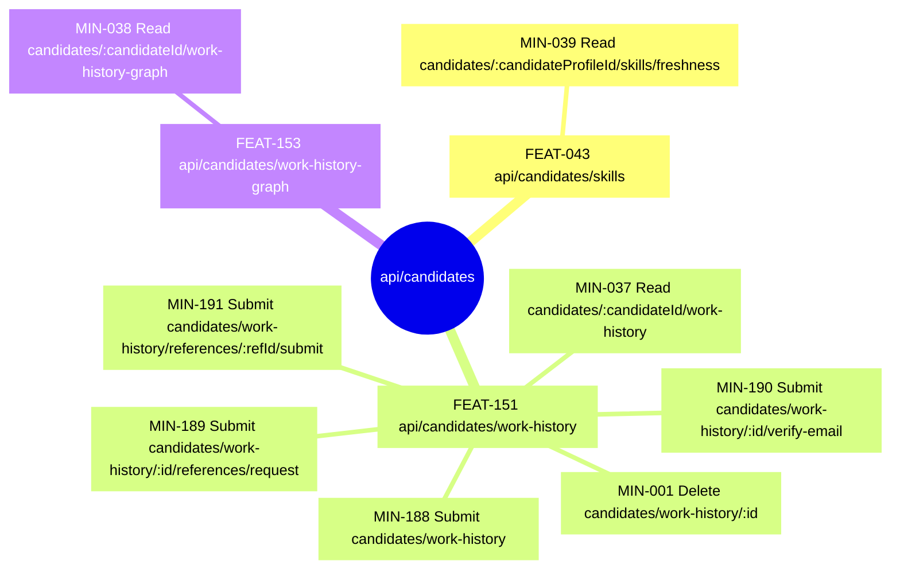

### FEAT-043 api/candidates/skills

api/candidates/skills

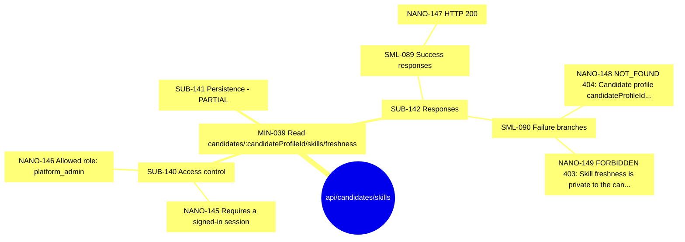

| ID       | Level | Parent   | Name                                                                                 | Description                                                                                                                                                                                                                                           | Status                | Verification | Evidence                    | Related                     |
| -------- | ----- | -------- | ------------------------------------------------------------------------------------ | ----------------------------------------------------------------------------------------------------------------------------------------------------------------------------------------------------------------------------------------------------- | --------------------- | ------------ | --------------------------- | --------------------------- |
| FEAT-043 | MAJOR | MOD-065  | api/candidates/skills                                                                |                                                                                                                                                                                                                                                       | IMPLEMENTED           |              | apps/api/src/server.ts:3319 |                             |
| MIN-039  | MINOR | FEAT-043 | Read candidates/:candidateProfileId/skills/freshness                                 | GET /api/v1/candidates/:candidateProfileId/skills/freshness for roles platform_admin; ephemeral (process memory); responds 200; 2 failure branch(es). Gaps: ephemeral: state held in process memory, lost on restart; no first-party web caller found | IMPLEMENTED           | VERIFIED     | apps/api/src/server.ts:3319 | API-060, TEST-131, TEST-211 |
| SUB-140  | SUB   | MIN-039  | Access control                                                                       | Who may call GET /api/v1/candidates/:candidateProfileId/skills/freshness: roles platform_admin.                                                                                                                                                       | IMPLEMENTED           | PATH_LEVEL   | apps/api/src/server.ts:3319 |                             |
| NANO-145 | NANO  | SUB-140  | Requires a signed-in session                                                         | Requests without a valid session token are rejected with 401 UNAUTHENTICATED.                                                                                                                                                                         | IMPLEMENTED           | PATH_LEVEL   | apps/api/src/server.ts:3319 | ROLE-001                    |
| NANO-146 | NANO  | SUB-140  | Allowed role: platform_admin                                                         | platform_admin is one of the roles allowed here (platform_admin); a caller holding none of them is rejected with 403.                                                                                                                                 | IMPLEMENTED           | PATH_LEVEL   | apps/api/src/server.ts:3319 | ROLE-008                    |
| SUB-141  | SUB   | MIN-039  | Persistence                                                                          | Ephemeral: state lives in API process memory and is lost on restart.                                                                                                                                                                                  | PARTIALLY_IMPLEMENTED | PATH_LEVEL   | apps/api/src/server.ts:3319 |                             |
| SUB-142  | SUB   | MIN-039  | Responses                                                                            | Success 200; 2 explicit failure branch(es) besides validation and access errors.                                                                                                                                                                      | IMPLEMENTED           | PATH_LEVEL   | apps/api/src/server.ts:3319 |                             |
| SML-089  | SMALL | SUB-142  | Success responses                                                                    | HTTP 200.                                                                                                                                                                                                                                             | IMPLEMENTED           | PATH_LEVEL   | apps/api/src/server.ts:3319 |                             |
| NANO-147 | NANO  | SML-089  | HTTP 200                                                                             | Replies 200 when the operation succeeds.                                                                                                                                                                                                              | IMPLEMENTED           | PATH_LEVEL   | apps/api/src/server.ts:3319 |                             |
| SML-090  | SMALL | SUB-142  | Failure branches                                                                     | 2 DomainError branch(es) in the handler, mapped to HTTP by the global error handler.                                                                                                                                                                  | IMPLEMENTED           | PATH_LEVEL   | apps/api/src/server.ts:3319 |                             |
| NANO-148 | NANO  | SML-090  | NOT_FOUND 404: Candidate profile ${candidateProfileId} not found.                    | Throws DomainError(NOT_FOUND) "Candidate profile ${candidateProfileId} not found." -> HTTP 404.                                                                                                                                                       | IMPLEMENTED           | PATH_LEVEL   | apps/api/src/server.ts:3330 | ERR-064                     |
| NANO-149 | NANO  | SML-090  | FORBIDDEN 403: Skill freshness is private to the candidate and visible to recruiters | Throws DomainError(FORBIDDEN) "Skill freshness is private to the candidate and visible to recruiters only within application context (BR-230)." -> HTTP 403.                                                                                          | IMPLEMENTED           | PATH_LEVEL   | apps/api/src/server.ts:3345 | ERR-065                     |

### FEAT-151 api/candidates/work-history

api/candidates/work-history

```mermaid
mindmap
  root((api/candidates/work-history))
    MIN_001[MIN-001 Delete candidates/work-history/:id]
      SUB_001[SUB-001 Access control]
        NANO_001[NANO-001 Requires a signed-in session]
      SUB_002[SUB-002 Persistence]
        SML_001[SML-001 Writes verified_work_histories]
      SUB_003[SUB-003 Responses]
        SML_002[SML-002 Success responses]
          NANO_002[NANO-002 HTTP 200]
        SML_003[SML-003 Failure branches]
          NANO_003[NANO-003 NOT_FOUND 404: Work history record id not found.]
          NANO_004[NANO-004 FORBIDDEN 403: Only the person this role belongs to...]
    MIN_037[MIN-037 Read candidates/:candidateId/work-history]
      SUB_132[SUB-132 Access control]
        NANO_140[NANO-140 Open to anonymous callers]
      SUB_133[SUB-133 Persistence]
      SUB_134[SUB-134 Responses]
        SML_085[SML-085 Success responses]
          NANO_141[NANO-141 HTTP 200]
    MIN_188[MIN-188 Submit candidates/work-history]
      SUB_729[SUB-729 Access control]
        NANO_984[NANO-984 Requires a signed-in session]
      SUB_730[SUB-730 Request validation]
        SML_538[SML-538 CreateWorkHistoryInputSchema]
          TNY_176[TNY-176 Field companyName]
            NANO_985[NANO-985 companyName: minimum 1 characters]
            NANO_986[NANO-986 companyName: maximum 150 characters]
          TNY_177[TNY-177 Field companyId]
            NANO_987[NANO-987 companyId: must be a UUID]
            NANO_988[NANO-988 companyId: optional]
          TNY_178[TNY-178 Field title]
            NANO_989[NANO-989 title: minimum 1 characters]
            NANO_990[NANO-990 title: maximum 150 characters]
          TNY_179[TNY-179 Field employmentType]
            NANO_991[NANO-991 employmentType: one of: full_time, part_time, contra...]
            NANO_992[NANO-992 employmentType: default full_time]
          TNY_180[TNY-180 Field startDate]
          TNY_181[TNY-181 Field endDate]
            NANO_993[NANO-993 endDate: optional]
          TNY_182[TNY-182 Field isCurrent]
            NANO_994[NANO-994 isCurrent: default false]
          TNY_183[TNY-183 Field description]
            NANO_995[NANO-995 description: maximum 3000 characters]
            NANO_996[NANO-996 description: optional]
          TNY_184[TNY-184 Field corporateEmail]
            NANO_997[NANO-997 corporateEmail: optional]
          TNY_185[TNY-185 Field skills]
            NANO_998[NANO-998 skills: list of string]
            NANO_999[NANO-999 skills: default]
          TNY_186[TNY-186 Field clientRequestId]
            NANO_1000[NANO-1000 clientRequestId: minimum 1 characters]
            NANO_1001[NANO-1001 clientRequestId: maximum 100 characters]
            NANO_1002[NANO-1002 clientRequestId: optional]
      SUB_731[SUB-731 Business rules]
        SML_539[SML-539 Rule createWorkHistory]
      SUB_732[SUB-732 Persistence]
        SML_540[SML-540 Writes verified_work_histories]
      SUB_733[SUB-733 Responses]
        SML_541[SML-541 Success responses]
          NANO_1003[NANO-1003 HTTP 200]
          NANO_1004[NANO-1004 HTTP 201]
        SML_542[SML-542 Failure branches]
          NANO_1005[NANO-1005 VALIDATION_FAILED 422: companyId does not match a k...]
    MIN_189[MIN-189 Submit candidates/work-history/:id/references/request]
      SUB_734[SUB-734 Access control]
        NANO_1006[NANO-1006 Requires a signed-in session]
        NANO_1007[NANO-1007 Allowed role: platform_admin]
      SUB_735[SUB-735 Request validation]
        SML_543[SML-543 RequestEmploymentReferenceInputSchema]
          TNY_187[TNY-187 Field refereeName]
            NANO_1008[NANO-1008 refereeName: minimum 2 characters]
            NANO_1009[NANO-1009 refereeName: maximum 150 characters]
          TNY_188[TNY-188 Field refereeEmail]
          TNY_189[TNY-189 Field relationship]
            NANO_1010[NANO-1010 relationship: one of: manager, peer, direct_report,...]
          TNY_190[TNY-190 Field clientRequestId]
            NANO_1011[NANO-1011 clientRequestId: minimum 1 characters]
            NANO_1012[NANO-1012 clientRequestId: maximum 100 characters]
            NANO_1013[NANO-1013 clientRequestId: optional]
      SUB_736[SUB-736 Business rules]
        SML_544[SML-544 Rule assertReferenceRequestAllowed]
        SML_545[SML-545 Rule requestEmploymentReference]
      SUB_737[SUB-737 Persistence]
        SML_546[SML-546 Writes employment_references]
      SUB_738[SUB-738 Responses]
        SML_547[SML-547 Success responses]
          NANO_1014[NANO-1014 HTTP 200]
          NANO_1015[NANO-1015 HTTP 201]
        SML_548[SML-548 Failure branches]
          NANO_1016[NANO-1016 NOT_FOUND 404: Work history record id not found.]
          NANO_1017[NANO-1017 FORBIDDEN 403: Access denied to request reference f...]
          NANO_1018[NANO-1018 SERVICE_UNAVAILABLE 503: Reference invitations are...]
          NANO_1019[NANO-1019 SERVICE_UNAVAILABLE 503: Reference invitation could...]
    MIN_190[MIN-190 Submit candidates/work-history/:id/verify-email]
      SUB_739[SUB-739 Access control]
        NANO_1020[NANO-1020 Requires a signed-in session]
        NANO_1021[NANO-1021 Allowed role: platform_admin]
      SUB_740[SUB-740 Request validation]
        SML_549[SML-549 VerifyWorkHistoryEmailInputSchema]
          TNY_191[TNY-191 Field corporateEmail]
          TNY_192[TNY-192 Field verificationCode]
            NANO_1022[NANO-1022 verificationCode: minimum 4 characters]
            NANO_1023[NANO-1023 verificationCode: maximum 32 characters]
            NANO_1024[NANO-1024 verificationCode: optional]
      SUB_741[SUB-741 Business rules]
        SML_550[SML-550 Rule assertCorporateEmailEligible]
        SML_551[SML-551 Rule assertEmailCodeIssuable]
        SML_552[SML-552 Rule verifyCorporateEmail]
      SUB_742[SUB-742 Persistence]
        SML_553[SML-553 Writes verified_work_histories]
        SML_554[SML-554 Writes work_history_email_challenges]
      SUB_743[SUB-743 Responses]
        SML_555[SML-555 Success responses]
          NANO_1025[NANO-1025 HTTP 200]
          NANO_1026[NANO-1026 HTTP 202]
        SML_556[SML-556 Failure branches]
          NANO_1027[NANO-1027 NOT_FOUND 404: Work history record id not found.]
          NANO_1028[NANO-1028 FORBIDDEN 403: Access denied to verify this work hi...]
          NANO_1029[NANO-1029 SERVICE_UNAVAILABLE 503: Work-email verification is...]
          NANO_1030[NANO-1030 SERVICE_UNAVAILABLE 503: Verification email could n...]
          NANO_1031[NANO-1031 VALIDATION_FAILED 422: No verification is pending f...]
          NANO_1032[NANO-1032 VALIDATION_FAILED 422: This code has expired. Reque...]
          NANO_1033[NANO-1033 RATE_LIMIT_EXCEEDED 429: Too many incorrect codes....]
          NANO_1034[NANO-1034 VALIDATION_FAILED 422: That code is not correct.]
    MIN_191[MIN-191 Submit candidates/work-history/references/:refId/submit]
      SUB_744[SUB-744 Access control]
        NANO_1035[NANO-1035 Requires a signed-in session]
        NANO_1036[NANO-1036 Allowed role: platform_admin]
        NANO_1037[NANO-1037 Guard: canViewProfile]
      SUB_745[SUB-745 Request validation]
        SML_557[SML-557 SubmitEmploymentReferenceInputSchema]
          TNY_193[TNY-193 Field token]
            NANO_1038[NANO-1038 token: minimum 6 characters]
            NANO_1039[NANO-1039 token: optional]
          TNY_194[TNY-194 Field confirmDates]
          TNY_195[TNY-195 Field confirmTitle]
          TNY_196[TNY-196 Field technicalProficiency]
            NANO_1040[NANO-1040 technicalProficiency: must be an integer]
            NANO_1041[NANO-1041 technicalProficiency: minimum 1]
            NANO_1042[NANO-1042 technicalProficiency: maximum 5]
          TNY_197[TNY-197 Field collaborationRating]
            NANO_1043[NANO-1043 collaborationRating: must be an integer]
            NANO_1044[NANO-1044 collaborationRating: minimum 1]
            NANO_1045[NANO-1045 collaborationRating: maximum 5]
          TNY_198[TNY-198 Field deliveryReliability]
            NANO_1046[NANO-1046 deliveryReliability: must be an integer]
            NANO_1047[NANO-1047 deliveryReliability: minimum 1]
            NANO_1048[NANO-1048 deliveryReliability: maximum 5]
          TNY_199[TNY-199 Field leadershipRating]
            NANO_1049[NANO-1049 leadershipRating: must be an integer]
            NANO_1050[NANO-1050 leadershipRating: minimum 1]
            NANO_1051[NANO-1051 leadershipRating: maximum 5]
            NANO_1052[NANO-1052 leadershipRating: optional]
          TNY_200[TNY-200 Field endorsedSkills]
            NANO_1053[NANO-1053 endorsedSkills: list of string]
            NANO_1054[NANO-1054 endorsedSkills: default]
          TNY_201[TNY-201 Field summaryNotes]
            NANO_1055[NANO-1055 summaryNotes: maximum 2000 characters]
            NANO_1056[NANO-1056 summaryNotes: optional]
      SUB_746[SUB-746 Business rules]
        SML_558[SML-558 Rule canViewProfile]
        SML_559[SML-559 Rule calculateVerificationScoreAndBadge]
        SML_560[SML-560 Rule referenceLinkExpired]
        SML_561[SML-561 Rule submitEmploymentReference]
      SUB_747[SUB-747 Persistence]
        SML_562[SML-562 Writes notifications]
        SML_563[SML-563 Writes verified_work_histories]
        SML_564[SML-564 Writes employment_references]
      SUB_748[SUB-748 Responses]
        SML_565[SML-565 Success responses]
          NANO_1057[NANO-1057 HTTP 200]
        SML_566[SML-566 Failure branches]
          NANO_1058[NANO-1058 NOT_FOUND 404: Employment reference refId not found.]
          NANO_1059[NANO-1059 FORBIDDEN 403: Candidate cannot submit their own re...]
          NANO_1060[NANO-1060 UNAUTHORIZED 403: This reference can only be submit...]
          NANO_1061[NANO-1061 NOT_FOUND 404: Candidate not found.]
          NANO_1062[NANO-1062 FORBIDDEN 403: This profile is private or restricte...]
```

| ID        | Level | Parent   | Name                                                                                            | Description                                                                                                                                                                                                                                                                                                                                                                                                      | Status      | Verification | Evidence                                                      | Related                                                       |
| --------- | ----- | -------- | ----------------------------------------------------------------------------------------------- | ---------------------------------------------------------------------------------------------------------------------------------------------------------------------------------------------------------------------------------------------------------------------------------------------------------------------------------------------------------------------------------------------------------------- | ----------- | ------------ | ------------------------------------------------------------- | ------------------------------------------------------------- |
| FEAT-151  | MAJOR | MOD-065  | api/candidates/work-history                                                                     |                                                                                                                                                                                                                                                                                                                                                                                                                  | IMPLEMENTED |              | apps/api/src/server.ts:12774                                  |                                                               |
| MIN-001   | MINOR | FEAT-151 | Delete candidates/work-history/:id                                                              | 7. Remove a role from your own work history. Before this, a mistaken entry could only be removed by deleting the whole account. Its references and any open email verification go with it (FK cascade in Postgres, applyToReadModel here); a referee's link stops working. Owner only: an administrator removing someone's record is a moderation decision with its own trail, not this route. DELETE /api/v1/ca | IMPLEMENTED | VERIFIED     | apps/api/src/server.ts:13397                                  | API-278, TEST-140, TEST-160                                   |
| SUB-001   | SUB   | MIN-001  | Access control                                                                                  | Who may call DELETE /api/v1/candidates/work-history/:id: any signed-in session.                                                                                                                                                                                                                                                                                                                                  | IMPLEMENTED | PATH_LEVEL   | apps/api/src/server.ts:13397                                  |                                                               |
| NANO-001  | NANO  | SUB-001  | Requires a signed-in session                                                                    | Requests without a valid session token are rejected with 401 UNAUTHENTICATED.                                                                                                                                                                                                                                                                                                                                    | IMPLEMENTED | PATH_LEVEL   | apps/api/src/server.ts:13397                                  | ROLE-001                                                      |
| SUB-002   | SUB   | MIN-001  | Persistence                                                                                     | Durable: writes go through the PostgreSQL store; store calls jobs.cancelQueued.                                                                                                                                                                                                                                                                                                                                  | IMPLEMENTED | PATH_LEVEL   | apps/api/src/server.ts:13397                                  |                                                               |
| SML-001   | SMALL | SUB-002  | Writes verified_work_histories                                                                  | Writes table verified_work_histories (00041_verified_work_history_schema.sql).                                                                                                                                                                                                                                                                                                                                   | IMPLEMENTED | PATH_LEVEL   | supabase/migrations/00041_verified_work_history_schema.sql:5  | DB-105                                                        |
| SUB-003   | SUB   | MIN-001  | Responses                                                                                       | Success 200; 2 explicit failure branch(es) besides validation and access errors.                                                                                                                                                                                                                                                                                                                                 | IMPLEMENTED | PATH_LEVEL   | apps/api/src/server.ts:13397                                  |                                                               |
| SML-002   | SMALL | SUB-003  | Success responses                                                                               | HTTP 200.                                                                                                                                                                                                                                                                                                                                                                                                        | IMPLEMENTED | PATH_LEVEL   | apps/api/src/server.ts:13397                                  |                                                               |
| NANO-002  | NANO  | SML-002  | HTTP 200                                                                                        | Replies 200 when the operation succeeds.                                                                                                                                                                                                                                                                                                                                                                         | IMPLEMENTED | PATH_LEVEL   | apps/api/src/server.ts:13397                                  |                                                               |
| SML-003   | SMALL | SUB-003  | Failure branches                                                                                | 2 DomainError branch(es) in the handler, mapped to HTTP by the global error handler.                                                                                                                                                                                                                                                                                                                             | IMPLEMENTED | PATH_LEVEL   | apps/api/src/server.ts:13397                                  |                                                               |
| NANO-003  | NANO  | SML-003  | NOT_FOUND 404: Work history record "${id}" not found.                                           | Throws DomainError(NOT_FOUND) "Work history record "${id}" not found." -> HTTP 404.                                                                                                                                                                                                                                                                                                                              | IMPLEMENTED | PATH_LEVEL   | apps/api/src/server.ts:13404                                  | ERR-235                                                       |
| NANO-004  | NANO  | SML-003  | FORBIDDEN 403: Only the person this role belongs to can remove it.                              | Throws DomainError(FORBIDDEN) "Only the person this role belongs to can remove it." -> HTTP 403.                                                                                                                                                                                                                                                                                                                 | IMPLEMENTED | PATH_LEVEL   | apps/api/src/server.ts:13407                                  | ERR-251                                                       |
| MIN-037   | MINOR | FEAT-151 | Read candidates/:candidateId/work-history                                                       | 5. Get Candidate Work History Records (F-94) GET /api/v1/candidates/:candidateId/work-history for anyone (public); durable (PostgreSQL); responds 200.                                                                                                                                                                                                                                                           | IMPLEMENTED | VERIFIED     | apps/api/src/server.ts:13304                                  | API-276, TEST-139, TEST-140, TEST-145, TEST-151, TEST-160 ... |
| SUB-132   | SUB   | MIN-037  | Access control                                                                                  | Who may call GET /api/v1/candidates/:candidateId/work-history: anyone (public).                                                                                                                                                                                                                                                                                                                                  | IMPLEMENTED | PATH_LEVEL   | apps/api/src/server.ts:13304                                  |                                                               |
| NANO-140  | NANO  | SUB-132  | Open to anonymous callers                                                                       | auth: public.                                                                                                                                                                                                                                                                                                                                                                                                    | IMPLEMENTED | PATH_LEVEL   | apps/api/src/server.ts:13304                                  | ROLE-001                                                      |
| SUB-133   | SUB   | MIN-037  | Persistence                                                                                     | Durable: writes go through the PostgreSQL store.                                                                                                                                                                                                                                                                                                                                                                 | IMPLEMENTED | PATH_LEVEL   | apps/api/src/server.ts:13304                                  |                                                               |
| SUB-134   | SUB   | MIN-037  | Responses                                                                                       | Success 200; 0 explicit failure branch(es) besides validation and access errors.                                                                                                                                                                                                                                                                                                                                 | IMPLEMENTED | PATH_LEVEL   | apps/api/src/server.ts:13304                                  |                                                               |
| SML-085   | SMALL | SUB-134  | Success responses                                                                               | HTTP 200.                                                                                                                                                                                                                                                                                                                                                                                                        | IMPLEMENTED | PATH_LEVEL   | apps/api/src/server.ts:13304                                  |                                                               |
| NANO-141  | NANO  | SML-085  | HTTP 200                                                                                        | Replies 200 when the operation succeeds.                                                                                                                                                                                                                                                                                                                                                                         | IMPLEMENTED | PATH_LEVEL   | apps/api/src/server.ts:13304                                  |                                                               |
| MIN-188   | MINOR | FEAT-151 | Submit candidates/work-history                                                                  | 1. Add Work History Entry (F-94) POST /api/v1/candidates/work-history for any signed-in session; validates CreateWorkHistoryInputSchema; calls createWorkHistory; durable (PostgreSQL); writes verified_work_histories; responds 200, 201; 1 failure branch(es).                                                                                                                                                 | IMPLEMENTED | VERIFIED     | apps/api/src/server.ts:12774                                  | API-271, TEST-097, TEST-098, TEST-099, TEST-103, TEST-139 ... |
| SUB-729   | SUB   | MIN-188  | Access control                                                                                  | Who may call POST /api/v1/candidates/work-history: any signed-in session.                                                                                                                                                                                                                                                                                                                                        | IMPLEMENTED | PATH_LEVEL   | apps/api/src/server.ts:12774                                  |                                                               |
| NANO-984  | NANO  | SUB-729  | Requires a signed-in session                                                                    | Requests without a valid session token are rejected with 401 UNAUTHENTICATED.                                                                                                                                                                                                                                                                                                                                    | IMPLEMENTED | PATH_LEVEL   | apps/api/src/server.ts:12774                                  | ROLE-001                                                      |
| SUB-730   | SUB   | MIN-188  | Request validation                                                                              | The request is parsed with CreateWorkHistoryInputSchema; a failure returns 400 with field details before any business logic runs.                                                                                                                                                                                                                                                                                | IMPLEMENTED | PATH_LEVEL   | apps/api/src/server.ts:12774                                  |                                                               |
| SML-538   | SMALL | SUB-730  | CreateWorkHistoryInputSchema                                                                    | CreateWorkHistoryInputSchema: 11 field(s)                                                                                                                                                                                                                                                                                                                                                                        | IMPLEMENTED | PATH_LEVEL   | packages/contracts/src/index.ts:1738                          | SCH-137                                                       |
| TNY-176   | TINY  | SML-538  | Field companyName                                                                               | companyName (string, required): minimum 1 characters; maximum 150 characters                                                                                                                                                                                                                                                                                                                                     | IMPLEMENTED | PATH_LEVEL   | packages/contracts/src/index.ts:1739                          |                                                               |
| NANO-985  | NANO  | TNY-176  | companyName: minimum 1 characters                                                               | companyName minimum 1 characters; message "Company name is required".                                                                                                                                                                                                                                                                                                                                            | IMPLEMENTED | PATH_LEVEL   | packages/contracts/src/index.ts:1739                          |                                                               |
| NANO-986  | NANO  | TNY-176  | companyName: maximum 150 characters                                                             | companyName maximum 150 characters.                                                                                                                                                                                                                                                                                                                                                                              | IMPLEMENTED | PATH_LEVEL   | packages/contracts/src/index.ts:1739                          |                                                               |
| TNY-177   | TINY  | SML-538  | Field companyId                                                                                 | companyId (string, optional): must be a UUID; optional                                                                                                                                                                                                                                                                                                                                                           | IMPLEMENTED | PATH_LEVEL   | packages/contracts/src/index.ts:1740                          |                                                               |
| NANO-987  | NANO  | TNY-177  | companyId: must be a UUID                                                                       | companyId must be a UUID.                                                                                                                                                                                                                                                                                                                                                                                        | IMPLEMENTED | PATH_LEVEL   | packages/contracts/src/index.ts:1740                          |                                                               |
| NANO-988  | NANO  | TNY-177  | companyId: optional                                                                             | companyId optional.                                                                                                                                                                                                                                                                                                                                                                                              | IMPLEMENTED | PATH_LEVEL   | packages/contracts/src/index.ts:1740                          |                                                               |
| TNY-178   | TINY  | SML-538  | Field title                                                                                     | title (string, required): minimum 1 characters; maximum 150 characters                                                                                                                                                                                                                                                                                                                                           | IMPLEMENTED | PATH_LEVEL   | packages/contracts/src/index.ts:1741                          |                                                               |
| NANO-989  | NANO  | TNY-178  | title: minimum 1 characters                                                                     | title minimum 1 characters; message "Job title is required".                                                                                                                                                                                                                                                                                                                                                     | IMPLEMENTED | PATH_LEVEL   | packages/contracts/src/index.ts:1741                          |                                                               |
| NANO-990  | NANO  | TNY-178  | title: maximum 150 characters                                                                   | title maximum 150 characters.                                                                                                                                                                                                                                                                                                                                                                                    | IMPLEMENTED | PATH_LEVEL   | packages/contracts/src/index.ts:1741                          |                                                               |
| TNY-179   | TINY  | SML-538  | Field employmentType                                                                            | employmentType (enum, optional): one of: full_time, part_time, contract, internship, freelance; default 'full_time'                                                                                                                                                                                                                                                                                              | IMPLEMENTED | PATH_LEVEL   | packages/contracts/src/index.ts:1742                          |                                                               |
| NANO-991  | NANO  | TNY-179  | employmentType: one of: full_time, part_time, contract, internship, freelance                   | employmentType one of: full_time, part_time, contract, internship, freelance.                                                                                                                                                                                                                                                                                                                                    | IMPLEMENTED | PATH_LEVEL   | packages/contracts/src/index.ts:1742                          |                                                               |
| NANO-992  | NANO  | TNY-179  | employmentType: default 'full_time'                                                             | employmentType default 'full_time'; message "full_time".                                                                                                                                                                                                                                                                                                                                                         | IMPLEMENTED | PATH_LEVEL   | packages/contracts/src/index.ts:1742                          |                                                               |
| TNY-180   | TINY  | SML-538  | Field startDate                                                                                 | startDate (calendarDate(), required)                                                                                                                                                                                                                                                                                                                                                                             | IMPLEMENTED | PATH_LEVEL   | packages/contracts/src/index.ts:1745                          |                                                               |
| TNY-181   | TINY  | SML-538  | Field endDate                                                                                   | endDate (calendarDate(), optional): optional                                                                                                                                                                                                                                                                                                                                                                     | IMPLEMENTED | PATH_LEVEL   | packages/contracts/src/index.ts:1746                          |                                                               |
| NANO-993  | NANO  | TNY-181  | endDate: optional                                                                               | endDate optional.                                                                                                                                                                                                                                                                                                                                                                                                | IMPLEMENTED | PATH_LEVEL   | packages/contracts/src/index.ts:1746                          |                                                               |
| TNY-182   | TINY  | SML-538  | Field isCurrent                                                                                 | isCurrent (boolean, optional): default false                                                                                                                                                                                                                                                                                                                                                                     | IMPLEMENTED | PATH_LEVEL   | packages/contracts/src/index.ts:1747                          |                                                               |
| NANO-994  | NANO  | TNY-182  | isCurrent: default false                                                                        | isCurrent default false.                                                                                                                                                                                                                                                                                                                                                                                         | IMPLEMENTED | PATH_LEVEL   | packages/contracts/src/index.ts:1747                          |                                                               |
| TNY-183   | TINY  | SML-538  | Field description                                                                               | description (string, optional): maximum 3000 characters; optional                                                                                                                                                                                                                                                                                                                                                | IMPLEMENTED | PATH_LEVEL   | packages/contracts/src/index.ts:1748                          |                                                               |
| NANO-995  | NANO  | TNY-183  | description: maximum 3000 characters                                                            | description maximum 3000 characters.                                                                                                                                                                                                                                                                                                                                                                             | IMPLEMENTED | PATH_LEVEL   | packages/contracts/src/index.ts:1748                          |                                                               |
| NANO-996  | NANO  | TNY-183  | description: optional                                                                           | description optional.                                                                                                                                                                                                                                                                                                                                                                                            | IMPLEMENTED | PATH_LEVEL   | packages/contracts/src/index.ts:1748                          |                                                               |
| TNY-184   | TINY  | SML-538  | Field corporateEmail                                                                            | corporateEmail (emailAddress(), optional): optional                                                                                                                                                                                                                                                                                                                                                              | IMPLEMENTED | PATH_LEVEL   | packages/contracts/src/index.ts:1749                          |                                                               |
| NANO-997  | NANO  | TNY-184  | corporateEmail: optional                                                                        | corporateEmail optional.                                                                                                                                                                                                                                                                                                                                                                                         | IMPLEMENTED | PATH_LEVEL   | packages/contracts/src/index.ts:1749                          |                                                               |
| TNY-185   | TINY  | SML-538  | Field skills                                                                                    | skills (array, optional): list of string; default []                                                                                                                                                                                                                                                                                                                                                             | IMPLEMENTED | PATH_LEVEL   | packages/contracts/src/index.ts:1750                          |                                                               |
| NANO-998  | NANO  | TNY-185  | skills: list of string                                                                          | skills list of string.                                                                                                                                                                                                                                                                                                                                                                                           | IMPLEMENTED | PATH_LEVEL   | packages/contracts/src/index.ts:1750                          |                                                               |
| NANO-999  | NANO  | TNY-185  | skills: default []                                                                              | skills default [].                                                                                                                                                                                                                                                                                                                                                                                               | IMPLEMENTED | PATH_LEVEL   | packages/contracts/src/index.ts:1750                          |                                                               |
| TNY-186   | TINY  | SML-538  | Field clientRequestId                                                                           | clientRequestId (string, optional): minimum 1 characters; maximum 100 characters; optional                                                                                                                                                                                                                                                                                                                       | IMPLEMENTED | PATH_LEVEL   | packages/contracts/src/index.ts:1753                          |                                                               |
| NANO-1000 | NANO  | TNY-186  | clientRequestId: minimum 1 characters                                                           | clientRequestId minimum 1 characters.                                                                                                                                                                                                                                                                                                                                                                            | IMPLEMENTED | PATH_LEVEL   | packages/contracts/src/index.ts:1753                          |                                                               |
| NANO-1001 | NANO  | TNY-186  | clientRequestId: maximum 100 characters                                                         | clientRequestId maximum 100 characters.                                                                                                                                                                                                                                                                                                                                                                          | IMPLEMENTED | PATH_LEVEL   | packages/contracts/src/index.ts:1753                          |                                                               |
| NANO-1002 | NANO  | TNY-186  | clientRequestId: optional                                                                       | clientRequestId optional.                                                                                                                                                                                                                                                                                                                                                                                        | IMPLEMENTED | PATH_LEVEL   | packages/contracts/src/index.ts:1753                          |                                                               |
| SUB-731   | SUB   | MIN-188  | Business rules                                                                                  | Domain functions from packages/domain called by the handler (1).                                                                                                                                                                                                                                                                                                                                                 | IMPLEMENTED | PATH_LEVEL   | apps/api/src/server.ts:12774                                  |                                                               |
| SML-539   | SMALL | SUB-731  | Rule createWorkHistory                                                                          | Calls createWorkHistory (packages/domain/src/work-history-graph.ts). Rule status IMPLEMENTED; its own tests: VERIFIED.                                                                                                                                                                                                                                                                                           | IMPLEMENTED | VERIFIED     | packages/domain/src/work-history-graph.ts:419                 | RULE-271                                                      |
| SUB-732   | SUB   | MIN-188  | Persistence                                                                                     | Durable: writes go through the PostgreSQL store.                                                                                                                                                                                                                                                                                                                                                                 | IMPLEMENTED | PATH_LEVEL   | apps/api/src/server.ts:12774                                  |                                                               |
| SML-540   | SMALL | SUB-732  | Writes verified_work_histories                                                                  | Writes table verified_work_histories (00041_verified_work_history_schema.sql).                                                                                                                                                                                                                                                                                                                                   | IMPLEMENTED | PATH_LEVEL   | supabase/migrations/00041_verified_work_history_schema.sql:5  | DB-105                                                        |
| SUB-733   | SUB   | MIN-188  | Responses                                                                                       | Success 200, 201; 1 explicit failure branch(es) besides validation and access errors.                                                                                                                                                                                                                                                                                                                            | IMPLEMENTED | PATH_LEVEL   | apps/api/src/server.ts:12774                                  |                                                               |
| SML-541   | SMALL | SUB-733  | Success responses                                                                               | HTTP 200, 201.                                                                                                                                                                                                                                                                                                                                                                                                   | IMPLEMENTED | PATH_LEVEL   | apps/api/src/server.ts:12774                                  |                                                               |
| NANO-1003 | NANO  | SML-541  | HTTP 200                                                                                        | Replies 200 when the operation succeeds.                                                                                                                                                                                                                                                                                                                                                                         | IMPLEMENTED | PATH_LEVEL   | apps/api/src/server.ts:12774                                  |                                                               |
| NANO-1004 | NANO  | SML-541  | HTTP 201                                                                                        | Replies 201 when the operation succeeds.                                                                                                                                                                                                                                                                                                                                                                         | IMPLEMENTED | PATH_LEVEL   | apps/api/src/server.ts:12774                                  |                                                               |
| SML-542   | SMALL | SUB-733  | Failure branches                                                                                | 1 DomainError branch(es) in the handler, mapped to HTTP by the global error handler.                                                                                                                                                                                                                                                                                                                             | IMPLEMENTED | PATH_LEVEL   | apps/api/src/server.ts:12774                                  |                                                               |
| NANO-1005 | NANO  | SML-542  | VALIDATION_FAILED 422: companyId does not match a known organization.                           | Throws DomainError(VALIDATION_FAILED) "companyId does not match a known organization." -> HTTP 422.                                                                                                                                                                                                                                                                                                              | IMPLEMENTED | PATH_LEVEL   | apps/api/src/server.ts:12795                                  | ERR-234                                                       |
| MIN-189   | MINOR | FEAT-151 | Submit candidates/work-history/:id/references/request                                           | 3. Request Employment Reference (F-94) POST /api/v1/candidates/work-history/:id/references/request for roles platform_admin; validates RequestEmploymentReferenceInputSchema; calls assertReferenceRequestAllowed, requestEmploymentReference; durable (PostgreSQL); writes employment_references; responds 200, 201; 4 failure branch(es).                                                                      | IMPLEMENTED | VERIFIED     | apps/api/src/server.ts:12995                                  | API-273, TEST-097, TEST-098, TEST-103, TEST-139, TEST-140 ... |
| SUB-734   | SUB   | MIN-189  | Access control                                                                                  | Who may call POST /api/v1/candidates/work-history/:id/references/request: roles platform_admin.                                                                                                                                                                                                                                                                                                                  | IMPLEMENTED | PATH_LEVEL   | apps/api/src/server.ts:12995                                  |                                                               |
| NANO-1006 | NANO  | SUB-734  | Requires a signed-in session                                                                    | Requests without a valid session token are rejected with 401 UNAUTHENTICATED.                                                                                                                                                                                                                                                                                                                                    | IMPLEMENTED | PATH_LEVEL   | apps/api/src/server.ts:12995                                  | ROLE-001                                                      |
| NANO-1007 | NANO  | SUB-734  | Allowed role: platform_admin                                                                    | platform_admin is one of the roles allowed here (platform_admin); a caller holding none of them is rejected with 403.                                                                                                                                                                                                                                                                                            | IMPLEMENTED | PATH_LEVEL   | apps/api/src/server.ts:12995                                  | ROLE-008                                                      |
| SUB-735   | SUB   | MIN-189  | Request validation                                                                              | The request is parsed with RequestEmploymentReferenceInputSchema; a failure returns 400 with field details before any business logic runs.                                                                                                                                                                                                                                                                       | IMPLEMENTED | PATH_LEVEL   | apps/api/src/server.ts:12995                                  |                                                               |
| SML-543   | SMALL | SUB-735  | RequestEmploymentReferenceInputSchema                                                           | RequestEmploymentReferenceInputSchema: 4 field(s)                                                                                                                                                                                                                                                                                                                                                                | IMPLEMENTED | PATH_LEVEL   | packages/contracts/src/index.ts:1765                          | SCH-139                                                       |
| TNY-187   | TINY  | SML-543  | Field refereeName                                                                               | refereeName (string, required): minimum 2 characters; maximum 150 characters                                                                                                                                                                                                                                                                                                                                     | IMPLEMENTED | PATH_LEVEL   | packages/contracts/src/index.ts:1766                          |                                                               |
| NANO-1008 | NANO  | TNY-187  | refereeName: minimum 2 characters                                                               | refereeName minimum 2 characters; message "Referee name must be at least 2 characters".                                                                                                                                                                                                                                                                                                                          | IMPLEMENTED | PATH_LEVEL   | packages/contracts/src/index.ts:1766                          |                                                               |
| NANO-1009 | NANO  | TNY-187  | refereeName: maximum 150 characters                                                             | refereeName maximum 150 characters.                                                                                                                                                                                                                                                                                                                                                                              | IMPLEMENTED | PATH_LEVEL   | packages/contracts/src/index.ts:1766                          |                                                               |
| TNY-188   | TINY  | SML-543  | Field refereeEmail                                                                              | refereeEmail (emailAddress(), required)                                                                                                                                                                                                                                                                                                                                                                          | IMPLEMENTED | PATH_LEVEL   | packages/contracts/src/index.ts:1767                          |                                                               |
| TNY-189   | TINY  | SML-543  | Field relationship                                                                              | relationship (enum, required): one of: manager, peer, direct_report, mentor, client                                                                                                                                                                                                                                                                                                                              | IMPLEMENTED | PATH_LEVEL   | packages/contracts/src/index.ts:1768                          |                                                               |
| NANO-1010 | NANO  | TNY-189  | relationship: one of: manager, peer, direct_report, mentor, client                              | relationship one of: manager, peer, direct_report, mentor, client.                                                                                                                                                                                                                                                                                                                                               | IMPLEMENTED | PATH_LEVEL   | packages/contracts/src/index.ts:1768                          |                                                               |
| TNY-190   | TINY  | SML-543  | Field clientRequestId                                                                           | clientRequestId (string, optional): minimum 1 characters; maximum 100 characters; optional                                                                                                                                                                                                                                                                                                                       | IMPLEMENTED | PATH_LEVEL   | packages/contracts/src/index.ts:1771                          |                                                               |
| NANO-1011 | NANO  | TNY-190  | clientRequestId: minimum 1 characters                                                           | clientRequestId minimum 1 characters.                                                                                                                                                                                                                                                                                                                                                                            | IMPLEMENTED | PATH_LEVEL   | packages/contracts/src/index.ts:1771                          |                                                               |
| NANO-1012 | NANO  | TNY-190  | clientRequestId: maximum 100 characters                                                         | clientRequestId maximum 100 characters.                                                                                                                                                                                                                                                                                                                                                                          | IMPLEMENTED | PATH_LEVEL   | packages/contracts/src/index.ts:1771                          |                                                               |
| NANO-1013 | NANO  | TNY-190  | clientRequestId: optional                                                                       | clientRequestId optional.                                                                                                                                                                                                                                                                                                                                                                                        | IMPLEMENTED | PATH_LEVEL   | packages/contracts/src/index.ts:1771                          |                                                               |
| SUB-736   | SUB   | MIN-189  | Business rules                                                                                  | Domain functions from packages/domain called by the handler (2).                                                                                                                                                                                                                                                                                                                                                 | IMPLEMENTED | PATH_LEVEL   | apps/api/src/server.ts:12995                                  |                                                               |
| SML-544   | SMALL | SUB-736  | Rule assertReferenceRequestAllowed                                                              | Calls assertReferenceRequestAllowed (packages/domain/src/work-history-graph.ts). Rule status IMPLEMENTED; its own tests: VERIFIED.                                                                                                                                                                                                                                                                               | IMPLEMENTED | VERIFIED     | packages/domain/src/work-history-graph.ts:536                 | RULE-274                                                      |
| SML-545   | SMALL | SUB-736  | Rule requestEmploymentReference                                                                 | Calls requestEmploymentReference (packages/domain/src/work-history-graph.ts). Rule status IMPLEMENTED; its own tests: VERIFIED.                                                                                                                                                                                                                                                                                  | IMPLEMENTED | VERIFIED     | packages/domain/src/work-history-graph.ts:642                 | RULE-277                                                      |
| SUB-737   | SUB   | MIN-189  | Persistence                                                                                     | Durable: writes go through the PostgreSQL store; store calls jobs.enqueue.                                                                                                                                                                                                                                                                                                                                       | IMPLEMENTED | PATH_LEVEL   | apps/api/src/server.ts:12995                                  |                                                               |
| SML-546   | SMALL | SUB-737  | Writes employment_references                                                                    | Writes table employment_references (00041_verified_work_history_schema.sql).                                                                                                                                                                                                                                                                                                                                     | IMPLEMENTED | PATH_LEVEL   | supabase/migrations/00041_verified_work_history_schema.sql:38 | DB-106                                                        |
| SUB-738   | SUB   | MIN-189  | Responses                                                                                       | Success 200, 201; 4 explicit failure branch(es) besides validation and access errors.                                                                                                                                                                                                                                                                                                                            | IMPLEMENTED | PATH_LEVEL   | apps/api/src/server.ts:12995                                  |                                                               |
| SML-547   | SMALL | SUB-738  | Success responses                                                                               | HTTP 200, 201.                                                                                                                                                                                                                                                                                                                                                                                                   | IMPLEMENTED | PATH_LEVEL   | apps/api/src/server.ts:12995                                  |                                                               |
| NANO-1014 | NANO  | SML-547  | HTTP 200                                                                                        | Replies 200 when the operation succeeds.                                                                                                                                                                                                                                                                                                                                                                         | IMPLEMENTED | PATH_LEVEL   | apps/api/src/server.ts:12995                                  |                                                               |
| NANO-1015 | NANO  | SML-547  | HTTP 201                                                                                        | Replies 201 when the operation succeeds.                                                                                                                                                                                                                                                                                                                                                                         | IMPLEMENTED | PATH_LEVEL   | apps/api/src/server.ts:12995                                  |                                                               |
| SML-548   | SMALL | SUB-738  | Failure branches                                                                                | 4 DomainError branch(es) in the handler, mapped to HTTP by the global error handler.                                                                                                                                                                                                                                                                                                                             | IMPLEMENTED | PATH_LEVEL   | apps/api/src/server.ts:12995                                  |                                                               |
| NANO-1016 | NANO  | SML-548  | NOT_FOUND 404: Work history record "${id}" not found.                                           | Throws DomainError(NOT_FOUND) "Work history record "${id}" not found." -> HTTP 404.                                                                                                                                                                                                                                                                                                                              | IMPLEMENTED | PATH_LEVEL   | apps/api/src/server.ts:13020                                  | ERR-235                                                       |
| NANO-1017 | NANO  | SML-548  | FORBIDDEN 403: Access denied to request reference for this record.                              | Throws DomainError(FORBIDDEN) "Access denied to request reference for this record." -> HTTP 403.                                                                                                                                                                                                                                                                                                                 | IMPLEMENTED | PATH_LEVEL   | apps/api/src/server.ts:13024                                  | ERR-243                                                       |
| NANO-1018 | NANO  | SML-548  | SERVICE_UNAVAILABLE 503: Reference invitations are unavailable until email delivery is configur | Throws DomainError(SERVICE_UNAVAILABLE) "Reference invitations are unavailable until email delivery is configured." -> HTTP 503.                                                                                                                                                                                                                                                                                 | IMPLEMENTED | PATH_LEVEL   | apps/api/src/server.ts:13031                                  | ERR-244                                                       |
| NANO-1019 | NANO  | SML-548  | SERVICE_UNAVAILABLE 503: Reference invitation could not be queued.                              | Throws DomainError(SERVICE_UNAVAILABLE) "Reference invitation could not be queued." -> HTTP 503.                                                                                                                                                                                                                                                                                                                 | IMPLEMENTED | PATH_LEVEL   | apps/api/src/server.ts:13095                                  | ERR-245                                                       |
| MIN-190   | MINOR | FEAT-151 | Submit candidates/work-history/:id/verify-email                                                 | 2. Verify Corporate Email for Work History (F-94) — two steps. Step 1 (no verificationCode): policy check, then a single-use 6-digit code is sent to the address. Step 2 (with verificationCode): the code proves the candidate controls the mailbox, and only then is the record marked email-verified. Previously step 1 alone marked the record verified, so anyone could claim any corporate address they c  | IMPLEMENTED | VERIFIED     | apps/api/src/server.ts:12852                                  | API-272, TEST-098, TEST-139, TEST-140, TEST-160, TEST-221     |
| SUB-739   | SUB   | MIN-190  | Access control                                                                                  | Who may call POST /api/v1/candidates/work-history/:id/verify-email: roles platform_admin.                                                                                                                                                                                                                                                                                                                        | IMPLEMENTED | PATH_LEVEL   | apps/api/src/server.ts:12852                                  |                                                               |
| NANO-1020 | NANO  | SUB-739  | Requires a signed-in session                                                                    | Requests without a valid session token are rejected with 401 UNAUTHENTICATED.                                                                                                                                                                                                                                                                                                                                    | IMPLEMENTED | PATH_LEVEL   | apps/api/src/server.ts:12852                                  | ROLE-001                                                      |
| NANO-1021 | NANO  | SUB-739  | Allowed role: platform_admin                                                                    | platform_admin is one of the roles allowed here (platform_admin); a caller holding none of them is rejected with 403.                                                                                                                                                                                                                                                                                            | IMPLEMENTED | PATH_LEVEL   | apps/api/src/server.ts:12852                                  | ROLE-008                                                      |
| SUB-740   | SUB   | MIN-190  | Request validation                                                                              | The request is parsed with VerifyWorkHistoryEmailInputSchema; a failure returns 400 with field details before any business logic runs.                                                                                                                                                                                                                                                                           | IMPLEMENTED | PATH_LEVEL   | apps/api/src/server.ts:12852                                  |                                                               |
| SML-549   | SMALL | SUB-740  | VerifyWorkHistoryEmailInputSchema                                                               | VerifyWorkHistoryEmailInputSchema: 2 field(s)                                                                                                                                                                                                                                                                                                                                                                    | IMPLEMENTED | PATH_LEVEL   | packages/contracts/src/index.ts:1758                          | SCH-138                                                       |
| TNY-191   | TINY  | SML-549  | Field corporateEmail                                                                            | corporateEmail (emailAddress(), required)                                                                                                                                                                                                                                                                                                                                                                        | IMPLEMENTED | PATH_LEVEL   | packages/contracts/src/index.ts:1759                          |                                                               |
| TNY-192   | TINY  | SML-549  | Field verificationCode                                                                          | verificationCode (string, optional): minimum 4 characters; maximum 32 characters; optional                                                                                                                                                                                                                                                                                                                       | IMPLEMENTED | PATH_LEVEL   | packages/contracts/src/index.ts:1760                          |                                                               |
| NANO-1022 | NANO  | TNY-192  | verificationCode: minimum 4 characters                                                          | verificationCode minimum 4 characters.                                                                                                                                                                                                                                                                                                                                                                           | IMPLEMENTED | PATH_LEVEL   | packages/contracts/src/index.ts:1760                          |                                                               |
| NANO-1023 | NANO  | TNY-192  | verificationCode: maximum 32 characters                                                         | verificationCode maximum 32 characters.                                                                                                                                                                                                                                                                                                                                                                          | IMPLEMENTED | PATH_LEVEL   | packages/contracts/src/index.ts:1760                          |                                                               |
| NANO-1024 | NANO  | TNY-192  | verificationCode: optional                                                                      | verificationCode optional.                                                                                                                                                                                                                                                                                                                                                                                       | IMPLEMENTED | PATH_LEVEL   | packages/contracts/src/index.ts:1760                          |                                                               |
| SUB-741   | SUB   | MIN-190  | Business rules                                                                                  | Domain functions from packages/domain called by the handler (3).                                                                                                                                                                                                                                                                                                                                                 | IMPLEMENTED | PATH_LEVEL   | apps/api/src/server.ts:12852                                  |                                                               |
| SML-550   | SMALL | SUB-741  | Rule assertCorporateEmailEligible                                                               | Calls assertCorporateEmailEligible (packages/domain/src/work-history-graph.ts). Rule status IMPLEMENTED; its own tests: UNKNOWN.                                                                                                                                                                                                                                                                                 | IMPLEMENTED | UNKNOWN      | packages/domain/src/work-history-graph.ts:469                 | RULE-272                                                      |
| SML-551   | SMALL | SUB-741  | Rule assertEmailCodeIssuable                                                                    | Calls assertEmailCodeIssuable (packages/domain/src/work-history-graph.ts). Rule status IMPLEMENTED; its own tests: VERIFIED.                                                                                                                                                                                                                                                                                     | IMPLEMENTED | VERIFIED     | packages/domain/src/work-history-graph.ts:512                 | RULE-273                                                      |
| SML-552   | SMALL | SUB-741  | Rule verifyCorporateEmail                                                                       | Calls verifyCorporateEmail (packages/domain/src/work-history-graph.ts). Rule status IMPLEMENTED; its own tests: VERIFIED.                                                                                                                                                                                                                                                                                        | IMPLEMENTED | VERIFIED     | packages/domain/src/work-history-graph.ts:545                 | RULE-275                                                      |
| SUB-742   | SUB   | MIN-190  | Persistence                                                                                     | Durable: writes go through the PostgreSQL store; store calls jobs.enqueue.                                                                                                                                                                                                                                                                                                                                       | IMPLEMENTED | PATH_LEVEL   | apps/api/src/server.ts:12852                                  |                                                               |
| SML-553   | SMALL | SUB-742  | Writes verified_work_histories                                                                  | Writes table verified_work_histories (00041_verified_work_history_schema.sql).                                                                                                                                                                                                                                                                                                                                   | IMPLEMENTED | PATH_LEVEL   | supabase/migrations/00041_verified_work_history_schema.sql:5  | DB-105                                                        |
| SML-554   | SMALL | SUB-742  | Writes work_history_email_challenges                                                            | Writes table work_history_email_challenges (00043_core_persistence_alignment.sql).                                                                                                                                                                                                                                                                                                                               | IMPLEMENTED | PATH_LEVEL   | supabase/migrations/00043_core_persistence_alignment.sql:114  | DB-108                                                        |
| SUB-743   | SUB   | MIN-190  | Responses                                                                                       | Success 200, 202; 8 explicit failure branch(es) besides validation and access errors.                                                                                                                                                                                                                                                                                                                            | IMPLEMENTED | PATH_LEVEL   | apps/api/src/server.ts:12852                                  |                                                               |
| SML-555   | SMALL | SUB-743  | Success responses                                                                               | HTTP 200, 202.                                                                                                                                                                                                                                                                                                                                                                                                   | IMPLEMENTED | PATH_LEVEL   | apps/api/src/server.ts:12852                                  |                                                               |
| NANO-1025 | NANO  | SML-555  | HTTP 200                                                                                        | Replies 200 when the operation succeeds.                                                                                                                                                                                                                                                                                                                                                                         | IMPLEMENTED | PATH_LEVEL   | apps/api/src/server.ts:12852                                  |                                                               |
| NANO-1026 | NANO  | SML-555  | HTTP 202                                                                                        | Replies 202 when the operation succeeds.                                                                                                                                                                                                                                                                                                                                                                         | IMPLEMENTED | PATH_LEVEL   | apps/api/src/server.ts:12852                                  |                                                               |
| SML-556   | SMALL | SUB-743  | Failure branches                                                                                | 8 DomainError branch(es) in the handler, mapped to HTTP by the global error handler.                                                                                                                                                                                                                                                                                                                             | IMPLEMENTED | PATH_LEVEL   | apps/api/src/server.ts:12852                                  |                                                               |
| NANO-1027 | NANO  | SML-556  | NOT_FOUND 404: Work history record "${id}" not found.                                           | Throws DomainError(NOT_FOUND) "Work history record "${id}" not found." -> HTTP 404.                                                                                                                                                                                                                                                                                                                              | IMPLEMENTED | PATH_LEVEL   | apps/api/src/server.ts:12861                                  | ERR-235                                                       |
| NANO-1028 | NANO  | SML-556  | FORBIDDEN 403: Access denied to verify this work history record.                                | Throws DomainError(FORBIDDEN) "Access denied to verify this work history record." -> HTTP 403.                                                                                                                                                                                                                                                                                                                   | IMPLEMENTED | PATH_LEVEL   | apps/api/src/server.ts:12865                                  | ERR-236                                                       |
| NANO-1029 | NANO  | SML-556  | SERVICE_UNAVAILABLE 503: Work-email verification is unavailable until email delivery is configu | Throws DomainError(SERVICE_UNAVAILABLE) "Work-email verification is unavailable until email delivery is configured." -> HTTP 503.                                                                                                                                                                                                                                                                                | IMPLEMENTED | PATH_LEVEL   | apps/api/src/server.ts:12884                                  | ERR-237                                                       |
| NANO-1030 | NANO  | SML-556  | SERVICE_UNAVAILABLE 503: Verification email could not be queued.                                | Throws DomainError(SERVICE_UNAVAILABLE) "Verification email could not be queued." -> HTTP 503.                                                                                                                                                                                                                                                                                                                   | IMPLEMENTED | PATH_LEVEL   | apps/api/src/server.ts:12929                                  | ERR-238                                                       |
| NANO-1031 | NANO  | SML-556  | VALIDATION_FAILED 422: No verification is pending for this address. Request a new code.         | Throws DomainError(VALIDATION_FAILED) "No verification is pending for this address. Request a new code." -> HTTP 422.                                                                                                                                                                                                                                                                                            | IMPLEMENTED | PATH_LEVEL   | apps/api/src/server.ts:12941                                  | ERR-239                                                       |
| NANO-1032 | NANO  | SML-556  | VALIDATION_FAILED 422: This code has expired. Request a new code.                               | Throws DomainError(VALIDATION_FAILED) "This code has expired. Request a new code." -> HTTP 422.                                                                                                                                                                                                                                                                                                                  | IMPLEMENTED | PATH_LEVEL   | apps/api/src/server.ts:12948                                  | ERR-240                                                       |
| NANO-1033 | NANO  | SML-556  | RATE_LIMIT_EXCEEDED 429: Too many incorrect codes. Request a new code.                          | Throws DomainError(RATE_LIMIT_EXCEEDED) "Too many incorrect codes. Request a new code." -> HTTP 429.                                                                                                                                                                                                                                                                                                             | IMPLEMENTED | PATH_LEVEL   | apps/api/src/server.ts:12951                                  | ERR-241                                                       |
| NANO-1034 | NANO  | SML-556  | VALIDATION_FAILED 422: That code is not correct.                                                | Throws DomainError(VALIDATION_FAILED) "That code is not correct." -> HTTP 422.                                                                                                                                                                                                                                                                                                                                   | IMPLEMENTED | PATH_LEVEL   | apps/api/src/server.ts:12964                                  | ERR-242                                                       |
| MIN-191   | MINOR | FEAT-151 | Submit candidates/work-history/references/:refId/submit                                         | 4. Submit Employment Reference (F-94) POST /api/v1/candidates/work-history/references/:refId/submit for roles platform_admin; validates SubmitEmploymentReferenceInputSchema; calls canViewProfile, calculateVerificationScoreAndBadge, referenceLinkExpired, submitEmploymentReference; durable (PostgreSQL); writes notifications, verified_work_histories, employment_references; responds 200; 5 failure bra | IMPLEMENTED | VERIFIED     | apps/api/src/server.ts:13143                                  | API-275, TEST-097, TEST-103, TEST-139, TEST-140, TEST-145 ... |
| SUB-744   | SUB   | MIN-191  | Access control                                                                                  | Who may call POST /api/v1/candidates/work-history/references/:refId/submit: roles platform_admin.                                                                                                                                                                                                                                                                                                                | IMPLEMENTED | PATH_LEVEL   | apps/api/src/server.ts:13143                                  |                                                               |
| NANO-1035 | NANO  | SUB-744  | Requires a signed-in session                                                                    | Requests without a valid session token are rejected with 401 UNAUTHENTICATED.                                                                                                                                                                                                                                                                                                                                    | IMPLEMENTED | PATH_LEVEL   | apps/api/src/server.ts:13143                                  | ROLE-001                                                      |
| NANO-1036 | NANO  | SUB-744  | Allowed role: platform_admin                                                                    | platform_admin is one of the roles allowed here (platform_admin); a caller holding none of them is rejected with 403.                                                                                                                                                                                                                                                                                            | IMPLEMENTED | PATH_LEVEL   | apps/api/src/server.ts:13143                                  | ROLE-008                                                      |
| NANO-1037 | NANO  | SUB-744  | Guard: canViewProfile                                                                           | Guard canViewProfile must pass before the handler runs.                                                                                                                                                                                                                                                                                                                                                          | IMPLEMENTED | PATH_LEVEL   | apps/api/src/server.ts:13143                                  |                                                               |
| SUB-745   | SUB   | MIN-191  | Request validation                                                                              | The request is parsed with SubmitEmploymentReferenceInputSchema; a failure returns 400 with field details before any business logic runs.                                                                                                                                                                                                                                                                        | IMPLEMENTED | PATH_LEVEL   | apps/api/src/server.ts:13143                                  |                                                               |
| SML-557   | SMALL | SUB-745  | SubmitEmploymentReferenceInputSchema                                                            | SubmitEmploymentReferenceInputSchema: 9 field(s)                                                                                                                                                                                                                                                                                                                                                                 | IMPLEMENTED | PATH_LEVEL   | packages/contracts/src/index.ts:1776                          | SCH-140                                                       |
| TNY-193   | TINY  | SML-557  | Field token                                                                                     | token (string, optional): minimum 6 characters; optional                                                                                                                                                                                                                                                                                                                                                         | IMPLEMENTED | PATH_LEVEL   | packages/contracts/src/index.ts:1777                          |                                                               |
| NANO-1038 | NANO  | TNY-193  | token: minimum 6 characters                                                                     | token minimum 6 characters.                                                                                                                                                                                                                                                                                                                                                                                      | IMPLEMENTED | PATH_LEVEL   | packages/contracts/src/index.ts:1777                          |                                                               |
| NANO-1039 | NANO  | TNY-193  | token: optional                                                                                 | token optional.                                                                                                                                                                                                                                                                                                                                                                                                  | IMPLEMENTED | PATH_LEVEL   | packages/contracts/src/index.ts:1777                          |                                                               |
| TNY-194   | TINY  | SML-557  | Field confirmDates                                                                              | confirmDates (boolean, required)                                                                                                                                                                                                                                                                                                                                                                                 | IMPLEMENTED | PATH_LEVEL   | packages/contracts/src/index.ts:1778                          |                                                               |
| TNY-195   | TINY  | SML-557  | Field confirmTitle                                                                              | confirmTitle (boolean, required)                                                                                                                                                                                                                                                                                                                                                                                 | IMPLEMENTED | PATH_LEVEL   | packages/contracts/src/index.ts:1779                          |                                                               |
| TNY-196   | TINY  | SML-557  | Field technicalProficiency                                                                      | technicalProficiency (number, required): must be an integer; minimum 1; maximum 5                                                                                                                                                                                                                                                                                                                                | IMPLEMENTED | PATH_LEVEL   | packages/contracts/src/index.ts:1780                          |                                                               |
| NANO-1040 | NANO  | TNY-196  | technicalProficiency: must be an integer                                                        | technicalProficiency must be an integer.                                                                                                                                                                                                                                                                                                                                                                         | IMPLEMENTED | PATH_LEVEL   | packages/contracts/src/index.ts:1780                          |                                                               |
| NANO-1041 | NANO  | TNY-196  | technicalProficiency: minimum 1                                                                 | technicalProficiency minimum 1.                                                                                                                                                                                                                                                                                                                                                                                  | IMPLEMENTED | PATH_LEVEL   | packages/contracts/src/index.ts:1780                          |                                                               |
| NANO-1042 | NANO  | TNY-196  | technicalProficiency: maximum 5                                                                 | technicalProficiency maximum 5.                                                                                                                                                                                                                                                                                                                                                                                  | IMPLEMENTED | PATH_LEVEL   | packages/contracts/src/index.ts:1780                          |                                                               |
| TNY-197   | TINY  | SML-557  | Field collaborationRating                                                                       | collaborationRating (number, required): must be an integer; minimum 1; maximum 5                                                                                                                                                                                                                                                                                                                                 | IMPLEMENTED | PATH_LEVEL   | packages/contracts/src/index.ts:1781                          |                                                               |
| NANO-1043 | NANO  | TNY-197  | collaborationRating: must be an integer                                                         | collaborationRating must be an integer.                                                                                                                                                                                                                                                                                                                                                                          | IMPLEMENTED | PATH_LEVEL   | packages/contracts/src/index.ts:1781                          |                                                               |
| NANO-1044 | NANO  | TNY-197  | collaborationRating: minimum 1                                                                  | collaborationRating minimum 1.                                                                                                                                                                                                                                                                                                                                                                                   | IMPLEMENTED | PATH_LEVEL   | packages/contracts/src/index.ts:1781                          |                                                               |
| NANO-1045 | NANO  | TNY-197  | collaborationRating: maximum 5                                                                  | collaborationRating maximum 5.                                                                                                                                                                                                                                                                                                                                                                                   | IMPLEMENTED | PATH_LEVEL   | packages/contracts/src/index.ts:1781                          |                                                               |
| TNY-198   | TINY  | SML-557  | Field deliveryReliability                                                                       | deliveryReliability (number, required): must be an integer; minimum 1; maximum 5                                                                                                                                                                                                                                                                                                                                 | IMPLEMENTED | PATH_LEVEL   | packages/contracts/src/index.ts:1782                          |                                                               |
| NANO-1046 | NANO  | TNY-198  | deliveryReliability: must be an integer                                                         | deliveryReliability must be an integer.                                                                                                                                                                                                                                                                                                                                                                          | IMPLEMENTED | PATH_LEVEL   | packages/contracts/src/index.ts:1782                          |                                                               |
| NANO-1047 | NANO  | TNY-198  | deliveryReliability: minimum 1                                                                  | deliveryReliability minimum 1.                                                                                                                                                                                                                                                                                                                                                                                   | IMPLEMENTED | PATH_LEVEL   | packages/contracts/src/index.ts:1782                          |                                                               |
| NANO-1048 | NANO  | TNY-198  | deliveryReliability: maximum 5                                                                  | deliveryReliability maximum 5.                                                                                                                                                                                                                                                                                                                                                                                   | IMPLEMENTED | PATH_LEVEL   | packages/contracts/src/index.ts:1782                          |                                                               |
| TNY-199   | TINY  | SML-557  | Field leadershipRating                                                                          | leadershipRating (number, optional): must be an integer; minimum 1; maximum 5; optional                                                                                                                                                                                                                                                                                                                          | IMPLEMENTED | PATH_LEVEL   | packages/contracts/src/index.ts:1783                          |                                                               |
| NANO-1049 | NANO  | TNY-199  | leadershipRating: must be an integer                                                            | leadershipRating must be an integer.                                                                                                                                                                                                                                                                                                                                                                             | IMPLEMENTED | PATH_LEVEL   | packages/contracts/src/index.ts:1783                          |                                                               |
| NANO-1050 | NANO  | TNY-199  | leadershipRating: minimum 1                                                                     | leadershipRating minimum 1.                                                                                                                                                                                                                                                                                                                                                                                      | IMPLEMENTED | PATH_LEVEL   | packages/contracts/src/index.ts:1783                          |                                                               |
| NANO-1051 | NANO  | TNY-199  | leadershipRating: maximum 5                                                                     | leadershipRating maximum 5.                                                                                                                                                                                                                                                                                                                                                                                      | IMPLEMENTED | PATH_LEVEL   | packages/contracts/src/index.ts:1783                          |                                                               |
| NANO-1052 | NANO  | TNY-199  | leadershipRating: optional                                                                      | leadershipRating optional.                                                                                                                                                                                                                                                                                                                                                                                       | IMPLEMENTED | PATH_LEVEL   | packages/contracts/src/index.ts:1783                          |                                                               |
| TNY-200   | TINY  | SML-557  | Field endorsedSkills                                                                            | endorsedSkills (array, optional): list of string; default []                                                                                                                                                                                                                                                                                                                                                     | IMPLEMENTED | PATH_LEVEL   | packages/contracts/src/index.ts:1784                          |                                                               |
| NANO-1053 | NANO  | TNY-200  | endorsedSkills: list of string                                                                  | endorsedSkills list of string.                                                                                                                                                                                                                                                                                                                                                                                   | IMPLEMENTED | PATH_LEVEL   | packages/contracts/src/index.ts:1784                          |                                                               |
| NANO-1054 | NANO  | TNY-200  | endorsedSkills: default []                                                                      | endorsedSkills default [].                                                                                                                                                                                                                                                                                                                                                                                       | IMPLEMENTED | PATH_LEVEL   | packages/contracts/src/index.ts:1784                          |                                                               |
| TNY-201   | TINY  | SML-557  | Field summaryNotes                                                                              | summaryNotes (string, optional): maximum 2000 characters; optional                                                                                                                                                                                                                                                                                                                                               | IMPLEMENTED | PATH_LEVEL   | packages/contracts/src/index.ts:1785                          |                                                               |
| NANO-1055 | NANO  | TNY-201  | summaryNotes: maximum 2000 characters                                                           | summaryNotes maximum 2000 characters.                                                                                                                                                                                                                                                                                                                                                                            | IMPLEMENTED | PATH_LEVEL   | packages/contracts/src/index.ts:1785                          |                                                               |
| NANO-1056 | NANO  | TNY-201  | summaryNotes: optional                                                                          | summaryNotes optional.                                                                                                                                                                                                                                                                                                                                                                                           | IMPLEMENTED | PATH_LEVEL   | packages/contracts/src/index.ts:1785                          |                                                               |
| SUB-746   | SUB   | MIN-191  | Business rules                                                                                  | Domain functions from packages/domain called by the handler (4).                                                                                                                                                                                                                                                                                                                                                 | IMPLEMENTED | PATH_LEVEL   | apps/api/src/server.ts:13143                                  |                                                               |
| SML-558   | SMALL | SUB-746  | Rule canViewProfile                                                                             | Calls canViewProfile (packages/domain/src/profile.ts). Rule status IMPLEMENTED; its own tests: VERIFIED.                                                                                                                                                                                                                                                                                                         | IMPLEMENTED | VERIFIED     | packages/domain/src/profile.ts:36                             | RULE-178                                                      |
| SML-559   | SMALL | SUB-746  | Rule calculateVerificationScoreAndBadge                                                         | Calls calculateVerificationScoreAndBadge (packages/domain/src/work-history-graph.ts). Rule status IMPLEMENTED; its own tests: VERIFIED.                                                                                                                                                                                                                                                                          | IMPLEMENTED | VERIFIED     | packages/domain/src/work-history-graph.ts:280                 | RULE-270                                                      |
| SML-560   | SMALL | SUB-746  | Rule referenceLinkExpired                                                                       | Calls referenceLinkExpired (packages/domain/src/work-history-graph.ts). Rule status IMPLEMENTED; its own tests: UNKNOWN.                                                                                                                                                                                                                                                                                         | IMPLEMENTED | UNKNOWN      | packages/domain/src/work-history-graph.ts:589                 | RULE-276                                                      |
| SML-561   | SMALL | SUB-746  | Rule submitEmploymentReference                                                                  | Calls submitEmploymentReference (packages/domain/src/work-history-graph.ts). Rule status IMPLEMENTED; its own tests: VERIFIED.                                                                                                                                                                                                                                                                                   | IMPLEMENTED | VERIFIED     | packages/domain/src/work-history-graph.ts:720                 | RULE-278                                                      |
| SUB-747   | SUB   | MIN-191  | Persistence                                                                                     | Durable: writes go through the PostgreSQL store.                                                                                                                                                                                                                                                                                                                                                                 | IMPLEMENTED | PATH_LEVEL   | apps/api/src/server.ts:13143                                  |                                                               |
| SML-562   | SMALL | SUB-747  | Writes notifications                                                                            | Writes table notifications (00007_notifications_schema.sql).                                                                                                                                                                                                                                                                                                                                                     | IMPLEMENTED | PATH_LEVEL   | supabase/migrations/00007_notifications_schema.sql:6          | DB-029                                                        |
| SML-563   | SMALL | SUB-747  | Writes verified_work_histories                                                                  | Writes table verified_work_histories (00041_verified_work_history_schema.sql).                                                                                                                                                                                                                                                                                                                                   | IMPLEMENTED | PATH_LEVEL   | supabase/migrations/00041_verified_work_history_schema.sql:5  | DB-105                                                        |
| SML-564   | SMALL | SUB-747  | Writes employment_references                                                                    | Writes table employment_references (00041_verified_work_history_schema.sql).                                                                                                                                                                                                                                                                                                                                     | IMPLEMENTED | PATH_LEVEL   | supabase/migrations/00041_verified_work_history_schema.sql:38 | DB-106                                                        |
| SUB-748   | SUB   | MIN-191  | Responses                                                                                       | Success 200; 5 explicit failure branch(es) besides validation and access errors.                                                                                                                                                                                                                                                                                                                                 | IMPLEMENTED | PATH_LEVEL   | apps/api/src/server.ts:13143                                  |                                                               |
| SML-565   | SMALL | SUB-748  | Success responses                                                                               | HTTP 200.                                                                                                                                                                                                                                                                                                                                                                                                        | IMPLEMENTED | PATH_LEVEL   | apps/api/src/server.ts:13143                                  |                                                               |
| NANO-1057 | NANO  | SML-565  | HTTP 200                                                                                        | Replies 200 when the operation succeeds.                                                                                                                                                                                                                                                                                                                                                                         | IMPLEMENTED | PATH_LEVEL   | apps/api/src/server.ts:13143                                  |                                                               |
| SML-566   | SMALL | SUB-748  | Failure branches                                                                                | 5 DomainError branch(es) in the handler, mapped to HTTP by the global error handler.                                                                                                                                                                                                                                                                                                                             | IMPLEMENTED | PATH_LEVEL   | apps/api/src/server.ts:13143                                  |                                                               |
| NANO-1058 | NANO  | SML-566  | NOT_FOUND 404: Employment reference "${refId}" not found.                                       | Throws DomainError(NOT_FOUND) "Employment reference "${refId}" not found." -> HTTP 404.                                                                                                                                                                                                                                                                                                                          | IMPLEMENTED | PATH_LEVEL   | apps/api/src/server.ts:13152                                  | ERR-247                                                       |
| NANO-1059 | NANO  | SML-566  | FORBIDDEN 403: Candidate cannot submit their own reference.                                     | Throws DomainError(FORBIDDEN) "Candidate cannot submit their own reference." -> HTTP 403.                                                                                                                                                                                                                                                                                                                        | IMPLEMENTED | PATH_LEVEL   | apps/api/src/server.ts:13156                                  | ERR-248                                                       |
| NANO-1060 | NANO  | SML-566  | UNAUTHORIZED 403: This reference can only be submitted from the link sent to the referee        | Throws DomainError(UNAUTHORIZED) "This reference can only be submitted from the link sent to the referee." -> HTTP 403.                                                                                                                                                                                                                                                                                          | IMPLEMENTED | PATH_LEVEL   | apps/api/src/server.ts:13172                                  | ERR-249                                                       |
| NANO-1061 | NANO  | SML-566  | NOT_FOUND 404: Candidate not found.                                                             | Throws DomainError(NOT_FOUND) "Candidate not found." -> HTTP 404.                                                                                                                                                                                                                                                                                                                                                | IMPLEMENTED | PATH_LEVEL   | apps/api/src/server.ts:13273                                  | ERR-250                                                       |
| NANO-1062 | NANO  | SML-566  | FORBIDDEN 403: This profile is private or restricted to authorized roles.                       | Throws DomainError(FORBIDDEN) "This profile is private or restricted to authorized roles." -> HTTP 403.                                                                                                                                                                                                                                                                                                          | IMPLEMENTED | PATH_LEVEL   | apps/api/src/server.ts:13286                                  | ERR-017                                                       |

### FEAT-153 api/candidates/work-history-graph

api/candidates/work-history-graph

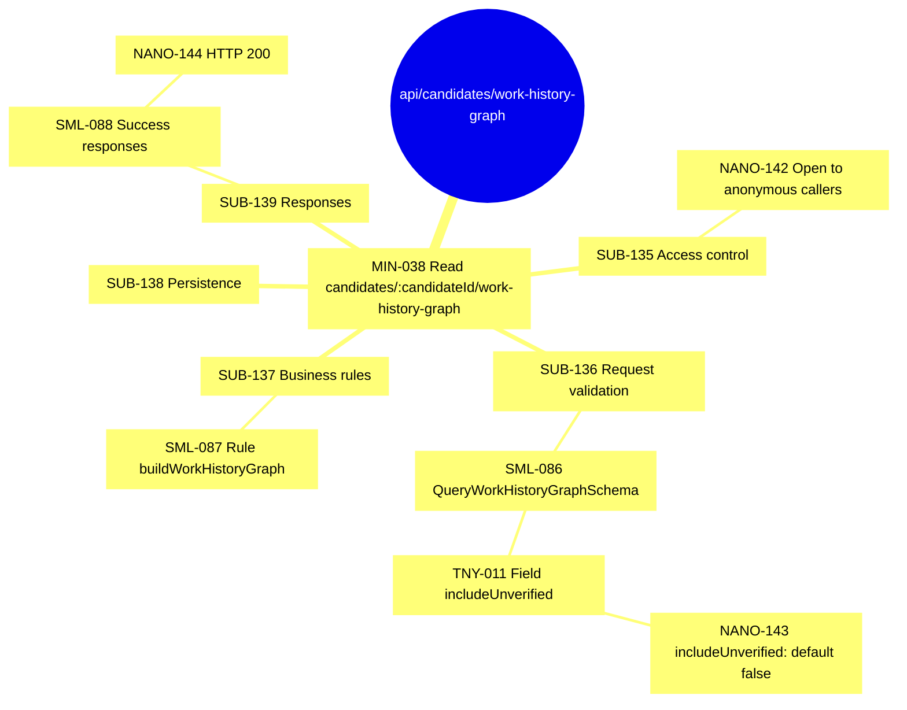

| ID       | Level | Parent   | Name                                            | Description                                                                                                                                                                                                                                                                     | Status      | Verification | Evidence                                      | Related                               |
| -------- | ----- | -------- | ----------------------------------------------- | ------------------------------------------------------------------------------------------------------------------------------------------------------------------------------------------------------------------------------------------------------------------------------- | ----------- | ------------ | --------------------------------------------- | ------------------------------------- |
| FEAT-153 | MAJOR | MOD-065  | api/candidates/work-history-graph               |                                                                                                                                                                                                                                                                                 | IMPLEMENTED |              | apps/api/src/server.ts:13353                  |                                       |
| MIN-038  | MINOR | FEAT-153 | Read candidates/:candidateId/work-history-graph | 6. Get Candidate Work History Network & Graph (F-162) GET /api/v1/candidates/:candidateId/work-history-graph for anyone (public); validates QueryWorkHistoryGraphSchema; calls buildWorkHistoryGraph; durable (PostgreSQL); responds 200. Gaps: no first-party web caller found | IMPLEMENTED | VERIFIED     | apps/api/src/server.ts:13353                  | API-277, TEST-139, TEST-145, TEST-221 |
| SUB-135  | SUB   | MIN-038  | Access control                                  | Who may call GET /api/v1/candidates/:candidateId/work-history-graph: anyone (public).                                                                                                                                                                                           | IMPLEMENTED | PATH_LEVEL   | apps/api/src/server.ts:13353                  |                                       |
| NANO-142 | NANO  | SUB-135  | Open to anonymous callers                       | auth: public.                                                                                                                                                                                                                                                                   | IMPLEMENTED | PATH_LEVEL   | apps/api/src/server.ts:13353                  | ROLE-001                              |
| SUB-136  | SUB   | MIN-038  | Request validation                              | The request is parsed with QueryWorkHistoryGraphSchema; a failure returns 400 with field details before any business logic runs.                                                                                                                                                | IMPLEMENTED | PATH_LEVEL   | apps/api/src/server.ts:13353                  |                                       |
| SML-086  | SMALL | SUB-136  | QueryWorkHistoryGraphSchema                     | QueryWorkHistoryGraphSchema: 1 field(s)                                                                                                                                                                                                                                         | IMPLEMENTED | PATH_LEVEL   | packages/contracts/src/index.ts:1804          | SCH-141                               |
| TNY-011  | TINY  | SML-086  | Field includeUnverified                         | includeUnverified (queryBoolean, optional): default false                                                                                                                                                                                                                       | IMPLEMENTED | PATH_LEVEL   | packages/contracts/src/index.ts:1805          |                                       |
| NANO-143 | NANO  | TNY-011  | includeUnverified: default false                | includeUnverified default false.                                                                                                                                                                                                                                                | IMPLEMENTED | PATH_LEVEL   | packages/contracts/src/index.ts:1805          |                                       |
| SUB-137  | SUB   | MIN-038  | Business rules                                  | Domain functions from packages/domain called by the handler (1).                                                                                                                                                                                                                | IMPLEMENTED | PATH_LEVEL   | apps/api/src/server.ts:13353                  |                                       |
| SML-087  | SMALL | SUB-137  | Rule buildWorkHistoryGraph                      | Calls buildWorkHistoryGraph (packages/domain/src/work-history-graph.ts). Rule status IMPLEMENTED; its own tests: VERIFIED.                                                                                                                                                      | IMPLEMENTED | VERIFIED     | packages/domain/src/work-history-graph.ts:795 | RULE-279                              |
| SUB-138  | SUB   | MIN-038  | Persistence                                     | Durable: writes go through the PostgreSQL store.                                                                                                                                                                                                                                | IMPLEMENTED | PATH_LEVEL   | apps/api/src/server.ts:13353                  |                                       |
| SUB-139  | SUB   | MIN-038  | Responses                                       | Success 200; 0 explicit failure branch(es) besides validation and access errors.                                                                                                                                                                                                | IMPLEMENTED | PATH_LEVEL   | apps/api/src/server.ts:13353                  |                                       |
| SML-088  | SMALL | SUB-139  | Success responses                               | HTTP 200.                                                                                                                                                                                                                                                                       | IMPLEMENTED | PATH_LEVEL   | apps/api/src/server.ts:13353                  |                                       |
| NANO-144 | NANO  | SML-088  | HTTP 200                                        | Replies 200 when the operation succeeds.                                                                                                                                                                                                                                        | IMPLEMENTED | PATH_LEVEL   | apps/api/src/server.ts:13353                  |                                       |

## api/career (MOD-082)

**Application:** apps/api (MOD-001). **Purpose:** API module: routes under /api/v1/career in apps/api/src/server.ts.

**Nodes by level:** MODULE 1, MAJOR 5, MINOR 6, SUB 29, SMALL 21, TINY 27, NANO 70. **Status:** IMPLEMENTED 152, PARTIALLY_IMPLEMENTED 7. **Verification:** PATH_LEVEL 140, UNKNOWN 1, VERIFIED 12.

**User roles that reach it:** anonymous, authenticated.

**Known gaps:** MIN-040 ephemeral: state held in process memory, lost on restart; MIN-192 ephemeral: state held in process memory, lost on restart; MIN-041 ephemeral: state held in process memory, lost on restart; MIN-193 ephemeral: state held in process memory, lost on restart; MIN-193 no first-party web caller found; MIN-042 ephemeral: state held in process memory, lost on restart; MIN-042 no first-party web caller found; MIN-194 ephemeral: state held in process memory, lost on restart; MIN-194 no first-party web caller found.

**Called from (web screens and components):** FEAT-160 Screen /career, FEAT-184 Component CareerPaths

### Module map (to minor features)

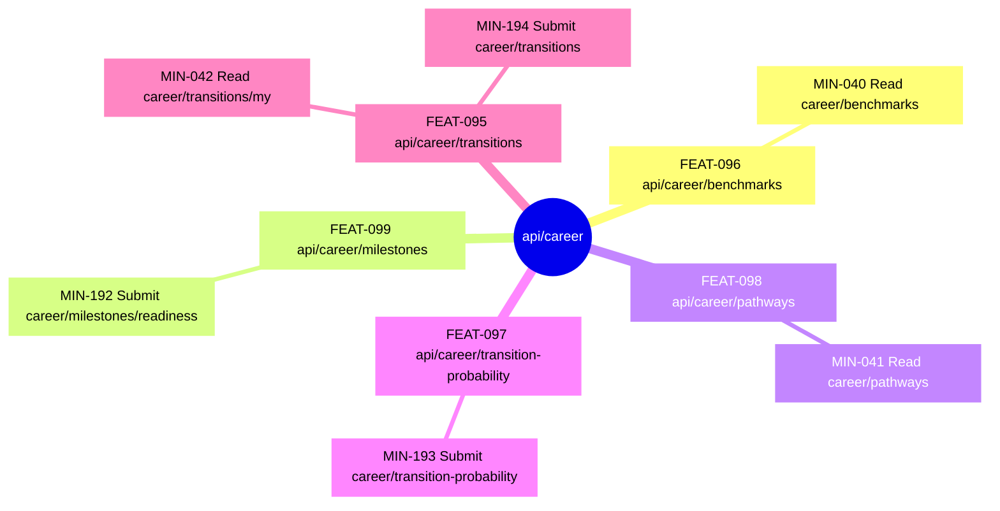

### FEAT-096 api/career/benchmarks

api/career/benchmarks

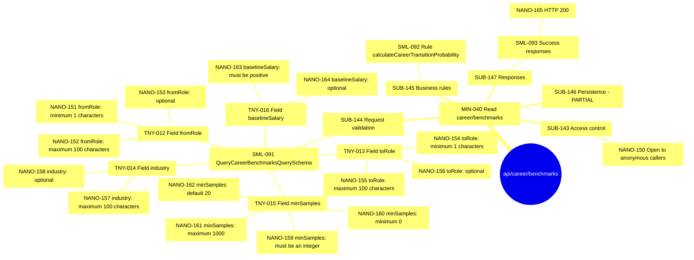

| ID       | Level | Parent   | Name                                      | Description                                                                                                                                                                                                                                         | Status                | Verification | Evidence                                     | Related                                         |
| -------- | ----- | -------- | ----------------------------------------- | --------------------------------------------------------------------------------------------------------------------------------------------------------------------------------------------------------------------------------------------------- | --------------------- | ------------ | -------------------------------------------- | ----------------------------------------------- |
| FEAT-096 | MAJOR | MOD-082  | api/career/benchmarks                     |                                                                                                                                                                                                                                                     | IMPLEMENTED           |              | apps/api/src/server.ts:7817                  |                                                 |
| MIN-040  | MINOR | FEAT-096 | Read career/benchmarks                    | GET /api/v1/career/benchmarks for anyone (public); validates QueryCareerBenchmarksQuerySchema; calls calculateCareerTransitionProbability; ephemeral (process memory); responds 200. Gaps: ephemeral: state held in process memory, lost on restart | IMPLEMENTED           | VERIFIED     | apps/api/src/server.ts:7817                  | API-164, TEST-093, TEST-101, TEST-145, TEST-174 |
| SUB-143  | SUB   | MIN-040  | Access control                            | Who may call GET /api/v1/career/benchmarks: anyone (public).                                                                                                                                                                                        | IMPLEMENTED           | PATH_LEVEL   | apps/api/src/server.ts:7817                  |                                                 |
| NANO-150 | NANO  | SUB-143  | Open to anonymous callers                 | auth: public.                                                                                                                                                                                                                                       | IMPLEMENTED           | PATH_LEVEL   | apps/api/src/server.ts:7817                  | ROLE-001                                        |
| SUB-144  | SUB   | MIN-040  | Request validation                        | The request is parsed with QueryCareerBenchmarksQuerySchema; a failure returns 400 with field details before any business logic runs.                                                                                                               | IMPLEMENTED           | PATH_LEVEL   | apps/api/src/server.ts:7817                  |                                                 |
| SML-091  | SMALL | SUB-144  | QueryCareerBenchmarksQuerySchema          | QueryCareerBenchmarksQuerySchema: 5 field(s)                                                                                                                                                                                                        | IMPLEMENTED           | PATH_LEVEL   | packages/contracts/src/index.ts:1514         | SCH-120                                         |
| TNY-012  | TINY  | SML-091  | Field fromRole                            | fromRole (string, optional): minimum 1 characters; maximum 100 characters; optional                                                                                                                                                                 | IMPLEMENTED           | PATH_LEVEL   | packages/contracts/src/index.ts:1515         |                                                 |
| NANO-151 | NANO  | TNY-012  | fromRole: minimum 1 characters            | fromRole minimum 1 characters.                                                                                                                                                                                                                      | IMPLEMENTED           | PATH_LEVEL   | packages/contracts/src/index.ts:1515         |                                                 |
| NANO-152 | NANO  | TNY-012  | fromRole: maximum 100 characters          | fromRole maximum 100 characters.                                                                                                                                                                                                                    | IMPLEMENTED           | PATH_LEVEL   | packages/contracts/src/index.ts:1515         |                                                 |
| NANO-153 | NANO  | TNY-012  | fromRole: optional                        | fromRole optional.                                                                                                                                                                                                                                  | IMPLEMENTED           | PATH_LEVEL   | packages/contracts/src/index.ts:1515         |                                                 |
| TNY-013  | TINY  | SML-091  | Field toRole                              | toRole (string, optional): minimum 1 characters; maximum 100 characters; optional                                                                                                                                                                   | IMPLEMENTED           | PATH_LEVEL   | packages/contracts/src/index.ts:1516         |                                                 |
| NANO-154 | NANO  | TNY-013  | toRole: minimum 1 characters              | toRole minimum 1 characters.                                                                                                                                                                                                                        | IMPLEMENTED           | PATH_LEVEL   | packages/contracts/src/index.ts:1516         |                                                 |
| NANO-155 | NANO  | TNY-013  | toRole: maximum 100 characters            | toRole maximum 100 characters.                                                                                                                                                                                                                      | IMPLEMENTED           | PATH_LEVEL   | packages/contracts/src/index.ts:1516         |                                                 |
| NANO-156 | NANO  | TNY-013  | toRole: optional                          | toRole optional.                                                                                                                                                                                                                                    | IMPLEMENTED           | PATH_LEVEL   | packages/contracts/src/index.ts:1516         |                                                 |
| TNY-014  | TINY  | SML-091  | Field industry                            | industry (string, optional): maximum 100 characters; optional                                                                                                                                                                                       | IMPLEMENTED           | PATH_LEVEL   | packages/contracts/src/index.ts:1517         |                                                 |
| NANO-157 | NANO  | TNY-014  | industry: maximum 100 characters          | industry maximum 100 characters.                                                                                                                                                                                                                    | IMPLEMENTED           | PATH_LEVEL   | packages/contracts/src/index.ts:1517         |                                                 |
| NANO-158 | NANO  | TNY-014  | industry: optional                        | industry optional.                                                                                                                                                                                                                                  | IMPLEMENTED           | PATH_LEVEL   | packages/contracts/src/index.ts:1517         |                                                 |
| TNY-015  | TINY  | SML-091  | Field minSamples                          | minSamples (number, optional): must be an integer; minimum 0; maximum 1000; default 20                                                                                                                                                              | IMPLEMENTED           | PATH_LEVEL   | packages/contracts/src/index.ts:1519         |                                                 |
| NANO-159 | NANO  | TNY-015  | minSamples: must be an integer            | minSamples must be an integer.                                                                                                                                                                                                                      | IMPLEMENTED           | PATH_LEVEL   | packages/contracts/src/index.ts:1519         |                                                 |
| NANO-160 | NANO  | TNY-015  | minSamples: minimum 0                     | minSamples minimum 0.                                                                                                                                                                                                                               | IMPLEMENTED           | PATH_LEVEL   | packages/contracts/src/index.ts:1519         |                                                 |
| NANO-161 | NANO  | TNY-015  | minSamples: maximum 1000                  | minSamples maximum 1000.                                                                                                                                                                                                                            | IMPLEMENTED           | PATH_LEVEL   | packages/contracts/src/index.ts:1519         |                                                 |
| NANO-162 | NANO  | TNY-015  | minSamples: default 20                    | minSamples default 20.                                                                                                                                                                                                                              | IMPLEMENTED           | PATH_LEVEL   | packages/contracts/src/index.ts:1519         |                                                 |
| TNY-016  | TINY  | SML-091  | Field baselineSalary                      | baselineSalary (number, optional): must be positive; optional                                                                                                                                                                                       | IMPLEMENTED           | PATH_LEVEL   | packages/contracts/src/index.ts:1528         |                                                 |
| NANO-163 | NANO  | TNY-016  | baselineSalary: must be positive          | baselineSalary must be positive.                                                                                                                                                                                                                    | IMPLEMENTED           | PATH_LEVEL   | packages/contracts/src/index.ts:1528         |                                                 |
| NANO-164 | NANO  | TNY-016  | baselineSalary: optional                  | baselineSalary optional.                                                                                                                                                                                                                            | IMPLEMENTED           | PATH_LEVEL   | packages/contracts/src/index.ts:1528         |                                                 |
| SUB-145  | SUB   | MIN-040  | Business rules                            | Domain functions from packages/domain called by the handler (1).                                                                                                                                                                                    | IMPLEMENTED           | PATH_LEVEL   | apps/api/src/server.ts:7817                  |                                                 |
| SML-092  | SMALL | SUB-145  | Rule calculateCareerTransitionProbability | Calls calculateCareerTransitionProbability (packages/domain/src/career-trajectory.ts). Rule status IMPLEMENTED; its own tests: VERIFIED.                                                                                                            | IMPLEMENTED           | VERIFIED     | packages/domain/src/career-trajectory.ts:293 | RULE-080                                        |
| SUB-146  | SUB   | MIN-040  | Persistence                               | Ephemeral: state lives in API process memory and is lost on restart.                                                                                                                                                                                | PARTIALLY_IMPLEMENTED | PATH_LEVEL   | apps/api/src/server.ts:7817                  |                                                 |
| SUB-147  | SUB   | MIN-040  | Responses                                 | Success 200; 0 explicit failure branch(es) besides validation and access errors.                                                                                                                                                                    | IMPLEMENTED           | PATH_LEVEL   | apps/api/src/server.ts:7817                  |                                                 |
| SML-093  | SMALL | SUB-147  | Success responses                         | HTTP 200.                                                                                                                                                                                                                                           | IMPLEMENTED           | PATH_LEVEL   | apps/api/src/server.ts:7817                  |                                                 |
| NANO-165 | NANO  | SML-093  | HTTP 200                                  | Replies 200 when the operation succeeds.                                                                                                                                                                                                            | IMPLEMENTED           | PATH_LEVEL   | apps/api/src/server.ts:7817                  |                                                 |

### FEAT-099 api/career/milestones

api/career/milestones

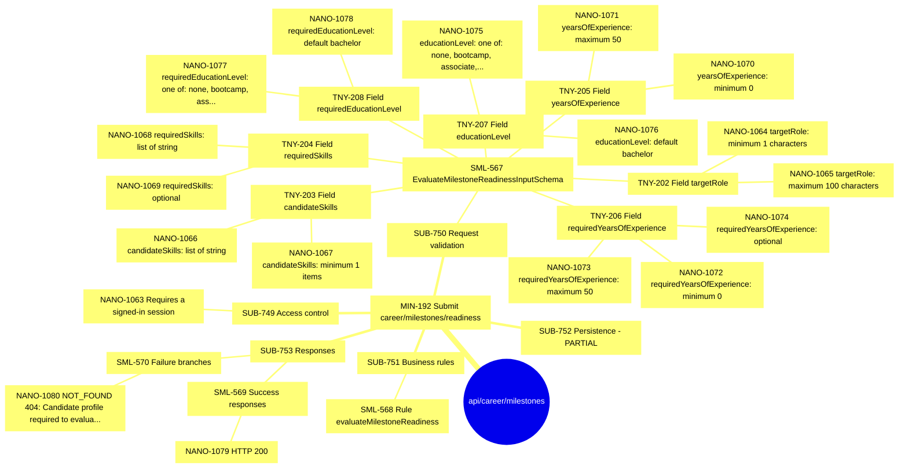

| ID        | Level | Parent   | Name                                                                                   | Description                                                                                                                                                                                                                                                                                                                                   | Status                | Verification | Evidence                                     | Related                               |
| --------- | ----- | -------- | -------------------------------------------------------------------------------------- | --------------------------------------------------------------------------------------------------------------------------------------------------------------------------------------------------------------------------------------------------------------------------------------------------------------------------------------------- | --------------------- | ------------ | -------------------------------------------- | ------------------------------------- |
| FEAT-099  | MAJOR | MOD-082  | api/career/milestones                                                                  |                                                                                                                                                                                                                                                                                                                                               | IMPLEMENTED           |              | apps/api/src/server.ts:7917                  |                                       |
| MIN-192   | MINOR | FEAT-099 | Submit career/milestones/readiness                                                     | 6. Evaluate Candidate Milestone Readiness (F-85, F-152) POST /api/v1/career/milestones/readiness for any signed-in session; validates EvaluateMilestoneReadinessInputSchema; calls evaluateMilestoneReadiness; ephemeral (process memory); responds 200; 1 failure branch(es). Gaps: ephemeral: state held in process memory, lost on restart | IMPLEMENTED           | VERIFIED     | apps/api/src/server.ts:7917                  | API-167, TEST-093, TEST-173, TEST-174 |
| SUB-749   | SUB   | MIN-192  | Access control                                                                         | Who may call POST /api/v1/career/milestones/readiness: any signed-in session.                                                                                                                                                                                                                                                                 | IMPLEMENTED           | PATH_LEVEL   | apps/api/src/server.ts:7917                  |                                       |
| NANO-1063 | NANO  | SUB-749  | Requires a signed-in session                                                           | Requests without a valid session token are rejected with 401 UNAUTHENTICATED.                                                                                                                                                                                                                                                                 | IMPLEMENTED           | PATH_LEVEL   | apps/api/src/server.ts:7917                  | ROLE-001                              |
| SUB-750   | SUB   | MIN-192  | Request validation                                                                     | The request is parsed with EvaluateMilestoneReadinessInputSchema; a failure returns 400 with field details before any business logic runs.                                                                                                                                                                                                    | IMPLEMENTED           | PATH_LEVEL   | apps/api/src/server.ts:7917                  |                                       |
| SML-567   | SMALL | SUB-750  | EvaluateMilestoneReadinessInputSchema                                                  | EvaluateMilestoneReadinessInputSchema: 7 field(s)                                                                                                                                                                                                                                                                                             | IMPLEMENTED           | PATH_LEVEL   | packages/contracts/src/index.ts:1552         | SCH-123                               |
| TNY-202   | TINY  | SML-567  | Field targetRole                                                                       | targetRole (string, required): minimum 1 characters; maximum 100 characters                                                                                                                                                                                                                                                                   | IMPLEMENTED           | PATH_LEVEL   | packages/contracts/src/index.ts:1553         |                                       |
| NANO-1064 | NANO  | TNY-202  | targetRole: minimum 1 characters                                                       | targetRole minimum 1 characters.                                                                                                                                                                                                                                                                                                              | IMPLEMENTED           | PATH_LEVEL   | packages/contracts/src/index.ts:1553         |                                       |
| NANO-1065 | NANO  | TNY-202  | targetRole: maximum 100 characters                                                     | targetRole maximum 100 characters.                                                                                                                                                                                                                                                                                                            | IMPLEMENTED           | PATH_LEVEL   | packages/contracts/src/index.ts:1553         |                                       |
| TNY-203   | TINY  | SML-567  | Field candidateSkills                                                                  | candidateSkills (array, required): list of string; minimum 1 items                                                                                                                                                                                                                                                                            | IMPLEMENTED           | PATH_LEVEL   | packages/contracts/src/index.ts:1554         |                                       |
| NANO-1066 | NANO  | TNY-203  | candidateSkills: list of string                                                        | candidateSkills list of string.                                                                                                                                                                                                                                                                                                               | IMPLEMENTED           | PATH_LEVEL   | packages/contracts/src/index.ts:1554         |                                       |
| NANO-1067 | NANO  | TNY-203  | candidateSkills: minimum 1 items                                                       | candidateSkills minimum 1 items.                                                                                                                                                                                                                                                                                                              | IMPLEMENTED           | PATH_LEVEL   | packages/contracts/src/index.ts:1554         |                                       |
| TNY-204   | TINY  | SML-567  | Field requiredSkills                                                                   | requiredSkills (array, optional): list of string; optional                                                                                                                                                                                                                                                                                    | IMPLEMENTED           | PATH_LEVEL   | packages/contracts/src/index.ts:1555         |                                       |
| NANO-1068 | NANO  | TNY-204  | requiredSkills: list of string                                                         | requiredSkills list of string.                                                                                                                                                                                                                                                                                                                | IMPLEMENTED           | PATH_LEVEL   | packages/contracts/src/index.ts:1555         |                                       |
| NANO-1069 | NANO  | TNY-204  | requiredSkills: optional                                                               | requiredSkills optional.                                                                                                                                                                                                                                                                                                                      | IMPLEMENTED           | PATH_LEVEL   | packages/contracts/src/index.ts:1555         |                                       |
| TNY-205   | TINY  | SML-567  | Field yearsOfExperience                                                                | yearsOfExperience (number, required): minimum 0; maximum 50                                                                                                                                                                                                                                                                                   | IMPLEMENTED           | PATH_LEVEL   | packages/contracts/src/index.ts:1556         |                                       |
| NANO-1070 | NANO  | TNY-205  | yearsOfExperience: minimum 0                                                           | yearsOfExperience minimum 0.                                                                                                                                                                                                                                                                                                                  | IMPLEMENTED           | PATH_LEVEL   | packages/contracts/src/index.ts:1556         |                                       |
| NANO-1071 | NANO  | TNY-205  | yearsOfExperience: maximum 50                                                          | yearsOfExperience maximum 50.                                                                                                                                                                                                                                                                                                                 | IMPLEMENTED           | PATH_LEVEL   | packages/contracts/src/index.ts:1556         |                                       |
| TNY-206   | TINY  | SML-567  | Field requiredYearsOfExperience                                                        | requiredYearsOfExperience (number, optional): minimum 0; maximum 50; optional                                                                                                                                                                                                                                                                 | IMPLEMENTED           | PATH_LEVEL   | packages/contracts/src/index.ts:1557         |                                       |
| NANO-1072 | NANO  | TNY-206  | requiredYearsOfExperience: minimum 0                                                   | requiredYearsOfExperience minimum 0.                                                                                                                                                                                                                                                                                                          | IMPLEMENTED           | PATH_LEVEL   | packages/contracts/src/index.ts:1557         |                                       |
| NANO-1073 | NANO  | TNY-206  | requiredYearsOfExperience: maximum 50                                                  | requiredYearsOfExperience maximum 50.                                                                                                                                                                                                                                                                                                         | IMPLEMENTED           | PATH_LEVEL   | packages/contracts/src/index.ts:1557         |                                       |
| NANO-1074 | NANO  | TNY-206  | requiredYearsOfExperience: optional                                                    | requiredYearsOfExperience optional.                                                                                                                                                                                                                                                                                                           | IMPLEMENTED           | PATH_LEVEL   | packages/contracts/src/index.ts:1557         |                                       |
| TNY-207   | TINY  | SML-567  | Field educationLevel                                                                   | educationLevel (enum, optional): one of: none, bootcamp, associate, bachelor, master, doctorate; default 'bachelor'                                                                                                                                                                                                                           | IMPLEMENTED           | PATH_LEVEL   | packages/contracts/src/index.ts:1558         |                                       |
| NANO-1075 | NANO  | TNY-207  | educationLevel: one of: none, bootcamp, associate, bachelor, master, doctorate         | educationLevel one of: none, bootcamp, associate, bachelor, master, doctorate.                                                                                                                                                                                                                                                                | IMPLEMENTED           | PATH_LEVEL   | packages/contracts/src/index.ts:1558         |                                       |
| NANO-1076 | NANO  | TNY-207  | educationLevel: default 'bachelor'                                                     | educationLevel default 'bachelor'; message "bachelor".                                                                                                                                                                                                                                                                                        | IMPLEMENTED           | PATH_LEVEL   | packages/contracts/src/index.ts:1558         |                                       |
| TNY-208   | TINY  | SML-567  | Field requiredEducationLevel                                                           | requiredEducationLevel (enum, optional): one of: none, bootcamp, associate, bachelor, master, doctorate; default 'bachelor'                                                                                                                                                                                                                   | IMPLEMENTED           | PATH_LEVEL   | packages/contracts/src/index.ts:1561         |                                       |
| NANO-1077 | NANO  | TNY-208  | requiredEducationLevel: one of: none, bootcamp, associate, bachelor, master, doctorate | requiredEducationLevel one of: none, bootcamp, associate, bachelor, master, doctorate.                                                                                                                                                                                                                                                        | IMPLEMENTED           | PATH_LEVEL   | packages/contracts/src/index.ts:1561         |                                       |
| NANO-1078 | NANO  | TNY-208  | requiredEducationLevel: default 'bachelor'                                             | requiredEducationLevel default 'bachelor'; message "bachelor".                                                                                                                                                                                                                                                                                | IMPLEMENTED           | PATH_LEVEL   | packages/contracts/src/index.ts:1561         |                                       |
| SUB-751   | SUB   | MIN-192  | Business rules                                                                         | Domain functions from packages/domain called by the handler (1).                                                                                                                                                                                                                                                                              | IMPLEMENTED           | PATH_LEVEL   | apps/api/src/server.ts:7917                  |                                       |
| SML-568   | SMALL | SUB-751  | Rule evaluateMilestoneReadiness                                                        | Calls evaluateMilestoneReadiness (packages/domain/src/career-trajectory.ts). Rule status IMPLEMENTED; its own tests: VERIFIED.                                                                                                                                                                                                                | IMPLEMENTED           | VERIFIED     | packages/domain/src/career-trajectory.ts:534 | RULE-083                              |
| SUB-752   | SUB   | MIN-192  | Persistence                                                                            | Ephemeral: state lives in API process memory and is lost on restart.                                                                                                                                                                                                                                                                          | PARTIALLY_IMPLEMENTED | PATH_LEVEL   | apps/api/src/server.ts:7917                  |                                       |
| SUB-753   | SUB   | MIN-192  | Responses                                                                              | Success 200; 1 explicit failure branch(es) besides validation and access errors.                                                                                                                                                                                                                                                              | IMPLEMENTED           | PATH_LEVEL   | apps/api/src/server.ts:7917                  |                                       |
| SML-569   | SMALL | SUB-753  | Success responses                                                                      | HTTP 200.                                                                                                                                                                                                                                                                                                                                     | IMPLEMENTED           | PATH_LEVEL   | apps/api/src/server.ts:7917                  |                                       |
| NANO-1079 | NANO  | SML-569  | HTTP 200                                                                               | Replies 200 when the operation succeeds.                                                                                                                                                                                                                                                                                                      | IMPLEMENTED           | PATH_LEVEL   | apps/api/src/server.ts:7917                  |                                       |
| SML-570   | SMALL | SUB-753  | Failure branches                                                                       | 1 DomainError branch(es) in the handler, mapped to HTTP by the global error handler.                                                                                                                                                                                                                                                          | IMPLEMENTED           | PATH_LEVEL   | apps/api/src/server.ts:7917                  |                                       |
| NANO-1080 | NANO  | SML-570  | NOT_FOUND 404: Candidate profile required to evaluate milestones.                      | Throws DomainError(NOT_FOUND) "Candidate profile required to evaluate milestones." -> HTTP 404.                                                                                                                                                                                                                                               | IMPLEMENTED           | PATH_LEVEL   | apps/api/src/server.ts:7923                  | ERR-159                               |

### FEAT-098 api/career/pathways

api/career/pathways

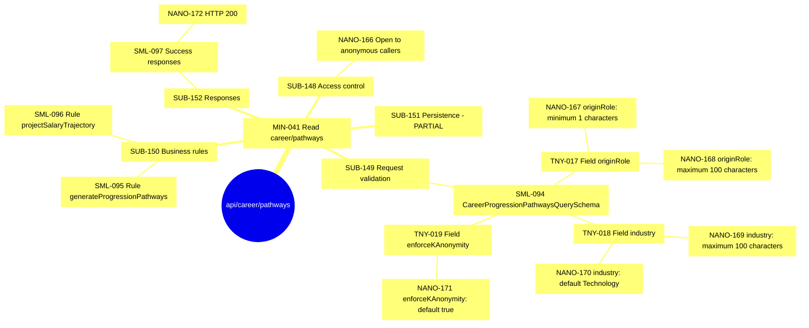

| ID       | Level | Parent   | Name                                 | Description                                                                                                                                                                                                                                                                                                                                               | Status                | Verification | Evidence                                     | Related                               |
| -------- | ----- | -------- | ------------------------------------ | --------------------------------------------------------------------------------------------------------------------------------------------------------------------------------------------------------------------------------------------------------------------------------------------------------------------------------------------------------- | --------------------- | ------------ | -------------------------------------------- | ------------------------------------- |
| FEAT-098 | MAJOR | MOD-082  | api/career/pathways                  |                                                                                                                                                                                                                                                                                                                                                           | IMPLEMENTED           |              | apps/api/src/server.ts:7893                  |                                       |
| MIN-041  | MINOR | FEAT-098 | Read career/pathways                 | 5. Discover Career Progression Pathways & Salary Trajectory (F-152, BR-160, BR-161) GET /api/v1/career/pathways for anyone (public); validates CareerProgressionPathwaysQuerySchema; calls generateProgressionPathways, projectSalaryTrajectory; ephemeral (process memory); responds 200. Gaps: ephemeral: state held in process memory, lost on restart | IMPLEMENTED           | VERIFIED     | apps/api/src/server.ts:7893                  | API-166, TEST-093, TEST-145, TEST-174 |
| SUB-148  | SUB   | MIN-041  | Access control                       | Who may call GET /api/v1/career/pathways: anyone (public).                                                                                                                                                                                                                                                                                                | IMPLEMENTED           | PATH_LEVEL   | apps/api/src/server.ts:7893                  |                                       |
| NANO-166 | NANO  | SUB-148  | Open to anonymous callers            | auth: public.                                                                                                                                                                                                                                                                                                                                             | IMPLEMENTED           | PATH_LEVEL   | apps/api/src/server.ts:7893                  | ROLE-001                              |
| SUB-149  | SUB   | MIN-041  | Request validation                   | The request is parsed with CareerProgressionPathwaysQuerySchema; a failure returns 400 with field details before any business logic runs.                                                                                                                                                                                                                 | IMPLEMENTED           | PATH_LEVEL   | apps/api/src/server.ts:7893                  |                                       |
| SML-094  | SMALL | SUB-149  | CareerProgressionPathwaysQuerySchema | CareerProgressionPathwaysQuerySchema: 3 field(s)                                                                                                                                                                                                                                                                                                          | IMPLEMENTED           | PATH_LEVEL   | packages/contracts/src/index.ts:1535         | SCH-122                               |
| TNY-017  | TINY  | SML-094  | Field originRole                     | originRole (string, required): minimum 1 characters; maximum 100 characters                                                                                                                                                                                                                                                                               | IMPLEMENTED           | PATH_LEVEL   | packages/contracts/src/index.ts:1536         |                                       |
| NANO-167 | NANO  | TNY-017  | originRole: minimum 1 characters     | originRole minimum 1 characters.                                                                                                                                                                                                                                                                                                                          | IMPLEMENTED           | PATH_LEVEL   | packages/contracts/src/index.ts:1536         |                                       |
| NANO-168 | NANO  | TNY-017  | originRole: maximum 100 characters   | originRole maximum 100 characters.                                                                                                                                                                                                                                                                                                                        | IMPLEMENTED           | PATH_LEVEL   | packages/contracts/src/index.ts:1536         |                                       |
| TNY-018  | TINY  | SML-094  | Field industry                       | industry (string, optional): maximum 100 characters; default 'Technology'                                                                                                                                                                                                                                                                                 | IMPLEMENTED           | PATH_LEVEL   | packages/contracts/src/index.ts:1537         |                                       |
| NANO-169 | NANO  | TNY-018  | industry: maximum 100 characters     | industry maximum 100 characters.                                                                                                                                                                                                                                                                                                                          | IMPLEMENTED           | PATH_LEVEL   | packages/contracts/src/index.ts:1537         |                                       |
| NANO-170 | NANO  | TNY-018  | industry: default 'Technology'       | industry default 'Technology'; message "Technology".                                                                                                                                                                                                                                                                                                      | IMPLEMENTED           | PATH_LEVEL   | packages/contracts/src/index.ts:1537         |                                       |
| TNY-019  | TINY  | SML-094  | Field enforceKAnonymity              | enforceKAnonymity (preprocess, optional): default true                                                                                                                                                                                                                                                                                                    | IMPLEMENTED           | PATH_LEVEL   | packages/contracts/src/index.ts:1540         |                                       |
| NANO-171 | NANO  | TNY-019  | enforceKAnonymity: default true      | enforceKAnonymity default true.                                                                                                                                                                                                                                                                                                                           | IMPLEMENTED           | PATH_LEVEL   | packages/contracts/src/index.ts:1540         |                                       |
| SUB-150  | SUB   | MIN-041  | Business rules                       | Domain functions from packages/domain called by the handler (2).                                                                                                                                                                                                                                                                                          | IMPLEMENTED           | PATH_LEVEL   | apps/api/src/server.ts:7893                  |                                       |
| SML-095  | SMALL | SUB-150  | Rule generateProgressionPathways     | Calls generateProgressionPathways (packages/domain/src/career-trajectory.ts). Rule status IMPLEMENTED; its own tests: VERIFIED.                                                                                                                                                                                                                           | IMPLEMENTED           | VERIFIED     | packages/domain/src/career-trajectory.ts:396 | RULE-081                              |
| SML-096  | SMALL | SUB-150  | Rule projectSalaryTrajectory         | Calls projectSalaryTrajectory (packages/domain/src/career-trajectory.ts). Rule status IMPLEMENTED; its own tests: VERIFIED.                                                                                                                                                                                                                               | IMPLEMENTED           | VERIFIED     | packages/domain/src/career-trajectory.ts:482 | RULE-082                              |
| SUB-151  | SUB   | MIN-041  | Persistence                          | Ephemeral: state lives in API process memory and is lost on restart.                                                                                                                                                                                                                                                                                      | PARTIALLY_IMPLEMENTED | PATH_LEVEL   | apps/api/src/server.ts:7893                  |                                       |
| SUB-152  | SUB   | MIN-041  | Responses                            | Success 200; 0 explicit failure branch(es) besides validation and access errors.                                                                                                                                                                                                                                                                          | IMPLEMENTED           | PATH_LEVEL   | apps/api/src/server.ts:7893                  |                                       |
| SML-097  | SMALL | SUB-152  | Success responses                    | HTTP 200.                                                                                                                                                                                                                                                                                                                                                 | IMPLEMENTED           | PATH_LEVEL   | apps/api/src/server.ts:7893                  |                                       |
| NANO-172 | NANO  | SML-097  | HTTP 200                             | Replies 200 when the operation succeeds.                                                                                                                                                                                                                                                                                                                  | IMPLEMENTED           | PATH_LEVEL   | apps/api/src/server.ts:7893                  |                                       |

### FEAT-097 api/career/transition-probability

api/career/transition-probability

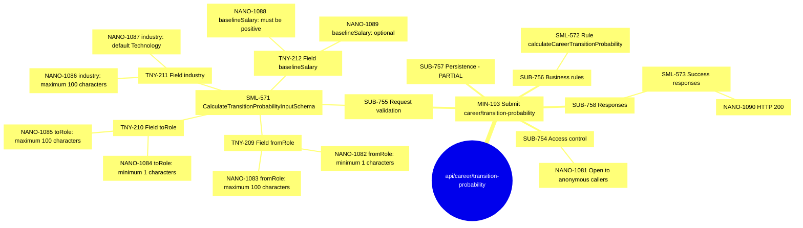

| ID        | Level | Parent   | Name                                      | Description                                                                                                                                                                                                                                                                                                                                                                                             | Status                | Verification | Evidence                                     | Related                               |
| --------- | ----- | -------- | ----------------------------------------- | ------------------------------------------------------------------------------------------------------------------------------------------------------------------------------------------------------------------------------------------------------------------------------------------------------------------------------------------------------------------------------------------------------- | --------------------- | ------------ | -------------------------------------------- | ------------------------------------- |
| FEAT-097  | MAJOR | MOD-082  | api/career/transition-probability         |                                                                                                                                                                                                                                                                                                                                                                                                         | IMPLEMENTED           |              | apps/api/src/server.ts:7860                  |                                       |
| MIN-193   | MINOR | FEAT-097 | Submit career/transition-probability      | 4. Calculate Transition Probability (BR-163: disclose data sources and confidence intervals) POST /api/v1/career/transition-probability for anyone (public); validates CalculateTransitionProbabilityInputSchema; calls calculateCareerTransitionProbability; ephemeral (process memory); responds 200. Gaps: ephemeral: state held in process memory, lost on restart; no first-party web caller found | IMPLEMENTED           | VERIFIED     | apps/api/src/server.ts:7860                  | API-165, TEST-093, TEST-145, TEST-174 |
| SUB-754   | SUB   | MIN-193  | Access control                            | Who may call POST /api/v1/career/transition-probability: anyone (public).                                                                                                                                                                                                                                                                                                                               | IMPLEMENTED           | PATH_LEVEL   | apps/api/src/server.ts:7860                  |                                       |
| NANO-1081 | NANO  | SUB-754  | Open to anonymous callers                 | auth: public.                                                                                                                                                                                                                                                                                                                                                                                           | IMPLEMENTED           | PATH_LEVEL   | apps/api/src/server.ts:7860                  | ROLE-001                              |
| SUB-755   | SUB   | MIN-193  | Request validation                        | The request is parsed with CalculateTransitionProbabilityInputSchema; a failure returns 400 with field details before any business logic runs.                                                                                                                                                                                                                                                          | IMPLEMENTED           | PATH_LEVEL   | apps/api/src/server.ts:7860                  |                                       |
| SML-571   | SMALL | SUB-755  | CalculateTransitionProbabilityInputSchema | CalculateTransitionProbabilityInputSchema: 4 field(s)                                                                                                                                                                                                                                                                                                                                                   | IMPLEMENTED           | PATH_LEVEL   | packages/contracts/src/index.ts:1524         | SCH-121                               |
| TNY-209   | TINY  | SML-571  | Field fromRole                            | fromRole (string, required): minimum 1 characters; maximum 100 characters                                                                                                                                                                                                                                                                                                                               | IMPLEMENTED           | PATH_LEVEL   | packages/contracts/src/index.ts:1525         |                                       |
| NANO-1082 | NANO  | TNY-209  | fromRole: minimum 1 characters            | fromRole minimum 1 characters.                                                                                                                                                                                                                                                                                                                                                                          | IMPLEMENTED           | PATH_LEVEL   | packages/contracts/src/index.ts:1525         |                                       |
| NANO-1083 | NANO  | TNY-209  | fromRole: maximum 100 characters          | fromRole maximum 100 characters.                                                                                                                                                                                                                                                                                                                                                                        | IMPLEMENTED           | PATH_LEVEL   | packages/contracts/src/index.ts:1525         |                                       |
| TNY-210   | TINY  | SML-571  | Field toRole                              | toRole (string, required): minimum 1 characters; maximum 100 characters                                                                                                                                                                                                                                                                                                                                 | IMPLEMENTED           | PATH_LEVEL   | packages/contracts/src/index.ts:1526         |                                       |
| NANO-1084 | NANO  | TNY-210  | toRole: minimum 1 characters              | toRole minimum 1 characters.                                                                                                                                                                                                                                                                                                                                                                            | IMPLEMENTED           | PATH_LEVEL   | packages/contracts/src/index.ts:1526         |                                       |
| NANO-1085 | NANO  | TNY-210  | toRole: maximum 100 characters            | toRole maximum 100 characters.                                                                                                                                                                                                                                                                                                                                                                          | IMPLEMENTED           | PATH_LEVEL   | packages/contracts/src/index.ts:1526         |                                       |
| TNY-211   | TINY  | SML-571  | Field industry                            | industry (string, optional): maximum 100 characters; default 'Technology'                                                                                                                                                                                                                                                                                                                               | IMPLEMENTED           | PATH_LEVEL   | packages/contracts/src/index.ts:1527         |                                       |
| NANO-1086 | NANO  | TNY-211  | industry: maximum 100 characters          | industry maximum 100 characters.                                                                                                                                                                                                                                                                                                                                                                        | IMPLEMENTED           | PATH_LEVEL   | packages/contracts/src/index.ts:1527         |                                       |
| NANO-1087 | NANO  | TNY-211  | industry: default 'Technology'            | industry default 'Technology'; message "Technology".                                                                                                                                                                                                                                                                                                                                                    | IMPLEMENTED           | PATH_LEVEL   | packages/contracts/src/index.ts:1527         |                                       |
| TNY-212   | TINY  | SML-571  | Field baselineSalary                      | baselineSalary (number, optional): must be positive; optional                                                                                                                                                                                                                                                                                                                                           | IMPLEMENTED           | PATH_LEVEL   | packages/contracts/src/index.ts:1528         |                                       |
| NANO-1088 | NANO  | TNY-212  | baselineSalary: must be positive          | baselineSalary must be positive.                                                                                                                                                                                                                                                                                                                                                                        | IMPLEMENTED           | PATH_LEVEL   | packages/contracts/src/index.ts:1528         |                                       |
| NANO-1089 | NANO  | TNY-212  | baselineSalary: optional                  | baselineSalary optional.                                                                                                                                                                                                                                                                                                                                                                                | IMPLEMENTED           | PATH_LEVEL   | packages/contracts/src/index.ts:1528         |                                       |
| SUB-756   | SUB   | MIN-193  | Business rules                            | Domain functions from packages/domain called by the handler (1).                                                                                                                                                                                                                                                                                                                                        | IMPLEMENTED           | PATH_LEVEL   | apps/api/src/server.ts:7860                  |                                       |
| SML-572   | SMALL | SUB-756  | Rule calculateCareerTransitionProbability | Calls calculateCareerTransitionProbability (packages/domain/src/career-trajectory.ts). Rule status IMPLEMENTED; its own tests: VERIFIED.                                                                                                                                                                                                                                                                | IMPLEMENTED           | VERIFIED     | packages/domain/src/career-trajectory.ts:293 | RULE-080                              |
| SUB-757   | SUB   | MIN-193  | Persistence                               | Ephemeral: state lives in API process memory and is lost on restart.                                                                                                                                                                                                                                                                                                                                    | PARTIALLY_IMPLEMENTED | PATH_LEVEL   | apps/api/src/server.ts:7860                  |                                       |
| SUB-758   | SUB   | MIN-193  | Responses                                 | Success 200; 0 explicit failure branch(es) besides validation and access errors.                                                                                                                                                                                                                                                                                                                        | IMPLEMENTED           | PATH_LEVEL   | apps/api/src/server.ts:7860                  |                                       |
| SML-573   | SMALL | SUB-758  | Success responses                         | HTTP 200.                                                                                                                                                                                                                                                                                                                                                                                               | IMPLEMENTED           | PATH_LEVEL   | apps/api/src/server.ts:7860                  |                                       |
| NANO-1090 | NANO  | SML-573  | HTTP 200                                  | Replies 200 when the operation succeeds.                                                                                                                                                                                                                                                                                                                                                                | IMPLEMENTED           | PATH_LEVEL   | apps/api/src/server.ts:7860                  |                                       |

### FEAT-095 api/career/transitions

api/career/transitions

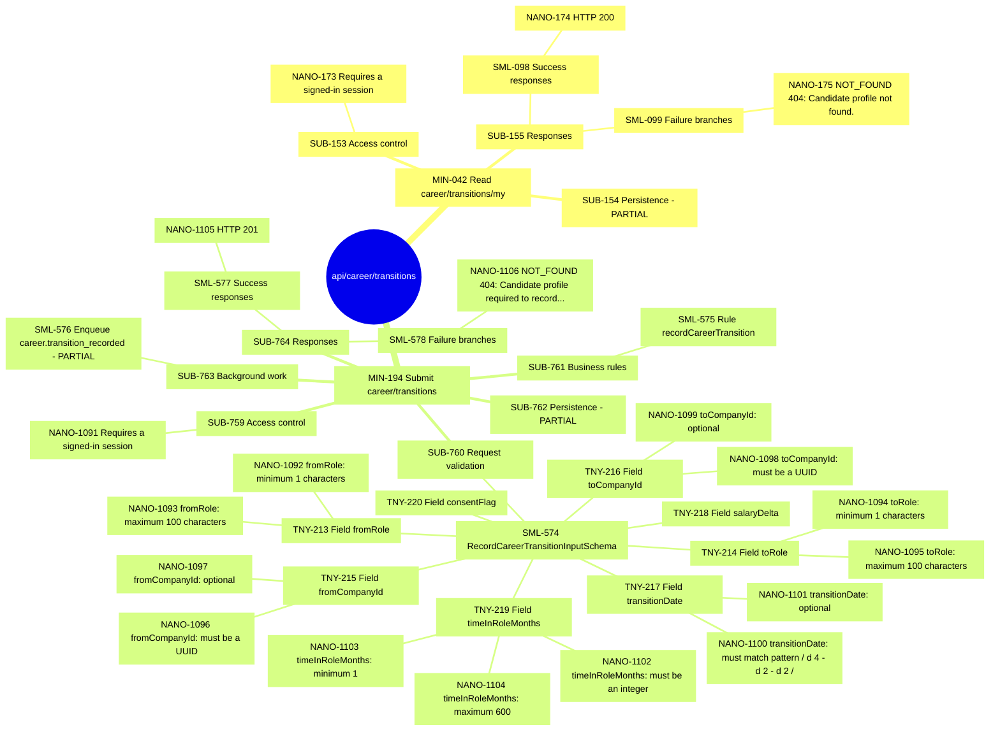

| ID        | Level | Parent   | Name                                                                   | Description                                                                                                                                                                                                                                                                                                                                                       | Status                | Verification | Evidence                                     | Related                               |
| --------- | ----- | -------- | ---------------------------------------------------------------------- | ----------------------------------------------------------------------------------------------------------------------------------------------------------------------------------------------------------------------------------------------------------------------------------------------------------------------------------------------------------------- | --------------------- | ------------ | -------------------------------------------- | ------------------------------------- |
| FEAT-095  | MAJOR | MOD-082  | api/career/transitions                                                 |                                                                                                                                                                                                                                                                                                                                                                   | IMPLEMENTED           |              | apps/api/src/server.ts:7740                  |                                       |
| MIN-042   | MINOR | FEAT-095 | Read career/transitions/my                                             | 2. Get My Career Transitions (BR-159: Individual career transitions visible only to the user) GET /api/v1/career/transitions/my for any signed-in session; ephemeral (process memory); responds 200; 1 failure branch(es). Gaps: ephemeral: state held in process memory, lost on restart; no first-party web caller found                                        | IMPLEMENTED           | VERIFIED     | apps/api/src/server.ts:7799                  | API-163, TEST-093, TEST-174           |
| SUB-153   | SUB   | MIN-042  | Access control                                                         | Who may call GET /api/v1/career/transitions/my: any signed-in session.                                                                                                                                                                                                                                                                                            | IMPLEMENTED           | PATH_LEVEL   | apps/api/src/server.ts:7799                  |                                       |
| NANO-173  | NANO  | SUB-153  | Requires a signed-in session                                           | Requests without a valid session token are rejected with 401 UNAUTHENTICATED.                                                                                                                                                                                                                                                                                     | IMPLEMENTED           | PATH_LEVEL   | apps/api/src/server.ts:7799                  | ROLE-001                              |
| SUB-154   | SUB   | MIN-042  | Persistence                                                            | Ephemeral: state lives in API process memory and is lost on restart.                                                                                                                                                                                                                                                                                              | PARTIALLY_IMPLEMENTED | PATH_LEVEL   | apps/api/src/server.ts:7799                  |                                       |
| SUB-155   | SUB   | MIN-042  | Responses                                                              | Success 200; 1 explicit failure branch(es) besides validation and access errors.                                                                                                                                                                                                                                                                                  | IMPLEMENTED           | PATH_LEVEL   | apps/api/src/server.ts:7799                  |                                       |
| SML-098   | SMALL | SUB-155  | Success responses                                                      | HTTP 200.                                                                                                                                                                                                                                                                                                                                                         | IMPLEMENTED           | PATH_LEVEL   | apps/api/src/server.ts:7799                  |                                       |
| NANO-174  | NANO  | SML-098  | HTTP 200                                                               | Replies 200 when the operation succeeds.                                                                                                                                                                                                                                                                                                                          | IMPLEMENTED           | PATH_LEVEL   | apps/api/src/server.ts:7799                  |                                       |
| SML-099   | SMALL | SUB-155  | Failure branches                                                       | 1 DomainError branch(es) in the handler, mapped to HTTP by the global error handler.                                                                                                                                                                                                                                                                              | IMPLEMENTED           | PATH_LEVEL   | apps/api/src/server.ts:7799                  |                                       |
| NANO-175  | NANO  | SML-099  | NOT_FOUND 404: Candidate profile not found.                            | Throws DomainError(NOT_FOUND) "Candidate profile not found." -> HTTP 404.                                                                                                                                                                                                                                                                                         | IMPLEMENTED           | PATH_LEVEL   | apps/api/src/server.ts:7803                  | ERR-158                               |
| MIN-194   | MINOR | FEAT-095 | Submit career/transitions                                              | 1. Record Opt-in Career Transition (BR-157, BR-159, BR-161) POST /api/v1/career/transitions for any signed-in session; validates RecordCareerTransitionInputSchema; calls recordCareerTransition; ephemeral (process memory); responds 201; 1 failure branch(es). Gaps: ephemeral: state held in process memory, lost on restart; no first-party web caller found | IMPLEMENTED           | VERIFIED     | apps/api/src/server.ts:7740                  | API-162, TEST-093, TEST-101, TEST-174 |
| SUB-759   | SUB   | MIN-194  | Access control                                                         | Who may call POST /api/v1/career/transitions: any signed-in session.                                                                                                                                                                                                                                                                                              | IMPLEMENTED           | PATH_LEVEL   | apps/api/src/server.ts:7740                  |                                       |
| NANO-1091 | NANO  | SUB-759  | Requires a signed-in session                                           | Requests without a valid session token are rejected with 401 UNAUTHENTICATED.                                                                                                                                                                                                                                                                                     | IMPLEMENTED           | PATH_LEVEL   | apps/api/src/server.ts:7740                  | ROLE-001                              |
| SUB-760   | SUB   | MIN-194  | Request validation                                                     | The request is parsed with RecordCareerTransitionInputSchema; a failure returns 400 with field details before any business logic runs.                                                                                                                                                                                                                            | IMPLEMENTED           | PATH_LEVEL   | apps/api/src/server.ts:7740                  |                                       |
| SML-574   | SMALL | SUB-760  | RecordCareerTransitionInputSchema                                      | RecordCareerTransitionInputSchema: 8 field(s)                                                                                                                                                                                                                                                                                                                     | IMPLEMENTED           | PATH_LEVEL   | packages/contracts/src/index.ts:1498         | SCH-119                               |
| TNY-213   | TINY  | SML-574  | Field fromRole                                                         | fromRole (string, required): minimum 1 characters; maximum 100 characters                                                                                                                                                                                                                                                                                         | IMPLEMENTED           | PATH_LEVEL   | packages/contracts/src/index.ts:1499         |                                       |
| NANO-1092 | NANO  | TNY-213  | fromRole: minimum 1 characters                                         | fromRole minimum 1 characters.                                                                                                                                                                                                                                                                                                                                    | IMPLEMENTED           | PATH_LEVEL   | packages/contracts/src/index.ts:1499         |                                       |
| NANO-1093 | NANO  | TNY-213  | fromRole: maximum 100 characters                                       | fromRole maximum 100 characters.                                                                                                                                                                                                                                                                                                                                  | IMPLEMENTED           | PATH_LEVEL   | packages/contracts/src/index.ts:1499         |                                       |
| TNY-214   | TINY  | SML-574  | Field toRole                                                           | toRole (string, required): minimum 1 characters; maximum 100 characters                                                                                                                                                                                                                                                                                           | IMPLEMENTED           | PATH_LEVEL   | packages/contracts/src/index.ts:1500         |                                       |
| NANO-1094 | NANO  | TNY-214  | toRole: minimum 1 characters                                           | toRole minimum 1 characters.                                                                                                                                                                                                                                                                                                                                      | IMPLEMENTED           | PATH_LEVEL   | packages/contracts/src/index.ts:1500         |                                       |
| NANO-1095 | NANO  | TNY-214  | toRole: maximum 100 characters                                         | toRole maximum 100 characters.                                                                                                                                                                                                                                                                                                                                    | IMPLEMENTED           | PATH_LEVEL   | packages/contracts/src/index.ts:1500         |                                       |
| TNY-215   | TINY  | SML-574  | Field fromCompanyId                                                    | fromCompanyId (string, optional): must be a UUID; optional                                                                                                                                                                                                                                                                                                        | IMPLEMENTED           | PATH_LEVEL   | packages/contracts/src/index.ts:1501         |                                       |
| NANO-1096 | NANO  | TNY-215  | fromCompanyId: must be a UUID                                          | fromCompanyId must be a UUID.                                                                                                                                                                                                                                                                                                                                     | IMPLEMENTED           | PATH_LEVEL   | packages/contracts/src/index.ts:1501         |                                       |
| NANO-1097 | NANO  | TNY-215  | fromCompanyId: optional                                                | fromCompanyId optional.                                                                                                                                                                                                                                                                                                                                           | IMPLEMENTED           | PATH_LEVEL   | packages/contracts/src/index.ts:1501         |                                       |
| TNY-216   | TINY  | SML-574  | Field toCompanyId                                                      | toCompanyId (string, optional): must be a UUID; optional                                                                                                                                                                                                                                                                                                          | IMPLEMENTED           | PATH_LEVEL   | packages/contracts/src/index.ts:1502         |                                       |
| NANO-1098 | NANO  | TNY-216  | toCompanyId: must be a UUID                                            | toCompanyId must be a UUID.                                                                                                                                                                                                                                                                                                                                       | IMPLEMENTED           | PATH_LEVEL   | packages/contracts/src/index.ts:1502         |                                       |
| NANO-1099 | NANO  | TNY-216  | toCompanyId: optional                                                  | toCompanyId optional.                                                                                                                                                                                                                                                                                                                                             | IMPLEMENTED           | PATH_LEVEL   | packages/contracts/src/index.ts:1502         |                                       |
| TNY-217   | TINY  | SML-574  | Field transitionDate                                                   | transitionDate (string, optional): must match pattern /^\d{4}-\d{2}-\d{2}$/; optional                                                                                                                                                                                                                                                                             | IMPLEMENTED           | PATH_LEVEL   | packages/contracts/src/index.ts:1503         |                                       |
| NANO-1100 | NANO  | TNY-217  | transitionDate: must match pattern /^\d{4}-\d{2}-\d{2}$/               | transitionDate must match pattern /^\d{4}-\d{2}-\d{2}$/.                                                                                                                                                                                                                                                                                                          | IMPLEMENTED           | PATH_LEVEL   | packages/contracts/src/index.ts:1503         |                                       |
| NANO-1101 | NANO  | TNY-217  | transitionDate: optional                                               | transitionDate optional.                                                                                                                                                                                                                                                                                                                                          | IMPLEMENTED           | PATH_LEVEL   | packages/contracts/src/index.ts:1503         |                                       |
| TNY-218   | TINY  | SML-574  | Field salaryDelta                                                      | salaryDelta (number, required)                                                                                                                                                                                                                                                                                                                                    | IMPLEMENTED           | PATH_LEVEL   | packages/contracts/src/index.ts:1507         |                                       |
| TNY-219   | TINY  | SML-574  | Field timeInRoleMonths                                                 | timeInRoleMonths (number, required): must be an integer; minimum 1; maximum 600                                                                                                                                                                                                                                                                                   | IMPLEMENTED           | PATH_LEVEL   | packages/contracts/src/index.ts:1508         |                                       |
| NANO-1102 | NANO  | TNY-219  | timeInRoleMonths: must be an integer                                   | timeInRoleMonths must be an integer.                                                                                                                                                                                                                                                                                                                              | IMPLEMENTED           | PATH_LEVEL   | packages/contracts/src/index.ts:1508         |                                       |
| NANO-1103 | NANO  | TNY-219  | timeInRoleMonths: minimum 1                                            | timeInRoleMonths minimum 1.                                                                                                                                                                                                                                                                                                                                       | IMPLEMENTED           | PATH_LEVEL   | packages/contracts/src/index.ts:1508         |                                       |
| NANO-1104 | NANO  | TNY-219  | timeInRoleMonths: maximum 600                                          | timeInRoleMonths maximum 600.                                                                                                                                                                                                                                                                                                                                     | IMPLEMENTED           | PATH_LEVEL   | packages/contracts/src/index.ts:1508         |                                       |
| TNY-220   | TINY  | SML-574  | Field consentFlag                                                      | consentFlag (boolean, required)                                                                                                                                                                                                                                                                                                                                   | IMPLEMENTED           | PATH_LEVEL   | packages/contracts/src/index.ts:1509         |                                       |
| SUB-761   | SUB   | MIN-194  | Business rules                                                         | Domain functions from packages/domain called by the handler (1).                                                                                                                                                                                                                                                                                                  | IMPLEMENTED           | PATH_LEVEL   | apps/api/src/server.ts:7740                  |                                       |
| SML-575   | SMALL | SUB-761  | Rule recordCareerTransition                                            | Calls recordCareerTransition (packages/domain/src/career-trajectory.ts). Rule status IMPLEMENTED; its own tests: VERIFIED.                                                                                                                                                                                                                                        | IMPLEMENTED           | VERIFIED     | packages/domain/src/career-trajectory.ts:203 | RULE-078                              |
| SUB-762   | SUB   | MIN-194  | Persistence                                                            | Ephemeral: state lives in API process memory and is lost on restart.                                                                                                                                                                                                                                                                                              | PARTIALLY_IMPLEMENTED | PATH_LEVEL   | apps/api/src/server.ts:7740                  |                                       |
| SUB-763   | SUB   | MIN-194  | Background work                                                        | Enqueues 1 background job kind(s) in background_jobs for apps/worker.                                                                                                                                                                                                                                                                                             | IMPLEMENTED           | PATH_LEVEL   | apps/api/src/server.ts:7740                  |                                       |
| SML-576   | SMALL | SUB-763  | Enqueue career.transition_recorded                                     | Dispatches job:career.transition_recorded; worker handler: recordEvent (no-op: marks the event recorded).                                                                                                                                                                                                                                                         | PARTIALLY_IMPLEMENTED | UNKNOWN      | packages/domain/src/background-jobs.ts:171   | SVC-013                               |
| SUB-764   | SUB   | MIN-194  | Responses                                                              | Success 201; 1 explicit failure branch(es) besides validation and access errors.                                                                                                                                                                                                                                                                                  | IMPLEMENTED           | PATH_LEVEL   | apps/api/src/server.ts:7740                  |                                       |
| SML-577   | SMALL | SUB-764  | Success responses                                                      | HTTP 201.                                                                                                                                                                                                                                                                                                                                                         | IMPLEMENTED           | PATH_LEVEL   | apps/api/src/server.ts:7740                  |                                       |
| NANO-1105 | NANO  | SML-577  | HTTP 201                                                               | Replies 201 when the operation succeeds.                                                                                                                                                                                                                                                                                                                          | IMPLEMENTED           | PATH_LEVEL   | apps/api/src/server.ts:7740                  |                                       |
| SML-578   | SMALL | SUB-764  | Failure branches                                                       | 1 DomainError branch(es) in the handler, mapped to HTTP by the global error handler.                                                                                                                                                                                                                                                                              | IMPLEMENTED           | PATH_LEVEL   | apps/api/src/server.ts:7740                  |                                       |
| NANO-1106 | NANO  | SML-578  | NOT_FOUND 404: Candidate profile required to record career transition. | Throws DomainError(NOT_FOUND) "Candidate profile required to record career transition." -> HTTP 404.                                                                                                                                                                                                                                                              | IMPLEMENTED           | PATH_LEVEL   | apps/api/src/server.ts:7744                  | ERR-157                               |

## api/certificates (MOD-074)

**Application:** apps/api (MOD-001). **Purpose:** API module: routes under /api/v1/certificates in apps/api/src/server.ts.

**Nodes by level:** MODULE 1, MAJOR 4, MINOR 4, SUB 15, SMALL 14, TINY 1, NANO 14. **Status:** IMPLEMENTED 49, PARTIALLY_IMPLEMENTED 4. **Verification:** PATH_LEVEL 42, VERIFIED 6.

**User roles that reach it:** anonymous, authenticated.

**Known gaps:** MIN-043 ephemeral: state held in process memory, lost on restart; MIN-043 no first-party web caller found; MIN-044 ephemeral: state held in process memory, lost on restart; MIN-195 ephemeral: state held in process memory, lost on restart; MIN-195 no first-party web caller found; MIN-045 ephemeral: state held in process memory, lost on restart; MIN-045 no first-party web caller found.

**Called from (web screens and components):** FEAT-187 Component CredentialsSection

### Module map (to minor features)

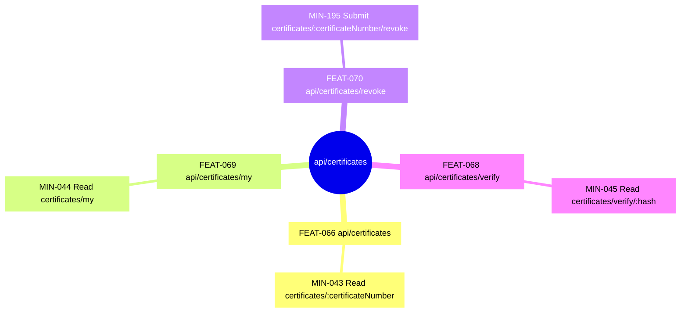

### FEAT-066 api/certificates

api/certificates

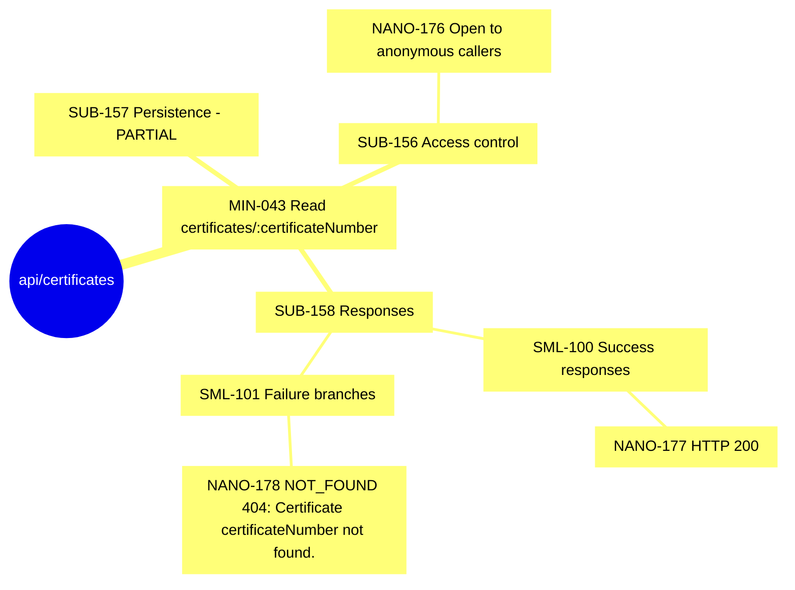

| ID       | Level | Parent   | Name                                                         | Description                                                                                                                                                                                                                                                                                                      | Status                | Verification | Evidence                    | Related                                                   |
| -------- | ----- | -------- | ------------------------------------------------------------ | ---------------------------------------------------------------------------------------------------------------------------------------------------------------------------------------------------------------------------------------------------------------------------------------------------------------- | --------------------- | ------------ | --------------------------- | --------------------------------------------------------- |
| FEAT-066 | MAJOR | MOD-074  | api/certificates                                             |                                                                                                                                                                                                                                                                                                                  | IMPLEMENTED           |              | apps/api/src/server.ts:5469 |                                                           |
| MIN-043  | MINOR | FEAT-066 | Read certificates/:certificateNumber                         | Public Certificate Verification Endpoint (Zero-PII verification BR-150, BR-155) GET /api/v1/certificates/:certificateNumber for anyone (public); ephemeral (process memory); responds 200; 1 failure branch(es). Gaps: ephemeral: state held in process memory, lost on restart; no first-party web caller found | IMPLEMENTED           | VERIFIED     | apps/api/src/server.ts:5469 | API-107, TEST-094, TEST-111, TEST-145, TEST-170, TEST-175 |
| SUB-156  | SUB   | MIN-043  | Access control                                               | Who may call GET /api/v1/certificates/:certificateNumber: anyone (public).                                                                                                                                                                                                                                       | IMPLEMENTED           | PATH_LEVEL   | apps/api/src/server.ts:5469 |                                                           |
| NANO-176 | NANO  | SUB-156  | Open to anonymous callers                                    | auth: public.                                                                                                                                                                                                                                                                                                    | IMPLEMENTED           | PATH_LEVEL   | apps/api/src/server.ts:5469 | ROLE-001                                                  |
| SUB-157  | SUB   | MIN-043  | Persistence                                                  | Ephemeral: state lives in API process memory and is lost on restart.                                                                                                                                                                                                                                             | PARTIALLY_IMPLEMENTED | PATH_LEVEL   | apps/api/src/server.ts:5469 |                                                           |
| SUB-158  | SUB   | MIN-043  | Responses                                                    | Success 200; 1 explicit failure branch(es) besides validation and access errors.                                                                                                                                                                                                                                 | IMPLEMENTED           | PATH_LEVEL   | apps/api/src/server.ts:5469 |                                                           |
| SML-100  | SMALL | SUB-158  | Success responses                                            | HTTP 200.                                                                                                                                                                                                                                                                                                        | IMPLEMENTED           | PATH_LEVEL   | apps/api/src/server.ts:5469 |                                                           |
| NANO-177 | NANO  | SML-100  | HTTP 200                                                     | Replies 200 when the operation succeeds.                                                                                                                                                                                                                                                                         | IMPLEMENTED           | PATH_LEVEL   | apps/api/src/server.ts:5469 |                                                           |
| SML-101  | SMALL | SUB-158  | Failure branches                                             | 1 DomainError branch(es) in the handler, mapped to HTTP by the global error handler.                                                                                                                                                                                                                             | IMPLEMENTED           | PATH_LEVEL   | apps/api/src/server.ts:5469 |                                                           |
| NANO-178 | NANO  | SML-101  | NOT_FOUND 404: Certificate "${certificateNumber}" not found. | Throws DomainError(NOT_FOUND) "Certificate "${certificateNumber}" not found." -> HTTP 404.                                                                                                                                                                                                                       | IMPLEMENTED           | PATH_LEVEL   | apps/api/src/server.ts:5475 | ERR-124                                                   |

### FEAT-069 api/certificates/my

api/certificates/my

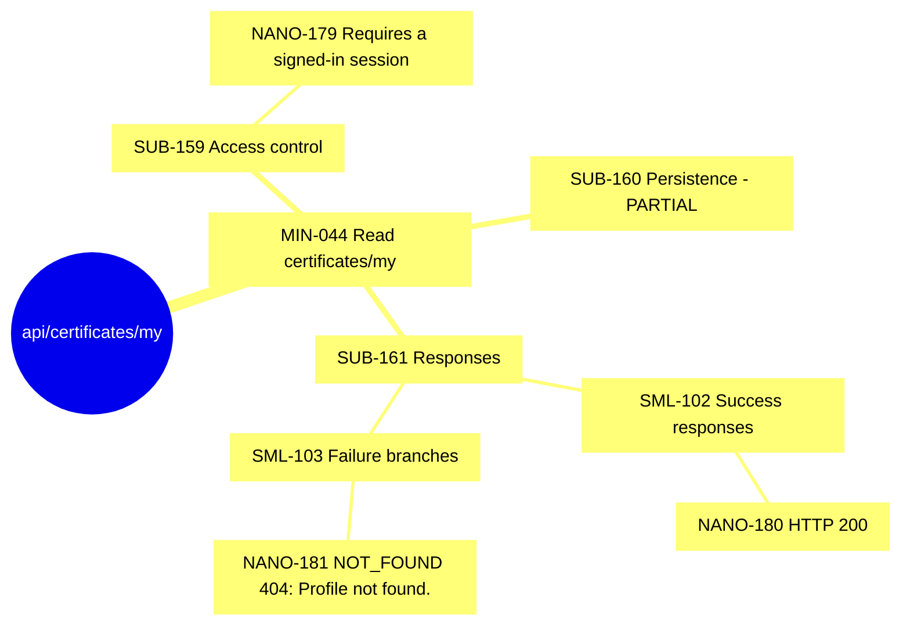

| ID       | Level | Parent   | Name                              | Description                                                                                                                                                                                                                | Status                | Verification | Evidence                    | Related                     |
| -------- | ----- | -------- | --------------------------------- | -------------------------------------------------------------------------------------------------------------------------------------------------------------------------------------------------------------------------- | --------------------- | ------------ | --------------------------- | --------------------------- |
| FEAT-069 | MAJOR | MOD-074  | api/certificates/my               |                                                                                                                                                                                                                            | IMPLEMENTED           |              | apps/api/src/server.ts:5562 |                             |
| MIN-044  | MINOR | FEAT-069 | Read certificates/my              | Learner's Earned Certificates (F-52) GET /api/v1/certificates/my for any signed-in session; ephemeral (process memory); responds 200; 1 failure branch(es). Gaps: ephemeral: state held in process memory, lost on restart | IMPLEMENTED           | VERIFIED     | apps/api/src/server.ts:5562 | API-110, TEST-094, TEST-175 |
| SUB-159  | SUB   | MIN-044  | Access control                    | Who may call GET /api/v1/certificates/my: any signed-in session.                                                                                                                                                           | IMPLEMENTED           | PATH_LEVEL   | apps/api/src/server.ts:5562 |                             |
| NANO-179 | NANO  | SUB-159  | Requires a signed-in session      | Requests without a valid session token are rejected with 401 UNAUTHENTICATED.                                                                                                                                              | IMPLEMENTED           | PATH_LEVEL   | apps/api/src/server.ts:5562 | ROLE-001                    |
| SUB-160  | SUB   | MIN-044  | Persistence                       | Ephemeral: state lives in API process memory and is lost on restart.                                                                                                                                                       | PARTIALLY_IMPLEMENTED | PATH_LEVEL   | apps/api/src/server.ts:5562 |                             |
| SUB-161  | SUB   | MIN-044  | Responses                         | Success 200; 1 explicit failure branch(es) besides validation and access errors.                                                                                                                                           | IMPLEMENTED           | PATH_LEVEL   | apps/api/src/server.ts:5562 |                             |
| SML-102  | SMALL | SUB-161  | Success responses                 | HTTP 200.                                                                                                                                                                                                                  | IMPLEMENTED           | PATH_LEVEL   | apps/api/src/server.ts:5562 |                             |
| NANO-180 | NANO  | SML-102  | HTTP 200                          | Replies 200 when the operation succeeds.                                                                                                                                                                                   | IMPLEMENTED           | PATH_LEVEL   | apps/api/src/server.ts:5562 |                             |
| SML-103  | SMALL | SUB-161  | Failure branches                  | 1 DomainError branch(es) in the handler, mapped to HTTP by the global error handler.                                                                                                                                       | IMPLEMENTED           | PATH_LEVEL   | apps/api/src/server.ts:5562 |                             |
| NANO-181 | NANO  | SML-103  | NOT_FOUND 404: Profile not found. | Throws DomainError(NOT_FOUND) "Profile not found." -> HTTP 404.                                                                                                                                                            | IMPLEMENTED           | PATH_LEVEL   | apps/api/src/server.ts:5566 | ERR-015                     |

### FEAT-070 api/certificates/revoke

api/certificates/revoke

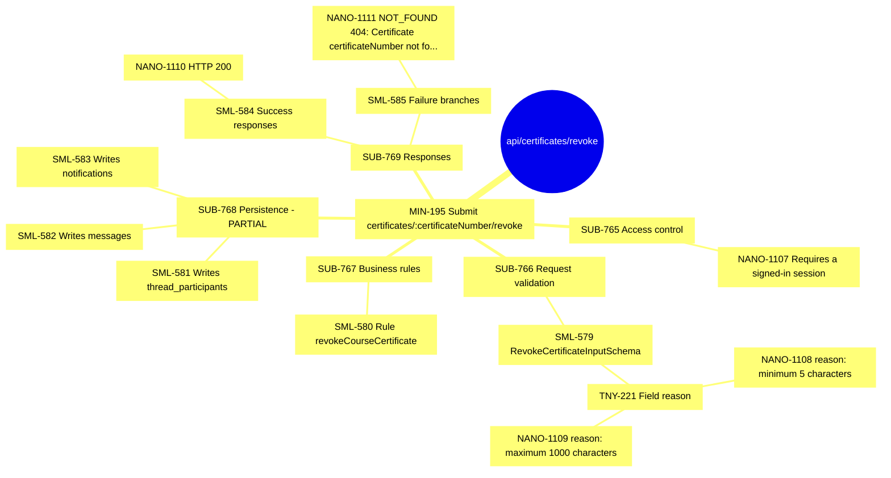

| ID        | Level | Parent   | Name                                                         | Description                                                                                                                                                                                                                                                                                                                                                                                                                                 | Status                | Verification | Evidence                                             | Related                               |
| --------- | ----- | -------- | ------------------------------------------------------------ | ------------------------------------------------------------------------------------------------------------------------------------------------------------------------------------------------------------------------------------------------------------------------------------------------------------------------------------------------------------------------------------------------------------------------------------------- | --------------------- | ------------ | ---------------------------------------------------- | ------------------------------------- |
| FEAT-070  | MAJOR | MOD-074  | api/certificates/revoke                                      |                                                                                                                                                                                                                                                                                                                                                                                                                                             | IMPLEMENTED           |              | apps/api/src/server.ts:5587                          |                                       |
| MIN-195   | MINOR | FEAT-070 | Submit certificates/:certificateNumber/revoke                | Revoke Certificate (Admin or Instructor authority, F-52, BR-154) POST /api/v1/certificates/:certificateNumber/revoke for any signed-in session; validates RevokeCertificateInputSchema; calls revokeCourseCertificate; ephemeral (process memory); writes thread_participants, messages, notifications; responds 200; 1 failure branch(es). Gaps: ephemeral: state held in process memory, lost on restart; no first-party web caller found | IMPLEMENTED           | VERIFIED     | apps/api/src/server.ts:5587                          | API-111, TEST-094, TEST-175, TEST-179 |
| SUB-765   | SUB   | MIN-195  | Access control                                               | Who may call POST /api/v1/certificates/:certificateNumber/revoke: any signed-in session.                                                                                                                                                                                                                                                                                                                                                    | IMPLEMENTED           | PATH_LEVEL   | apps/api/src/server.ts:5587                          |                                       |
| NANO-1107 | NANO  | SUB-765  | Requires a signed-in session                                 | Requests without a valid session token are rejected with 401 UNAUTHENTICATED.                                                                                                                                                                                                                                                                                                                                                               | IMPLEMENTED           | PATH_LEVEL   | apps/api/src/server.ts:5587                          | ROLE-001                              |
| SUB-766   | SUB   | MIN-195  | Request validation                                           | The request is parsed with RevokeCertificateInputSchema; a failure returns 400 with field details before any business logic runs.                                                                                                                                                                                                                                                                                                           | IMPLEMENTED           | PATH_LEVEL   | apps/api/src/server.ts:5587                          |                                       |
| SML-579   | SMALL | SUB-766  | RevokeCertificateInputSchema                                 | RevokeCertificateInputSchema: 1 field(s)                                                                                                                                                                                                                                                                                                                                                                                                    | IMPLEMENTED           | PATH_LEVEL   | packages/contracts/src/index.ts:950                  | SCH-076                               |
| TNY-221   | TINY  | SML-579  | Field reason                                                 | reason (string, required): minimum 5 characters; maximum 1000 characters                                                                                                                                                                                                                                                                                                                                                                    | IMPLEMENTED           | PATH_LEVEL   | packages/contracts/src/index.ts:951                  |                                       |
| NANO-1108 | NANO  | TNY-221  | reason: minimum 5 characters                                 | reason minimum 5 characters.                                                                                                                                                                                                                                                                                                                                                                                                                | IMPLEMENTED           | PATH_LEVEL   | packages/contracts/src/index.ts:951                  |                                       |
| NANO-1109 | NANO  | TNY-221  | reason: maximum 1000 characters                              | reason maximum 1000 characters.                                                                                                                                                                                                                                                                                                                                                                                                             | IMPLEMENTED           | PATH_LEVEL   | packages/contracts/src/index.ts:951                  |                                       |
| SUB-767   | SUB   | MIN-195  | Business rules                                               | Domain functions from packages/domain called by the handler (1).                                                                                                                                                                                                                                                                                                                                                                            | IMPLEMENTED           | PATH_LEVEL   | apps/api/src/server.ts:5587                          |                                       |
| SML-580   | SMALL | SUB-767  | Rule revokeCourseCertificate                                 | Calls revokeCourseCertificate (packages/domain/src/lms.ts). Rule status IMPLEMENTED; its own tests: VERIFIED.                                                                                                                                                                                                                                                                                                                               | IMPLEMENTED           | VERIFIED     | packages/domain/src/lms.ts:326                       | RULE-141                              |
| SUB-768   | SUB   | MIN-195  | Persistence                                                  | Ephemeral: state lives in API process memory and is lost on restart.                                                                                                                                                                                                                                                                                                                                                                        | PARTIALLY_IMPLEMENTED | PATH_LEVEL   | apps/api/src/server.ts:5587                          |                                       |
| SML-581   | SMALL | SUB-768  | Writes thread_participants                                   | Writes table thread_participants (00006_messaging_schema.sql).                                                                                                                                                                                                                                                                                                                                                                              | IMPLEMENTED           | PATH_LEVEL   | supabase/migrations/00006_messaging_schema.sql:17    | DB-027                                |
| SML-582   | SMALL | SUB-768  | Writes messages                                              | Writes table messages (00006_messaging_schema.sql).                                                                                                                                                                                                                                                                                                                                                                                         | IMPLEMENTED           | PATH_LEVEL   | supabase/migrations/00006_messaging_schema.sql:30    | DB-028                                |
| SML-583   | SMALL | SUB-768  | Writes notifications                                         | Writes table notifications (00007_notifications_schema.sql).                                                                                                                                                                                                                                                                                                                                                                                | IMPLEMENTED           | PATH_LEVEL   | supabase/migrations/00007_notifications_schema.sql:6 | DB-029                                |
| SUB-769   | SUB   | MIN-195  | Responses                                                    | Success 200; 1 explicit failure branch(es) besides validation and access errors.                                                                                                                                                                                                                                                                                                                                                            | IMPLEMENTED           | PATH_LEVEL   | apps/api/src/server.ts:5587                          |                                       |
| SML-584   | SMALL | SUB-769  | Success responses                                            | HTTP 200.                                                                                                                                                                                                                                                                                                                                                                                                                                   | IMPLEMENTED           | PATH_LEVEL   | apps/api/src/server.ts:5587                          |                                       |
| NANO-1110 | NANO  | SML-584  | HTTP 200                                                     | Replies 200 when the operation succeeds.                                                                                                                                                                                                                                                                                                                                                                                                    | IMPLEMENTED           | PATH_LEVEL   | apps/api/src/server.ts:5587                          |                                       |
| SML-585   | SMALL | SUB-769  | Failure branches                                             | 1 DomainError branch(es) in the handler, mapped to HTTP by the global error handler.                                                                                                                                                                                                                                                                                                                                                        | IMPLEMENTED           | PATH_LEVEL   | apps/api/src/server.ts:5587                          |                                       |
| NANO-1111 | NANO  | SML-585  | NOT_FOUND 404: Certificate "${certificateNumber}" not found. | Throws DomainError(NOT_FOUND) "Certificate "${certificateNumber}" not found." -> HTTP 404.                                                                                                                                                                                                                                                                                                                                                  | IMPLEMENTED           | PATH_LEVEL   | apps/api/src/server.ts:5594                          | ERR-124                               |

### FEAT-068 api/certificates/verify

api/certificates/verify

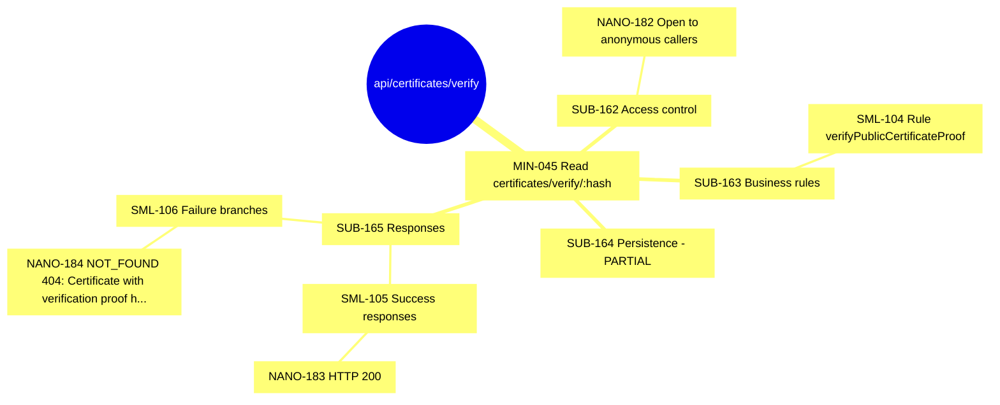

| ID       | Level | Parent   | Name                                                                         | Description                                                                                                                                                                                                                                                                                                 | Status                | Verification | Evidence                       | Related                               |
| -------- | ----- | -------- | ---------------------------------------------------------------------------- | ----------------------------------------------------------------------------------------------------------------------------------------------------------------------------------------------------------------------------------------------------------------------------------------------------------- | --------------------- | ------------ | ------------------------------ | ------------------------------------- |
| FEAT-068 | MAJOR | MOD-074  | api/certificates/verify                                                      |                                                                                                                                                                                                                                                                                                             | IMPLEMENTED           |              | apps/api/src/server.ts:5540    |                                       |
| MIN-045  | MINOR | FEAT-068 | Read certificates/verify/:hash                                               | Direct Certificate Verification Alias (F-52) GET /api/v1/certificates/verify/:hash for anyone (public); calls verifyPublicCertificateProof; ephemeral (process memory); responds 200; 1 failure branch(es). Gaps: ephemeral: state held in process memory, lost on restart; no first-party web caller found | IMPLEMENTED           | VERIFIED     | apps/api/src/server.ts:5540    | API-109, TEST-094, TEST-145, TEST-175 |
| SUB-162  | SUB   | MIN-045  | Access control                                                               | Who may call GET /api/v1/certificates/verify/:hash: anyone (public).                                                                                                                                                                                                                                        | IMPLEMENTED           | PATH_LEVEL   | apps/api/src/server.ts:5540    |                                       |
| NANO-182 | NANO  | SUB-162  | Open to anonymous callers                                                    | auth: public.                                                                                                                                                                                                                                                                                               | IMPLEMENTED           | PATH_LEVEL   | apps/api/src/server.ts:5540    | ROLE-001                              |
| SUB-163  | SUB   | MIN-045  | Business rules                                                               | Domain functions from packages/domain called by the handler (1).                                                                                                                                                                                                                                            | IMPLEMENTED           | PATH_LEVEL   | apps/api/src/server.ts:5540    |                                       |
| SML-104  | SMALL | SUB-163  | Rule verifyPublicCertificateProof                                            | Calls verifyPublicCertificateProof (packages/domain/src/lms.ts). Rule status IMPLEMENTED; its own tests: VERIFIED.                                                                                                                                                                                          | IMPLEMENTED           | VERIFIED     | packages/domain/src/lms.ts:371 | RULE-142                              |
| SUB-164  | SUB   | MIN-045  | Persistence                                                                  | Ephemeral: state lives in API process memory and is lost on restart.                                                                                                                                                                                                                                        | PARTIALLY_IMPLEMENTED | PATH_LEVEL   | apps/api/src/server.ts:5540    |                                       |
| SUB-165  | SUB   | MIN-045  | Responses                                                                    | Success 200; 1 explicit failure branch(es) besides validation and access errors.                                                                                                                                                                                                                            | IMPLEMENTED           | PATH_LEVEL   | apps/api/src/server.ts:5540    |                                       |
| SML-105  | SMALL | SUB-165  | Success responses                                                            | HTTP 200.                                                                                                                                                                                                                                                                                                   | IMPLEMENTED           | PATH_LEVEL   | apps/api/src/server.ts:5540    |                                       |
| NANO-183 | NANO  | SML-105  | HTTP 200                                                                     | Replies 200 when the operation succeeds.                                                                                                                                                                                                                                                                    | IMPLEMENTED           | PATH_LEVEL   | apps/api/src/server.ts:5540    |                                       |
| SML-106  | SMALL | SUB-165  | Failure branches                                                             | 1 DomainError branch(es) in the handler, mapped to HTTP by the global error handler.                                                                                                                                                                                                                        | IMPLEMENTED           | PATH_LEVEL   | apps/api/src/server.ts:5540    |                                       |
| NANO-184 | NANO  | SML-106  | NOT_FOUND 404: Certificate with verification proof hash "${hash}" not found. | Throws DomainError(NOT_FOUND) "Certificate with verification proof hash "${hash}" not found." -> HTTP 404.                                                                                                                                                                                                  | IMPLEMENTED           | PATH_LEVEL   | apps/api/src/server.ts:5546    | ERR-126                               |

## api/challenges (MOD-068)

**Application:** apps/api (MOD-001). **Purpose:** API module: routes under /api/v1/challenges in apps/api/src/server.ts.

**Nodes by level:** MODULE 1, MAJOR 3, MINOR 5, SUB 23, SMALL 20, TINY 13, NANO 46. **Status:** IMPLEMENTED 105, PARTIALLY_IMPLEMENTED 6. **Verification:** PATH_LEVEL 94, UNKNOWN 1, VERIFIED 12.

**User roles that reach it:** anonymous, authenticated.

**Known gaps:** MIN-046 ephemeral: state held in process memory, lost on restart; MIN-047 ephemeral: state held in process memory, lost on restart; MIN-047 no first-party web caller found; MIN-196 ephemeral: state held in process memory, lost on restart; MIN-196 no first-party web caller found; MIN-197 ephemeral: state held in process memory, lost on restart; MIN-198 ephemeral: state held in process memory, lost on restart.

**Called from (web screens and components):** FEAT-159 Screen /assessments

### Module map (to minor features)

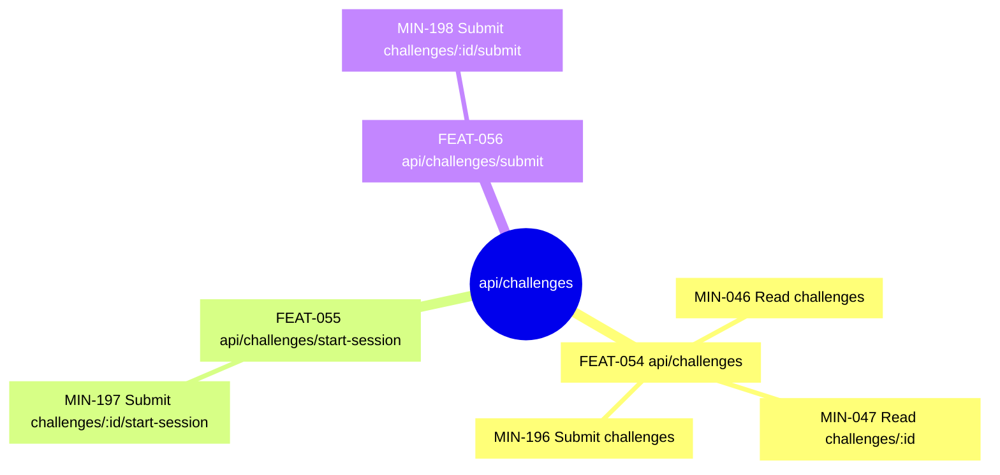

### FEAT-054 api/challenges

api/challenges

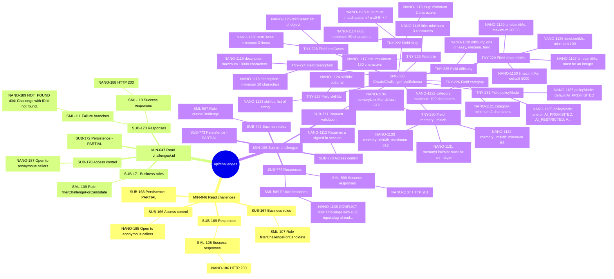

| ID        | Level | Parent   | Name                                                                               | Description                                                                                                                                                                                                                                                                     | Status                | Verification | Evidence                              | Related                                          |
| --------- | ----- | -------- | ---------------------------------------------------------------------------------- | ------------------------------------------------------------------------------------------------------------------------------------------------------------------------------------------------------------------------------------------------------------------------------- | --------------------- | ------------ | ------------------------------------- | ------------------------------------------------ |
| FEAT-054  | MAJOR | MOD-068  | api/challenges                                                                     |                                                                                                                                                                                                                                                                                 | IMPLEMENTED           |              | apps/api/src/server.ts:4724           |                                                  |
| MIN-046   | MINOR | FEAT-054 | Read challenges                                                                    | Challenges Endpoints GET /api/v1/challenges for anyone (public); calls filterChallengeForCandidate; ephemeral (process memory); responds 200. Gaps: ephemeral: state held in process memory, lost on restart                                                                    | IMPLEMENTED           | VERIFIED     | apps/api/src/server.ts:4724           | API-091, TEST-145, TEST-170, TEST-176            |
| SUB-166   | SUB   | MIN-046  | Access control                                                                     | Who may call GET /api/v1/challenges: anyone (public).                                                                                                                                                                                                                           | IMPLEMENTED           | PATH_LEVEL   | apps/api/src/server.ts:4724           |                                                  |
| NANO-185  | NANO  | SUB-166  | Open to anonymous callers                                                          | auth: public.                                                                                                                                                                                                                                                                   | IMPLEMENTED           | PATH_LEVEL   | apps/api/src/server.ts:4724           | ROLE-001                                         |
| SUB-167   | SUB   | MIN-046  | Business rules                                                                     | Domain functions from packages/domain called by the handler (1).                                                                                                                                                                                                                | IMPLEMENTED           | PATH_LEVEL   | apps/api/src/server.ts:4724           |                                                  |
| SML-107   | SMALL | SUB-167  | Rule filterChallengeForCandidate                                                   | Calls filterChallengeForCandidate (packages/domain/src/challenges.ts). Rule status IMPLEMENTED; its own tests: VERIFIED.                                                                                                                                                        | IMPLEMENTED           | VERIFIED     | packages/domain/src/challenges.ts:111 | RULE-085                                         |
| SUB-168   | SUB   | MIN-046  | Persistence                                                                        | Ephemeral: state lives in API process memory and is lost on restart.                                                                                                                                                                                                            | PARTIALLY_IMPLEMENTED | PATH_LEVEL   | apps/api/src/server.ts:4724           |                                                  |
| SUB-169   | SUB   | MIN-046  | Responses                                                                          | Success 200; 0 explicit failure branch(es) besides validation and access errors.                                                                                                                                                                                                | IMPLEMENTED           | PATH_LEVEL   | apps/api/src/server.ts:4724           |                                                  |
| SML-108   | SMALL | SUB-169  | Success responses                                                                  | HTTP 200 (implicit).                                                                                                                                                                                                                                                            | IMPLEMENTED           | PATH_LEVEL   | apps/api/src/server.ts:4724           |                                                  |
| NANO-186  | NANO  | SML-108  | HTTP 200                                                                           | Replies 200 when the operation succeeds (implicit default).                                                                                                                                                                                                                     | IMPLEMENTED           | PATH_LEVEL   | apps/api/src/server.ts:4724           |                                                  |
| MIN-047   | MINOR | FEAT-054 | Read challenges/:id                                                                | GET /api/v1/challenges/:id for anyone (public); calls filterChallengeForCandidate; ephemeral (process memory); responds 200; 1 failure branch(es). Gaps: ephemeral: state held in process memory, lost on restart; no first-party web caller found                              | IMPLEMENTED           | VERIFIED     | apps/api/src/server.ts:4729           | API-092, TEST-095, TEST-145                      |
| SUB-170   | SUB   | MIN-047  | Access control                                                                     | Who may call GET /api/v1/challenges/:id: anyone (public).                                                                                                                                                                                                                       | IMPLEMENTED           | PATH_LEVEL   | apps/api/src/server.ts:4729           |                                                  |
| NANO-187  | NANO  | SUB-170  | Open to anonymous callers                                                          | auth: public.                                                                                                                                                                                                                                                                   | IMPLEMENTED           | PATH_LEVEL   | apps/api/src/server.ts:4729           | ROLE-001                                         |
| SUB-171   | SUB   | MIN-047  | Business rules                                                                     | Domain functions from packages/domain called by the handler (1).                                                                                                                                                                                                                | IMPLEMENTED           | PATH_LEVEL   | apps/api/src/server.ts:4729           |                                                  |
| SML-109   | SMALL | SUB-171  | Rule filterChallengeForCandidate                                                   | Calls filterChallengeForCandidate (packages/domain/src/challenges.ts). Rule status IMPLEMENTED; its own tests: VERIFIED.                                                                                                                                                        | IMPLEMENTED           | VERIFIED     | packages/domain/src/challenges.ts:111 | RULE-085                                         |
| SUB-172   | SUB   | MIN-047  | Persistence                                                                        | Ephemeral: state lives in API process memory and is lost on restart.                                                                                                                                                                                                            | PARTIALLY_IMPLEMENTED | PATH_LEVEL   | apps/api/src/server.ts:4729           |                                                  |
| SUB-173   | SUB   | MIN-047  | Responses                                                                          | Success 200; 1 explicit failure branch(es) besides validation and access errors.                                                                                                                                                                                                | IMPLEMENTED           | PATH_LEVEL   | apps/api/src/server.ts:4729           |                                                  |
| SML-110   | SMALL | SUB-173  | Success responses                                                                  | HTTP 200.                                                                                                                                                                                                                                                                       | IMPLEMENTED           | PATH_LEVEL   | apps/api/src/server.ts:4729           |                                                  |
| NANO-188  | NANO  | SML-110  | HTTP 200                                                                           | Replies 200 when the operation succeeds.                                                                                                                                                                                                                                        | IMPLEMENTED           | PATH_LEVEL   | apps/api/src/server.ts:4729           |                                                  |
| SML-111   | SMALL | SUB-173  | Failure branches                                                                   | 1 DomainError branch(es) in the handler, mapped to HTTP by the global error handler.                                                                                                                                                                                            | IMPLEMENTED           | PATH_LEVEL   | apps/api/src/server.ts:4729           |                                                  |
| NANO-189  | NANO  | SML-111  | NOT_FOUND 404: Challenge with ID ${id} not found.                                  | Throws DomainError(NOT_FOUND) "Challenge with ID ${id} not found." -> HTTP 404.                                                                                                                                                                                                 | IMPLEMENTED           | PATH_LEVEL   | apps/api/src/server.ts:4735           | ERR-100                                          |
| MIN-196   | MINOR | FEAT-054 | Submit challenges                                                                  | POST /api/v1/challenges for any signed-in session; validates CreateChallengeInputSchema; calls createChallenge; ephemeral (process memory); responds 201; 1 failure branch(es). Gaps: ephemeral: state held in process memory, lost on restart; no first-party web caller found | IMPLEMENTED           | VERIFIED     | apps/api/src/server.ts:4741           | API-093, TEST-095                                |
| SUB-770   | SUB   | MIN-196  | Access control                                                                     | Who may call POST /api/v1/challenges: any signed-in session.                                                                                                                                                                                                                    | IMPLEMENTED           | PATH_LEVEL   | apps/api/src/server.ts:4741           |                                                  |
| NANO-1112 | NANO  | SUB-770  | Requires a signed-in session                                                       | Requests without a valid session token are rejected with 401 UNAUTHENTICATED.                                                                                                                                                                                                   | IMPLEMENTED           | PATH_LEVEL   | apps/api/src/server.ts:4741           | ROLE-001                                         |
| SUB-771   | SUB   | MIN-196  | Request validation                                                                 | The request is parsed with CreateChallengeInputSchema; a failure returns 400 with field details before any business logic runs.                                                                                                                                                 | IMPLEMENTED           | PATH_LEVEL   | apps/api/src/server.ts:4741           |                                                  |
| SML-586   | SMALL | SUB-771  | CreateChallengeInputSchema                                                         | CreateChallengeInputSchema: 10 field(s)                                                                                                                                                                                                                                         | IMPLEMENTED           | PATH_LEVEL   | packages/contracts/src/index.ts:302   | SCH-020                                          |
| TNY-222   | TINY  | SML-586  | Field slug                                                                         | slug (string, required): minimum 2 characters; maximum 50 characters; must match pattern /^[a-z0-9-]+$/                                                                                                                                                                         | IMPLEMENTED           | PATH_LEVEL   | packages/contracts/src/index.ts:303   |                                                  |
| NANO-1113 | NANO  | TNY-222  | slug: minimum 2 characters                                                         | slug minimum 2 characters.                                                                                                                                                                                                                                                      | IMPLEMENTED           | PATH_LEVEL   | packages/contracts/src/index.ts:303   |                                                  |
| NANO-1114 | NANO  | TNY-222  | slug: maximum 50 characters                                                        | slug maximum 50 characters.                                                                                                                                                                                                                                                     | IMPLEMENTED           | PATH_LEVEL   | packages/contracts/src/index.ts:303   |                                                  |
| NANO-1115 | NANO  | TNY-222  | slug: must match pattern /^[a-z0-9-]+$/                                            | slug must match pattern /^[a-z0-9-]+$/; message "Slug must be lowercase alphanumeric with hyphens".                                                                                                                                                                             | IMPLEMENTED           | PATH_LEVEL   | packages/contracts/src/index.ts:303   |                                                  |
| TNY-223   | TINY  | SML-586  | Field title                                                                        | title (string, required): minimum 3 characters; maximum 150 characters                                                                                                                                                                                                          | IMPLEMENTED           | PATH_LEVEL   | packages/contracts/src/index.ts:308   |                                                  |
| NANO-1116 | NANO  | TNY-223  | title: minimum 3 characters                                                        | title minimum 3 characters.                                                                                                                                                                                                                                                     | IMPLEMENTED           | PATH_LEVEL   | packages/contracts/src/index.ts:308   |                                                  |
| NANO-1117 | NANO  | TNY-223  | title: maximum 150 characters                                                      | title maximum 150 characters.                                                                                                                                                                                                                                                   | IMPLEMENTED           | PATH_LEVEL   | packages/contracts/src/index.ts:308   |                                                  |
| TNY-224   | TINY  | SML-586  | Field description                                                                  | description (string, required): minimum 10 characters; maximum 10000 characters                                                                                                                                                                                                 | IMPLEMENTED           | PATH_LEVEL   | packages/contracts/src/index.ts:309   |                                                  |
| NANO-1118 | NANO  | TNY-224  | description: minimum 10 characters                                                 | description minimum 10 characters.                                                                                                                                                                                                                                              | IMPLEMENTED           | PATH_LEVEL   | packages/contracts/src/index.ts:309   |                                                  |
| NANO-1119 | NANO  | TNY-224  | description: maximum 10000 characters                                              | description maximum 10000 characters.                                                                                                                                                                                                                                           | IMPLEMENTED           | PATH_LEVEL   | packages/contracts/src/index.ts:309   |                                                  |
| TNY-225   | TINY  | SML-586  | Field difficulty                                                                   | difficulty (enum, required): one of: easy, medium, hard                                                                                                                                                                                                                         | IMPLEMENTED           | PATH_LEVEL   | packages/contracts/src/index.ts:310   |                                                  |
| NANO-1120 | NANO  | TNY-225  | difficulty: one of: easy, medium, hard                                             | difficulty one of: easy, medium, hard.                                                                                                                                                                                                                                          | IMPLEMENTED           | PATH_LEVEL   | packages/contracts/src/index.ts:310   |                                                  |
| TNY-226   | TINY  | SML-586  | Field category                                                                     | category (string, required): minimum 2 characters; maximum 100 characters                                                                                                                                                                                                       | IMPLEMENTED           | PATH_LEVEL   | packages/contracts/src/index.ts:311   |                                                  |
| NANO-1121 | NANO  | TNY-226  | category: minimum 2 characters                                                     | category minimum 2 characters.                                                                                                                                                                                                                                                  | IMPLEMENTED           | PATH_LEVEL   | packages/contracts/src/index.ts:311   |                                                  |
| NANO-1122 | NANO  | TNY-226  | category: maximum 100 characters                                                   | category maximum 100 characters.                                                                                                                                                                                                                                                | IMPLEMENTED           | PATH_LEVEL   | packages/contracts/src/index.ts:311   |                                                  |
| TNY-227   | TINY  | SML-586  | Field skillIds                                                                     | skillIds (array, optional): list of string; optional                                                                                                                                                                                                                            | IMPLEMENTED           | PATH_LEVEL   | packages/contracts/src/index.ts:312   |                                                  |
| NANO-1123 | NANO  | TNY-227  | skillIds: list of string                                                           | skillIds list of string.                                                                                                                                                                                                                                                        | IMPLEMENTED           | PATH_LEVEL   | packages/contracts/src/index.ts:312   |                                                  |
| NANO-1124 | NANO  | TNY-227  | skillIds: optional                                                                 | skillIds optional.                                                                                                                                                                                                                                                              | IMPLEMENTED           | PATH_LEVEL   | packages/contracts/src/index.ts:312   |                                                  |
| TNY-228   | TINY  | SML-586  | Field testCases                                                                    | testCases (array, required): list of object; minimum 2 items                                                                                                                                                                                                                    | IMPLEMENTED           | PATH_LEVEL   | packages/contracts/src/index.ts:313   |                                                  |
| NANO-1125 | NANO  | TNY-228  | testCases: list of object                                                          | testCases list of object.                                                                                                                                                                                                                                                       | IMPLEMENTED           | PATH_LEVEL   | packages/contracts/src/index.ts:313   |                                                  |
| NANO-1126 | NANO  | TNY-228  | testCases: minimum 2 items                                                         | testCases minimum 2 items.                                                                                                                                                                                                                                                      | IMPLEMENTED           | PATH_LEVEL   | packages/contracts/src/index.ts:313   |                                                  |
| TNY-229   | TINY  | SML-586  | Field timeLimitMs                                                                  | timeLimitMs (number, optional): must be an integer; minimum 100; maximum 30000; default 5000                                                                                                                                                                                    | IMPLEMENTED           | PATH_LEVEL   | packages/contracts/src/index.ts:323   |                                                  |
| NANO-1127 | NANO  | TNY-229  | timeLimitMs: must be an integer                                                    | timeLimitMs must be an integer.                                                                                                                                                                                                                                                 | IMPLEMENTED           | PATH_LEVEL   | packages/contracts/src/index.ts:323   |                                                  |
| NANO-1128 | NANO  | TNY-229  | timeLimitMs: minimum 100                                                           | timeLimitMs minimum 100.                                                                                                                                                                                                                                                        | IMPLEMENTED           | PATH_LEVEL   | packages/contracts/src/index.ts:323   |                                                  |
| NANO-1129 | NANO  | TNY-229  | timeLimitMs: maximum 30000                                                         | timeLimitMs maximum 30000.                                                                                                                                                                                                                                                      | IMPLEMENTED           | PATH_LEVEL   | packages/contracts/src/index.ts:323   |                                                  |
| NANO-1130 | NANO  | TNY-229  | timeLimitMs: default 5000                                                          | timeLimitMs default 5000.                                                                                                                                                                                                                                                       | IMPLEMENTED           | PATH_LEVEL   | packages/contracts/src/index.ts:323   |                                                  |
| TNY-230   | TINY  | SML-586  | Field memoryLimitMb                                                                | memoryLimitMb (number, optional): must be an integer; minimum 64; maximum 512; default 512                                                                                                                                                                                      | IMPLEMENTED           | PATH_LEVEL   | packages/contracts/src/index.ts:324   |                                                  |
| NANO-1131 | NANO  | TNY-230  | memoryLimitMb: must be an integer                                                  | memoryLimitMb must be an integer.                                                                                                                                                                                                                                               | IMPLEMENTED           | PATH_LEVEL   | packages/contracts/src/index.ts:324   |                                                  |
| NANO-1132 | NANO  | TNY-230  | memoryLimitMb: minimum 64                                                          | memoryLimitMb minimum 64.                                                                                                                                                                                                                                                       | IMPLEMENTED           | PATH_LEVEL   | packages/contracts/src/index.ts:324   |                                                  |
| NANO-1133 | NANO  | TNY-230  | memoryLimitMb: maximum 512                                                         | memoryLimitMb maximum 512.                                                                                                                                                                                                                                                      | IMPLEMENTED           | PATH_LEVEL   | packages/contracts/src/index.ts:324   |                                                  |
| NANO-1134 | NANO  | TNY-230  | memoryLimitMb: default 512                                                         | memoryLimitMb default 512.                                                                                                                                                                                                                                                      | IMPLEMENTED           | PATH_LEVEL   | packages/contracts/src/index.ts:324   |                                                  |
| TNY-231   | TINY  | SML-586  | Field policyMode                                                                   | policyMode (enum, optional): one of: AI_PROHIBITED, AI_RESTRICTED, AI_ALLOWED, POST_ASSESSMENT_ONLY; default 'AI_PROHIBITED'                                                                                                                                                    | IMPLEMENTED           | PATH_LEVEL   | packages/contracts/src/index.ts:325   |                                                  |
| NANO-1135 | NANO  | TNY-231  | policyMode: one of: AI_PROHIBITED, AI_RESTRICTED, AI_ALLOWED, POST_ASSESSMENT_ONLY | policyMode one of: AI_PROHIBITED, AI_RESTRICTED, AI_ALLOWED, POST_ASSESSMENT_ONLY.                                                                                                                                                                                              | IMPLEMENTED           | PATH_LEVEL   | packages/contracts/src/index.ts:325   |                                                  |
| NANO-1136 | NANO  | TNY-231  | policyMode: default 'AI_PROHIBITED'                                                | policyMode default 'AI_PROHIBITED'; message "AI_PROHIBITED".                                                                                                                                                                                                                    | IMPLEMENTED           | VERIFIED     | packages/contracts/src/index.ts:325   | TEST-170, TEST-084, TEST-095, TEST-018, TEST-027 |
| SUB-772   | SUB   | MIN-196  | Business rules                                                                     | Domain functions from packages/domain called by the handler (1).                                                                                                                                                                                                                | IMPLEMENTED           | PATH_LEVEL   | apps/api/src/server.ts:4741           |                                                  |
| SML-587   | SMALL | SUB-772  | Rule createChallenge                                                               | Calls createChallenge (packages/domain/src/challenges.ts). Rule status IMPLEMENTED; its own tests: VERIFIED.                                                                                                                                                                    | IMPLEMENTED           | VERIFIED     | packages/domain/src/challenges.ts:53  | RULE-084                                         |
| SUB-773   | SUB   | MIN-196  | Persistence                                                                        | Ephemeral: state lives in API process memory and is lost on restart.                                                                                                                                                                                                            | PARTIALLY_IMPLEMENTED | PATH_LEVEL   | apps/api/src/server.ts:4741           |                                                  |
| SUB-774   | SUB   | MIN-196  | Responses                                                                          | Success 201; 1 explicit failure branch(es) besides validation and access errors.                                                                                                                                                                                                | IMPLEMENTED           | PATH_LEVEL   | apps/api/src/server.ts:4741           |                                                  |
| SML-588   | SMALL | SUB-774  | Success responses                                                                  | HTTP 201.                                                                                                                                                                                                                                                                       | IMPLEMENTED           | PATH_LEVEL   | apps/api/src/server.ts:4741           |                                                  |
| NANO-1137 | NANO  | SML-588  | HTTP 201                                                                           | Replies 201 when the operation succeeds.                                                                                                                                                                                                                                        | IMPLEMENTED           | PATH_LEVEL   | apps/api/src/server.ts:4741           |                                                  |
| SML-589   | SMALL | SUB-774  | Failure branches                                                                   | 1 DomainError branch(es) in the handler, mapped to HTTP by the global error handler.                                                                                                                                                                                            | IMPLEMENTED           | PATH_LEVEL   | apps/api/src/server.ts:4741           |                                                  |
| NANO-1138 | NANO  | SML-589  | CONFLICT 409: Challenge with slug "${input.slug}" already exists.                  | Throws DomainError(CONFLICT) "Challenge with slug "${input.slug}" already exists." -> HTTP 409.                                                                                                                                                                                 | IMPLEMENTED           | PATH_LEVEL   | apps/api/src/server.ts:4746           | ERR-101                                          |

### FEAT-055 api/challenges/start-session

api/challenges/start-session

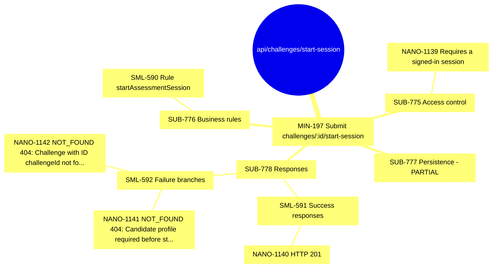

| ID        | Level | Parent   | Name                                                                  | Description                                                                                                                                                                                                                                                                 | Status                | Verification | Evidence                             | Related                                         |
| --------- | ----- | -------- | --------------------------------------------------------------------- | --------------------------------------------------------------------------------------------------------------------------------------------------------------------------------------------------------------------------------------------------------------------------- | --------------------- | ------------ | ------------------------------------ | ----------------------------------------------- |
| FEAT-055  | MAJOR | MOD-068  | api/challenges/start-session                                          |                                                                                                                                                                                                                                                                             | IMPLEMENTED           |              | apps/api/src/server.ts:4773          |                                                 |
| MIN-197   | MINOR | FEAT-055 | Submit challenges/:id/start-session                                   | Assessment Session & Submission Endpoints POST /api/v1/challenges/:id/start-session for any signed-in session; calls startAssessmentSession; ephemeral (process memory); responds 201; 2 failure branch(es). Gaps: ephemeral: state held in process memory, lost on restart | IMPLEMENTED           | VERIFIED     | apps/api/src/server.ts:4773          | API-094, TEST-084, TEST-095, TEST-170, TEST-176 |
| SUB-775   | SUB   | MIN-197  | Access control                                                        | Who may call POST /api/v1/challenges/:id/start-session: any signed-in session.                                                                                                                                                                                              | IMPLEMENTED           | PATH_LEVEL   | apps/api/src/server.ts:4773          |                                                 |
| NANO-1139 | NANO  | SUB-775  | Requires a signed-in session                                          | Requests without a valid session token are rejected with 401 UNAUTHENTICATED.                                                                                                                                                                                               | IMPLEMENTED           | PATH_LEVEL   | apps/api/src/server.ts:4773          | ROLE-001                                        |
| SUB-776   | SUB   | MIN-197  | Business rules                                                        | Domain functions from packages/domain called by the handler (1).                                                                                                                                                                                                            | IMPLEMENTED           | PATH_LEVEL   | apps/api/src/server.ts:4773          |                                                 |
| SML-590   | SMALL | SUB-776  | Rule startAssessmentSession                                           | Calls startAssessmentSession (packages/domain/src/assessment.ts). Rule status IMPLEMENTED; its own tests: VERIFIED.                                                                                                                                                         | IMPLEMENTED           | VERIFIED     | packages/domain/src/assessment.ts:49 | RULE-045                                        |
| SUB-777   | SUB   | MIN-197  | Persistence                                                           | Ephemeral: state lives in API process memory and is lost on restart.                                                                                                                                                                                                        | PARTIALLY_IMPLEMENTED | PATH_LEVEL   | apps/api/src/server.ts:4773          |                                                 |
| SUB-778   | SUB   | MIN-197  | Responses                                                             | Success 201; 2 explicit failure branch(es) besides validation and access errors.                                                                                                                                                                                            | IMPLEMENTED           | PATH_LEVEL   | apps/api/src/server.ts:4773          |                                                 |
| SML-591   | SMALL | SUB-778  | Success responses                                                     | HTTP 201.                                                                                                                                                                                                                                                                   | IMPLEMENTED           | PATH_LEVEL   | apps/api/src/server.ts:4773          |                                                 |
| NANO-1140 | NANO  | SML-591  | HTTP 201                                                              | Replies 201 when the operation succeeds.                                                                                                                                                                                                                                    | IMPLEMENTED           | PATH_LEVEL   | apps/api/src/server.ts:4773          |                                                 |
| SML-592   | SMALL | SUB-778  | Failure branches                                                      | 2 DomainError branch(es) in the handler, mapped to HTTP by the global error handler.                                                                                                                                                                                        | IMPLEMENTED           | PATH_LEVEL   | apps/api/src/server.ts:4773          |                                                 |
| NANO-1141 | NANO  | SML-592  | NOT_FOUND 404: Candidate profile required before starting assessment. | Throws DomainError(NOT_FOUND) "Candidate profile required before starting assessment." -> HTTP 404.                                                                                                                                                                         | IMPLEMENTED           | PATH_LEVEL   | apps/api/src/server.ts:4781          | ERR-102                                         |
| NANO-1142 | NANO  | SML-592  | NOT_FOUND 404: Challenge with ID ${challengeId} not found.            | Throws DomainError(NOT_FOUND) "Challenge with ID ${challengeId} not found." -> HTTP 404.                                                                                                                                                                                    | IMPLEMENTED           | PATH_LEVEL   | apps/api/src/server.ts:4789          | ERR-103                                         |

### FEAT-056 api/challenges/submit

api/challenges/submit

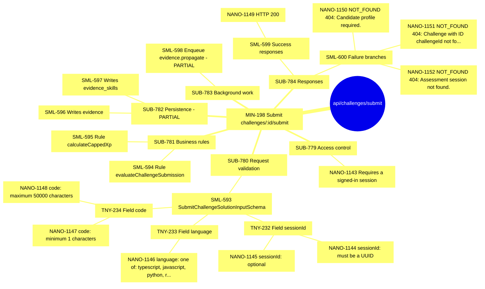

| ID        | Level | Parent   | Name                                                       | Description                                                                                                                                                                                                                                                                                                                        | Status                | Verification | Evidence                                                | Related                                         |
| --------- | ----- | -------- | ---------------------------------------------------------- | ---------------------------------------------------------------------------------------------------------------------------------------------------------------------------------------------------------------------------------------------------------------------------------------------------------------------------------- | --------------------- | ------------ | ------------------------------------------------------- | ----------------------------------------------- |
| FEAT-056  | MAJOR | MOD-068  | api/challenges/submit                                      |                                                                                                                                                                                                                                                                                                                                    | IMPLEMENTED           |              | apps/api/src/server.ts:4806                             |                                                 |
| MIN-198   | MINOR | FEAT-056 | Submit challenges/:id/submit                               | POST /api/v1/challenges/:id/submit for any signed-in session; validates SubmitChallengeSolutionInputSchema; calls evaluateChallengeSubmission, calculateCappedXp; ephemeral (process memory); writes evidence, evidence_skills; responds 200; 3 failure branch(es). Gaps: ephemeral: state held in process memory, lost on restart | IMPLEMENTED           | VERIFIED     | apps/api/src/server.ts:4806                             | API-095, TEST-095, TEST-124, TEST-170, TEST-176 |
| SUB-779   | SUB   | MIN-198  | Access control                                             | Who may call POST /api/v1/challenges/:id/submit: any signed-in session.                                                                                                                                                                                                                                                            | IMPLEMENTED           | PATH_LEVEL   | apps/api/src/server.ts:4806                             |                                                 |
| NANO-1143 | NANO  | SUB-779  | Requires a signed-in session                               | Requests without a valid session token are rejected with 401 UNAUTHENTICATED.                                                                                                                                                                                                                                                      | IMPLEMENTED           | PATH_LEVEL   | apps/api/src/server.ts:4806                             | ROLE-001                                        |
| SUB-780   | SUB   | MIN-198  | Request validation                                         | The request is parsed with SubmitChallengeSolutionInputSchema; a failure returns 400 with field details before any business logic runs.                                                                                                                                                                                            | IMPLEMENTED           | PATH_LEVEL   | apps/api/src/server.ts:4806                             |                                                 |
| SML-593   | SMALL | SUB-780  | SubmitChallengeSolutionInputSchema                         | SubmitChallengeSolutionInputSchema: 3 field(s)                                                                                                                                                                                                                                                                                     | IMPLEMENTED           | PATH_LEVEL   | packages/contracts/src/index.ts:332                     | SCH-021                                         |
| TNY-232   | TINY  | SML-593  | Field sessionId                                            | sessionId (string, optional): must be a UUID; optional                                                                                                                                                                                                                                                                             | IMPLEMENTED           | PATH_LEVEL   | packages/contracts/src/index.ts:333                     |                                                 |
| NANO-1144 | NANO  | TNY-232  | sessionId: must be a UUID                                  | sessionId must be a UUID.                                                                                                                                                                                                                                                                                                          | IMPLEMENTED           | PATH_LEVEL   | packages/contracts/src/index.ts:333                     |                                                 |
| NANO-1145 | NANO  | TNY-232  | sessionId: optional                                        | sessionId optional.                                                                                                                                                                                                                                                                                                                | IMPLEMENTED           | PATH_LEVEL   | packages/contracts/src/index.ts:333                     |                                                 |
| TNY-233   | TINY  | SML-593  | Field language                                             | language (enum, required): one of: typescript, javascript, python, rust, go                                                                                                                                                                                                                                                        | IMPLEMENTED           | PATH_LEVEL   | packages/contracts/src/index.ts:334                     |                                                 |
| NANO-1146 | NANO  | TNY-233  | language: one of: typescript, javascript, python, rust, go | language one of: typescript, javascript, python, rust, go.                                                                                                                                                                                                                                                                         | IMPLEMENTED           | PATH_LEVEL   | packages/contracts/src/index.ts:334                     |                                                 |
| TNY-234   | TINY  | SML-593  | Field code                                                 | code (string, required): minimum 1 characters; maximum 50000 characters                                                                                                                                                                                                                                                            | IMPLEMENTED           | PATH_LEVEL   | packages/contracts/src/index.ts:335                     |                                                 |
| NANO-1147 | NANO  | TNY-234  | code: minimum 1 characters                                 | code minimum 1 characters.                                                                                                                                                                                                                                                                                                         | IMPLEMENTED           | PATH_LEVEL   | packages/contracts/src/index.ts:335                     |                                                 |
| NANO-1148 | NANO  | TNY-234  | code: maximum 50000 characters                             | code maximum 50000 characters.                                                                                                                                                                                                                                                                                                     | IMPLEMENTED           | PATH_LEVEL   | packages/contracts/src/index.ts:335                     |                                                 |
| SUB-781   | SUB   | MIN-198  | Business rules                                             | Domain functions from packages/domain called by the handler (2).                                                                                                                                                                                                                                                                   | IMPLEMENTED           | PATH_LEVEL   | apps/api/src/server.ts:4806                             |                                                 |
| SML-594   | SMALL | SUB-781  | Rule evaluateChallengeSubmission                           | Calls evaluateChallengeSubmission (packages/domain/src/assessment.ts). Rule status IMPLEMENTED; its own tests: VERIFIED.                                                                                                                                                                                                           | IMPLEMENTED           | VERIFIED     | packages/domain/src/assessment.ts:72                    | RULE-046                                        |
| SML-595   | SMALL | SUB-781  | Rule calculateCappedXp                                     | Calls calculateCappedXp (packages/domain/src/assessment.ts). Rule status IMPLEMENTED; its own tests: VERIFIED.                                                                                                                                                                                                                     | IMPLEMENTED           | VERIFIED     | packages/domain/src/assessment.ts:130                   | RULE-047                                        |
| SUB-782   | SUB   | MIN-198  | Persistence                                                | Ephemeral: state lives in API process memory and is lost on restart.                                                                                                                                                                                                                                                               | PARTIALLY_IMPLEMENTED | PATH_LEVEL   | apps/api/src/server.ts:4806                             |                                                 |
| SML-596   | SMALL | SUB-782  | Writes evidence                                            | Writes table evidence (00001_core_schema.sql).                                                                                                                                                                                                                                                                                     | IMPLEMENTED           | PATH_LEVEL   | supabase/migrations/00001_core_schema.sql:128           | DB-003                                          |
| SML-597   | SMALL | SUB-782  | Writes evidence_skills                                     | Writes table evidence_skills (00002_evidence_skills_schema.sql).                                                                                                                                                                                                                                                                   | IMPLEMENTED           | PATH_LEVEL   | supabase/migrations/00002_evidence_skills_schema.sql:39 | DB-012                                          |
| SUB-783   | SUB   | MIN-198  | Background work                                            | Enqueues 1 background job kind(s) in background_jobs for apps/worker.                                                                                                                                                                                                                                                              | IMPLEMENTED           | PATH_LEVEL   | apps/api/src/server.ts:4806                             |                                                 |
| SML-598   | SMALL | SUB-783  | Enqueue evidence.propagate                                 | Dispatches job:evidence.propagate; worker handler: recordEvent (no-op: marks the event recorded).                                                                                                                                                                                                                                  | PARTIALLY_IMPLEMENTED | UNKNOWN      | packages/domain/src/background-jobs.ts:171              | SVC-020                                         |
| SUB-784   | SUB   | MIN-198  | Responses                                                  | Success 200; 3 explicit failure branch(es) besides validation and access errors.                                                                                                                                                                                                                                                   | IMPLEMENTED           | PATH_LEVEL   | apps/api/src/server.ts:4806                             |                                                 |
| SML-599   | SMALL | SUB-784  | Success responses                                          | HTTP 200.                                                                                                                                                                                                                                                                                                                          | IMPLEMENTED           | PATH_LEVEL   | apps/api/src/server.ts:4806                             |                                                 |
| NANO-1149 | NANO  | SML-599  | HTTP 200                                                   | Replies 200 when the operation succeeds.                                                                                                                                                                                                                                                                                           | IMPLEMENTED           | PATH_LEVEL   | apps/api/src/server.ts:4806                             |                                                 |
| SML-600   | SMALL | SUB-784  | Failure branches                                           | 3 DomainError branch(es) in the handler, mapped to HTTP by the global error handler.                                                                                                                                                                                                                                               | IMPLEMENTED           | PATH_LEVEL   | apps/api/src/server.ts:4806                             |                                                 |
| NANO-1150 | NANO  | SML-600  | NOT_FOUND 404: Candidate profile required.                 | Throws DomainError(NOT_FOUND) "Candidate profile required." -> HTTP 404.                                                                                                                                                                                                                                                           | IMPLEMENTED           | PATH_LEVEL   | apps/api/src/server.ts:4815                             | ERR-104                                         |
| NANO-1151 | NANO  | SML-600  | NOT_FOUND 404: Challenge with ID ${challengeId} not found. | Throws DomainError(NOT_FOUND) "Challenge with ID ${challengeId} not found." -> HTTP 404.                                                                                                                                                                                                                                           | IMPLEMENTED           | PATH_LEVEL   | apps/api/src/server.ts:4820                             | ERR-103                                         |
| NANO-1152 | NANO  | SML-600  | NOT_FOUND 404: Assessment session not found.               | Throws DomainError(NOT_FOUND) "Assessment session not found." -> HTTP 404.                                                                                                                                                                                                                                                         | IMPLEMENTED           | PATH_LEVEL   | apps/api/src/server.ts:4832                             | ERR-105                                         |

## api/connections (MOD-079)

**Application:** apps/api (MOD-001). **Purpose:** API module: routes under /api/v1/connections in apps/api/src/server.ts.

**Nodes by level:** MODULE 1, MAJOR 5, MINOR 6, SUB 28, SMALL 22, TINY 3, NANO 21. **Status:** IMPLEMENTED 81, PARTIALLY_IMPLEMENTED 5. **Verification:** PATH_LEVEL 64, UNKNOWN 5, VERIFIED 11.

**User roles that reach it:** authenticated.

**Known gaps:** MIN-002 no first-party web caller found; MIN-049 no first-party web caller found; MIN-200 no first-party web caller found.

**Called from (web screens and components):** FEAT-173 Screen /network

### Module map (to minor features)

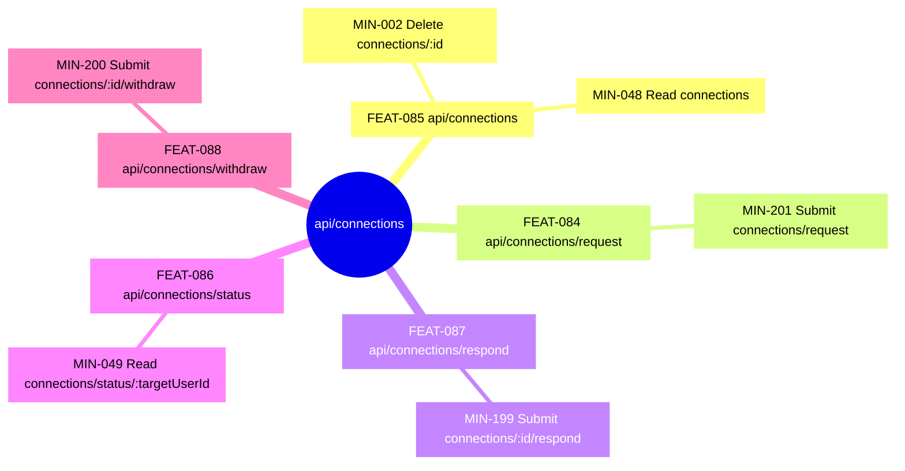

### FEAT-085 api/connections

api/connections

```mermaid
mindmap
  root((api/connections))
    MIN_002[MIN-002 Delete connections/:id]
      SUB_004[SUB-004 Access control]
        NANO_005[NANO-005 Requires a signed-in session]
      SUB_005[SUB-005 Persistence]
      SUB_006[SUB-006 Background work]
        SML_004[SML-004 Enqueue connection.removed - PARTIAL]
      SUB_007[SUB-007 Responses]
        SML_005[SML-005 Success responses]
          NANO_006[NANO-006 HTTP 200]
        SML_006[SML-006 Failure branches]
          NANO_007[NANO-007 NOT_FOUND 404: Connection with ID id not found.]
          NANO_008[NANO-008 FORBIDDEN 403: Access denied to connection.]
    MIN_048[MIN-048 Read connections]
      SUB_174[SUB-174 Access control]
        NANO_190[NANO-190 Requires a signed-in session]
      SUB_175[SUB-175 Persistence]
      SUB_176[SUB-176 Responses]
        SML_112[SML-112 Success responses]
          NANO_191[NANO-191 HTTP 200]
```

| ID       | Level | Parent   | Name                                                 | Description                                                                                                                                               | Status                | Verification | Evidence                                   | Related                               |
| -------- | ----- | -------- | ---------------------------------------------------- | --------------------------------------------------------------------------------------------------------------------------------------------------------- | --------------------- | ------------ | ------------------------------------------ | ------------------------------------- |
| FEAT-085 | MAJOR | MOD-079  | api/connections                                      |                                                                                                                                                           | IMPLEMENTED           |              | apps/api/src/server.ts:6547                |                                       |
| MIN-002  | MINOR | FEAT-085 | Delete connections/:id                               | DELETE /api/v1/connections/:id for any signed-in session; durable (PostgreSQL); responds 200; 2 failure branch(es). Gaps: no first-party web caller found | IMPLEMENTED           | VERIFIED     | apps/api/src/server.ts:6723                | API-139, TEST-115, TEST-225           |
| SUB-004  | SUB   | MIN-002  | Access control                                       | Who may call DELETE /api/v1/connections/:id: any signed-in session.                                                                                       | IMPLEMENTED           | PATH_LEVEL   | apps/api/src/server.ts:6723                |                                       |
| NANO-005 | NANO  | SUB-004  | Requires a signed-in session                         | Requests without a valid session token are rejected with 401 UNAUTHENTICATED.                                                                             | IMPLEMENTED           | PATH_LEVEL   | apps/api/src/server.ts:6723                | ROLE-001                              |
| SUB-005  | SUB   | MIN-002  | Persistence                                          | Durable: writes go through the PostgreSQL store; store calls connections.remove.                                                                          | IMPLEMENTED           | PATH_LEVEL   | apps/api/src/server.ts:6723                |                                       |
| SUB-006  | SUB   | MIN-002  | Background work                                      | Enqueues 1 background job kind(s) in background_jobs for apps/worker.                                                                                     | IMPLEMENTED           | PATH_LEVEL   | apps/api/src/server.ts:6723                |                                       |
| SML-004  | SMALL | SUB-006  | Enqueue connection.removed                           | Dispatches job:connection.removed; worker handler: recordEvent (no-op: marks the event recorded).                                                         | PARTIALLY_IMPLEMENTED | UNKNOWN      | packages/domain/src/background-jobs.ts:171 | SVC-015                               |
| SUB-007  | SUB   | MIN-002  | Responses                                            | Success 200; 2 explicit failure branch(es) besides validation and access errors.                                                                          | IMPLEMENTED           | PATH_LEVEL   | apps/api/src/server.ts:6723                |                                       |
| SML-005  | SMALL | SUB-007  | Success responses                                    | HTTP 200.                                                                                                                                                 | IMPLEMENTED           | PATH_LEVEL   | apps/api/src/server.ts:6723                |                                       |
| NANO-006 | NANO  | SML-005  | HTTP 200                                             | Replies 200 when the operation succeeds.                                                                                                                  | IMPLEMENTED           | PATH_LEVEL   | apps/api/src/server.ts:6723                |                                       |
| SML-006  | SMALL | SUB-007  | Failure branches                                     | 2 DomainError branch(es) in the handler, mapped to HTTP by the global error handler.                                                                      | IMPLEMENTED           | PATH_LEVEL   | apps/api/src/server.ts:6723                |                                       |
| NANO-007 | NANO  | SML-006  | NOT_FOUND 404: Connection with ID "${id}" not found. | Throws DomainError(NOT_FOUND) "Connection with ID "${id}" not found." -> HTTP 404.                                                                        | IMPLEMENTED           | PATH_LEVEL   | apps/api/src/server.ts:6731                | ERR-141                               |
| NANO-008 | NANO  | SML-006  | FORBIDDEN 403: Access denied to connection.          | Throws DomainError(FORBIDDEN) "Access denied to connection." -> HTTP 403.                                                                                 | IMPLEMENTED           | PATH_LEVEL   | apps/api/src/server.ts:6735                | ERR-142                               |
| MIN-048  | MINOR | FEAT-085 | Read connections                                     | GET /api/v1/connections for any signed-in session; durable (PostgreSQL); responds 200.                                                                    | IMPLEMENTED           | VERIFIED     | apps/api/src/server.ts:6547                | API-135, TEST-101, TEST-115, TEST-225 |
| SUB-174  | SUB   | MIN-048  | Access control                                       | Who may call GET /api/v1/connections: any signed-in session.                                                                                              | IMPLEMENTED           | PATH_LEVEL   | apps/api/src/server.ts:6547                |                                       |
| NANO-190 | NANO  | SUB-174  | Requires a signed-in session                         | Requests without a valid session token are rejected with 401 UNAUTHENTICATED.                                                                             | IMPLEMENTED           | PATH_LEVEL   | apps/api/src/server.ts:6547                | ROLE-001                              |
| SUB-175  | SUB   | MIN-048  | Persistence                                          | Durable: writes go through the PostgreSQL store.                                                                                                          | IMPLEMENTED           | PATH_LEVEL   | apps/api/src/server.ts:6547                |                                       |
| SUB-176  | SUB   | MIN-048  | Responses                                            | Success 200; 0 explicit failure branch(es) besides validation and access errors.                                                                          | IMPLEMENTED           | PATH_LEVEL   | apps/api/src/server.ts:6547                |                                       |
| SML-112  | SMALL | SUB-176  | Success responses                                    | HTTP 200.                                                                                                                                                 | IMPLEMENTED           | PATH_LEVEL   | apps/api/src/server.ts:6547                |                                       |
| NANO-191 | NANO  | SML-112  | HTTP 200                                             | Replies 200 when the operation succeeds.                                                                                                                  | IMPLEMENTED           | PATH_LEVEL   | apps/api/src/server.ts:6547                |                                       |

### FEAT-084 api/connections/request

api/connections/request

```mermaid
mindmap
  root((api/connections/request))
    MIN_201[MIN-201 Submit connections/request]
      SUB_796[SUB-796 Access control]
        NANO_1160[NANO-1160 Requires a signed-in session]
      SUB_797[SUB-797 Request validation]
        SML_612[SML-612 RequestConnectionInputSchema]
          TNY_236[TNY-236 Field recipientId]
            NANO_1161[NANO-1161 recipientId: must be a UUID]
          TNY_237[TNY-237 Field note]
            NANO_1162[NANO-1162 note: maximum 500 characters]
            NANO_1163[NANO-1163 note: optional]
      SUB_798[SUB-798 Business rules]
        SML_613[SML-613 Rule requestConnection]
      SUB_799[SUB-799 Persistence]
      SUB_800[SUB-800 Background work]
        SML_614[SML-614 Enqueue connection.requested - PARTIAL]
      SUB_801[SUB-801 Responses]
        SML_615[SML-615 Success responses]
          NANO_1164[NANO-1164 HTTP 201]
        SML_616[SML-616 Failure branches]
          NANO_1165[NANO-1165 NOT_FOUND 404: Recipient user not found.]
```

| ID        | Level | Parent   | Name                                     | Description                                                                                                                                                                            | Status                | Verification | Evidence                                   | Related                                                       |
| --------- | ----- | -------- | ---------------------------------------- | -------------------------------------------------------------------------------------------------------------------------------------------------------------------------------------- | --------------------- | ------------ | ------------------------------------------ | ------------------------------------------------------------- |
| FEAT-084  | MAJOR | MOD-079  | api/connections/request                  |                                                                                                                                                                                        | IMPLEMENTED           |              | apps/api/src/server.ts:6477                |                                                               |
| MIN-201   | MINOR | FEAT-084 | Submit connections/request               | POST /api/v1/connections/request for any signed-in session; validates RequestConnectionInputSchema; calls requestConnection; durable (PostgreSQL); responds 201; 1 failure branch(es). | IMPLEMENTED           | VERIFIED     | apps/api/src/server.ts:6477                | API-134, TEST-096, TEST-101, TEST-113, TEST-115, TEST-116 ... |
| SUB-796   | SUB   | MIN-201  | Access control                           | Who may call POST /api/v1/connections/request: any signed-in session.                                                                                                                  | IMPLEMENTED           | PATH_LEVEL   | apps/api/src/server.ts:6477                |                                                               |
| NANO-1160 | NANO  | SUB-796  | Requires a signed-in session             | Requests without a valid session token are rejected with 401 UNAUTHENTICATED.                                                                                                          | IMPLEMENTED           | PATH_LEVEL   | apps/api/src/server.ts:6477                | ROLE-001                                                      |
| SUB-797   | SUB   | MIN-201  | Request validation                       | The request is parsed with RequestConnectionInputSchema; a failure returns 400 with field details before any business logic runs.                                                      | IMPLEMENTED           | PATH_LEVEL   | apps/api/src/server.ts:6477                |                                                               |
| SML-612   | SMALL | SUB-797  | RequestConnectionInputSchema             | RequestConnectionInputSchema: 2 field(s)                                                                                                                                               | IMPLEMENTED           | PATH_LEVEL   | packages/contracts/src/index.ts:521        | SCH-039                                                       |
| TNY-236   | TINY  | SML-612  | Field recipientId                        | recipientId (string, required): must be a UUID                                                                                                                                         | IMPLEMENTED           | PATH_LEVEL   | packages/contracts/src/index.ts:522        |                                                               |
| NANO-1161 | NANO  | TNY-236  | recipientId: must be a UUID              | recipientId must be a UUID.                                                                                                                                                            | IMPLEMENTED           | PATH_LEVEL   | packages/contracts/src/index.ts:522        |                                                               |
| TNY-237   | TINY  | SML-612  | Field note                               | note (string, optional): maximum 500 characters; optional                                                                                                                              | IMPLEMENTED           | PATH_LEVEL   | packages/contracts/src/index.ts:523        |                                                               |
| NANO-1162 | NANO  | TNY-237  | note: maximum 500 characters             | note maximum 500 characters.                                                                                                                                                           | IMPLEMENTED           | PATH_LEVEL   | packages/contracts/src/index.ts:523        |                                                               |
| NANO-1163 | NANO  | TNY-237  | note: optional                           | note optional.                                                                                                                                                                         | IMPLEMENTED           | PATH_LEVEL   | packages/contracts/src/index.ts:523        |                                                               |
| SUB-798   | SUB   | MIN-201  | Business rules                           | Domain functions from packages/domain called by the handler (1).                                                                                                                       | IMPLEMENTED           | PATH_LEVEL   | apps/api/src/server.ts:6477                |                                                               |
| SML-613   | SMALL | SUB-798  | Rule requestConnection                   | Calls requestConnection (packages/domain/src/networking.ts). Rule status IMPLEMENTED; its own tests: VERIFIED.                                                                         | IMPLEMENTED           | VERIFIED     | packages/domain/src/networking.ts:32       | RULE-154                                                      |
| SUB-799   | SUB   | MIN-201  | Persistence                              | Durable: writes go through the PostgreSQL store; store calls connections.insert.                                                                                                       | IMPLEMENTED           | PATH_LEVEL   | apps/api/src/server.ts:6477                |                                                               |
| SUB-800   | SUB   | MIN-201  | Background work                          | Enqueues 1 background job kind(s) in background_jobs for apps/worker.                                                                                                                  | IMPLEMENTED           | PATH_LEVEL   | apps/api/src/server.ts:6477                |                                                               |
| SML-614   | SMALL | SUB-800  | Enqueue connection.requested             | Dispatches job:connection.requested; worker handler: recordEvent (no-op: marks the event recorded).                                                                                    | PARTIALLY_IMPLEMENTED | UNKNOWN      | packages/domain/src/background-jobs.ts:171 | SVC-017                                                       |
| SUB-801   | SUB   | MIN-201  | Responses                                | Success 201; 1 explicit failure branch(es) besides validation and access errors.                                                                                                       | IMPLEMENTED           | PATH_LEVEL   | apps/api/src/server.ts:6477                |                                                               |
| SML-615   | SMALL | SUB-801  | Success responses                        | HTTP 201.                                                                                                                                                                              | IMPLEMENTED           | PATH_LEVEL   | apps/api/src/server.ts:6477                |                                                               |
| NANO-1164 | NANO  | SML-615  | HTTP 201                                 | Replies 201 when the operation succeeds.                                                                                                                                               | IMPLEMENTED           | PATH_LEVEL   | apps/api/src/server.ts:6477                |                                                               |
| SML-616   | SMALL | SUB-801  | Failure branches                         | 1 DomainError branch(es) in the handler, mapped to HTTP by the global error handler.                                                                                                   | IMPLEMENTED           | PATH_LEVEL   | apps/api/src/server.ts:6477                |                                                               |
| NANO-1165 | NANO  | SML-616  | NOT_FOUND 404: Recipient user not found. | Throws DomainError(NOT_FOUND) "Recipient user not found." -> HTTP 404.                                                                                                                 | IMPLEMENTED           | PATH_LEVEL   | apps/api/src/server.ts:6488                | ERR-139                                                       |

### FEAT-087 api/connections/respond

api/connections/respond

```mermaid
mindmap
  root((api/connections/respond))
    MIN_199[MIN-199 Submit connections/:id/respond]
      SUB_785[SUB-785 Access control]
        NANO_1153[NANO-1153 Requires a signed-in session]
      SUB_786[SUB-786 Request validation]
        SML_601[SML-601 RespondConnectionInputSchema]
          TNY_235[TNY-235 Field action]
            NANO_1154[NANO-1154 action: one of: accept, reject]
      SUB_787[SUB-787 Business rules]
        SML_602[SML-602 Rule acceptConnection]
        SML_603[SML-603 Rule rejectConnection]
      SUB_788[SUB-788 Persistence]
      SUB_789[SUB-789 Background work]
        SML_604[SML-604 Enqueue connection.accepted - PARTIAL]
        SML_605[SML-605 Enqueue connection.rejected - PARTIAL]
      SUB_790[SUB-790 Responses]
        SML_606[SML-606 Success responses]
          NANO_1155[NANO-1155 HTTP 200]
        SML_607[SML-607 Failure branches]
          NANO_1156[NANO-1156 NOT_FOUND 404: Connection request with ID id not fo...]
```

| ID        | Level | Parent   | Name                                                         | Description                                                                                                                                                                                                 | Status                | Verification | Evidence                                   | Related                                                       |
| --------- | ----- | -------- | ------------------------------------------------------------ | ----------------------------------------------------------------------------------------------------------------------------------------------------------------------------------------------------------- | --------------------- | ------------ | ------------------------------------------ | ------------------------------------------------------------- |
| FEAT-087  | MAJOR | MOD-079  | api/connections/respond                                      |                                                                                                                                                                                                             | IMPLEMENTED           |              | apps/api/src/server.ts:6616                |                                                               |
| MIN-199   | MINOR | FEAT-087 | Submit connections/:id/respond                               | POST /api/v1/connections/:id/respond for any signed-in session; validates RespondConnectionInputSchema; calls acceptConnection, rejectConnection; durable (PostgreSQL); responds 200; 1 failure branch(es). | IMPLEMENTED           | VERIFIED     | apps/api/src/server.ts:6616                | API-137, TEST-096, TEST-101, TEST-113, TEST-115, TEST-116 ... |
| SUB-785   | SUB   | MIN-199  | Access control                                               | Who may call POST /api/v1/connections/:id/respond: any signed-in session.                                                                                                                                   | IMPLEMENTED           | PATH_LEVEL   | apps/api/src/server.ts:6616                |                                                               |
| NANO-1153 | NANO  | SUB-785  | Requires a signed-in session                                 | Requests without a valid session token are rejected with 401 UNAUTHENTICATED.                                                                                                                               | IMPLEMENTED           | PATH_LEVEL   | apps/api/src/server.ts:6616                | ROLE-001                                                      |
| SUB-786   | SUB   | MIN-199  | Request validation                                           | The request is parsed with RespondConnectionInputSchema; a failure returns 400 with field details before any business logic runs.                                                                           | IMPLEMENTED           | PATH_LEVEL   | apps/api/src/server.ts:6616                |                                                               |
| SML-601   | SMALL | SUB-786  | RespondConnectionInputSchema                                 | RespondConnectionInputSchema: 1 field(s)                                                                                                                                                                    | IMPLEMENTED           | PATH_LEVEL   | packages/contracts/src/index.ts:528        | SCH-040                                                       |
| TNY-235   | TINY  | SML-601  | Field action                                                 | action (enum, required): one of: accept, reject                                                                                                                                                             | IMPLEMENTED           | PATH_LEVEL   | packages/contracts/src/index.ts:529        |                                                               |
| NANO-1154 | NANO  | TNY-235  | action: one of: accept, reject                               | action one of: accept, reject.                                                                                                                                                                              | IMPLEMENTED           | PATH_LEVEL   | packages/contracts/src/index.ts:529        |                                                               |
| SUB-787   | SUB   | MIN-199  | Business rules                                               | Domain functions from packages/domain called by the handler (2).                                                                                                                                            | IMPLEMENTED           | PATH_LEVEL   | apps/api/src/server.ts:6616                |                                                               |
| SML-602   | SMALL | SUB-787  | Rule acceptConnection                                        | Calls acceptConnection (packages/domain/src/networking.ts). Rule status IMPLEMENTED; its own tests: VERIFIED.                                                                                               | IMPLEMENTED           | VERIFIED     | packages/domain/src/networking.ts:84       | RULE-155                                                      |
| SML-603   | SMALL | SUB-787  | Rule rejectConnection                                        | Calls rejectConnection (packages/domain/src/networking.ts). Rule status IMPLEMENTED; its own tests: VERIFIED.                                                                                               | IMPLEMENTED           | VERIFIED     | packages/domain/src/networking.ts:109      | RULE-156                                                      |
| SUB-788   | SUB   | MIN-199  | Persistence                                                  | Durable: writes go through the PostgreSQL store; store calls connections.update.                                                                                                                            | IMPLEMENTED           | PATH_LEVEL   | apps/api/src/server.ts:6616                |                                                               |
| SUB-789   | SUB   | MIN-199  | Background work                                              | Enqueues 2 background job kind(s) in background_jobs for apps/worker.                                                                                                                                       | IMPLEMENTED           | PATH_LEVEL   | apps/api/src/server.ts:6616                |                                                               |
| SML-604   | SMALL | SUB-789  | Enqueue connection.accepted                                  | Dispatches job:connection.accepted; worker handler: recordEvent (no-op: marks the event recorded).                                                                                                          | PARTIALLY_IMPLEMENTED | UNKNOWN      | packages/domain/src/background-jobs.ts:171 | SVC-014                                                       |
| SML-605   | SMALL | SUB-789  | Enqueue connection.rejected                                  | Dispatches job:connection.rejected; worker handler: recordEvent (no-op: marks the event recorded).                                                                                                          | PARTIALLY_IMPLEMENTED | UNKNOWN      | packages/domain/src/background-jobs.ts:171 | SVC-016                                                       |
| SUB-790   | SUB   | MIN-199  | Responses                                                    | Success 200; 1 explicit failure branch(es) besides validation and access errors.                                                                                                                            | IMPLEMENTED           | PATH_LEVEL   | apps/api/src/server.ts:6616                |                                                               |
| SML-606   | SMALL | SUB-790  | Success responses                                            | HTTP 200.                                                                                                                                                                                                   | IMPLEMENTED           | PATH_LEVEL   | apps/api/src/server.ts:6616                |                                                               |
| NANO-1155 | NANO  | SML-606  | HTTP 200                                                     | Replies 200 when the operation succeeds.                                                                                                                                                                    | IMPLEMENTED           | PATH_LEVEL   | apps/api/src/server.ts:6616                |                                                               |
| SML-607   | SMALL | SUB-790  | Failure branches                                             | 1 DomainError branch(es) in the handler, mapped to HTTP by the global error handler.                                                                                                                        | IMPLEMENTED           | PATH_LEVEL   | apps/api/src/server.ts:6616                |                                                               |
| NANO-1156 | NANO  | SML-607  | NOT_FOUND 404: Connection request with ID "${id}" not found. | Throws DomainError(NOT_FOUND) "Connection request with ID "${id}" not found." -> HTTP 404.                                                                                                                  | IMPLEMENTED           | PATH_LEVEL   | apps/api/src/server.ts:6624                | ERR-140                                                       |

### FEAT-086 api/connections/status

api/connections/status

```mermaid
mindmap
  root((api/connections/status))
    MIN_049[MIN-049 Read connections/status/:targetUserId]
      SUB_177[SUB-177 Access control]
        NANO_192[NANO-192 Requires a signed-in session]
      SUB_178[SUB-178 Business rules]
        SML_113[SML-113 Rule getConnectionBetween]
      SUB_179[SUB-179 Persistence]
      SUB_180[SUB-180 Responses]
        SML_114[SML-114 Success responses]
          NANO_193[NANO-193 HTTP 200]
```

| ID       | Level | Parent   | Name                                  | Description                                                                                                                                                                   | Status      | Verification | Evidence                              | Related                               |
| -------- | ----- | -------- | ------------------------------------- | ----------------------------------------------------------------------------------------------------------------------------------------------------------------------------- | ----------- | ------------ | ------------------------------------- | ------------------------------------- |
| FEAT-086 | MAJOR | MOD-079  | api/connections/status                |                                                                                                                                                                               | IMPLEMENTED |              | apps/api/src/server.ts:6594           |                                       |
| MIN-049  | MINOR | FEAT-086 | Read connections/status/:targetUserId | GET /api/v1/connections/status/:targetUserId for any signed-in session; calls getConnectionBetween; durable (PostgreSQL); responds 200. Gaps: no first-party web caller found | IMPLEMENTED | VERIFIED     | apps/api/src/server.ts:6594           | API-136, TEST-115, TEST-206, TEST-225 |
| SUB-177  | SUB   | MIN-049  | Access control                        | Who may call GET /api/v1/connections/status/:targetUserId: any signed-in session.                                                                                             | IMPLEMENTED | PATH_LEVEL   | apps/api/src/server.ts:6594           |                                       |
| NANO-192 | NANO  | SUB-177  | Requires a signed-in session          | Requests without a valid session token are rejected with 401 UNAUTHENTICATED.                                                                                                 | IMPLEMENTED | PATH_LEVEL   | apps/api/src/server.ts:6594           | ROLE-001                              |
| SUB-178  | SUB   | MIN-049  | Business rules                        | Domain functions from packages/domain called by the handler (1).                                                                                                              | IMPLEMENTED | PATH_LEVEL   | apps/api/src/server.ts:6594           |                                       |
| SML-113  | SMALL | SUB-178  | Rule getConnectionBetween             | Calls getConnectionBetween (packages/domain/src/networking.ts). Rule status IMPLEMENTED; its own tests: VERIFIED.                                                             | IMPLEMENTED | VERIFIED     | packages/domain/src/networking.ts:168 | RULE-159                              |
| SUB-179  | SUB   | MIN-049  | Persistence                           | Durable: writes go through the PostgreSQL store.                                                                                                                              | IMPLEMENTED | PATH_LEVEL   | apps/api/src/server.ts:6594           |                                       |
| SUB-180  | SUB   | MIN-049  | Responses                             | Success 200; 0 explicit failure branch(es) besides validation and access errors.                                                                                              | IMPLEMENTED | PATH_LEVEL   | apps/api/src/server.ts:6594           |                                       |
| SML-114  | SMALL | SUB-180  | Success responses                     | HTTP 200.                                                                                                                                                                     | IMPLEMENTED | PATH_LEVEL   | apps/api/src/server.ts:6594           |                                       |
| NANO-193 | NANO  | SML-114  | HTTP 200                              | Replies 200 when the operation succeeds.                                                                                                                                      | IMPLEMENTED | PATH_LEVEL   | apps/api/src/server.ts:6594           |                                       |

### FEAT-088 api/connections/withdraw

api/connections/withdraw

```mermaid
mindmap
  root((api/connections/withdraw))
    MIN_200[MIN-200 Submit connections/:id/withdraw]
      SUB_791[SUB-791 Access control]
        NANO_1157[NANO-1157 Requires a signed-in session]
      SUB_792[SUB-792 Business rules]
        SML_608[SML-608 Rule withdrawConnection]
      SUB_793[SUB-793 Persistence]
      SUB_794[SUB-794 Background work]
        SML_609[SML-609 Enqueue connection.withdrawn - PARTIAL]
      SUB_795[SUB-795 Responses]
        SML_610[SML-610 Success responses]
          NANO_1158[NANO-1158 HTTP 200]
        SML_611[SML-611 Failure branches]
          NANO_1159[NANO-1159 NOT_FOUND 404: Connection request with ID id not fo...]
```

| ID        | Level | Parent   | Name                                                         | Description                                                                                                                                                                                | Status                | Verification | Evidence                                   | Related           |
| --------- | ----- | -------- | ------------------------------------------------------------ | ------------------------------------------------------------------------------------------------------------------------------------------------------------------------------------------ | --------------------- | ------------ | ------------------------------------------ | ----------------- |
| FEAT-088  | MAJOR | MOD-079  | api/connections/withdraw                                     |                                                                                                                                                                                            | IMPLEMENTED           |              | apps/api/src/server.ts:6686                |                   |
| MIN-200   | MINOR | FEAT-088 | Submit connections/:id/withdraw                              | POST /api/v1/connections/:id/withdraw for any signed-in session; calls withdrawConnection; durable (PostgreSQL); responds 200; 1 failure branch(es). Gaps: no first-party web caller found | IMPLEMENTED           | VERIFIED     | apps/api/src/server.ts:6686                | API-138, TEST-115 |
| SUB-791   | SUB   | MIN-200  | Access control                                               | Who may call POST /api/v1/connections/:id/withdraw: any signed-in session.                                                                                                                 | IMPLEMENTED           | PATH_LEVEL   | apps/api/src/server.ts:6686                |                   |
| NANO-1157 | NANO  | SUB-791  | Requires a signed-in session                                 | Requests without a valid session token are rejected with 401 UNAUTHENTICATED.                                                                                                              | IMPLEMENTED           | PATH_LEVEL   | apps/api/src/server.ts:6686                | ROLE-001          |
| SUB-792   | SUB   | MIN-200  | Business rules                                               | Domain functions from packages/domain called by the handler (1).                                                                                                                           | IMPLEMENTED           | PATH_LEVEL   | apps/api/src/server.ts:6686                |                   |
| SML-608   | SMALL | SUB-792  | Rule withdrawConnection                                      | Calls withdrawConnection (packages/domain/src/networking.ts). Rule status IMPLEMENTED; its own tests: VERIFIED.                                                                            | IMPLEMENTED           | VERIFIED     | packages/domain/src/networking.ts:133      | RULE-157          |
| SUB-793   | SUB   | MIN-200  | Persistence                                                  | Durable: writes go through the PostgreSQL store; store calls connections.update.                                                                                                           | IMPLEMENTED           | PATH_LEVEL   | apps/api/src/server.ts:6686                |                   |
| SUB-794   | SUB   | MIN-200  | Background work                                              | Enqueues 1 background job kind(s) in background_jobs for apps/worker.                                                                                                                      | IMPLEMENTED           | PATH_LEVEL   | apps/api/src/server.ts:6686                |                   |
| SML-609   | SMALL | SUB-794  | Enqueue connection.withdrawn                                 | Dispatches job:connection.withdrawn; worker handler: recordEvent (no-op: marks the event recorded).                                                                                        | PARTIALLY_IMPLEMENTED | UNKNOWN      | packages/domain/src/background-jobs.ts:171 | SVC-018           |
| SUB-795   | SUB   | MIN-200  | Responses                                                    | Success 200; 1 explicit failure branch(es) besides validation and access errors.                                                                                                           | IMPLEMENTED           | PATH_LEVEL   | apps/api/src/server.ts:6686                |                   |
| SML-610   | SMALL | SUB-795  | Success responses                                            | HTTP 200.                                                                                                                                                                                  | IMPLEMENTED           | PATH_LEVEL   | apps/api/src/server.ts:6686                |                   |
| NANO-1158 | NANO  | SML-610  | HTTP 200                                                     | Replies 200 when the operation succeeds.                                                                                                                                                   | IMPLEMENTED           | PATH_LEVEL   | apps/api/src/server.ts:6686                |                   |
| SML-611   | SMALL | SUB-795  | Failure branches                                             | 1 DomainError branch(es) in the handler, mapped to HTTP by the global error handler.                                                                                                       | IMPLEMENTED           | PATH_LEVEL   | apps/api/src/server.ts:6686                |                   |
| NANO-1159 | NANO  | SML-611  | NOT_FOUND 404: Connection request with ID "${id}" not found. | Throws DomainError(NOT_FOUND) "Connection request with ID "${id}" not found." -> HTTP 404.                                                                                                 | IMPLEMENTED           | PATH_LEVEL   | apps/api/src/server.ts:6694                | ERR-140           |

## api/courses (MOD-071)

**Application:** apps/api (MOD-001). **Purpose:** API module: routes under /api/v1/courses in apps/api/src/server.ts.

**Nodes by level:** MODULE 1, MAJOR 5, MINOR 7, SUB 27, SMALL 19, TINY 15, NANO 65. **Status:** IMPLEMENTED 132, PARTIALLY_IMPLEMENTED 7. **Verification:** PATH_LEVEL 123, VERIFIED 10.

**User roles that reach it:** anonymous, authenticated, platform_admin.

**Known gaps:** MIN-050 ephemeral: state held in process memory, lost on restart; MIN-051 ephemeral: state held in process memory, lost on restart; MIN-202 ephemeral: state held in process memory, lost on restart; MIN-202 no first-party web caller found; MIN-203 ephemeral: state held in process memory, lost on restart; MIN-204 ephemeral: state held in process memory, lost on restart; MIN-204 no first-party web caller found; MIN-052 ephemeral: state held in process memory, lost on restart; MIN-205 ephemeral: state held in process memory, lost on restart; MIN-205 no first-party web caller found.

**Called from (web screens and components):** FEAT-168 Screen /learning, FEAT-169 Screen /learning/:id

### Module map (to minor features)

```mermaid
mindmap
  root((api/courses))
    FEAT_059[FEAT-059 api/courses]
      MIN_050[MIN-050 Read courses]
      MIN_051[MIN-051 Read courses/:id]
      MIN_202[MIN-202 Submit courses]
    FEAT_063[FEAT-063 api/courses/enroll]
      MIN_203[MIN-203 Submit courses/:id/enroll]
    FEAT_060[FEAT-060 api/courses/modules]
      MIN_204[MIN-204 Submit courses/:id/modules]
    FEAT_064[FEAT-064 api/courses/progress]
      MIN_052[MIN-052 Read courses/:id/progress]
    FEAT_062[FEAT-062 api/courses/publish]
      MIN_205[MIN-205 Submit courses/:id/publish]
```

### FEAT-059 api/courses

api/courses

```mermaid
mindmap
  root((api/courses))
    MIN_050[MIN-050 Read courses]
      SUB_181[SUB-181 Access control]
        NANO_194[NANO-194 Open to anonymous callers]
      SUB_182[SUB-182 Persistence - PARTIAL]
      SUB_183[SUB-183 Responses]
        SML_115[SML-115 Success responses]
          NANO_195[NANO-195 HTTP 200]
    MIN_051[MIN-051 Read courses/:id]
      SUB_184[SUB-184 Access control]
        NANO_196[NANO-196 Requires a signed-in session]
        NANO_197[NANO-197 Allowed role: platform_admin]
      SUB_185[SUB-185 Persistence - PARTIAL]
      SUB_186[SUB-186 Responses]
        SML_116[SML-116 Success responses]
          NANO_198[NANO-198 HTTP 200]
        SML_117[SML-117 Failure branches]
          NANO_199[NANO-199 NOT_FOUND 404: Course with ID or slug id not found.]
          NANO_200[NANO-200 NOT_FOUND 404: Course with ID or slug id not found.]
    MIN_202[MIN-202 Submit courses]
      SUB_802[SUB-802 Access control]
        NANO_1166[NANO-1166 Requires a signed-in session]
      SUB_803[SUB-803 Request validation]
        SML_617[SML-617 CreateCourseInputSchema]
          TNY_238[TNY-238 Field title]
            NANO_1167[NANO-1167 title: minimum 3 characters]
            NANO_1168[NANO-1168 title: maximum 200 characters]
          TNY_239[TNY-239 Field slug]
            NANO_1169[NANO-1169 slug: minimum 2 characters]
            NANO_1170[NANO-1170 slug: maximum 100 characters]
            NANO_1171[NANO-1171 slug: must match pattern / a-z0-9- + /]
          TNY_240[TNY-240 Field description]
            NANO_1172[NANO-1172 description: minimum 10 characters]
            NANO_1173[NANO-1173 description: maximum 5000 characters]
          TNY_241[TNY-241 Field level]
            NANO_1174[NANO-1174 level: one of: beginner, intermediate, advanced]
            NANO_1175[NANO-1175 level: default beginner]
          TNY_242[TNY-242 Field estimatedDurationMinutes]
            NANO_1176[NANO-1176 estimatedDurationMinutes: must be an integer]
            NANO_1177[NANO-1177 estimatedDurationMinutes: minimum 10]
            NANO_1178[NANO-1178 estimatedDurationMinutes: maximum 10000]
            NANO_1179[NANO-1179 estimatedDurationMinutes: default 60]
          TNY_243[TNY-243 Field passingScorePercent]
            NANO_1180[NANO-1180 passingScorePercent: must be an integer]
            NANO_1181[NANO-1181 passingScorePercent: minimum 1]
            NANO_1182[NANO-1182 passingScorePercent: maximum 100]
            NANO_1183[NANO-1183 passingScorePercent: default 70]
          TNY_244[TNY-244 Field xpReward]
            NANO_1184[NANO-1184 xpReward: must be an integer]
            NANO_1185[NANO-1185 xpReward: minimum 0]
            NANO_1186[NANO-1186 xpReward: maximum 200]
            NANO_1187[NANO-1187 xpReward: default 50]
          TNY_245[TNY-245 Field skillIds]
            NANO_1188[NANO-1188 skillIds: list of string]
            NANO_1189[NANO-1189 skillIds: optional]
      SUB_804[SUB-804 Persistence - PARTIAL]
      SUB_805[SUB-805 Responses]
        SML_618[SML-618 Success responses]
          NANO_1190[NANO-1190 HTTP 201]
        SML_619[SML-619 Failure branches]
          NANO_1191[NANO-1191 FORBIDDEN 403: Only instructors, course authors and...]
          NANO_1192[NANO-1192 NOT_FOUND 404: Profile not found. Please create a p...]
          NANO_1193[NANO-1193 CONFLICT 409: Course with slug input.slug already e...]
```

| ID        | Level | Parent   | Name                                                                                  | Description                                                                                                                                                                                                                                        | Status                | Verification | Evidence                            | Related                                                       |
| --------- | ----- | -------- | ------------------------------------------------------------------------------------- | -------------------------------------------------------------------------------------------------------------------------------------------------------------------------------------------------------------------------------------------------- | --------------------- | ------------ | ----------------------------------- | ------------------------------------------------------------- |
| FEAT-059  | MAJOR | MOD-071  | api/courses                                                                           |                                                                                                                                                                                                                                                    | IMPLEMENTED           |              | apps/api/src/server.ts:4958         |                                                               |
| MIN-050   | MINOR | FEAT-059 | Read courses                                                                          | LMS Endpoints (F-07) GET /api/v1/courses for anyone (public); ephemeral (process memory); responds 200. Gaps: ephemeral: state held in process memory, lost on restart                                                                             | IMPLEMENTED           | VERIFIED     | apps/api/src/server.ts:4958         | API-098, TEST-111, TEST-145, TEST-170, TEST-175               |
| SUB-181   | SUB   | MIN-050  | Access control                                                                        | Who may call GET /api/v1/courses: anyone (public).                                                                                                                                                                                                 | IMPLEMENTED           | PATH_LEVEL   | apps/api/src/server.ts:4958         |                                                               |
| NANO-194  | NANO  | SUB-181  | Open to anonymous callers                                                             | auth: public.                                                                                                                                                                                                                                      | IMPLEMENTED           | PATH_LEVEL   | apps/api/src/server.ts:4958         | ROLE-001                                                      |
| SUB-182   | SUB   | MIN-050  | Persistence                                                                           | Ephemeral: state lives in API process memory and is lost on restart.                                                                                                                                                                               | PARTIALLY_IMPLEMENTED | PATH_LEVEL   | apps/api/src/server.ts:4958         |                                                               |
| SUB-183   | SUB   | MIN-050  | Responses                                                                             | Success 200; 0 explicit failure branch(es) besides validation and access errors.                                                                                                                                                                   | IMPLEMENTED           | PATH_LEVEL   | apps/api/src/server.ts:4958         |                                                               |
| SML-115   | SMALL | SUB-183  | Success responses                                                                     | HTTP 200 (implicit).                                                                                                                                                                                                                               | IMPLEMENTED           | PATH_LEVEL   | apps/api/src/server.ts:4958         |                                                               |
| NANO-195  | NANO  | SML-115  | HTTP 200                                                                              | Replies 200 when the operation succeeds (implicit default).                                                                                                                                                                                        | IMPLEMENTED           | PATH_LEVEL   | apps/api/src/server.ts:4958         |                                                               |
| MIN-051   | MINOR | FEAT-059 | Read courses/:id                                                                      | GET /api/v1/courses/:id for roles platform_admin; ephemeral (process memory); responds 200; 2 failure branch(es). Gaps: ephemeral: state held in process memory, lost on restart                                                                   | IMPLEMENTED           | VERIFIED     | apps/api/src/server.ts:5037         | API-100, TEST-055, TEST-094, TEST-110, TEST-111, TEST-145 ... |
| SUB-184   | SUB   | MIN-051  | Access control                                                                        | Who may call GET /api/v1/courses/:id: roles platform_admin.                                                                                                                                                                                        | IMPLEMENTED           | PATH_LEVEL   | apps/api/src/server.ts:5037         |                                                               |
| NANO-196  | NANO  | SUB-184  | Requires a signed-in session                                                          | Requests without a valid session token are rejected with 401 UNAUTHENTICATED.                                                                                                                                                                      | IMPLEMENTED           | PATH_LEVEL   | apps/api/src/server.ts:5037         | ROLE-001                                                      |
| NANO-197  | NANO  | SUB-184  | Allowed role: platform_admin                                                          | platform_admin is one of the roles allowed here (platform_admin); a caller holding none of them is rejected with 403.                                                                                                                              | IMPLEMENTED           | PATH_LEVEL   | apps/api/src/server.ts:5037         | ROLE-008                                                      |
| SUB-185   | SUB   | MIN-051  | Persistence                                                                           | Ephemeral: state lives in API process memory and is lost on restart.                                                                                                                                                                               | PARTIALLY_IMPLEMENTED | PATH_LEVEL   | apps/api/src/server.ts:5037         |                                                               |
| SUB-186   | SUB   | MIN-051  | Responses                                                                             | Success 200; 2 explicit failure branch(es) besides validation and access errors.                                                                                                                                                                   | IMPLEMENTED           | PATH_LEVEL   | apps/api/src/server.ts:5037         |                                                               |
| SML-116   | SMALL | SUB-186  | Success responses                                                                     | HTTP 200.                                                                                                                                                                                                                                          | IMPLEMENTED           | PATH_LEVEL   | apps/api/src/server.ts:5037         |                                                               |
| NANO-198  | NANO  | SML-116  | HTTP 200                                                                              | Replies 200 when the operation succeeds.                                                                                                                                                                                                           | IMPLEMENTED           | PATH_LEVEL   | apps/api/src/server.ts:5037         |                                                               |
| SML-117   | SMALL | SUB-186  | Failure branches                                                                      | 2 DomainError branch(es) in the handler, mapped to HTTP by the global error handler.                                                                                                                                                               | IMPLEMENTED           | PATH_LEVEL   | apps/api/src/server.ts:5037         |                                                               |
| NANO-199  | NANO  | SML-117  | NOT_FOUND 404: Course with ID or slug "${id}" not found.                              | Throws DomainError(NOT_FOUND) "Course with ID or slug "${id}" not found." -> HTTP 404.                                                                                                                                                             | IMPLEMENTED           | PATH_LEVEL   | apps/api/src/server.ts:5043         | ERR-109                                                       |
| NANO-200  | NANO  | SML-117  | NOT_FOUND 404: Course with ID or slug "${id}" not found.                              | Throws DomainError(NOT_FOUND) "Course with ID or slug "${id}" not found." -> HTTP 404.                                                                                                                                                             | IMPLEMENTED           | PATH_LEVEL   | apps/api/src/server.ts:5052         | ERR-109                                                       |
| MIN-202   | MINOR | FEAT-059 | Submit courses                                                                        | POST /api/v1/courses for any signed-in session; validates CreateCourseInputSchema; ephemeral (process memory); responds 201; 3 failure branch(es). Gaps: ephemeral: state held in process memory, lost on restart; no first-party web caller found | IMPLEMENTED           | VERIFIED     | apps/api/src/server.ts:4990         | API-099, TEST-111                                             |
| SUB-802   | SUB   | MIN-202  | Access control                                                                        | Who may call POST /api/v1/courses: any signed-in session.                                                                                                                                                                                          | IMPLEMENTED           | PATH_LEVEL   | apps/api/src/server.ts:4990         |                                                               |
| NANO-1166 | NANO  | SUB-802  | Requires a signed-in session                                                          | Requests without a valid session token are rejected with 401 UNAUTHENTICATED.                                                                                                                                                                      | IMPLEMENTED           | PATH_LEVEL   | apps/api/src/server.ts:4990         | ROLE-001                                                      |
| SUB-803   | SUB   | MIN-202  | Request validation                                                                    | The request is parsed with CreateCourseInputSchema; a failure returns 400 with field details before any business logic runs.                                                                                                                       | IMPLEMENTED           | PATH_LEVEL   | apps/api/src/server.ts:4990         |                                                               |
| SML-617   | SMALL | SUB-803  | CreateCourseInputSchema                                                               | CreateCourseInputSchema: 8 field(s)                                                                                                                                                                                                                | IMPLEMENTED           | PATH_LEVEL   | packages/contracts/src/index.ts:352 | SCH-023                                                       |
| TNY-238   | TINY  | SML-617  | Field title                                                                           | title (string, required): minimum 3 characters; maximum 200 characters                                                                                                                                                                             | IMPLEMENTED           | PATH_LEVEL   | packages/contracts/src/index.ts:353 |                                                               |
| NANO-1167 | NANO  | TNY-238  | title: minimum 3 characters                                                           | title minimum 3 characters.                                                                                                                                                                                                                        | IMPLEMENTED           | PATH_LEVEL   | packages/contracts/src/index.ts:353 |                                                               |
| NANO-1168 | NANO  | TNY-238  | title: maximum 200 characters                                                         | title maximum 200 characters.                                                                                                                                                                                                                      | IMPLEMENTED           | PATH_LEVEL   | packages/contracts/src/index.ts:353 |                                                               |
| TNY-239   | TINY  | SML-617  | Field slug                                                                            | slug (string, required): minimum 2 characters; maximum 100 characters; must match pattern /^[a-z0-9-]+$/                                                                                                                                           | IMPLEMENTED           | PATH_LEVEL   | packages/contracts/src/index.ts:354 |                                                               |
| NANO-1169 | NANO  | TNY-239  | slug: minimum 2 characters                                                            | slug minimum 2 characters.                                                                                                                                                                                                                         | IMPLEMENTED           | PATH_LEVEL   | packages/contracts/src/index.ts:354 |                                                               |
| NANO-1170 | NANO  | TNY-239  | slug: maximum 100 characters                                                          | slug maximum 100 characters.                                                                                                                                                                                                                       | IMPLEMENTED           | PATH_LEVEL   | packages/contracts/src/index.ts:354 |                                                               |
| NANO-1171 | NANO  | TNY-239  | slug: must match pattern /^[a-z0-9-]+$/                                               | slug must match pattern /^[a-z0-9-]+$/; message "Slug must be lowercase alphanumeric with hyphens".                                                                                                                                                | IMPLEMENTED           | PATH_LEVEL   | packages/contracts/src/index.ts:354 |                                                               |
| TNY-240   | TINY  | SML-617  | Field description                                                                     | description (string, required): minimum 10 characters; maximum 5000 characters                                                                                                                                                                     | IMPLEMENTED           | PATH_LEVEL   | packages/contracts/src/index.ts:359 |                                                               |
| NANO-1172 | NANO  | TNY-240  | description: minimum 10 characters                                                    | description minimum 10 characters.                                                                                                                                                                                                                 | IMPLEMENTED           | PATH_LEVEL   | packages/contracts/src/index.ts:359 |                                                               |
| NANO-1173 | NANO  | TNY-240  | description: maximum 5000 characters                                                  | description maximum 5000 characters.                                                                                                                                                                                                               | IMPLEMENTED           | PATH_LEVEL   | packages/contracts/src/index.ts:359 |                                                               |
| TNY-241   | TINY  | SML-617  | Field level                                                                           | level (enum, optional): one of: beginner, intermediate, advanced; default 'beginner'                                                                                                                                                               | IMPLEMENTED           | PATH_LEVEL   | packages/contracts/src/index.ts:360 |                                                               |
| NANO-1174 | NANO  | TNY-241  | level: one of: beginner, intermediate, advanced                                       | level one of: beginner, intermediate, advanced.                                                                                                                                                                                                    | IMPLEMENTED           | PATH_LEVEL   | packages/contracts/src/index.ts:360 |                                                               |
| NANO-1175 | NANO  | TNY-241  | level: default 'beginner'                                                             | level default 'beginner'; message "beginner".                                                                                                                                                                                                      | IMPLEMENTED           | PATH_LEVEL   | packages/contracts/src/index.ts:360 |                                                               |
| TNY-242   | TINY  | SML-617  | Field estimatedDurationMinutes                                                        | estimatedDurationMinutes (number, optional): must be an integer; minimum 10; maximum 10000; default 60                                                                                                                                             | IMPLEMENTED           | PATH_LEVEL   | packages/contracts/src/index.ts:361 |                                                               |
| NANO-1176 | NANO  | TNY-242  | estimatedDurationMinutes: must be an integer                                          | estimatedDurationMinutes must be an integer.                                                                                                                                                                                                       | IMPLEMENTED           | PATH_LEVEL   | packages/contracts/src/index.ts:361 |                                                               |
| NANO-1177 | NANO  | TNY-242  | estimatedDurationMinutes: minimum 10                                                  | estimatedDurationMinutes minimum 10.                                                                                                                                                                                                               | IMPLEMENTED           | PATH_LEVEL   | packages/contracts/src/index.ts:361 |                                                               |
| NANO-1178 | NANO  | TNY-242  | estimatedDurationMinutes: maximum 10000                                               | estimatedDurationMinutes maximum 10000.                                                                                                                                                                                                            | IMPLEMENTED           | PATH_LEVEL   | packages/contracts/src/index.ts:361 |                                                               |
| NANO-1179 | NANO  | TNY-242  | estimatedDurationMinutes: default 60                                                  | estimatedDurationMinutes default 60.                                                                                                                                                                                                               | IMPLEMENTED           | PATH_LEVEL   | packages/contracts/src/index.ts:361 |                                                               |
| TNY-243   | TINY  | SML-617  | Field passingScorePercent                                                             | passingScorePercent (number, optional): must be an integer; minimum 1; maximum 100; default 70                                                                                                                                                     | IMPLEMENTED           | PATH_LEVEL   | packages/contracts/src/index.ts:362 |                                                               |
| NANO-1180 | NANO  | TNY-243  | passingScorePercent: must be an integer                                               | passingScorePercent must be an integer.                                                                                                                                                                                                            | IMPLEMENTED           | PATH_LEVEL   | packages/contracts/src/index.ts:362 |                                                               |
| NANO-1181 | NANO  | TNY-243  | passingScorePercent: minimum 1                                                        | passingScorePercent minimum 1.                                                                                                                                                                                                                     | IMPLEMENTED           | PATH_LEVEL   | packages/contracts/src/index.ts:362 |                                                               |
| NANO-1182 | NANO  | TNY-243  | passingScorePercent: maximum 100                                                      | passingScorePercent maximum 100.                                                                                                                                                                                                                   | IMPLEMENTED           | PATH_LEVEL   | packages/contracts/src/index.ts:362 |                                                               |
| NANO-1183 | NANO  | TNY-243  | passingScorePercent: default 70                                                       | passingScorePercent default 70.                                                                                                                                                                                                                    | IMPLEMENTED           | PATH_LEVEL   | packages/contracts/src/index.ts:362 |                                                               |
| TNY-244   | TINY  | SML-617  | Field xpReward                                                                        | xpReward (number, optional): must be an integer; minimum 0; maximum 200; default 50                                                                                                                                                                | IMPLEMENTED           | PATH_LEVEL   | packages/contracts/src/index.ts:363 |                                                               |
| NANO-1184 | NANO  | TNY-244  | xpReward: must be an integer                                                          | xpReward must be an integer.                                                                                                                                                                                                                       | IMPLEMENTED           | PATH_LEVEL   | packages/contracts/src/index.ts:363 |                                                               |
| NANO-1185 | NANO  | TNY-244  | xpReward: minimum 0                                                                   | xpReward minimum 0.                                                                                                                                                                                                                                | IMPLEMENTED           | PATH_LEVEL   | packages/contracts/src/index.ts:363 |                                                               |
| NANO-1186 | NANO  | TNY-244  | xpReward: maximum 200                                                                 | xpReward maximum 200.                                                                                                                                                                                                                              | IMPLEMENTED           | PATH_LEVEL   | packages/contracts/src/index.ts:363 |                                                               |
| NANO-1187 | NANO  | TNY-244  | xpReward: default 50                                                                  | xpReward default 50.                                                                                                                                                                                                                               | IMPLEMENTED           | PATH_LEVEL   | packages/contracts/src/index.ts:363 |                                                               |
| TNY-245   | TINY  | SML-617  | Field skillIds                                                                        | skillIds (array, optional): list of string; optional                                                                                                                                                                                               | IMPLEMENTED           | PATH_LEVEL   | packages/contracts/src/index.ts:364 |                                                               |
| NANO-1188 | NANO  | TNY-245  | skillIds: list of string                                                              | skillIds list of string.                                                                                                                                                                                                                           | IMPLEMENTED           | PATH_LEVEL   | packages/contracts/src/index.ts:364 |                                                               |
| NANO-1189 | NANO  | TNY-245  | skillIds: optional                                                                    | skillIds optional.                                                                                                                                                                                                                                 | IMPLEMENTED           | PATH_LEVEL   | packages/contracts/src/index.ts:364 |                                                               |
| SUB-804   | SUB   | MIN-202  | Persistence                                                                           | Ephemeral: state lives in API process memory and is lost on restart.                                                                                                                                                                               | PARTIALLY_IMPLEMENTED | PATH_LEVEL   | apps/api/src/server.ts:4990         |                                                               |
| SUB-805   | SUB   | MIN-202  | Responses                                                                             | Success 201; 3 explicit failure branch(es) besides validation and access errors.                                                                                                                                                                   | IMPLEMENTED           | PATH_LEVEL   | apps/api/src/server.ts:4990         |                                                               |
| SML-618   | SMALL | SUB-805  | Success responses                                                                     | HTTP 201.                                                                                                                                                                                                                                          | IMPLEMENTED           | PATH_LEVEL   | apps/api/src/server.ts:4990         |                                                               |
| NANO-1190 | NANO  | SML-618  | HTTP 201                                                                              | Replies 201 when the operation succeeds.                                                                                                                                                                                                           | IMPLEMENTED           | PATH_LEVEL   | apps/api/src/server.ts:4990         |                                                               |
| SML-619   | SMALL | SUB-805  | Failure branches                                                                      | 3 DomainError branch(es) in the handler, mapped to HTTP by the global error handler.                                                                                                                                                               | IMPLEMENTED           | PATH_LEVEL   | apps/api/src/server.ts:4990         |                                                               |
| NANO-1191 | NANO  | SML-619  | FORBIDDEN 403: Only instructors, course authors and platform admins can create course | Throws DomainError(FORBIDDEN) "Only instructors, course authors and platform admins can create courses." -> HTTP 403.                                                                                                                              | IMPLEMENTED           | PATH_LEVEL   | apps/api/src/server.ts:4996         | ERR-106                                                       |
| NANO-1192 | NANO  | SML-619  | NOT_FOUND 404: Profile not found. Please create a profile first.                      | Throws DomainError(NOT_FOUND) "Profile not found. Please create a profile first." -> HTTP 404.                                                                                                                                                     | IMPLEMENTED           | PATH_LEVEL   | apps/api/src/server.ts:5003         | ERR-107                                                       |
| NANO-1193 | NANO  | SML-619  | CONFLICT 409: Course with slug "${input.slug}" already exists.                        | Throws DomainError(CONFLICT) "Course with slug "${input.slug}" already exists." -> HTTP 409.                                                                                                                                                       | IMPLEMENTED           | PATH_LEVEL   | apps/api/src/server.ts:5008         | ERR-108                                                       |

### FEAT-063 api/courses/enroll

api/courses/enroll

```mermaid
mindmap
  root((api/courses/enroll))
    MIN_203[MIN-203 Submit courses/:id/enroll]
      SUB_806[SUB-806 Access control]
        NANO_1194[NANO-1194 Requires a signed-in session]
      SUB_807[SUB-807 Business rules]
        SML_620[SML-620 Rule enrollUserInCourse]
      SUB_808[SUB-808 Persistence - PARTIAL]
      SUB_809[SUB-809 Responses]
        SML_621[SML-621 Success responses]
          NANO_1195[NANO-1195 HTTP 201]
        SML_622[SML-622 Failure branches]
          NANO_1196[NANO-1196 NOT_FOUND 404: Course with ID id not found.]
          NANO_1197[NANO-1197 NOT_FOUND 404: Profile not found. Please create a p...]
          NANO_1198[NANO-1198 FORBIDDEN 403: You cannot enrol in a course you teach.]
```

| ID        | Level | Parent   | Name                                                             | Description                                                                                                                                                                                                         | Status                | Verification | Evidence                       | Related                                                       |
| --------- | ----- | -------- | ---------------------------------------------------------------- | ------------------------------------------------------------------------------------------------------------------------------------------------------------------------------------------------------------------- | --------------------- | ------------ | ------------------------------ | ------------------------------------------------------------- |
| FEAT-063  | MAJOR | MOD-071  | api/courses/enroll                                               |                                                                                                                                                                                                                     | IMPLEMENTED           |              | apps/api/src/server.ts:5227    |                                                               |
| MIN-203   | MINOR | FEAT-063 | Submit courses/:id/enroll                                        | POST /api/v1/courses/:id/enroll for any signed-in session; calls enrollUserInCourse; ephemeral (process memory); responds 201; 3 failure branch(es). Gaps: ephemeral: state held in process memory, lost on restart | IMPLEMENTED           | VERIFIED     | apps/api/src/server.ts:5227    | API-104, TEST-094, TEST-110, TEST-111, TEST-126, TEST-170 ... |
| SUB-806   | SUB   | MIN-203  | Access control                                                   | Who may call POST /api/v1/courses/:id/enroll: any signed-in session.                                                                                                                                                | IMPLEMENTED           | PATH_LEVEL   | apps/api/src/server.ts:5227    |                                                               |
| NANO-1194 | NANO  | SUB-806  | Requires a signed-in session                                     | Requests without a valid session token are rejected with 401 UNAUTHENTICATED.                                                                                                                                       | IMPLEMENTED           | PATH_LEVEL   | apps/api/src/server.ts:5227    | ROLE-001                                                      |
| SUB-807   | SUB   | MIN-203  | Business rules                                                   | Domain functions from packages/domain called by the handler (1).                                                                                                                                                    | IMPLEMENTED           | PATH_LEVEL   | apps/api/src/server.ts:5227    |                                                               |
| SML-620   | SMALL | SUB-807  | Rule enrollUserInCourse                                          | Calls enrollUserInCourse (packages/domain/src/lms.ts). Rule status IMPLEMENTED; its own tests: VERIFIED.                                                                                                            | IMPLEMENTED           | VERIFIED     | packages/domain/src/lms.ts:138 | RULE-134                                                      |
| SUB-808   | SUB   | MIN-203  | Persistence                                                      | Ephemeral: state lives in API process memory and is lost on restart.                                                                                                                                                | PARTIALLY_IMPLEMENTED | PATH_LEVEL   | apps/api/src/server.ts:5227    |                                                               |
| SUB-809   | SUB   | MIN-203  | Responses                                                        | Success 201; 3 explicit failure branch(es) besides validation and access errors.                                                                                                                                    | IMPLEMENTED           | PATH_LEVEL   | apps/api/src/server.ts:5227    |                                                               |
| SML-621   | SMALL | SUB-809  | Success responses                                                | HTTP 201.                                                                                                                                                                                                           | IMPLEMENTED           | PATH_LEVEL   | apps/api/src/server.ts:5227    |                                                               |
| NANO-1195 | NANO  | SML-621  | HTTP 201                                                         | Replies 201 when the operation succeeds.                                                                                                                                                                            | IMPLEMENTED           | PATH_LEVEL   | apps/api/src/server.ts:5227    |                                                               |
| SML-622   | SMALL | SUB-809  | Failure branches                                                 | 3 DomainError branch(es) in the handler, mapped to HTTP by the global error handler.                                                                                                                                | IMPLEMENTED           | PATH_LEVEL   | apps/api/src/server.ts:5227    |                                                               |
| NANO-1196 | NANO  | SML-622  | NOT_FOUND 404: Course with ID "${id}" not found.                 | Throws DomainError(NOT_FOUND) "Course with ID "${id}" not found." -> HTTP 404.                                                                                                                                      | IMPLEMENTED           | PATH_LEVEL   | apps/api/src/server.ts:5234    | ERR-110                                                       |
| NANO-1197 | NANO  | SML-622  | NOT_FOUND 404: Profile not found. Please create a profile first. | Throws DomainError(NOT_FOUND) "Profile not found. Please create a profile first." -> HTTP 404.                                                                                                                      | IMPLEMENTED           | PATH_LEVEL   | apps/api/src/server.ts:5239    | ERR-107                                                       |
| NANO-1198 | NANO  | SML-622  | FORBIDDEN 403: You cannot enrol in a course you teach.           | Throws DomainError(FORBIDDEN) "You cannot enrol in a course you teach." -> HTTP 403.                                                                                                                                | IMPLEMENTED           | PATH_LEVEL   | apps/api/src/server.ts:5244    | ERR-119                                                       |

### FEAT-060 api/courses/modules

api/courses/modules

```mermaid
mindmap
  root((api/courses/modules))
    MIN_204[MIN-204 Submit courses/:id/modules]
      SUB_810[SUB-810 Access control]
        NANO_1199[NANO-1199 Requires a signed-in session]
      SUB_811[SUB-811 Request validation]
        SML_623[SML-623 CreateCourseModuleInputSchema]
          TNY_246[TNY-246 Field title]
            NANO_1200[NANO-1200 title: minimum 2 characters]
            NANO_1201[NANO-1201 title: maximum 200 characters]
          TNY_247[TNY-247 Field description]
            NANO_1202[NANO-1202 description: maximum 1000 characters]
            NANO_1203[NANO-1203 description: optional]
          TNY_248[TNY-248 Field orderIndex]
            NANO_1204[NANO-1204 orderIndex: must be an integer]
            NANO_1205[NANO-1205 orderIndex: minimum 0]
      SUB_812[SUB-812 Persistence - PARTIAL]
      SUB_813[SUB-813 Responses]
        SML_624[SML-624 Success responses]
          NANO_1206[NANO-1206 HTTP 201]
        SML_625[SML-625 Failure branches]
          NANO_1207[NANO-1207 NOT_FOUND 404: Course with ID id not found.]
          NANO_1208[NANO-1208 FORBIDDEN 403: Only the course instructor or platfo...]
          NANO_1209[NANO-1209 CONFLICT 409: Module with orderIndex input.orderInd...]
```

| ID        | Level | Parent   | Name                                                                                 | Description                                                                                                                                                                                                                                                          | Status                | Verification | Evidence                            | Related           |
| --------- | ----- | -------- | ------------------------------------------------------------------------------------ | -------------------------------------------------------------------------------------------------------------------------------------------------------------------------------------------------------------------------------------------------------------------- | --------------------- | ------------ | ----------------------------------- | ----------------- |
| FEAT-060  | MAJOR | MOD-071  | api/courses/modules                                                                  |                                                                                                                                                                                                                                                                      | IMPLEMENTED           |              | apps/api/src/server.ts:5080         |                   |
| MIN-204   | MINOR | FEAT-060 | Submit courses/:id/modules                                                           | POST /api/v1/courses/:id/modules for any signed-in session; validates CreateCourseModuleInputSchema; ephemeral (process memory); responds 201; 3 failure branch(es). Gaps: ephemeral: state held in process memory, lost on restart; no first-party web caller found | IMPLEMENTED           | VERIFIED     | apps/api/src/server.ts:5080         | API-101, TEST-111 |
| SUB-810   | SUB   | MIN-204  | Access control                                                                       | Who may call POST /api/v1/courses/:id/modules: any signed-in session.                                                                                                                                                                                                | IMPLEMENTED           | PATH_LEVEL   | apps/api/src/server.ts:5080         |                   |
| NANO-1199 | NANO  | SUB-810  | Requires a signed-in session                                                         | Requests without a valid session token are rejected with 401 UNAUTHENTICATED.                                                                                                                                                                                        | IMPLEMENTED           | PATH_LEVEL   | apps/api/src/server.ts:5080         | ROLE-001          |
| SUB-811   | SUB   | MIN-204  | Request validation                                                                   | The request is parsed with CreateCourseModuleInputSchema; a failure returns 400 with field details before any business logic runs.                                                                                                                                   | IMPLEMENTED           | PATH_LEVEL   | apps/api/src/server.ts:5080         |                   |
| SML-623   | SMALL | SUB-811  | CreateCourseModuleInputSchema                                                        | CreateCourseModuleInputSchema: 3 field(s)                                                                                                                                                                                                                            | IMPLEMENTED           | PATH_LEVEL   | packages/contracts/src/index.ts:369 | SCH-024           |
| TNY-246   | TINY  | SML-623  | Field title                                                                          | title (string, required): minimum 2 characters; maximum 200 characters                                                                                                                                                                                               | IMPLEMENTED           | PATH_LEVEL   | packages/contracts/src/index.ts:370 |                   |
| NANO-1200 | NANO  | TNY-246  | title: minimum 2 characters                                                          | title minimum 2 characters.                                                                                                                                                                                                                                          | IMPLEMENTED           | PATH_LEVEL   | packages/contracts/src/index.ts:370 |                   |
| NANO-1201 | NANO  | TNY-246  | title: maximum 200 characters                                                        | title maximum 200 characters.                                                                                                                                                                                                                                        | IMPLEMENTED           | PATH_LEVEL   | packages/contracts/src/index.ts:370 |                   |
| TNY-247   | TINY  | SML-623  | Field description                                                                    | description (string, optional): maximum 1000 characters; optional                                                                                                                                                                                                    | IMPLEMENTED           | PATH_LEVEL   | packages/contracts/src/index.ts:371 |                   |
| NANO-1202 | NANO  | TNY-247  | description: maximum 1000 characters                                                 | description maximum 1000 characters.                                                                                                                                                                                                                                 | IMPLEMENTED           | PATH_LEVEL   | packages/contracts/src/index.ts:371 |                   |
| NANO-1203 | NANO  | TNY-247  | description: optional                                                                | description optional.                                                                                                                                                                                                                                                | IMPLEMENTED           | PATH_LEVEL   | packages/contracts/src/index.ts:371 |                   |
| TNY-248   | TINY  | SML-623  | Field orderIndex                                                                     | orderIndex (number, required): must be an integer; minimum 0                                                                                                                                                                                                         | IMPLEMENTED           | PATH_LEVEL   | packages/contracts/src/index.ts:372 |                   |
| NANO-1204 | NANO  | TNY-248  | orderIndex: must be an integer                                                       | orderIndex must be an integer.                                                                                                                                                                                                                                       | IMPLEMENTED           | PATH_LEVEL   | packages/contracts/src/index.ts:372 |                   |
| NANO-1205 | NANO  | TNY-248  | orderIndex: minimum 0                                                                | orderIndex minimum 0.                                                                                                                                                                                                                                                | IMPLEMENTED           | PATH_LEVEL   | packages/contracts/src/index.ts:372 |                   |
| SUB-812   | SUB   | MIN-204  | Persistence                                                                          | Ephemeral: state lives in API process memory and is lost on restart.                                                                                                                                                                                                 | PARTIALLY_IMPLEMENTED | PATH_LEVEL   | apps/api/src/server.ts:5080         |                   |
| SUB-813   | SUB   | MIN-204  | Responses                                                                            | Success 201; 3 explicit failure branch(es) besides validation and access errors.                                                                                                                                                                                     | IMPLEMENTED           | PATH_LEVEL   | apps/api/src/server.ts:5080         |                   |
| SML-624   | SMALL | SUB-813  | Success responses                                                                    | HTTP 201.                                                                                                                                                                                                                                                            | IMPLEMENTED           | PATH_LEVEL   | apps/api/src/server.ts:5080         |                   |
| NANO-1206 | NANO  | SML-624  | HTTP 201                                                                             | Replies 201 when the operation succeeds.                                                                                                                                                                                                                             | IMPLEMENTED           | PATH_LEVEL   | apps/api/src/server.ts:5080         |                   |
| SML-625   | SMALL | SUB-813  | Failure branches                                                                     | 3 DomainError branch(es) in the handler, mapped to HTTP by the global error handler.                                                                                                                                                                                 | IMPLEMENTED           | PATH_LEVEL   | apps/api/src/server.ts:5080         |                   |
| NANO-1207 | NANO  | SML-625  | NOT_FOUND 404: Course with ID "${id}" not found.                                     | Throws DomainError(NOT_FOUND) "Course with ID "${id}" not found." -> HTTP 404.                                                                                                                                                                                       | IMPLEMENTED           | PATH_LEVEL   | apps/api/src/server.ts:5087         | ERR-110           |
| NANO-1208 | NANO  | SML-625  | FORBIDDEN 403: Only the course instructor or platform admin can add modules.         | Throws DomainError(FORBIDDEN) "Only the course instructor or platform admin can add modules." -> HTTP 403.                                                                                                                                                           | IMPLEMENTED           | PATH_LEVEL   | apps/api/src/server.ts:5092         | ERR-111           |
| NANO-1209 | NANO  | SML-625  | CONFLICT 409: Module with orderIndex ${input.orderIndex} already exists in this cour | Throws DomainError(CONFLICT) "Module with orderIndex ${input.orderIndex} already exists in this course." -> HTTP 409.                                                                                                                                                | IMPLEMENTED           | PATH_LEVEL   | apps/api/src/server.ts:5103         | ERR-112           |

### FEAT-064 api/courses/progress

api/courses/progress

```mermaid
mindmap
  root((api/courses/progress))
    MIN_052[MIN-052 Read courses/:id/progress]
      SUB_187[SUB-187 Access control]
        NANO_201[NANO-201 Requires a signed-in session]
      SUB_188[SUB-188 Request validation]
        SML_118[SML-118 CourseProgressResponseSchema]
          TNY_020[TNY-020 Field enrolled]
          TNY_021[TNY-021 Field completedLessonIds]
            NANO_202[NANO-202 completedLessonIds: list of string]
            NANO_203[NANO-203 completedLessonIds: optional]
          TNY_022[TNY-022 Field nextLessonId]
            NANO_204[NANO-204 nextLessonId: may be null]
            NANO_205[NANO-205 nextLessonId: optional]
          TNY_023[TNY-023 Field locked]
            NANO_206[NANO-206 locked: optional]
      SUB_189[SUB-189 Business rules]
        SML_119[SML-119 Rule computeCourseLockState]
      SUB_190[SUB-190 Persistence - PARTIAL]
      SUB_191[SUB-191 Responses]
        SML_120[SML-120 Success responses]
          NANO_207[NANO-207 HTTP 200]
        SML_121[SML-121 Failure branches]
          NANO_208[NANO-208 NOT_FOUND 404: Course with ID id not found.]
          NANO_209[NANO-209 NOT_FOUND 404: Profile not found.]
```

| ID       | Level | Parent   | Name                                             | Description                                                                                                                                                                                                                                                      | Status                | Verification | Evidence                            | Related                     |
| -------- | ----- | -------- | ------------------------------------------------ | ---------------------------------------------------------------------------------------------------------------------------------------------------------------------------------------------------------------------------------------------------------------- | --------------------- | ------------ | ----------------------------------- | --------------------------- |
| FEAT-064 | MAJOR | MOD-071  | api/courses/progress                             |                                                                                                                                                                                                                                                                  | IMPLEMENTED           |              | apps/api/src/server.ts:5260         |                             |
| MIN-052  | MINOR | FEAT-064 | Read courses/:id/progress                        | GET /api/v1/courses/:id/progress for any signed-in session; validates CourseProgressResponseSchema; calls computeCourseLockState; ephemeral (process memory); responds 200; 2 failure branch(es). Gaps: ephemeral: state held in process memory, lost on restart | IMPLEMENTED           | VERIFIED     | apps/api/src/server.ts:5260         | API-105, TEST-111, TEST-170 |
| SUB-187  | SUB   | MIN-052  | Access control                                   | Who may call GET /api/v1/courses/:id/progress: any signed-in session.                                                                                                                                                                                            | IMPLEMENTED           | PATH_LEVEL   | apps/api/src/server.ts:5260         |                             |
| NANO-201 | NANO  | SUB-187  | Requires a signed-in session                     | Requests without a valid session token are rejected with 401 UNAUTHENTICATED.                                                                                                                                                                                    | IMPLEMENTED           | PATH_LEVEL   | apps/api/src/server.ts:5260         | ROLE-001                    |
| SUB-188  | SUB   | MIN-052  | Request validation                               | The request is parsed with CourseProgressResponseSchema; a failure returns 400 with field details before any business logic runs.                                                                                                                                | IMPLEMENTED           | PATH_LEVEL   | apps/api/src/server.ts:5260         |                             |
| SML-118  | SMALL | SUB-188  | CourseProgressResponseSchema                     | CourseProgressResponseSchema: 4 field(s)                                                                                                                                                                                                                         | IMPLEMENTED           | PATH_LEVEL   | packages/contracts/src/index.ts:390 | SCH-026                     |
| TNY-020  | TINY  | SML-118  | Field enrolled                                   | enrolled (boolean, required)                                                                                                                                                                                                                                     | IMPLEMENTED           | PATH_LEVEL   | packages/contracts/src/index.ts:392 |                             |
| TNY-021  | TINY  | SML-118  | Field completedLessonIds                         | completedLessonIds (array, optional): list of string; optional                                                                                                                                                                                                   | IMPLEMENTED           | PATH_LEVEL   | packages/contracts/src/index.ts:393 |                             |
| NANO-202 | NANO  | TNY-021  | completedLessonIds: list of string               | completedLessonIds list of string.                                                                                                                                                                                                                               | IMPLEMENTED           | PATH_LEVEL   | packages/contracts/src/index.ts:393 |                             |
| NANO-203 | NANO  | TNY-021  | completedLessonIds: optional                     | completedLessonIds optional.                                                                                                                                                                                                                                     | IMPLEMENTED           | PATH_LEVEL   | packages/contracts/src/index.ts:393 |                             |
| TNY-022  | TINY  | SML-118  | Field nextLessonId                               | nextLessonId (string, optional): may be null; optional                                                                                                                                                                                                           | IMPLEMENTED           | PATH_LEVEL   | packages/contracts/src/index.ts:394 |                             |
| NANO-204 | NANO  | TNY-022  | nextLessonId: may be null                        | nextLessonId may be null.                                                                                                                                                                                                                                        | IMPLEMENTED           | PATH_LEVEL   | packages/contracts/src/index.ts:394 |                             |
| NANO-205 | NANO  | TNY-022  | nextLessonId: optional                           | nextLessonId optional.                                                                                                                                                                                                                                           | IMPLEMENTED           | PATH_LEVEL   | packages/contracts/src/index.ts:394 |                             |
| TNY-023  | TINY  | SML-118  | Field locked                                     | locked (record, optional): optional                                                                                                                                                                                                                              | IMPLEMENTED           | PATH_LEVEL   | packages/contracts/src/index.ts:395 |                             |
| NANO-206 | NANO  | TNY-023  | locked: optional                                 | locked optional.                                                                                                                                                                                                                                                 | IMPLEMENTED           | PATH_LEVEL   | packages/contracts/src/index.ts:395 |                             |
| SUB-189  | SUB   | MIN-052  | Business rules                                   | Domain functions from packages/domain called by the handler (1).                                                                                                                                                                                                 | IMPLEMENTED           | PATH_LEVEL   | apps/api/src/server.ts:5260         |                             |
| SML-119  | SMALL | SUB-189  | Rule computeCourseLockState                      | Calls computeCourseLockState (packages/domain/src/lms.ts). Rule status IMPLEMENTED; its own tests: VERIFIED.                                                                                                                                                     | IMPLEMENTED           | VERIFIED     | packages/domain/src/lms.ts:236      | RULE-137                    |
| SUB-190  | SUB   | MIN-052  | Persistence                                      | Ephemeral: state lives in API process memory and is lost on restart.                                                                                                                                                                                             | PARTIALLY_IMPLEMENTED | PATH_LEVEL   | apps/api/src/server.ts:5260         |                             |
| SUB-191  | SUB   | MIN-052  | Responses                                        | Success 200; 2 explicit failure branch(es) besides validation and access errors.                                                                                                                                                                                 | IMPLEMENTED           | PATH_LEVEL   | apps/api/src/server.ts:5260         |                             |
| SML-120  | SMALL | SUB-191  | Success responses                                | HTTP 200.                                                                                                                                                                                                                                                        | IMPLEMENTED           | PATH_LEVEL   | apps/api/src/server.ts:5260         |                             |
| NANO-207 | NANO  | SML-120  | HTTP 200                                         | Replies 200 when the operation succeeds.                                                                                                                                                                                                                         | IMPLEMENTED           | PATH_LEVEL   | apps/api/src/server.ts:5260         |                             |
| SML-121  | SMALL | SUB-191  | Failure branches                                 | 2 DomainError branch(es) in the handler, mapped to HTTP by the global error handler.                                                                                                                                                                             | IMPLEMENTED           | PATH_LEVEL   | apps/api/src/server.ts:5260         |                             |
| NANO-208 | NANO  | SML-121  | NOT_FOUND 404: Course with ID "${id}" not found. | Throws DomainError(NOT_FOUND) "Course with ID "${id}" not found." -> HTTP 404.                                                                                                                                                                                   | IMPLEMENTED           | PATH_LEVEL   | apps/api/src/server.ts:5267         | ERR-110                     |
| NANO-209 | NANO  | SML-121  | NOT_FOUND 404: Profile not found.                | Throws DomainError(NOT_FOUND) "Profile not found." -> HTTP 404.                                                                                                                                                                                                  | IMPLEMENTED           | PATH_LEVEL   | apps/api/src/server.ts:5272         | ERR-015                     |

### FEAT-062 api/courses/publish

api/courses/publish

```mermaid
mindmap
  root((api/courses/publish))
    MIN_205[MIN-205 Submit courses/:id/publish]
      SUB_814[SUB-814 Access control]
        NANO_1210[NANO-1210 Requires a signed-in session]
      SUB_815[SUB-815 Business rules]
        SML_626[SML-626 Rule validateCoursePublishReadiness]
      SUB_816[SUB-816 Persistence - PARTIAL]
      SUB_817[SUB-817 Responses]
        SML_627[SML-627 Success responses]
          NANO_1211[NANO-1211 HTTP 200]
        SML_628[SML-628 Failure branches]
          NANO_1212[NANO-1212 NOT_FOUND 404: Course with ID id not found.]
          NANO_1213[NANO-1213 FORBIDDEN 403: Only the course instructor or platfo...]
          NANO_1214[NANO-1214 VALIDATION_FAILED 422: Course publish requirements...]
```

| ID        | Level | Parent   | Name                                                                                       | Description                                                                                                                                                                                                                                                       | Status                | Verification | Evidence                      | Related           |
| --------- | ----- | -------- | ------------------------------------------------------------------------------------------ | ----------------------------------------------------------------------------------------------------------------------------------------------------------------------------------------------------------------------------------------------------------------- | --------------------- | ------------ | ----------------------------- | ----------------- |
| FEAT-062  | MAJOR | MOD-071  | api/courses/publish                                                                        |                                                                                                                                                                                                                                                                   | IMPLEMENTED           |              | apps/api/src/server.ts:5185   |                   |
| MIN-205   | MINOR | FEAT-062 | Submit courses/:id/publish                                                                 | POST /api/v1/courses/:id/publish for any signed-in session; calls validateCoursePublishReadiness; ephemeral (process memory); responds 200; 3 failure branch(es). Gaps: ephemeral: state held in process memory, lost on restart; no first-party web caller found | IMPLEMENTED           | VERIFIED     | apps/api/src/server.ts:5185   | API-103, TEST-111 |
| SUB-814   | SUB   | MIN-205  | Access control                                                                             | Who may call POST /api/v1/courses/:id/publish: any signed-in session.                                                                                                                                                                                             | IMPLEMENTED           | PATH_LEVEL   | apps/api/src/server.ts:5185   |                   |
| NANO-1210 | NANO  | SUB-814  | Requires a signed-in session                                                               | Requests without a valid session token are rejected with 401 UNAUTHENTICATED.                                                                                                                                                                                     | IMPLEMENTED           | PATH_LEVEL   | apps/api/src/server.ts:5185   | ROLE-001          |
| SUB-815   | SUB   | MIN-205  | Business rules                                                                             | Domain functions from packages/domain called by the handler (1).                                                                                                                                                                                                  | IMPLEMENTED           | PATH_LEVEL   | apps/api/src/server.ts:5185   |                   |
| SML-626   | SMALL | SUB-815  | Rule validateCoursePublishReadiness                                                        | Calls validateCoursePublishReadiness (packages/domain/src/lms.ts). Rule status IMPLEMENTED; its own tests: VERIFIED.                                                                                                                                              | IMPLEMENTED           | VERIFIED     | packages/domain/src/lms.ts:92 | RULE-133          |
| SUB-816   | SUB   | MIN-205  | Persistence                                                                                | Ephemeral: state lives in API process memory and is lost on restart.                                                                                                                                                                                              | PARTIALLY_IMPLEMENTED | PATH_LEVEL   | apps/api/src/server.ts:5185   |                   |
| SUB-817   | SUB   | MIN-205  | Responses                                                                                  | Success 200; 3 explicit failure branch(es) besides validation and access errors.                                                                                                                                                                                  | IMPLEMENTED           | PATH_LEVEL   | apps/api/src/server.ts:5185   |                   |
| SML-627   | SMALL | SUB-817  | Success responses                                                                          | HTTP 200.                                                                                                                                                                                                                                                         | IMPLEMENTED           | PATH_LEVEL   | apps/api/src/server.ts:5185   |                   |
| NANO-1211 | NANO  | SML-627  | HTTP 200                                                                                   | Replies 200 when the operation succeeds.                                                                                                                                                                                                                          | IMPLEMENTED           | PATH_LEVEL   | apps/api/src/server.ts:5185   |                   |
| SML-628   | SMALL | SUB-817  | Failure branches                                                                           | 3 DomainError branch(es) in the handler, mapped to HTTP by the global error handler.                                                                                                                                                                              | IMPLEMENTED           | PATH_LEVEL   | apps/api/src/server.ts:5185   |                   |
| NANO-1212 | NANO  | SML-628  | NOT_FOUND 404: Course with ID "${id}" not found.                                           | Throws DomainError(NOT_FOUND) "Course with ID "${id}" not found." -> HTTP 404.                                                                                                                                                                                    | IMPLEMENTED           | PATH_LEVEL   | apps/api/src/server.ts:5192   | ERR-110           |
| NANO-1213 | NANO  | SML-628  | FORBIDDEN 403: Only the course instructor or platform admin can publish this course.       | Throws DomainError(FORBIDDEN) "Only the course instructor or platform admin can publish this course." -> HTTP 403.                                                                                                                                                | IMPLEMENTED           | PATH_LEVEL   | apps/api/src/server.ts:5197   | ERR-117           |
| NANO-1214 | NANO  | SML-628  | VALIDATION_FAILED 422: Course publish requirements not met: ${readiness.errors.join('; ')} | Throws DomainError(VALIDATION_FAILED) "Course publish requirements not met: ${readiness.errors.join('; ')}" -> HTTP 422.                                                                                                                                          | IMPLEMENTED           | PATH_LEVEL   | apps/api/src/server.ts:5211   | ERR-118           |

## api/evidence (MOD-057)

**Application:** apps/api (MOD-001). **Purpose:** API module: routes under /api/v1/evidence in apps/api/src/server.ts.

**Nodes by level:** MODULE 1, MAJOR 7, MINOR 8, SUB 38, SMALL 40, TINY 11, NANO 44. **Status:** IMPLEMENTED 146, PARTIALLY_IMPLEMENTED 3. **Verification:** PATH_LEVEL 120, UNKNOWN 5, VERIFIED 16.

**User roles that reach it:** anonymous, authenticated.

**Known gaps:** MIN-053 no first-party web caller found; MIN-206 no first-party web caller found; MIN-207 no first-party web caller found; MIN-208 no first-party web caller found; MIN-056 no first-party web caller found; MIN-209 no first-party web caller found.

**Called from (web screens and components):** FEAT-162 Screen /dashboard, FEAT-167 Screen /jobs/:id, FEAT-187 Component CredentialsSection

### Module map (to minor features)

```mermaid
mindmap
  root((api/evidence))
    FEAT_012[FEAT-012 api/evidence]
      MIN_053[MIN-053 Read evidence/:id]
      MIN_206[MIN-206 Submit evidence]
    FEAT_016[FEAT-016 api/evidence/dispute]
      MIN_207[MIN-207 Submit evidence/:id/dispute]
    FEAT_013[FEAT-013 api/evidence/mine]
      MIN_055[MIN-055 Read evidence/mine]
    FEAT_017[FEAT-017 api/evidence/revoke]
      MIN_208[MIN-208 Submit evidence/:id/revoke]
    FEAT_014[FEAT-014 api/evidence/subject]
      MIN_056[MIN-056 Read evidence/subject/:subjectId]
    FEAT_015[FEAT-015 api/evidence/verify]
      MIN_209[MIN-209 Submit evidence/:id/verify]
    FEAT_018[FEAT-018 api/evidence/verify-public]
      MIN_054[MIN-054 Read evidence/:id/verify-public]
```

### FEAT-012 api/evidence

api/evidence

```mermaid
mindmap
  root((api/evidence))
    MIN_053[MIN-053 Read evidence/:id]
      SUB_192[SUB-192 Access control]
        NANO_210[NANO-210 Requires a signed-in session]
        NANO_211[NANO-211 Guard: canSeeEvidenceInternals]
        NANO_212[NANO-212 Guard: canViewProfile]
      SUB_193[SUB-193 Business rules]
        SML_122[SML-122 Rule evidenceSummaryForReviewers]
        SML_123[SML-123 Rule canSeeEvidenceInternals]
        SML_124[SML-124 Rule canViewProfile]
      SUB_194[SUB-194 Persistence]
      SUB_195[SUB-195 Responses]
        SML_125[SML-125 Success responses]
          NANO_213[NANO-213 HTTP 200]
        SML_126[SML-126 Failure branches]
          NANO_214[NANO-214 NOT_FOUND 404: Evidence with ID id not found.]
          NANO_215[NANO-215 FORBIDDEN 403: Access to this evidence is restricted...]
    MIN_206[MIN-206 Submit evidence]
      SUB_818[SUB-818 Access control]
        NANO_1215[NANO-1215 Requires a signed-in session]
      SUB_819[SUB-819 Request validation]
        SML_629[SML-629 CreateEvidenceInputSchema]
          TNY_249[TNY-249 Field type]
            NANO_1216[NANO-1216 type: one of: self_declaration, course_completion,...]
          TNY_250[TNY-250 Field title]
            NANO_1217[NANO-1217 title: minimum 3 characters]
            NANO_1218[NANO-1218 title: maximum 200 characters]
          TNY_251[TNY-251 Field description]
            NANO_1219[NANO-1219 description: maximum 5000 characters]
          TNY_252[TNY-252 Field source]
            NANO_1220[NANO-1220 source: maximum 500 characters]
          TNY_253[TNY-253 Field provenance]
            NANO_1221[NANO-1221 provenance: maximum 500 characters]
          TNY_254[TNY-254 Field recencyDate]
          TNY_255[TNY-255 Field skillIds]
            NANO_1222[NANO-1222 skillIds: optional]
      SUB_820[SUB-820 Business rules]
        SML_630[SML-630 Rule createEvidence]
      SUB_821[SUB-821 Persistence]
        SML_631[SML-631 Writes evidence]
        SML_632[SML-632 Writes evidence_skills]
      SUB_822[SUB-822 Responses]
        SML_633[SML-633 Success responses]
          NANO_1223[NANO-1223 HTTP 201]
        SML_634[SML-634 Failure branches]
          NANO_1224[NANO-1224 NOT_FOUND 404: Profile required before creating evi...]
          NANO_1225[NANO-1225 NOT_FOUND 404: Canonical skill skillId does not exi...]
```

| ID        | Level | Parent   | Name                                                                                                                                                                        | Description                                                                                                                                                                                                                                                                          | Status      | Verification | Evidence                                                | Related                                                       |
| --------- | ----- | -------- | --------------------------------------------------------------------------------------------------------------------------------------------------------------------------- | ------------------------------------------------------------------------------------------------------------------------------------------------------------------------------------------------------------------------------------------------------------------------------------ | ----------- | ------------ | ------------------------------------------------------- | ------------------------------------------------------------- |
| FEAT-012  | MAJOR | MOD-057  | api/evidence                                                                                                                                                                |                                                                                                                                                                                                                                                                                      | IMPLEMENTED |              | apps/api/src/server.ts:1487                             |                                                               |
| MIN-053   | MINOR | FEAT-012 | Read evidence/:id                                                                                                                                                           | GET /api/v1/evidence/:id for any signed-in session; calls evidenceSummaryForReviewers, canSeeEvidenceInternals, canViewProfile; durable (PostgreSQL); responds 200; 2 failure branch(es). Gaps: no first-party web caller found                                                      | IMPLEMENTED | VERIFIED     | apps/api/src/server.ts:1531                             | API-015, TEST-025, TEST-095, TEST-103, TEST-104, TEST-111 ... |
| SUB-192   | SUB   | MIN-053  | Access control                                                                                                                                                              | Who may call GET /api/v1/evidence/:id: any signed-in session.                                                                                                                                                                                                                        | IMPLEMENTED | PATH_LEVEL   | apps/api/src/server.ts:1531                             |                                                               |
| NANO-210  | NANO  | SUB-192  | Requires a signed-in session                                                                                                                                                | Requests without a valid session token are rejected with 401 UNAUTHENTICATED.                                                                                                                                                                                                        | IMPLEMENTED | PATH_LEVEL   | apps/api/src/server.ts:1531                             | ROLE-001                                                      |
| NANO-211  | NANO  | SUB-192  | Guard: canSeeEvidenceInternals                                                                                                                                              | Guard canSeeEvidenceInternals must pass before the handler runs.                                                                                                                                                                                                                     | IMPLEMENTED | PATH_LEVEL   | apps/api/src/server.ts:1531                             |                                                               |
| NANO-212  | NANO  | SUB-192  | Guard: canViewProfile                                                                                                                                                       | Guard canViewProfile must pass before the handler runs.                                                                                                                                                                                                                              | IMPLEMENTED | PATH_LEVEL   | apps/api/src/server.ts:1531                             |                                                               |
| SUB-193   | SUB   | MIN-053  | Business rules                                                                                                                                                              | Domain functions from packages/domain called by the handler (3).                                                                                                                                                                                                                     | IMPLEMENTED | PATH_LEVEL   | apps/api/src/server.ts:1531                             |                                                               |
| SML-122   | SMALL | SUB-193  | Rule evidenceSummaryForReviewers                                                                                                                                            | Calls evidenceSummaryForReviewers (packages/domain/src/evidence.ts). Rule status IMPLEMENTED; its own tests: VERIFIED.                                                                                                                                                               | IMPLEMENTED | VERIFIED     | packages/domain/src/evidence.ts:359                     | RULE-101                                                      |
| SML-123   | SMALL | SUB-193  | Rule canSeeEvidenceInternals                                                                                                                                                | Calls canSeeEvidenceInternals (packages/domain/src/evidence.ts). Rule status IMPLEMENTED; its own tests: UNKNOWN.                                                                                                                                                                    | IMPLEMENTED | UNKNOWN      | packages/domain/src/evidence.ts:381                     | RULE-102                                                      |
| SML-124   | SMALL | SUB-193  | Rule canViewProfile                                                                                                                                                         | Calls canViewProfile (packages/domain/src/profile.ts). Rule status IMPLEMENTED; its own tests: VERIFIED.                                                                                                                                                                             | IMPLEMENTED | VERIFIED     | packages/domain/src/profile.ts:36                       | RULE-178                                                      |
| SUB-194   | SUB   | MIN-053  | Persistence                                                                                                                                                                 | Durable: writes go through the PostgreSQL store.                                                                                                                                                                                                                                     | IMPLEMENTED | PATH_LEVEL   | apps/api/src/server.ts:1531                             |                                                               |
| SUB-195   | SUB   | MIN-053  | Responses                                                                                                                                                                   | Success 200; 2 explicit failure branch(es) besides validation and access errors.                                                                                                                                                                                                     | IMPLEMENTED | PATH_LEVEL   | apps/api/src/server.ts:1531                             |                                                               |
| SML-125   | SMALL | SUB-195  | Success responses                                                                                                                                                           | HTTP 200.                                                                                                                                                                                                                                                                            | IMPLEMENTED | PATH_LEVEL   | apps/api/src/server.ts:1531                             |                                                               |
| NANO-213  | NANO  | SML-125  | HTTP 200                                                                                                                                                                    | Replies 200 when the operation succeeds.                                                                                                                                                                                                                                             | IMPLEMENTED | PATH_LEVEL   | apps/api/src/server.ts:1531                             |                                                               |
| SML-126   | SMALL | SUB-195  | Failure branches                                                                                                                                                            | 2 DomainError branch(es) in the handler, mapped to HTTP by the global error handler.                                                                                                                                                                                                 | IMPLEMENTED | PATH_LEVEL   | apps/api/src/server.ts:1531                             |                                                               |
| NANO-214  | NANO  | SML-126  | NOT_FOUND 404: Evidence with ID ${id} not found.                                                                                                                            | Throws DomainError(NOT_FOUND) "Evidence with ID ${id} not found." -> HTTP 404.                                                                                                                                                                                                       | IMPLEMENTED | PATH_LEVEL   | apps/api/src/server.ts:1537                             | ERR-020                                                       |
| NANO-215  | NANO  | SML-126  | FORBIDDEN 403: Access to this evidence is restricted by profile privacy.                                                                                                    | Throws DomainError(FORBIDDEN) "Access to this evidence is restricted by profile privacy." -> HTTP 403.                                                                                                                                                                               | IMPLEMENTED | PATH_LEVEL   | apps/api/src/server.ts:1551                             | ERR-021                                                       |
| MIN-206   | MINOR | FEAT-012 | Submit evidence                                                                                                                                                             | Evidence Endpoints (F-96, BR-149..155) POST /api/v1/evidence for any signed-in session; validates CreateEvidenceInputSchema; calls createEvidence; durable (PostgreSQL); writes evidence, evidence_skills; responds 201; 2 failure branch(es). Gaps: no first-party web caller found | IMPLEMENTED | VERIFIED     | apps/api/src/server.ts:1487                             | API-014, TEST-096, TEST-103, TEST-104, TEST-109, TEST-135 ... |
| SUB-818   | SUB   | MIN-206  | Access control                                                                                                                                                              | Who may call POST /api/v1/evidence: any signed-in session.                                                                                                                                                                                                                           | IMPLEMENTED | PATH_LEVEL   | apps/api/src/server.ts:1487                             |                                                               |
| NANO-1215 | NANO  | SUB-818  | Requires a signed-in session                                                                                                                                                | Requests without a valid session token are rejected with 401 UNAUTHENTICATED.                                                                                                                                                                                                        | IMPLEMENTED | PATH_LEVEL   | apps/api/src/server.ts:1487                             | ROLE-001                                                      |
| SUB-819   | SUB   | MIN-206  | Request validation                                                                                                                                                          | The request is parsed with CreateEvidenceInputSchema; a failure returns 400 with field details before any business logic runs.                                                                                                                                                       | IMPLEMENTED | PATH_LEVEL   | apps/api/src/server.ts:1487                             |                                                               |
| SML-629   | SMALL | SUB-819  | CreateEvidenceInputSchema                                                                                                                                                   | CreateEvidenceInputSchema: 7 field(s)                                                                                                                                                                                                                                                | IMPLEMENTED | PATH_LEVEL   | packages/contracts/src/index.ts:146                     | SCH-008                                                       |
| TNY-249   | TINY  | SML-629  | Field type                                                                                                                                                                  | type (enum, required): one of: self_declaration, course_completion, assessment, project, work_experience, contribution, employer_verification, institution_credential, external_verification                                                                                         | IMPLEMENTED | PATH_LEVEL   | packages/contracts/src/index.ts:147                     |                                                               |
| NANO-1216 | NANO  | TNY-249  | type: one of: self_declaration, course_completion, assessment, project, work_experience, contribution, employer_verification, institution_credential, external_verification | type one of: self_declaration, course_completion, assessment, project, work_experience, contribution, employer_verification, institution_credential, external_verification.                                                                                                          | IMPLEMENTED | PATH_LEVEL   | packages/contracts/src/index.ts:147                     |                                                               |
| TNY-250   | TINY  | SML-629  | Field title                                                                                                                                                                 | title (string, required): minimum 3 characters; maximum 200 characters                                                                                                                                                                                                               | IMPLEMENTED | PATH_LEVEL   | packages/contracts/src/index.ts:158                     |                                                               |
| NANO-1217 | NANO  | TNY-250  | title: minimum 3 characters                                                                                                                                                 | title minimum 3 characters.                                                                                                                                                                                                                                                          | IMPLEMENTED | PATH_LEVEL   | packages/contracts/src/index.ts:158                     |                                                               |
| NANO-1218 | NANO  | TNY-250  | title: maximum 200 characters                                                                                                                                               | title maximum 200 characters.                                                                                                                                                                                                                                                        | IMPLEMENTED | PATH_LEVEL   | packages/contracts/src/index.ts:158                     |                                                               |
| TNY-251   | TINY  | SML-629  | Field description                                                                                                                                                           | description (string, required): maximum 5000 characters                                                                                                                                                                                                                              | IMPLEMENTED | PATH_LEVEL   | packages/contracts/src/index.ts:159                     |                                                               |
| NANO-1219 | NANO  | TNY-251  | description: maximum 5000 characters                                                                                                                                        | description maximum 5000 characters.                                                                                                                                                                                                                                                 | IMPLEMENTED | PATH_LEVEL   | packages/contracts/src/index.ts:159                     |                                                               |
| TNY-252   | TINY  | SML-629  | Field source                                                                                                                                                                | source (string, required): maximum 500 characters                                                                                                                                                                                                                                    | IMPLEMENTED | PATH_LEVEL   | packages/contracts/src/index.ts:160                     |                                                               |
| NANO-1220 | NANO  | TNY-252  | source: maximum 500 characters                                                                                                                                              | source maximum 500 characters.                                                                                                                                                                                                                                                       | IMPLEMENTED | PATH_LEVEL   | packages/contracts/src/index.ts:160                     |                                                               |
| TNY-253   | TINY  | SML-629  | Field provenance                                                                                                                                                            | provenance (string, required): maximum 500 characters                                                                                                                                                                                                                                | IMPLEMENTED | PATH_LEVEL   | packages/contracts/src/index.ts:161                     |                                                               |
| NANO-1221 | NANO  | TNY-253  | provenance: maximum 500 characters                                                                                                                                          | provenance maximum 500 characters.                                                                                                                                                                                                                                                   | IMPLEMENTED | PATH_LEVEL   | packages/contracts/src/index.ts:161                     |                                                               |
| TNY-254   | TINY  | SML-629  | Field recencyDate                                                                                                                                                           | recencyDate (calendarDate(), required)                                                                                                                                                                                                                                               | IMPLEMENTED | PATH_LEVEL   | packages/contracts/src/index.ts:162                     |                                                               |
| TNY-255   | TINY  | SML-629  | Field skillIds                                                                                                                                                              | skillIds (uniqueIdList(), optional): optional                                                                                                                                                                                                                                        | IMPLEMENTED | PATH_LEVEL   | packages/contracts/src/index.ts:163                     |                                                               |
| NANO-1222 | NANO  | TNY-255  | skillIds: optional                                                                                                                                                          | skillIds optional.                                                                                                                                                                                                                                                                   | IMPLEMENTED | PATH_LEVEL   | packages/contracts/src/index.ts:163                     |                                                               |
| SUB-820   | SUB   | MIN-206  | Business rules                                                                                                                                                              | Domain functions from packages/domain called by the handler (1).                                                                                                                                                                                                                     | IMPLEMENTED | PATH_LEVEL   | apps/api/src/server.ts:1487                             |                                                               |
| SML-630   | SMALL | SUB-820  | Rule createEvidence                                                                                                                                                         | Calls createEvidence (packages/domain/src/evidence.ts). Rule status IMPLEMENTED; its own tests: VERIFIED.                                                                                                                                                                            | IMPLEMENTED | VERIFIED     | packages/domain/src/evidence.ts:41                      | RULE-095                                                      |
| SUB-821   | SUB   | MIN-206  | Persistence                                                                                                                                                                 | Durable: writes go through the PostgreSQL store.                                                                                                                                                                                                                                     | IMPLEMENTED | PATH_LEVEL   | apps/api/src/server.ts:1487                             |                                                               |
| SML-631   | SMALL | SUB-821  | Writes evidence                                                                                                                                                             | Writes table evidence (00001_core_schema.sql).                                                                                                                                                                                                                                       | IMPLEMENTED | PATH_LEVEL   | supabase/migrations/00001_core_schema.sql:128           | DB-003                                                        |
| SML-632   | SMALL | SUB-821  | Writes evidence_skills                                                                                                                                                      | Writes table evidence_skills (00002_evidence_skills_schema.sql).                                                                                                                                                                                                                     | IMPLEMENTED | PATH_LEVEL   | supabase/migrations/00002_evidence_skills_schema.sql:39 | DB-012                                                        |
| SUB-822   | SUB   | MIN-206  | Responses                                                                                                                                                                   | Success 201; 2 explicit failure branch(es) besides validation and access errors.                                                                                                                                                                                                     | IMPLEMENTED | PATH_LEVEL   | apps/api/src/server.ts:1487                             |                                                               |
| SML-633   | SMALL | SUB-822  | Success responses                                                                                                                                                           | HTTP 201.                                                                                                                                                                                                                                                                            | IMPLEMENTED | PATH_LEVEL   | apps/api/src/server.ts:1487                             |                                                               |
| NANO-1223 | NANO  | SML-633  | HTTP 201                                                                                                                                                                    | Replies 201 when the operation succeeds.                                                                                                                                                                                                                                             | IMPLEMENTED | PATH_LEVEL   | apps/api/src/server.ts:1487                             |                                                               |
| SML-634   | SMALL | SUB-822  | Failure branches                                                                                                                                                            | 2 DomainError branch(es) in the handler, mapped to HTTP by the global error handler.                                                                                                                                                                                                 | IMPLEMENTED | PATH_LEVEL   | apps/api/src/server.ts:1487                             |                                                               |
| NANO-1224 | NANO  | SML-634  | NOT_FOUND 404: Profile required before creating evidence.                                                                                                                   | Throws DomainError(NOT_FOUND) "Profile required before creating evidence." -> HTTP 404.                                                                                                                                                                                              | IMPLEMENTED | PATH_LEVEL   | apps/api/src/server.ts:1493                             | ERR-018                                                       |
| NANO-1225 | NANO  | SML-634  | NOT_FOUND 404: Canonical skill ${skillId} does not exist (BR-144).                                                                                                          | Throws DomainError(NOT_FOUND) "Canonical skill ${skillId} does not exist (BR-144)." -> HTTP 404.                                                                                                                                                                                     | IMPLEMENTED | PATH_LEVEL   | apps/api/src/server.ts:1511                             | ERR-019                                                       |

### FEAT-016 api/evidence/dispute

api/evidence/dispute

```mermaid
mindmap
  root((api/evidence/dispute))
    MIN_207[MIN-207 Submit evidence/:id/dispute]
      SUB_823[SUB-823 Access control]
        NANO_1226[NANO-1226 Requires a signed-in session]
      SUB_824[SUB-824 Request validation]
        SML_635[SML-635 DisputeEvidenceInputSchema]
          TNY_256[TNY-256 Field reason]
            NANO_1227[NANO-1227 reason: minimum 5 characters]
            NANO_1228[NANO-1228 reason: maximum 1000 characters]
      SUB_825[SUB-825 Business rules]
        SML_636[SML-636 Rule disputeEvidence]
      SUB_826[SUB-826 Persistence]
        SML_637[SML-637 Writes evidence]
        SML_638[SML-638 Writes evidence_skills]
      SUB_827[SUB-827 Background work]
        SML_639[SML-639 Enqueue evidence.propagate - PARTIAL]
      SUB_828[SUB-828 Responses]
        SML_640[SML-640 Success responses]
          NANO_1229[NANO-1229 HTTP 200]
        SML_641[SML-641 Failure branches]
          NANO_1230[NANO-1230 NOT_FOUND 404: Evidence with ID id not found.]
```

| ID        | Level | Parent   | Name                                             | Description                                                                                                                                                                                                                                                 | Status                | Verification | Evidence                                                | Related                               |
| --------- | ----- | -------- | ------------------------------------------------ | ----------------------------------------------------------------------------------------------------------------------------------------------------------------------------------------------------------------------------------------------------------- | --------------------- | ------------ | ------------------------------------------------------- | ------------------------------------- |
| FEAT-016  | MAJOR | MOD-057  | api/evidence/dispute                             |                                                                                                                                                                                                                                                             | IMPLEMENTED           |              | apps/api/src/server.ts:1681                             |                                       |
| MIN-207   | MINOR | FEAT-016 | Submit evidence/:id/dispute                      | POST /api/v1/evidence/:id/dispute for any signed-in session; validates DisputeEvidenceInputSchema; calls disputeEvidence; durable (PostgreSQL); writes evidence, evidence_skills; responds 200; 1 failure branch(es). Gaps: no first-party web caller found | IMPLEMENTED           | VERIFIED     | apps/api/src/server.ts:1681                             | API-019, TEST-103, TEST-104, TEST-181 |
| SUB-823   | SUB   | MIN-207  | Access control                                   | Who may call POST /api/v1/evidence/:id/dispute: any signed-in session.                                                                                                                                                                                      | IMPLEMENTED           | PATH_LEVEL   | apps/api/src/server.ts:1681                             |                                       |
| NANO-1226 | NANO  | SUB-823  | Requires a signed-in session                     | Requests without a valid session token are rejected with 401 UNAUTHENTICATED.                                                                                                                                                                               | IMPLEMENTED           | PATH_LEVEL   | apps/api/src/server.ts:1681                             | ROLE-001                              |
| SUB-824   | SUB   | MIN-207  | Request validation                               | The request is parsed with DisputeEvidenceInputSchema; a failure returns 400 with field details before any business logic runs.                                                                                                                             | IMPLEMENTED           | PATH_LEVEL   | apps/api/src/server.ts:1681                             |                                       |
| SML-635   | SMALL | SUB-824  | DisputeEvidenceInputSchema                       | DisputeEvidenceInputSchema: 1 field(s)                                                                                                                                                                                                                      | IMPLEMENTED           | PATH_LEVEL   | packages/contracts/src/index.ts:175                     | SCH-010                               |
| TNY-256   | TINY  | SML-635  | Field reason                                     | reason (string, required): minimum 5 characters; maximum 1000 characters                                                                                                                                                                                    | IMPLEMENTED           | PATH_LEVEL   | packages/contracts/src/index.ts:176                     |                                       |
| NANO-1227 | NANO  | TNY-256  | reason: minimum 5 characters                     | reason minimum 5 characters.                                                                                                                                                                                                                                | IMPLEMENTED           | PATH_LEVEL   | packages/contracts/src/index.ts:176                     |                                       |
| NANO-1228 | NANO  | TNY-256  | reason: maximum 1000 characters                  | reason maximum 1000 characters.                                                                                                                                                                                                                             | IMPLEMENTED           | PATH_LEVEL   | packages/contracts/src/index.ts:176                     |                                       |
| SUB-825   | SUB   | MIN-207  | Business rules                                   | Domain functions from packages/domain called by the handler (1).                                                                                                                                                                                            | IMPLEMENTED           | PATH_LEVEL   | apps/api/src/server.ts:1681                             |                                       |
| SML-636   | SMALL | SUB-825  | Rule disputeEvidence                             | Calls disputeEvidence (packages/domain/src/evidence.ts). Rule status IMPLEMENTED; its own tests: VERIFIED.                                                                                                                                                  | IMPLEMENTED           | VERIFIED     | packages/domain/src/evidence.ts:245                     | RULE-098                              |
| SUB-826   | SUB   | MIN-207  | Persistence                                      | Durable: writes go through the PostgreSQL store.                                                                                                                                                                                                            | IMPLEMENTED           | PATH_LEVEL   | apps/api/src/server.ts:1681                             |                                       |
| SML-637   | SMALL | SUB-826  | Writes evidence                                  | Writes table evidence (00001_core_schema.sql).                                                                                                                                                                                                              | IMPLEMENTED           | PATH_LEVEL   | supabase/migrations/00001_core_schema.sql:128           | DB-003                                |
| SML-638   | SMALL | SUB-826  | Writes evidence_skills                           | Writes table evidence_skills (00002_evidence_skills_schema.sql).                                                                                                                                                                                            | IMPLEMENTED           | PATH_LEVEL   | supabase/migrations/00002_evidence_skills_schema.sql:39 | DB-012                                |
| SUB-827   | SUB   | MIN-207  | Background work                                  | Enqueues 1 background job kind(s) in background_jobs for apps/worker.                                                                                                                                                                                       | IMPLEMENTED           | PATH_LEVEL   | apps/api/src/server.ts:1681                             |                                       |
| SML-639   | SMALL | SUB-827  | Enqueue evidence.propagate                       | Dispatches job:evidence.propagate; worker handler: recordEvent (no-op: marks the event recorded).                                                                                                                                                           | PARTIALLY_IMPLEMENTED | UNKNOWN      | packages/domain/src/background-jobs.ts:171              | SVC-020                               |
| SUB-828   | SUB   | MIN-207  | Responses                                        | Success 200; 1 explicit failure branch(es) besides validation and access errors.                                                                                                                                                                            | IMPLEMENTED           | PATH_LEVEL   | apps/api/src/server.ts:1681                             |                                       |
| SML-640   | SMALL | SUB-828  | Success responses                                | HTTP 200.                                                                                                                                                                                                                                                   | IMPLEMENTED           | PATH_LEVEL   | apps/api/src/server.ts:1681                             |                                       |
| NANO-1229 | NANO  | SML-640  | HTTP 200                                         | Replies 200 when the operation succeeds.                                                                                                                                                                                                                    | IMPLEMENTED           | PATH_LEVEL   | apps/api/src/server.ts:1681                             |                                       |
| SML-641   | SMALL | SUB-828  | Failure branches                                 | 1 DomainError branch(es) in the handler, mapped to HTTP by the global error handler.                                                                                                                                                                        | IMPLEMENTED           | PATH_LEVEL   | apps/api/src/server.ts:1681                             |                                       |
| NANO-1230 | NANO  | SML-641  | NOT_FOUND 404: Evidence with ID ${id} not found. | Throws DomainError(NOT_FOUND) "Evidence with ID ${id} not found." -> HTTP 404.                                                                                                                                                                              | IMPLEMENTED           | PATH_LEVEL   | apps/api/src/server.ts:1690                             | ERR-020                               |

### FEAT-013 api/evidence/mine

api/evidence/mine

```mermaid
mindmap
  root((api/evidence/mine))
    MIN_055[MIN-055 Read evidence/mine]
      SUB_200[SUB-200 Access control]
        NANO_219[NANO-219 Requires a signed-in session]
      SUB_201[SUB-201 Persistence]
      SUB_202[SUB-202 Responses]
        SML_130[SML-130 Success responses]
          NANO_220[NANO-220 HTTP 200]
```

| ID       | Level | Parent   | Name                         | Description                                                                                                                                    | Status      | Verification | Evidence                    | Related                                                   |
| -------- | ----- | -------- | ---------------------------- | ---------------------------------------------------------------------------------------------------------------------------------------------- | ----------- | ------------ | --------------------------- | --------------------------------------------------------- |
| FEAT-013 | MAJOR | MOD-057  | api/evidence/mine            |                                                                                                                                                | IMPLEMENTED |              | apps/api/src/server.ts:1573 |                                                           |
| MIN-055  | MINOR | FEAT-013 | Read evidence/mine           | The signed-in candidate's own evidence, newest first. GET /api/v1/evidence/mine for any signed-in session; durable (PostgreSQL); responds 200. | IMPLEMENTED | VERIFIED     | apps/api/src/server.ts:1573 | API-016, TEST-103, TEST-104, TEST-111, TEST-142, TEST-176 |
| SUB-200  | SUB   | MIN-055  | Access control               | Who may call GET /api/v1/evidence/mine: any signed-in session.                                                                                 | IMPLEMENTED | PATH_LEVEL   | apps/api/src/server.ts:1573 |                                                           |
| NANO-219 | NANO  | SUB-200  | Requires a signed-in session | Requests without a valid session token are rejected with 401 UNAUTHENTICATED.                                                                  | IMPLEMENTED | PATH_LEVEL   | apps/api/src/server.ts:1573 | ROLE-001                                                  |
| SUB-201  | SUB   | MIN-055  | Persistence                  | Durable: writes go through the PostgreSQL store.                                                                                               | IMPLEMENTED | PATH_LEVEL   | apps/api/src/server.ts:1573 |                                                           |
| SUB-202  | SUB   | MIN-055  | Responses                    | Success 200; 0 explicit failure branch(es) besides validation and access errors.                                                               | IMPLEMENTED | PATH_LEVEL   | apps/api/src/server.ts:1573 |                                                           |
| SML-130  | SMALL | SUB-202  | Success responses            | HTTP 200.                                                                                                                                      | IMPLEMENTED | PATH_LEVEL   | apps/api/src/server.ts:1573 |                                                           |
| NANO-220 | NANO  | SML-130  | HTTP 200                     | Replies 200 when the operation succeeds.                                                                                                       | IMPLEMENTED | PATH_LEVEL   | apps/api/src/server.ts:1573 |                                                           |

### FEAT-017 api/evidence/revoke

api/evidence/revoke

```mermaid
mindmap
  root((api/evidence/revoke))
    MIN_208[MIN-208 Submit evidence/:id/revoke]
      SUB_829[SUB-829 Access control]
        NANO_1231[NANO-1231 Requires a signed-in session]
      SUB_830[SUB-830 Request validation]
        SML_642[SML-642 RevokeEvidenceInputSchema]
          TNY_257[TNY-257 Field reason]
            NANO_1232[NANO-1232 reason: minimum 5 characters]
            NANO_1233[NANO-1233 reason: maximum 1000 characters]
      SUB_831[SUB-831 Business rules]
        SML_643[SML-643 Rule revokeEvidence]
      SUB_832[SUB-832 Persistence]
        SML_644[SML-644 Writes evidence]
        SML_645[SML-645 Writes evidence_skills]
      SUB_833[SUB-833 Background work]
        SML_646[SML-646 Enqueue evidence.propagate - PARTIAL]
      SUB_834[SUB-834 Responses]
        SML_647[SML-647 Success responses]
          NANO_1234[NANO-1234 HTTP 200]
        SML_648[SML-648 Failure branches]
          NANO_1235[NANO-1235 NOT_FOUND 404: Evidence with ID id not found.]
```

| ID        | Level | Parent   | Name                                             | Description                                                                                                                                                                                                                                              | Status                | Verification | Evidence                                                | Related                               |
| --------- | ----- | -------- | ------------------------------------------------ | -------------------------------------------------------------------------------------------------------------------------------------------------------------------------------------------------------------------------------------------------------- | --------------------- | ------------ | ------------------------------------------------------- | ------------------------------------- |
| FEAT-017  | MAJOR | MOD-057  | api/evidence/revoke                              |                                                                                                                                                                                                                                                          | IMPLEMENTED           |              | apps/api/src/server.ts:1722                             |                                       |
| MIN-208   | MINOR | FEAT-017 | Submit evidence/:id/revoke                       | POST /api/v1/evidence/:id/revoke for any signed-in session; validates RevokeEvidenceInputSchema; calls revokeEvidence; durable (PostgreSQL); writes evidence, evidence_skills; responds 200; 1 failure branch(es). Gaps: no first-party web caller found | IMPLEMENTED           | VERIFIED     | apps/api/src/server.ts:1722                             | API-020, TEST-103, TEST-109, TEST-181 |
| SUB-829   | SUB   | MIN-208  | Access control                                   | Who may call POST /api/v1/evidence/:id/revoke: any signed-in session.                                                                                                                                                                                    | IMPLEMENTED           | PATH_LEVEL   | apps/api/src/server.ts:1722                             |                                       |
| NANO-1231 | NANO  | SUB-829  | Requires a signed-in session                     | Requests without a valid session token are rejected with 401 UNAUTHENTICATED.                                                                                                                                                                            | IMPLEMENTED           | PATH_LEVEL   | apps/api/src/server.ts:1722                             | ROLE-001                              |
| SUB-830   | SUB   | MIN-208  | Request validation                               | The request is parsed with RevokeEvidenceInputSchema; a failure returns 400 with field details before any business logic runs.                                                                                                                           | IMPLEMENTED           | PATH_LEVEL   | apps/api/src/server.ts:1722                             |                                       |
| SML-642   | SMALL | SUB-830  | RevokeEvidenceInputSchema                        | RevokeEvidenceInputSchema: 1 field(s)                                                                                                                                                                                                                    | IMPLEMENTED           | PATH_LEVEL   | packages/contracts/src/index.ts:181                     | SCH-011                               |
| TNY-257   | TINY  | SML-642  | Field reason                                     | reason (string, required): minimum 5 characters; maximum 1000 characters                                                                                                                                                                                 | IMPLEMENTED           | PATH_LEVEL   | packages/contracts/src/index.ts:182                     |                                       |
| NANO-1232 | NANO  | TNY-257  | reason: minimum 5 characters                     | reason minimum 5 characters.                                                                                                                                                                                                                             | IMPLEMENTED           | PATH_LEVEL   | packages/contracts/src/index.ts:182                     |                                       |
| NANO-1233 | NANO  | TNY-257  | reason: maximum 1000 characters                  | reason maximum 1000 characters.                                                                                                                                                                                                                          | IMPLEMENTED           | PATH_LEVEL   | packages/contracts/src/index.ts:182                     |                                       |
| SUB-831   | SUB   | MIN-208  | Business rules                                   | Domain functions from packages/domain called by the handler (1).                                                                                                                                                                                         | IMPLEMENTED           | PATH_LEVEL   | apps/api/src/server.ts:1722                             |                                       |
| SML-643   | SMALL | SUB-831  | Rule revokeEvidence                              | Calls revokeEvidence (packages/domain/src/evidence.ts). Rule status IMPLEMENTED; its own tests: VERIFIED.                                                                                                                                                | IMPLEMENTED           | VERIFIED     | packages/domain/src/evidence.ts:295                     | RULE-099                              |
| SUB-832   | SUB   | MIN-208  | Persistence                                      | Durable: writes go through the PostgreSQL store.                                                                                                                                                                                                         | IMPLEMENTED           | PATH_LEVEL   | apps/api/src/server.ts:1722                             |                                       |
| SML-644   | SMALL | SUB-832  | Writes evidence                                  | Writes table evidence (00001_core_schema.sql).                                                                                                                                                                                                           | IMPLEMENTED           | PATH_LEVEL   | supabase/migrations/00001_core_schema.sql:128           | DB-003                                |
| SML-645   | SMALL | SUB-832  | Writes evidence_skills                           | Writes table evidence_skills (00002_evidence_skills_schema.sql).                                                                                                                                                                                         | IMPLEMENTED           | PATH_LEVEL   | supabase/migrations/00002_evidence_skills_schema.sql:39 | DB-012                                |
| SUB-833   | SUB   | MIN-208  | Background work                                  | Enqueues 1 background job kind(s) in background_jobs for apps/worker.                                                                                                                                                                                    | IMPLEMENTED           | PATH_LEVEL   | apps/api/src/server.ts:1722                             |                                       |
| SML-646   | SMALL | SUB-833  | Enqueue evidence.propagate                       | Dispatches job:evidence.propagate; worker handler: recordEvent (no-op: marks the event recorded).                                                                                                                                                        | PARTIALLY_IMPLEMENTED | UNKNOWN      | packages/domain/src/background-jobs.ts:171              | SVC-020                               |
| SUB-834   | SUB   | MIN-208  | Responses                                        | Success 200; 1 explicit failure branch(es) besides validation and access errors.                                                                                                                                                                         | IMPLEMENTED           | PATH_LEVEL   | apps/api/src/server.ts:1722                             |                                       |
| SML-647   | SMALL | SUB-834  | Success responses                                | HTTP 200.                                                                                                                                                                                                                                                | IMPLEMENTED           | PATH_LEVEL   | apps/api/src/server.ts:1722                             |                                       |
| NANO-1234 | NANO  | SML-647  | HTTP 200                                         | Replies 200 when the operation succeeds.                                                                                                                                                                                                                 | IMPLEMENTED           | PATH_LEVEL   | apps/api/src/server.ts:1722                             |                                       |
| SML-648   | SMALL | SUB-834  | Failure branches                                 | 1 DomainError branch(es) in the handler, mapped to HTTP by the global error handler.                                                                                                                                                                     | IMPLEMENTED           | PATH_LEVEL   | apps/api/src/server.ts:1722                             |                                       |
| NANO-1235 | NANO  | SML-648  | NOT_FOUND 404: Evidence with ID ${id} not found. | Throws DomainError(NOT_FOUND) "Evidence with ID ${id} not found." -> HTTP 404.                                                                                                                                                                           | IMPLEMENTED           | PATH_LEVEL   | apps/api/src/server.ts:1731                             | ERR-020                               |

### FEAT-014 api/evidence/subject

api/evidence/subject

```mermaid
mindmap
  root((api/evidence/subject))
    MIN_056[MIN-056 Read evidence/subject/:subjectId]
      SUB_203[SUB-203 Access control]
        NANO_221[NANO-221 Requires a signed-in session]
        NANO_222[NANO-222 Guard: canSeeEvidenceInternals]
        NANO_223[NANO-223 Guard: canViewProfile]
      SUB_204[SUB-204 Business rules]
        SML_131[SML-131 Rule canSeeEvidenceInternals]
        SML_132[SML-132 Rule canViewProfile]
      SUB_205[SUB-205 Persistence]
      SUB_206[SUB-206 Responses]
        SML_133[SML-133 Success responses]
          NANO_224[NANO-224 HTTP 200]
        SML_134[SML-134 Failure branches]
          NANO_225[NANO-225 NOT_FOUND 404: Profile with ID subjectId not found.]
          NANO_226[NANO-226 FORBIDDEN 403: Access to evidence is restricted by s...]
```

| ID       | Level | Parent   | Name                                                                         | Description                                                                                                                                                                                                       | Status      | Verification | Evidence                            | Related                               |
| -------- | ----- | -------- | ---------------------------------------------------------------------------- | ----------------------------------------------------------------------------------------------------------------------------------------------------------------------------------------------------------------- | ----------- | ------------ | ----------------------------------- | ------------------------------------- |
| FEAT-014 | MAJOR | MOD-057  | api/evidence/subject                                                         |                                                                                                                                                                                                                   | IMPLEMENTED |              | apps/api/src/server.ts:1581         |                                       |
| MIN-056  | MINOR | FEAT-014 | Read evidence/subject/:subjectId                                             | GET /api/v1/evidence/subject/:subjectId for any signed-in session; calls canSeeEvidenceInternals, canViewProfile; durable (PostgreSQL); responds 200; 2 failure branch(es). Gaps: no first-party web caller found | IMPLEMENTED | VERIFIED     | apps/api/src/server.ts:1581         | API-017, TEST-096, TEST-104, TEST-145 |
| SUB-203  | SUB   | MIN-056  | Access control                                                               | Who may call GET /api/v1/evidence/subject/:subjectId: any signed-in session.                                                                                                                                      | IMPLEMENTED | PATH_LEVEL   | apps/api/src/server.ts:1581         |                                       |
| NANO-221 | NANO  | SUB-203  | Requires a signed-in session                                                 | Requests without a valid session token are rejected with 401 UNAUTHENTICATED.                                                                                                                                     | IMPLEMENTED | PATH_LEVEL   | apps/api/src/server.ts:1581         | ROLE-001                              |
| NANO-222 | NANO  | SUB-203  | Guard: canSeeEvidenceInternals                                               | Guard canSeeEvidenceInternals must pass before the handler runs.                                                                                                                                                  | IMPLEMENTED | PATH_LEVEL   | apps/api/src/server.ts:1581         |                                       |
| NANO-223 | NANO  | SUB-203  | Guard: canViewProfile                                                        | Guard canViewProfile must pass before the handler runs.                                                                                                                                                           | IMPLEMENTED | PATH_LEVEL   | apps/api/src/server.ts:1581         |                                       |
| SUB-204  | SUB   | MIN-056  | Business rules                                                               | Domain functions from packages/domain called by the handler (2).                                                                                                                                                  | IMPLEMENTED | PATH_LEVEL   | apps/api/src/server.ts:1581         |                                       |
| SML-131  | SMALL | SUB-204  | Rule canSeeEvidenceInternals                                                 | Calls canSeeEvidenceInternals (packages/domain/src/evidence.ts). Rule status IMPLEMENTED; its own tests: UNKNOWN.                                                                                                 | IMPLEMENTED | UNKNOWN      | packages/domain/src/evidence.ts:381 | RULE-102                              |
| SML-132  | SMALL | SUB-204  | Rule canViewProfile                                                          | Calls canViewProfile (packages/domain/src/profile.ts). Rule status IMPLEMENTED; its own tests: VERIFIED.                                                                                                          | IMPLEMENTED | VERIFIED     | packages/domain/src/profile.ts:36   | RULE-178                              |
| SUB-205  | SUB   | MIN-056  | Persistence                                                                  | Durable: writes go through the PostgreSQL store.                                                                                                                                                                  | IMPLEMENTED | PATH_LEVEL   | apps/api/src/server.ts:1581         |                                       |
| SUB-206  | SUB   | MIN-056  | Responses                                                                    | Success 200; 2 explicit failure branch(es) besides validation and access errors.                                                                                                                                  | IMPLEMENTED | PATH_LEVEL   | apps/api/src/server.ts:1581         |                                       |
| SML-133  | SMALL | SUB-206  | Success responses                                                            | HTTP 200.                                                                                                                                                                                                         | IMPLEMENTED | PATH_LEVEL   | apps/api/src/server.ts:1581         |                                       |
| NANO-224 | NANO  | SML-133  | HTTP 200                                                                     | Replies 200 when the operation succeeds.                                                                                                                                                                          | IMPLEMENTED | PATH_LEVEL   | apps/api/src/server.ts:1581         |                                       |
| SML-134  | SMALL | SUB-206  | Failure branches                                                             | 2 DomainError branch(es) in the handler, mapped to HTTP by the global error handler.                                                                                                                              | IMPLEMENTED | PATH_LEVEL   | apps/api/src/server.ts:1581         |                                       |
| NANO-225 | NANO  | SML-134  | NOT_FOUND 404: Profile with ID ${subjectId} not found.                       | Throws DomainError(NOT_FOUND) "Profile with ID ${subjectId} not found." -> HTTP 404.                                                                                                                              | IMPLEMENTED | PATH_LEVEL   | apps/api/src/server.ts:1587         | ERR-022                               |
| NANO-226 | NANO  | SML-134  | FORBIDDEN 403: Access to evidence is restricted by subject privacy settings. | Throws DomainError(FORBIDDEN) "Access to evidence is restricted by subject privacy settings." -> HTTP 403.                                                                                                        | IMPLEMENTED | PATH_LEVEL   | apps/api/src/server.ts:1599         | ERR-023                               |

### FEAT-015 api/evidence/verify

api/evidence/verify

```mermaid
mindmap
  root((api/evidence/verify))
    MIN_209[MIN-209 Submit evidence/:id/verify]
      SUB_835[SUB-835 Access control]
        NANO_1236[NANO-1236 Requires a signed-in session]
      SUB_836[SUB-836 Request validation]
        SML_649[SML-649 VerifyEvidenceInputSchema]
          TNY_258[TNY-258 Field verificationLevel]
            NANO_1237[NANO-1237 verificationLevel: one of: peer_reviewed, instituti...]
          TNY_259[TNY-259 Field notes]
            NANO_1238[NANO-1238 notes: maximum 1000 characters]
            NANO_1239[NANO-1239 notes: optional]
      SUB_837[SUB-837 Business rules]
        SML_650[SML-650 Rule verifyEvidence]
      SUB_838[SUB-838 Persistence]
        SML_651[SML-651 Writes evidence]
        SML_652[SML-652 Writes evidence_skills]
      SUB_839[SUB-839 Background work]
        SML_653[SML-653 Enqueue evidence.propagate - PARTIAL]
      SUB_840[SUB-840 Responses]
        SML_654[SML-654 Success responses]
          NANO_1240[NANO-1240 HTTP 200]
        SML_655[SML-655 Failure branches]
          NANO_1241[NANO-1241 NOT_FOUND 404: Evidence with ID id not found.]
```

| ID        | Level | Parent   | Name                                                                               | Description                                                                                                                                                                                                                                              | Status                | Verification | Evidence                                                | Related                               |
| --------- | ----- | -------- | ---------------------------------------------------------------------------------- | -------------------------------------------------------------------------------------------------------------------------------------------------------------------------------------------------------------------------------------------------------- | --------------------- | ------------ | ------------------------------------------------------- | ------------------------------------- |
| FEAT-015  | MAJOR | MOD-057  | api/evidence/verify                                                                |                                                                                                                                                                                                                                                          | IMPLEMENTED           |              | apps/api/src/server.ts:1633                             |                                       |
| MIN-209   | MINOR | FEAT-015 | Submit evidence/:id/verify                                                         | POST /api/v1/evidence/:id/verify for any signed-in session; validates VerifyEvidenceInputSchema; calls verifyEvidence; durable (PostgreSQL); writes evidence, evidence_skills; responds 200; 1 failure branch(es). Gaps: no first-party web caller found | IMPLEMENTED           | VERIFIED     | apps/api/src/server.ts:1633                             | API-018, TEST-103, TEST-179, TEST-181 |
| SUB-835   | SUB   | MIN-209  | Access control                                                                     | Who may call POST /api/v1/evidence/:id/verify: any signed-in session.                                                                                                                                                                                    | IMPLEMENTED           | PATH_LEVEL   | apps/api/src/server.ts:1633                             |                                       |
| NANO-1236 | NANO  | SUB-835  | Requires a signed-in session                                                       | Requests without a valid session token are rejected with 401 UNAUTHENTICATED.                                                                                                                                                                            | IMPLEMENTED           | PATH_LEVEL   | apps/api/src/server.ts:1633                             | ROLE-001                              |
| SUB-836   | SUB   | MIN-209  | Request validation                                                                 | The request is parsed with VerifyEvidenceInputSchema; a failure returns 400 with field details before any business logic runs.                                                                                                                           | IMPLEMENTED           | PATH_LEVEL   | apps/api/src/server.ts:1633                             |                                       |
| SML-649   | SMALL | SUB-836  | VerifyEvidenceInputSchema                                                          | VerifyEvidenceInputSchema: 2 field(s)                                                                                                                                                                                                                    | IMPLEMENTED           | PATH_LEVEL   | packages/contracts/src/index.ts:168                     | SCH-009                               |
| TNY-258   | TINY  | SML-649  | Field verificationLevel                                                            | verificationLevel (enum, required): one of: peer_reviewed, institution_verified, authority_verified                                                                                                                                                      | IMPLEMENTED           | PATH_LEVEL   | packages/contracts/src/index.ts:169                     |                                       |
| NANO-1237 | NANO  | TNY-258  | verificationLevel: one of: peer_reviewed, institution_verified, authority_verified | verificationLevel one of: peer_reviewed, institution_verified, authority_verified.                                                                                                                                                                       | IMPLEMENTED           | PATH_LEVEL   | packages/contracts/src/index.ts:169                     |                                       |
| TNY-259   | TINY  | SML-649  | Field notes                                                                        | notes (string, optional): maximum 1000 characters; optional                                                                                                                                                                                              | IMPLEMENTED           | PATH_LEVEL   | packages/contracts/src/index.ts:170                     |                                       |
| NANO-1238 | NANO  | TNY-259  | notes: maximum 1000 characters                                                     | notes maximum 1000 characters.                                                                                                                                                                                                                           | IMPLEMENTED           | PATH_LEVEL   | packages/contracts/src/index.ts:170                     |                                       |
| NANO-1239 | NANO  | TNY-259  | notes: optional                                                                    | notes optional.                                                                                                                                                                                                                                          | IMPLEMENTED           | PATH_LEVEL   | packages/contracts/src/index.ts:170                     |                                       |
| SUB-837   | SUB   | MIN-209  | Business rules                                                                     | Domain functions from packages/domain called by the handler (1).                                                                                                                                                                                         | IMPLEMENTED           | PATH_LEVEL   | apps/api/src/server.ts:1633                             |                                       |
| SML-650   | SMALL | SUB-837  | Rule verifyEvidence                                                                | Calls verifyEvidence (packages/domain/src/evidence.ts). Rule status IMPLEMENTED; its own tests: VERIFIED.                                                                                                                                                | IMPLEMENTED           | VERIFIED     | packages/domain/src/evidence.ts:139                     | RULE-097                              |
| SUB-838   | SUB   | MIN-209  | Persistence                                                                        | Durable: writes go through the PostgreSQL store.                                                                                                                                                                                                         | IMPLEMENTED           | PATH_LEVEL   | apps/api/src/server.ts:1633                             |                                       |
| SML-651   | SMALL | SUB-838  | Writes evidence                                                                    | Writes table evidence (00001_core_schema.sql).                                                                                                                                                                                                           | IMPLEMENTED           | PATH_LEVEL   | supabase/migrations/00001_core_schema.sql:128           | DB-003                                |
| SML-652   | SMALL | SUB-838  | Writes evidence_skills                                                             | Writes table evidence_skills (00002_evidence_skills_schema.sql).                                                                                                                                                                                         | IMPLEMENTED           | PATH_LEVEL   | supabase/migrations/00002_evidence_skills_schema.sql:39 | DB-012                                |
| SUB-839   | SUB   | MIN-209  | Background work                                                                    | Enqueues 1 background job kind(s) in background_jobs for apps/worker.                                                                                                                                                                                    | IMPLEMENTED           | PATH_LEVEL   | apps/api/src/server.ts:1633                             |                                       |
| SML-653   | SMALL | SUB-839  | Enqueue evidence.propagate                                                         | Dispatches job:evidence.propagate; worker handler: recordEvent (no-op: marks the event recorded).                                                                                                                                                        | PARTIALLY_IMPLEMENTED | UNKNOWN      | packages/domain/src/background-jobs.ts:171              | SVC-020                               |
| SUB-840   | SUB   | MIN-209  | Responses                                                                          | Success 200; 1 explicit failure branch(es) besides validation and access errors.                                                                                                                                                                         | IMPLEMENTED           | PATH_LEVEL   | apps/api/src/server.ts:1633                             |                                       |
| SML-654   | SMALL | SUB-840  | Success responses                                                                  | HTTP 200.                                                                                                                                                                                                                                                | IMPLEMENTED           | PATH_LEVEL   | apps/api/src/server.ts:1633                             |                                       |
| NANO-1240 | NANO  | SML-654  | HTTP 200                                                                           | Replies 200 when the operation succeeds.                                                                                                                                                                                                                 | IMPLEMENTED           | PATH_LEVEL   | apps/api/src/server.ts:1633                             |                                       |
| SML-655   | SMALL | SUB-840  | Failure branches                                                                   | 1 DomainError branch(es) in the handler, mapped to HTTP by the global error handler.                                                                                                                                                                     | IMPLEMENTED           | PATH_LEVEL   | apps/api/src/server.ts:1633                             |                                       |
| NANO-1241 | NANO  | SML-655  | NOT_FOUND 404: Evidence with ID ${id} not found.                                   | Throws DomainError(NOT_FOUND) "Evidence with ID ${id} not found." -> HTTP 404.                                                                                                                                                                           | IMPLEMENTED           | PATH_LEVEL   | apps/api/src/server.ts:1642                             | ERR-020                               |

### FEAT-018 api/evidence/verify-public

api/evidence/verify-public

```mermaid
mindmap
  root((api/evidence/verify-public))
    MIN_054[MIN-054 Read evidence/:id/verify-public]
      SUB_196[SUB-196 Access control]
        NANO_216[NANO-216 Open to anonymous callers]
      SUB_197[SUB-197 Business rules]
        SML_127[SML-127 Rule generatePublicProof]
      SUB_198[SUB-198 Persistence]
      SUB_199[SUB-199 Responses]
        SML_128[SML-128 Success responses]
          NANO_217[NANO-217 HTTP 200]
        SML_129[SML-129 Failure branches]
          NANO_218[NANO-218 NOT_FOUND 404: Evidence with ID id not found.]
```

| ID       | Level | Parent   | Name                                             | Description                                                                                                                                      | Status      | Verification | Evidence                            | Related                               |
| -------- | ----- | -------- | ------------------------------------------------ | ------------------------------------------------------------------------------------------------------------------------------------------------ | ----------- | ------------ | ----------------------------------- | ------------------------------------- |
| FEAT-018 | MAJOR | MOD-057  | api/evidence/verify-public                       |                                                                                                                                                  | IMPLEMENTED |              | apps/api/src/server.ts:1763         |                                       |
| MIN-054  | MINOR | FEAT-018 | Read evidence/:id/verify-public                  | GET /api/v1/evidence/:id/verify-public for anyone (public); calls generatePublicProof; durable (PostgreSQL); responds 200; 1 failure branch(es). | IMPLEMENTED | VERIFIED     | apps/api/src/server.ts:1763         | API-021, TEST-103, TEST-145, TEST-181 |
| SUB-196  | SUB   | MIN-054  | Access control                                   | Who may call GET /api/v1/evidence/:id/verify-public: anyone (public).                                                                            | IMPLEMENTED | PATH_LEVEL   | apps/api/src/server.ts:1763         |                                       |
| NANO-216 | NANO  | SUB-196  | Open to anonymous callers                        | auth: public.                                                                                                                                    | IMPLEMENTED | PATH_LEVEL   | apps/api/src/server.ts:1763         | ROLE-001                              |
| SUB-197  | SUB   | MIN-054  | Business rules                                   | Domain functions from packages/domain called by the handler (1).                                                                                 | IMPLEMENTED | PATH_LEVEL   | apps/api/src/server.ts:1763         |                                       |
| SML-127  | SMALL | SUB-197  | Rule generatePublicProof                         | Calls generatePublicProof (packages/domain/src/evidence.ts). Rule status IMPLEMENTED; its own tests: VERIFIED.                                   | IMPLEMENTED | VERIFIED     | packages/domain/src/evidence.ts:397 | RULE-103                              |
| SUB-198  | SUB   | MIN-054  | Persistence                                      | Durable: writes go through the PostgreSQL store.                                                                                                 | IMPLEMENTED | PATH_LEVEL   | apps/api/src/server.ts:1763         |                                       |
| SUB-199  | SUB   | MIN-054  | Responses                                        | Success 200; 1 explicit failure branch(es) besides validation and access errors.                                                                 | IMPLEMENTED | PATH_LEVEL   | apps/api/src/server.ts:1763         |                                       |
| SML-128  | SMALL | SUB-199  | Success responses                                | HTTP 200.                                                                                                                                        | IMPLEMENTED | PATH_LEVEL   | apps/api/src/server.ts:1763         |                                       |
| NANO-217 | NANO  | SML-128  | HTTP 200                                         | Replies 200 when the operation succeeds.                                                                                                         | IMPLEMENTED | PATH_LEVEL   | apps/api/src/server.ts:1763         |                                       |
| SML-129  | SMALL | SUB-199  | Failure branches                                 | 1 DomainError branch(es) in the handler, mapped to HTTP by the global error handler.                                                             | IMPLEMENTED | PATH_LEVEL   | apps/api/src/server.ts:1763         |                                       |
| NANO-218 | NANO  | SML-129  | NOT_FOUND 404: Evidence with ID ${id} not found. | Throws DomainError(NOT_FOUND) "Evidence with ID ${id} not found." -> HTTP 404.                                                                   | IMPLEMENTED | PATH_LEVEL   | apps/api/src/server.ts:1769         | ERR-020                               |

## api/feature-flags (MOD-054)

**Application:** apps/api (MOD-001). **Purpose:** API module: routes under /api/v1/feature-flags in apps/api/src/server.ts.

**Nodes by level:** MODULE 1, MAJOR 1, MINOR 1, SUB 4, SMALL 5, NANO 10. **Status:** IMPLEMENTED 22. **Verification:** PATH_LEVEL 13, UNKNOWN 1, VERIFIED 6.

**User roles that reach it:** platform_admin.

**Known gaps:** MIN-057 no first-party web caller found.

### Module map (to minor features)

```mermaid
mindmap
  root((api/feature-flags))
    FEAT_003[FEAT-003 api/feature-flags]
      MIN_057[MIN-057 Read feature-flags]
```

### FEAT-003 api/feature-flags

api/feature-flags

```mermaid
mindmap
  root((api/feature-flags))
    MIN_057[MIN-057 Read feature-flags]
      SUB_207[SUB-207 Access control]
        NANO_227[NANO-227 Requires a signed-in session]
        NANO_228[NANO-228 Allowed role: platform_admin]
      SUB_208[SUB-208 Business rules]
        SML_135[SML-135 Rule hashPassword]
        SML_136[SML-136 Rule recentLoginFailures]
        SML_137[SML-137 Rule verifySessionToken]
      SUB_209[SUB-209 Persistence]
      SUB_210[SUB-210 Responses]
        SML_138[SML-138 Success responses]
          NANO_229[NANO-229 HTTP 200]
        SML_139[SML-139 Failure branches]
          NANO_230[NANO-230 UNAUTHENTICATED 401: You signed out of this session....]
          NANO_231[NANO-231 UNAUTHENTICATED 401: This account no longer exists.]
          NANO_232[NANO-232 UNAUTHENTICATED 401: This account has been closed.]
          NANO_233[NANO-233 UNAUTHENTICATED 401: This session was ended from ano...]
          NANO_234[NANO-234 FORBIDDEN 403: This account is restricted. You can s...]
          NANO_235[NANO-235 UNAUTHENTICATED 401: Missing or malformed Authorizat...]
          NANO_236[NANO-236 UNAUTHENTICATED 401: Your session has expired or is...]
```

| ID       | Level | Parent   | Name                                                                                 | Description                                                                                                                                                                                                                                 | Status      | Verification | Evidence                        | Related                                         |
| -------- | ----- | -------- | ------------------------------------------------------------------------------------ | ------------------------------------------------------------------------------------------------------------------------------------------------------------------------------------------------------------------------------------------- | ----------- | ------------ | ------------------------------- | ----------------------------------------------- |
| FEAT-003 | MAJOR | MOD-054  | api/feature-flags                                                                    |                                                                                                                                                                                                                                             | IMPLEMENTED |              | apps/api/src/server.ts:861      |                                                 |
| MIN-057  | MINOR | FEAT-003 | Read feature-flags                                                                   | Public Feature Flags Route GET /api/v1/feature-flags for roles platform_admin; calls hashPassword, recentLoginFailures, verifySessionToken; durable (PostgreSQL); responds 200; 7 failure branch(es). Gaps: no first-party web caller found | IMPLEMENTED | VERIFIED     | apps/api/src/server.ts:861      | API-004, TEST-083, TEST-087, TEST-141, TEST-145 |
| SUB-207  | SUB   | MIN-057  | Access control                                                                       | Who may call GET /api/v1/feature-flags: roles platform_admin.                                                                                                                                                                               | IMPLEMENTED | PATH_LEVEL   | apps/api/src/server.ts:861      |                                                 |
| NANO-227 | NANO  | SUB-207  | Requires a signed-in session                                                         | Requests without a valid session token are rejected with 401 UNAUTHENTICATED.                                                                                                                                                               | IMPLEMENTED | PATH_LEVEL   | apps/api/src/server.ts:861      | ROLE-001                                        |
| NANO-228 | NANO  | SUB-207  | Allowed role: platform_admin                                                         | platform_admin is one of the roles allowed here (platform_admin); a caller holding none of them is rejected with 403.                                                                                                                       | IMPLEMENTED | PATH_LEVEL   | apps/api/src/server.ts:861      | ROLE-008                                        |
| SUB-208  | SUB   | MIN-057  | Business rules                                                                       | Domain functions from packages/domain called by the handler (3).                                                                                                                                                                            | IMPLEMENTED | PATH_LEVEL   | apps/api/src/server.ts:861      |                                                 |
| SML-135  | SMALL | SUB-208  | Rule hashPassword                                                                    | Calls hashPassword (packages/domain/src/auth.ts). Rule status IMPLEMENTED; its own tests: VERIFIED.                                                                                                                                         | IMPLEMENTED | VERIFIED     | packages/domain/src/auth.ts:58  | RULE-049                                        |
| SML-136  | SMALL | SUB-208  | Rule recentLoginFailures                                                             | Calls recentLoginFailures (packages/domain/src/auth.ts). Rule status IMPLEMENTED; its own tests: VERIFIED.                                                                                                                                  | IMPLEMENTED | VERIFIED     | packages/domain/src/auth.ts:102 | RULE-052                                        |
| SML-137  | SMALL | SUB-208  | Rule verifySessionToken                                                              | Calls verifySessionToken (packages/domain/src/auth.ts). Rule status IMPLEMENTED; its own tests: UNKNOWN.                                                                                                                                    | IMPLEMENTED | UNKNOWN      | packages/domain/src/auth.ts:168 | RULE-055                                        |
| SUB-209  | SUB   | MIN-057  | Persistence                                                                          | Durable: writes go through the PostgreSQL store; store calls featureFlags.list.                                                                                                                                                             | IMPLEMENTED | PATH_LEVEL   | apps/api/src/server.ts:861      |                                                 |
| SUB-210  | SUB   | MIN-057  | Responses                                                                            | Success 200; 7 explicit failure branch(es) besides validation and access errors.                                                                                                                                                            | IMPLEMENTED | PATH_LEVEL   | apps/api/src/server.ts:861      |                                                 |
| SML-138  | SMALL | SUB-210  | Success responses                                                                    | HTTP 200 (implicit).                                                                                                                                                                                                                        | IMPLEMENTED | PATH_LEVEL   | apps/api/src/server.ts:861      |                                                 |
| NANO-229 | NANO  | SML-138  | HTTP 200                                                                             | Replies 200 when the operation succeeds (implicit default).                                                                                                                                                                                 | IMPLEMENTED | PATH_LEVEL   | apps/api/src/server.ts:861      |                                                 |
| SML-139  | SMALL | SUB-210  | Failure branches                                                                     | 7 DomainError branch(es) in the handler, mapped to HTTP by the global error handler.                                                                                                                                                        | IMPLEMENTED | PATH_LEVEL   | apps/api/src/server.ts:861      |                                                 |
| NANO-230 | NANO  | SML-139  | UNAUTHENTICATED 401: You signed out of this session. Sign in again.                  | Throws DomainError(UNAUTHENTICATED) "You signed out of this session. Sign in again." -> HTTP 401.                                                                                                                                           | IMPLEMENTED | VERIFIED     | apps/api/src/server.ts:910      | ERR-001, TEST-146                               |
| NANO-231 | NANO  | SML-139  | UNAUTHENTICATED 401: This account no longer exists.                                  | Throws DomainError(UNAUTHENTICATED) "This account no longer exists." -> HTTP 401.                                                                                                                                                           | IMPLEMENTED | VERIFIED     | apps/api/src/server.ts:921      | ERR-002, TEST-150                               |
| NANO-232 | NANO  | SML-139  | UNAUTHENTICATED 401: This account has been closed.                                   | Throws DomainError(UNAUTHENTICATED) "This account has been closed." -> HTTP 401.                                                                                                                                                            | IMPLEMENTED | PATH_LEVEL   | apps/api/src/server.ts:927      | ERR-003                                         |
| NANO-233 | NANO  | SML-139  | UNAUTHENTICATED 401: This session was ended from another device. Sign in again.      | Throws DomainError(UNAUTHENTICATED) "This session was ended from another device. Sign in again." -> HTTP 401.                                                                                                                               | IMPLEMENTED | VERIFIED     | apps/api/src/server.ts:936      | ERR-004, TEST-164, TEST-142, TEST-146, TEST-056 |
| NANO-234 | NANO  | SML-139  | FORBIDDEN 403: This account is restricted. You can still export or delete your data. | Throws DomainError(FORBIDDEN) "This account is restricted. You can still export or delete your data." -> HTTP 403.                                                                                                                          | IMPLEMENTED | PATH_LEVEL   | apps/api/src/server.ts:944      | ERR-005                                         |
| NANO-235 | NANO  | SML-139  | UNAUTHENTICATED 401: Missing or malformed Authorization header.                      | Throws DomainError(UNAUTHENTICATED) "Missing or malformed Authorization header." -> HTTP 401.                                                                                                                                               | IMPLEMENTED | PATH_LEVEL   | apps/api/src/server.ts:958      | ERR-006                                         |
| NANO-236 | NANO  | SML-139  | UNAUTHENTICATED 401: Your session has expired or is no longer valid. Sign in again.  | Throws DomainError(UNAUTHENTICATED) "Your session has expired or is no longer valid. Sign in again." -> HTTP 401.                                                                                                                           | IMPLEMENTED | PATH_LEVEL   | apps/api/src/server.ts:963      | ERR-007                                         |

## api/feedback (MOD-064)

**Application:** apps/api (MOD-001). **Purpose:** API module: routes under /api/v1/feedback in apps/api/src/server.ts.

**Nodes by level:** MODULE 1, MAJOR 1, MINOR 1, SUB 4, SMALL 2, NANO 2. **Status:** IMPLEMENTED 10, PARTIALLY_IMPLEMENTED 1. **Verification:** PATH_LEVEL 7, VERIFIED 2.

**User roles that reach it:** anonymous.

**Known gaps:** MIN-058 ephemeral: state held in process memory, lost on restart; MIN-058 no first-party web caller found.

### Module map (to minor features)

```mermaid
mindmap
  root((api/feedback))
    FEAT_041[FEAT-041 api/feedback/aggregate-insights]
      MIN_058[MIN-058 Read feedback/aggregate-insights]
```

### FEAT-041 api/feedback/aggregate-insights

api/feedback/aggregate-insights

```mermaid
mindmap
  root((api/feedback/aggregate-insights))
    MIN_058[MIN-058 Read feedback/aggregate-insights]
      SUB_211[SUB-211 Access control]
        NANO_237[NANO-237 Open to anonymous callers]
      SUB_212[SUB-212 Business rules]
        SML_140[SML-140 Rule computeFeedbackAggregateInsights]
      SUB_213[SUB-213 Persistence - PARTIAL]
      SUB_214[SUB-214 Responses]
        SML_141[SML-141 Success responses]
          NANO_238[NANO-238 HTTP 200]
```

| ID       | Level | Parent   | Name                                  | Description                                                                                                                                                                                                                                    | Status                | Verification | Evidence                                        | Related                     |
| -------- | ----- | -------- | ------------------------------------- | ---------------------------------------------------------------------------------------------------------------------------------------------------------------------------------------------------------------------------------------------- | --------------------- | ------------ | ----------------------------------------------- | --------------------------- |
| FEAT-041 | MAJOR | MOD-064  | api/feedback/aggregate-insights       |                                                                                                                                                                                                                                                | IMPLEMENTED           |              | apps/api/src/server.ts:3257                     |                             |
| MIN-058  | MINOR | FEAT-041 | Read feedback/aggregate-insights      | GET /api/v1/feedback/aggregate-insights for anyone (public); calls computeFeedbackAggregateInsights; ephemeral (process memory); responds 200. Gaps: ephemeral: state held in process memory, lost on restart; no first-party web caller found | IMPLEMENTED           | VERIFIED     | apps/api/src/server.ts:3257                     | API-057, TEST-089, TEST-145 |
| SUB-211  | SUB   | MIN-058  | Access control                        | Who may call GET /api/v1/feedback/aggregate-insights: anyone (public).                                                                                                                                                                         | IMPLEMENTED           | PATH_LEVEL   | apps/api/src/server.ts:3257                     |                             |
| NANO-237 | NANO  | SUB-211  | Open to anonymous callers             | auth: public.                                                                                                                                                                                                                                  | IMPLEMENTED           | PATH_LEVEL   | apps/api/src/server.ts:3257                     | ROLE-001                    |
| SUB-212  | SUB   | MIN-058  | Business rules                        | Domain functions from packages/domain called by the handler (1).                                                                                                                                                                               | IMPLEMENTED           | PATH_LEVEL   | apps/api/src/server.ts:3257                     |                             |
| SML-140  | SMALL | SUB-212  | Rule computeFeedbackAggregateInsights | Calls computeFeedbackAggregateInsights (packages/domain/src/application-feedback.ts). Rule status IMPLEMENTED; its own tests: VERIFIED.                                                                                                        | IMPLEMENTED           | VERIFIED     | packages/domain/src/application-feedback.ts:248 | RULE-039                    |
| SUB-213  | SUB   | MIN-058  | Persistence                           | Ephemeral: state lives in API process memory and is lost on restart.                                                                                                                                                                           | PARTIALLY_IMPLEMENTED | PATH_LEVEL   | apps/api/src/server.ts:3257                     |                             |
| SUB-214  | SUB   | MIN-058  | Responses                             | Success 200; 0 explicit failure branch(es) besides validation and access errors.                                                                                                                                                               | IMPLEMENTED           | PATH_LEVEL   | apps/api/src/server.ts:3257                     |                             |
| SML-141  | SMALL | SUB-214  | Success responses                     | HTTP 200.                                                                                                                                                                                                                                      | IMPLEMENTED           | PATH_LEVEL   | apps/api/src/server.ts:3257                     |                             |
| NANO-238 | NANO  | SML-141  | HTTP 200                              | Replies 200 when the operation succeeds.                                                                                                                                                                                                       | IMPLEMENTED           | PATH_LEVEL   | apps/api/src/server.ts:3257                     |                             |

## api/gamification (MOD-088)

**Application:** apps/api (MOD-001). **Purpose:** API module: routes under /api/v1/gamification in apps/api/src/server.ts.

**Nodes by level:** MODULE 1, MAJOR 5, MINOR 5, SUB 21, SMALL 15, TINY 6, NANO 25. **Status:** IMPLEMENTED 68, PARTIALLY_IMPLEMENTED 9, UNKNOWN 1. **Verification:** PATH_LEVEL 59, UNKNOWN 2, VERIFIED 11.

**User roles that reach it:** authenticated.

**Known gaps:** MIN-059 ephemeral: state held in process memory, lost on restart; MIN-059 no first-party web caller found; MIN-210 ephemeral: state held in process memory, lost on restart; MIN-210 no first-party web caller found; MIN-060 ephemeral: state held in process memory, lost on restart; MIN-060 no first-party web caller found; MIN-061 ephemeral: state held in process memory, lost on restart; MIN-061 no first-party web caller found; MIN-062 ephemeral: state held in process memory, lost on restart; MIN-062 no first-party web caller found.

### Module map (to minor features)

```mermaid
mindmap
  root((api/gamification))
    FEAT_116[FEAT-116 api/gamification/badges]
      MIN_059[MIN-059 Read gamification/badges]
    FEAT_118[FEAT-118 api/gamification/claim-activity]
      MIN_210[MIN-210 Submit gamification/claim-activity]
    FEAT_117[FEAT-117 api/gamification/leaderboard]
      MIN_060[MIN-060 Read gamification/leaderboard]
    FEAT_114[FEAT-114 api/gamification/summary]
      MIN_061[MIN-061 Read gamification/summary]
    FEAT_115[FEAT-115 api/gamification/transactions - PARTIAL]
      MIN_062[MIN-062 Read gamification/transactions - UNKNOWN]
```

### FEAT-116 api/gamification/badges

api/gamification/badges

```mermaid
mindmap
  root((api/gamification/badges))
    MIN_059[MIN-059 Read gamification/badges]
      SUB_215[SUB-215 Access control]
        NANO_239[NANO-239 Requires a signed-in session]
      SUB_216[SUB-216 Persistence - PARTIAL]
      SUB_217[SUB-217 Responses]
        SML_142[SML-142 Success responses]
          NANO_240[NANO-240 HTTP 200]
```

| ID       | Level | Parent   | Name                         | Description                                                                                                                                                                                          | Status                | Verification | Evidence                    | Related           |
| -------- | ----- | -------- | ---------------------------- | ---------------------------------------------------------------------------------------------------------------------------------------------------------------------------------------------------- | --------------------- | ------------ | --------------------------- | ----------------- |
| FEAT-116 | MAJOR | MOD-088  | api/gamification/badges      |                                                                                                                                                                                                      | IMPLEMENTED           |              | apps/api/src/server.ts:9942 |                   |
| MIN-059  | MINOR | FEAT-116 | Read gamification/badges     | GET /api/v1/gamification/badges for any signed-in session; ephemeral (process memory); responds 200. Gaps: ephemeral: state held in process memory, lost on restart; no first-party web caller found | IMPLEMENTED           | VERIFIED     | apps/api/src/server.ts:9942 | API-209, TEST-105 |
| SUB-215  | SUB   | MIN-059  | Access control               | Who may call GET /api/v1/gamification/badges: any signed-in session.                                                                                                                                 | IMPLEMENTED           | PATH_LEVEL   | apps/api/src/server.ts:9942 |                   |
| NANO-239 | NANO  | SUB-215  | Requires a signed-in session | Requests without a valid session token are rejected with 401 UNAUTHENTICATED.                                                                                                                        | IMPLEMENTED           | PATH_LEVEL   | apps/api/src/server.ts:9942 | ROLE-001          |
| SUB-216  | SUB   | MIN-059  | Persistence                  | Ephemeral: state lives in API process memory and is lost on restart.                                                                                                                                 | PARTIALLY_IMPLEMENTED | PATH_LEVEL   | apps/api/src/server.ts:9942 |                   |
| SUB-217  | SUB   | MIN-059  | Responses                    | Success 200; 0 explicit failure branch(es) besides validation and access errors.                                                                                                                     | IMPLEMENTED           | PATH_LEVEL   | apps/api/src/server.ts:9942 |                   |
| SML-142  | SMALL | SUB-217  | Success responses            | HTTP 200.                                                                                                                                                                                            | IMPLEMENTED           | PATH_LEVEL   | apps/api/src/server.ts:9942 |                   |
| NANO-240 | NANO  | SML-142  | HTTP 200                     | Replies 200 when the operation succeeds.                                                                                                                                                             | IMPLEMENTED           | PATH_LEVEL   | apps/api/src/server.ts:9942 |                   |

### FEAT-118 api/gamification/claim-activity

api/gamification/claim-activity

```mermaid
mindmap
  root((api/gamification/claim-activity))
    MIN_210[MIN-210 Submit gamification/claim-activity]
      SUB_841[SUB-841 Access control]
        NANO_1242[NANO-1242 Requires a signed-in session]
      SUB_842[SUB-842 Request validation]
        SML_656[SML-656 ClaimGamificationActivityInputSchema]
          TNY_260[TNY-260 Field referenceType]
            NANO_1243[NANO-1243 referenceType: minimum 1 characters]
            NANO_1244[NANO-1244 referenceType: maximum 64 characters]
          TNY_261[TNY-261 Field referenceId]
            NANO_1245[NANO-1245 referenceId: minimum 1 characters]
            NANO_1246[NANO-1246 referenceId: maximum 128 characters]
          TNY_262[TNY-262 Field amount]
            NANO_1247[NANO-1247 amount: must be an integer]
            NANO_1248[NANO-1248 amount: minimum 1]
            NANO_1249[NANO-1249 amount: maximum 200]
          TNY_263[TNY-263 Field description]
            NANO_1250[NANO-1250 description: maximum 255 characters]
            NANO_1251[NANO-1251 description: optional]
      SUB_843[SUB-843 Business rules]
        SML_657[SML-657 Rule processXpAward]
        SML_658[SML-658 Rule evaluateEligibleBadges]
        SML_659[SML-659 Rule createDefaultUserSettings]
        SML_660[SML-660 Rule withProfileVisibility]
      SUB_844[SUB-844 Persistence - PARTIAL]
      SUB_845[SUB-845 Background work]
        SML_661[SML-661 Enqueue gamification.badge.unlocked - PARTIAL]
        SML_662[SML-662 Enqueue gamification.xp.awarded - PARTIAL]
      SUB_846[SUB-846 Responses]
        SML_663[SML-663 Success responses]
          NANO_1252[NANO-1252 HTTP 200]
```

| ID        | Level | Parent   | Name                                 | Description                                                                                                                                                                                                                                                                                                                                                   | Status                | Verification | Evidence                                   | Related                     |
| --------- | ----- | -------- | ------------------------------------ | ------------------------------------------------------------------------------------------------------------------------------------------------------------------------------------------------------------------------------------------------------------------------------------------------------------------------------------------------------------- | --------------------- | ------------ | ------------------------------------------ | --------------------------- |
| FEAT-118  | MAJOR | MOD-088  | api/gamification/claim-activity      |                                                                                                                                                                                                                                                                                                                                                               | IMPLEMENTED           |              | apps/api/src/server.ts:9998                |                             |
| MIN-210   | MINOR | FEAT-118 | Submit gamification/claim-activity   | POST /api/v1/gamification/claim-activity for any signed-in session; validates ClaimGamificationActivityInputSchema; calls processXpAward, evaluateEligibleBadges, createDefaultUserSettings, withProfileVisibility; ephemeral (process memory); responds 200. Gaps: ephemeral: state held in process memory, lost on restart; no first-party web caller found | IMPLEMENTED           | VERIFIED     | apps/api/src/server.ts:9998                | API-211, TEST-105, TEST-183 |
| SUB-841   | SUB   | MIN-210  | Access control                       | Who may call POST /api/v1/gamification/claim-activity: any signed-in session.                                                                                                                                                                                                                                                                                 | IMPLEMENTED           | PATH_LEVEL   | apps/api/src/server.ts:9998                |                             |
| NANO-1242 | NANO  | SUB-841  | Requires a signed-in session         | Requests without a valid session token are rejected with 401 UNAUTHENTICATED.                                                                                                                                                                                                                                                                                 | IMPLEMENTED           | PATH_LEVEL   | apps/api/src/server.ts:9998                | ROLE-001                    |
| SUB-842   | SUB   | MIN-210  | Request validation                   | The request is parsed with ClaimGamificationActivityInputSchema; a failure returns 400 with field details before any business logic runs.                                                                                                                                                                                                                     | IMPLEMENTED           | PATH_LEVEL   | apps/api/src/server.ts:9998                |                             |
| SML-656   | SMALL | SUB-842  | ClaimGamificationActivityInputSchema | ClaimGamificationActivityInputSchema: 4 field(s)                                                                                                                                                                                                                                                                                                              | IMPLEMENTED           | PATH_LEVEL   | packages/contracts/src/index.ts:570        | SCH-044                     |
| TNY-260   | TINY  | SML-656  | Field referenceType                  | referenceType (string, required): minimum 1 characters; maximum 64 characters                                                                                                                                                                                                                                                                                 | IMPLEMENTED           | PATH_LEVEL   | packages/contracts/src/index.ts:571        |                             |
| NANO-1243 | NANO  | TNY-260  | referenceType: minimum 1 characters  | referenceType minimum 1 characters.                                                                                                                                                                                                                                                                                                                           | IMPLEMENTED           | PATH_LEVEL   | packages/contracts/src/index.ts:571        |                             |
| NANO-1244 | NANO  | TNY-260  | referenceType: maximum 64 characters | referenceType maximum 64 characters.                                                                                                                                                                                                                                                                                                                          | IMPLEMENTED           | PATH_LEVEL   | packages/contracts/src/index.ts:571        |                             |
| TNY-261   | TINY  | SML-656  | Field referenceId                    | referenceId (string, required): minimum 1 characters; maximum 128 characters                                                                                                                                                                                                                                                                                  | IMPLEMENTED           | PATH_LEVEL   | packages/contracts/src/index.ts:572        |                             |
| NANO-1245 | NANO  | TNY-261  | referenceId: minimum 1 characters    | referenceId minimum 1 characters.                                                                                                                                                                                                                                                                                                                             | IMPLEMENTED           | PATH_LEVEL   | packages/contracts/src/index.ts:572        |                             |
| NANO-1246 | NANO  | TNY-261  | referenceId: maximum 128 characters  | referenceId maximum 128 characters.                                                                                                                                                                                                                                                                                                                           | IMPLEMENTED           | PATH_LEVEL   | packages/contracts/src/index.ts:572        |                             |
| TNY-262   | TINY  | SML-656  | Field amount                         | amount (number, required): must be an integer; minimum 1; maximum 200                                                                                                                                                                                                                                                                                         | IMPLEMENTED           | PATH_LEVEL   | packages/contracts/src/index.ts:573        |                             |
| NANO-1247 | NANO  | TNY-262  | amount: must be an integer           | amount must be an integer.                                                                                                                                                                                                                                                                                                                                    | IMPLEMENTED           | PATH_LEVEL   | packages/contracts/src/index.ts:573        |                             |
| NANO-1248 | NANO  | TNY-262  | amount: minimum 1                    | amount minimum 1.                                                                                                                                                                                                                                                                                                                                             | IMPLEMENTED           | PATH_LEVEL   | packages/contracts/src/index.ts:573        |                             |
| NANO-1249 | NANO  | TNY-262  | amount: maximum 200                  | amount maximum 200.                                                                                                                                                                                                                                                                                                                                           | IMPLEMENTED           | PATH_LEVEL   | packages/contracts/src/index.ts:573        |                             |
| TNY-263   | TINY  | SML-656  | Field description                    | description (string, optional): maximum 255 characters; optional                                                                                                                                                                                                                                                                                              | IMPLEMENTED           | PATH_LEVEL   | packages/contracts/src/index.ts:574        |                             |
| NANO-1250 | NANO  | TNY-263  | description: maximum 255 characters  | description maximum 255 characters.                                                                                                                                                                                                                                                                                                                           | IMPLEMENTED           | PATH_LEVEL   | packages/contracts/src/index.ts:574        |                             |
| NANO-1251 | NANO  | TNY-263  | description: optional                | description optional.                                                                                                                                                                                                                                                                                                                                         | IMPLEMENTED           | PATH_LEVEL   | packages/contracts/src/index.ts:574        |                             |
| SUB-843   | SUB   | MIN-210  | Business rules                       | Domain functions from packages/domain called by the handler (4).                                                                                                                                                                                                                                                                                              | IMPLEMENTED           | PATH_LEVEL   | apps/api/src/server.ts:9998                |                             |
| SML-657   | SMALL | SUB-843  | Rule processXpAward                  | Calls processXpAward (packages/domain/src/gamification.ts). Rule status IMPLEMENTED; its own tests: VERIFIED.                                                                                                                                                                                                                                                 | IMPLEMENTED           | VERIFIED     | packages/domain/src/gamification.ts:204    | RULE-106                    |
| SML-658   | SMALL | SUB-843  | Rule evaluateEligibleBadges          | Calls evaluateEligibleBadges (packages/domain/src/gamification.ts). Rule status IMPLEMENTED; its own tests: VERIFIED.                                                                                                                                                                                                                                         | IMPLEMENTED           | VERIFIED     | packages/domain/src/gamification.ts:295    | RULE-107                    |
| SML-659   | SMALL | SUB-843  | Rule createDefaultUserSettings       | Calls createDefaultUserSettings (packages/domain/src/settings.ts). Rule status IMPLEMENTED; its own tests: VERIFIED.                                                                                                                                                                                                                                          | IMPLEMENTED           | VERIFIED     | packages/domain/src/settings.ts:104        | RULE-212                    |
| SML-660   | SMALL | SUB-843  | Rule withProfileVisibility           | Calls withProfileVisibility (packages/domain/src/settings.ts). Rule status IMPLEMENTED; its own tests: VERIFIED.                                                                                                                                                                                                                                              | IMPLEMENTED           | VERIFIED     | packages/domain/src/settings.ts:134        | RULE-213                    |
| SUB-844   | SUB   | MIN-210  | Persistence                          | Ephemeral: state lives in API process memory and is lost on restart; store calls accountMetadata.getSettings, accountMetadata.saveSettings.                                                                                                                                                                                                                   | PARTIALLY_IMPLEMENTED | PATH_LEVEL   | apps/api/src/server.ts:9998                |                             |
| SUB-845   | SUB   | MIN-210  | Background work                      | Enqueues 2 background job kind(s) in background_jobs for apps/worker.                                                                                                                                                                                                                                                                                         | IMPLEMENTED           | PATH_LEVEL   | apps/api/src/server.ts:9998                |                             |
| SML-661   | SMALL | SUB-845  | Enqueue gamification.badge.unlocked  | Dispatches job:gamification.badge.unlocked; worker handler: recordEvent (no-op: marks the event recorded).                                                                                                                                                                                                                                                    | PARTIALLY_IMPLEMENTED | UNKNOWN      | packages/domain/src/background-jobs.ts:171 | SVC-021                     |
| SML-662   | SMALL | SUB-845  | Enqueue gamification.xp.awarded      | Dispatches job:gamification.xp.awarded; worker handler: recordEvent (no-op: marks the event recorded).                                                                                                                                                                                                                                                        | PARTIALLY_IMPLEMENTED | UNKNOWN      | packages/domain/src/background-jobs.ts:171 | SVC-022                     |
| SUB-846   | SUB   | MIN-210  | Responses                            | Success 200; 0 explicit failure branch(es) besides validation and access errors.                                                                                                                                                                                                                                                                              | IMPLEMENTED           | PATH_LEVEL   | apps/api/src/server.ts:9998                |                             |
| SML-663   | SMALL | SUB-846  | Success responses                    | HTTP 200.                                                                                                                                                                                                                                                                                                                                                     | IMPLEMENTED           | PATH_LEVEL   | apps/api/src/server.ts:9998                |                             |
| NANO-1252 | NANO  | SML-663  | HTTP 200                             | Replies 200 when the operation succeeds.                                                                                                                                                                                                                                                                                                                      | IMPLEMENTED           | PATH_LEVEL   | apps/api/src/server.ts:9998                |                             |

### FEAT-117 api/gamification/leaderboard

api/gamification/leaderboard

```mermaid
mindmap
  root((api/gamification/leaderboard))
    MIN_060[MIN-060 Read gamification/leaderboard]
      SUB_218[SUB-218 Access control]
        NANO_241[NANO-241 Requires a signed-in session]
      SUB_219[SUB-219 Request validation]
        SML_143[SML-143 GetLeaderboardQuerySchema]
          TNY_024[TNY-024 Field period]
            NANO_242[NANO-242 period: one of: weekly, all_time]
            NANO_243[NANO-243 period: default all_time]
          TNY_025[TNY-025 Field limit]
            NANO_244[NANO-244 limit: must be an integer]
            NANO_245[NANO-245 limit: minimum 1]
            NANO_246[NANO-246 limit: maximum 100]
            NANO_247[NANO-247 limit: default 50]
      SUB_220[SUB-220 Business rules]
        SML_144[SML-144 Rule computeLeaderboard]
      SUB_221[SUB-221 Persistence - PARTIAL]
      SUB_222[SUB-222 Responses]
        SML_145[SML-145 Success responses]
          NANO_248[NANO-248 HTTP 200]
```

| ID       | Level | Parent   | Name                             | Description                                                                                                                                                                                                                                                              | Status                | Verification | Evidence                                | Related                     |
| -------- | ----- | -------- | -------------------------------- | ------------------------------------------------------------------------------------------------------------------------------------------------------------------------------------------------------------------------------------------------------------------------ | --------------------- | ------------ | --------------------------------------- | --------------------------- |
| FEAT-117 | MAJOR | MOD-088  | api/gamification/leaderboard     |                                                                                                                                                                                                                                                                          | IMPLEMENTED           |              | apps/api/src/server.ts:9956             |                             |
| MIN-060  | MINOR | FEAT-117 | Read gamification/leaderboard    | GET /api/v1/gamification/leaderboard for any signed-in session; validates GetLeaderboardQuerySchema; calls computeLeaderboard; ephemeral (process memory); responds 200. Gaps: ephemeral: state held in process memory, lost on restart; no first-party web caller found | IMPLEMENTED           | VERIFIED     | apps/api/src/server.ts:9956             | API-210, TEST-105, TEST-183 |
| SUB-218  | SUB   | MIN-060  | Access control                   | Who may call GET /api/v1/gamification/leaderboard: any signed-in session.                                                                                                                                                                                                | IMPLEMENTED           | PATH_LEVEL   | apps/api/src/server.ts:9956             |                             |
| NANO-241 | NANO  | SUB-218  | Requires a signed-in session     | Requests without a valid session token are rejected with 401 UNAUTHENTICATED.                                                                                                                                                                                            | IMPLEMENTED           | PATH_LEVEL   | apps/api/src/server.ts:9956             | ROLE-001                    |
| SUB-219  | SUB   | MIN-060  | Request validation               | The request is parsed with GetLeaderboardQuerySchema; a failure returns 400 with field details before any business logic runs.                                                                                                                                           | IMPLEMENTED           | PATH_LEVEL   | apps/api/src/server.ts:9956             |                             |
| SML-143  | SMALL | SUB-219  | GetLeaderboardQuerySchema        | GetLeaderboardQuerySchema: 2 field(s)                                                                                                                                                                                                                                    | IMPLEMENTED           | PATH_LEVEL   | packages/contracts/src/index.ts:579     | SCH-045                     |
| TNY-024  | TINY  | SML-143  | Field period                     | period (enum, optional): one of: weekly, all_time; default 'all_time'                                                                                                                                                                                                    | IMPLEMENTED           | PATH_LEVEL   | packages/contracts/src/index.ts:580     |                             |
| NANO-242 | NANO  | TNY-024  | period: one of: weekly, all_time | period one of: weekly, all_time.                                                                                                                                                                                                                                         | IMPLEMENTED           | PATH_LEVEL   | packages/contracts/src/index.ts:580     |                             |
| NANO-243 | NANO  | TNY-024  | period: default 'all_time'       | period default 'all_time'; message "all_time".                                                                                                                                                                                                                           | IMPLEMENTED           | PATH_LEVEL   | packages/contracts/src/index.ts:580     |                             |
| TNY-025  | TINY  | SML-143  | Field limit                      | limit (number, optional): must be an integer; minimum 1; maximum 100; default 50                                                                                                                                                                                         | IMPLEMENTED           | PATH_LEVEL   | packages/contracts/src/index.ts:581     |                             |
| NANO-244 | NANO  | TNY-025  | limit: must be an integer        | limit must be an integer.                                                                                                                                                                                                                                                | IMPLEMENTED           | PATH_LEVEL   | packages/contracts/src/index.ts:581     |                             |
| NANO-245 | NANO  | TNY-025  | limit: minimum 1                 | limit minimum 1.                                                                                                                                                                                                                                                         | IMPLEMENTED           | PATH_LEVEL   | packages/contracts/src/index.ts:581     |                             |
| NANO-246 | NANO  | TNY-025  | limit: maximum 100               | limit maximum 100.                                                                                                                                                                                                                                                       | IMPLEMENTED           | PATH_LEVEL   | packages/contracts/src/index.ts:581     |                             |
| NANO-247 | NANO  | TNY-025  | limit: default 50                | limit default 50.                                                                                                                                                                                                                                                        | IMPLEMENTED           | PATH_LEVEL   | packages/contracts/src/index.ts:581     |                             |
| SUB-220  | SUB   | MIN-060  | Business rules                   | Domain functions from packages/domain called by the handler (1).                                                                                                                                                                                                         | IMPLEMENTED           | PATH_LEVEL   | apps/api/src/server.ts:9956             |                             |
| SML-144  | SMALL | SUB-220  | Rule computeLeaderboard          | Calls computeLeaderboard (packages/domain/src/gamification.ts). Rule status IMPLEMENTED; its own tests: VERIFIED.                                                                                                                                                        | IMPLEMENTED           | VERIFIED     | packages/domain/src/gamification.ts:359 | RULE-108                    |
| SUB-221  | SUB   | MIN-060  | Persistence                      | Ephemeral: state lives in API process memory and is lost on restart.                                                                                                                                                                                                     | PARTIALLY_IMPLEMENTED | PATH_LEVEL   | apps/api/src/server.ts:9956             |                             |
| SUB-222  | SUB   | MIN-060  | Responses                        | Success 200; 0 explicit failure branch(es) besides validation and access errors.                                                                                                                                                                                         | IMPLEMENTED           | PATH_LEVEL   | apps/api/src/server.ts:9956             |                             |
| SML-145  | SMALL | SUB-222  | Success responses                | HTTP 200.                                                                                                                                                                                                                                                                | IMPLEMENTED           | PATH_LEVEL   | apps/api/src/server.ts:9956             |                             |
| NANO-248 | NANO  | SML-145  | HTTP 200                         | Replies 200 when the operation succeeds.                                                                                                                                                                                                                                 | IMPLEMENTED           | PATH_LEVEL   | apps/api/src/server.ts:9956             |                             |

### FEAT-114 api/gamification/summary

api/gamification/summary

```mermaid
mindmap
  root((api/gamification/summary))
    MIN_061[MIN-061 Read gamification/summary]
      SUB_223[SUB-223 Access control]
        NANO_249[NANO-249 Requires a signed-in session]
      SUB_224[SUB-224 Business rules]
        SML_146[SML-146 Rule calculateLevel]
      SUB_225[SUB-225 Persistence - PARTIAL]
      SUB_226[SUB-226 Responses]
        SML_147[SML-147 Success responses]
          NANO_250[NANO-250 HTTP 200]
```

| ID       | Level | Parent   | Name                         | Description                                                                                                                                                                                                                 | Status                | Verification | Evidence                                | Related                               |
| -------- | ----- | -------- | ---------------------------- | --------------------------------------------------------------------------------------------------------------------------------------------------------------------------------------------------------------------------- | --------------------- | ------------ | --------------------------------------- | ------------------------------------- |
| FEAT-114 | MAJOR | MOD-088  | api/gamification/summary     |                                                                                                                                                                                                                             | IMPLEMENTED           |              | apps/api/src/server.ts:9912             |                                       |
| MIN-061  | MINOR | FEAT-114 | Read gamification/summary    | GET /api/v1/gamification/summary for any signed-in session; calls calculateLevel; ephemeral (process memory); responds 200. Gaps: ephemeral: state held in process memory, lost on restart; no first-party web caller found | IMPLEMENTED           | VERIFIED     | apps/api/src/server.ts:9912             | API-207, TEST-105, TEST-150, TEST-183 |
| SUB-223  | SUB   | MIN-061  | Access control               | Who may call GET /api/v1/gamification/summary: any signed-in session.                                                                                                                                                       | IMPLEMENTED           | PATH_LEVEL   | apps/api/src/server.ts:9912             |                                       |
| NANO-249 | NANO  | SUB-223  | Requires a signed-in session | Requests without a valid session token are rejected with 401 UNAUTHENTICATED.                                                                                                                                               | IMPLEMENTED           | PATH_LEVEL   | apps/api/src/server.ts:9912             | ROLE-001                              |
| SUB-224  | SUB   | MIN-061  | Business rules               | Domain functions from packages/domain called by the handler (1).                                                                                                                                                            | IMPLEMENTED           | PATH_LEVEL   | apps/api/src/server.ts:9912             |                                       |
| SML-146  | SMALL | SUB-224  | Rule calculateLevel          | Calls calculateLevel (packages/domain/src/gamification.ts). Rule status IMPLEMENTED; its own tests: VERIFIED.                                                                                                               | IMPLEMENTED           | VERIFIED     | packages/domain/src/gamification.ts:112 | RULE-104                              |
| SUB-225  | SUB   | MIN-061  | Persistence                  | Ephemeral: state lives in API process memory and is lost on restart.                                                                                                                                                        | PARTIALLY_IMPLEMENTED | PATH_LEVEL   | apps/api/src/server.ts:9912             |                                       |
| SUB-226  | SUB   | MIN-061  | Responses                    | Success 200; 0 explicit failure branch(es) besides validation and access errors.                                                                                                                                            | IMPLEMENTED           | PATH_LEVEL   | apps/api/src/server.ts:9912             |                                       |
| SML-147  | SMALL | SUB-226  | Success responses            | HTTP 200.                                                                                                                                                                                                                   | IMPLEMENTED           | PATH_LEVEL   | apps/api/src/server.ts:9912             |                                       |
| NANO-250 | NANO  | SML-147  | HTTP 200                     | Replies 200 when the operation succeeds.                                                                                                                                                                                    | IMPLEMENTED           | PATH_LEVEL   | apps/api/src/server.ts:9912             |                                       |

### FEAT-115 api/gamification/transactions

api/gamification/transactions

```mermaid
mindmap
  root((api/gamification/transactions))
    MIN_062[MIN-062 Read gamification/transactions - UNKNOWN]
      SUB_227[SUB-227 Access control]
        NANO_251[NANO-251 Requires a signed-in session]
      SUB_228[SUB-228 Persistence - PARTIAL]
      SUB_229[SUB-229 Responses]
        SML_148[SML-148 Success responses]
          NANO_252[NANO-252 HTTP 200]
```

| ID       | Level | Parent   | Name                           | Description                                                                                                                                                                                                | Status                | Verification | Evidence                    | Related           |
| -------- | ----- | -------- | ------------------------------ | ---------------------------------------------------------------------------------------------------------------------------------------------------------------------------------------------------------- | --------------------- | ------------ | --------------------------- | ----------------- |
| FEAT-115 | MAJOR | MOD-088  | api/gamification/transactions  |                                                                                                                                                                                                            | PARTIALLY_IMPLEMENTED |              | apps/api/src/server.ts:9936 |                   |
| MIN-062  | MINOR | FEAT-115 | Read gamification/transactions | GET /api/v1/gamification/transactions for any signed-in session; ephemeral (process memory); responds 200. Gaps: ephemeral: state held in process memory, lost on restart; no first-party web caller found | UNKNOWN               | VERIFIED     | apps/api/src/server.ts:9936 | API-208, TEST-105 |
| SUB-227  | SUB   | MIN-062  | Access control                 | Who may call GET /api/v1/gamification/transactions: any signed-in session.                                                                                                                                 | IMPLEMENTED           | PATH_LEVEL   | apps/api/src/server.ts:9936 |                   |
| NANO-251 | NANO  | SUB-227  | Requires a signed-in session   | Requests without a valid session token are rejected with 401 UNAUTHENTICATED.                                                                                                                              | IMPLEMENTED           | PATH_LEVEL   | apps/api/src/server.ts:9936 | ROLE-001          |
| SUB-228  | SUB   | MIN-062  | Persistence                    | Ephemeral: state lives in API process memory and is lost on restart.                                                                                                                                       | PARTIALLY_IMPLEMENTED | PATH_LEVEL   | apps/api/src/server.ts:9936 |                   |
| SUB-229  | SUB   | MIN-062  | Responses                      | Success 200; 0 explicit failure branch(es) besides validation and access errors.                                                                                                                           | IMPLEMENTED           | PATH_LEVEL   | apps/api/src/server.ts:9936 |                   |
| SML-148  | SMALL | SUB-229  | Success responses              | HTTP 200.                                                                                                                                                                                                  | IMPLEMENTED           | PATH_LEVEL   | apps/api/src/server.ts:9936 |                   |
| NANO-252 | NANO  | SML-148  | HTTP 200                       | Replies 200 when the operation succeeds.                                                                                                                                                                   | IMPLEMENTED           | PATH_LEVEL   | apps/api/src/server.ts:9936 |                   |

## api/health (MOD-052)

**Application:** apps/api (MOD-001). **Purpose:** API module: routes under /api/v1/health in apps/api/src/server.ts.

**Nodes by level:** MODULE 1, MAJOR 1, MINOR 2, SUB 6, SMALL 2, NANO 6. **Status:** IMPLEMENTED 18. **Verification:** PATH_LEVEL 14, VERIFIED 2.

**User roles that reach it:** anonymous.

**Known gaps:** MIN-063 no first-party web caller found; MIN-143 no first-party web caller found.

### Module map (to minor features)

```mermaid
mindmap
  root((api/health))
    FEAT_001[FEAT-001 api/health]
      MIN_063[MIN-063 Read health]
      MIN_143[MIN-143 Read health]
```

### FEAT-001 api/health

api/health

```mermaid
mindmap
  root((api/health))
    MIN_063[MIN-063 Read health]
      SUB_230[SUB-230 Access control]
        NANO_253[NANO-253 Open to anonymous callers]
        NANO_254[NANO-254 Route-specific rate limit]
      SUB_231[SUB-231 Persistence]
      SUB_232[SUB-232 Responses]
        SML_149[SML-149 Success responses]
          NANO_255[NANO-255 HTTP 200]
    MIN_143[MIN-143 Read health]
      SUB_514[SUB-514 Access control]
        NANO_613[NANO-613 Open to anonymous callers]
        NANO_614[NANO-614 Route-specific rate limit]
      SUB_515[SUB-515 Persistence]
      SUB_516[SUB-516 Responses]
        SML_335[SML-335 Success responses]
          NANO_615[NANO-615 HTTP 200]
```

| ID       | Level | Parent   | Name                      | Description                                                                                                                                                                                                                                                     | Status      | Verification | Evidence                   | Related                                                       |
| -------- | ----- | -------- | ------------------------- | --------------------------------------------------------------------------------------------------------------------------------------------------------------------------------------------------------------------------------------------------------------- | ----------- | ------------ | -------------------------- | ------------------------------------------------------------- |
| FEAT-001 | MAJOR | MOD-052  | api/health                |                                                                                                                                                                                                                                                                 | IMPLEMENTED |              | apps/api/src/server.ts:776 |                                                               |
| MIN-063  | MINOR | FEAT-001 | Read health               | GET /api/v1/health for anyone (public); durable (PostgreSQL); responds 200. Gaps: no first-party web caller found                                                                                                                                               | IMPLEMENTED | VERIFIED     | apps/api/src/server.ts:829 | API-003, TEST-087, TEST-141, TEST-143, TEST-145, TEST-151 ... |
| SUB-230  | SUB   | MIN-063  | Access control            | Who may call GET /api/v1/health: anyone (public).                                                                                                                                                                                                               | IMPLEMENTED | PATH_LEVEL   | apps/api/src/server.ts:829 |                                                               |
| NANO-253 | NANO  | SUB-230  | Open to anonymous callers | auth: public.                                                                                                                                                                                                                                                   | IMPLEMENTED | PATH_LEVEL   | apps/api/src/server.ts:829 | ROLE-001                                                      |
| NANO-254 | NANO  | SUB-230  | Route-specific rate limit | This route sets its own rate-limit configuration (429 when exceeded).                                                                                                                                                                                           | IMPLEMENTED | PATH_LEVEL   | apps/api/src/server.ts:829 |                                                               |
| SUB-231  | SUB   | MIN-063  | Persistence               | Durable: writes go through the PostgreSQL store.                                                                                                                                                                                                                | IMPLEMENTED | PATH_LEVEL   | apps/api/src/server.ts:829 |                                                               |
| SUB-232  | SUB   | MIN-063  | Responses                 | Success 200; 0 explicit failure branch(es) besides validation and access errors.                                                                                                                                                                                | IMPLEMENTED | PATH_LEVEL   | apps/api/src/server.ts:829 |                                                               |
| SML-149  | SMALL | SUB-232  | Success responses         | HTTP 200 (implicit).                                                                                                                                                                                                                                            | IMPLEMENTED | PATH_LEVEL   | apps/api/src/server.ts:829 |                                                               |
| NANO-255 | NANO  | SML-149  | HTTP 200                  | Replies 200 when the operation succeeds (implicit default).                                                                                                                                                                                                     | IMPLEMENTED | PATH_LEVEL   | apps/api/src/server.ts:829 |                                                               |
| MIN-143  | MINOR | FEAT-001 | Read health               | Base Health Checks Health checks are exempt from the limiter: a load balancer polling them must never be able to throttle the API into looking dead. GET /health for anyone (public); durable (PostgreSQL); responds 200. Gaps: no first-party web caller found | IMPLEMENTED | VERIFIED     | apps/api/src/server.ts:776 | API-001, TEST-087, TEST-141, TEST-143, TEST-145, TEST-151 ... |
| SUB-514  | SUB   | MIN-143  | Access control            | Who may call GET /health: anyone (public).                                                                                                                                                                                                                      | IMPLEMENTED | PATH_LEVEL   | apps/api/src/server.ts:776 |                                                               |
| NANO-613 | NANO  | SUB-514  | Open to anonymous callers | auth: public.                                                                                                                                                                                                                                                   | IMPLEMENTED | PATH_LEVEL   | apps/api/src/server.ts:776 | ROLE-001                                                      |
| NANO-614 | NANO  | SUB-514  | Route-specific rate limit | This route sets its own rate-limit configuration (429 when exceeded).                                                                                                                                                                                           | IMPLEMENTED | PATH_LEVEL   | apps/api/src/server.ts:776 |                                                               |
| SUB-515  | SUB   | MIN-143  | Persistence               | Durable: writes go through the PostgreSQL store.                                                                                                                                                                                                                | IMPLEMENTED | PATH_LEVEL   | apps/api/src/server.ts:776 |                                                               |
| SUB-516  | SUB   | MIN-143  | Responses                 | Success 200; 0 explicit failure branch(es) besides validation and access errors.                                                                                                                                                                                | IMPLEMENTED | PATH_LEVEL   | apps/api/src/server.ts:776 |                                                               |
| SML-335  | SMALL | SUB-516  | Success responses         | HTTP 200 (implicit).                                                                                                                                                                                                                                            | IMPLEMENTED | PATH_LEVEL   | apps/api/src/server.ts:776 |                                                               |
| NANO-615 | NANO  | SML-335  | HTTP 200                  | Replies 200 when the operation succeeds (implicit default).                                                                                                                                                                                                     | IMPLEMENTED | PATH_LEVEL   | apps/api/src/server.ts:776 |                                                               |

## api/internal (MOD-096)

**Application:** apps/api (MOD-001). **Purpose:** API module: routes under /api/v1/internal in apps/api/src/server.ts.

**Nodes by level:** MODULE 1, MAJOR 1, MINOR 1, SUB 3, SMALL 1, NANO 2. **Status:** IMPLEMENTED 8, PARTIALLY_IMPLEMENTED 1. **Verification:** PATH_LEVEL 6, VERIFIED 1.

**User roles that reach it:** anonymous.

**Known gaps:** MIN-064 ephemeral: state held in process memory, lost on restart; MIN-064 no first-party web caller found.

### Module map (to minor features)

```mermaid
mindmap
  root((api/internal))
    FEAT_154[FEAT-154 api/internal/worker-jobs]
      MIN_064[MIN-064 Read internal/worker-jobs]
```

### FEAT-154 api/internal/worker-jobs

api/internal/worker-jobs

```mermaid
mindmap
  root((api/internal/worker-jobs))
    MIN_064[MIN-064 Read internal/worker-jobs]
      SUB_233[SUB-233 Access control]
        NANO_256[NANO-256 Open to anonymous callers]
      SUB_234[SUB-234 Persistence - PARTIAL]
      SUB_235[SUB-235 Responses]
        SML_150[SML-150 Success responses]
          NANO_257[NANO-257 HTTP 200]
```

| ID       | Level | Parent   | Name                      | Description                                                                                                                                                                                                                                                                                                                                                                                                                                                                                 | Status                | Verification | Evidence                     | Related                                                       |
| -------- | ----- | -------- | ------------------------- | ------------------------------------------------------------------------------------------------------------------------------------------------------------------------------------------------------------------------------------------------------------------------------------------------------------------------------------------------------------------------------------------------------------------------------------------------------------------------------------------- | --------------------- | ------------ | ---------------------------- | ------------------------------------------------------------- |
| FEAT-154 | MAJOR | MOD-096  | api/internal/worker-jobs  |                                                                                                                                                                                                                                                                                                                                                                                                                                                                                             | IMPLEMENTED           |              | apps/api/src/server.ts:13451 |                                                               |
| MIN-064  | MINOR | FEAT-154 | Read internal/worker-jobs | Internal helper for inspecting async job dispatch (tests + local dev). Unauthenticated, so it exists ONLY in development and test: payloads carry user ids and, for email jobs, one-time codes and reference links. Staging and production observe the queue through the admin diagnostics. GET /api/v1/internal/worker-jobs for anyone (public); ephemeral (process memory); responds 200. Gaps: ephemeral: state held in process memory, lost on restart; no first-party web caller found | IMPLEMENTED           | VERIFIED     | apps/api/src/server.ts:13451 | API-279, TEST-083, TEST-092, TEST-097, TEST-102, TEST-103 ... |
| SUB-233  | SUB   | MIN-064  | Access control            | Who may call GET /api/v1/internal/worker-jobs: anyone (public).                                                                                                                                                                                                                                                                                                                                                                                                                             | IMPLEMENTED           | PATH_LEVEL   | apps/api/src/server.ts:13451 |                                                               |
| NANO-256 | NANO  | SUB-233  | Open to anonymous callers | auth: public.                                                                                                                                                                                                                                                                                                                                                                                                                                                                               | IMPLEMENTED           | PATH_LEVEL   | apps/api/src/server.ts:13451 | ROLE-001                                                      |
| SUB-234  | SUB   | MIN-064  | Persistence               | Ephemeral: state lives in API process memory and is lost on restart; store calls jobs.list.                                                                                                                                                                                                                                                                                                                                                                                                 | PARTIALLY_IMPLEMENTED | PATH_LEVEL   | apps/api/src/server.ts:13451 |                                                               |
| SUB-235  | SUB   | MIN-064  | Responses                 | Success 200; 0 explicit failure branch(es) besides validation and access errors.                                                                                                                                                                                                                                                                                                                                                                                                            | IMPLEMENTED           | PATH_LEVEL   | apps/api/src/server.ts:13451 |                                                               |
| SML-150  | SMALL | SUB-235  | Success responses         | HTTP 200 (implicit).                                                                                                                                                                                                                                                                                                                                                                                                                                                                        | IMPLEMENTED           | PATH_LEVEL   | apps/api/src/server.ts:13451 |                                                               |
| NANO-257 | NANO  | SML-150  | HTTP 200                  | Replies 200 when the operation succeeds (implicit default).                                                                                                                                                                                                                                                                                                                                                                                                                                 | IMPLEMENTED           | PATH_LEVEL   | apps/api/src/server.ts:13451 |                                                               |
