# apps/api modules, part 3 of 6

Generated by `docs/mindmap/tools/catalog.py` from `master/MASTER_PROJECT_GRAPH.json` at commit `eb166ea`. Do not edit by hand. Back to the [feature catalog](../FEATURE_CATALOG.md). Other parts: [part 1](api-1.md), [part 2](api-2.md), [part 4](api-4.md), [part 5](api-5.md), [part 6](api-6.md).

| Module                                         | ID      |
| ---------------------------------------------- | ------- |
| [api/interviews](#apiinterviews-mod-066)       | MOD-066 |
| [api/job-templates](#apijob-templates-mod-061) | MOD-061 |
| [api/jobs](#apijobs-mod-060)                   | MOD-060 |
| [api/learning](#apilearning-mod-083)           | MOD-083 |
| [api/lessons](#apilessons-mod-073)             | MOD-073 |
| [api/moderation](#apimoderation-mod-093)       | MOD-093 |

## api/interviews (MOD-066)

**Application:** apps/api (MOD-001). **Purpose:** API module: routes under /api/v1/interviews in apps/api/src/server.ts.

**Nodes by level:** MODULE 1, MAJOR 2, MINOR 13, SUB 55, SMALL 45, TINY 39, NANO 149. **Status:** IMPLEMENTED 291, PARTIALLY_IMPLEMENTED 13. **Verification:** PATH_LEVEL 277, VERIFIED 24.

**User roles that reach it:** authenticated, candidate, platform_admin, recruiter.

**Known gaps:** MIN-065 ephemeral: state held in process memory, lost on restart; MIN-065 no first-party web caller found; MIN-066 ephemeral: state held in process memory, lost on restart; MIN-066 no first-party web caller found; MIN-211 ephemeral: state held in process memory, lost on restart; MIN-211 no first-party web caller found; MIN-212 ephemeral: state held in process memory, lost on restart; MIN-212 no first-party web caller found; MIN-213 ephemeral: state held in process memory, lost on restart; MIN-213 no first-party web caller found; MIN-214 ephemeral: state held in process memory, lost on restart; MIN-214 no first-party web caller found; MIN-215 ephemeral: state held in process memory, lost on restart; MIN-215 no first-party web caller found; MIN-216 ephemeral: state held in process memory, lost on restart; MIN-216 no first-party web caller found; MIN-217 ephemeral: state held in process memory, lost on restart; MIN-217 no first-party web caller found; MIN-218 ephemeral: state held in process memory, lost on restart; MIN-218 no first-party web caller found; MIN-219 ephemeral: state held in process memory, lost on restart; MIN-219 no first-party web caller found; MIN-067 ephemeral: state held in process memory, lost on restart; MIN-067 no first-party web caller found; MIN-220 ephemeral: state held in process memory, lost on restart; MIN-220 no first-party web caller found.

### Module map (to minor features)

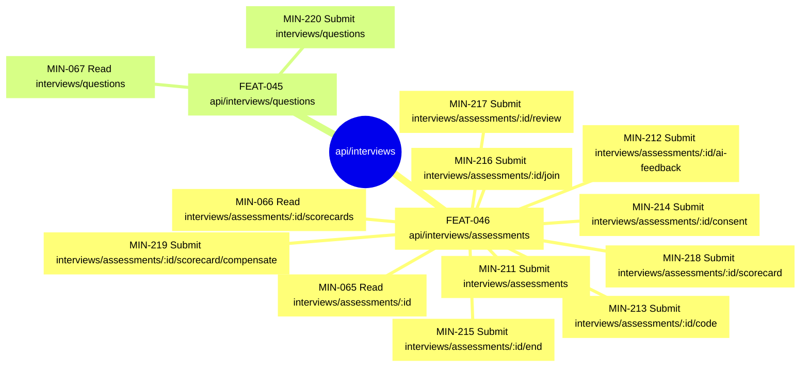

### FEAT-046 api/interviews/assessments

api/interviews/assessments

```mermaid
mindmap
  root((api/interviews/assessments))
    MIN_065[MIN-065 Read interviews/assessments/:id]
      SUB_236[SUB-236 Access control]
        NANO_258[NANO-258 Requires a signed-in session]
        NANO_259[NANO-259 Guard: requireInterviewParticipant]
      SUB_237[SUB-237 Persistence - PARTIAL]
      SUB_238[SUB-238 Responses]
        SML_151[SML-151 Success responses]
          NANO_260[NANO-260 HTTP 200]
        SML_152[SML-152 Failure branches]
          NANO_261[NANO-261 NOT_FOUND 404: Interview assessment id not found.]
    MIN_066[MIN-066 Read interviews/assessments/:id/scorecards]
      SUB_239[SUB-239 Access control]
        NANO_262[NANO-262 Requires a signed-in session]
        NANO_263[NANO-263 Guard: requireInterviewParticipant]
      SUB_240[SUB-240 Persistence - PARTIAL]
      SUB_241[SUB-241 Responses]
        SML_153[SML-153 Success responses]
          NANO_264[NANO-264 HTTP 200]
        SML_154[SML-154 Failure branches]
          NANO_265[NANO-265 NOT_FOUND 404: Interview assessment id not found.]
    MIN_211[MIN-211 Submit interviews/assessments]
      SUB_847[SUB-847 Access control]
        NANO_1253[NANO-1253 Requires a signed-in session]
        NANO_1254[NANO-1254 Allowed role: platform_admin]
      SUB_848[SUB-848 Request validation]
        SML_664[SML-664 ScheduleInterviewAssessmentInputSchema]
          TNY_264[TNY-264 Field orgId]
            NANO_1255[NANO-1255 orgId: must be a UUID]
          TNY_265[TNY-265 Field applicationId]
            NANO_1256[NANO-1256 applicationId: must be a UUID]
            NANO_1257[NANO-1257 applicationId: optional]
          TNY_266[TNY-266 Field candidateProfileId]
            NANO_1258[NANO-1258 candidateProfileId: must be a UUID]
          TNY_267[TNY-267 Field interviewerUserId]
            NANO_1259[NANO-1259 interviewerUserId: must be a UUID]
          TNY_268[TNY-268 Field title]
            NANO_1260[NANO-1260 title: minimum 1 characters]
            NANO_1261[NANO-1261 title: maximum 200 characters]
          TNY_269[TNY-269 Field scheduledAt]
            NANO_1262[NANO-1262 scheduledAt: must be an ISO date-time]
          TNY_270[TNY-270 Field durationMinutes]
            NANO_1263[NANO-1263 durationMinutes: must be an integer]
            NANO_1264[NANO-1264 durationMinutes: minimum 15]
            NANO_1265[NANO-1265 durationMinutes: maximum 240]
            NANO_1266[NANO-1266 durationMinutes: default 60]
          TNY_271[TNY-271 Field meetingUrl]
            NANO_1267[NANO-1267 meetingUrl: optional]
          TNY_272[TNY-272 Field questionIds]
            NANO_1268[NANO-1268 questionIds: list of string]
            NANO_1269[NANO-1269 questionIds: default]
      SUB_849[SUB-849 Business rules]
        SML_665[SML-665 Rule scheduleInterviewAssessment]
      SUB_850[SUB-850 Persistence - PARTIAL]
      SUB_851[SUB-851 Responses]
        SML_666[SML-666 Success responses]
          NANO_1270[NANO-1270 HTTP 201]
        SML_667[SML-667 Failure branches]
          NANO_1271[NANO-1271 FORBIDDEN 403: User is not authorized to schedule i...]
          NANO_1272[NANO-1272 NOT_FOUND 404: Candidate profile input.candidatePro...]
          NANO_1273[NANO-1273 VALIDATION_FAILED 422: The interviewer must be a me...]
          NANO_1274[NANO-1274 VALIDATION_FAILED 422: applicationId must be an app...]
          NANO_1275[NANO-1275 VALIDATION_FAILED 422: questionIds must be question...]
    MIN_212[MIN-212 Submit interviews/assessments/:id/ai-feedback]
      SUB_852[SUB-852 Access control]
        NANO_1276[NANO-1276 Requires a signed-in session]
        NANO_1277[NANO-1277 Guard: requireInterviewPanel]
      SUB_853[SUB-853 Business rules]
        SML_668[SML-668 Rule generateAdvisoryAiFeedback]
      SUB_854[SUB-854 Persistence - PARTIAL]
      SUB_855[SUB-855 Responses]
        SML_669[SML-669 Success responses]
          NANO_1278[NANO-1278 HTTP 200]
        SML_670[SML-670 Failure branches]
          NANO_1279[NANO-1279 NOT_FOUND 404: Interview assessment id not found.]
    MIN_213[MIN-213 Submit interviews/assessments/:id/code]
      SUB_856[SUB-856 Access control]
        NANO_1280[NANO-1280 Requires a signed-in session]
        NANO_1281[NANO-1281 Guard: requireInterviewParticipant]
      SUB_857[SUB-857 Request validation]
        SML_671[SML-671 ExecuteInterviewCodeInputSchema]
          TNY_273[TNY-273 Field code]
            NANO_1282[NANO-1282 code: minimum 1 characters]
            NANO_1283[NANO-1283 code: maximum 50000 characters]
          TNY_274[TNY-274 Field language]
            NANO_1284[NANO-1284 language: one of: javascript, typescript, python]
            NANO_1285[NANO-1285 language: default javascript]
          TNY_275[TNY-275 Field questionId]
            NANO_1286[NANO-1286 questionId: must be a UUID]
            NANO_1287[NANO-1287 questionId: optional]
          TNY_276[TNY-276 Field customTestCases]
            NANO_1288[NANO-1288 customTestCases: list of object]
            NANO_1289[NANO-1289 customTestCases: optional]
      SUB_858[SUB-858 Business rules]
        SML_672[SML-672 Rule executeInterviewCode]
      SUB_859[SUB-859 Persistence - PARTIAL]
      SUB_860[SUB-860 Responses]
        SML_673[SML-673 Success responses]
          NANO_1290[NANO-1290 HTTP 200]
        SML_674[SML-674 Failure branches]
          NANO_1291[NANO-1291 NOT_FOUND 404: Interview assessment id not found.]
          NANO_1292[NANO-1292 SERVICE_UNAVAILABLE 503: Automated code execution i...]
          NANO_1293[NANO-1293 NOT_FOUND 404: That question is not part of this in...]
    MIN_214[MIN-214 Submit interviews/assessments/:id/consent]
      SUB_861[SUB-861 Access control]
        NANO_1294[NANO-1294 Requires a signed-in session]
        NANO_1295[NANO-1295 Guard: requireInterviewParticipant]
      SUB_862[SUB-862 Request validation]
        SML_675[SML-675 SetRecordingConsentInputSchema]
          TNY_277[TNY-277 Field consent]
      SUB_863[SUB-863 Business rules]
        SML_676[SML-676 Rule updateRecordingConsent]
      SUB_864[SUB-864 Persistence - PARTIAL]
      SUB_865[SUB-865 Responses]
        SML_677[SML-677 Success responses]
          NANO_1296[NANO-1296 HTTP 200]
        SML_678[SML-678 Failure branches]
          NANO_1297[NANO-1297 NOT_FOUND 404: Interview assessment id not found.]
    MIN_215[MIN-215 Submit interviews/assessments/:id/end]
      SUB_866[SUB-866 Access control]
        NANO_1298[NANO-1298 Requires a signed-in session]
        NANO_1299[NANO-1299 Guard: requireInterviewPanel]
      SUB_867[SUB-867 Business rules]
        SML_679[SML-679 Rule endInterviewAssessment]
      SUB_868[SUB-868 Persistence - PARTIAL]
      SUB_869[SUB-869 Responses]
        SML_680[SML-680 Success responses]
          NANO_1300[NANO-1300 HTTP 200]
        SML_681[SML-681 Failure branches]
          NANO_1301[NANO-1301 NOT_FOUND 404: Interview assessment id not found.]
          NANO_1302[NANO-1302 VALIDATION_FAILED 422: Invalid resolution resolutio...]
    MIN_216[MIN-216 Submit interviews/assessments/:id/join]
      SUB_870[SUB-870 Access control]
        NANO_1303[NANO-1303 Requires a signed-in session]
        NANO_1304[NANO-1304 Guard: requireInterviewParticipant]
      SUB_871[SUB-871 Business rules]
        SML_682[SML-682 Rule joinInterviewAssessment]
      SUB_872[SUB-872 Persistence - PARTIAL]
      SUB_873[SUB-873 Responses]
        SML_683[SML-683 Success responses]
          NANO_1305[NANO-1305 HTTP 200]
        SML_684[SML-684 Failure branches]
          NANO_1306[NANO-1306 NOT_FOUND 404: Interview assessment id not found.]
    MIN_217[MIN-217 Submit interviews/assessments/:id/review]
      SUB_874[SUB-874 Access control]
        NANO_1307[NANO-1307 Requires a signed-in session]
        NANO_1308[NANO-1308 Guard: requireInterviewPanel]
      SUB_875[SUB-875 Business rules]
        SML_685[SML-685 Rule reviewInterviewAssessment]
      SUB_876[SUB-876 Persistence - PARTIAL]
      SUB_877[SUB-877 Responses]
        SML_686[SML-686 Success responses]
          NANO_1309[NANO-1309 HTTP 200]
        SML_687[SML-687 Failure branches]
          NANO_1310[NANO-1310 NOT_FOUND 404: Interview assessment id not found.]
    MIN_218[MIN-218 Submit interviews/assessments/:id/scorecard]
      SUB_878[SUB-878 Access control]
        NANO_1311[NANO-1311 Requires a signed-in session]
        NANO_1312[NANO-1312 Guard: canTransitionApplication]
        NANO_1313[NANO-1313 Guard: requireInterviewPanel]
      SUB_879[SUB-879 Request validation]
        SML_688[SML-688 SubmitInterviewScorecardInputSchema]
          TNY_278[TNY-278 Field technicalCorrectness]
            NANO_1314[NANO-1314 technicalCorrectness: must be an integer]
            NANO_1315[NANO-1315 technicalCorrectness: minimum 1]
            NANO_1316[NANO-1316 technicalCorrectness: maximum 5]
          TNY_279[TNY-279 Field communication]
            NANO_1317[NANO-1317 communication: must be an integer]
            NANO_1318[NANO-1318 communication: minimum 1]
            NANO_1319[NANO-1319 communication: maximum 5]
          TNY_280[TNY-280 Field problemSolving]
            NANO_1320[NANO-1320 problemSolving: must be an integer]
            NANO_1321[NANO-1321 problemSolving: minimum 1]
            NANO_1322[NANO-1322 problemSolving: maximum 5]
          TNY_281[TNY-281 Field codeQuality]
            NANO_1323[NANO-1323 codeQuality: must be an integer]
            NANO_1324[NANO-1324 codeQuality: minimum 1]
            NANO_1325[NANO-1325 codeQuality: maximum 5]
          TNY_282[TNY-282 Field recommendation]
            NANO_1326[NANO-1326 recommendation: one of: strong_yes, yes, neutral, n...]
          TNY_283[TNY-283 Field strengths]
            NANO_1327[NANO-1327 strengths: minimum 1 characters]
            NANO_1328[NANO-1328 strengths: maximum 5000 characters]
          TNY_284[TNY-284 Field areasForImprovement]
            NANO_1329[NANO-1329 areasForImprovement: minimum 1 characters]
            NANO_1330[NANO-1330 areasForImprovement: maximum 5000 characters]
          TNY_285[TNY-285 Field privateNotes]
            NANO_1331[NANO-1331 privateNotes: maximum 5000 characters]
            NANO_1332[NANO-1332 privateNotes: optional]
      SUB_880[SUB-880 Business rules]
        SML_689[SML-689 Rule canTransitionApplication]
        SML_690[SML-690 Rule submitInterviewScorecard]
      SUB_881[SUB-881 Persistence - PARTIAL]
        SML_691[SML-691 Writes job_applications]
        SML_692[SML-692 Writes application_evidence]
      SUB_882[SUB-882 Responses]
        SML_693[SML-693 Success responses]
          NANO_1333[NANO-1333 HTTP 201]
        SML_694[SML-694 Failure branches]
          NANO_1334[NANO-1334 NOT_FOUND 404: Interview assessment id not found.]
          NANO_1335[NANO-1335 FORBIDDEN 403: Candidates are not authorized to sub...]
    MIN_219[MIN-219 Submit interviews/assessments/:id/scorecard/compensate]
      SUB_883[SUB-883 Access control]
        NANO_1336[NANO-1336 Requires a signed-in session]
        NANO_1337[NANO-1337 Guard: requireInterviewPanel]
      SUB_884[SUB-884 Request validation]
        SML_695[SML-695 CompensateInterviewScorecardInputSchema]
          TNY_286[TNY-286 Field technicalCorrectness]
            NANO_1338[NANO-1338 technicalCorrectness: must be an integer]
            NANO_1339[NANO-1339 technicalCorrectness: minimum 1]
            NANO_1340[NANO-1340 technicalCorrectness: maximum 5]
          TNY_287[TNY-287 Field communication]
            NANO_1341[NANO-1341 communication: must be an integer]
            NANO_1342[NANO-1342 communication: minimum 1]
            NANO_1343[NANO-1343 communication: maximum 5]
          TNY_288[TNY-288 Field problemSolving]
            NANO_1344[NANO-1344 problemSolving: must be an integer]
            NANO_1345[NANO-1345 problemSolving: minimum 1]
            NANO_1346[NANO-1346 problemSolving: maximum 5]
          TNY_289[TNY-289 Field codeQuality]
            NANO_1347[NANO-1347 codeQuality: must be an integer]
            NANO_1348[NANO-1348 codeQuality: minimum 1]
            NANO_1349[NANO-1349 codeQuality: maximum 5]
          TNY_290[TNY-290 Field recommendation]
            NANO_1350[NANO-1350 recommendation: one of: strong_yes, yes, neutral, n...]
          TNY_291[TNY-291 Field strengths]
            NANO_1351[NANO-1351 strengths: minimum 1 characters]
            NANO_1352[NANO-1352 strengths: maximum 5000 characters]
          TNY_292[TNY-292 Field areasForImprovement]
            NANO_1353[NANO-1353 areasForImprovement: minimum 1 characters]
            NANO_1354[NANO-1354 areasForImprovement: maximum 5000 characters]
          TNY_293[TNY-293 Field compensationReason]
            NANO_1355[NANO-1355 compensationReason: minimum 1 characters]
            NANO_1356[NANO-1356 compensationReason: maximum 1000 characters]
          TNY_294[TNY-294 Field privateNotes]
            NANO_1357[NANO-1357 privateNotes: maximum 5000 characters]
            NANO_1358[NANO-1358 privateNotes: optional]
      SUB_885[SUB-885 Business rules]
        SML_696[SML-696 Rule compensateInterviewScorecard]
      SUB_886[SUB-886 Persistence - PARTIAL]
      SUB_887[SUB-887 Responses]
        SML_697[SML-697 Success responses]
          NANO_1359[NANO-1359 HTTP 201]
        SML_698[SML-698 Failure branches]
          NANO_1360[NANO-1360 NOT_FOUND 404: Interview assessment id not found.]
          NANO_1361[NANO-1361 FORBIDDEN 403: Candidates are not authorized to sub...]
          NANO_1362[NANO-1362 NOT_FOUND 404: No existing scorecard found to compe...]
```

| ID        | Level | Parent   | Name                                                                                           | Description                                                                                                                                                                                                                                                                                                                                                                                          | Status                | Verification | Evidence                                                  | Related                               |
| --------- | ----- | -------- | ---------------------------------------------------------------------------------------------- | ---------------------------------------------------------------------------------------------------------------------------------------------------------------------------------------------------------------------------------------------------------------------------------------------------------------------------------------------------------------------------------------------------- | --------------------- | ------------ | --------------------------------------------------------- | ------------------------------------- |
| FEAT-046  | MAJOR | MOD-066  | api/interviews/assessments                                                                     |                                                                                                                                                                                                                                                                                                                                                                                                      | IMPLEMENTED           |              | apps/api/src/server.ts:3562                               |                                       |
| MIN-065   | MINOR | FEAT-046 | Read interviews/assessments/:id                                                                | GET /api/v1/interviews/assessments/:id for any signed-in session; ephemeral (process memory); responds 200; 1 failure branch(es). Gaps: ephemeral: state held in process memory, lost on restart; no first-party web caller found                                                                                                                                                                    | IMPLEMENTED           | VERIFIED     | apps/api/src/server.ts:3658                               | API-066, TEST-137, TEST-142, TEST-216 |
| SUB-236   | SUB   | MIN-065  | Access control                                                                                 | Who may call GET /api/v1/interviews/assessments/:id: any signed-in session.                                                                                                                                                                                                                                                                                                                          | IMPLEMENTED           | PATH_LEVEL   | apps/api/src/server.ts:3658                               |                                       |
| NANO-258  | NANO  | SUB-236  | Requires a signed-in session                                                                   | Requests without a valid session token are rejected with 401 UNAUTHENTICATED.                                                                                                                                                                                                                                                                                                                        | IMPLEMENTED           | PATH_LEVEL   | apps/api/src/server.ts:3658                               | ROLE-001                              |
| NANO-259  | NANO  | SUB-236  | Guard: requireInterviewParticipant                                                             | Guard requireInterviewParticipant must pass before the handler runs.                                                                                                                                                                                                                                                                                                                                 | IMPLEMENTED           | PATH_LEVEL   | apps/api/src/server.ts:3658                               |                                       |
| SUB-237   | SUB   | MIN-065  | Persistence                                                                                    | Ephemeral: state lives in API process memory and is lost on restart.                                                                                                                                                                                                                                                                                                                                 | PARTIALLY_IMPLEMENTED | PATH_LEVEL   | apps/api/src/server.ts:3658                               |                                       |
| SUB-238   | SUB   | MIN-065  | Responses                                                                                      | Success 200; 1 explicit failure branch(es) besides validation and access errors.                                                                                                                                                                                                                                                                                                                     | IMPLEMENTED           | PATH_LEVEL   | apps/api/src/server.ts:3658                               |                                       |
| SML-151   | SMALL | SUB-238  | Success responses                                                                              | HTTP 200.                                                                                                                                                                                                                                                                                                                                                                                            | IMPLEMENTED           | PATH_LEVEL   | apps/api/src/server.ts:3658                               |                                       |
| NANO-260  | NANO  | SML-151  | HTTP 200                                                                                       | Replies 200 when the operation succeeds.                                                                                                                                                                                                                                                                                                                                                             | IMPLEMENTED           | PATH_LEVEL   | apps/api/src/server.ts:3658                               |                                       |
| SML-152   | SMALL | SUB-238  | Failure branches                                                                               | 1 DomainError branch(es) in the handler, mapped to HTTP by the global error handler.                                                                                                                                                                                                                                                                                                                 | IMPLEMENTED           | PATH_LEVEL   | apps/api/src/server.ts:3658                               |                                       |
| NANO-261  | NANO  | SML-152  | NOT_FOUND 404: Interview assessment ${id} not found.                                           | Throws DomainError(NOT_FOUND) "Interview assessment ${id} not found." -> HTTP 404.                                                                                                                                                                                                                                                                                                                   | IMPLEMENTED           | PATH_LEVEL   | apps/api/src/server.ts:3665                               | ERR-079                               |
| MIN-066   | MINOR | FEAT-046 | Read interviews/assessments/:id/scorecards                                                     | GET /api/v1/interviews/assessments/:id/scorecards for any signed-in session; ephemeral (process memory); responds 200; 1 failure branch(es). Gaps: ephemeral: state held in process memory, lost on restart; no first-party web caller found                                                                                                                                                         | IMPLEMENTED           | VERIFIED     | apps/api/src/server.ts:3961                               | API-073, TEST-137, TEST-216           |
| SUB-239   | SUB   | MIN-066  | Access control                                                                                 | Who may call GET /api/v1/interviews/assessments/:id/scorecards: any signed-in session.                                                                                                                                                                                                                                                                                                               | IMPLEMENTED           | PATH_LEVEL   | apps/api/src/server.ts:3961                               |                                       |
| NANO-262  | NANO  | SUB-239  | Requires a signed-in session                                                                   | Requests without a valid session token are rejected with 401 UNAUTHENTICATED.                                                                                                                                                                                                                                                                                                                        | IMPLEMENTED           | PATH_LEVEL   | apps/api/src/server.ts:3961                               | ROLE-001                              |
| NANO-263  | NANO  | SUB-239  | Guard: requireInterviewParticipant                                                             | Guard requireInterviewParticipant must pass before the handler runs.                                                                                                                                                                                                                                                                                                                                 | IMPLEMENTED           | PATH_LEVEL   | apps/api/src/server.ts:3961                               |                                       |
| SUB-240   | SUB   | MIN-066  | Persistence                                                                                    | Ephemeral: state lives in API process memory and is lost on restart.                                                                                                                                                                                                                                                                                                                                 | PARTIALLY_IMPLEMENTED | PATH_LEVEL   | apps/api/src/server.ts:3961                               |                                       |
| SUB-241   | SUB   | MIN-066  | Responses                                                                                      | Success 200; 1 explicit failure branch(es) besides validation and access errors.                                                                                                                                                                                                                                                                                                                     | IMPLEMENTED           | PATH_LEVEL   | apps/api/src/server.ts:3961                               |                                       |
| SML-153   | SMALL | SUB-241  | Success responses                                                                              | HTTP 200.                                                                                                                                                                                                                                                                                                                                                                                            | IMPLEMENTED           | PATH_LEVEL   | apps/api/src/server.ts:3961                               |                                       |
| NANO-264  | NANO  | SML-153  | HTTP 200                                                                                       | Replies 200 when the operation succeeds.                                                                                                                                                                                                                                                                                                                                                             | IMPLEMENTED           | PATH_LEVEL   | apps/api/src/server.ts:3961                               |                                       |
| SML-154   | SMALL | SUB-241  | Failure branches                                                                               | 1 DomainError branch(es) in the handler, mapped to HTTP by the global error handler.                                                                                                                                                                                                                                                                                                                 | IMPLEMENTED           | PATH_LEVEL   | apps/api/src/server.ts:3961                               |                                       |
| NANO-265  | NANO  | SML-154  | NOT_FOUND 404: Interview assessment ${id} not found.                                           | Throws DomainError(NOT_FOUND) "Interview assessment ${id} not found." -> HTTP 404.                                                                                                                                                                                                                                                                                                                   | IMPLEMENTED           | PATH_LEVEL   | apps/api/src/server.ts:3968                               | ERR-079                               |
| MIN-211   | MINOR | FEAT-046 | Submit interviews/assessments                                                                  | POST /api/v1/interviews/assessments for roles platform_admin; validates ScheduleInterviewAssessmentInputSchema; calls scheduleInterviewAssessment; ephemeral (process memory); responds 201; 5 failure branch(es). Gaps: ephemeral: state held in process memory, lost on restart; no first-party web caller found                                                                                   | IMPLEMENTED           | VERIFIED     | apps/api/src/server.ts:3562                               | API-065, TEST-137, TEST-142, TEST-216 |
| SUB-847   | SUB   | MIN-211  | Access control                                                                                 | Who may call POST /api/v1/interviews/assessments: roles platform_admin.                                                                                                                                                                                                                                                                                                                              | IMPLEMENTED           | PATH_LEVEL   | apps/api/src/server.ts:3562                               |                                       |
| NANO-1253 | NANO  | SUB-847  | Requires a signed-in session                                                                   | Requests without a valid session token are rejected with 401 UNAUTHENTICATED.                                                                                                                                                                                                                                                                                                                        | IMPLEMENTED           | PATH_LEVEL   | apps/api/src/server.ts:3562                               | ROLE-001                              |
| NANO-1254 | NANO  | SUB-847  | Allowed role: platform_admin                                                                   | platform_admin is one of the roles allowed here (platform_admin); a caller holding none of them is rejected with 403.                                                                                                                                                                                                                                                                                | IMPLEMENTED           | PATH_LEVEL   | apps/api/src/server.ts:3562                               | ROLE-008                              |
| SUB-848   | SUB   | MIN-211  | Request validation                                                                             | The request is parsed with ScheduleInterviewAssessmentInputSchema; a failure returns 400 with field details before any business logic runs.                                                                                                                                                                                                                                                          | IMPLEMENTED           | PATH_LEVEL   | apps/api/src/server.ts:3562                               |                                       |
| SML-664   | SMALL | SUB-848  | ScheduleInterviewAssessmentInputSchema                                                         | ScheduleInterviewAssessmentInputSchema: 9 field(s)                                                                                                                                                                                                                                                                                                                                                   | IMPLEMENTED           | PATH_LEVEL   | packages/contracts/src/index.ts:1151                      | SCH-089                               |
| TNY-264   | TINY  | SML-664  | Field orgId                                                                                    | orgId (string, required): must be a UUID                                                                                                                                                                                                                                                                                                                                                             | IMPLEMENTED           | PATH_LEVEL   | packages/contracts/src/index.ts:1152                      |                                       |
| NANO-1255 | NANO  | TNY-264  | orgId: must be a UUID                                                                          | orgId must be a UUID.                                                                                                                                                                                                                                                                                                                                                                                | IMPLEMENTED           | PATH_LEVEL   | packages/contracts/src/index.ts:1152                      |                                       |
| TNY-265   | TINY  | SML-664  | Field applicationId                                                                            | applicationId (string, optional): must be a UUID; optional                                                                                                                                                                                                                                                                                                                                           | IMPLEMENTED           | PATH_LEVEL   | packages/contracts/src/index.ts:1153                      |                                       |
| NANO-1256 | NANO  | TNY-265  | applicationId: must be a UUID                                                                  | applicationId must be a UUID.                                                                                                                                                                                                                                                                                                                                                                        | IMPLEMENTED           | PATH_LEVEL   | packages/contracts/src/index.ts:1153                      |                                       |
| NANO-1257 | NANO  | TNY-265  | applicationId: optional                                                                        | applicationId optional.                                                                                                                                                                                                                                                                                                                                                                              | IMPLEMENTED           | PATH_LEVEL   | packages/contracts/src/index.ts:1153                      |                                       |
| TNY-266   | TINY  | SML-664  | Field candidateProfileId                                                                       | candidateProfileId (string, required): must be a UUID                                                                                                                                                                                                                                                                                                                                                | IMPLEMENTED           | PATH_LEVEL   | packages/contracts/src/index.ts:1154                      |                                       |
| NANO-1258 | NANO  | TNY-266  | candidateProfileId: must be a UUID                                                             | candidateProfileId must be a UUID.                                                                                                                                                                                                                                                                                                                                                                   | IMPLEMENTED           | PATH_LEVEL   | packages/contracts/src/index.ts:1154                      |                                       |
| TNY-267   | TINY  | SML-664  | Field interviewerUserId                                                                        | interviewerUserId (string, required): must be a UUID                                                                                                                                                                                                                                                                                                                                                 | IMPLEMENTED           | PATH_LEVEL   | packages/contracts/src/index.ts:1155                      |                                       |
| NANO-1259 | NANO  | TNY-267  | interviewerUserId: must be a UUID                                                              | interviewerUserId must be a UUID.                                                                                                                                                                                                                                                                                                                                                                    | IMPLEMENTED           | PATH_LEVEL   | packages/contracts/src/index.ts:1155                      |                                       |
| TNY-268   | TINY  | SML-664  | Field title                                                                                    | title (string, required): minimum 1 characters; maximum 200 characters                                                                                                                                                                                                                                                                                                                               | IMPLEMENTED           | PATH_LEVEL   | packages/contracts/src/index.ts:1156                      |                                       |
| NANO-1260 | NANO  | TNY-268  | title: minimum 1 characters                                                                    | title minimum 1 characters.                                                                                                                                                                                                                                                                                                                                                                          | IMPLEMENTED           | PATH_LEVEL   | packages/contracts/src/index.ts:1156                      |                                       |
| NANO-1261 | NANO  | TNY-268  | title: maximum 200 characters                                                                  | title maximum 200 characters.                                                                                                                                                                                                                                                                                                                                                                        | IMPLEMENTED           | PATH_LEVEL   | packages/contracts/src/index.ts:1156                      |                                       |
| TNY-269   | TINY  | SML-664  | Field scheduledAt                                                                              | scheduledAt (string, required): must be an ISO date-time                                                                                                                                                                                                                                                                                                                                             | IMPLEMENTED           | PATH_LEVEL   | packages/contracts/src/index.ts:1157                      |                                       |
| NANO-1262 | NANO  | TNY-269  | scheduledAt: must be an ISO date-time                                                          | scheduledAt must be an ISO date-time.                                                                                                                                                                                                                                                                                                                                                                | IMPLEMENTED           | PATH_LEVEL   | packages/contracts/src/index.ts:1157                      |                                       |
| TNY-270   | TINY  | SML-664  | Field durationMinutes                                                                          | durationMinutes (number, optional): must be an integer; minimum 15; maximum 240; default 60                                                                                                                                                                                                                                                                                                          | IMPLEMENTED           | PATH_LEVEL   | packages/contracts/src/index.ts:1158                      |                                       |
| NANO-1263 | NANO  | TNY-270  | durationMinutes: must be an integer                                                            | durationMinutes must be an integer.                                                                                                                                                                                                                                                                                                                                                                  | IMPLEMENTED           | PATH_LEVEL   | packages/contracts/src/index.ts:1158                      |                                       |
| NANO-1264 | NANO  | TNY-270  | durationMinutes: minimum 15                                                                    | durationMinutes minimum 15.                                                                                                                                                                                                                                                                                                                                                                          | IMPLEMENTED           | PATH_LEVEL   | packages/contracts/src/index.ts:1158                      |                                       |
| NANO-1265 | NANO  | TNY-270  | durationMinutes: maximum 240                                                                   | durationMinutes maximum 240.                                                                                                                                                                                                                                                                                                                                                                         | IMPLEMENTED           | PATH_LEVEL   | packages/contracts/src/index.ts:1158                      |                                       |
| NANO-1266 | NANO  | TNY-270  | durationMinutes: default 60                                                                    | durationMinutes default 60.                                                                                                                                                                                                                                                                                                                                                                          | IMPLEMENTED           | PATH_LEVEL   | packages/contracts/src/index.ts:1158                      |                                       |
| TNY-271   | TINY  | SML-664  | Field meetingUrl                                                                               | meetingUrl (httpUrl(), optional): optional                                                                                                                                                                                                                                                                                                                                                           | IMPLEMENTED           | PATH_LEVEL   | packages/contracts/src/index.ts:1159                      |                                       |
| NANO-1267 | NANO  | TNY-271  | meetingUrl: optional                                                                           | meetingUrl optional.                                                                                                                                                                                                                                                                                                                                                                                 | IMPLEMENTED           | PATH_LEVEL   | packages/contracts/src/index.ts:1159                      |                                       |
| TNY-272   | TINY  | SML-664  | Field questionIds                                                                              | questionIds (array, optional): list of string; default []                                                                                                                                                                                                                                                                                                                                            | IMPLEMENTED           | PATH_LEVEL   | packages/contracts/src/index.ts:1160                      |                                       |
| NANO-1268 | NANO  | TNY-272  | questionIds: list of string                                                                    | questionIds list of string.                                                                                                                                                                                                                                                                                                                                                                          | IMPLEMENTED           | PATH_LEVEL   | packages/contracts/src/index.ts:1160                      |                                       |
| NANO-1269 | NANO  | TNY-272  | questionIds: default []                                                                        | questionIds default [].                                                                                                                                                                                                                                                                                                                                                                              | IMPLEMENTED           | PATH_LEVEL   | packages/contracts/src/index.ts:1160                      |                                       |
| SUB-849   | SUB   | MIN-211  | Business rules                                                                                 | Domain functions from packages/domain called by the handler (1).                                                                                                                                                                                                                                                                                                                                     | IMPLEMENTED           | PATH_LEVEL   | apps/api/src/server.ts:3562                               |                                       |
| SML-665   | SMALL | SUB-849  | Rule scheduleInterviewAssessment                                                               | Calls scheduleInterviewAssessment (packages/domain/src/technical-interview.ts). Rule status IMPLEMENTED; its own tests: VERIFIED.                                                                                                                                                                                                                                                                    | IMPLEMENTED           | VERIFIED     | packages/domain/src/technical-interview.ts:185            | RULE-253                              |
| SUB-850   | SUB   | MIN-211  | Persistence                                                                                    | Ephemeral: state lives in API process memory and is lost on restart.                                                                                                                                                                                                                                                                                                                                 | PARTIALLY_IMPLEMENTED | PATH_LEVEL   | apps/api/src/server.ts:3562                               |                                       |
| SUB-851   | SUB   | MIN-211  | Responses                                                                                      | Success 201; 5 explicit failure branch(es) besides validation and access errors.                                                                                                                                                                                                                                                                                                                     | IMPLEMENTED           | PATH_LEVEL   | apps/api/src/server.ts:3562                               |                                       |
| SML-666   | SMALL | SUB-851  | Success responses                                                                              | HTTP 201.                                                                                                                                                                                                                                                                                                                                                                                            | IMPLEMENTED           | PATH_LEVEL   | apps/api/src/server.ts:3562                               |                                       |
| NANO-1270 | NANO  | SML-666  | HTTP 201                                                                                       | Replies 201 when the operation succeeds.                                                                                                                                                                                                                                                                                                                                                             | IMPLEMENTED           | PATH_LEVEL   | apps/api/src/server.ts:3562                               |                                       |
| SML-667   | SMALL | SUB-851  | Failure branches                                                                               | 5 DomainError branch(es) in the handler, mapped to HTTP by the global error handler.                                                                                                                                                                                                                                                                                                                 | IMPLEMENTED           | PATH_LEVEL   | apps/api/src/server.ts:3562                               |                                       |
| NANO-1271 | NANO  | SML-667  | FORBIDDEN 403: User is not authorized to schedule interviews for this organization.            | Throws DomainError(FORBIDDEN) "User is not authorized to schedule interviews for this organization." -> HTTP 403.                                                                                                                                                                                                                                                                                    | IMPLEMENTED           | PATH_LEVEL   | apps/api/src/server.ts:3570                               | ERR-074                               |
| NANO-1272 | NANO  | SML-667  | NOT_FOUND 404: Candidate profile ${input.candidateProfileId} not found.                        | Throws DomainError(NOT_FOUND) "Candidate profile ${input.candidateProfileId} not found." -> HTTP 404.                                                                                                                                                                                                                                                                                                | IMPLEMENTED           | PATH_LEVEL   | apps/api/src/server.ts:3578                               | ERR-075                               |
| NANO-1273 | NANO  | SML-667  | VALIDATION_FAILED 422: The interviewer must be a member of the hiring organization.            | Throws DomainError(VALIDATION_FAILED) "The interviewer must be a member of the hiring organization." -> HTTP 422.                                                                                                                                                                                                                                                                                    | IMPLEMENTED           | PATH_LEVEL   | apps/api/src/server.ts:3590                               | ERR-076                               |
| NANO-1274 | NANO  | SML-667  | VALIDATION_FAILED 422: applicationId must be an application to one of this organization's job  | Throws DomainError(VALIDATION_FAILED) "applicationId must be an application to one of this organization's jobs from this candidate." -> HTTP 422.                                                                                                                                                                                                                                                    | IMPLEMENTED           | PATH_LEVEL   | apps/api/src/server.ts:3607                               | ERR-077                               |
| NANO-1275 | NANO  | SML-667  | VALIDATION_FAILED 422: questionIds must be questions from this organization's own question ba  | Throws DomainError(VALIDATION_FAILED) "questionIds must be questions from this organization's own question bank." -> HTTP 422.                                                                                                                                                                                                                                                                       | IMPLEMENTED           | PATH_LEVEL   | apps/api/src/server.ts:3619                               | ERR-078                               |
| MIN-212   | MINOR | FEAT-046 | Submit interviews/assessments/:id/ai-feedback                                                  | POST /api/v1/interviews/assessments/:id/ai-feedback for any signed-in session; calls generateAdvisoryAiFeedback; ephemeral (process memory); responds 200; 1 failure branch(es). Gaps: ephemeral: state held in process memory, lost on restart; no first-party web caller found                                                                                                                     | IMPLEMENTED           | VERIFIED     | apps/api/src/server.ts:3993                               | API-074, TEST-137, TEST-216           |
| SUB-852   | SUB   | MIN-212  | Access control                                                                                 | Who may call POST /api/v1/interviews/assessments/:id/ai-feedback: any signed-in session.                                                                                                                                                                                                                                                                                                             | IMPLEMENTED           | PATH_LEVEL   | apps/api/src/server.ts:3993                               |                                       |
| NANO-1276 | NANO  | SUB-852  | Requires a signed-in session                                                                   | Requests without a valid session token are rejected with 401 UNAUTHENTICATED.                                                                                                                                                                                                                                                                                                                        | IMPLEMENTED           | PATH_LEVEL   | apps/api/src/server.ts:3993                               | ROLE-001                              |
| NANO-1277 | NANO  | SUB-852  | Guard: requireInterviewPanel                                                                   | Guard requireInterviewPanel must pass before the handler runs.                                                                                                                                                                                                                                                                                                                                       | IMPLEMENTED           | PATH_LEVEL   | apps/api/src/server.ts:3993                               |                                       |
| SUB-853   | SUB   | MIN-212  | Business rules                                                                                 | Domain functions from packages/domain called by the handler (1).                                                                                                                                                                                                                                                                                                                                     | IMPLEMENTED           | PATH_LEVEL   | apps/api/src/server.ts:3993                               |                                       |
| SML-668   | SMALL | SUB-853  | Rule generateAdvisoryAiFeedback                                                                | Calls generateAdvisoryAiFeedback (packages/domain/src/technical-interview.ts). Rule status IMPLEMENTED; its own tests: VERIFIED.                                                                                                                                                                                                                                                                     | IMPLEMENTED           | VERIFIED     | packages/domain/src/technical-interview.ts:490            | RULE-260                              |
| SUB-854   | SUB   | MIN-212  | Persistence                                                                                    | Ephemeral: state lives in API process memory and is lost on restart.                                                                                                                                                                                                                                                                                                                                 | PARTIALLY_IMPLEMENTED | PATH_LEVEL   | apps/api/src/server.ts:3993                               |                                       |
| SUB-855   | SUB   | MIN-212  | Responses                                                                                      | Success 200; 1 explicit failure branch(es) besides validation and access errors.                                                                                                                                                                                                                                                                                                                     | IMPLEMENTED           | PATH_LEVEL   | apps/api/src/server.ts:3993                               |                                       |
| SML-669   | SMALL | SUB-855  | Success responses                                                                              | HTTP 200.                                                                                                                                                                                                                                                                                                                                                                                            | IMPLEMENTED           | PATH_LEVEL   | apps/api/src/server.ts:3993                               |                                       |
| NANO-1278 | NANO  | SML-669  | HTTP 200                                                                                       | Replies 200 when the operation succeeds.                                                                                                                                                                                                                                                                                                                                                             | IMPLEMENTED           | PATH_LEVEL   | apps/api/src/server.ts:3993                               |                                       |
| SML-670   | SMALL | SUB-855  | Failure branches                                                                               | 1 DomainError branch(es) in the handler, mapped to HTTP by the global error handler.                                                                                                                                                                                                                                                                                                                 | IMPLEMENTED           | PATH_LEVEL   | apps/api/src/server.ts:3993                               |                                       |
| NANO-1279 | NANO  | SML-670  | NOT_FOUND 404: Interview assessment ${id} not found.                                           | Throws DomainError(NOT_FOUND) "Interview assessment ${id} not found." -> HTTP 404.                                                                                                                                                                                                                                                                                                                   | IMPLEMENTED           | PATH_LEVEL   | apps/api/src/server.ts:4000                               | ERR-079                               |
| MIN-213   | MINOR | FEAT-046 | Submit interviews/assessments/:id/code                                                         | POST /api/v1/interviews/assessments/:id/code for any signed-in session; validates ExecuteInterviewCodeInputSchema; calls executeInterviewCode; ephemeral (process memory); responds 200; 3 failure branch(es). Gaps: ephemeral: state held in process memory, lost on restart; no first-party web caller found                                                                                       | IMPLEMENTED           | VERIFIED     | apps/api/src/server.ts:3775                               | API-070, TEST-137, TEST-142, TEST-216 |
| SUB-856   | SUB   | MIN-213  | Access control                                                                                 | Who may call POST /api/v1/interviews/assessments/:id/code: any signed-in session.                                                                                                                                                                                                                                                                                                                    | IMPLEMENTED           | PATH_LEVEL   | apps/api/src/server.ts:3775                               |                                       |
| NANO-1280 | NANO  | SUB-856  | Requires a signed-in session                                                                   | Requests without a valid session token are rejected with 401 UNAUTHENTICATED.                                                                                                                                                                                                                                                                                                                        | IMPLEMENTED           | PATH_LEVEL   | apps/api/src/server.ts:3775                               | ROLE-001                              |
| NANO-1281 | NANO  | SUB-856  | Guard: requireInterviewParticipant                                                             | Guard requireInterviewParticipant must pass before the handler runs.                                                                                                                                                                                                                                                                                                                                 | IMPLEMENTED           | PATH_LEVEL   | apps/api/src/server.ts:3775                               |                                       |
| SUB-857   | SUB   | MIN-213  | Request validation                                                                             | The request is parsed with ExecuteInterviewCodeInputSchema; a failure returns 400 with field details before any business logic runs.                                                                                                                                                                                                                                                                 | IMPLEMENTED           | PATH_LEVEL   | apps/api/src/server.ts:3775                               |                                       |
| SML-671   | SMALL | SUB-857  | ExecuteInterviewCodeInputSchema                                                                | ExecuteInterviewCodeInputSchema: 4 field(s)                                                                                                                                                                                                                                                                                                                                                          | IMPLEMENTED           | PATH_LEVEL   | packages/contracts/src/index.ts:1202                      | SCH-093                               |
| TNY-273   | TINY  | SML-671  | Field code                                                                                     | code (string, required): minimum 1 characters; maximum 50000 characters                                                                                                                                                                                                                                                                                                                              | IMPLEMENTED           | PATH_LEVEL   | packages/contracts/src/index.ts:1203                      |                                       |
| NANO-1282 | NANO  | TNY-273  | code: minimum 1 characters                                                                     | code minimum 1 characters.                                                                                                                                                                                                                                                                                                                                                                           | IMPLEMENTED           | PATH_LEVEL   | packages/contracts/src/index.ts:1203                      |                                       |
| NANO-1283 | NANO  | TNY-273  | code: maximum 50000 characters                                                                 | code maximum 50000 characters.                                                                                                                                                                                                                                                                                                                                                                       | IMPLEMENTED           | PATH_LEVEL   | packages/contracts/src/index.ts:1203                      |                                       |
| TNY-274   | TINY  | SML-671  | Field language                                                                                 | language (enum, optional): one of: javascript, typescript, python; default 'javascript'                                                                                                                                                                                                                                                                                                              | IMPLEMENTED           | PATH_LEVEL   | packages/contracts/src/index.ts:1204                      |                                       |
| NANO-1284 | NANO  | TNY-274  | language: one of: javascript, typescript, python                                               | language one of: javascript, typescript, python.                                                                                                                                                                                                                                                                                                                                                     | IMPLEMENTED           | PATH_LEVEL   | packages/contracts/src/index.ts:1204                      |                                       |
| NANO-1285 | NANO  | TNY-274  | language: default 'javascript'                                                                 | language default 'javascript'; message "javascript".                                                                                                                                                                                                                                                                                                                                                 | IMPLEMENTED           | PATH_LEVEL   | packages/contracts/src/index.ts:1204                      |                                       |
| TNY-275   | TINY  | SML-671  | Field questionId                                                                               | questionId (string, optional): must be a UUID; optional                                                                                                                                                                                                                                                                                                                                              | IMPLEMENTED           | PATH_LEVEL   | packages/contracts/src/index.ts:1205                      |                                       |
| NANO-1286 | NANO  | TNY-275  | questionId: must be a UUID                                                                     | questionId must be a UUID.                                                                                                                                                                                                                                                                                                                                                                           | IMPLEMENTED           | PATH_LEVEL   | packages/contracts/src/index.ts:1205                      |                                       |
| NANO-1287 | NANO  | TNY-275  | questionId: optional                                                                           | questionId optional.                                                                                                                                                                                                                                                                                                                                                                                 | IMPLEMENTED           | PATH_LEVEL   | packages/contracts/src/index.ts:1205                      |                                       |
| TNY-276   | TINY  | SML-671  | Field customTestCases                                                                          | customTestCases (array, optional): list of object; optional                                                                                                                                                                                                                                                                                                                                          | IMPLEMENTED           | PATH_LEVEL   | packages/contracts/src/index.ts:1206                      |                                       |
| NANO-1288 | NANO  | TNY-276  | customTestCases: list of object                                                                | customTestCases list of object.                                                                                                                                                                                                                                                                                                                                                                      | IMPLEMENTED           | PATH_LEVEL   | packages/contracts/src/index.ts:1206                      |                                       |
| NANO-1289 | NANO  | TNY-276  | customTestCases: optional                                                                      | customTestCases optional.                                                                                                                                                                                                                                                                                                                                                                            | IMPLEMENTED           | PATH_LEVEL   | packages/contracts/src/index.ts:1206                      |                                       |
| SUB-858   | SUB   | MIN-213  | Business rules                                                                                 | Domain functions from packages/domain called by the handler (1).                                                                                                                                                                                                                                                                                                                                     | IMPLEMENTED           | PATH_LEVEL   | apps/api/src/server.ts:3775                               |                                       |
| SML-672   | SMALL | SUB-858  | Rule executeInterviewCode                                                                      | Calls executeInterviewCode (packages/domain/src/technical-interview.ts). Rule status IMPLEMENTED; its own tests: VERIFIED.                                                                                                                                                                                                                                                                           | IMPLEMENTED           | VERIFIED     | packages/domain/src/technical-interview.ts:518            | RULE-261                              |
| SUB-859   | SUB   | MIN-213  | Persistence                                                                                    | Ephemeral: state lives in API process memory and is lost on restart.                                                                                                                                                                                                                                                                                                                                 | PARTIALLY_IMPLEMENTED | PATH_LEVEL   | apps/api/src/server.ts:3775                               |                                       |
| SUB-860   | SUB   | MIN-213  | Responses                                                                                      | Success 200; 3 explicit failure branch(es) besides validation and access errors.                                                                                                                                                                                                                                                                                                                     | IMPLEMENTED           | PATH_LEVEL   | apps/api/src/server.ts:3775                               |                                       |
| SML-673   | SMALL | SUB-860  | Success responses                                                                              | HTTP 200.                                                                                                                                                                                                                                                                                                                                                                                            | IMPLEMENTED           | PATH_LEVEL   | apps/api/src/server.ts:3775                               |                                       |
| NANO-1290 | NANO  | SML-673  | HTTP 200                                                                                       | Replies 200 when the operation succeeds.                                                                                                                                                                                                                                                                                                                                                             | IMPLEMENTED           | PATH_LEVEL   | apps/api/src/server.ts:3775                               |                                       |
| SML-674   | SMALL | SUB-860  | Failure branches                                                                               | 3 DomainError branch(es) in the handler, mapped to HTTP by the global error handler.                                                                                                                                                                                                                                                                                                                 | IMPLEMENTED           | PATH_LEVEL   | apps/api/src/server.ts:3775                               |                                       |
| NANO-1291 | NANO  | SML-674  | NOT_FOUND 404: Interview assessment ${id} not found.                                           | Throws DomainError(NOT_FOUND) "Interview assessment ${id} not found." -> HTTP 404.                                                                                                                                                                                                                                                                                                                   | IMPLEMENTED           | PATH_LEVEL   | apps/api/src/server.ts:3782                               | ERR-079                               |
| NANO-1292 | NANO  | SML-674  | SERVICE_UNAVAILABLE 503: Automated code execution is unavailable until a real isolated sandbox | Throws DomainError(SERVICE_UNAVAILABLE) "Automated code execution is unavailable until a real isolated sandbox is configured." -> HTTP 503.                                                                                                                                                                                                                                                          | IMPLEMENTED           | PATH_LEVEL   | apps/api/src/server.ts:3789                               | ERR-081                               |
| NANO-1293 | NANO  | SML-674  | NOT_FOUND 404: That question is not part of this interview.                                    | Throws DomainError(NOT_FOUND) "That question is not part of this interview." -> HTTP 404.                                                                                                                                                                                                                                                                                                            | IMPLEMENTED           | PATH_LEVEL   | apps/api/src/server.ts:3800                               | ERR-082                               |
| MIN-214   | MINOR | FEAT-046 | Submit interviews/assessments/:id/consent                                                      | POST /api/v1/interviews/assessments/:id/consent for any signed-in session; validates SetRecordingConsentInputSchema; calls updateRecordingConsent; ephemeral (process memory); responds 200; 1 failure branch(es). Gaps: ephemeral: state held in process memory, lost on restart; no first-party web caller found                                                                                   | IMPLEMENTED           | VERIFIED     | apps/api/src/server.ts:3718                               | API-068, TEST-137, TEST-216           |
| SUB-861   | SUB   | MIN-214  | Access control                                                                                 | Who may call POST /api/v1/interviews/assessments/:id/consent: any signed-in session.                                                                                                                                                                                                                                                                                                                 | IMPLEMENTED           | PATH_LEVEL   | apps/api/src/server.ts:3718                               |                                       |
| NANO-1294 | NANO  | SUB-861  | Requires a signed-in session                                                                   | Requests without a valid session token are rejected with 401 UNAUTHENTICATED.                                                                                                                                                                                                                                                                                                                        | IMPLEMENTED           | PATH_LEVEL   | apps/api/src/server.ts:3718                               | ROLE-001                              |
| NANO-1295 | NANO  | SUB-861  | Guard: requireInterviewParticipant                                                             | Guard requireInterviewParticipant must pass before the handler runs.                                                                                                                                                                                                                                                                                                                                 | IMPLEMENTED           | PATH_LEVEL   | apps/api/src/server.ts:3718                               |                                       |
| SUB-862   | SUB   | MIN-214  | Request validation                                                                             | The request is parsed with SetRecordingConsentInputSchema; a failure returns 400 with field details before any business logic runs.                                                                                                                                                                                                                                                                  | IMPLEMENTED           | PATH_LEVEL   | apps/api/src/server.ts:3718                               |                                       |
| SML-675   | SMALL | SUB-862  | SetRecordingConsentInputSchema                                                                 | SetRecordingConsentInputSchema: 1 field(s)                                                                                                                                                                                                                                                                                                                                                           | IMPLEMENTED           | PATH_LEVEL   | packages/contracts/src/index.ts:1167                      | SCH-090                               |
| TNY-277   | TINY  | SML-675  | Field consent                                                                                  | consent (boolean, required)                                                                                                                                                                                                                                                                                                                                                                          | IMPLEMENTED           | PATH_LEVEL   | packages/contracts/src/index.ts:1168                      |                                       |
| SUB-863   | SUB   | MIN-214  | Business rules                                                                                 | Domain functions from packages/domain called by the handler (1).                                                                                                                                                                                                                                                                                                                                     | IMPLEMENTED           | PATH_LEVEL   | apps/api/src/server.ts:3718                               |                                       |
| SML-676   | SMALL | SUB-863  | Rule updateRecordingConsent                                                                    | Calls updateRecordingConsent (packages/domain/src/technical-interview.ts). Rule status IMPLEMENTED; its own tests: VERIFIED.                                                                                                                                                                                                                                                                         | IMPLEMENTED           | VERIFIED     | packages/domain/src/technical-interview.ts:277            | RULE-255                              |
| SUB-864   | SUB   | MIN-214  | Persistence                                                                                    | Ephemeral: state lives in API process memory and is lost on restart.                                                                                                                                                                                                                                                                                                                                 | PARTIALLY_IMPLEMENTED | PATH_LEVEL   | apps/api/src/server.ts:3718                               |                                       |
| SUB-865   | SUB   | MIN-214  | Responses                                                                                      | Success 200; 1 explicit failure branch(es) besides validation and access errors.                                                                                                                                                                                                                                                                                                                     | IMPLEMENTED           | PATH_LEVEL   | apps/api/src/server.ts:3718                               |                                       |
| SML-677   | SMALL | SUB-865  | Success responses                                                                              | HTTP 200.                                                                                                                                                                                                                                                                                                                                                                                            | IMPLEMENTED           | PATH_LEVEL   | apps/api/src/server.ts:3718                               |                                       |
| NANO-1296 | NANO  | SML-677  | HTTP 200                                                                                       | Replies 200 when the operation succeeds.                                                                                                                                                                                                                                                                                                                                                             | IMPLEMENTED           | PATH_LEVEL   | apps/api/src/server.ts:3718                               |                                       |
| SML-678   | SMALL | SUB-865  | Failure branches                                                                               | 1 DomainError branch(es) in the handler, mapped to HTTP by the global error handler.                                                                                                                                                                                                                                                                                                                 | IMPLEMENTED           | PATH_LEVEL   | apps/api/src/server.ts:3718                               |                                       |
| NANO-1297 | NANO  | SML-678  | NOT_FOUND 404: Interview assessment ${id} not found.                                           | Throws DomainError(NOT_FOUND) "Interview assessment ${id} not found." -> HTTP 404.                                                                                                                                                                                                                                                                                                                   | IMPLEMENTED           | PATH_LEVEL   | apps/api/src/server.ts:3725                               | ERR-079                               |
| MIN-215   | MINOR | FEAT-046 | Submit interviews/assessments/:id/end                                                          | POST /api/v1/interviews/assessments/:id/end for any signed-in session; calls endInterviewAssessment; ephemeral (process memory); responds 200; 2 failure branch(es). Gaps: ephemeral: state held in process memory, lost on restart; no first-party web caller found                                                                                                                                 | IMPLEMENTED           | VERIFIED     | apps/api/src/server.ts:3739                               | API-069, TEST-137, TEST-216           |
| SUB-866   | SUB   | MIN-215  | Access control                                                                                 | Who may call POST /api/v1/interviews/assessments/:id/end: any signed-in session.                                                                                                                                                                                                                                                                                                                     | IMPLEMENTED           | PATH_LEVEL   | apps/api/src/server.ts:3739                               |                                       |
| NANO-1298 | NANO  | SUB-866  | Requires a signed-in session                                                                   | Requests without a valid session token are rejected with 401 UNAUTHENTICATED.                                                                                                                                                                                                                                                                                                                        | IMPLEMENTED           | PATH_LEVEL   | apps/api/src/server.ts:3739                               | ROLE-001                              |
| NANO-1299 | NANO  | SUB-866  | Guard: requireInterviewPanel                                                                   | Guard requireInterviewPanel must pass before the handler runs.                                                                                                                                                                                                                                                                                                                                       | IMPLEMENTED           | PATH_LEVEL   | apps/api/src/server.ts:3739                               |                                       |
| SUB-867   | SUB   | MIN-215  | Business rules                                                                                 | Domain functions from packages/domain called by the handler (1).                                                                                                                                                                                                                                                                                                                                     | IMPLEMENTED           | PATH_LEVEL   | apps/api/src/server.ts:3739                               |                                       |
| SML-679   | SMALL | SUB-867  | Rule endInterviewAssessment                                                                    | Calls endInterviewAssessment (packages/domain/src/technical-interview.ts). Rule status IMPLEMENTED; its own tests: VERIFIED.                                                                                                                                                                                                                                                                         | IMPLEMENTED           | VERIFIED     | packages/domain/src/technical-interview.ts:312            | RULE-256                              |
| SUB-868   | SUB   | MIN-215  | Persistence                                                                                    | Ephemeral: state lives in API process memory and is lost on restart.                                                                                                                                                                                                                                                                                                                                 | PARTIALLY_IMPLEMENTED | PATH_LEVEL   | apps/api/src/server.ts:3739                               |                                       |
| SUB-869   | SUB   | MIN-215  | Responses                                                                                      | Success 200; 2 explicit failure branch(es) besides validation and access errors.                                                                                                                                                                                                                                                                                                                     | IMPLEMENTED           | PATH_LEVEL   | apps/api/src/server.ts:3739                               |                                       |
| SML-680   | SMALL | SUB-869  | Success responses                                                                              | HTTP 200.                                                                                                                                                                                                                                                                                                                                                                                            | IMPLEMENTED           | PATH_LEVEL   | apps/api/src/server.ts:3739                               |                                       |
| NANO-1300 | NANO  | SML-680  | HTTP 200                                                                                       | Replies 200 when the operation succeeds.                                                                                                                                                                                                                                                                                                                                                             | IMPLEMENTED           | PATH_LEVEL   | apps/api/src/server.ts:3739                               |                                       |
| SML-681   | SMALL | SUB-869  | Failure branches                                                                               | 2 DomainError branch(es) in the handler, mapped to HTTP by the global error handler.                                                                                                                                                                                                                                                                                                                 | IMPLEMENTED           | PATH_LEVEL   | apps/api/src/server.ts:3739                               |                                       |
| NANO-1301 | NANO  | SML-681  | NOT_FOUND 404: Interview assessment ${id} not found.                                           | Throws DomainError(NOT_FOUND) "Interview assessment ${id} not found." -> HTTP 404.                                                                                                                                                                                                                                                                                                                   | IMPLEMENTED           | PATH_LEVEL   | apps/api/src/server.ts:3746                               | ERR-079                               |
| NANO-1302 | NANO  | SML-681  | VALIDATION_FAILED 422: Invalid resolution '${resolution}'. Must be completed, cancelled, or n  | Throws DomainError(VALIDATION_FAILED) "Invalid resolution '${resolution}'. Must be completed, cancelled, or no_show." -> HTTP 422.                                                                                                                                                                                                                                                                   | IMPLEMENTED           | PATH_LEVEL   | apps/api/src/server.ts:3754                               | ERR-080                               |
| MIN-216   | MINOR | FEAT-046 | Submit interviews/assessments/:id/join                                                         | POST /api/v1/interviews/assessments/:id/join for any signed-in session; calls joinInterviewAssessment; ephemeral (process memory); responds 200; 1 failure branch(es). Gaps: ephemeral: state held in process memory, lost on restart; no first-party web caller found                                                                                                                               | IMPLEMENTED           | VERIFIED     | apps/api/src/server.ts:3690                               | API-067, TEST-137, TEST-216           |
| SUB-870   | SUB   | MIN-216  | Access control                                                                                 | Who may call POST /api/v1/interviews/assessments/:id/join: any signed-in session.                                                                                                                                                                                                                                                                                                                    | IMPLEMENTED           | PATH_LEVEL   | apps/api/src/server.ts:3690                               |                                       |
| NANO-1303 | NANO  | SUB-870  | Requires a signed-in session                                                                   | Requests without a valid session token are rejected with 401 UNAUTHENTICATED.                                                                                                                                                                                                                                                                                                                        | IMPLEMENTED           | PATH_LEVEL   | apps/api/src/server.ts:3690                               | ROLE-001                              |
| NANO-1304 | NANO  | SUB-870  | Guard: requireInterviewParticipant                                                             | Guard requireInterviewParticipant must pass before the handler runs.                                                                                                                                                                                                                                                                                                                                 | IMPLEMENTED           | PATH_LEVEL   | apps/api/src/server.ts:3690                               |                                       |
| SUB-871   | SUB   | MIN-216  | Business rules                                                                                 | Domain functions from packages/domain called by the handler (1).                                                                                                                                                                                                                                                                                                                                     | IMPLEMENTED           | PATH_LEVEL   | apps/api/src/server.ts:3690                               |                                       |
| SML-682   | SMALL | SUB-871  | Rule joinInterviewAssessment                                                                   | Calls joinInterviewAssessment (packages/domain/src/technical-interview.ts). Rule status IMPLEMENTED; its own tests: VERIFIED.                                                                                                                                                                                                                                                                        | IMPLEMENTED           | VERIFIED     | packages/domain/src/technical-interview.ts:241            | RULE-254                              |
| SUB-872   | SUB   | MIN-216  | Persistence                                                                                    | Ephemeral: state lives in API process memory and is lost on restart.                                                                                                                                                                                                                                                                                                                                 | PARTIALLY_IMPLEMENTED | PATH_LEVEL   | apps/api/src/server.ts:3690                               |                                       |
| SUB-873   | SUB   | MIN-216  | Responses                                                                                      | Success 200; 1 explicit failure branch(es) besides validation and access errors.                                                                                                                                                                                                                                                                                                                     | IMPLEMENTED           | PATH_LEVEL   | apps/api/src/server.ts:3690                               |                                       |
| SML-683   | SMALL | SUB-873  | Success responses                                                                              | HTTP 200.                                                                                                                                                                                                                                                                                                                                                                                            | IMPLEMENTED           | PATH_LEVEL   | apps/api/src/server.ts:3690                               |                                       |
| NANO-1305 | NANO  | SML-683  | HTTP 200                                                                                       | Replies 200 when the operation succeeds.                                                                                                                                                                                                                                                                                                                                                             | IMPLEMENTED           | PATH_LEVEL   | apps/api/src/server.ts:3690                               |                                       |
| SML-684   | SMALL | SUB-873  | Failure branches                                                                               | 1 DomainError branch(es) in the handler, mapped to HTTP by the global error handler.                                                                                                                                                                                                                                                                                                                 | IMPLEMENTED           | PATH_LEVEL   | apps/api/src/server.ts:3690                               |                                       |
| NANO-1306 | NANO  | SML-684  | NOT_FOUND 404: Interview assessment ${id} not found.                                           | Throws DomainError(NOT_FOUND) "Interview assessment ${id} not found." -> HTTP 404.                                                                                                                                                                                                                                                                                                                   | IMPLEMENTED           | PATH_LEVEL   | apps/api/src/server.ts:3697                               | ERR-079                               |
| MIN-217   | MINOR | FEAT-046 | Submit interviews/assessments/:id/review                                                       | POST /api/v1/interviews/assessments/:id/review for any signed-in session; calls reviewInterviewAssessment; ephemeral (process memory); responds 200; 1 failure branch(es). Gaps: ephemeral: state held in process memory, lost on restart; no first-party web caller found                                                                                                                           | IMPLEMENTED           | VERIFIED     | apps/api/src/server.ts:4013                               | API-075, TEST-137, TEST-216           |
| SUB-874   | SUB   | MIN-217  | Access control                                                                                 | Who may call POST /api/v1/interviews/assessments/:id/review: any signed-in session.                                                                                                                                                                                                                                                                                                                  | IMPLEMENTED           | PATH_LEVEL   | apps/api/src/server.ts:4013                               |                                       |
| NANO-1307 | NANO  | SUB-874  | Requires a signed-in session                                                                   | Requests without a valid session token are rejected with 401 UNAUTHENTICATED.                                                                                                                                                                                                                                                                                                                        | IMPLEMENTED           | PATH_LEVEL   | apps/api/src/server.ts:4013                               | ROLE-001                              |
| NANO-1308 | NANO  | SUB-874  | Guard: requireInterviewPanel                                                                   | Guard requireInterviewPanel must pass before the handler runs.                                                                                                                                                                                                                                                                                                                                       | IMPLEMENTED           | PATH_LEVEL   | apps/api/src/server.ts:4013                               |                                       |
| SUB-875   | SUB   | MIN-217  | Business rules                                                                                 | Domain functions from packages/domain called by the handler (1).                                                                                                                                                                                                                                                                                                                                     | IMPLEMENTED           | PATH_LEVEL   | apps/api/src/server.ts:4013                               |                                       |
| SML-685   | SMALL | SUB-875  | Rule reviewInterviewAssessment                                                                 | Calls reviewInterviewAssessment (packages/domain/src/technical-interview.ts). Rule status IMPLEMENTED; its own tests: VERIFIED.                                                                                                                                                                                                                                                                      | IMPLEMENTED           | VERIFIED     | packages/domain/src/technical-interview.ts:472            | RULE-259                              |
| SUB-876   | SUB   | MIN-217  | Persistence                                                                                    | Ephemeral: state lives in API process memory and is lost on restart.                                                                                                                                                                                                                                                                                                                                 | PARTIALLY_IMPLEMENTED | PATH_LEVEL   | apps/api/src/server.ts:4013                               |                                       |
| SUB-877   | SUB   | MIN-217  | Responses                                                                                      | Success 200; 1 explicit failure branch(es) besides validation and access errors.                                                                                                                                                                                                                                                                                                                     | IMPLEMENTED           | PATH_LEVEL   | apps/api/src/server.ts:4013                               |                                       |
| SML-686   | SMALL | SUB-877  | Success responses                                                                              | HTTP 200.                                                                                                                                                                                                                                                                                                                                                                                            | IMPLEMENTED           | PATH_LEVEL   | apps/api/src/server.ts:4013                               |                                       |
| NANO-1309 | NANO  | SML-686  | HTTP 200                                                                                       | Replies 200 when the operation succeeds.                                                                                                                                                                                                                                                                                                                                                             | IMPLEMENTED           | PATH_LEVEL   | apps/api/src/server.ts:4013                               |                                       |
| SML-687   | SMALL | SUB-877  | Failure branches                                                                               | 1 DomainError branch(es) in the handler, mapped to HTTP by the global error handler.                                                                                                                                                                                                                                                                                                                 | IMPLEMENTED           | PATH_LEVEL   | apps/api/src/server.ts:4013                               |                                       |
| NANO-1310 | NANO  | SML-687  | NOT_FOUND 404: Interview assessment ${id} not found.                                           | Throws DomainError(NOT_FOUND) "Interview assessment ${id} not found." -> HTTP 404.                                                                                                                                                                                                                                                                                                                   | IMPLEMENTED           | PATH_LEVEL   | apps/api/src/server.ts:4020                               | ERR-079                               |
| MIN-218   | MINOR | FEAT-046 | Submit interviews/assessments/:id/scorecard                                                    | POST /api/v1/interviews/assessments/:id/scorecard for any signed-in session; validates SubmitInterviewScorecardInputSchema; calls canTransitionApplication, submitInterviewScorecard; ephemeral (process memory); writes job_applications, application_evidence; responds 201; 2 failure branch(es). Gaps: ephemeral: state held in process memory, lost on restart; no first-party web caller found | IMPLEMENTED           | VERIFIED     | apps/api/src/server.ts:3825                               | API-071, TEST-137, TEST-142, TEST-216 |
| SUB-878   | SUB   | MIN-218  | Access control                                                                                 | Who may call POST /api/v1/interviews/assessments/:id/scorecard: any signed-in session.                                                                                                                                                                                                                                                                                                               | IMPLEMENTED           | PATH_LEVEL   | apps/api/src/server.ts:3825                               |                                       |
| NANO-1311 | NANO  | SUB-878  | Requires a signed-in session                                                                   | Requests without a valid session token are rejected with 401 UNAUTHENTICATED.                                                                                                                                                                                                                                                                                                                        | IMPLEMENTED           | PATH_LEVEL   | apps/api/src/server.ts:3825                               | ROLE-001                              |
| NANO-1312 | NANO  | SUB-878  | Guard: canTransitionApplication                                                                | Guard canTransitionApplication must pass before the handler runs.                                                                                                                                                                                                                                                                                                                                    | IMPLEMENTED           | PATH_LEVEL   | apps/api/src/server.ts:3825                               |                                       |
| NANO-1313 | NANO  | SUB-878  | Guard: requireInterviewPanel                                                                   | Guard requireInterviewPanel must pass before the handler runs.                                                                                                                                                                                                                                                                                                                                       | IMPLEMENTED           | PATH_LEVEL   | apps/api/src/server.ts:3825                               |                                       |
| SUB-879   | SUB   | MIN-218  | Request validation                                                                             | The request is parsed with SubmitInterviewScorecardInputSchema; a failure returns 400 with field details before any business logic runs.                                                                                                                                                                                                                                                             | IMPLEMENTED           | PATH_LEVEL   | apps/api/src/server.ts:3825                               |                                       |
| SML-688   | SMALL | SUB-879  | SubmitInterviewScorecardInputSchema                                                            | SubmitInterviewScorecardInputSchema: 8 field(s)                                                                                                                                                                                                                                                                                                                                                      | IMPLEMENTED           | PATH_LEVEL   | packages/contracts/src/index.ts:1173                      | SCH-091                               |
| TNY-278   | TINY  | SML-688  | Field technicalCorrectness                                                                     | technicalCorrectness (number, required): must be an integer; minimum 1; maximum 5                                                                                                                                                                                                                                                                                                                    | IMPLEMENTED           | PATH_LEVEL   | packages/contracts/src/index.ts:1174                      |                                       |
| NANO-1314 | NANO  | TNY-278  | technicalCorrectness: must be an integer                                                       | technicalCorrectness must be an integer.                                                                                                                                                                                                                                                                                                                                                             | IMPLEMENTED           | PATH_LEVEL   | packages/contracts/src/index.ts:1174                      |                                       |
| NANO-1315 | NANO  | TNY-278  | technicalCorrectness: minimum 1                                                                | technicalCorrectness minimum 1.                                                                                                                                                                                                                                                                                                                                                                      | IMPLEMENTED           | PATH_LEVEL   | packages/contracts/src/index.ts:1174                      |                                       |
| NANO-1316 | NANO  | TNY-278  | technicalCorrectness: maximum 5                                                                | technicalCorrectness maximum 5.                                                                                                                                                                                                                                                                                                                                                                      | IMPLEMENTED           | PATH_LEVEL   | packages/contracts/src/index.ts:1174                      |                                       |
| TNY-279   | TINY  | SML-688  | Field communication                                                                            | communication (number, required): must be an integer; minimum 1; maximum 5                                                                                                                                                                                                                                                                                                                           | IMPLEMENTED           | PATH_LEVEL   | packages/contracts/src/index.ts:1175                      |                                       |
| NANO-1317 | NANO  | TNY-279  | communication: must be an integer                                                              | communication must be an integer.                                                                                                                                                                                                                                                                                                                                                                    | IMPLEMENTED           | PATH_LEVEL   | packages/contracts/src/index.ts:1175                      |                                       |
| NANO-1318 | NANO  | TNY-279  | communication: minimum 1                                                                       | communication minimum 1.                                                                                                                                                                                                                                                                                                                                                                             | IMPLEMENTED           | PATH_LEVEL   | packages/contracts/src/index.ts:1175                      |                                       |
| NANO-1319 | NANO  | TNY-279  | communication: maximum 5                                                                       | communication maximum 5.                                                                                                                                                                                                                                                                                                                                                                             | IMPLEMENTED           | PATH_LEVEL   | packages/contracts/src/index.ts:1175                      |                                       |
| TNY-280   | TINY  | SML-688  | Field problemSolving                                                                           | problemSolving (number, required): must be an integer; minimum 1; maximum 5                                                                                                                                                                                                                                                                                                                          | IMPLEMENTED           | PATH_LEVEL   | packages/contracts/src/index.ts:1176                      |                                       |
| NANO-1320 | NANO  | TNY-280  | problemSolving: must be an integer                                                             | problemSolving must be an integer.                                                                                                                                                                                                                                                                                                                                                                   | IMPLEMENTED           | PATH_LEVEL   | packages/contracts/src/index.ts:1176                      |                                       |
| NANO-1321 | NANO  | TNY-280  | problemSolving: minimum 1                                                                      | problemSolving minimum 1.                                                                                                                                                                                                                                                                                                                                                                            | IMPLEMENTED           | PATH_LEVEL   | packages/contracts/src/index.ts:1176                      |                                       |
| NANO-1322 | NANO  | TNY-280  | problemSolving: maximum 5                                                                      | problemSolving maximum 5.                                                                                                                                                                                                                                                                                                                                                                            | IMPLEMENTED           | PATH_LEVEL   | packages/contracts/src/index.ts:1176                      |                                       |
| TNY-281   | TINY  | SML-688  | Field codeQuality                                                                              | codeQuality (number, required): must be an integer; minimum 1; maximum 5                                                                                                                                                                                                                                                                                                                             | IMPLEMENTED           | PATH_LEVEL   | packages/contracts/src/index.ts:1177                      |                                       |
| NANO-1323 | NANO  | TNY-281  | codeQuality: must be an integer                                                                | codeQuality must be an integer.                                                                                                                                                                                                                                                                                                                                                                      | IMPLEMENTED           | PATH_LEVEL   | packages/contracts/src/index.ts:1177                      |                                       |
| NANO-1324 | NANO  | TNY-281  | codeQuality: minimum 1                                                                         | codeQuality minimum 1.                                                                                                                                                                                                                                                                                                                                                                               | IMPLEMENTED           | PATH_LEVEL   | packages/contracts/src/index.ts:1177                      |                                       |
| NANO-1325 | NANO  | TNY-281  | codeQuality: maximum 5                                                                         | codeQuality maximum 5.                                                                                                                                                                                                                                                                                                                                                                               | IMPLEMENTED           | PATH_LEVEL   | packages/contracts/src/index.ts:1177                      |                                       |
| TNY-282   | TINY  | SML-688  | Field recommendation                                                                           | recommendation (enum, required): one of: strong_yes, yes, neutral, no, strong_no                                                                                                                                                                                                                                                                                                                     | IMPLEMENTED           | PATH_LEVEL   | packages/contracts/src/index.ts:1178                      |                                       |
| NANO-1326 | NANO  | TNY-282  | recommendation: one of: strong_yes, yes, neutral, no, strong_no                                | recommendation one of: strong_yes, yes, neutral, no, strong_no.                                                                                                                                                                                                                                                                                                                                      | IMPLEMENTED           | PATH_LEVEL   | packages/contracts/src/index.ts:1178                      |                                       |
| TNY-283   | TINY  | SML-688  | Field strengths                                                                                | strengths (string, required): minimum 1 characters; maximum 5000 characters                                                                                                                                                                                                                                                                                                                          | IMPLEMENTED           | PATH_LEVEL   | packages/contracts/src/index.ts:1179                      |                                       |
| NANO-1327 | NANO  | TNY-283  | strengths: minimum 1 characters                                                                | strengths minimum 1 characters.                                                                                                                                                                                                                                                                                                                                                                      | IMPLEMENTED           | PATH_LEVEL   | packages/contracts/src/index.ts:1179                      |                                       |
| NANO-1328 | NANO  | TNY-283  | strengths: maximum 5000 characters                                                             | strengths maximum 5000 characters.                                                                                                                                                                                                                                                                                                                                                                   | IMPLEMENTED           | PATH_LEVEL   | packages/contracts/src/index.ts:1179                      |                                       |
| TNY-284   | TINY  | SML-688  | Field areasForImprovement                                                                      | areasForImprovement (string, required): minimum 1 characters; maximum 5000 characters                                                                                                                                                                                                                                                                                                                | IMPLEMENTED           | PATH_LEVEL   | packages/contracts/src/index.ts:1180                      |                                       |
| NANO-1329 | NANO  | TNY-284  | areasForImprovement: minimum 1 characters                                                      | areasForImprovement minimum 1 characters.                                                                                                                                                                                                                                                                                                                                                            | IMPLEMENTED           | PATH_LEVEL   | packages/contracts/src/index.ts:1180                      |                                       |
| NANO-1330 | NANO  | TNY-284  | areasForImprovement: maximum 5000 characters                                                   | areasForImprovement maximum 5000 characters.                                                                                                                                                                                                                                                                                                                                                         | IMPLEMENTED           | PATH_LEVEL   | packages/contracts/src/index.ts:1180                      |                                       |
| TNY-285   | TINY  | SML-688  | Field privateNotes                                                                             | privateNotes (string, optional): maximum 5000 characters; optional                                                                                                                                                                                                                                                                                                                                   | IMPLEMENTED           | PATH_LEVEL   | packages/contracts/src/index.ts:1181                      |                                       |
| NANO-1331 | NANO  | TNY-285  | privateNotes: maximum 5000 characters                                                          | privateNotes maximum 5000 characters.                                                                                                                                                                                                                                                                                                                                                                | IMPLEMENTED           | PATH_LEVEL   | packages/contracts/src/index.ts:1181                      |                                       |
| NANO-1332 | NANO  | TNY-285  | privateNotes: optional                                                                         | privateNotes optional.                                                                                                                                                                                                                                                                                                                                                                               | IMPLEMENTED           | PATH_LEVEL   | packages/contracts/src/index.ts:1181                      |                                       |
| SUB-880   | SUB   | MIN-218  | Business rules                                                                                 | Domain functions from packages/domain called by the handler (2).                                                                                                                                                                                                                                                                                                                                     | IMPLEMENTED           | PATH_LEVEL   | apps/api/src/server.ts:3825                               |                                       |
| SML-689   | SMALL | SUB-880  | Rule canTransitionApplication                                                                  | Calls canTransitionApplication (packages/domain/src/core.ts). Rule status IMPLEMENTED; its own tests: VERIFIED.                                                                                                                                                                                                                                                                                      | IMPLEMENTED           | VERIFIED     | packages/domain/src/core.ts:112                           | RULE-086                              |
| SML-690   | SMALL | SUB-880  | Rule submitInterviewScorecard                                                                  | Calls submitInterviewScorecard (packages/domain/src/technical-interview.ts). Rule status IMPLEMENTED; its own tests: VERIFIED.                                                                                                                                                                                                                                                                       | IMPLEMENTED           | VERIFIED     | packages/domain/src/technical-interview.ts:340            | RULE-257                              |
| SUB-881   | SUB   | MIN-218  | Persistence                                                                                    | Ephemeral: state lives in API process memory and is lost on restart.                                                                                                                                                                                                                                                                                                                                 | PARTIALLY_IMPLEMENTED | PATH_LEVEL   | apps/api/src/server.ts:3825                               |                                       |
| SML-691   | SMALL | SUB-881  | Writes job_applications                                                                        | Writes table job_applications (00001_core_schema.sql).                                                                                                                                                                                                                                                                                                                                               | IMPLEMENTED           | PATH_LEVEL   | supabase/migrations/00001_core_schema.sql:179             | DB-007                                |
| SML-692   | SMALL | SUB-881  | Writes application_evidence                                                                    | Writes table application_evidence (00003_jobs_applications_schema.sql).                                                                                                                                                                                                                                                                                                                              | IMPLEMENTED           | PATH_LEVEL   | supabase/migrations/00003_jobs_applications_schema.sql:33 | DB-014                                |
| SUB-882   | SUB   | MIN-218  | Responses                                                                                      | Success 201; 2 explicit failure branch(es) besides validation and access errors.                                                                                                                                                                                                                                                                                                                     | IMPLEMENTED           | PATH_LEVEL   | apps/api/src/server.ts:3825                               |                                       |
| SML-693   | SMALL | SUB-882  | Success responses                                                                              | HTTP 201.                                                                                                                                                                                                                                                                                                                                                                                            | IMPLEMENTED           | PATH_LEVEL   | apps/api/src/server.ts:3825                               |                                       |
| NANO-1333 | NANO  | SML-693  | HTTP 201                                                                                       | Replies 201 when the operation succeeds.                                                                                                                                                                                                                                                                                                                                                             | IMPLEMENTED           | PATH_LEVEL   | apps/api/src/server.ts:3825                               |                                       |
| SML-694   | SMALL | SUB-882  | Failure branches                                                                               | 2 DomainError branch(es) in the handler, mapped to HTTP by the global error handler.                                                                                                                                                                                                                                                                                                                 | IMPLEMENTED           | PATH_LEVEL   | apps/api/src/server.ts:3825                               |                                       |
| NANO-1334 | NANO  | SML-694  | NOT_FOUND 404: Interview assessment ${id} not found.                                           | Throws DomainError(NOT_FOUND) "Interview assessment ${id} not found." -> HTTP 404.                                                                                                                                                                                                                                                                                                                   | IMPLEMENTED           | PATH_LEVEL   | apps/api/src/server.ts:3832                               | ERR-079                               |
| NANO-1335 | NANO  | SML-694  | FORBIDDEN 403: Candidates are not authorized to submit interview scorecards.                   | Throws DomainError(FORBIDDEN) "Candidates are not authorized to submit interview scorecards." -> HTTP 403.                                                                                                                                                                                                                                                                                           | IMPLEMENTED           | PATH_LEVEL   | apps/api/src/server.ts:3838                               | ERR-083                               |
| MIN-219   | MINOR | FEAT-046 | Submit interviews/assessments/:id/scorecard/compensate                                         | POST /api/v1/interviews/assessments/:id/scorecard/compensate for any signed-in session; validates CompensateInterviewScorecardInputSchema; calls compensateInterviewScorecard; ephemeral (process memory); responds 201; 3 failure branch(es). Gaps: ephemeral: state held in process memory, lost on restart; no first-party web caller found                                                       | IMPLEMENTED           | VERIFIED     | apps/api/src/server.ts:3901                               | API-072, TEST-137, TEST-216           |
| SUB-883   | SUB   | MIN-219  | Access control                                                                                 | Who may call POST /api/v1/interviews/assessments/:id/scorecard/compensate: any signed-in session.                                                                                                                                                                                                                                                                                                    | IMPLEMENTED           | PATH_LEVEL   | apps/api/src/server.ts:3901                               |                                       |
| NANO-1336 | NANO  | SUB-883  | Requires a signed-in session                                                                   | Requests without a valid session token are rejected with 401 UNAUTHENTICATED.                                                                                                                                                                                                                                                                                                                        | IMPLEMENTED           | PATH_LEVEL   | apps/api/src/server.ts:3901                               | ROLE-001                              |
| NANO-1337 | NANO  | SUB-883  | Guard: requireInterviewPanel                                                                   | Guard requireInterviewPanel must pass before the handler runs.                                                                                                                                                                                                                                                                                                                                       | IMPLEMENTED           | PATH_LEVEL   | apps/api/src/server.ts:3901                               |                                       |
| SUB-884   | SUB   | MIN-219  | Request validation                                                                             | The request is parsed with CompensateInterviewScorecardInputSchema; a failure returns 400 with field details before any business logic runs.                                                                                                                                                                                                                                                         | IMPLEMENTED           | PATH_LEVEL   | apps/api/src/server.ts:3901                               |                                       |
| SML-695   | SMALL | SUB-884  | CompensateInterviewScorecardInputSchema                                                        | CompensateInterviewScorecardInputSchema: 9 field(s)                                                                                                                                                                                                                                                                                                                                                  | IMPLEMENTED           | PATH_LEVEL   | packages/contracts/src/index.ts:1186                      | SCH-092                               |
| TNY-286   | TINY  | SML-695  | Field technicalCorrectness                                                                     | technicalCorrectness (number, required): must be an integer; minimum 1; maximum 5                                                                                                                                                                                                                                                                                                                    | IMPLEMENTED           | PATH_LEVEL   | packages/contracts/src/index.ts:1187                      |                                       |
| NANO-1338 | NANO  | TNY-286  | technicalCorrectness: must be an integer                                                       | technicalCorrectness must be an integer.                                                                                                                                                                                                                                                                                                                                                             | IMPLEMENTED           | PATH_LEVEL   | packages/contracts/src/index.ts:1187                      |                                       |
| NANO-1339 | NANO  | TNY-286  | technicalCorrectness: minimum 1                                                                | technicalCorrectness minimum 1.                                                                                                                                                                                                                                                                                                                                                                      | IMPLEMENTED           | PATH_LEVEL   | packages/contracts/src/index.ts:1187                      |                                       |
| NANO-1340 | NANO  | TNY-286  | technicalCorrectness: maximum 5                                                                | technicalCorrectness maximum 5.                                                                                                                                                                                                                                                                                                                                                                      | IMPLEMENTED           | PATH_LEVEL   | packages/contracts/src/index.ts:1187                      |                                       |
| TNY-287   | TINY  | SML-695  | Field communication                                                                            | communication (number, required): must be an integer; minimum 1; maximum 5                                                                                                                                                                                                                                                                                                                           | IMPLEMENTED           | PATH_LEVEL   | packages/contracts/src/index.ts:1188                      |                                       |
| NANO-1341 | NANO  | TNY-287  | communication: must be an integer                                                              | communication must be an integer.                                                                                                                                                                                                                                                                                                                                                                    | IMPLEMENTED           | PATH_LEVEL   | packages/contracts/src/index.ts:1188                      |                                       |
| NANO-1342 | NANO  | TNY-287  | communication: minimum 1                                                                       | communication minimum 1.                                                                                                                                                                                                                                                                                                                                                                             | IMPLEMENTED           | PATH_LEVEL   | packages/contracts/src/index.ts:1188                      |                                       |
| NANO-1343 | NANO  | TNY-287  | communication: maximum 5                                                                       | communication maximum 5.                                                                                                                                                                                                                                                                                                                                                                             | IMPLEMENTED           | PATH_LEVEL   | packages/contracts/src/index.ts:1188                      |                                       |
| TNY-288   | TINY  | SML-695  | Field problemSolving                                                                           | problemSolving (number, required): must be an integer; minimum 1; maximum 5                                                                                                                                                                                                                                                                                                                          | IMPLEMENTED           | PATH_LEVEL   | packages/contracts/src/index.ts:1189                      |                                       |
| NANO-1344 | NANO  | TNY-288  | problemSolving: must be an integer                                                             | problemSolving must be an integer.                                                                                                                                                                                                                                                                                                                                                                   | IMPLEMENTED           | PATH_LEVEL   | packages/contracts/src/index.ts:1189                      |                                       |
| NANO-1345 | NANO  | TNY-288  | problemSolving: minimum 1                                                                      | problemSolving minimum 1.                                                                                                                                                                                                                                                                                                                                                                            | IMPLEMENTED           | PATH_LEVEL   | packages/contracts/src/index.ts:1189                      |                                       |
| NANO-1346 | NANO  | TNY-288  | problemSolving: maximum 5                                                                      | problemSolving maximum 5.                                                                                                                                                                                                                                                                                                                                                                            | IMPLEMENTED           | PATH_LEVEL   | packages/contracts/src/index.ts:1189                      |                                       |
| TNY-289   | TINY  | SML-695  | Field codeQuality                                                                              | codeQuality (number, required): must be an integer; minimum 1; maximum 5                                                                                                                                                                                                                                                                                                                             | IMPLEMENTED           | PATH_LEVEL   | packages/contracts/src/index.ts:1190                      |                                       |
| NANO-1347 | NANO  | TNY-289  | codeQuality: must be an integer                                                                | codeQuality must be an integer.                                                                                                                                                                                                                                                                                                                                                                      | IMPLEMENTED           | PATH_LEVEL   | packages/contracts/src/index.ts:1190                      |                                       |
| NANO-1348 | NANO  | TNY-289  | codeQuality: minimum 1                                                                         | codeQuality minimum 1.                                                                                                                                                                                                                                                                                                                                                                               | IMPLEMENTED           | PATH_LEVEL   | packages/contracts/src/index.ts:1190                      |                                       |
| NANO-1349 | NANO  | TNY-289  | codeQuality: maximum 5                                                                         | codeQuality maximum 5.                                                                                                                                                                                                                                                                                                                                                                               | IMPLEMENTED           | PATH_LEVEL   | packages/contracts/src/index.ts:1190                      |                                       |
| TNY-290   | TINY  | SML-695  | Field recommendation                                                                           | recommendation (enum, required): one of: strong_yes, yes, neutral, no, strong_no                                                                                                                                                                                                                                                                                                                     | IMPLEMENTED           | PATH_LEVEL   | packages/contracts/src/index.ts:1191                      |                                       |
| NANO-1350 | NANO  | TNY-290  | recommendation: one of: strong_yes, yes, neutral, no, strong_no                                | recommendation one of: strong_yes, yes, neutral, no, strong_no.                                                                                                                                                                                                                                                                                                                                      | IMPLEMENTED           | PATH_LEVEL   | packages/contracts/src/index.ts:1191                      |                                       |
| TNY-291   | TINY  | SML-695  | Field strengths                                                                                | strengths (string, required): minimum 1 characters; maximum 5000 characters                                                                                                                                                                                                                                                                                                                          | IMPLEMENTED           | PATH_LEVEL   | packages/contracts/src/index.ts:1192                      |                                       |
| NANO-1351 | NANO  | TNY-291  | strengths: minimum 1 characters                                                                | strengths minimum 1 characters.                                                                                                                                                                                                                                                                                                                                                                      | IMPLEMENTED           | PATH_LEVEL   | packages/contracts/src/index.ts:1192                      |                                       |
| NANO-1352 | NANO  | TNY-291  | strengths: maximum 5000 characters                                                             | strengths maximum 5000 characters.                                                                                                                                                                                                                                                                                                                                                                   | IMPLEMENTED           | PATH_LEVEL   | packages/contracts/src/index.ts:1192                      |                                       |
| TNY-292   | TINY  | SML-695  | Field areasForImprovement                                                                      | areasForImprovement (string, required): minimum 1 characters; maximum 5000 characters                                                                                                                                                                                                                                                                                                                | IMPLEMENTED           | PATH_LEVEL   | packages/contracts/src/index.ts:1193                      |                                       |
| NANO-1353 | NANO  | TNY-292  | areasForImprovement: minimum 1 characters                                                      | areasForImprovement minimum 1 characters.                                                                                                                                                                                                                                                                                                                                                            | IMPLEMENTED           | PATH_LEVEL   | packages/contracts/src/index.ts:1193                      |                                       |
| NANO-1354 | NANO  | TNY-292  | areasForImprovement: maximum 5000 characters                                                   | areasForImprovement maximum 5000 characters.                                                                                                                                                                                                                                                                                                                                                         | IMPLEMENTED           | PATH_LEVEL   | packages/contracts/src/index.ts:1193                      |                                       |
| TNY-293   | TINY  | SML-695  | Field compensationReason                                                                       | compensationReason (string, required): minimum 1 characters; maximum 1000 characters                                                                                                                                                                                                                                                                                                                 | IMPLEMENTED           | PATH_LEVEL   | packages/contracts/src/index.ts:1194                      |                                       |
| NANO-1355 | NANO  | TNY-293  | compensationReason: minimum 1 characters                                                       | compensationReason minimum 1 characters.                                                                                                                                                                                                                                                                                                                                                             | IMPLEMENTED           | PATH_LEVEL   | packages/contracts/src/index.ts:1194                      |                                       |
| NANO-1356 | NANO  | TNY-293  | compensationReason: maximum 1000 characters                                                    | compensationReason maximum 1000 characters.                                                                                                                                                                                                                                                                                                                                                          | IMPLEMENTED           | PATH_LEVEL   | packages/contracts/src/index.ts:1194                      |                                       |
| TNY-294   | TINY  | SML-695  | Field privateNotes                                                                             | privateNotes (string, optional): maximum 5000 characters; optional                                                                                                                                                                                                                                                                                                                                   | IMPLEMENTED           | PATH_LEVEL   | packages/contracts/src/index.ts:1195                      |                                       |
| NANO-1357 | NANO  | TNY-294  | privateNotes: maximum 5000 characters                                                          | privateNotes maximum 5000 characters.                                                                                                                                                                                                                                                                                                                                                                | IMPLEMENTED           | PATH_LEVEL   | packages/contracts/src/index.ts:1195                      |                                       |
| NANO-1358 | NANO  | TNY-294  | privateNotes: optional                                                                         | privateNotes optional.                                                                                                                                                                                                                                                                                                                                                                               | IMPLEMENTED           | PATH_LEVEL   | packages/contracts/src/index.ts:1195                      |                                       |
| SUB-885   | SUB   | MIN-219  | Business rules                                                                                 | Domain functions from packages/domain called by the handler (1).                                                                                                                                                                                                                                                                                                                                     | IMPLEMENTED           | PATH_LEVEL   | apps/api/src/server.ts:3901                               |                                       |
| SML-696   | SMALL | SUB-885  | Rule compensateInterviewScorecard                                                              | Calls compensateInterviewScorecard (packages/domain/src/technical-interview.ts). Rule status IMPLEMENTED; its own tests: VERIFIED.                                                                                                                                                                                                                                                                   | IMPLEMENTED           | VERIFIED     | packages/domain/src/technical-interview.ts:409            | RULE-258                              |
| SUB-886   | SUB   | MIN-219  | Persistence                                                                                    | Ephemeral: state lives in API process memory and is lost on restart.                                                                                                                                                                                                                                                                                                                                 | PARTIALLY_IMPLEMENTED | PATH_LEVEL   | apps/api/src/server.ts:3901                               |                                       |
| SUB-887   | SUB   | MIN-219  | Responses                                                                                      | Success 201; 3 explicit failure branch(es) besides validation and access errors.                                                                                                                                                                                                                                                                                                                     | IMPLEMENTED           | PATH_LEVEL   | apps/api/src/server.ts:3901                               |                                       |
| SML-697   | SMALL | SUB-887  | Success responses                                                                              | HTTP 201.                                                                                                                                                                                                                                                                                                                                                                                            | IMPLEMENTED           | PATH_LEVEL   | apps/api/src/server.ts:3901                               |                                       |
| NANO-1359 | NANO  | SML-697  | HTTP 201                                                                                       | Replies 201 when the operation succeeds.                                                                                                                                                                                                                                                                                                                                                             | IMPLEMENTED           | PATH_LEVEL   | apps/api/src/server.ts:3901                               |                                       |
| SML-698   | SMALL | SUB-887  | Failure branches                                                                               | 3 DomainError branch(es) in the handler, mapped to HTTP by the global error handler.                                                                                                                                                                                                                                                                                                                 | IMPLEMENTED           | PATH_LEVEL   | apps/api/src/server.ts:3901                               |                                       |
| NANO-1360 | NANO  | SML-698  | NOT_FOUND 404: Interview assessment ${id} not found.                                           | Throws DomainError(NOT_FOUND) "Interview assessment ${id} not found." -> HTTP 404.                                                                                                                                                                                                                                                                                                                   | IMPLEMENTED           | PATH_LEVEL   | apps/api/src/server.ts:3908                               | ERR-079                               |
| NANO-1361 | NANO  | SML-698  | FORBIDDEN 403: Candidates are not authorized to submit scorecard compensations.                | Throws DomainError(FORBIDDEN) "Candidates are not authorized to submit scorecard compensations." -> HTTP 403.                                                                                                                                                                                                                                                                                        | IMPLEMENTED           | PATH_LEVEL   | apps/api/src/server.ts:3913                               | ERR-084                               |
| NANO-1362 | NANO  | SML-698  | NOT_FOUND 404: No existing scorecard found to compensate.                                      | Throws DomainError(NOT_FOUND) "No existing scorecard found to compensate." -> HTTP 404.                                                                                                                                                                                                                                                                                                              | IMPLEMENTED           | PATH_LEVEL   | apps/api/src/server.ts:3922                               | ERR-085                               |

### FEAT-045 api/interviews/questions

api/interviews/questions

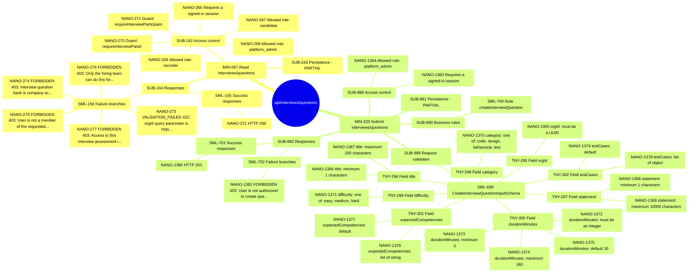

| ID        | Level | Parent   | Name                                                                                  | Description                                                                                                                                                                                                                                                                                                                                                                             | Status                | Verification | Evidence                                       | Related                               |
| --------- | ----- | -------- | ------------------------------------------------------------------------------------- | --------------------------------------------------------------------------------------------------------------------------------------------------------------------------------------------------------------------------------------------------------------------------------------------------------------------------------------------------------------------------------------- | --------------------- | ------------ | ---------------------------------------------- | ------------------------------------- |
| FEAT-045  | MAJOR | MOD-066  | api/interviews/questions                                                              |                                                                                                                                                                                                                                                                                                                                                                                         | IMPLEMENTED           |              | apps/api/src/server.ts:3447                    |                                       |
| MIN-067   | MINOR | FEAT-045 | Read interviews/questions                                                             | GET /api/v1/interviews/questions for roles candidate, platform_admin, recruiter; ephemeral (process memory); responds 200; 5 failure branch(es). Gaps: ephemeral: state held in process memory, lost on restart; no first-party web caller found                                                                                                                                        | IMPLEMENTED           | VERIFIED     | apps/api/src/server.ts:3489                    | API-064, TEST-137, TEST-142, TEST-216 |
| SUB-242   | SUB   | MIN-067  | Access control                                                                        | Who may call GET /api/v1/interviews/questions: roles candidate, platform_admin, recruiter.                                                                                                                                                                                                                                                                                              | IMPLEMENTED           | PATH_LEVEL   | apps/api/src/server.ts:3489                    |                                       |
| NANO-266  | NANO  | SUB-242  | Requires a signed-in session                                                          | Requests without a valid session token are rejected with 401 UNAUTHENTICATED.                                                                                                                                                                                                                                                                                                           | IMPLEMENTED           | PATH_LEVEL   | apps/api/src/server.ts:3489                    | ROLE-001                              |
| NANO-267  | NANO  | SUB-242  | Allowed role: candidate                                                               | candidate is one of the roles allowed here (candidate, platform_admin, recruiter); a caller holding none of them is rejected with 403.                                                                                                                                                                                                                                                  | IMPLEMENTED           | PATH_LEVEL   | apps/api/src/server.ts:3489                    | ROLE-002                              |
| NANO-268  | NANO  | SUB-242  | Allowed role: platform_admin                                                          | platform_admin is one of the roles allowed here (candidate, platform_admin, recruiter); a caller holding none of them is rejected with 403.                                                                                                                                                                                                                                             | IMPLEMENTED           | PATH_LEVEL   | apps/api/src/server.ts:3489                    | ROLE-008                              |
| NANO-269  | NANO  | SUB-242  | Allowed role: recruiter                                                               | recruiter is one of the roles allowed here (candidate, platform_admin, recruiter); a caller holding none of them is rejected with 403.                                                                                                                                                                                                                                                  | IMPLEMENTED           | PATH_LEVEL   | apps/api/src/server.ts:3489                    | ROLE-003                              |
| NANO-270  | NANO  | SUB-242  | Guard: requireInterviewPanel                                                          | Guard requireInterviewPanel must pass before the handler runs.                                                                                                                                                                                                                                                                                                                          | IMPLEMENTED           | PATH_LEVEL   | apps/api/src/server.ts:3489                    |                                       |
| NANO-271  | NANO  | SUB-242  | Guard: requireInterviewParticipant                                                    | Guard requireInterviewParticipant must pass before the handler runs.                                                                                                                                                                                                                                                                                                                    | IMPLEMENTED           | PATH_LEVEL   | apps/api/src/server.ts:3489                    |                                       |
| SUB-243   | SUB   | MIN-067  | Persistence                                                                           | Ephemeral: state lives in API process memory and is lost on restart.                                                                                                                                                                                                                                                                                                                    | PARTIALLY_IMPLEMENTED | PATH_LEVEL   | apps/api/src/server.ts:3489                    |                                       |
| SUB-244   | SUB   | MIN-067  | Responses                                                                             | Success 200; 5 explicit failure branch(es) besides validation and access errors.                                                                                                                                                                                                                                                                                                        | IMPLEMENTED           | PATH_LEVEL   | apps/api/src/server.ts:3489                    |                                       |
| SML-155   | SMALL | SUB-244  | Success responses                                                                     | HTTP 200.                                                                                                                                                                                                                                                                                                                                                                               | IMPLEMENTED           | PATH_LEVEL   | apps/api/src/server.ts:3489                    |                                       |
| NANO-272  | NANO  | SML-155  | HTTP 200                                                                              | Replies 200 when the operation succeeds.                                                                                                                                                                                                                                                                                                                                                | IMPLEMENTED           | PATH_LEVEL   | apps/api/src/server.ts:3489                    |                                       |
| SML-156   | SMALL | SUB-244  | Failure branches                                                                      | 5 DomainError branch(es) in the handler, mapped to HTTP by the global error handler.                                                                                                                                                                                                                                                                                                    | IMPLEMENTED           | PATH_LEVEL   | apps/api/src/server.ts:3489                    |                                       |
| NANO-273  | NANO  | SML-156  | VALIDATION_FAILED 422: orgId query parameter is required.                             | Throws DomainError(VALIDATION_FAILED) "orgId query parameter is required." -> HTTP 422.                                                                                                                                                                                                                                                                                                 | IMPLEMENTED           | PATH_LEVEL   | apps/api/src/server.ts:3495                    | ERR-069                               |
| NANO-274  | NANO  | SML-156  | FORBIDDEN 403: Interview question bank is company-scoped and not accessible to candid | Throws DomainError(FORBIDDEN) "Interview question bank is company-scoped and not accessible to candidates (BR-173)." -> HTTP 403.                                                                                                                                                                                                                                                       | IMPLEMENTED           | PATH_LEVEL   | apps/api/src/server.ts:3504                    | ERR-070                               |
| NANO-275  | NANO  | SML-156  | FORBIDDEN 403: User is not a member of the requested organization.                    | Throws DomainError(FORBIDDEN) "User is not a member of the requested organization." -> HTTP 403.                                                                                                                                                                                                                                                                                        | IMPLEMENTED           | PATH_LEVEL   | apps/api/src/server.ts:3514                    | ERR-071                               |
| NANO-276  | NANO  | SML-156  | FORBIDDEN 403: Only the hiring team can do this for this interview.                   | Throws DomainError(FORBIDDEN) "Only the hiring team can do this for this interview." -> HTTP 403.                                                                                                                                                                                                                                                                                       | IMPLEMENTED           | PATH_LEVEL   | apps/api/src/server.ts:3547                    | ERR-072                               |
| NANO-277  | NANO  | SML-156  | FORBIDDEN 403: Access to this interview assessment is restricted.                     | Throws DomainError(FORBIDDEN) "Access to this interview assessment is restricted." -> HTTP 403.                                                                                                                                                                                                                                                                                         | IMPLEMENTED           | PATH_LEVEL   | apps/api/src/server.ts:3557                    | ERR-073                               |
| MIN-220   | MINOR | FEAT-045 | Submit interviews/questions                                                           | Technical Interview Assessment Platform Endpoints (F-88, S-06, BR-169..BR-176) POST /api/v1/interviews/questions for roles platform_admin; validates CreateInterviewQuestionInputSchema; calls createInterviewQuestion; ephemeral (process memory); responds 201; 1 failure branch(es). Gaps: ephemeral: state held in process memory, lost on restart; no first-party web caller found | IMPLEMENTED           | VERIFIED     | apps/api/src/server.ts:3447                    | API-063, TEST-137, TEST-142, TEST-216 |
| SUB-888   | SUB   | MIN-220  | Access control                                                                        | Who may call POST /api/v1/interviews/questions: roles platform_admin.                                                                                                                                                                                                                                                                                                                   | IMPLEMENTED           | PATH_LEVEL   | apps/api/src/server.ts:3447                    |                                       |
| NANO-1363 | NANO  | SUB-888  | Requires a signed-in session                                                          | Requests without a valid session token are rejected with 401 UNAUTHENTICATED.                                                                                                                                                                                                                                                                                                           | IMPLEMENTED           | PATH_LEVEL   | apps/api/src/server.ts:3447                    | ROLE-001                              |
| NANO-1364 | NANO  | SUB-888  | Allowed role: platform_admin                                                          | platform_admin is one of the roles allowed here (platform_admin); a caller holding none of them is rejected with 403.                                                                                                                                                                                                                                                                   | IMPLEMENTED           | PATH_LEVEL   | apps/api/src/server.ts:3447                    | ROLE-008                              |
| SUB-889   | SUB   | MIN-220  | Request validation                                                                    | The request is parsed with CreateInterviewQuestionInputSchema; a failure returns 400 with field details before any business logic runs.                                                                                                                                                                                                                                                 | IMPLEMENTED           | PATH_LEVEL   | apps/api/src/server.ts:3447                    |                                       |
| SML-699   | SMALL | SUB-889  | CreateInterviewQuestionInputSchema                                                    | CreateInterviewQuestionInputSchema: 8 field(s)                                                                                                                                                                                                                                                                                                                                          | IMPLEMENTED           | PATH_LEVEL   | packages/contracts/src/index.ts:1130           | SCH-088                               |
| TNY-295   | TINY  | SML-699  | Field orgId                                                                           | orgId (string, required): must be a UUID                                                                                                                                                                                                                                                                                                                                                | IMPLEMENTED           | PATH_LEVEL   | packages/contracts/src/index.ts:1131           |                                       |
| NANO-1365 | NANO  | TNY-295  | orgId: must be a UUID                                                                 | orgId must be a UUID.                                                                                                                                                                                                                                                                                                                                                                   | IMPLEMENTED           | PATH_LEVEL   | packages/contracts/src/index.ts:1131           |                                       |
| TNY-296   | TINY  | SML-699  | Field title                                                                           | title (string, required): minimum 1 characters; maximum 200 characters                                                                                                                                                                                                                                                                                                                  | IMPLEMENTED           | PATH_LEVEL   | packages/contracts/src/index.ts:1132           |                                       |
| NANO-1366 | NANO  | TNY-296  | title: minimum 1 characters                                                           | title minimum 1 characters.                                                                                                                                                                                                                                                                                                                                                             | IMPLEMENTED           | PATH_LEVEL   | packages/contracts/src/index.ts:1132           |                                       |
| NANO-1367 | NANO  | TNY-296  | title: maximum 200 characters                                                         | title maximum 200 characters.                                                                                                                                                                                                                                                                                                                                                           | IMPLEMENTED           | PATH_LEVEL   | packages/contracts/src/index.ts:1132           |                                       |
| TNY-297   | TINY  | SML-699  | Field statement                                                                       | statement (string, required): minimum 1 characters; maximum 10000 characters                                                                                                                                                                                                                                                                                                            | IMPLEMENTED           | PATH_LEVEL   | packages/contracts/src/index.ts:1133           |                                       |
| NANO-1368 | NANO  | TNY-297  | statement: minimum 1 characters                                                       | statement minimum 1 characters.                                                                                                                                                                                                                                                                                                                                                         | IMPLEMENTED           | PATH_LEVEL   | packages/contracts/src/index.ts:1133           |                                       |
| NANO-1369 | NANO  | TNY-297  | statement: maximum 10000 characters                                                   | statement maximum 10000 characters.                                                                                                                                                                                                                                                                                                                                                     | IMPLEMENTED           | PATH_LEVEL   | packages/contracts/src/index.ts:1133           |                                       |
| TNY-298   | TINY  | SML-699  | Field category                                                                        | category (enum, required): one of: code, design, behavioral, text                                                                                                                                                                                                                                                                                                                       | IMPLEMENTED           | PATH_LEVEL   | packages/contracts/src/index.ts:1134           |                                       |
| NANO-1370 | NANO  | TNY-298  | category: one of: code, design, behavioral, text                                      | category one of: code, design, behavioral, text.                                                                                                                                                                                                                                                                                                                                        | IMPLEMENTED           | PATH_LEVEL   | packages/contracts/src/index.ts:1134           |                                       |
| TNY-299   | TINY  | SML-699  | Field difficulty                                                                      | difficulty (enum, required): one of: easy, medium, hard                                                                                                                                                                                                                                                                                                                                 | IMPLEMENTED           | PATH_LEVEL   | packages/contracts/src/index.ts:1135           |                                       |
| NANO-1371 | NANO  | TNY-299  | difficulty: one of: easy, medium, hard                                                | difficulty one of: easy, medium, hard.                                                                                                                                                                                                                                                                                                                                                  | IMPLEMENTED           | PATH_LEVEL   | packages/contracts/src/index.ts:1135           |                                       |
| TNY-300   | TINY  | SML-699  | Field durationMinutes                                                                 | durationMinutes (number, optional): must be an integer; minimum 5; maximum 180; default 30                                                                                                                                                                                                                                                                                              | IMPLEMENTED           | PATH_LEVEL   | packages/contracts/src/index.ts:1136           |                                       |
| NANO-1372 | NANO  | TNY-300  | durationMinutes: must be an integer                                                   | durationMinutes must be an integer.                                                                                                                                                                                                                                                                                                                                                     | IMPLEMENTED           | PATH_LEVEL   | packages/contracts/src/index.ts:1136           |                                       |
| NANO-1373 | NANO  | TNY-300  | durationMinutes: minimum 5                                                            | durationMinutes minimum 5.                                                                                                                                                                                                                                                                                                                                                              | IMPLEMENTED           | PATH_LEVEL   | packages/contracts/src/index.ts:1136           |                                       |
| NANO-1374 | NANO  | TNY-300  | durationMinutes: maximum 180                                                          | durationMinutes maximum 180.                                                                                                                                                                                                                                                                                                                                                            | IMPLEMENTED           | PATH_LEVEL   | packages/contracts/src/index.ts:1136           |                                       |
| NANO-1375 | NANO  | TNY-300  | durationMinutes: default 30                                                           | durationMinutes default 30.                                                                                                                                                                                                                                                                                                                                                             | IMPLEMENTED           | PATH_LEVEL   | packages/contracts/src/index.ts:1136           |                                       |
| TNY-301   | TINY  | SML-699  | Field expectedCompetencies                                                            | expectedCompetencies (array, optional): list of string; default []                                                                                                                                                                                                                                                                                                                      | IMPLEMENTED           | PATH_LEVEL   | packages/contracts/src/index.ts:1137           |                                       |
| NANO-1376 | NANO  | TNY-301  | expectedCompetencies: list of string                                                  | expectedCompetencies list of string.                                                                                                                                                                                                                                                                                                                                                    | IMPLEMENTED           | PATH_LEVEL   | packages/contracts/src/index.ts:1137           |                                       |
| NANO-1377 | NANO  | TNY-301  | expectedCompetencies: default []                                                      | expectedCompetencies default [].                                                                                                                                                                                                                                                                                                                                                        | IMPLEMENTED           | PATH_LEVEL   | packages/contracts/src/index.ts:1137           |                                       |
| TNY-302   | TINY  | SML-699  | Field testCases                                                                       | testCases (array, optional): list of object; default []                                                                                                                                                                                                                                                                                                                                 | IMPLEMENTED           | PATH_LEVEL   | packages/contracts/src/index.ts:1138           |                                       |
| NANO-1378 | NANO  | TNY-302  | testCases: list of object                                                             | testCases list of object.                                                                                                                                                                                                                                                                                                                                                               | IMPLEMENTED           | PATH_LEVEL   | packages/contracts/src/index.ts:1138           |                                       |
| NANO-1379 | NANO  | TNY-302  | testCases: default []                                                                 | testCases default [].                                                                                                                                                                                                                                                                                                                                                                   | IMPLEMENTED           | PATH_LEVEL   | packages/contracts/src/index.ts:1138           |                                       |
| SUB-890   | SUB   | MIN-220  | Business rules                                                                        | Domain functions from packages/domain called by the handler (1).                                                                                                                                                                                                                                                                                                                        | IMPLEMENTED           | PATH_LEVEL   | apps/api/src/server.ts:3447                    |                                       |
| SML-700   | SMALL | SUB-890  | Rule createInterviewQuestion                                                          | Calls createInterviewQuestion (packages/domain/src/technical-interview.ts). Rule status IMPLEMENTED; its own tests: VERIFIED.                                                                                                                                                                                                                                                           | IMPLEMENTED           | VERIFIED     | packages/domain/src/technical-interview.ts:143 | RULE-252                              |
| SUB-891   | SUB   | MIN-220  | Persistence                                                                           | Ephemeral: state lives in API process memory and is lost on restart.                                                                                                                                                                                                                                                                                                                    | PARTIALLY_IMPLEMENTED | PATH_LEVEL   | apps/api/src/server.ts:3447                    |                                       |
| SUB-892   | SUB   | MIN-220  | Responses                                                                             | Success 201; 1 explicit failure branch(es) besides validation and access errors.                                                                                                                                                                                                                                                                                                        | IMPLEMENTED           | PATH_LEVEL   | apps/api/src/server.ts:3447                    |                                       |
| SML-701   | SMALL | SUB-892  | Success responses                                                                     | HTTP 201.                                                                                                                                                                                                                                                                                                                                                                               | IMPLEMENTED           | PATH_LEVEL   | apps/api/src/server.ts:3447                    |                                       |
| NANO-1380 | NANO  | SML-701  | HTTP 201                                                                              | Replies 201 when the operation succeeds.                                                                                                                                                                                                                                                                                                                                                | IMPLEMENTED           | PATH_LEVEL   | apps/api/src/server.ts:3447                    |                                       |
| SML-702   | SMALL | SUB-892  | Failure branches                                                                      | 1 DomainError branch(es) in the handler, mapped to HTTP by the global error handler.                                                                                                                                                                                                                                                                                                    | IMPLEMENTED           | PATH_LEVEL   | apps/api/src/server.ts:3447                    |                                       |
| NANO-1381 | NANO  | SML-702  | FORBIDDEN 403: User is not authorized to create questions for this organization.      | Throws DomainError(FORBIDDEN) "User is not authorized to create questions for this organization." -> HTTP 403.                                                                                                                                                                                                                                                                          | IMPLEMENTED           | PATH_LEVEL   | apps/api/src/server.ts:3455                    | ERR-068                               |

## api/job-templates (MOD-061)

**Application:** apps/api (MOD-001). **Purpose:** API module: routes under /api/v1/job-templates in apps/api/src/server.ts.

**Nodes by level:** MODULE 1, MAJOR 2, MINOR 6, SUB 25, SMALL 21, TINY 35, NANO 99. **Status:** IMPLEMENTED 183, PARTIALLY_IMPLEMENTED 6. **Verification:** PATH_LEVEL 176, VERIFIED 10.

**User roles that reach it:** platform_admin.

**Known gaps:** MIN-003 ephemeral: state held in process memory, lost on restart; MIN-003 no first-party web caller found; MIN-068 ephemeral: state held in process memory, lost on restart; MIN-068 no first-party web caller found; MIN-069 ephemeral: state held in process memory, lost on restart; MIN-069 no first-party web caller found; MIN-147 ephemeral: state held in process memory, lost on restart; MIN-147 no first-party web caller found; MIN-221 ephemeral: state held in process memory, lost on restart; MIN-221 no first-party web caller found; MIN-222 ephemeral: state held in process memory, lost on restart; MIN-222 no first-party web caller found.

### Module map (to minor features)

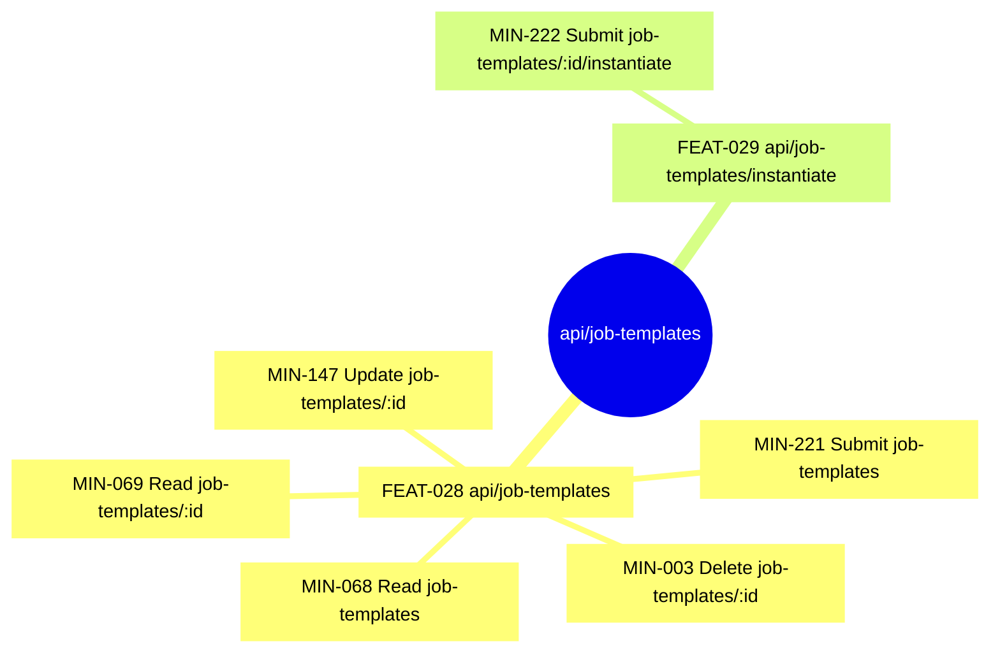

### FEAT-028 api/job-templates

api/job-templates

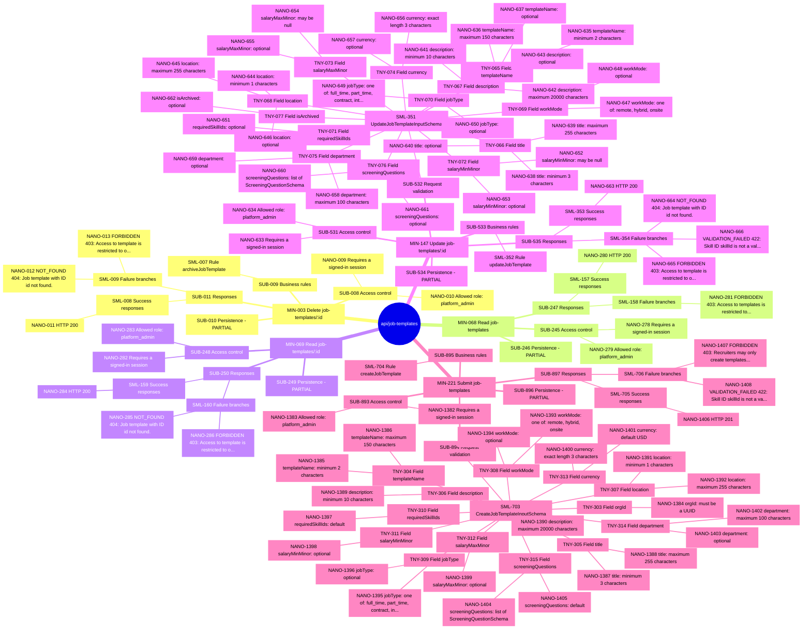

| ID        | Level | Parent   | Name                                                                                  | Description                                                                                                                                                                                                                                                                                                                                      | Status                | Verification | Evidence                                 | Related                     |
| --------- | ----- | -------- | ------------------------------------------------------------------------------------- | ------------------------------------------------------------------------------------------------------------------------------------------------------------------------------------------------------------------------------------------------------------------------------------------------------------------------------------------------ | --------------------- | ------------ | ---------------------------------------- | --------------------------- |
| FEAT-028  | MAJOR | MOD-061  | api/job-templates                                                                     |                                                                                                                                                                                                                                                                                                                                                  | IMPLEMENTED           |              | apps/api/src/server.ts:2186              |                             |
| MIN-003   | MINOR | FEAT-028 | Delete job-templates/:id                                                              | DELETE /api/v1/job-templates/:id for roles platform_admin; calls archiveJobTemplate; ephemeral (process memory); responds 200; 2 failure branch(es). Gaps: ephemeral: state held in process memory, lost on restart; no first-party web caller found                                                                                             | IMPLEMENTED           | VERIFIED     | apps/api/src/server.ts:2404              | API-039, TEST-108, TEST-186 |
| SUB-008   | SUB   | MIN-003  | Access control                                                                        | Who may call DELETE /api/v1/job-templates/:id: roles platform_admin.                                                                                                                                                                                                                                                                             | IMPLEMENTED           | PATH_LEVEL   | apps/api/src/server.ts:2404              |                             |
| NANO-009  | NANO  | SUB-008  | Requires a signed-in session                                                          | Requests without a valid session token are rejected with 401 UNAUTHENTICATED.                                                                                                                                                                                                                                                                    | IMPLEMENTED           | PATH_LEVEL   | apps/api/src/server.ts:2404              | ROLE-001                    |
| NANO-010  | NANO  | SUB-008  | Allowed role: platform_admin                                                          | platform_admin is one of the roles allowed here (platform_admin); a caller holding none of them is rejected with 403.                                                                                                                                                                                                                            | IMPLEMENTED           | PATH_LEVEL   | apps/api/src/server.ts:2404              | ROLE-008                    |
| SUB-009   | SUB   | MIN-003  | Business rules                                                                        | Domain functions from packages/domain called by the handler (1).                                                                                                                                                                                                                                                                                 | IMPLEMENTED           | PATH_LEVEL   | apps/api/src/server.ts:2404              |                             |
| SML-007   | SMALL | SUB-009  | Rule archiveJobTemplate                                                               | Calls archiveJobTemplate (packages/domain/src/job-templates.ts). Rule status IMPLEMENTED; its own tests: VERIFIED.                                                                                                                                                                                                                               | IMPLEMENTED           | VERIFIED     | packages/domain/src/job-templates.ts:261 | RULE-125                    |
| SUB-010   | SUB   | MIN-003  | Persistence                                                                           | Ephemeral: state lives in API process memory and is lost on restart.                                                                                                                                                                                                                                                                             | PARTIALLY_IMPLEMENTED | PATH_LEVEL   | apps/api/src/server.ts:2404              |                             |
| SUB-011   | SUB   | MIN-003  | Responses                                                                             | Success 200; 2 explicit failure branch(es) besides validation and access errors.                                                                                                                                                                                                                                                                 | IMPLEMENTED           | PATH_LEVEL   | apps/api/src/server.ts:2404              |                             |
| SML-008   | SMALL | SUB-011  | Success responses                                                                     | HTTP 200.                                                                                                                                                                                                                                                                                                                                        | IMPLEMENTED           | PATH_LEVEL   | apps/api/src/server.ts:2404              |                             |
| NANO-011  | NANO  | SML-008  | HTTP 200                                                                              | Replies 200 when the operation succeeds.                                                                                                                                                                                                                                                                                                         | IMPLEMENTED           | PATH_LEVEL   | apps/api/src/server.ts:2404              |                             |
| SML-009   | SMALL | SUB-011  | Failure branches                                                                      | 2 DomainError branch(es) in the handler, mapped to HTTP by the global error handler.                                                                                                                                                                                                                                                             | IMPLEMENTED           | PATH_LEVEL   | apps/api/src/server.ts:2404              |                             |
| NANO-012  | NANO  | SML-009  | NOT_FOUND 404: Job template with ID ${id} not found.                                  | Throws DomainError(NOT_FOUND) "Job template with ID ${id} not found." -> HTTP 404.                                                                                                                                                                                                                                                               | IMPLEMENTED           | PATH_LEVEL   | apps/api/src/server.ts:2412              | ERR-041                     |
| NANO-013  | NANO  | SML-009  | FORBIDDEN 403: Access to template is restricted to organization members (BR-12).      | Throws DomainError(FORBIDDEN) "Access to template is restricted to organization members (BR-12)." -> HTTP 403.                                                                                                                                                                                                                                   | IMPLEMENTED           | PATH_LEVEL   | apps/api/src/server.ts:2420              | ERR-042                     |
| MIN-068   | MINOR | FEAT-028 | Read job-templates                                                                    | GET /api/v1/job-templates for roles platform_admin; ephemeral (process memory); responds 200; 1 failure branch(es). Gaps: ephemeral: state held in process memory, lost on restart; no first-party web caller found                                                                                                                              | IMPLEMENTED           | VERIFIED     | apps/api/src/server.ts:2253              | API-036, TEST-108           |
| SUB-245   | SUB   | MIN-068  | Access control                                                                        | Who may call GET /api/v1/job-templates: roles platform_admin.                                                                                                                                                                                                                                                                                    | IMPLEMENTED           | PATH_LEVEL   | apps/api/src/server.ts:2253              |                             |
| NANO-278  | NANO  | SUB-245  | Requires a signed-in session                                                          | Requests without a valid session token are rejected with 401 UNAUTHENTICATED.                                                                                                                                                                                                                                                                    | IMPLEMENTED           | PATH_LEVEL   | apps/api/src/server.ts:2253              | ROLE-001                    |
| NANO-279  | NANO  | SUB-245  | Allowed role: platform_admin                                                          | platform_admin is one of the roles allowed here (platform_admin); a caller holding none of them is rejected with 403.                                                                                                                                                                                                                            | IMPLEMENTED           | PATH_LEVEL   | apps/api/src/server.ts:2253              | ROLE-008                    |
| SUB-246   | SUB   | MIN-068  | Persistence                                                                           | Ephemeral: state lives in API process memory and is lost on restart.                                                                                                                                                                                                                                                                             | PARTIALLY_IMPLEMENTED | PATH_LEVEL   | apps/api/src/server.ts:2253              |                             |
| SUB-247   | SUB   | MIN-068  | Responses                                                                             | Success 200; 1 explicit failure branch(es) besides validation and access errors.                                                                                                                                                                                                                                                                 | IMPLEMENTED           | PATH_LEVEL   | apps/api/src/server.ts:2253              |                             |
| SML-157   | SMALL | SUB-247  | Success responses                                                                     | HTTP 200.                                                                                                                                                                                                                                                                                                                                        | IMPLEMENTED           | PATH_LEVEL   | apps/api/src/server.ts:2253              |                             |
| NANO-280  | NANO  | SML-157  | HTTP 200                                                                              | Replies 200 when the operation succeeds.                                                                                                                                                                                                                                                                                                         | IMPLEMENTED           | PATH_LEVEL   | apps/api/src/server.ts:2253              |                             |
| SML-158   | SMALL | SUB-247  | Failure branches                                                                      | 1 DomainError branch(es) in the handler, mapped to HTTP by the global error handler.                                                                                                                                                                                                                                                             | IMPLEMENTED           | PATH_LEVEL   | apps/api/src/server.ts:2253              |                             |
| NANO-281  | NANO  | SML-158  | FORBIDDEN 403: Access to templates is restricted to organization members (BR-12).     | Throws DomainError(FORBIDDEN) "Access to templates is restricted to organization members (BR-12)." -> HTTP 403.                                                                                                                                                                                                                                  | IMPLEMENTED           | PATH_LEVEL   | apps/api/src/server.ts:2269              | ERR-040                     |
| MIN-069   | MINOR | FEAT-028 | Read job-templates/:id                                                                | GET /api/v1/job-templates/:id for roles platform_admin; ephemeral (process memory); responds 200; 2 failure branch(es). Gaps: ephemeral: state held in process memory, lost on restart; no first-party web caller found                                                                                                                          | IMPLEMENTED           | VERIFIED     | apps/api/src/server.ts:2294              | API-037, TEST-108, TEST-186 |
| SUB-248   | SUB   | MIN-069  | Access control                                                                        | Who may call GET /api/v1/job-templates/:id: roles platform_admin.                                                                                                                                                                                                                                                                                | IMPLEMENTED           | PATH_LEVEL   | apps/api/src/server.ts:2294              |                             |
| NANO-282  | NANO  | SUB-248  | Requires a signed-in session                                                          | Requests without a valid session token are rejected with 401 UNAUTHENTICATED.                                                                                                                                                                                                                                                                    | IMPLEMENTED           | PATH_LEVEL   | apps/api/src/server.ts:2294              | ROLE-001                    |
| NANO-283  | NANO  | SUB-248  | Allowed role: platform_admin                                                          | platform_admin is one of the roles allowed here (platform_admin); a caller holding none of them is rejected with 403.                                                                                                                                                                                                                            | IMPLEMENTED           | PATH_LEVEL   | apps/api/src/server.ts:2294              | ROLE-008                    |
| SUB-249   | SUB   | MIN-069  | Persistence                                                                           | Ephemeral: state lives in API process memory and is lost on restart.                                                                                                                                                                                                                                                                             | PARTIALLY_IMPLEMENTED | PATH_LEVEL   | apps/api/src/server.ts:2294              |                             |
| SUB-250   | SUB   | MIN-069  | Responses                                                                             | Success 200; 2 explicit failure branch(es) besides validation and access errors.                                                                                                                                                                                                                                                                 | IMPLEMENTED           | PATH_LEVEL   | apps/api/src/server.ts:2294              |                             |
| SML-159   | SMALL | SUB-250  | Success responses                                                                     | HTTP 200.                                                                                                                                                                                                                                                                                                                                        | IMPLEMENTED           | PATH_LEVEL   | apps/api/src/server.ts:2294              |                             |
| NANO-284  | NANO  | SML-159  | HTTP 200                                                                              | Replies 200 when the operation succeeds.                                                                                                                                                                                                                                                                                                         | IMPLEMENTED           | PATH_LEVEL   | apps/api/src/server.ts:2294              |                             |
| SML-160   | SMALL | SUB-250  | Failure branches                                                                      | 2 DomainError branch(es) in the handler, mapped to HTTP by the global error handler.                                                                                                                                                                                                                                                             | IMPLEMENTED           | PATH_LEVEL   | apps/api/src/server.ts:2294              |                             |
| NANO-285  | NANO  | SML-160  | NOT_FOUND 404: Job template with ID ${id} not found.                                  | Throws DomainError(NOT_FOUND) "Job template with ID ${id} not found." -> HTTP 404.                                                                                                                                                                                                                                                               | IMPLEMENTED           | PATH_LEVEL   | apps/api/src/server.ts:2302              | ERR-041                     |
| NANO-286  | NANO  | SML-160  | FORBIDDEN 403: Access to template is restricted to organization members (BR-12).      | Throws DomainError(FORBIDDEN) "Access to template is restricted to organization members (BR-12)." -> HTTP 403.                                                                                                                                                                                                                                   | IMPLEMENTED           | PATH_LEVEL   | apps/api/src/server.ts:2310              | ERR-042                     |
| MIN-147   | MINOR | FEAT-028 | Update job-templates/:id                                                              | PATCH /api/v1/job-templates/:id for roles platform_admin; validates UpdateJobTemplateInputSchema; calls updateJobTemplate; ephemeral (process memory); responds 200; 3 failure branch(es). Gaps: ephemeral: state held in process memory, lost on restart; no first-party web caller found                                                       | IMPLEMENTED           | VERIFIED     | apps/api/src/server.ts:2320              | API-038, TEST-108, TEST-186 |
| SUB-531   | SUB   | MIN-147  | Access control                                                                        | Who may call PATCH /api/v1/job-templates/:id: roles platform_admin.                                                                                                                                                                                                                                                                              | IMPLEMENTED           | PATH_LEVEL   | apps/api/src/server.ts:2320              |                             |
| NANO-633  | NANO  | SUB-531  | Requires a signed-in session                                                          | Requests without a valid session token are rejected with 401 UNAUTHENTICATED.                                                                                                                                                                                                                                                                    | IMPLEMENTED           | PATH_LEVEL   | apps/api/src/server.ts:2320              | ROLE-001                    |
| NANO-634  | NANO  | SUB-531  | Allowed role: platform_admin                                                          | platform_admin is one of the roles allowed here (platform_admin); a caller holding none of them is rejected with 403.                                                                                                                                                                                                                            | IMPLEMENTED           | PATH_LEVEL   | apps/api/src/server.ts:2320              | ROLE-008                    |
| SUB-532   | SUB   | MIN-147  | Request validation                                                                    | The request is parsed with UpdateJobTemplateInputSchema; a failure returns 400 with field details before any business logic runs.                                                                                                                                                                                                                | IMPLEMENTED           | PATH_LEVEL   | apps/api/src/server.ts:2320              |                             |
| SML-351   | SMALL | SUB-532  | UpdateJobTemplateInputSchema                                                          | UpdateJobTemplateInputSchema: 13 field(s)                                                                                                                                                                                                                                                                                                        | IMPLEMENTED           | PATH_LEVEL   | packages/contracts/src/index.ts:986      | SCH-079                     |
| TNY-065   | TINY  | SML-351  | Field templateName                                                                    | templateName (string, optional): minimum 2 characters; maximum 150 characters; optional                                                                                                                                                                                                                                                          | IMPLEMENTED           | PATH_LEVEL   | packages/contracts/src/index.ts:987      |                             |
| NANO-635  | NANO  | TNY-065  | templateName: minimum 2 characters                                                    | templateName minimum 2 characters.                                                                                                                                                                                                                                                                                                               | IMPLEMENTED           | PATH_LEVEL   | packages/contracts/src/index.ts:987      |                             |
| NANO-636  | NANO  | TNY-065  | templateName: maximum 150 characters                                                  | templateName maximum 150 characters.                                                                                                                                                                                                                                                                                                             | IMPLEMENTED           | PATH_LEVEL   | packages/contracts/src/index.ts:987      |                             |
| NANO-637  | NANO  | TNY-065  | templateName: optional                                                                | templateName optional.                                                                                                                                                                                                                                                                                                                           | IMPLEMENTED           | PATH_LEVEL   | packages/contracts/src/index.ts:987      |                             |
| TNY-066   | TINY  | SML-351  | Field title                                                                           | title (string, optional): minimum 3 characters; maximum 255 characters; optional                                                                                                                                                                                                                                                                 | IMPLEMENTED           | PATH_LEVEL   | packages/contracts/src/index.ts:988      |                             |
| NANO-638  | NANO  | TNY-066  | title: minimum 3 characters                                                           | title minimum 3 characters.                                                                                                                                                                                                                                                                                                                      | IMPLEMENTED           | PATH_LEVEL   | packages/contracts/src/index.ts:988      |                             |
| NANO-639  | NANO  | TNY-066  | title: maximum 255 characters                                                         | title maximum 255 characters.                                                                                                                                                                                                                                                                                                                    | IMPLEMENTED           | PATH_LEVEL   | packages/contracts/src/index.ts:988      |                             |
| NANO-640  | NANO  | TNY-066  | title: optional                                                                       | title optional.                                                                                                                                                                                                                                                                                                                                  | IMPLEMENTED           | PATH_LEVEL   | packages/contracts/src/index.ts:988      |                             |
| TNY-067   | TINY  | SML-351  | Field description                                                                     | description (string, optional): minimum 10 characters; maximum 20000 characters; optional                                                                                                                                                                                                                                                        | IMPLEMENTED           | PATH_LEVEL   | packages/contracts/src/index.ts:989      |                             |
| NANO-641  | NANO  | TNY-067  | description: minimum 10 characters                                                    | description minimum 10 characters.                                                                                                                                                                                                                                                                                                               | IMPLEMENTED           | PATH_LEVEL   | packages/contracts/src/index.ts:989      |                             |
| NANO-642  | NANO  | TNY-067  | description: maximum 20000 characters                                                 | description maximum 20000 characters.                                                                                                                                                                                                                                                                                                            | IMPLEMENTED           | PATH_LEVEL   | packages/contracts/src/index.ts:989      |                             |
| NANO-643  | NANO  | TNY-067  | description: optional                                                                 | description optional.                                                                                                                                                                                                                                                                                                                            | IMPLEMENTED           | PATH_LEVEL   | packages/contracts/src/index.ts:989      |                             |
| TNY-068   | TINY  | SML-351  | Field location                                                                        | location (string, optional): minimum 1 characters; maximum 255 characters; optional                                                                                                                                                                                                                                                              | IMPLEMENTED           | PATH_LEVEL   | packages/contracts/src/index.ts:990      |                             |
| NANO-644  | NANO  | TNY-068  | location: minimum 1 characters                                                        | location minimum 1 characters.                                                                                                                                                                                                                                                                                                                   | IMPLEMENTED           | PATH_LEVEL   | packages/contracts/src/index.ts:990      |                             |
| NANO-645  | NANO  | TNY-068  | location: maximum 255 characters                                                      | location maximum 255 characters.                                                                                                                                                                                                                                                                                                                 | IMPLEMENTED           | PATH_LEVEL   | packages/contracts/src/index.ts:990      |                             |
| NANO-646  | NANO  | TNY-068  | location: optional                                                                    | location optional.                                                                                                                                                                                                                                                                                                                               | IMPLEMENTED           | PATH_LEVEL   | packages/contracts/src/index.ts:990      |                             |
| TNY-069   | TINY  | SML-351  | Field workMode                                                                        | workMode (enum, optional): one of: remote, hybrid, onsite; optional                                                                                                                                                                                                                                                                              | IMPLEMENTED           | PATH_LEVEL   | packages/contracts/src/index.ts:991      |                             |
| NANO-647  | NANO  | TNY-069  | workMode: one of: remote, hybrid, onsite                                              | workMode one of: remote, hybrid, onsite.                                                                                                                                                                                                                                                                                                         | IMPLEMENTED           | PATH_LEVEL   | packages/contracts/src/index.ts:991      |                             |
| NANO-648  | NANO  | TNY-069  | workMode: optional                                                                    | workMode optional.                                                                                                                                                                                                                                                                                                                               | IMPLEMENTED           | PATH_LEVEL   | packages/contracts/src/index.ts:991      |                             |
| TNY-070   | TINY  | SML-351  | Field jobType                                                                         | jobType (enum, optional): one of: full_time, part_time, contract, internship; optional                                                                                                                                                                                                                                                           | IMPLEMENTED           | PATH_LEVEL   | packages/contracts/src/index.ts:992      |                             |
| NANO-649  | NANO  | TNY-070  | jobType: one of: full_time, part_time, contract, internship                           | jobType one of: full_time, part_time, contract, internship.                                                                                                                                                                                                                                                                                      | IMPLEMENTED           | PATH_LEVEL   | packages/contracts/src/index.ts:992      |                             |
| NANO-650  | NANO  | TNY-070  | jobType: optional                                                                     | jobType optional.                                                                                                                                                                                                                                                                                                                                | IMPLEMENTED           | PATH_LEVEL   | packages/contracts/src/index.ts:992      |                             |
| TNY-071   | TINY  | SML-351  | Field requiredSkillIds                                                                | requiredSkillIds (uniqueIdList(), optional): optional                                                                                                                                                                                                                                                                                            | IMPLEMENTED           | PATH_LEVEL   | packages/contracts/src/index.ts:993      |                             |
| NANO-651  | NANO  | TNY-071  | requiredSkillIds: optional                                                            | requiredSkillIds optional.                                                                                                                                                                                                                                                                                                                       | IMPLEMENTED           | PATH_LEVEL   | packages/contracts/src/index.ts:993      |                             |
| TNY-072   | TINY  | SML-351  | Field salaryMinMinor                                                                  | salaryMinMinor (salaryMinor(), optional): may be null; optional                                                                                                                                                                                                                                                                                  | IMPLEMENTED           | PATH_LEVEL   | packages/contracts/src/index.ts:994      |                             |
| NANO-652  | NANO  | TNY-072  | salaryMinMinor: may be null                                                           | salaryMinMinor may be null.                                                                                                                                                                                                                                                                                                                      | IMPLEMENTED           | PATH_LEVEL   | packages/contracts/src/index.ts:994      |                             |
| NANO-653  | NANO  | TNY-072  | salaryMinMinor: optional                                                              | salaryMinMinor optional.                                                                                                                                                                                                                                                                                                                         | IMPLEMENTED           | PATH_LEVEL   | packages/contracts/src/index.ts:994      |                             |
| TNY-073   | TINY  | SML-351  | Field salaryMaxMinor                                                                  | salaryMaxMinor (salaryMinor(), optional): may be null; optional                                                                                                                                                                                                                                                                                  | IMPLEMENTED           | PATH_LEVEL   | packages/contracts/src/index.ts:995      |                             |
| NANO-654  | NANO  | TNY-073  | salaryMaxMinor: may be null                                                           | salaryMaxMinor may be null.                                                                                                                                                                                                                                                                                                                      | IMPLEMENTED           | PATH_LEVEL   | packages/contracts/src/index.ts:995      |                             |
| NANO-655  | NANO  | TNY-073  | salaryMaxMinor: optional                                                              | salaryMaxMinor optional.                                                                                                                                                                                                                                                                                                                         | IMPLEMENTED           | PATH_LEVEL   | packages/contracts/src/index.ts:995      |                             |
| TNY-074   | TINY  | SML-351  | Field currency                                                                        | currency (string, optional): exact length 3 characters; optional                                                                                                                                                                                                                                                                                 | IMPLEMENTED           | PATH_LEVEL   | packages/contracts/src/index.ts:996      |                             |
| NANO-656  | NANO  | TNY-074  | currency: exact length 3 characters                                                   | currency exact length 3 characters.                                                                                                                                                                                                                                                                                                              | IMPLEMENTED           | PATH_LEVEL   | packages/contracts/src/index.ts:996      |                             |
| NANO-657  | NANO  | TNY-074  | currency: optional                                                                    | currency optional.                                                                                                                                                                                                                                                                                                                               | IMPLEMENTED           | PATH_LEVEL   | packages/contracts/src/index.ts:996      |                             |
| TNY-075   | TINY  | SML-351  | Field department                                                                      | department (string, optional): maximum 100 characters; optional                                                                                                                                                                                                                                                                                  | IMPLEMENTED           | PATH_LEVEL   | packages/contracts/src/index.ts:997      |                             |
| NANO-658  | NANO  | TNY-075  | department: maximum 100 characters                                                    | department maximum 100 characters.                                                                                                                                                                                                                                                                                                               | IMPLEMENTED           | PATH_LEVEL   | packages/contracts/src/index.ts:997      |                             |
| NANO-659  | NANO  | TNY-075  | department: optional                                                                  | department optional.                                                                                                                                                                                                                                                                                                                             | IMPLEMENTED           | PATH_LEVEL   | packages/contracts/src/index.ts:997      |                             |
| TNY-076   | TINY  | SML-351  | Field screeningQuestions                                                              | screeningQuestions (array, optional): list of ScreeningQuestionSchema; optional                                                                                                                                                                                                                                                                  | IMPLEMENTED           | PATH_LEVEL   | packages/contracts/src/index.ts:998      |                             |
| NANO-660  | NANO  | TNY-076  | screeningQuestions: list of ScreeningQuestionSchema                                   | screeningQuestions list of ScreeningQuestionSchema.                                                                                                                                                                                                                                                                                              | IMPLEMENTED           | PATH_LEVEL   | packages/contracts/src/index.ts:998      |                             |
| NANO-661  | NANO  | TNY-076  | screeningQuestions: optional                                                          | screeningQuestions optional.                                                                                                                                                                                                                                                                                                                     | IMPLEMENTED           | PATH_LEVEL   | packages/contracts/src/index.ts:998      |                             |
| TNY-077   | TINY  | SML-351  | Field isArchived                                                                      | isArchived (boolean, optional): optional                                                                                                                                                                                                                                                                                                         | IMPLEMENTED           | PATH_LEVEL   | packages/contracts/src/index.ts:999      |                             |
| NANO-662  | NANO  | TNY-077  | isArchived: optional                                                                  | isArchived optional.                                                                                                                                                                                                                                                                                                                             | IMPLEMENTED           | PATH_LEVEL   | packages/contracts/src/index.ts:999      |                             |
| SUB-533   | SUB   | MIN-147  | Business rules                                                                        | Domain functions from packages/domain called by the handler (1).                                                                                                                                                                                                                                                                                 | IMPLEMENTED           | PATH_LEVEL   | apps/api/src/server.ts:2320              |                             |
| SML-352   | SMALL | SUB-533  | Rule updateJobTemplate                                                                | Calls updateJobTemplate (packages/domain/src/job-templates.ts). Rule status IMPLEMENTED; its own tests: VERIFIED.                                                                                                                                                                                                                                | IMPLEMENTED           | VERIFIED     | packages/domain/src/job-templates.ts:172 | RULE-124                    |
| SUB-534   | SUB   | MIN-147  | Persistence                                                                           | Ephemeral: state lives in API process memory and is lost on restart.                                                                                                                                                                                                                                                                             | PARTIALLY_IMPLEMENTED | PATH_LEVEL   | apps/api/src/server.ts:2320              |                             |
| SUB-535   | SUB   | MIN-147  | Responses                                                                             | Success 200; 3 explicit failure branch(es) besides validation and access errors.                                                                                                                                                                                                                                                                 | IMPLEMENTED           | PATH_LEVEL   | apps/api/src/server.ts:2320              |                             |
| SML-353   | SMALL | SUB-535  | Success responses                                                                     | HTTP 200.                                                                                                                                                                                                                                                                                                                                        | IMPLEMENTED           | PATH_LEVEL   | apps/api/src/server.ts:2320              |                             |
| NANO-663  | NANO  | SML-353  | HTTP 200                                                                              | Replies 200 when the operation succeeds.                                                                                                                                                                                                                                                                                                         | IMPLEMENTED           | PATH_LEVEL   | apps/api/src/server.ts:2320              |                             |
| SML-354   | SMALL | SUB-535  | Failure branches                                                                      | 3 DomainError branch(es) in the handler, mapped to HTTP by the global error handler.                                                                                                                                                                                                                                                             | IMPLEMENTED           | PATH_LEVEL   | apps/api/src/server.ts:2320              |                             |
| NANO-664  | NANO  | SML-354  | NOT_FOUND 404: Job template with ID ${id} not found.                                  | Throws DomainError(NOT_FOUND) "Job template with ID ${id} not found." -> HTTP 404.                                                                                                                                                                                                                                                               | IMPLEMENTED           | PATH_LEVEL   | apps/api/src/server.ts:2329              | ERR-041                     |
| NANO-665  | NANO  | SML-354  | FORBIDDEN 403: Access to template is restricted to organization members (BR-12).      | Throws DomainError(FORBIDDEN) "Access to template is restricted to organization members (BR-12)." -> HTTP 403.                                                                                                                                                                                                                                   | IMPLEMENTED           | PATH_LEVEL   | apps/api/src/server.ts:2337              | ERR-042                     |
| NANO-666  | NANO  | SML-354  | VALIDATION_FAILED 422: Skill ID ${skillId} is not a valid canonical skill (BR-144).   | Throws DomainError(VALIDATION_FAILED) "Skill ID ${skillId} is not a valid canonical skill (BR-144)." -> HTTP 422.                                                                                                                                                                                                                                | IMPLEMENTED           | PATH_LEVEL   | apps/api/src/server.ts:2346              | ERR-039                     |
| MIN-221   | MINOR | FEAT-028 | Submit job-templates                                                                  | Job Templates Endpoints (F-37, F-05, BR-01, BR-12, BR-144) POST /api/v1/job-templates for roles platform_admin; validates CreateJobTemplateInputSchema; calls createJobTemplate; ephemeral (process memory); responds 201; 2 failure branch(es). Gaps: ephemeral: state held in process memory, lost on restart; no first-party web caller found | IMPLEMENTED           | VERIFIED     | apps/api/src/server.ts:2186              | API-035, TEST-108, TEST-186 |
| SUB-893   | SUB   | MIN-221  | Access control                                                                        | Who may call POST /api/v1/job-templates: roles platform_admin.                                                                                                                                                                                                                                                                                   | IMPLEMENTED           | PATH_LEVEL   | apps/api/src/server.ts:2186              |                             |
| NANO-1382 | NANO  | SUB-893  | Requires a signed-in session                                                          | Requests without a valid session token are rejected with 401 UNAUTHENTICATED.                                                                                                                                                                                                                                                                    | IMPLEMENTED           | PATH_LEVEL   | apps/api/src/server.ts:2186              | ROLE-001                    |
| NANO-1383 | NANO  | SUB-893  | Allowed role: platform_admin                                                          | platform_admin is one of the roles allowed here (platform_admin); a caller holding none of them is rejected with 403.                                                                                                                                                                                                                            | IMPLEMENTED           | PATH_LEVEL   | apps/api/src/server.ts:2186              | ROLE-008                    |
| SUB-894   | SUB   | MIN-221  | Request validation                                                                    | The request is parsed with CreateJobTemplateInputSchema; a failure returns 400 with field details before any business logic runs.                                                                                                                                                                                                                | IMPLEMENTED           | PATH_LEVEL   | apps/api/src/server.ts:2186              |                             |
| SML-703   | SMALL | SUB-894  | CreateJobTemplateInputSchema                                                          | CreateJobTemplateInputSchema: 13 field(s)                                                                                                                                                                                                                                                                                                        | IMPLEMENTED           | PATH_LEVEL   | packages/contracts/src/index.ts:968      | SCH-078                     |
| TNY-303   | TINY  | SML-703  | Field orgId                                                                           | orgId (string, required): must be a UUID                                                                                                                                                                                                                                                                                                         | IMPLEMENTED           | PATH_LEVEL   | packages/contracts/src/index.ts:969      |                             |
| NANO-1384 | NANO  | TNY-303  | orgId: must be a UUID                                                                 | orgId must be a UUID.                                                                                                                                                                                                                                                                                                                            | IMPLEMENTED           | PATH_LEVEL   | packages/contracts/src/index.ts:969      |                             |
| TNY-304   | TINY  | SML-703  | Field templateName                                                                    | templateName (string, required): minimum 2 characters; maximum 150 characters                                                                                                                                                                                                                                                                    | IMPLEMENTED           | PATH_LEVEL   | packages/contracts/src/index.ts:970      |                             |
| NANO-1385 | NANO  | TNY-304  | templateName: minimum 2 characters                                                    | templateName minimum 2 characters.                                                                                                                                                                                                                                                                                                               | IMPLEMENTED           | PATH_LEVEL   | packages/contracts/src/index.ts:970      |                             |
| NANO-1386 | NANO  | TNY-304  | templateName: maximum 150 characters                                                  | templateName maximum 150 characters.                                                                                                                                                                                                                                                                                                             | IMPLEMENTED           | PATH_LEVEL   | packages/contracts/src/index.ts:970      |                             |
| TNY-305   | TINY  | SML-703  | Field title                                                                           | title (string, required): minimum 3 characters; maximum 255 characters                                                                                                                                                                                                                                                                           | IMPLEMENTED           | PATH_LEVEL   | packages/contracts/src/index.ts:971      |                             |
| NANO-1387 | NANO  | TNY-305  | title: minimum 3 characters                                                           | title minimum 3 characters.                                                                                                                                                                                                                                                                                                                      | IMPLEMENTED           | PATH_LEVEL   | packages/contracts/src/index.ts:971      |                             |
| NANO-1388 | NANO  | TNY-305  | title: maximum 255 characters                                                         | title maximum 255 characters.                                                                                                                                                                                                                                                                                                                    | IMPLEMENTED           | PATH_LEVEL   | packages/contracts/src/index.ts:971      |                             |
| TNY-306   | TINY  | SML-703  | Field description                                                                     | description (string, required): minimum 10 characters; maximum 20000 characters                                                                                                                                                                                                                                                                  | IMPLEMENTED           | PATH_LEVEL   | packages/contracts/src/index.ts:972      |                             |
| NANO-1389 | NANO  | TNY-306  | description: minimum 10 characters                                                    | description minimum 10 characters.                                                                                                                                                                                                                                                                                                               | IMPLEMENTED           | PATH_LEVEL   | packages/contracts/src/index.ts:972      |                             |
| NANO-1390 | NANO  | TNY-306  | description: maximum 20000 characters                                                 | description maximum 20000 characters.                                                                                                                                                                                                                                                                                                            | IMPLEMENTED           | PATH_LEVEL   | packages/contracts/src/index.ts:972      |                             |
| TNY-307   | TINY  | SML-703  | Field location                                                                        | location (string, required): minimum 1 characters; maximum 255 characters                                                                                                                                                                                                                                                                        | IMPLEMENTED           | PATH_LEVEL   | packages/contracts/src/index.ts:973      |                             |
| NANO-1391 | NANO  | TNY-307  | location: minimum 1 characters                                                        | location minimum 1 characters.                                                                                                                                                                                                                                                                                                                   | IMPLEMENTED           | PATH_LEVEL   | packages/contracts/src/index.ts:973      |                             |
| NANO-1392 | NANO  | TNY-307  | location: maximum 255 characters                                                      | location maximum 255 characters.                                                                                                                                                                                                                                                                                                                 | IMPLEMENTED           | PATH_LEVEL   | packages/contracts/src/index.ts:973      |                             |
| TNY-308   | TINY  | SML-703  | Field workMode                                                                        | workMode (enum, optional): one of: remote, hybrid, onsite; optional                                                                                                                                                                                                                                                                              | IMPLEMENTED           | PATH_LEVEL   | packages/contracts/src/index.ts:974      |                             |
| NANO-1393 | NANO  | TNY-308  | workMode: one of: remote, hybrid, onsite                                              | workMode one of: remote, hybrid, onsite.                                                                                                                                                                                                                                                                                                         | IMPLEMENTED           | PATH_LEVEL   | packages/contracts/src/index.ts:974      |                             |
| NANO-1394 | NANO  | TNY-308  | workMode: optional                                                                    | workMode optional.                                                                                                                                                                                                                                                                                                                               | IMPLEMENTED           | PATH_LEVEL   | packages/contracts/src/index.ts:974      |                             |
| TNY-309   | TINY  | SML-703  | Field jobType                                                                         | jobType (enum, optional): one of: full_time, part_time, contract, internship; optional                                                                                                                                                                                                                                                           | IMPLEMENTED           | PATH_LEVEL   | packages/contracts/src/index.ts:975      |                             |
| NANO-1395 | NANO  | TNY-309  | jobType: one of: full_time, part_time, contract, internship                           | jobType one of: full_time, part_time, contract, internship.                                                                                                                                                                                                                                                                                      | IMPLEMENTED           | PATH_LEVEL   | packages/contracts/src/index.ts:975      |                             |
| NANO-1396 | NANO  | TNY-309  | jobType: optional                                                                     | jobType optional.                                                                                                                                                                                                                                                                                                                                | IMPLEMENTED           | PATH_LEVEL   | packages/contracts/src/index.ts:975      |                             |
| TNY-310   | TINY  | SML-703  | Field requiredSkillIds                                                                | requiredSkillIds (uniqueIdList(), optional): default []                                                                                                                                                                                                                                                                                          | IMPLEMENTED           | PATH_LEVEL   | packages/contracts/src/index.ts:976      |                             |
| NANO-1397 | NANO  | TNY-310  | requiredSkillIds: default []                                                          | requiredSkillIds default [].                                                                                                                                                                                                                                                                                                                     | IMPLEMENTED           | PATH_LEVEL   | packages/contracts/src/index.ts:976      |                             |
| TNY-311   | TINY  | SML-703  | Field salaryMinMinor                                                                  | salaryMinMinor (salaryMinor(), optional): optional                                                                                                                                                                                                                                                                                               | IMPLEMENTED           | PATH_LEVEL   | packages/contracts/src/index.ts:977      |                             |
| NANO-1398 | NANO  | TNY-311  | salaryMinMinor: optional                                                              | salaryMinMinor optional.                                                                                                                                                                                                                                                                                                                         | IMPLEMENTED           | PATH_LEVEL   | packages/contracts/src/index.ts:977      |                             |
| TNY-312   | TINY  | SML-703  | Field salaryMaxMinor                                                                  | salaryMaxMinor (salaryMinor(), optional): optional                                                                                                                                                                                                                                                                                               | IMPLEMENTED           | PATH_LEVEL   | packages/contracts/src/index.ts:978      |                             |
| NANO-1399 | NANO  | TNY-312  | salaryMaxMinor: optional                                                              | salaryMaxMinor optional.                                                                                                                                                                                                                                                                                                                         | IMPLEMENTED           | PATH_LEVEL   | packages/contracts/src/index.ts:978      |                             |
| TNY-313   | TINY  | SML-703  | Field currency                                                                        | currency (string, optional): exact length 3 characters; default 'USD'                                                                                                                                                                                                                                                                            | IMPLEMENTED           | PATH_LEVEL   | packages/contracts/src/index.ts:979      |                             |
| NANO-1400 | NANO  | TNY-313  | currency: exact length 3 characters                                                   | currency exact length 3 characters.                                                                                                                                                                                                                                                                                                              | IMPLEMENTED           | PATH_LEVEL   | packages/contracts/src/index.ts:979      |                             |
| NANO-1401 | NANO  | TNY-313  | currency: default 'USD'                                                               | currency default 'USD'; message "USD".                                                                                                                                                                                                                                                                                                           | IMPLEMENTED           | PATH_LEVEL   | packages/contracts/src/index.ts:979      |                             |
| TNY-314   | TINY  | SML-703  | Field department                                                                      | department (string, optional): maximum 100 characters; optional                                                                                                                                                                                                                                                                                  | IMPLEMENTED           | PATH_LEVEL   | packages/contracts/src/index.ts:980      |                             |
| NANO-1402 | NANO  | TNY-314  | department: maximum 100 characters                                                    | department maximum 100 characters.                                                                                                                                                                                                                                                                                                               | IMPLEMENTED           | PATH_LEVEL   | packages/contracts/src/index.ts:980      |                             |
| NANO-1403 | NANO  | TNY-314  | department: optional                                                                  | department optional.                                                                                                                                                                                                                                                                                                                             | IMPLEMENTED           | PATH_LEVEL   | packages/contracts/src/index.ts:980      |                             |
| TNY-315   | TINY  | SML-703  | Field screeningQuestions                                                              | screeningQuestions (array, optional): list of ScreeningQuestionSchema; default []                                                                                                                                                                                                                                                                | IMPLEMENTED           | PATH_LEVEL   | packages/contracts/src/index.ts:981      |                             |
| NANO-1404 | NANO  | TNY-315  | screeningQuestions: list of ScreeningQuestionSchema                                   | screeningQuestions list of ScreeningQuestionSchema.                                                                                                                                                                                                                                                                                              | IMPLEMENTED           | PATH_LEVEL   | packages/contracts/src/index.ts:981      |                             |
| NANO-1405 | NANO  | TNY-315  | screeningQuestions: default []                                                        | screeningQuestions default [].                                                                                                                                                                                                                                                                                                                   | IMPLEMENTED           | PATH_LEVEL   | packages/contracts/src/index.ts:981      |                             |
| SUB-895   | SUB   | MIN-221  | Business rules                                                                        | Domain functions from packages/domain called by the handler (1).                                                                                                                                                                                                                                                                                 | IMPLEMENTED           | PATH_LEVEL   | apps/api/src/server.ts:2186              |                             |
| SML-704   | SMALL | SUB-895  | Rule createJobTemplate                                                                | Calls createJobTemplate (packages/domain/src/job-templates.ts). Rule status IMPLEMENTED; its own tests: VERIFIED.                                                                                                                                                                                                                                | IMPLEMENTED           | VERIFIED     | packages/domain/src/job-templates.ts:96  | RULE-123                    |
| SUB-896   | SUB   | MIN-221  | Persistence                                                                           | Ephemeral: state lives in API process memory and is lost on restart.                                                                                                                                                                                                                                                                             | PARTIALLY_IMPLEMENTED | PATH_LEVEL   | apps/api/src/server.ts:2186              |                             |
| SUB-897   | SUB   | MIN-221  | Responses                                                                             | Success 201; 2 explicit failure branch(es) besides validation and access errors.                                                                                                                                                                                                                                                                 | IMPLEMENTED           | PATH_LEVEL   | apps/api/src/server.ts:2186              |                             |
| SML-705   | SMALL | SUB-897  | Success responses                                                                     | HTTP 201.                                                                                                                                                                                                                                                                                                                                        | IMPLEMENTED           | PATH_LEVEL   | apps/api/src/server.ts:2186              |                             |
| NANO-1406 | NANO  | SML-705  | HTTP 201                                                                              | Replies 201 when the operation succeeds.                                                                                                                                                                                                                                                                                                         | IMPLEMENTED           | PATH_LEVEL   | apps/api/src/server.ts:2186              |                             |
| SML-706   | SMALL | SUB-897  | Failure branches                                                                      | 2 DomainError branch(es) in the handler, mapped to HTTP by the global error handler.                                                                                                                                                                                                                                                             | IMPLEMENTED           | PATH_LEVEL   | apps/api/src/server.ts:2186              |                             |
| NANO-1407 | NANO  | SML-706  | FORBIDDEN 403: Recruiters may only create templates for their assigned organization ( | Throws DomainError(FORBIDDEN) "Recruiters may only create templates for their assigned organization (BR-12)." -> HTTP 403.                                                                                                                                                                                                                       | IMPLEMENTED           | PATH_LEVEL   | apps/api/src/server.ts:2195              | ERR-038                     |
| NANO-1408 | NANO  | SML-706  | VALIDATION_FAILED 422: Skill ID ${skillId} is not a valid canonical skill (BR-144).   | Throws DomainError(VALIDATION_FAILED) "Skill ID ${skillId} is not a valid canonical skill (BR-144)." -> HTTP 422.                                                                                                                                                                                                                                | IMPLEMENTED           | PATH_LEVEL   | apps/api/src/server.ts:2204              | ERR-039                     |

### FEAT-029 api/job-templates/instantiate

api/job-templates/instantiate

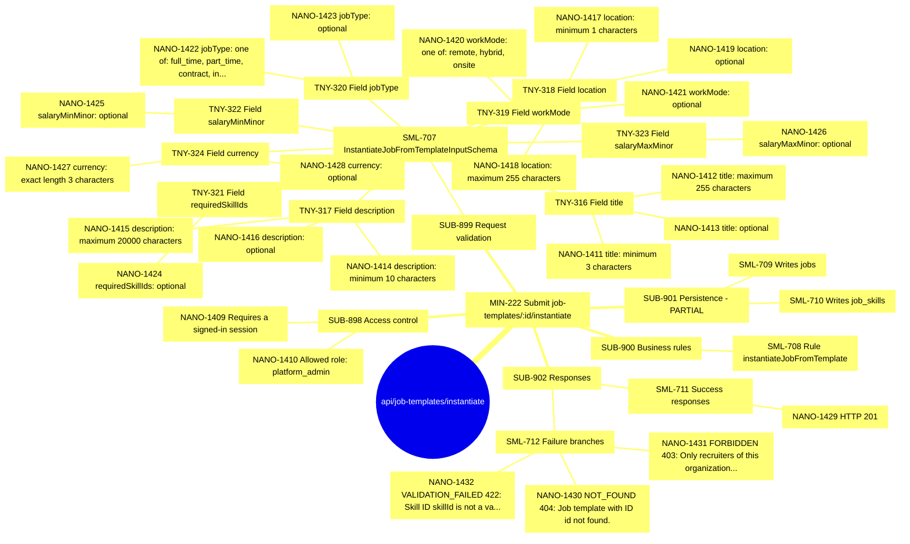

| ID        | Level | Parent   | Name                                                                                  | Description                                                                                                                                                                                                                                                                                                                                      | Status                | Verification | Evidence                                                  | Related                     |
| --------- | ----- | -------- | ------------------------------------------------------------------------------------- | ------------------------------------------------------------------------------------------------------------------------------------------------------------------------------------------------------------------------------------------------------------------------------------------------------------------------------------------------ | --------------------- | ------------ | --------------------------------------------------------- | --------------------------- |
| FEAT-029  | MAJOR | MOD-061  | api/job-templates/instantiate                                                         |                                                                                                                                                                                                                                                                                                                                                  | IMPLEMENTED           |              | apps/api/src/server.ts:2451                               |                             |
| MIN-222   | MINOR | FEAT-029 | Submit job-templates/:id/instantiate                                                  | POST /api/v1/job-templates/:id/instantiate for roles platform_admin; validates InstantiateJobFromTemplateInputSchema; calls instantiateJobFromTemplate; ephemeral (process memory); writes jobs, job_skills; responds 201; 3 failure branch(es). Gaps: ephemeral: state held in process memory, lost on restart; no first-party web caller found | IMPLEMENTED           | VERIFIED     | apps/api/src/server.ts:2451                               | API-040, TEST-108, TEST-186 |
| SUB-898   | SUB   | MIN-222  | Access control                                                                        | Who may call POST /api/v1/job-templates/:id/instantiate: roles platform_admin.                                                                                                                                                                                                                                                                   | IMPLEMENTED           | PATH_LEVEL   | apps/api/src/server.ts:2451                               |                             |
| NANO-1409 | NANO  | SUB-898  | Requires a signed-in session                                                          | Requests without a valid session token are rejected with 401 UNAUTHENTICATED.                                                                                                                                                                                                                                                                    | IMPLEMENTED           | PATH_LEVEL   | apps/api/src/server.ts:2451                               | ROLE-001                    |
| NANO-1410 | NANO  | SUB-898  | Allowed role: platform_admin                                                          | platform_admin is one of the roles allowed here (platform_admin); a caller holding none of them is rejected with 403.                                                                                                                                                                                                                            | IMPLEMENTED           | PATH_LEVEL   | apps/api/src/server.ts:2451                               | ROLE-008                    |
| SUB-899   | SUB   | MIN-222  | Request validation                                                                    | The request is parsed with InstantiateJobFromTemplateInputSchema; a failure returns 400 with field details before any business logic runs.                                                                                                                                                                                                       | IMPLEMENTED           | PATH_LEVEL   | apps/api/src/server.ts:2451                               |                             |
| SML-707   | SMALL | SUB-899  | InstantiateJobFromTemplateInputSchema                                                 | InstantiateJobFromTemplateInputSchema: 9 field(s)                                                                                                                                                                                                                                                                                                | IMPLEMENTED           | PATH_LEVEL   | packages/contracts/src/index.ts:1004                      | SCH-080                     |
| TNY-316   | TINY  | SML-707  | Field title                                                                           | title (string, optional): minimum 3 characters; maximum 255 characters; optional                                                                                                                                                                                                                                                                 | IMPLEMENTED           | PATH_LEVEL   | packages/contracts/src/index.ts:1005                      |                             |
| NANO-1411 | NANO  | TNY-316  | title: minimum 3 characters                                                           | title minimum 3 characters.                                                                                                                                                                                                                                                                                                                      | IMPLEMENTED           | PATH_LEVEL   | packages/contracts/src/index.ts:1005                      |                             |
| NANO-1412 | NANO  | TNY-316  | title: maximum 255 characters                                                         | title maximum 255 characters.                                                                                                                                                                                                                                                                                                                    | IMPLEMENTED           | PATH_LEVEL   | packages/contracts/src/index.ts:1005                      |                             |
| NANO-1413 | NANO  | TNY-316  | title: optional                                                                       | title optional.                                                                                                                                                                                                                                                                                                                                  | IMPLEMENTED           | PATH_LEVEL   | packages/contracts/src/index.ts:1005                      |                             |
| TNY-317   | TINY  | SML-707  | Field description                                                                     | description (string, optional): minimum 10 characters; maximum 20000 characters; optional                                                                                                                                                                                                                                                        | IMPLEMENTED           | PATH_LEVEL   | packages/contracts/src/index.ts:1006                      |                             |
| NANO-1414 | NANO  | TNY-317  | description: minimum 10 characters                                                    | description minimum 10 characters.                                                                                                                                                                                                                                                                                                               | IMPLEMENTED           | PATH_LEVEL   | packages/contracts/src/index.ts:1006                      |                             |
| NANO-1415 | NANO  | TNY-317  | description: maximum 20000 characters                                                 | description maximum 20000 characters.                                                                                                                                                                                                                                                                                                            | IMPLEMENTED           | PATH_LEVEL   | packages/contracts/src/index.ts:1006                      |                             |
| NANO-1416 | NANO  | TNY-317  | description: optional                                                                 | description optional.                                                                                                                                                                                                                                                                                                                            | IMPLEMENTED           | PATH_LEVEL   | packages/contracts/src/index.ts:1006                      |                             |
| TNY-318   | TINY  | SML-707  | Field location                                                                        | location (string, optional): minimum 1 characters; maximum 255 characters; optional                                                                                                                                                                                                                                                              | IMPLEMENTED           | PATH_LEVEL   | packages/contracts/src/index.ts:1007                      |                             |
| NANO-1417 | NANO  | TNY-318  | location: minimum 1 characters                                                        | location minimum 1 characters.                                                                                                                                                                                                                                                                                                                   | IMPLEMENTED           | PATH_LEVEL   | packages/contracts/src/index.ts:1007                      |                             |
| NANO-1418 | NANO  | TNY-318  | location: maximum 255 characters                                                      | location maximum 255 characters.                                                                                                                                                                                                                                                                                                                 | IMPLEMENTED           | PATH_LEVEL   | packages/contracts/src/index.ts:1007                      |                             |
| NANO-1419 | NANO  | TNY-318  | location: optional                                                                    | location optional.                                                                                                                                                                                                                                                                                                                               | IMPLEMENTED           | PATH_LEVEL   | packages/contracts/src/index.ts:1007                      |                             |
| TNY-319   | TINY  | SML-707  | Field workMode                                                                        | workMode (enum, optional): one of: remote, hybrid, onsite; optional                                                                                                                                                                                                                                                                              | IMPLEMENTED           | PATH_LEVEL   | packages/contracts/src/index.ts:1008                      |                             |
| NANO-1420 | NANO  | TNY-319  | workMode: one of: remote, hybrid, onsite                                              | workMode one of: remote, hybrid, onsite.                                                                                                                                                                                                                                                                                                         | IMPLEMENTED           | PATH_LEVEL   | packages/contracts/src/index.ts:1008                      |                             |
| NANO-1421 | NANO  | TNY-319  | workMode: optional                                                                    | workMode optional.                                                                                                                                                                                                                                                                                                                               | IMPLEMENTED           | PATH_LEVEL   | packages/contracts/src/index.ts:1008                      |                             |
| TNY-320   | TINY  | SML-707  | Field jobType                                                                         | jobType (enum, optional): one of: full_time, part_time, contract, internship; optional                                                                                                                                                                                                                                                           | IMPLEMENTED           | PATH_LEVEL   | packages/contracts/src/index.ts:1009                      |                             |
| NANO-1422 | NANO  | TNY-320  | jobType: one of: full_time, part_time, contract, internship                           | jobType one of: full_time, part_time, contract, internship.                                                                                                                                                                                                                                                                                      | IMPLEMENTED           | PATH_LEVEL   | packages/contracts/src/index.ts:1009                      |                             |
| NANO-1423 | NANO  | TNY-320  | jobType: optional                                                                     | jobType optional.                                                                                                                                                                                                                                                                                                                                | IMPLEMENTED           | PATH_LEVEL   | packages/contracts/src/index.ts:1009                      |                             |
| TNY-321   | TINY  | SML-707  | Field requiredSkillIds                                                                | requiredSkillIds (uniqueIdList(), optional): optional                                                                                                                                                                                                                                                                                            | IMPLEMENTED           | PATH_LEVEL   | packages/contracts/src/index.ts:1010                      |                             |
| NANO-1424 | NANO  | TNY-321  | requiredSkillIds: optional                                                            | requiredSkillIds optional.                                                                                                                                                                                                                                                                                                                       | IMPLEMENTED           | PATH_LEVEL   | packages/contracts/src/index.ts:1010                      |                             |
| TNY-322   | TINY  | SML-707  | Field salaryMinMinor                                                                  | salaryMinMinor (salaryMinor(), optional): optional                                                                                                                                                                                                                                                                                               | IMPLEMENTED           | PATH_LEVEL   | packages/contracts/src/index.ts:1011                      |                             |
| NANO-1425 | NANO  | TNY-322  | salaryMinMinor: optional                                                              | salaryMinMinor optional.                                                                                                                                                                                                                                                                                                                         | IMPLEMENTED           | PATH_LEVEL   | packages/contracts/src/index.ts:1011                      |                             |
| TNY-323   | TINY  | SML-707  | Field salaryMaxMinor                                                                  | salaryMaxMinor (salaryMinor(), optional): optional                                                                                                                                                                                                                                                                                               | IMPLEMENTED           | PATH_LEVEL   | packages/contracts/src/index.ts:1012                      |                             |
| NANO-1426 | NANO  | TNY-323  | salaryMaxMinor: optional                                                              | salaryMaxMinor optional.                                                                                                                                                                                                                                                                                                                         | IMPLEMENTED           | PATH_LEVEL   | packages/contracts/src/index.ts:1012                      |                             |
| TNY-324   | TINY  | SML-707  | Field currency                                                                        | currency (string, optional): exact length 3 characters; optional                                                                                                                                                                                                                                                                                 | IMPLEMENTED           | PATH_LEVEL   | packages/contracts/src/index.ts:1013                      |                             |
| NANO-1427 | NANO  | TNY-324  | currency: exact length 3 characters                                                   | currency exact length 3 characters.                                                                                                                                                                                                                                                                                                              | IMPLEMENTED           | PATH_LEVEL   | packages/contracts/src/index.ts:1013                      |                             |
| NANO-1428 | NANO  | TNY-324  | currency: optional                                                                    | currency optional.                                                                                                                                                                                                                                                                                                                               | IMPLEMENTED           | PATH_LEVEL   | packages/contracts/src/index.ts:1013                      |                             |
| SUB-900   | SUB   | MIN-222  | Business rules                                                                        | Domain functions from packages/domain called by the handler (1).                                                                                                                                                                                                                                                                                 | IMPLEMENTED           | PATH_LEVEL   | apps/api/src/server.ts:2451                               |                             |
| SML-708   | SMALL | SUB-900  | Rule instantiateJobFromTemplate                                                       | Calls instantiateJobFromTemplate (packages/domain/src/job-templates.ts). Rule status IMPLEMENTED; its own tests: VERIFIED.                                                                                                                                                                                                                       | IMPLEMENTED           | VERIFIED     | packages/domain/src/job-templates.ts:268                  | RULE-126                    |
| SUB-901   | SUB   | MIN-222  | Persistence                                                                           | Ephemeral: state lives in API process memory and is lost on restart.                                                                                                                                                                                                                                                                             | PARTIALLY_IMPLEMENTED | PATH_LEVEL   | apps/api/src/server.ts:2451                               |                             |
| SML-709   | SMALL | SUB-901  | Writes jobs                                                                           | Writes table jobs (00001_core_schema.sql).                                                                                                                                                                                                                                                                                                       | IMPLEMENTED           | PATH_LEVEL   | supabase/migrations/00001_core_schema.sql:167             | DB-006                      |
| SML-710   | SMALL | SUB-901  | Writes job_skills                                                                     | Writes table job_skills (00003_jobs_applications_schema.sql).                                                                                                                                                                                                                                                                                    | IMPLEMENTED           | PATH_LEVEL   | supabase/migrations/00003_jobs_applications_schema.sql:24 | DB-013                      |
| SUB-902   | SUB   | MIN-222  | Responses                                                                             | Success 201; 3 explicit failure branch(es) besides validation and access errors.                                                                                                                                                                                                                                                                 | IMPLEMENTED           | PATH_LEVEL   | apps/api/src/server.ts:2451                               |                             |
| SML-711   | SMALL | SUB-902  | Success responses                                                                     | HTTP 201.                                                                                                                                                                                                                                                                                                                                        | IMPLEMENTED           | PATH_LEVEL   | apps/api/src/server.ts:2451                               |                             |
| NANO-1429 | NANO  | SML-711  | HTTP 201                                                                              | Replies 201 when the operation succeeds.                                                                                                                                                                                                                                                                                                         | IMPLEMENTED           | PATH_LEVEL   | apps/api/src/server.ts:2451                               |                             |
| SML-712   | SMALL | SUB-902  | Failure branches                                                                      | 3 DomainError branch(es) in the handler, mapped to HTTP by the global error handler.                                                                                                                                                                                                                                                             | IMPLEMENTED           | PATH_LEVEL   | apps/api/src/server.ts:2451                               |                             |
| NANO-1430 | NANO  | SML-712  | NOT_FOUND 404: Job template with ID ${id} not found.                                  | Throws DomainError(NOT_FOUND) "Job template with ID ${id} not found." -> HTTP 404.                                                                                                                                                                                                                                                               | IMPLEMENTED           | PATH_LEVEL   | apps/api/src/server.ts:2460                               | ERR-041                     |
| NANO-1431 | NANO  | SML-712  | FORBIDDEN 403: Only recruiters of this organization can instantiate jobs from its tem | Throws DomainError(FORBIDDEN) "Only recruiters of this organization can instantiate jobs from its templates (BR-12)." -> HTTP 403.                                                                                                                                                                                                               | IMPLEMENTED           | PATH_LEVEL   | apps/api/src/server.ts:2468                               | ERR-043                     |
| NANO-1432 | NANO  | SML-712  | VALIDATION_FAILED 422: Skill ID ${skillId} is not a valid canonical skill (BR-144).   | Throws DomainError(VALIDATION_FAILED) "Skill ID ${skillId} is not a valid canonical skill (BR-144)." -> HTTP 422.                                                                                                                                                                                                                                | IMPLEMENTED           | PATH_LEVEL   | apps/api/src/server.ts:2477                               | ERR-039                     |

## api/jobs (MOD-060)

**Application:** apps/api (MOD-001). **Purpose:** API module: routes under /api/v1/jobs in apps/api/src/server.ts.

**Nodes by level:** MODULE 1, MAJOR 10, MINOR 22, SUB 84, SMALL 66, TINY 29, NANO 132. **Status:** IMPLEMENTED 342, PARTIALLY_IMPLEMENTED 2. **Verification:** PATH_LEVEL 297, UNKNOWN 1, VERIFIED 35.

**User roles that reach it:** anonymous, authenticated, platform_admin.

**Known gaps:** MIN-074 no first-party web caller found; MIN-149 no first-party web caller found; MIN-005 no first-party web caller found; MIN-073 no first-party web caller found; MIN-227 no first-party web caller found; MIN-282 no first-party web caller found; MIN-004 no first-party web caller found; MIN-225 no first-party web caller found; MIN-226 ephemeral: state held in process memory, lost on restart; MIN-226 no first-party web caller found; MIN-075 no first-party web caller found; MIN-006 no first-party web caller found; MIN-076 no first-party web caller found; MIN-077 no first-party web caller found; MIN-150 no first-party web caller found; MIN-228 no first-party web caller found; MIN-229 no first-party web caller found.

**Called from (web screens and components):** FEAT-162 Screen /dashboard, FEAT-164 Screen /hiring, FEAT-165 Screen /hiring/jobs/:id, FEAT-166 Screen /jobs, FEAT-167 Screen /jobs/:id

### Module map (to minor features)

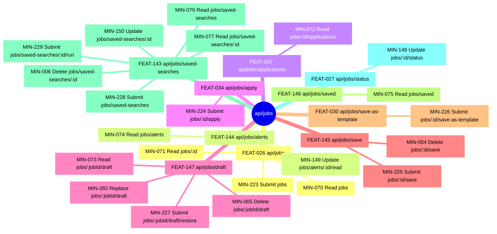

### FEAT-026 api/jobs

api/jobs

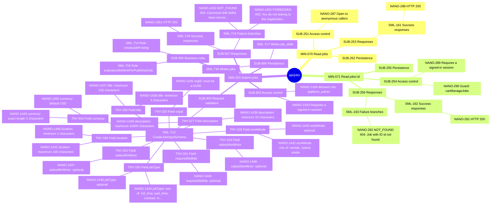

| ID        | Level | Parent   | Name                                                                               | Description                                                                                                                                                                                                              | Status      | Verification | Evidence                                                  | Related                                                       |
| --------- | ----- | -------- | ---------------------------------------------------------------------------------- | ------------------------------------------------------------------------------------------------------------------------------------------------------------------------------------------------------------------------ | ----------- | ------------ | --------------------------------------------------------- | ------------------------------------------------------------- |
| FEAT-026  | MAJOR | MOD-060  | api/jobs                                                                           |                                                                                                                                                                                                                          | IMPLEMENTED |              | apps/api/src/server.ts:2041                               |                                                               |
| MIN-070   | MINOR | FEAT-026 | Read jobs                                                                          | GET /api/v1/jobs for anyone (public); durable (PostgreSQL); responds 200.                                                                                                                                                | IMPLEMENTED | VERIFIED     | apps/api/src/server.ts:2105                               | API-032, TEST-056, TEST-097, TEST-101, TEST-109, TEST-112 ... |
| SUB-251   | SUB   | MIN-070  | Access control                                                                     | Who may call GET /api/v1/jobs: anyone (public).                                                                                                                                                                          | IMPLEMENTED | PATH_LEVEL   | apps/api/src/server.ts:2105                               |                                                               |
| NANO-287  | NANO  | SUB-251  | Open to anonymous callers                                                          | auth: public.                                                                                                                                                                                                            | IMPLEMENTED | PATH_LEVEL   | apps/api/src/server.ts:2105                               | ROLE-001                                                      |
| SUB-252   | SUB   | MIN-070  | Persistence                                                                        | Durable: writes go through the PostgreSQL store.                                                                                                                                                                         | IMPLEMENTED | PATH_LEVEL   | apps/api/src/server.ts:2105                               |                                                               |
| SUB-253   | SUB   | MIN-070  | Responses                                                                          | Success 200; 0 explicit failure branch(es) besides validation and access errors.                                                                                                                                         | IMPLEMENTED | PATH_LEVEL   | apps/api/src/server.ts:2105                               |                                                               |
| SML-161   | SMALL | SUB-253  | Success responses                                                                  | HTTP 200 (implicit).                                                                                                                                                                                                     | IMPLEMENTED | PATH_LEVEL   | apps/api/src/server.ts:2105                               |                                                               |
| NANO-288  | NANO  | SML-161  | HTTP 200                                                                           | Replies 200 when the operation succeeds (implicit default).                                                                                                                                                              | IMPLEMENTED | PATH_LEVEL   | apps/api/src/server.ts:2105                               |                                                               |
| MIN-071   | MINOR | FEAT-026 | Read jobs/:id                                                                      | GET /api/v1/jobs/:id for any signed-in session; durable (PostgreSQL); responds 200; 1 failure branch(es).                                                                                                                | IMPLEMENTED | VERIFIED     | apps/api/src/server.ts:2119                               | API-033, TEST-055, TEST-108, TEST-128, TEST-142, TEST-145 ... |
| SUB-254   | SUB   | MIN-071  | Access control                                                                     | Who may call GET /api/v1/jobs/:id: any signed-in session.                                                                                                                                                                | IMPLEMENTED | PATH_LEVEL   | apps/api/src/server.ts:2119                               |                                                               |
| NANO-289  | NANO  | SUB-254  | Requires a signed-in session                                                       | Requests without a valid session token are rejected with 401 UNAUTHENTICATED.                                                                                                                                            | IMPLEMENTED | PATH_LEVEL   | apps/api/src/server.ts:2119                               | ROLE-001                                                      |
| NANO-290  | NANO  | SUB-254  | Guard: canManageJobs                                                               | Guard canManageJobs must pass before the handler runs.                                                                                                                                                                   | IMPLEMENTED | PATH_LEVEL   | apps/api/src/server.ts:2119                               |                                                               |
| SUB-255   | SUB   | MIN-071  | Persistence                                                                        | Durable: writes go through the PostgreSQL store.                                                                                                                                                                         | IMPLEMENTED | PATH_LEVEL   | apps/api/src/server.ts:2119                               |                                                               |
| SUB-256   | SUB   | MIN-071  | Responses                                                                          | Success 200; 1 explicit failure branch(es) besides validation and access errors.                                                                                                                                         | IMPLEMENTED | PATH_LEVEL   | apps/api/src/server.ts:2119                               |                                                               |
| SML-162   | SMALL | SUB-256  | Success responses                                                                  | HTTP 200.                                                                                                                                                                                                                | IMPLEMENTED | PATH_LEVEL   | apps/api/src/server.ts:2119                               |                                                               |
| NANO-291  | NANO  | SML-162  | HTTP 200                                                                           | Replies 200 when the operation succeeds.                                                                                                                                                                                 | IMPLEMENTED | PATH_LEVEL   | apps/api/src/server.ts:2119                               |                                                               |
| SML-163   | SMALL | SUB-256  | Failure branches                                                                   | 1 DomainError branch(es) in the handler, mapped to HTTP by the global error handler.                                                                                                                                     | IMPLEMENTED | PATH_LEVEL   | apps/api/src/server.ts:2119                               |                                                               |
| NANO-292  | NANO  | SML-163  | NOT_FOUND 404: Job with ID ${id} not found.                                        | Throws DomainError(NOT_FOUND) "Job with ID ${id} not found." -> HTTP 404.                                                                                                                                                | IMPLEMENTED | PATH_LEVEL   | apps/api/src/server.ts:2129                               | ERR-037                                                       |
| MIN-223   | MINOR | FEAT-026 | Submit jobs                                                                        | POST /api/v1/jobs for roles platform_admin; validates CreateJobInputSchema; calls createJobPosting, evaluateJobAlertsForPublishedJob; durable (PostgreSQL); writes jobs, job_skills; responds 201; 2 failure branch(es). | IMPLEMENTED | VERIFIED     | apps/api/src/server.ts:2041                               | API-031, TEST-088, TEST-089, TEST-097, TEST-101, TEST-109 ... |
| SUB-903   | SUB   | MIN-223  | Access control                                                                     | Who may call POST /api/v1/jobs: roles platform_admin.                                                                                                                                                                    | IMPLEMENTED | PATH_LEVEL   | apps/api/src/server.ts:2041                               |                                                               |
| NANO-1433 | NANO  | SUB-903  | Requires a signed-in session                                                       | Requests without a valid session token are rejected with 401 UNAUTHENTICATED.                                                                                                                                            | IMPLEMENTED | PATH_LEVEL   | apps/api/src/server.ts:2041                               | ROLE-001                                                      |
| NANO-1434 | NANO  | SUB-903  | Allowed role: platform_admin                                                       | platform_admin is one of the roles allowed here (platform_admin); a caller holding none of them is rejected with 403.                                                                                                    | IMPLEMENTED | PATH_LEVEL   | apps/api/src/server.ts:2041                               | ROLE-008                                                      |
| SUB-904   | SUB   | MIN-223  | Request validation                                                                 | The request is parsed with CreateJobInputSchema; a failure returns 400 with field details before any business logic runs.                                                                                                | IMPLEMENTED | PATH_LEVEL   | apps/api/src/server.ts:2041                               |                                                               |
| SML-713   | SMALL | SUB-904  | CreateJobInputSchema                                                               | CreateJobInputSchema: 10 field(s)                                                                                                                                                                                        | IMPLEMENTED | PATH_LEVEL   | packages/contracts/src/index.ts:242                       | SCH-016                                                       |
| TNY-325   | TINY  | SML-713  | Field orgId                                                                        | orgId (string, required): must be a UUID                                                                                                                                                                                 | IMPLEMENTED | PATH_LEVEL   | packages/contracts/src/index.ts:243                       |                                                               |
| NANO-1435 | NANO  | TNY-325  | orgId: must be a UUID                                                              | orgId must be a UUID.                                                                                                                                                                                                    | IMPLEMENTED | PATH_LEVEL   | packages/contracts/src/index.ts:243                       |                                                               |
| TNY-326   | TINY  | SML-713  | Field title                                                                        | title (string, required): minimum 3 characters; maximum 150 characters                                                                                                                                                   | IMPLEMENTED | PATH_LEVEL   | packages/contracts/src/index.ts:244                       |                                                               |
| NANO-1436 | NANO  | TNY-326  | title: minimum 3 characters                                                        | title minimum 3 characters.                                                                                                                                                                                              | IMPLEMENTED | PATH_LEVEL   | packages/contracts/src/index.ts:244                       |                                                               |
| NANO-1437 | NANO  | TNY-326  | title: maximum 150 characters                                                      | title maximum 150 characters.                                                                                                                                                                                            | IMPLEMENTED | PATH_LEVEL   | packages/contracts/src/index.ts:244                       |                                                               |
| TNY-327   | TINY  | SML-713  | Field description                                                                  | description (string, required): minimum 10 characters; maximum 10000 characters                                                                                                                                          | IMPLEMENTED | PATH_LEVEL   | packages/contracts/src/index.ts:245                       |                                                               |
| NANO-1438 | NANO  | TNY-327  | description: minimum 10 characters                                                 | description minimum 10 characters.                                                                                                                                                                                       | IMPLEMENTED | PATH_LEVEL   | packages/contracts/src/index.ts:245                       |                                                               |
| NANO-1439 | NANO  | TNY-327  | description: maximum 10000 characters                                              | description maximum 10000 characters.                                                                                                                                                                                    | IMPLEMENTED | PATH_LEVEL   | packages/contracts/src/index.ts:245                       |                                                               |
| TNY-328   | TINY  | SML-713  | Field location                                                                     | location (string, required): minimum 2 characters; maximum 100 characters                                                                                                                                                | IMPLEMENTED | PATH_LEVEL   | packages/contracts/src/index.ts:246                       |                                                               |
| NANO-1440 | NANO  | TNY-328  | location: minimum 2 characters                                                     | location minimum 2 characters.                                                                                                                                                                                           | IMPLEMENTED | PATH_LEVEL   | packages/contracts/src/index.ts:246                       |                                                               |
| NANO-1441 | NANO  | TNY-328  | location: maximum 100 characters                                                   | location maximum 100 characters.                                                                                                                                                                                         | IMPLEMENTED | PATH_LEVEL   | packages/contracts/src/index.ts:246                       |                                                               |
| TNY-329   | TINY  | SML-713  | Field workMode                                                                     | workMode (enum, optional): one of: remote, hybrid, onsite; optional                                                                                                                                                      | IMPLEMENTED | PATH_LEVEL   | packages/contracts/src/index.ts:247                       |                                                               |
| NANO-1442 | NANO  | TNY-329  | workMode: one of: remote, hybrid, onsite                                           | workMode one of: remote, hybrid, onsite.                                                                                                                                                                                 | IMPLEMENTED | PATH_LEVEL   | packages/contracts/src/index.ts:247                       |                                                               |
| NANO-1443 | NANO  | TNY-329  | workMode: optional                                                                 | workMode optional.                                                                                                                                                                                                       | IMPLEMENTED | PATH_LEVEL   | packages/contracts/src/index.ts:247                       |                                                               |
| TNY-330   | TINY  | SML-713  | Field jobType                                                                      | jobType (enum, optional): one of: full_time, part_time, contract, internship; optional                                                                                                                                   | IMPLEMENTED | PATH_LEVEL   | packages/contracts/src/index.ts:248                       |                                                               |
| NANO-1444 | NANO  | TNY-330  | jobType: one of: full_time, part_time, contract, internship                        | jobType one of: full_time, part_time, contract, internship.                                                                                                                                                              | IMPLEMENTED | PATH_LEVEL   | packages/contracts/src/index.ts:248                       |                                                               |
| NANO-1445 | NANO  | TNY-330  | jobType: optional                                                                  | jobType optional.                                                                                                                                                                                                        | IMPLEMENTED | PATH_LEVEL   | packages/contracts/src/index.ts:248                       |                                                               |
| TNY-331   | TINY  | SML-713  | Field requiredSkillIds                                                             | requiredSkillIds (uniqueIdList(), optional): optional                                                                                                                                                                    | IMPLEMENTED | PATH_LEVEL   | packages/contracts/src/index.ts:249                       |                                                               |
| NANO-1446 | NANO  | TNY-331  | requiredSkillIds: optional                                                         | requiredSkillIds optional.                                                                                                                                                                                               | IMPLEMENTED | PATH_LEVEL   | packages/contracts/src/index.ts:249                       |                                                               |
| TNY-332   | TINY  | SML-713  | Field salaryMinMinor                                                               | salaryMinMinor (salaryMinor(), optional): optional                                                                                                                                                                       | IMPLEMENTED | PATH_LEVEL   | packages/contracts/src/index.ts:250                       |                                                               |
| NANO-1447 | NANO  | TNY-332  | salaryMinMinor: optional                                                           | salaryMinMinor optional.                                                                                                                                                                                                 | IMPLEMENTED | PATH_LEVEL   | packages/contracts/src/index.ts:250                       |                                                               |
| TNY-333   | TINY  | SML-713  | Field salaryMaxMinor                                                               | salaryMaxMinor (salaryMinor(), optional): optional                                                                                                                                                                       | IMPLEMENTED | PATH_LEVEL   | packages/contracts/src/index.ts:251                       |                                                               |
| NANO-1448 | NANO  | TNY-333  | salaryMaxMinor: optional                                                           | salaryMaxMinor optional.                                                                                                                                                                                                 | IMPLEMENTED | PATH_LEVEL   | packages/contracts/src/index.ts:251                       |                                                               |
| TNY-334   | TINY  | SML-713  | Field currency                                                                     | currency (string, optional): exact length 3 characters; default 'USD'                                                                                                                                                    | IMPLEMENTED | PATH_LEVEL   | packages/contracts/src/index.ts:252                       |                                                               |
| NANO-1449 | NANO  | TNY-334  | currency: exact length 3 characters                                                | currency exact length 3 characters.                                                                                                                                                                                      | IMPLEMENTED | PATH_LEVEL   | packages/contracts/src/index.ts:252                       |                                                               |
| NANO-1450 | NANO  | TNY-334  | currency: default 'USD'                                                            | currency default 'USD'; message "USD".                                                                                                                                                                                   | IMPLEMENTED | PATH_LEVEL   | packages/contracts/src/index.ts:252                       |                                                               |
| SUB-905   | SUB   | MIN-223  | Business rules                                                                     | Domain functions from packages/domain called by the handler (2).                                                                                                                                                         | IMPLEMENTED | PATH_LEVEL   | apps/api/src/server.ts:2041                               |                                                               |
| SML-714   | SMALL | SUB-905  | Rule createJobPosting                                                              | Calls createJobPosting (packages/domain/src/jobs.ts). Rule status IMPLEMENTED; its own tests: VERIFIED.                                                                                                                  | IMPLEMENTED | VERIFIED     | packages/domain/src/jobs.ts:64                            | RULE-128                                                      |
| SML-715   | SMALL | SUB-905  | Rule evaluateJobAlertsForPublishedJob                                              | Calls evaluateJobAlertsForPublishedJob (packages/domain/src/saved-searches.ts). Rule status IMPLEMENTED; its own tests: VERIFIED.                                                                                        | IMPLEMENTED | VERIFIED     | packages/domain/src/saved-searches.ts:197                 | RULE-202                                                      |
| SUB-906   | SUB   | MIN-223  | Persistence                                                                        | Durable: writes go through the PostgreSQL store; store calls jobAlerts.createMany, savedSearches.listAll.                                                                                                                | IMPLEMENTED | PATH_LEVEL   | apps/api/src/server.ts:2041                               |                                                               |
| SML-716   | SMALL | SUB-906  | Writes jobs                                                                        | Writes table jobs (00001_core_schema.sql).                                                                                                                                                                               | IMPLEMENTED | PATH_LEVEL   | supabase/migrations/00001_core_schema.sql:167             | DB-006                                                        |
| SML-717   | SMALL | SUB-906  | Writes job_skills                                                                  | Writes table job_skills (00003_jobs_applications_schema.sql).                                                                                                                                                            | IMPLEMENTED | PATH_LEVEL   | supabase/migrations/00003_jobs_applications_schema.sql:24 | DB-013                                                        |
| SUB-907   | SUB   | MIN-223  | Responses                                                                          | Success 201; 2 explicit failure branch(es) besides validation and access errors.                                                                                                                                         | IMPLEMENTED | PATH_LEVEL   | apps/api/src/server.ts:2041                               |                                                               |
| SML-718   | SMALL | SUB-907  | Success responses                                                                  | HTTP 201.                                                                                                                                                                                                                | IMPLEMENTED | PATH_LEVEL   | apps/api/src/server.ts:2041                               |                                                               |
| NANO-1451 | NANO  | SML-718  | HTTP 201                                                                           | Replies 201 when the operation succeeds.                                                                                                                                                                                 | IMPLEMENTED | PATH_LEVEL   | apps/api/src/server.ts:2041                               |                                                               |
| SML-719   | SMALL | SUB-907  | Failure branches                                                                   | 2 DomainError branch(es) in the handler, mapped to HTTP by the global error handler.                                                                                                                                     | IMPLEMENTED | PATH_LEVEL   | apps/api/src/server.ts:2041                               |                                                               |
| NANO-1452 | NANO  | SML-719  | FORBIDDEN 403: You do not belong to the organization for this job posting (BR-12). | Throws DomainError(FORBIDDEN) "You do not belong to the organization for this job posting (BR-12)." -> HTTP 403.                                                                                                         | IMPLEMENTED | PATH_LEVEL   | apps/api/src/server.ts:2050                               | ERR-036                                                       |
| NANO-1453 | NANO  | SML-719  | NOT_FOUND 404: Canonical skill ${skillId} does not exist (BR-144).                 | Throws DomainError(NOT_FOUND) "Canonical skill ${skillId} does not exist (BR-144)." -> HTTP 404.                                                                                                                         | IMPLEMENTED | PATH_LEVEL   | apps/api/src/server.ts:2059                               | ERR-019                                                       |

### FEAT-144 api/jobs/alerts

api/jobs/alerts

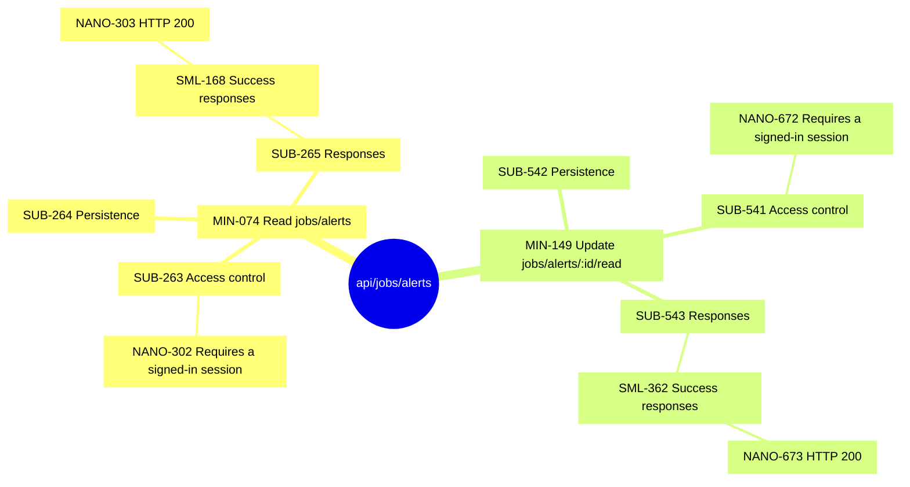

| ID       | Level | Parent   | Name                         | Description                                                                                                                                                       | Status      | Verification | Evidence                     | Related                               |
| -------- | ----- | -------- | ---------------------------- | ----------------------------------------------------------------------------------------------------------------------------------------------------------------- | ----------- | ------------ | ---------------------------- | ------------------------------------- |
| FEAT-144 | MAJOR | MOD-060  | api/jobs/alerts              |                                                                                                                                                                   | IMPLEMENTED |              | apps/api/src/server.ts:12375 |                                       |
| MIN-074  | MINOR | FEAT-144 | Read jobs/alerts             | 7. List job alerts for candidate GET /api/v1/jobs/alerts for any signed-in session; durable (PostgreSQL); responds 200. Gaps: no first-party web caller found     | IMPLEMENTED | VERIFIED     | apps/api/src/server.ts:12375 | API-258, TEST-128, TEST-208, TEST-226 |
| SUB-263  | SUB   | MIN-074  | Access control               | Who may call GET /api/v1/jobs/alerts: any signed-in session.                                                                                                      | IMPLEMENTED | PATH_LEVEL   | apps/api/src/server.ts:12375 |                                       |
| NANO-302 | NANO  | SUB-263  | Requires a signed-in session | Requests without a valid session token are rejected with 401 UNAUTHENTICATED.                                                                                     | IMPLEMENTED | PATH_LEVEL   | apps/api/src/server.ts:12375 | ROLE-001                              |
| SUB-264  | SUB   | MIN-074  | Persistence                  | Durable: writes go through the PostgreSQL store; store calls jobAlerts.listByUser.                                                                                | IMPLEMENTED | PATH_LEVEL   | apps/api/src/server.ts:12375 |                                       |
| SUB-265  | SUB   | MIN-074  | Responses                    | Success 200; 0 explicit failure branch(es) besides validation and access errors.                                                                                  | IMPLEMENTED | PATH_LEVEL   | apps/api/src/server.ts:12375 |                                       |
| SML-168  | SMALL | SUB-265  | Success responses            | HTTP 200.                                                                                                                                                         | IMPLEMENTED | PATH_LEVEL   | apps/api/src/server.ts:12375 |                                       |
| NANO-303 | NANO  | SML-168  | HTTP 200                     | Replies 200 when the operation succeeds.                                                                                                                          | IMPLEMENTED | PATH_LEVEL   | apps/api/src/server.ts:12375 |                                       |
| MIN-149  | MINOR | FEAT-144 | Update jobs/alerts/:id/read  | 8. Mark job alert as read PATCH /api/v1/jobs/alerts/:id/read for any signed-in session; durable (PostgreSQL); responds 200. Gaps: no first-party web caller found | IMPLEMENTED | VERIFIED     | apps/api/src/server.ts:12382 | API-259, TEST-128, TEST-208, TEST-226 |
| SUB-541  | SUB   | MIN-149  | Access control               | Who may call PATCH /api/v1/jobs/alerts/:id/read: any signed-in session.                                                                                           | IMPLEMENTED | PATH_LEVEL   | apps/api/src/server.ts:12382 |                                       |
| NANO-672 | NANO  | SUB-541  | Requires a signed-in session | Requests without a valid session token are rejected with 401 UNAUTHENTICATED.                                                                                     | IMPLEMENTED | PATH_LEVEL   | apps/api/src/server.ts:12382 | ROLE-001                              |
| SUB-542  | SUB   | MIN-149  | Persistence                  | Durable: writes go through the PostgreSQL store; store calls jobAlerts.markRead.                                                                                  | IMPLEMENTED | PATH_LEVEL   | apps/api/src/server.ts:12382 |                                       |
| SUB-543  | SUB   | MIN-149  | Responses                    | Success 200; 0 explicit failure branch(es) besides validation and access errors.                                                                                  | IMPLEMENTED | PATH_LEVEL   | apps/api/src/server.ts:12382 |                                       |
| SML-362  | SMALL | SUB-543  | Success responses            | HTTP 200.                                                                                                                                                         | IMPLEMENTED | PATH_LEVEL   | apps/api/src/server.ts:12382 |                                       |
| NANO-673 | NANO  | SML-362  | HTTP 200                     | Replies 200 when the operation succeeds.                                                                                                                          | IMPLEMENTED | PATH_LEVEL   | apps/api/src/server.ts:12382 |                                       |

### FEAT-037 api/jobs/applications

api/jobs/applications

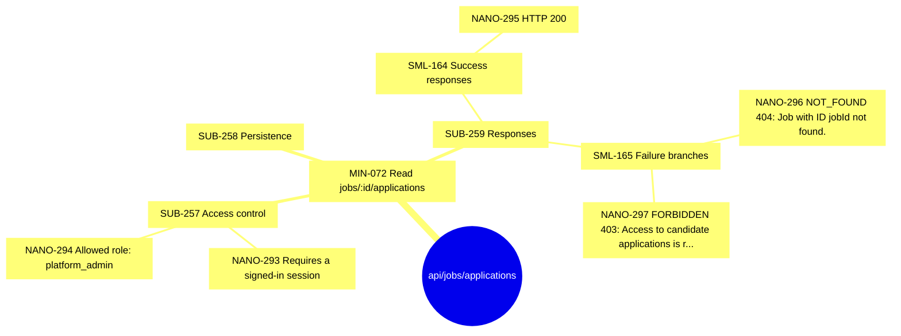

| ID       | Level | Parent   | Name                                                                                  | Description                                                                                                                                         | Status      | Verification | Evidence                    | Related                                         |
| -------- | ----- | -------- | ------------------------------------------------------------------------------------- | --------------------------------------------------------------------------------------------------------------------------------------------------- | ----------- | ------------ | --------------------------- | ----------------------------------------------- |
| FEAT-037 | MAJOR | MOD-060  | api/jobs/applications                                                                 |                                                                                                                                                     | IMPLEMENTED |              | apps/api/src/server.ts:2869 |                                                 |
| MIN-072  | MINOR | FEAT-037 | Read jobs/:id/applications                                                            | GET /api/v1/jobs/:id/applications for roles platform_admin; durable (PostgreSQL); responds 200; 2 failure branch(es).                               | IMPLEMENTED | VERIFIED     | apps/api/src/server.ts:2869 | API-050, TEST-097, TEST-109, TEST-151, TEST-187 |
| SUB-257  | SUB   | MIN-072  | Access control                                                                        | Who may call GET /api/v1/jobs/:id/applications: roles platform_admin.                                                                               | IMPLEMENTED | PATH_LEVEL   | apps/api/src/server.ts:2869 |                                                 |
| NANO-293 | NANO  | SUB-257  | Requires a signed-in session                                                          | Requests without a valid session token are rejected with 401 UNAUTHENTICATED.                                                                       | IMPLEMENTED | PATH_LEVEL   | apps/api/src/server.ts:2869 | ROLE-001                                        |
| NANO-294 | NANO  | SUB-257  | Allowed role: platform_admin                                                          | platform_admin is one of the roles allowed here (platform_admin); a caller holding none of them is rejected with 403.                               | IMPLEMENTED | PATH_LEVEL   | apps/api/src/server.ts:2869 | ROLE-008                                        |
| SUB-258  | SUB   | MIN-072  | Persistence                                                                           | Durable: writes go through the PostgreSQL store.                                                                                                    | IMPLEMENTED | PATH_LEVEL   | apps/api/src/server.ts:2869 |                                                 |
| SUB-259  | SUB   | MIN-072  | Responses                                                                             | Success 200; 2 explicit failure branch(es) besides validation and access errors.                                                                    | IMPLEMENTED | PATH_LEVEL   | apps/api/src/server.ts:2869 |                                                 |
| SML-164  | SMALL | SUB-259  | Success responses                                                                     | HTTP 200.                                                                                                                                           | IMPLEMENTED | PATH_LEVEL   | apps/api/src/server.ts:2869 |                                                 |
| NANO-295 | NANO  | SML-164  | HTTP 200                                                                              | Replies 200 when the operation succeeds.                                                                                                            | IMPLEMENTED | PATH_LEVEL   | apps/api/src/server.ts:2869 |                                                 |
| SML-165  | SMALL | SUB-259  | Failure branches                                                                      | 2 DomainError branch(es) in the handler, mapped to HTTP by the global error handler.                                                                | IMPLEMENTED | PATH_LEVEL   | apps/api/src/server.ts:2869 |                                                 |
| NANO-296 | NANO  | SML-165  | NOT_FOUND 404: Job with ID ${jobId} not found.                                        | Throws DomainError(NOT_FOUND) "Job with ID ${jobId} not found." -> HTTP 404.                                                                        | IMPLEMENTED | PATH_LEVEL   | apps/api/src/server.ts:2877 | ERR-048                                         |
| NANO-297 | NANO  | SML-165  | FORBIDDEN 403: Access to candidate applications is restricted to authorized recruiter | Throws DomainError(FORBIDDEN) "Access to candidate applications is restricted to authorized recruiters for this organization (BR-40)." -> HTTP 403. | IMPLEMENTED | PATH_LEVEL   | apps/api/src/server.ts:2885 | ERR-053                                         |

### FEAT-034 api/jobs/apply

api/jobs/apply

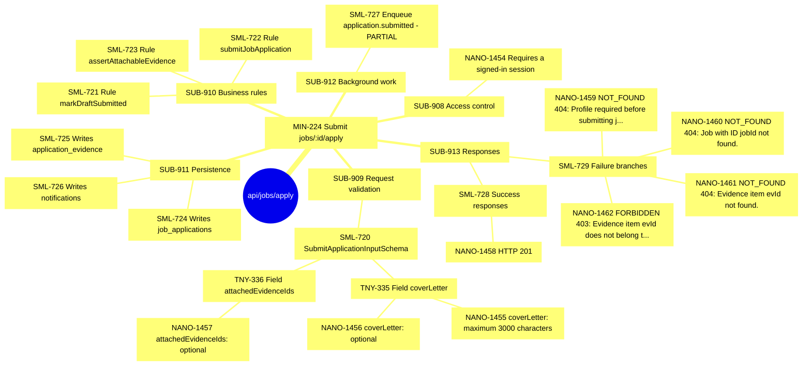

| ID        | Level | Parent   | Name                                                                  | Description                                                                                                                                                                                                                                                                                                                                        | Status                | Verification | Evidence                                                  | Related                                                       |
| --------- | ----- | -------- | --------------------------------------------------------------------- | -------------------------------------------------------------------------------------------------------------------------------------------------------------------------------------------------------------------------------------------------------------------------------------------------------------------------------------------------- | --------------------- | ------------ | --------------------------------------------------------- | ------------------------------------------------------------- |
| FEAT-034  | MAJOR | MOD-060  | api/jobs/apply                                                        |                                                                                                                                                                                                                                                                                                                                                    | IMPLEMENTED           |              | apps/api/src/server.ts:2722                               |                                                               |
| MIN-224   | MINOR | FEAT-034 | Submit jobs/:id/apply                                                 | Application Endpoints (F-06, BR-02, BR-15..BR-41) POST /api/v1/jobs/:id/apply for any signed-in session; validates SubmitApplicationInputSchema; calls markDraftSubmitted, submitJobApplication, assertAttachableEvidence; durable (PostgreSQL); writes job_applications, application_evidence, notifications; responds 201; 4 failure branch(es). | IMPLEMENTED           | VERIFIED     | apps/api/src/server.ts:2722                               | API-047, TEST-088, TEST-089, TEST-097, TEST-101, TEST-109 ... |
| SUB-908   | SUB   | MIN-224  | Access control                                                        | Who may call POST /api/v1/jobs/:id/apply: any signed-in session.                                                                                                                                                                                                                                                                                   | IMPLEMENTED           | PATH_LEVEL   | apps/api/src/server.ts:2722                               |                                                               |
| NANO-1454 | NANO  | SUB-908  | Requires a signed-in session                                          | Requests without a valid session token are rejected with 401 UNAUTHENTICATED.                                                                                                                                                                                                                                                                      | IMPLEMENTED           | PATH_LEVEL   | apps/api/src/server.ts:2722                               | ROLE-001                                                      |
| SUB-909   | SUB   | MIN-224  | Request validation                                                    | The request is parsed with SubmitApplicationInputSchema; a failure returns 400 with field details before any business logic runs.                                                                                                                                                                                                                  | IMPLEMENTED           | PATH_LEVEL   | apps/api/src/server.ts:2722                               |                                                               |
| SML-720   | SMALL | SUB-909  | SubmitApplicationInputSchema                                          | SubmitApplicationInputSchema: 2 field(s)                                                                                                                                                                                                                                                                                                           | IMPLEMENTED           | PATH_LEVEL   | packages/contracts/src/index.ts:274                       | SCH-018                                                       |
| TNY-335   | TINY  | SML-720  | Field coverLetter                                                     | coverLetter (string, optional): maximum 3000 characters; optional                                                                                                                                                                                                                                                                                  | IMPLEMENTED           | PATH_LEVEL   | packages/contracts/src/index.ts:275                       |                                                               |
| NANO-1455 | NANO  | TNY-335  | coverLetter: maximum 3000 characters                                  | coverLetter maximum 3000 characters.                                                                                                                                                                                                                                                                                                               | IMPLEMENTED           | PATH_LEVEL   | packages/contracts/src/index.ts:275                       |                                                               |
| NANO-1456 | NANO  | TNY-335  | coverLetter: optional                                                 | coverLetter optional.                                                                                                                                                                                                                                                                                                                              | IMPLEMENTED           | PATH_LEVEL   | packages/contracts/src/index.ts:275                       |                                                               |
| TNY-336   | TINY  | SML-720  | Field attachedEvidenceIds                                             | attachedEvidenceIds (uniqueIdList(), optional): optional                                                                                                                                                                                                                                                                                           | IMPLEMENTED           | PATH_LEVEL   | packages/contracts/src/index.ts:276                       |                                                               |
| NANO-1457 | NANO  | TNY-336  | attachedEvidenceIds: optional                                         | attachedEvidenceIds optional.                                                                                                                                                                                                                                                                                                                      | IMPLEMENTED           | PATH_LEVEL   | packages/contracts/src/index.ts:276                       |                                                               |
| SUB-910   | SUB   | MIN-224  | Business rules                                                        | Domain functions from packages/domain called by the handler (3).                                                                                                                                                                                                                                                                                   | IMPLEMENTED           | PATH_LEVEL   | apps/api/src/server.ts:2722                               |                                                               |
| SML-721   | SMALL | SUB-910  | Rule markDraftSubmitted                                               | Calls markDraftSubmitted (packages/domain/src/application-drafts.ts). Rule status IMPLEMENTED; its own tests: VERIFIED.                                                                                                                                                                                                                            | IMPLEMENTED           | VERIFIED     | packages/domain/src/application-drafts.ts:179             | RULE-035                                                      |
| SML-722   | SMALL | SUB-910  | Rule submitJobApplication                                             | Calls submitJobApplication (packages/domain/src/applications.ts). Rule status IMPLEMENTED; its own tests: VERIFIED.                                                                                                                                                                                                                                | IMPLEMENTED           | VERIFIED     | packages/domain/src/applications.ts:39                    | RULE-041                                                      |
| SML-723   | SMALL | SUB-910  | Rule assertAttachableEvidence                                         | Calls assertAttachableEvidence (packages/domain/src/evidence.ts). Rule status IMPLEMENTED; its own tests: VERIFIED.                                                                                                                                                                                                                                | IMPLEMENTED           | VERIFIED     | packages/domain/src/evidence.ts:345                       | RULE-100                                                      |
| SUB-911   | SUB   | MIN-224  | Persistence                                                           | Durable: writes go through the PostgreSQL store; store calls applicationDrafts.get, applicationDrafts.markSubmitted.                                                                                                                                                                                                                               | IMPLEMENTED           | PATH_LEVEL   | apps/api/src/server.ts:2722                               |                                                               |
| SML-724   | SMALL | SUB-911  | Writes job_applications                                               | Writes table job_applications (00001_core_schema.sql).                                                                                                                                                                                                                                                                                             | IMPLEMENTED           | PATH_LEVEL   | supabase/migrations/00001_core_schema.sql:179             | DB-007                                                        |
| SML-725   | SMALL | SUB-911  | Writes application_evidence                                           | Writes table application_evidence (00003_jobs_applications_schema.sql).                                                                                                                                                                                                                                                                            | IMPLEMENTED           | PATH_LEVEL   | supabase/migrations/00003_jobs_applications_schema.sql:33 | DB-014                                                        |
| SML-726   | SMALL | SUB-911  | Writes notifications                                                  | Writes table notifications (00007_notifications_schema.sql).                                                                                                                                                                                                                                                                                       | IMPLEMENTED           | PATH_LEVEL   | supabase/migrations/00007_notifications_schema.sql:6      | DB-029                                                        |
| SUB-912   | SUB   | MIN-224  | Background work                                                       | Enqueues 1 background job kind(s) in background_jobs for apps/worker.                                                                                                                                                                                                                                                                              | IMPLEMENTED           | PATH_LEVEL   | apps/api/src/server.ts:2722                               |                                                               |
| SML-727   | SMALL | SUB-912  | Enqueue application.submitted                                         | Dispatches job:application.submitted; worker handler: recordEvent (no-op: marks the event recorded).                                                                                                                                                                                                                                               | PARTIALLY_IMPLEMENTED | UNKNOWN      | packages/domain/src/background-jobs.ts:171                | SVC-008                                                       |
| SUB-913   | SUB   | MIN-224  | Responses                                                             | Success 201; 4 explicit failure branch(es) besides validation and access errors.                                                                                                                                                                                                                                                                   | IMPLEMENTED           | PATH_LEVEL   | apps/api/src/server.ts:2722                               |                                                               |
| SML-728   | SMALL | SUB-913  | Success responses                                                     | HTTP 201.                                                                                                                                                                                                                                                                                                                                          | IMPLEMENTED           | PATH_LEVEL   | apps/api/src/server.ts:2722                               |                                                               |
| NANO-1458 | NANO  | SML-728  | HTTP 201                                                              | Replies 201 when the operation succeeds.                                                                                                                                                                                                                                                                                                           | IMPLEMENTED           | PATH_LEVEL   | apps/api/src/server.ts:2722                               |                                                               |
| SML-729   | SMALL | SUB-913  | Failure branches                                                      | 4 DomainError branch(es) in the handler, mapped to HTTP by the global error handler.                                                                                                                                                                                                                                                               | IMPLEMENTED           | PATH_LEVEL   | apps/api/src/server.ts:2722                               |                                                               |
| NANO-1459 | NANO  | SML-729  | NOT_FOUND 404: Profile required before submitting job applications.   | Throws DomainError(NOT_FOUND) "Profile required before submitting job applications." -> HTTP 404.                                                                                                                                                                                                                                                  | IMPLEMENTED           | PATH_LEVEL   | apps/api/src/server.ts:2731                               | ERR-047                                                       |
| NANO-1460 | NANO  | SML-729  | NOT_FOUND 404: Job with ID ${jobId} not found.                        | Throws DomainError(NOT_FOUND) "Job with ID ${jobId} not found." -> HTTP 404.                                                                                                                                                                                                                                                                       | IMPLEMENTED           | PATH_LEVEL   | apps/api/src/server.ts:2736                               | ERR-048                                                       |
| NANO-1461 | NANO  | SML-729  | NOT_FOUND 404: Evidence item ${evId} not found.                       | Throws DomainError(NOT_FOUND) "Evidence item ${evId} not found." -> HTTP 404.                                                                                                                                                                                                                                                                      | IMPLEMENTED           | PATH_LEVEL   | apps/api/src/server.ts:2743                               | ERR-049                                                       |
| NANO-1462 | NANO  | SML-729  | FORBIDDEN 403: Evidence item ${evId} does not belong to your profile. | Throws DomainError(FORBIDDEN) "Evidence item ${evId} does not belong to your profile." -> HTTP 403.                                                                                                                                                                                                                                                | IMPLEMENTED           | PATH_LEVEL   | apps/api/src/server.ts:2746                               | ERR-050                                                       |

### FEAT-147 api/jobs/draft

api/jobs/draft

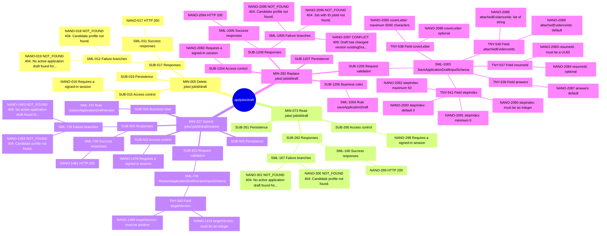

| ID        | Level | Parent   | Name                                                                                 | Description                                                                                                                                                                                                                                                                                            | Status      | Verification | Evidence                                      | Related                                         |
| --------- | ----- | -------- | ------------------------------------------------------------------------------------ | ------------------------------------------------------------------------------------------------------------------------------------------------------------------------------------------------------------------------------------------------------------------------------------------------------ | ----------- | ------------ | --------------------------------------------- | ----------------------------------------------- |
| FEAT-147  | MAJOR | MOD-060  | api/jobs/draft                                                                       |                                                                                                                                                                                                                                                                                                        | IMPLEMENTED |              | apps/api/src/server.ts:12434                  |                                                 |
| MIN-005   | MINOR | FEAT-147 | Delete jobs/:jobId/draft                                                             | DELETE /api/v1/jobs/:jobId/draft for any signed-in session; durable (PostgreSQL); responds 200; 2 failure branch(es). Gaps: no first-party web caller found                                                                                                                                            | IMPLEMENTED | VERIFIED     | apps/api/src/server.ts:12518                  | API-265, TEST-088, TEST-168, TEST-224           |
| SUB-015   | SUB   | MIN-005  | Access control                                                                       | Who may call DELETE /api/v1/jobs/:jobId/draft: any signed-in session.                                                                                                                                                                                                                                  | IMPLEMENTED | PATH_LEVEL   | apps/api/src/server.ts:12518                  |                                                 |
| NANO-016  | NANO  | SUB-015  | Requires a signed-in session                                                         | Requests without a valid session token are rejected with 401 UNAUTHENTICATED.                                                                                                                                                                                                                          | IMPLEMENTED | PATH_LEVEL   | apps/api/src/server.ts:12518                  | ROLE-001                                        |
| SUB-016   | SUB   | MIN-005  | Persistence                                                                          | Durable: writes go through the PostgreSQL store; store calls applicationDrafts.remove.                                                                                                                                                                                                                 | IMPLEMENTED | PATH_LEVEL   | apps/api/src/server.ts:12518                  |                                                 |
| SUB-017   | SUB   | MIN-005  | Responses                                                                            | Success 200; 2 explicit failure branch(es) besides validation and access errors.                                                                                                                                                                                                                       | IMPLEMENTED | PATH_LEVEL   | apps/api/src/server.ts:12518                  |                                                 |
| SML-011   | SMALL | SUB-017  | Success responses                                                                    | HTTP 200.                                                                                                                                                                                                                                                                                              | IMPLEMENTED | PATH_LEVEL   | apps/api/src/server.ts:12518                  |                                                 |
| NANO-017  | NANO  | SML-011  | HTTP 200                                                                             | Replies 200 when the operation succeeds.                                                                                                                                                                                                                                                               | IMPLEMENTED | PATH_LEVEL   | apps/api/src/server.ts:12518                  |                                                 |
| SML-012   | SMALL | SUB-017  | Failure branches                                                                     | 2 DomainError branch(es) in the handler, mapped to HTTP by the global error handler.                                                                                                                                                                                                                   | IMPLEMENTED | PATH_LEVEL   | apps/api/src/server.ts:12518                  |                                                 |
| NANO-018  | NANO  | SML-012  | NOT_FOUND 404: Candidate profile not found.                                          | Throws DomainError(NOT_FOUND) "Candidate profile not found." -> HTTP 404.                                                                                                                                                                                                                              | IMPLEMENTED | PATH_LEVEL   | apps/api/src/server.ts:12524                  | ERR-158                                         |
| NANO-019  | NANO  | SML-012  | NOT_FOUND 404: No active application draft found for this job.                       | Throws DomainError(NOT_FOUND) "No active application draft found for this job." -> HTTP 404.                                                                                                                                                                                                           | IMPLEMENTED | PATH_LEVEL   | apps/api/src/server.ts:12529                  | ERR-233                                         |
| MIN-073   | MINOR | FEAT-147 | Read jobs/:jobId/draft                                                               | GET /api/v1/jobs/:jobId/draft for any signed-in session; durable (PostgreSQL); responds 200; 2 failure branch(es). Gaps: no first-party web caller found                                                                                                                                               | IMPLEMENTED | VERIFIED     | apps/api/src/server.ts:12494                  | API-264, TEST-088, TEST-168, TEST-224           |
| SUB-260   | SUB   | MIN-073  | Access control                                                                       | Who may call GET /api/v1/jobs/:jobId/draft: any signed-in session.                                                                                                                                                                                                                                     | IMPLEMENTED | PATH_LEVEL   | apps/api/src/server.ts:12494                  |                                                 |
| NANO-298  | NANO  | SUB-260  | Requires a signed-in session                                                         | Requests without a valid session token are rejected with 401 UNAUTHENTICATED.                                                                                                                                                                                                                          | IMPLEMENTED | PATH_LEVEL   | apps/api/src/server.ts:12494                  | ROLE-001                                        |
| SUB-261   | SUB   | MIN-073  | Persistence                                                                          | Durable: writes go through the PostgreSQL store; store calls applicationDrafts.get, applicationDrafts.listVersions.                                                                                                                                                                                    | IMPLEMENTED | PATH_LEVEL   | apps/api/src/server.ts:12494                  |                                                 |
| SUB-262   | SUB   | MIN-073  | Responses                                                                            | Success 200; 2 explicit failure branch(es) besides validation and access errors.                                                                                                                                                                                                                       | IMPLEMENTED | PATH_LEVEL   | apps/api/src/server.ts:12494                  |                                                 |
| SML-166   | SMALL | SUB-262  | Success responses                                                                    | HTTP 200.                                                                                                                                                                                                                                                                                              | IMPLEMENTED | PATH_LEVEL   | apps/api/src/server.ts:12494                  |                                                 |
| NANO-299  | NANO  | SML-166  | HTTP 200                                                                             | Replies 200 when the operation succeeds.                                                                                                                                                                                                                                                               | IMPLEMENTED | PATH_LEVEL   | apps/api/src/server.ts:12494                  |                                                 |
| SML-167   | SMALL | SUB-262  | Failure branches                                                                     | 2 DomainError branch(es) in the handler, mapped to HTTP by the global error handler.                                                                                                                                                                                                                   | IMPLEMENTED | PATH_LEVEL   | apps/api/src/server.ts:12494                  |                                                 |
| NANO-300  | NANO  | SML-167  | NOT_FOUND 404: Candidate profile not found.                                          | Throws DomainError(NOT_FOUND) "Candidate profile not found." -> HTTP 404.                                                                                                                                                                                                                              | IMPLEMENTED | PATH_LEVEL   | apps/api/src/server.ts:12500                  | ERR-158                                         |
| NANO-301  | NANO  | SML-167  | NOT_FOUND 404: No active application draft found for this job.                       | Throws DomainError(NOT_FOUND) "No active application draft found for this job." -> HTTP 404.                                                                                                                                                                                                           | IMPLEMENTED | PATH_LEVEL   | apps/api/src/server.ts:12506                  | ERR-233                                         |
| MIN-227   | MINOR | FEAT-147 | Submit jobs/:jobId/draft/restore                                                     | POST /api/v1/jobs/:jobId/draft/restore for any signed-in session; validates RestoreApplicationDraftVersionInputSchema; calls restoreApplicationDraftVersion; durable (PostgreSQL); responds 200; 2 failure branch(es). Gaps: no first-party web caller found                                           | IMPLEMENTED | VERIFIED     | apps/api/src/server.ts:12538                  | API-266, TEST-088, TEST-168, TEST-224           |
| SUB-922   | SUB   | MIN-227  | Access control                                                                       | Who may call POST /api/v1/jobs/:jobId/draft/restore: any signed-in session.                                                                                                                                                                                                                            | IMPLEMENTED | PATH_LEVEL   | apps/api/src/server.ts:12538                  |                                                 |
| NANO-1478 | NANO  | SUB-922  | Requires a signed-in session                                                         | Requests without a valid session token are rejected with 401 UNAUTHENTICATED.                                                                                                                                                                                                                          | IMPLEMENTED | PATH_LEVEL   | apps/api/src/server.ts:12538                  | ROLE-001                                        |
| SUB-923   | SUB   | MIN-227  | Request validation                                                                   | The request is parsed with RestoreApplicationDraftVersionInputSchema; a failure returns 400 with field details before any business logic runs.                                                                                                                                                         | IMPLEMENTED | PATH_LEVEL   | apps/api/src/server.ts:12538                  |                                                 |
| SML-736   | SMALL | SUB-923  | RestoreApplicationDraftVersionInputSchema                                            | RestoreApplicationDraftVersionInputSchema: 1 field(s)                                                                                                                                                                                                                                                  | IMPLEMENTED | PATH_LEVEL   | packages/contracts/src/index.ts:922           | SCH-073                                         |
| TNY-340   | TINY  | SML-736  | Field targetVersion                                                                  | targetVersion (number, required): must be an integer; must be positive                                                                                                                                                                                                                                 | IMPLEMENTED | PATH_LEVEL   | packages/contracts/src/index.ts:923           |                                                 |
| NANO-1479 | NANO  | TNY-340  | targetVersion: must be an integer                                                    | targetVersion must be an integer.                                                                                                                                                                                                                                                                      | IMPLEMENTED | PATH_LEVEL   | packages/contracts/src/index.ts:923           |                                                 |
| NANO-1480 | NANO  | TNY-340  | targetVersion: must be positive                                                      | targetVersion must be positive.                                                                                                                                                                                                                                                                        | IMPLEMENTED | PATH_LEVEL   | packages/contracts/src/index.ts:923           |                                                 |
| SUB-924   | SUB   | MIN-227  | Business rules                                                                       | Domain functions from packages/domain called by the handler (1).                                                                                                                                                                                                                                       | IMPLEMENTED | PATH_LEVEL   | apps/api/src/server.ts:12538                  |                                                 |
| SML-737   | SMALL | SUB-924  | Rule restoreApplicationDraftVersion                                                  | Calls restoreApplicationDraftVersion (packages/domain/src/application-drafts.ts). Rule status IMPLEMENTED; its own tests: VERIFIED.                                                                                                                                                                    | IMPLEMENTED | VERIFIED     | packages/domain/src/application-drafts.ts:115 | RULE-034                                        |
| SUB-925   | SUB   | MIN-227  | Persistence                                                                          | Durable: writes go through the PostgreSQL store; store calls applicationDrafts.get, applicationDrafts.listVersions, applicationDrafts.save.                                                                                                                                                            | IMPLEMENTED | PATH_LEVEL   | apps/api/src/server.ts:12538                  |                                                 |
| SUB-926   | SUB   | MIN-227  | Responses                                                                            | Success 200; 2 explicit failure branch(es) besides validation and access errors.                                                                                                                                                                                                                       | IMPLEMENTED | PATH_LEVEL   | apps/api/src/server.ts:12538                  |                                                 |
| SML-738   | SMALL | SUB-926  | Success responses                                                                    | HTTP 200.                                                                                                                                                                                                                                                                                              | IMPLEMENTED | PATH_LEVEL   | apps/api/src/server.ts:12538                  |                                                 |
| NANO-1481 | NANO  | SML-738  | HTTP 200                                                                             | Replies 200 when the operation succeeds.                                                                                                                                                                                                                                                               | IMPLEMENTED | PATH_LEVEL   | apps/api/src/server.ts:12538                  |                                                 |
| SML-739   | SMALL | SUB-926  | Failure branches                                                                     | 2 DomainError branch(es) in the handler, mapped to HTTP by the global error handler.                                                                                                                                                                                                                   | IMPLEMENTED | PATH_LEVEL   | apps/api/src/server.ts:12538                  |                                                 |
| NANO-1482 | NANO  | SML-739  | NOT_FOUND 404: Candidate profile not found.                                          | Throws DomainError(NOT_FOUND) "Candidate profile not found." -> HTTP 404.                                                                                                                                                                                                                              | IMPLEMENTED | PATH_LEVEL   | apps/api/src/server.ts:12544                  | ERR-158                                         |
| NANO-1483 | NANO  | SML-739  | NOT_FOUND 404: No active application draft found for this job.                       | Throws DomainError(NOT_FOUND) "No active application draft found for this job." -> HTTP 404.                                                                                                                                                                                                           | IMPLEMENTED | PATH_LEVEL   | apps/api/src/server.ts:12550                  | ERR-233                                         |
| MIN-282   | MINOR | FEAT-147 | Replace jobs/:jobId/draft                                                            | Application Draft Autosave & Version Recovery (F-36, BR-18, SSOT 1015) PUT /api/v1/jobs/:jobId/draft for any signed-in session; validates SaveApplicationDraftInputSchema; calls saveApplicationDraft; durable (PostgreSQL); responds 200; 3 failure branch(es). Gaps: no first-party web caller found | IMPLEMENTED | VERIFIED     | apps/api/src/server.ts:12434                  | API-263, TEST-088, TEST-126, TEST-168, TEST-224 |
| SUB-1204  | SUB   | MIN-282  | Access control                                                                       | Who may call PUT /api/v1/jobs/:jobId/draft: any signed-in session.                                                                                                                                                                                                                                     | IMPLEMENTED | PATH_LEVEL   | apps/api/src/server.ts:12434                  |                                                 |
| NANO-2082 | NANO  | SUB-1204 | Requires a signed-in session                                                         | Requests without a valid session token are rejected with 401 UNAUTHENTICATED.                                                                                                                                                                                                                          | IMPLEMENTED | PATH_LEVEL   | apps/api/src/server.ts:12434                  | ROLE-001                                        |
| SUB-1205  | SUB   | MIN-282  | Request validation                                                                   | The request is parsed with SaveApplicationDraftInputSchema; a failure returns 400 with field details before any business logic runs.                                                                                                                                                                   | IMPLEMENTED | PATH_LEVEL   | apps/api/src/server.ts:12434                  |                                                 |
| SML-1003  | SMALL | SUB-1205 | SaveApplicationDraftInputSchema                                                      | SaveApplicationDraftInputSchema: 5 field(s)                                                                                                                                                                                                                                                            | IMPLEMENTED | PATH_LEVEL   | packages/contracts/src/index.ts:908           | SCH-072                                         |
| TNY-537   | TINY  | SML-1003 | Field resumeId                                                                       | resumeId (string, optional): must be a UUID; optional                                                                                                                                                                                                                                                  | IMPLEMENTED | PATH_LEVEL   | packages/contracts/src/index.ts:909           |                                                 |
| NANO-2083 | NANO  | TNY-537  | resumeId: must be a UUID                                                             | resumeId must be a UUID.                                                                                                                                                                                                                                                                               | IMPLEMENTED | PATH_LEVEL   | packages/contracts/src/index.ts:909           |                                                 |
| NANO-2084 | NANO  | TNY-537  | resumeId: optional                                                                   | resumeId optional.                                                                                                                                                                                                                                                                                     | IMPLEMENTED | PATH_LEVEL   | packages/contracts/src/index.ts:909           |                                                 |
| TNY-538   | TINY  | SML-1003 | Field coverLetter                                                                    | coverLetter (string, optional): maximum 5000 characters; optional                                                                                                                                                                                                                                      | IMPLEMENTED | PATH_LEVEL   | packages/contracts/src/index.ts:910           |                                                 |
| NANO-2085 | NANO  | TNY-538  | coverLetter: maximum 5000 characters                                                 | coverLetter maximum 5000 characters.                                                                                                                                                                                                                                                                   | IMPLEMENTED | PATH_LEVEL   | packages/contracts/src/index.ts:910           |                                                 |
| NANO-2086 | NANO  | TNY-538  | coverLetter: optional                                                                | coverLetter optional.                                                                                                                                                                                                                                                                                  | IMPLEMENTED | PATH_LEVEL   | packages/contracts/src/index.ts:910           |                                                 |
| TNY-539   | TINY  | SML-1003 | Field answers                                                                        | answers (record, optional): default {}                                                                                                                                                                                                                                                                 | IMPLEMENTED | PATH_LEVEL   | packages/contracts/src/index.ts:911           |                                                 |
| NANO-2087 | NANO  | TNY-539  | answers: default {}                                                                  | answers default {}.                                                                                                                                                                                                                                                                                    | IMPLEMENTED | PATH_LEVEL   | packages/contracts/src/index.ts:911           |                                                 |
| TNY-540   | TINY  | SML-1003 | Field attachedEvidenceIds                                                            | attachedEvidenceIds (array, optional): list of string; default []                                                                                                                                                                                                                                      | IMPLEMENTED | PATH_LEVEL   | packages/contracts/src/index.ts:912           |                                                 |
| NANO-2088 | NANO  | TNY-540  | attachedEvidenceIds: list of string                                                  | attachedEvidenceIds list of string.                                                                                                                                                                                                                                                                    | IMPLEMENTED | PATH_LEVEL   | packages/contracts/src/index.ts:912           |                                                 |
| NANO-2089 | NANO  | TNY-540  | attachedEvidenceIds: default []                                                      | attachedEvidenceIds default [].                                                                                                                                                                                                                                                                        | IMPLEMENTED | PATH_LEVEL   | packages/contracts/src/index.ts:912           |                                                 |
| TNY-541   | TINY  | SML-1003 | Field stepIndex                                                                      | stepIndex (number, optional): must be an integer; minimum 0; maximum 50; default 0                                                                                                                                                                                                                     | IMPLEMENTED | PATH_LEVEL   | packages/contracts/src/index.ts:913           |                                                 |
| NANO-2090 | NANO  | TNY-541  | stepIndex: must be an integer                                                        | stepIndex must be an integer.                                                                                                                                                                                                                                                                          | IMPLEMENTED | PATH_LEVEL   | packages/contracts/src/index.ts:913           |                                                 |
| NANO-2091 | NANO  | TNY-541  | stepIndex: minimum 0                                                                 | stepIndex minimum 0.                                                                                                                                                                                                                                                                                   | IMPLEMENTED | PATH_LEVEL   | packages/contracts/src/index.ts:913           |                                                 |
| NANO-2092 | NANO  | TNY-541  | stepIndex: maximum 50                                                                | stepIndex maximum 50.                                                                                                                                                                                                                                                                                  | IMPLEMENTED | PATH_LEVEL   | packages/contracts/src/index.ts:913           |                                                 |
| NANO-2093 | NANO  | TNY-541  | stepIndex: default 0                                                                 | stepIndex default 0.                                                                                                                                                                                                                                                                                   | IMPLEMENTED | PATH_LEVEL   | packages/contracts/src/index.ts:913           |                                                 |
| SUB-1206  | SUB   | MIN-282  | Business rules                                                                       | Domain functions from packages/domain called by the handler (1).                                                                                                                                                                                                                                       | IMPLEMENTED | PATH_LEVEL   | apps/api/src/server.ts:12434                  |                                                 |
| SML-1004  | SMALL | SUB-1206 | Rule saveApplicationDraft                                                            | Calls saveApplicationDraft (packages/domain/src/application-drafts.ts). Rule status IMPLEMENTED; its own tests: VERIFIED.                                                                                                                                                                              | IMPLEMENTED | VERIFIED     | packages/domain/src/application-drafts.ts:52  | RULE-033                                        |
| SUB-1207  | SUB   | MIN-282  | Persistence                                                                          | Durable: writes go through the PostgreSQL store; store calls applicationDrafts.get, applicationDrafts.save.                                                                                                                                                                                            | IMPLEMENTED | PATH_LEVEL   | apps/api/src/server.ts:12434                  |                                                 |
| SUB-1208  | SUB   | MIN-282  | Responses                                                                            | Success 200; 3 explicit failure branch(es) besides validation and access errors.                                                                                                                                                                                                                       | IMPLEMENTED | PATH_LEVEL   | apps/api/src/server.ts:12434                  |                                                 |
| SML-1005  | SMALL | SUB-1208 | Success responses                                                                    | HTTP 200.                                                                                                                                                                                                                                                                                              | IMPLEMENTED | PATH_LEVEL   | apps/api/src/server.ts:12434                  |                                                 |
| NANO-2094 | NANO  | SML-1005 | HTTP 200                                                                             | Replies 200 when the operation succeeds.                                                                                                                                                                                                                                                               | IMPLEMENTED | PATH_LEVEL   | apps/api/src/server.ts:12434                  |                                                 |
| SML-1006  | SMALL | SUB-1208 | Failure branches                                                                     | 3 DomainError branch(es) in the handler, mapped to HTTP by the global error handler.                                                                                                                                                                                                                   | IMPLEMENTED | PATH_LEVEL   | apps/api/src/server.ts:12434                  |                                                 |
| NANO-2095 | NANO  | SML-1006 | NOT_FOUND 404: Candidate profile not found.                                          | Throws DomainError(NOT_FOUND) "Candidate profile not found." -> HTTP 404.                                                                                                                                                                                                                              | IMPLEMENTED | PATH_LEVEL   | apps/api/src/server.ts:12440                  | ERR-158                                         |
| NANO-2096 | NANO  | SML-1006 | NOT_FOUND 404: Job with ID "${jobId}" not found.                                     | Throws DomainError(NOT_FOUND) "Job with ID "${jobId}" not found." -> HTTP 404.                                                                                                                                                                                                                         | IMPLEMENTED | PATH_LEVEL   | apps/api/src/server.ts:12446                  | ERR-231                                         |
| NANO-2097 | NANO  | SML-1006 | CONFLICT 409: Draft has changed (version ${existingDraft.version}, expected ${input. | Throws DomainError(CONFLICT) "Draft has changed (version ${existingDraft.version}, expected ${input.expectedVersion}). Reload before saving." -> HTTP 409.                                                                                                                                             | IMPLEMENTED | PATH_LEVEL   | apps/api/src/server.ts:12461                  | ERR-232                                         |

### FEAT-145 api/jobs/save

api/jobs/save

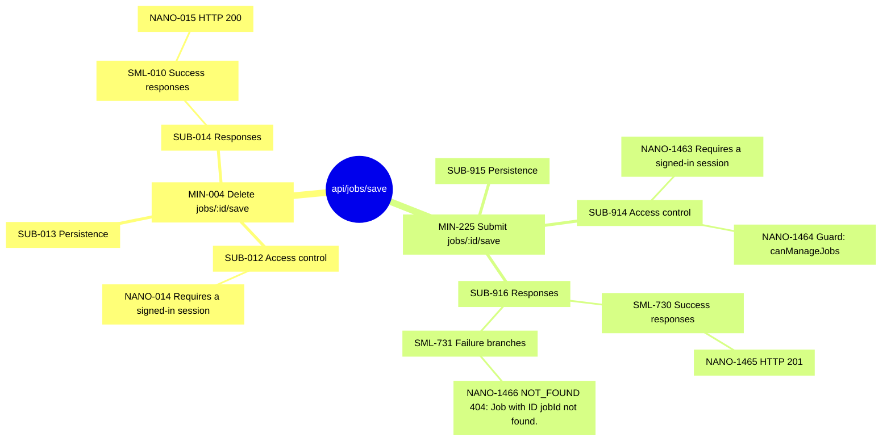

| ID        | Level | Parent   | Name                                             | Description                                                                                                                                                                  | Status      | Verification | Evidence                     | Related                     |
| --------- | ----- | -------- | ------------------------------------------------ | ---------------------------------------------------------------------------------------------------------------------------------------------------------------------------- | ----------- | ------------ | ---------------------------- | --------------------------- |
| FEAT-145  | MAJOR | MOD-060  | api/jobs/save                                    |                                                                                                                                                                              | IMPLEMENTED |              | apps/api/src/server.ts:12393 |                             |
| MIN-004   | MINOR | FEAT-145 | Delete jobs/:id/save                             | 10. Remove saved job bookmark DELETE /api/v1/jobs/:id/save for any signed-in session; durable (PostgreSQL); responds 200. Gaps: no first-party web caller found              | IMPLEMENTED | VERIFIED     | apps/api/src/server.ts:12410 | API-261, TEST-128, TEST-208 |
| SUB-012   | SUB   | MIN-004  | Access control                                   | Who may call DELETE /api/v1/jobs/:id/save: any signed-in session.                                                                                                            | IMPLEMENTED | PATH_LEVEL   | apps/api/src/server.ts:12410 |                             |
| NANO-014  | NANO  | SUB-012  | Requires a signed-in session                     | Requests without a valid session token are rejected with 401 UNAUTHENTICATED.                                                                                                | IMPLEMENTED | PATH_LEVEL   | apps/api/src/server.ts:12410 | ROLE-001                    |
| SUB-013   | SUB   | MIN-004  | Persistence                                      | Durable: writes go through the PostgreSQL store; store calls savedJobs.remove.                                                                                               | IMPLEMENTED | PATH_LEVEL   | apps/api/src/server.ts:12410 |                             |
| SUB-014   | SUB   | MIN-004  | Responses                                        | Success 200; 0 explicit failure branch(es) besides validation and access errors.                                                                                             | IMPLEMENTED | PATH_LEVEL   | apps/api/src/server.ts:12410 |                             |
| SML-010   | SMALL | SUB-014  | Success responses                                | HTTP 200.                                                                                                                                                                    | IMPLEMENTED | PATH_LEVEL   | apps/api/src/server.ts:12410 |                             |
| NANO-015  | NANO  | SML-010  | HTTP 200                                         | Replies 200 when the operation succeeds.                                                                                                                                     | IMPLEMENTED | PATH_LEVEL   | apps/api/src/server.ts:12410 |                             |
| MIN-225   | MINOR | FEAT-145 | Submit jobs/:id/save                             | 9. Bookmark / save job POST /api/v1/jobs/:id/save for any signed-in session; durable (PostgreSQL); responds 201; 1 failure branch(es). Gaps: no first-party web caller found | IMPLEMENTED | VERIFIED     | apps/api/src/server.ts:12393 | API-260, TEST-128, TEST-208 |
| SUB-914   | SUB   | MIN-225  | Access control                                   | Who may call POST /api/v1/jobs/:id/save: any signed-in session.                                                                                                              | IMPLEMENTED | PATH_LEVEL   | apps/api/src/server.ts:12393 |                             |
| NANO-1463 | NANO  | SUB-914  | Requires a signed-in session                     | Requests without a valid session token are rejected with 401 UNAUTHENTICATED.                                                                                                | IMPLEMENTED | PATH_LEVEL   | apps/api/src/server.ts:12393 | ROLE-001                    |
| NANO-1464 | NANO  | SUB-914  | Guard: canManageJobs                             | Guard canManageJobs must pass before the handler runs.                                                                                                                       | IMPLEMENTED | PATH_LEVEL   | apps/api/src/server.ts:12393 |                             |
| SUB-915   | SUB   | MIN-225  | Persistence                                      | Durable: writes go through the PostgreSQL store; store calls savedJobs.add.                                                                                                  | IMPLEMENTED | PATH_LEVEL   | apps/api/src/server.ts:12393 |                             |
| SUB-916   | SUB   | MIN-225  | Responses                                        | Success 201; 1 explicit failure branch(es) besides validation and access errors.                                                                                             | IMPLEMENTED | PATH_LEVEL   | apps/api/src/server.ts:12393 |                             |
| SML-730   | SMALL | SUB-916  | Success responses                                | HTTP 201.                                                                                                                                                                    | IMPLEMENTED | PATH_LEVEL   | apps/api/src/server.ts:12393 |                             |
| NANO-1465 | NANO  | SML-730  | HTTP 201                                         | Replies 201 when the operation succeeds.                                                                                                                                     | IMPLEMENTED | PATH_LEVEL   | apps/api/src/server.ts:12393 |                             |
| SML-731   | SMALL | SUB-916  | Failure branches                                 | 1 DomainError branch(es) in the handler, mapped to HTTP by the global error handler.                                                                                         | IMPLEMENTED | PATH_LEVEL   | apps/api/src/server.ts:12393 |                             |
| NANO-1466 | NANO  | SML-731  | NOT_FOUND 404: Job with ID "${jobId}" not found. | Throws DomainError(NOT_FOUND) "Job with ID "${jobId}" not found." -> HTTP 404.                                                                                               | IMPLEMENTED | PATH_LEVEL   | apps/api/src/server.ts:12402 | ERR-231                     |

### FEAT-030 api/jobs/save-as-template

api/jobs/save-as-template

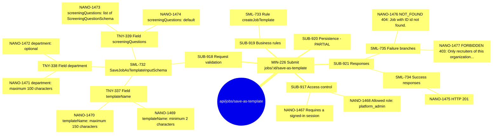

| ID        | Level | Parent   | Name                                                                                  | Description                                                                                                                                                                                                                                                                                       | Status                | Verification | Evidence                                | Related                     |
| --------- | ----- | -------- | ------------------------------------------------------------------------------------- | ------------------------------------------------------------------------------------------------------------------------------------------------------------------------------------------------------------------------------------------------------------------------------------------------- | --------------------- | ------------ | --------------------------------------- | --------------------------- |
| FEAT-030  | MAJOR | MOD-060  | api/jobs/save-as-template                                                             |                                                                                                                                                                                                                                                                                                   | IMPLEMENTED           |              | apps/api/src/server.ts:2529             |                             |
| MIN-226   | MINOR | FEAT-030 | Submit jobs/:id/save-as-template                                                      | POST /api/v1/jobs/:id/save-as-template for roles platform_admin; validates SaveJobAsTemplateInputSchema; calls createJobTemplate; ephemeral (process memory); responds 201; 2 failure branch(es). Gaps: ephemeral: state held in process memory, lost on restart; no first-party web caller found | IMPLEMENTED           | VERIFIED     | apps/api/src/server.ts:2529             | API-041, TEST-108, TEST-186 |
| SUB-917   | SUB   | MIN-226  | Access control                                                                        | Who may call POST /api/v1/jobs/:id/save-as-template: roles platform_admin.                                                                                                                                                                                                                        | IMPLEMENTED           | PATH_LEVEL   | apps/api/src/server.ts:2529             |                             |
| NANO-1467 | NANO  | SUB-917  | Requires a signed-in session                                                          | Requests without a valid session token are rejected with 401 UNAUTHENTICATED.                                                                                                                                                                                                                     | IMPLEMENTED           | PATH_LEVEL   | apps/api/src/server.ts:2529             | ROLE-001                    |
| NANO-1468 | NANO  | SUB-917  | Allowed role: platform_admin                                                          | platform_admin is one of the roles allowed here (platform_admin); a caller holding none of them is rejected with 403.                                                                                                                                                                             | IMPLEMENTED           | PATH_LEVEL   | apps/api/src/server.ts:2529             | ROLE-008                    |
| SUB-918   | SUB   | MIN-226  | Request validation                                                                    | The request is parsed with SaveJobAsTemplateInputSchema; a failure returns 400 with field details before any business logic runs.                                                                                                                                                                 | IMPLEMENTED           | PATH_LEVEL   | apps/api/src/server.ts:2529             |                             |
| SML-732   | SMALL | SUB-918  | SaveJobAsTemplateInputSchema                                                          | SaveJobAsTemplateInputSchema: 3 field(s)                                                                                                                                                                                                                                                          | IMPLEMENTED           | PATH_LEVEL   | packages/contracts/src/index.ts:1018    | SCH-081                     |
| TNY-337   | TINY  | SML-732  | Field templateName                                                                    | templateName (string, required): minimum 2 characters; maximum 150 characters                                                                                                                                                                                                                     | IMPLEMENTED           | PATH_LEVEL   | packages/contracts/src/index.ts:1019    |                             |
| NANO-1469 | NANO  | TNY-337  | templateName: minimum 2 characters                                                    | templateName minimum 2 characters.                                                                                                                                                                                                                                                                | IMPLEMENTED           | PATH_LEVEL   | packages/contracts/src/index.ts:1019    |                             |
| NANO-1470 | NANO  | TNY-337  | templateName: maximum 150 characters                                                  | templateName maximum 150 characters.                                                                                                                                                                                                                                                              | IMPLEMENTED           | PATH_LEVEL   | packages/contracts/src/index.ts:1019    |                             |
| TNY-338   | TINY  | SML-732  | Field department                                                                      | department (string, optional): maximum 100 characters; optional                                                                                                                                                                                                                                   | IMPLEMENTED           | PATH_LEVEL   | packages/contracts/src/index.ts:1020    |                             |
| NANO-1471 | NANO  | TNY-338  | department: maximum 100 characters                                                    | department maximum 100 characters.                                                                                                                                                                                                                                                                | IMPLEMENTED           | PATH_LEVEL   | packages/contracts/src/index.ts:1020    |                             |
| NANO-1472 | NANO  | TNY-338  | department: optional                                                                  | department optional.                                                                                                                                                                                                                                                                              | IMPLEMENTED           | PATH_LEVEL   | packages/contracts/src/index.ts:1020    |                             |
| TNY-339   | TINY  | SML-732  | Field screeningQuestions                                                              | screeningQuestions (array, optional): list of ScreeningQuestionSchema; default []                                                                                                                                                                                                                 | IMPLEMENTED           | PATH_LEVEL   | packages/contracts/src/index.ts:1021    |                             |
| NANO-1473 | NANO  | TNY-339  | screeningQuestions: list of ScreeningQuestionSchema                                   | screeningQuestions list of ScreeningQuestionSchema.                                                                                                                                                                                                                                               | IMPLEMENTED           | PATH_LEVEL   | packages/contracts/src/index.ts:1021    |                             |
| NANO-1474 | NANO  | TNY-339  | screeningQuestions: default []                                                        | screeningQuestions default [].                                                                                                                                                                                                                                                                    | IMPLEMENTED           | PATH_LEVEL   | packages/contracts/src/index.ts:1021    |                             |
| SUB-919   | SUB   | MIN-226  | Business rules                                                                        | Domain functions from packages/domain called by the handler (1).                                                                                                                                                                                                                                  | IMPLEMENTED           | PATH_LEVEL   | apps/api/src/server.ts:2529             |                             |
| SML-733   | SMALL | SUB-919  | Rule createJobTemplate                                                                | Calls createJobTemplate (packages/domain/src/job-templates.ts). Rule status IMPLEMENTED; its own tests: VERIFIED.                                                                                                                                                                                 | IMPLEMENTED           | VERIFIED     | packages/domain/src/job-templates.ts:96 | RULE-123                    |
| SUB-920   | SUB   | MIN-226  | Persistence                                                                           | Ephemeral: state lives in API process memory and is lost on restart.                                                                                                                                                                                                                              | PARTIALLY_IMPLEMENTED | PATH_LEVEL   | apps/api/src/server.ts:2529             |                             |
| SUB-921   | SUB   | MIN-226  | Responses                                                                             | Success 201; 2 explicit failure branch(es) besides validation and access errors.                                                                                                                                                                                                                  | IMPLEMENTED           | PATH_LEVEL   | apps/api/src/server.ts:2529             |                             |
| SML-734   | SMALL | SUB-921  | Success responses                                                                     | HTTP 201.                                                                                                                                                                                                                                                                                         | IMPLEMENTED           | PATH_LEVEL   | apps/api/src/server.ts:2529             |                             |
| NANO-1475 | NANO  | SML-734  | HTTP 201                                                                              | Replies 201 when the operation succeeds.                                                                                                                                                                                                                                                          | IMPLEMENTED           | PATH_LEVEL   | apps/api/src/server.ts:2529             |                             |
| SML-735   | SMALL | SUB-921  | Failure branches                                                                      | 2 DomainError branch(es) in the handler, mapped to HTTP by the global error handler.                                                                                                                                                                                                              | IMPLEMENTED           | PATH_LEVEL   | apps/api/src/server.ts:2529             |                             |
| NANO-1476 | NANO  | SML-735  | NOT_FOUND 404: Job with ID ${id} not found.                                           | Throws DomainError(NOT_FOUND) "Job with ID ${id} not found." -> HTTP 404.                                                                                                                                                                                                                         | IMPLEMENTED           | PATH_LEVEL   | apps/api/src/server.ts:2538             | ERR-037                     |
| NANO-1477 | NANO  | SML-735  | FORBIDDEN 403: Only recruiters of this organization can save its jobs as templates (B | Throws DomainError(FORBIDDEN) "Only recruiters of this organization can save its jobs as templates (BR-12)." -> HTTP 403.                                                                                                                                                                         | IMPLEMENTED           | PATH_LEVEL   | apps/api/src/server.ts:2546             | ERR-044                     |

### FEAT-146 api/jobs/saved

api/jobs/saved

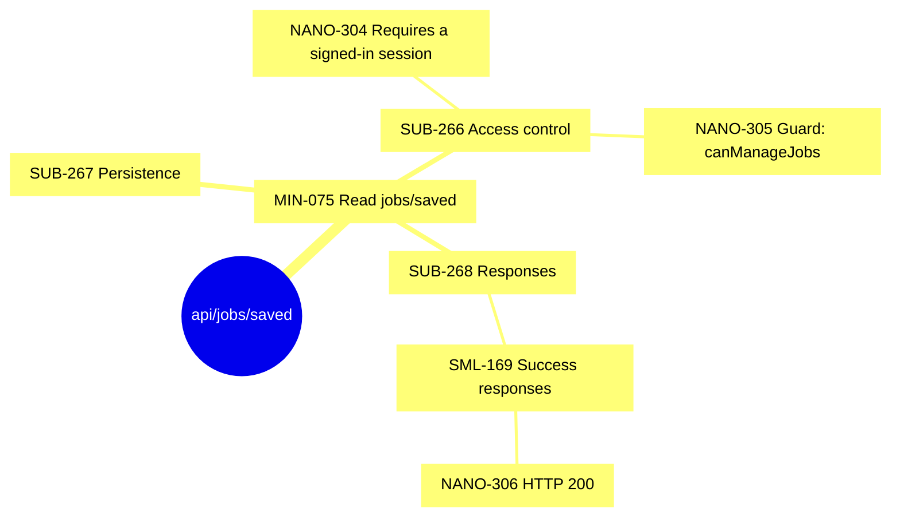

| ID       | Level | Parent   | Name                         | Description                                                                                                                                                 | Status      | Verification | Evidence                     | Related                               |
| -------- | ----- | -------- | ---------------------------- | ----------------------------------------------------------------------------------------------------------------------------------------------------------- | ----------- | ------------ | ---------------------------- | ------------------------------------- |
| FEAT-146 | MAJOR | MOD-060  | api/jobs/saved               |                                                                                                                                                             | IMPLEMENTED |              | apps/api/src/server.ts:12421 |                                       |
| MIN-075  | MINOR | FEAT-146 | Read jobs/saved              | 11. List candidate's saved jobs GET /api/v1/jobs/saved for any signed-in session; durable (PostgreSQL); responds 200. Gaps: no first-party web caller found | IMPLEMENTED | VERIFIED     | apps/api/src/server.ts:12421 | API-262, TEST-128, TEST-158, TEST-208 |
| SUB-266  | SUB   | MIN-075  | Access control               | Who may call GET /api/v1/jobs/saved: any signed-in session.                                                                                                 | IMPLEMENTED | PATH_LEVEL   | apps/api/src/server.ts:12421 |                                       |
| NANO-304 | NANO  | SUB-266  | Requires a signed-in session | Requests without a valid session token are rejected with 401 UNAUTHENTICATED.                                                                               | IMPLEMENTED | PATH_LEVEL   | apps/api/src/server.ts:12421 | ROLE-001                              |
| NANO-305 | NANO  | SUB-266  | Guard: canManageJobs         | Guard canManageJobs must pass before the handler runs.                                                                                                      | IMPLEMENTED | PATH_LEVEL   | apps/api/src/server.ts:12421 |                                       |
| SUB-267  | SUB   | MIN-075  | Persistence                  | Durable: writes go through the PostgreSQL store; store calls savedJobs.list.                                                                                | IMPLEMENTED | PATH_LEVEL   | apps/api/src/server.ts:12421 |                                       |
| SUB-268  | SUB   | MIN-075  | Responses                    | Success 200; 0 explicit failure branch(es) besides validation and access errors.                                                                            | IMPLEMENTED | PATH_LEVEL   | apps/api/src/server.ts:12421 |                                       |
| SML-169  | SMALL | SUB-268  | Success responses            | HTTP 200.                                                                                                                                                   | IMPLEMENTED | PATH_LEVEL   | apps/api/src/server.ts:12421 |                                       |
| NANO-306 | NANO  | SML-169  | HTTP 200                     | Replies 200 when the operation succeeds.                                                                                                                    | IMPLEMENTED | PATH_LEVEL   | apps/api/src/server.ts:12421 |                                       |

### FEAT-143 api/jobs/saved-searches

api/jobs/saved-searches

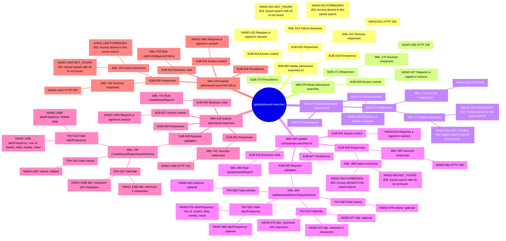

| ID        | Level | Parent   | Name                                                   | Description                                                                                                                                                                                                                                              | Status      | Verification | Evidence                                  | Related                                         |
| --------- | ----- | -------- | ------------------------------------------------------ | -------------------------------------------------------------------------------------------------------------------------------------------------------------------------------------------------------------------------------------------------------- | ----------- | ------------ | ----------------------------------------- | ----------------------------------------------- |
| FEAT-143  | MAJOR | MOD-060  | api/jobs/saved-searches                                |                                                                                                                                                                                                                                                          | IMPLEMENTED |              | apps/api/src/server.ts:12276              |                                                 |
| MIN-006   | MINOR | FEAT-143 | Delete jobs/saved-searches/:id                         | 5. Delete saved search DELETE /api/v1/jobs/saved-searches/:id for any signed-in session; durable (PostgreSQL); responds 200; 2 failure branch(es). Gaps: no first-party web caller found                                                                 | IMPLEMENTED | VERIFIED     | apps/api/src/server.ts:12338              | API-256, TEST-128, TEST-159, TEST-208           |
| SUB-018   | SUB   | MIN-006  | Access control                                         | Who may call DELETE /api/v1/jobs/saved-searches/:id: any signed-in session.                                                                                                                                                                              | IMPLEMENTED | PATH_LEVEL   | apps/api/src/server.ts:12338              |                                                 |
| NANO-020  | NANO  | SUB-018  | Requires a signed-in session                           | Requests without a valid session token are rejected with 401 UNAUTHENTICATED.                                                                                                                                                                            | IMPLEMENTED | PATH_LEVEL   | apps/api/src/server.ts:12338              | ROLE-001                                        |
| SUB-019   | SUB   | MIN-006  | Persistence                                            | Durable: writes go through the PostgreSQL store; store calls savedSearches.get, savedSearches.remove.                                                                                                                                                    | IMPLEMENTED | PATH_LEVEL   | apps/api/src/server.ts:12338              |                                                 |
| SUB-020   | SUB   | MIN-006  | Responses                                              | Success 200; 2 explicit failure branch(es) besides validation and access errors.                                                                                                                                                                         | IMPLEMENTED | PATH_LEVEL   | apps/api/src/server.ts:12338              |                                                 |
| SML-013   | SMALL | SUB-020  | Success responses                                      | HTTP 200.                                                                                                                                                                                                                                                | IMPLEMENTED | PATH_LEVEL   | apps/api/src/server.ts:12338              |                                                 |
| NANO-021  | NANO  | SML-013  | HTTP 200                                               | Replies 200 when the operation succeeds.                                                                                                                                                                                                                 | IMPLEMENTED | PATH_LEVEL   | apps/api/src/server.ts:12338              |                                                 |
| SML-014   | SMALL | SUB-020  | Failure branches                                       | 2 DomainError branch(es) in the handler, mapped to HTTP by the global error handler.                                                                                                                                                                     | IMPLEMENTED | PATH_LEVEL   | apps/api/src/server.ts:12338              |                                                 |
| NANO-022  | NANO  | SML-014  | NOT_FOUND 404: Saved search with ID "${id}" not found. | Throws DomainError(NOT_FOUND) "Saved search with ID "${id}" not found." -> HTTP 404.                                                                                                                                                                     | IMPLEMENTED | PATH_LEVEL   | apps/api/src/server.ts:12345              | ERR-227                                         |
| NANO-023  | NANO  | SML-014  | FORBIDDEN 403: Access denied to this saved search.     | Throws DomainError(FORBIDDEN) "Access denied to this saved search." -> HTTP 403.                                                                                                                                                                         | IMPLEMENTED | PATH_LEVEL   | apps/api/src/server.ts:12348              | ERR-228                                         |
| MIN-076   | MINOR | FEAT-143 | Read jobs/saved-searches                               | 2. List candidate's saved searches GET /api/v1/jobs/saved-searches for any signed-in session; durable (PostgreSQL); responds 200. Gaps: no first-party web caller found                                                                                  | IMPLEMENTED | VERIFIED     | apps/api/src/server.ts:12294              | API-253, TEST-128, TEST-159, TEST-208, TEST-226 |
| SUB-269   | SUB   | MIN-076  | Access control                                         | Who may call GET /api/v1/jobs/saved-searches: any signed-in session.                                                                                                                                                                                     | IMPLEMENTED | PATH_LEVEL   | apps/api/src/server.ts:12294              |                                                 |
| NANO-307  | NANO  | SUB-269  | Requires a signed-in session                           | Requests without a valid session token are rejected with 401 UNAUTHENTICATED.                                                                                                                                                                            | IMPLEMENTED | PATH_LEVEL   | apps/api/src/server.ts:12294              | ROLE-001                                        |
| SUB-270   | SUB   | MIN-076  | Persistence                                            | Durable: writes go through the PostgreSQL store; store calls savedSearches.listByUser.                                                                                                                                                                   | IMPLEMENTED | PATH_LEVEL   | apps/api/src/server.ts:12294              |                                                 |
| SUB-271   | SUB   | MIN-076  | Responses                                              | Success 200; 0 explicit failure branch(es) besides validation and access errors.                                                                                                                                                                         | IMPLEMENTED | PATH_LEVEL   | apps/api/src/server.ts:12294              |                                                 |
| SML-170   | SMALL | SUB-271  | Success responses                                      | HTTP 200.                                                                                                                                                                                                                                                | IMPLEMENTED | PATH_LEVEL   | apps/api/src/server.ts:12294              |                                                 |
| NANO-308  | NANO  | SML-170  | HTTP 200                                               | Replies 200 when the operation succeeds.                                                                                                                                                                                                                 | IMPLEMENTED | PATH_LEVEL   | apps/api/src/server.ts:12294              |                                                 |
| MIN-077   | MINOR | FEAT-143 | Read jobs/saved-searches/:id                           | 3. Get single saved search by ID GET /api/v1/jobs/saved-searches/:id for any signed-in session; durable (PostgreSQL); responds 200; 2 failure branch(es). Gaps: no first-party web caller found                                                          | IMPLEMENTED | VERIFIED     | apps/api/src/server.ts:12301              | API-254, TEST-128, TEST-159                     |
| SUB-272   | SUB   | MIN-077  | Access control                                         | Who may call GET /api/v1/jobs/saved-searches/:id: any signed-in session.                                                                                                                                                                                 | IMPLEMENTED | PATH_LEVEL   | apps/api/src/server.ts:12301              |                                                 |
| NANO-309  | NANO  | SUB-272  | Requires a signed-in session                           | Requests without a valid session token are rejected with 401 UNAUTHENTICATED.                                                                                                                                                                            | IMPLEMENTED | PATH_LEVEL   | apps/api/src/server.ts:12301              | ROLE-001                                        |
| SUB-273   | SUB   | MIN-077  | Persistence                                            | Durable: writes go through the PostgreSQL store; store calls savedSearches.get.                                                                                                                                                                          | IMPLEMENTED | PATH_LEVEL   | apps/api/src/server.ts:12301              |                                                 |
| SUB-274   | SUB   | MIN-077  | Responses                                              | Success 200; 2 explicit failure branch(es) besides validation and access errors.                                                                                                                                                                         | IMPLEMENTED | PATH_LEVEL   | apps/api/src/server.ts:12301              |                                                 |
| SML-171   | SMALL | SUB-274  | Success responses                                      | HTTP 200.                                                                                                                                                                                                                                                | IMPLEMENTED | PATH_LEVEL   | apps/api/src/server.ts:12301              |                                                 |
| NANO-310  | NANO  | SML-171  | HTTP 200                                               | Replies 200 when the operation succeeds.                                                                                                                                                                                                                 | IMPLEMENTED | PATH_LEVEL   | apps/api/src/server.ts:12301              |                                                 |
| SML-172   | SMALL | SUB-274  | Failure branches                                       | 2 DomainError branch(es) in the handler, mapped to HTTP by the global error handler.                                                                                                                                                                     | IMPLEMENTED | PATH_LEVEL   | apps/api/src/server.ts:12301              |                                                 |
| NANO-311  | NANO  | SML-172  | NOT_FOUND 404: Saved search with ID "${id}" not found. | Throws DomainError(NOT_FOUND) "Saved search with ID "${id}" not found." -> HTTP 404.                                                                                                                                                                     | IMPLEMENTED | PATH_LEVEL   | apps/api/src/server.ts:12308              | ERR-227                                         |
| NANO-312  | NANO  | SML-172  | FORBIDDEN 403: Access denied to this saved search.     | Throws DomainError(FORBIDDEN) "Access denied to this saved search." -> HTTP 403.                                                                                                                                                                         | IMPLEMENTED | PATH_LEVEL   | apps/api/src/server.ts:12311              | ERR-228                                         |
| MIN-150   | MINOR | FEAT-143 | Update jobs/saved-searches/:id                         | 4. Update saved search PATCH /api/v1/jobs/saved-searches/:id for any signed-in session; validates UpdateSavedSearchInputSchema; calls updateSavedSearch; durable (PostgreSQL); responds 200; 2 failure branch(es). Gaps: no first-party web caller found | IMPLEMENTED | VERIFIED     | apps/api/src/server.ts:12318              | API-255, TEST-128, TEST-159, TEST-208           |
| SUB-544   | SUB   | MIN-150  | Access control                                         | Who may call PATCH /api/v1/jobs/saved-searches/:id: any signed-in session.                                                                                                                                                                               | IMPLEMENTED | PATH_LEVEL   | apps/api/src/server.ts:12318              |                                                 |
| NANO-674  | NANO  | SUB-544  | Requires a signed-in session                           | Requests without a valid session token are rejected with 401 UNAUTHENTICATED.                                                                                                                                                                            | IMPLEMENTED | PATH_LEVEL   | apps/api/src/server.ts:12318              | ROLE-001                                        |
| SUB-545   | SUB   | MIN-150  | Request validation                                     | The request is parsed with UpdateSavedSearchInputSchema; a failure returns 400 with field details before any business logic runs.                                                                                                                        | IMPLEMENTED | PATH_LEVEL   | apps/api/src/server.ts:12318              |                                                 |
| SML-363   | SMALL | SUB-545  | UpdateSavedSearchInputSchema                           | UpdateSavedSearchInputSchema: 4 field(s)                                                                                                                                                                                                                 | IMPLEMENTED | PATH_LEVEL   | packages/contracts/src/index.ts:896       | SCH-071                                         |
| TNY-079   | TINY  | SML-363  | Field title                                            | title (string, optional): minimum 2 characters; maximum 100 characters; optional                                                                                                                                                                         | IMPLEMENTED | PATH_LEVEL   | packages/contracts/src/index.ts:897       |                                                 |
| NANO-675  | NANO  | TNY-079  | title: minimum 2 characters                            | title minimum 2 characters.                                                                                                                                                                                                                              | IMPLEMENTED | PATH_LEVEL   | packages/contracts/src/index.ts:897       |                                                 |
| NANO-676  | NANO  | TNY-079  | title: maximum 100 characters                          | title maximum 100 characters.                                                                                                                                                                                                                            | IMPLEMENTED | PATH_LEVEL   | packages/contracts/src/index.ts:897       |                                                 |
| NANO-677  | NANO  | TNY-079  | title: optional                                        | title optional.                                                                                                                                                                                                                                          | IMPLEMENTED | PATH_LEVEL   | packages/contracts/src/index.ts:897       |                                                 |
| TNY-080   | TINY  | SML-363  | Field criteria                                         | criteria (SearchCriteriaSchema, optional): optional                                                                                                                                                                                                      | IMPLEMENTED | PATH_LEVEL   | packages/contracts/src/index.ts:898       |                                                 |
| NANO-678  | NANO  | TNY-080  | criteria: optional                                     | criteria optional.                                                                                                                                                                                                                                       | IMPLEMENTED | PATH_LEVEL   | packages/contracts/src/index.ts:898       |                                                 |
| TNY-081   | TINY  | SML-363  | Field alertFrequency                                   | alertFrequency (enum, optional): one of: instant, daily, weekly, never; optional                                                                                                                                                                         | IMPLEMENTED | PATH_LEVEL   | packages/contracts/src/index.ts:899       |                                                 |
| NANO-679  | NANO  | TNY-081  | alertFrequency: one of: instant, daily, weekly, never  | alertFrequency one of: instant, daily, weekly, never.                                                                                                                                                                                                    | IMPLEMENTED | PATH_LEVEL   | packages/contracts/src/index.ts:899       |                                                 |
| NANO-680  | NANO  | TNY-081  | alertFrequency: optional                               | alertFrequency optional.                                                                                                                                                                                                                                 | IMPLEMENTED | PATH_LEVEL   | packages/contracts/src/index.ts:899       |                                                 |
| TNY-082   | TINY  | SML-363  | Field isActive                                         | isActive (boolean, optional): optional                                                                                                                                                                                                                   | IMPLEMENTED | PATH_LEVEL   | packages/contracts/src/index.ts:900       |                                                 |
| NANO-681  | NANO  | TNY-082  | isActive: optional                                     | isActive optional.                                                                                                                                                                                                                                       | IMPLEMENTED | PATH_LEVEL   | packages/contracts/src/index.ts:900       |                                                 |
| SUB-546   | SUB   | MIN-150  | Business rules                                         | Domain functions from packages/domain called by the handler (1).                                                                                                                                                                                         | IMPLEMENTED | PATH_LEVEL   | apps/api/src/server.ts:12318              |                                                 |
| SML-364   | SMALL | SUB-546  | Rule updateSavedSearch                                 | Calls updateSavedSearch (packages/domain/src/saved-searches.ts). Rule status IMPLEMENTED; its own tests: VERIFIED.                                                                                                                                       | IMPLEMENTED | VERIFIED     | packages/domain/src/saved-searches.ts:109 | RULE-200                                        |
| SUB-547   | SUB   | MIN-150  | Persistence                                            | Durable: writes go through the PostgreSQL store; store calls savedSearches.get, savedSearches.update.                                                                                                                                                    | IMPLEMENTED | PATH_LEVEL   | apps/api/src/server.ts:12318              |                                                 |
| SUB-548   | SUB   | MIN-150  | Responses                                              | Success 200; 2 explicit failure branch(es) besides validation and access errors.                                                                                                                                                                         | IMPLEMENTED | PATH_LEVEL   | apps/api/src/server.ts:12318              |                                                 |
| SML-365   | SMALL | SUB-548  | Success responses                                      | HTTP 200.                                                                                                                                                                                                                                                | IMPLEMENTED | PATH_LEVEL   | apps/api/src/server.ts:12318              |                                                 |
| NANO-682  | NANO  | SML-365  | HTTP 200                                               | Replies 200 when the operation succeeds.                                                                                                                                                                                                                 | IMPLEMENTED | PATH_LEVEL   | apps/api/src/server.ts:12318              |                                                 |
| SML-366   | SMALL | SUB-548  | Failure branches                                       | 2 DomainError branch(es) in the handler, mapped to HTTP by the global error handler.                                                                                                                                                                     | IMPLEMENTED | PATH_LEVEL   | apps/api/src/server.ts:12318              |                                                 |
| NANO-683  | NANO  | SML-366  | NOT_FOUND 404: Saved search with ID "${id}" not found. | Throws DomainError(NOT_FOUND) "Saved search with ID "${id}" not found." -> HTTP 404.                                                                                                                                                                     | IMPLEMENTED | PATH_LEVEL   | apps/api/src/server.ts:12325              | ERR-227                                         |
| NANO-684  | NANO  | SML-366  | FORBIDDEN 403: Access denied to this saved search.     | Throws DomainError(FORBIDDEN) "Access denied to this saved search." -> HTTP 403.                                                                                                                                                                         | IMPLEMENTED | PATH_LEVEL   | apps/api/src/server.ts:12328              | ERR-228                                         |
| MIN-228   | MINOR | FEAT-143 | Submit jobs/saved-searches                             | 1. Create a new saved search POST /api/v1/jobs/saved-searches for any signed-in session; validates CreateSavedSearchInputSchema; calls createSavedSearch; durable (PostgreSQL); responds 201. Gaps: no first-party web caller found                      | IMPLEMENTED | VERIFIED     | apps/api/src/server.ts:12276              | API-252, TEST-128, TEST-159, TEST-208, TEST-226 |
| SUB-927   | SUB   | MIN-228  | Access control                                         | Who may call POST /api/v1/jobs/saved-searches: any signed-in session.                                                                                                                                                                                    | IMPLEMENTED | PATH_LEVEL   | apps/api/src/server.ts:12276              |                                                 |
| NANO-1484 | NANO  | SUB-927  | Requires a signed-in session                           | Requests without a valid session token are rejected with 401 UNAUTHENTICATED.                                                                                                                                                                            | IMPLEMENTED | PATH_LEVEL   | apps/api/src/server.ts:12276              | ROLE-001                                        |
| SUB-928   | SUB   | MIN-228  | Request validation                                     | The request is parsed with CreateSavedSearchInputSchema; a failure returns 400 with field details before any business logic runs.                                                                                                                        | IMPLEMENTED | PATH_LEVEL   | apps/api/src/server.ts:12276              |                                                 |
| SML-740   | SMALL | SUB-928  | CreateSavedSearchInputSchema                           | CreateSavedSearchInputSchema: 3 field(s)                                                                                                                                                                                                                 | IMPLEMENTED | PATH_LEVEL   | packages/contracts/src/index.ts:888       | SCH-070                                         |
| TNY-341   | TINY  | SML-740  | Field title                                            | title (string, required): minimum 2 characters; maximum 100 characters                                                                                                                                                                                   | IMPLEMENTED | PATH_LEVEL   | packages/contracts/src/index.ts:889       |                                                 |
| NANO-1485 | NANO  | TNY-341  | title: minimum 2 characters                            | title minimum 2 characters.                                                                                                                                                                                                                              | IMPLEMENTED | PATH_LEVEL   | packages/contracts/src/index.ts:889       |                                                 |
| NANO-1486 | NANO  | TNY-341  | title: maximum 100 characters                          | title maximum 100 characters.                                                                                                                                                                                                                            | IMPLEMENTED | PATH_LEVEL   | packages/contracts/src/index.ts:889       |                                                 |
| TNY-342   | TINY  | SML-740  | Field criteria                                         | criteria (SearchCriteriaSchema, optional): default {}                                                                                                                                                                                                    | IMPLEMENTED | PATH_LEVEL   | packages/contracts/src/index.ts:890       |                                                 |
| NANO-1487 | NANO  | TNY-342  | criteria: default {}                                   | criteria default {}.                                                                                                                                                                                                                                     | IMPLEMENTED | PATH_LEVEL   | packages/contracts/src/index.ts:890       |                                                 |
| TNY-343   | TINY  | SML-740  | Field alertFrequency                                   | alertFrequency (enum, optional): one of: instant, daily, weekly, never; default 'daily'                                                                                                                                                                  | IMPLEMENTED | PATH_LEVEL   | packages/contracts/src/index.ts:891       |                                                 |
| NANO-1488 | NANO  | TNY-343  | alertFrequency: one of: instant, daily, weekly, never  | alertFrequency one of: instant, daily, weekly, never.                                                                                                                                                                                                    | IMPLEMENTED | PATH_LEVEL   | packages/contracts/src/index.ts:891       |                                                 |
| NANO-1489 | NANO  | TNY-343  | alertFrequency: default 'daily'                        | alertFrequency default 'daily'; message "daily".                                                                                                                                                                                                         | IMPLEMENTED | PATH_LEVEL   | packages/contracts/src/index.ts:891       |                                                 |
| SUB-929   | SUB   | MIN-228  | Business rules                                         | Domain functions from packages/domain called by the handler (1).                                                                                                                                                                                         | IMPLEMENTED | PATH_LEVEL   | apps/api/src/server.ts:12276              |                                                 |
| SML-741   | SMALL | SUB-929  | Rule createSavedSearch                                 | Calls createSavedSearch (packages/domain/src/saved-searches.ts). Rule status IMPLEMENTED; its own tests: VERIFIED.                                                                                                                                       | IMPLEMENTED | VERIFIED     | packages/domain/src/saved-searches.ts:58  | RULE-199                                        |
| SUB-930   | SUB   | MIN-228  | Persistence                                            | Durable: writes go through the PostgreSQL store; store calls savedSearches.create, savedSearches.listByUser.                                                                                                                                             | IMPLEMENTED | PATH_LEVEL   | apps/api/src/server.ts:12276              |                                                 |
| SUB-931   | SUB   | MIN-228  | Responses                                              | Success 201; 0 explicit failure branch(es) besides validation and access errors.                                                                                                                                                                         | IMPLEMENTED | PATH_LEVEL   | apps/api/src/server.ts:12276              |                                                 |
| SML-742   | SMALL | SUB-931  | Success responses                                      | HTTP 201.                                                                                                                                                                                                                                                | IMPLEMENTED | PATH_LEVEL   | apps/api/src/server.ts:12276              |                                                 |
| NANO-1490 | NANO  | SML-742  | HTTP 201                                               | Replies 201 when the operation succeeds.                                                                                                                                                                                                                 | IMPLEMENTED | PATH_LEVEL   | apps/api/src/server.ts:12276              |                                                 |
| MIN-229   | MINOR | FEAT-143 | Submit jobs/saved-searches/:id/run                     | 6. Run saved search on live published inventory POST /api/v1/jobs/saved-searches/:id/run for any signed-in session; calls matchJobAgainstCriteria; durable (PostgreSQL); responds 200; 2 failure branch(es). Gaps: no first-party web caller found       | IMPLEMENTED | VERIFIED     | apps/api/src/server.ts:12356              | API-257, TEST-128, TEST-208                     |
| SUB-932   | SUB   | MIN-229  | Access control                                         | Who may call POST /api/v1/jobs/saved-searches/:id/run: any signed-in session.                                                                                                                                                                            | IMPLEMENTED | PATH_LEVEL   | apps/api/src/server.ts:12356              |                                                 |
| NANO-1491 | NANO  | SUB-932  | Requires a signed-in session                           | Requests without a valid session token are rejected with 401 UNAUTHENTICATED.                                                                                                                                                                            | IMPLEMENTED | PATH_LEVEL   | apps/api/src/server.ts:12356              | ROLE-001                                        |
| SUB-933   | SUB   | MIN-229  | Business rules                                         | Domain functions from packages/domain called by the handler (1).                                                                                                                                                                                         | IMPLEMENTED | PATH_LEVEL   | apps/api/src/server.ts:12356              |                                                 |
| SML-743   | SMALL | SUB-933  | Rule matchJobAgainstCriteria                           | Calls matchJobAgainstCriteria (packages/domain/src/saved-searches.ts). Rule status IMPLEMENTED; its own tests: VERIFIED.                                                                                                                                 | IMPLEMENTED | VERIFIED     | packages/domain/src/saved-searches.ts:137 | RULE-201                                        |
| SUB-934   | SUB   | MIN-229  | Persistence                                            | Durable: writes go through the PostgreSQL store; store calls savedSearches.get.                                                                                                                                                                          | IMPLEMENTED | PATH_LEVEL   | apps/api/src/server.ts:12356              |                                                 |
| SUB-935   | SUB   | MIN-229  | Responses                                              | Success 200; 2 explicit failure branch(es) besides validation and access errors.                                                                                                                                                                         | IMPLEMENTED | PATH_LEVEL   | apps/api/src/server.ts:12356              |                                                 |
| SML-744   | SMALL | SUB-935  | Success responses                                      | HTTP 200.                                                                                                                                                                                                                                                | IMPLEMENTED | PATH_LEVEL   | apps/api/src/server.ts:12356              |                                                 |
| NANO-1492 | NANO  | SML-744  | HTTP 200                                               | Replies 200 when the operation succeeds.                                                                                                                                                                                                                 | IMPLEMENTED | PATH_LEVEL   | apps/api/src/server.ts:12356              |                                                 |
| SML-745   | SMALL | SUB-935  | Failure branches                                       | 2 DomainError branch(es) in the handler, mapped to HTTP by the global error handler.                                                                                                                                                                     | IMPLEMENTED | PATH_LEVEL   | apps/api/src/server.ts:12356              |                                                 |
| NANO-1493 | NANO  | SML-745  | NOT_FOUND 404: Saved search with ID "${id}" not found. | Throws DomainError(NOT_FOUND) "Saved search with ID "${id}" not found." -> HTTP 404.                                                                                                                                                                     | IMPLEMENTED | PATH_LEVEL   | apps/api/src/server.ts:12363              | ERR-227                                         |
| NANO-1494 | NANO  | SML-745  | FORBIDDEN 403: Access denied to this saved search.     | Throws DomainError(FORBIDDEN) "Access denied to this saved search." -> HTTP 403.                                                                                                                                                                         | IMPLEMENTED | PATH_LEVEL   | apps/api/src/server.ts:12366              | ERR-228                                         |

### FEAT-027 api/jobs/status

api/jobs/status

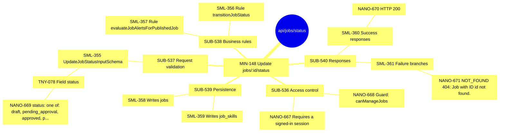

| ID       | Level | Parent   | Name                                                                                   | Description                                                                                                                                                                                                                                    | Status      | Verification | Evidence                                                  | Related                                                       |
| -------- | ----- | -------- | -------------------------------------------------------------------------------------- | ---------------------------------------------------------------------------------------------------------------------------------------------------------------------------------------------------------------------------------------------- | ----------- | ------------ | --------------------------------------------------------- | ------------------------------------------------------------- |
| FEAT-027 | MAJOR | MOD-060  | api/jobs/status                                                                        |                                                                                                                                                                                                                                                | IMPLEMENTED |              | apps/api/src/server.ts:2139                               |                                                               |
| MIN-148  | MINOR | FEAT-027 | Update jobs/:id/status                                                                 | PATCH /api/v1/jobs/:id/status for any signed-in session; validates UpdateJobStatusInputSchema; calls transitionJobStatus, evaluateJobAlertsForPublishedJob; durable (PostgreSQL); writes jobs, job_skills; responds 200; 1 failure branch(es). | IMPLEMENTED | VERIFIED     | apps/api/src/server.ts:2139                               | API-034, TEST-088, TEST-089, TEST-097, TEST-101, TEST-109 ... |
| SUB-536  | SUB   | MIN-148  | Access control                                                                         | Who may call PATCH /api/v1/jobs/:id/status: any signed-in session.                                                                                                                                                                             | IMPLEMENTED | PATH_LEVEL   | apps/api/src/server.ts:2139                               |                                                               |
| NANO-667 | NANO  | SUB-536  | Requires a signed-in session                                                           | Requests without a valid session token are rejected with 401 UNAUTHENTICATED.                                                                                                                                                                  | IMPLEMENTED | PATH_LEVEL   | apps/api/src/server.ts:2139                               | ROLE-001                                                      |
| NANO-668 | NANO  | SUB-536  | Guard: canManageJobs                                                                   | Guard canManageJobs must pass before the handler runs.                                                                                                                                                                                         | IMPLEMENTED | PATH_LEVEL   | apps/api/src/server.ts:2139                               |                                                               |
| SUB-537  | SUB   | MIN-148  | Request validation                                                                     | The request is parsed with UpdateJobStatusInputSchema; a failure returns 400 with field details before any business logic runs.                                                                                                                | IMPLEMENTED | PATH_LEVEL   | apps/api/src/server.ts:2139                               |                                                               |
| SML-355  | SMALL | SUB-537  | UpdateJobStatusInputSchema                                                             | UpdateJobStatusInputSchema: 1 field(s)                                                                                                                                                                                                         | IMPLEMENTED | PATH_LEVEL   | packages/contracts/src/index.ts:257                       | SCH-017                                                       |
| TNY-078  | TINY  | SML-355  | Field status                                                                           | status (enum, required): one of: draft, pending_approval, approved, published, paused, closed, archived                                                                                                                                        | IMPLEMENTED | PATH_LEVEL   | packages/contracts/src/index.ts:258                       |                                                               |
| NANO-669 | NANO  | TNY-078  | status: one of: draft, pending_approval, approved, published, paused, closed, archived | status one of: draft, pending_approval, approved, published, paused, closed, archived.                                                                                                                                                         | IMPLEMENTED | PATH_LEVEL   | packages/contracts/src/index.ts:258                       |                                                               |
| SUB-538  | SUB   | MIN-148  | Business rules                                                                         | Domain functions from packages/domain called by the handler (2).                                                                                                                                                                               | IMPLEMENTED | PATH_LEVEL   | apps/api/src/server.ts:2139                               |                                                               |
| SML-356  | SMALL | SUB-538  | Rule transitionJobStatus                                                               | Calls transitionJobStatus (packages/domain/src/jobs.ts). Rule status IMPLEMENTED; its own tests: VERIFIED.                                                                                                                                     | IMPLEMENTED | VERIFIED     | packages/domain/src/jobs.ts:127                           | RULE-129                                                      |
| SML-357  | SMALL | SUB-538  | Rule evaluateJobAlertsForPublishedJob                                                  | Calls evaluateJobAlertsForPublishedJob (packages/domain/src/saved-searches.ts). Rule status IMPLEMENTED; its own tests: VERIFIED.                                                                                                              | IMPLEMENTED | VERIFIED     | packages/domain/src/saved-searches.ts:197                 | RULE-202                                                      |
| SUB-539  | SUB   | MIN-148  | Persistence                                                                            | Durable: writes go through the PostgreSQL store; store calls jobAlerts.createMany, savedSearches.listAll.                                                                                                                                      | IMPLEMENTED | PATH_LEVEL   | apps/api/src/server.ts:2139                               |                                                               |
| SML-358  | SMALL | SUB-539  | Writes jobs                                                                            | Writes table jobs (00001_core_schema.sql).                                                                                                                                                                                                     | IMPLEMENTED | PATH_LEVEL   | supabase/migrations/00001_core_schema.sql:167             | DB-006                                                        |
| SML-359  | SMALL | SUB-539  | Writes job_skills                                                                      | Writes table job_skills (00003_jobs_applications_schema.sql).                                                                                                                                                                                  | IMPLEMENTED | PATH_LEVEL   | supabase/migrations/00003_jobs_applications_schema.sql:24 | DB-013                                                        |
| SUB-540  | SUB   | MIN-148  | Responses                                                                              | Success 200; 1 explicit failure branch(es) besides validation and access errors.                                                                                                                                                               | IMPLEMENTED | PATH_LEVEL   | apps/api/src/server.ts:2139                               |                                                               |
| SML-360  | SMALL | SUB-540  | Success responses                                                                      | HTTP 200.                                                                                                                                                                                                                                      | IMPLEMENTED | PATH_LEVEL   | apps/api/src/server.ts:2139                               |                                                               |
| NANO-670 | NANO  | SML-360  | HTTP 200                                                                               | Replies 200 when the operation succeeds.                                                                                                                                                                                                       | IMPLEMENTED | PATH_LEVEL   | apps/api/src/server.ts:2139                               |                                                               |
| SML-361  | SMALL | SUB-540  | Failure branches                                                                       | 1 DomainError branch(es) in the handler, mapped to HTTP by the global error handler.                                                                                                                                                           | IMPLEMENTED | PATH_LEVEL   | apps/api/src/server.ts:2139                               |                                                               |
| NANO-671 | NANO  | SML-361  | NOT_FOUND 404: Job with ID ${id} not found.                                            | Throws DomainError(NOT_FOUND) "Job with ID ${id} not found." -> HTTP 404.                                                                                                                                                                      | IMPLEMENTED | PATH_LEVEL   | apps/api/src/server.ts:2148                               | ERR-037                                                       |

## api/learning (MOD-083)

**Application:** apps/api (MOD-001). **Purpose:** API module: routes under /api/v1/learning in apps/api/src/server.ts.

**Nodes by level:** MODULE 1, MAJOR 1, MINOR 4, SUB 21, SMALL 16, TINY 11, NANO 38. **Status:** IMPLEMENTED 87, PARTIALLY_IMPLEMENTED 5. **Verification:** PATH_LEVEL 80, UNKNOWN 1, VERIFIED 9.

**User roles that reach it:** anonymous, authenticated, platform_admin.

**Known gaps:** MIN-078 ephemeral: state held in process memory, lost on restart; MIN-078 no first-party web caller found; MIN-079 ephemeral: state held in process memory, lost on restart; MIN-079 no first-party web caller found; MIN-230 ephemeral: state held in process memory, lost on restart; MIN-230 no first-party web caller found; MIN-231 ephemeral: state held in process memory, lost on restart; MIN-231 no first-party web caller found.

### Module map (to minor features)

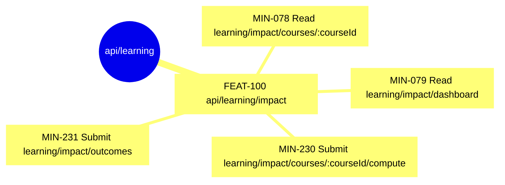

### FEAT-100 api/learning/impact

api/learning/impact

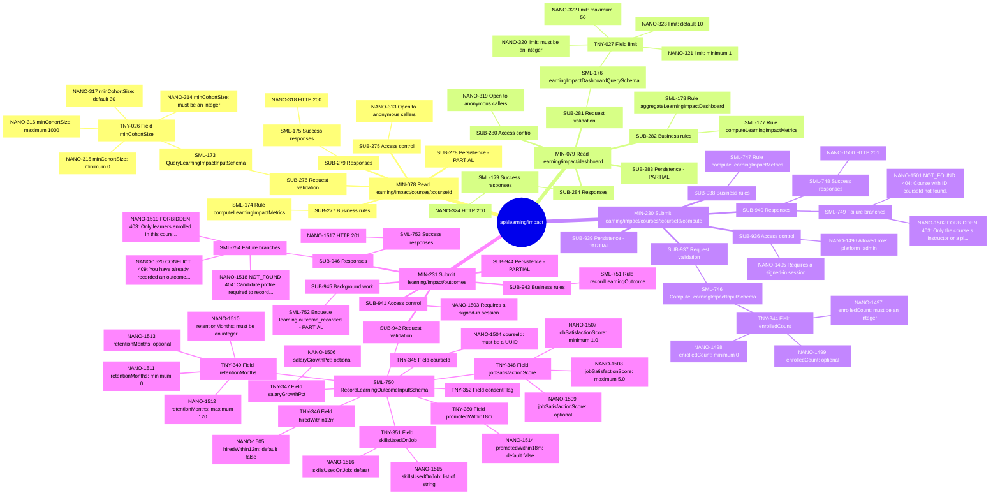

| ID        | Level | Parent   | Name                                                                                  | Description                                                                                                                                                                                                                                                                                                                                                                                                        | Status                | Verification | Evidence                                   | Related                               |
| --------- | ----- | -------- | ------------------------------------------------------------------------------------- | ------------------------------------------------------------------------------------------------------------------------------------------------------------------------------------------------------------------------------------------------------------------------------------------------------------------------------------------------------------------------------------------------------------------ | --------------------- | ------------ | ------------------------------------------ | ------------------------------------- |
| FEAT-100  | MAJOR | MOD-083  | api/learning/impact                                                                   |                                                                                                                                                                                                                                                                                                                                                                                                                    | IMPLEMENTED           |              | apps/api/src/server.ts:7972                |                                       |
| MIN-078   | MINOR | FEAT-100 | Read learning/impact/courses/:courseId                                                | 2. Get Course Learning Impact Metrics (F-153, F-114, BR-189, BR-193, OD-51) GET /api/v1/learning/impact/courses/:courseId for anyone (public); validates QueryLearningImpactInputSchema; calls computeLearningImpactMetrics; ephemeral (process memory); responds 200. Gaps: ephemeral: state held in process memory, lost on restart; no first-party web caller found                                             | IMPLEMENTED           | VERIFIED     | apps/api/src/server.ts:8050                | API-169, TEST-110, TEST-145, TEST-188 |
| SUB-275   | SUB   | MIN-078  | Access control                                                                        | Who may call GET /api/v1/learning/impact/courses/:courseId: anyone (public).                                                                                                                                                                                                                                                                                                                                       | IMPLEMENTED           | PATH_LEVEL   | apps/api/src/server.ts:8050                |                                       |
| NANO-313  | NANO  | SUB-275  | Open to anonymous callers                                                             | auth: public.                                                                                                                                                                                                                                                                                                                                                                                                      | IMPLEMENTED           | PATH_LEVEL   | apps/api/src/server.ts:8050                | ROLE-001                              |
| SUB-276   | SUB   | MIN-078  | Request validation                                                                    | The request is parsed with QueryLearningImpactInputSchema; a failure returns 400 with field details before any business logic runs.                                                                                                                                                                                                                                                                                | IMPLEMENTED           | PATH_LEVEL   | apps/api/src/server.ts:8050                |                                       |
| SML-173   | SMALL | SUB-276  | QueryLearningImpactInputSchema                                                        | QueryLearningImpactInputSchema: 1 field(s)                                                                                                                                                                                                                                                                                                                                                                         | IMPLEMENTED           | PATH_LEVEL   | packages/contracts/src/index.ts:1584       | SCH-125                               |
| TNY-026   | TINY  | SML-173  | Field minCohortSize                                                                   | minCohortSize (number, optional): must be an integer; minimum 0; maximum 1000; default 30                                                                                                                                                                                                                                                                                                                          | IMPLEMENTED           | PATH_LEVEL   | packages/contracts/src/index.ts:1586       |                                       |
| NANO-314  | NANO  | TNY-026  | minCohortSize: must be an integer                                                     | minCohortSize must be an integer.                                                                                                                                                                                                                                                                                                                                                                                  | IMPLEMENTED           | PATH_LEVEL   | packages/contracts/src/index.ts:1586       |                                       |
| NANO-315  | NANO  | TNY-026  | minCohortSize: minimum 0                                                              | minCohortSize minimum 0.                                                                                                                                                                                                                                                                                                                                                                                           | IMPLEMENTED           | PATH_LEVEL   | packages/contracts/src/index.ts:1586       |                                       |
| NANO-316  | NANO  | TNY-026  | minCohortSize: maximum 1000                                                           | minCohortSize maximum 1000.                                                                                                                                                                                                                                                                                                                                                                                        | IMPLEMENTED           | PATH_LEVEL   | packages/contracts/src/index.ts:1586       |                                       |
| NANO-317  | NANO  | TNY-026  | minCohortSize: default 30                                                             | minCohortSize default 30.                                                                                                                                                                                                                                                                                                                                                                                          | IMPLEMENTED           | PATH_LEVEL   | packages/contracts/src/index.ts:1586       |                                       |
| SUB-277   | SUB   | MIN-078  | Business rules                                                                        | Domain functions from packages/domain called by the handler (1).                                                                                                                                                                                                                                                                                                                                                   | IMPLEMENTED           | PATH_LEVEL   | apps/api/src/server.ts:8050                |                                       |
| SML-174   | SMALL | SUB-277  | Rule computeLearningImpactMetrics                                                     | Calls computeLearningImpactMetrics (packages/domain/src/learning-impact.ts). Rule status IMPLEMENTED; its own tests: VERIFIED.                                                                                                                                                                                                                                                                                     | IMPLEMENTED           | VERIFIED     | packages/domain/src/learning-impact.ts:150 | RULE-131                              |
| SUB-278   | SUB   | MIN-078  | Persistence                                                                           | Ephemeral: state lives in API process memory and is lost on restart.                                                                                                                                                                                                                                                                                                                                               | PARTIALLY_IMPLEMENTED | PATH_LEVEL   | apps/api/src/server.ts:8050                |                                       |
| SUB-279   | SUB   | MIN-078  | Responses                                                                             | Success 200; 0 explicit failure branch(es) besides validation and access errors.                                                                                                                                                                                                                                                                                                                                   | IMPLEMENTED           | PATH_LEVEL   | apps/api/src/server.ts:8050                |                                       |
| SML-175   | SMALL | SUB-279  | Success responses                                                                     | HTTP 200.                                                                                                                                                                                                                                                                                                                                                                                                          | IMPLEMENTED           | PATH_LEVEL   | apps/api/src/server.ts:8050                |                                       |
| NANO-318  | NANO  | SML-175  | HTTP 200                                                                              | Replies 200 when the operation succeeds.                                                                                                                                                                                                                                                                                                                                                                           | IMPLEMENTED           | PATH_LEVEL   | apps/api/src/server.ts:8050                |                                       |
| MIN-079   | MINOR | FEAT-100 | Read learning/impact/dashboard                                                        | 4. Learning Impact Platform Dashboard (F-153) GET /api/v1/learning/impact/dashboard for anyone (public); validates LearningImpactDashboardQuerySchema; calls computeLearningImpactMetrics, aggregateLearningImpactDashboard; ephemeral (process memory); responds 200. Gaps: ephemeral: state held in process memory, lost on restart; no first-party web caller found                                             | IMPLEMENTED           | VERIFIED     | apps/api/src/server.ts:8129                | API-171, TEST-110, TEST-145, TEST-188 |
| SUB-280   | SUB   | MIN-079  | Access control                                                                        | Who may call GET /api/v1/learning/impact/dashboard: anyone (public).                                                                                                                                                                                                                                                                                                                                               | IMPLEMENTED           | PATH_LEVEL   | apps/api/src/server.ts:8129                |                                       |
| NANO-319  | NANO  | SUB-280  | Open to anonymous callers                                                             | auth: public.                                                                                                                                                                                                                                                                                                                                                                                                      | IMPLEMENTED           | PATH_LEVEL   | apps/api/src/server.ts:8129                | ROLE-001                              |
| SUB-281   | SUB   | MIN-079  | Request validation                                                                    | The request is parsed with LearningImpactDashboardQuerySchema; a failure returns 400 with field details before any business logic runs.                                                                                                                                                                                                                                                                            | IMPLEMENTED           | PATH_LEVEL   | apps/api/src/server.ts:8129                |                                       |
| SML-176   | SMALL | SUB-281  | LearningImpactDashboardQuerySchema                                                    | LearningImpactDashboardQuerySchema: 1 field(s)                                                                                                                                                                                                                                                                                                                                                                     | IMPLEMENTED           | PATH_LEVEL   | packages/contracts/src/index.ts:1597       | SCH-127                               |
| TNY-027   | TINY  | SML-176  | Field limit                                                                           | limit (number, optional): must be an integer; minimum 1; maximum 50; default 10                                                                                                                                                                                                                                                                                                                                    | IMPLEMENTED           | PATH_LEVEL   | packages/contracts/src/index.ts:1598       |                                       |
| NANO-320  | NANO  | TNY-027  | limit: must be an integer                                                             | limit must be an integer.                                                                                                                                                                                                                                                                                                                                                                                          | IMPLEMENTED           | PATH_LEVEL   | packages/contracts/src/index.ts:1598       |                                       |
| NANO-321  | NANO  | TNY-027  | limit: minimum 1                                                                      | limit minimum 1.                                                                                                                                                                                                                                                                                                                                                                                                   | IMPLEMENTED           | PATH_LEVEL   | packages/contracts/src/index.ts:1598       |                                       |
| NANO-322  | NANO  | TNY-027  | limit: maximum 50                                                                     | limit maximum 50.                                                                                                                                                                                                                                                                                                                                                                                                  | IMPLEMENTED           | PATH_LEVEL   | packages/contracts/src/index.ts:1598       |                                       |
| NANO-323  | NANO  | TNY-027  | limit: default 10                                                                     | limit default 10.                                                                                                                                                                                                                                                                                                                                                                                                  | IMPLEMENTED           | PATH_LEVEL   | packages/contracts/src/index.ts:1598       |                                       |
| SUB-282   | SUB   | MIN-079  | Business rules                                                                        | Domain functions from packages/domain called by the handler (2).                                                                                                                                                                                                                                                                                                                                                   | IMPLEMENTED           | PATH_LEVEL   | apps/api/src/server.ts:8129                |                                       |
| SML-177   | SMALL | SUB-282  | Rule computeLearningImpactMetrics                                                     | Calls computeLearningImpactMetrics (packages/domain/src/learning-impact.ts). Rule status IMPLEMENTED; its own tests: VERIFIED.                                                                                                                                                                                                                                                                                     | IMPLEMENTED           | VERIFIED     | packages/domain/src/learning-impact.ts:150 | RULE-131                              |
| SML-178   | SMALL | SUB-282  | Rule aggregateLearningImpactDashboard                                                 | Calls aggregateLearningImpactDashboard (packages/domain/src/learning-impact.ts). Rule status IMPLEMENTED; its own tests: VERIFIED.                                                                                                                                                                                                                                                                                 | IMPLEMENTED           | VERIFIED     | packages/domain/src/learning-impact.ts:253 | RULE-132                              |
| SUB-283   | SUB   | MIN-079  | Persistence                                                                           | Ephemeral: state lives in API process memory and is lost on restart.                                                                                                                                                                                                                                                                                                                                               | PARTIALLY_IMPLEMENTED | PATH_LEVEL   | apps/api/src/server.ts:8129                |                                       |
| SUB-284   | SUB   | MIN-079  | Responses                                                                             | Success 200; 0 explicit failure branch(es) besides validation and access errors.                                                                                                                                                                                                                                                                                                                                   | IMPLEMENTED           | PATH_LEVEL   | apps/api/src/server.ts:8129                |                                       |
| SML-179   | SMALL | SUB-284  | Success responses                                                                     | HTTP 200.                                                                                                                                                                                                                                                                                                                                                                                                          | IMPLEMENTED           | PATH_LEVEL   | apps/api/src/server.ts:8129                |                                       |
| NANO-324  | NANO  | SML-179  | HTTP 200                                                                              | Replies 200 when the operation succeeds.                                                                                                                                                                                                                                                                                                                                                                           | IMPLEMENTED           | PATH_LEVEL   | apps/api/src/server.ts:8129                |                                       |
| MIN-230   | MINOR | FEAT-100 | Submit learning/impact/courses/:courseId/compute                                      | 3. Compute/Recompute Course Impact Metrics (Instructor / Admin authority, BR-191) POST /api/v1/learning/impact/courses/:courseId/compute for roles platform_admin; validates ComputeLearningImpactInputSchema; calls computeLearningImpactMetrics; ephemeral (process memory); responds 201; 2 failure branch(es). Gaps: ephemeral: state held in process memory, lost on restart; no first-party web caller found | IMPLEMENTED           | VERIFIED     | apps/api/src/server.ts:8083                | API-170, TEST-110, TEST-188           |
| SUB-936   | SUB   | MIN-230  | Access control                                                                        | Who may call POST /api/v1/learning/impact/courses/:courseId/compute: roles platform_admin.                                                                                                                                                                                                                                                                                                                         | IMPLEMENTED           | PATH_LEVEL   | apps/api/src/server.ts:8083                |                                       |
| NANO-1495 | NANO  | SUB-936  | Requires a signed-in session                                                          | Requests without a valid session token are rejected with 401 UNAUTHENTICATED.                                                                                                                                                                                                                                                                                                                                      | IMPLEMENTED           | PATH_LEVEL   | apps/api/src/server.ts:8083                | ROLE-001                              |
| NANO-1496 | NANO  | SUB-936  | Allowed role: platform_admin                                                          | platform_admin is one of the roles allowed here (platform_admin); a caller holding none of them is rejected with 403.                                                                                                                                                                                                                                                                                              | IMPLEMENTED           | PATH_LEVEL   | apps/api/src/server.ts:8083                | ROLE-008                              |
| SUB-937   | SUB   | MIN-230  | Request validation                                                                    | The request is parsed with ComputeLearningImpactInputSchema; a failure returns 400 with field details before any business logic runs.                                                                                                                                                                                                                                                                              | IMPLEMENTED           | PATH_LEVEL   | apps/api/src/server.ts:8083                |                                       |
| SML-746   | SMALL | SUB-937  | ComputeLearningImpactInputSchema                                                      | ComputeLearningImpactInputSchema: 1 field(s)                                                                                                                                                                                                                                                                                                                                                                       | IMPLEMENTED           | PATH_LEVEL   | packages/contracts/src/index.ts:1591       | SCH-126                               |
| TNY-344   | TINY  | SML-746  | Field enrolledCount                                                                   | enrolledCount (number, optional): must be an integer; minimum 0; optional                                                                                                                                                                                                                                                                                                                                          | IMPLEMENTED           | PATH_LEVEL   | packages/contracts/src/index.ts:1592       |                                       |
| NANO-1497 | NANO  | TNY-344  | enrolledCount: must be an integer                                                     | enrolledCount must be an integer.                                                                                                                                                                                                                                                                                                                                                                                  | IMPLEMENTED           | PATH_LEVEL   | packages/contracts/src/index.ts:1592       |                                       |
| NANO-1498 | NANO  | TNY-344  | enrolledCount: minimum 0                                                              | enrolledCount minimum 0.                                                                                                                                                                                                                                                                                                                                                                                           | IMPLEMENTED           | PATH_LEVEL   | packages/contracts/src/index.ts:1592       |                                       |
| NANO-1499 | NANO  | TNY-344  | enrolledCount: optional                                                               | enrolledCount optional.                                                                                                                                                                                                                                                                                                                                                                                            | IMPLEMENTED           | PATH_LEVEL   | packages/contracts/src/index.ts:1592       |                                       |
| SUB-938   | SUB   | MIN-230  | Business rules                                                                        | Domain functions from packages/domain called by the handler (1).                                                                                                                                                                                                                                                                                                                                                   | IMPLEMENTED           | PATH_LEVEL   | apps/api/src/server.ts:8083                |                                       |
| SML-747   | SMALL | SUB-938  | Rule computeLearningImpactMetrics                                                     | Calls computeLearningImpactMetrics (packages/domain/src/learning-impact.ts). Rule status IMPLEMENTED; its own tests: VERIFIED.                                                                                                                                                                                                                                                                                     | IMPLEMENTED           | VERIFIED     | packages/domain/src/learning-impact.ts:150 | RULE-131                              |
| SUB-939   | SUB   | MIN-230  | Persistence                                                                           | Ephemeral: state lives in API process memory and is lost on restart.                                                                                                                                                                                                                                                                                                                                               | PARTIALLY_IMPLEMENTED | PATH_LEVEL   | apps/api/src/server.ts:8083                |                                       |
| SUB-940   | SUB   | MIN-230  | Responses                                                                             | Success 201; 2 explicit failure branch(es) besides validation and access errors.                                                                                                                                                                                                                                                                                                                                   | IMPLEMENTED           | PATH_LEVEL   | apps/api/src/server.ts:8083                |                                       |
| SML-748   | SMALL | SUB-940  | Success responses                                                                     | HTTP 201.                                                                                                                                                                                                                                                                                                                                                                                                          | IMPLEMENTED           | PATH_LEVEL   | apps/api/src/server.ts:8083                |                                       |
| NANO-1500 | NANO  | SML-748  | HTTP 201                                                                              | Replies 201 when the operation succeeds.                                                                                                                                                                                                                                                                                                                                                                           | IMPLEMENTED           | PATH_LEVEL   | apps/api/src/server.ts:8083                |                                       |
| SML-749   | SMALL | SUB-940  | Failure branches                                                                      | 2 DomainError branch(es) in the handler, mapped to HTTP by the global error handler.                                                                                                                                                                                                                                                                                                                               | IMPLEMENTED           | PATH_LEVEL   | apps/api/src/server.ts:8083                |                                       |
| NANO-1501 | NANO  | SML-749  | NOT_FOUND 404: Course with ID "${courseId}" not found.                                | Throws DomainError(NOT_FOUND) "Course with ID "${courseId}" not found." -> HTTP 404.                                                                                                                                                                                                                                                                                                                               | IMPLEMENTED           | PATH_LEVEL   | apps/api/src/server.ts:8092                | ERR-163                               |
| NANO-1502 | NANO  | SML-749  | FORBIDDEN 403: Only the course's instructor or a platform admin can recompute its imp | Throws DomainError(FORBIDDEN) "Only the course's instructor or a platform admin can recompute its impact metrics." -> HTTP 403.                                                                                                                                                                                                                                                                                    | IMPLEMENTED           | PATH_LEVEL   | apps/api/src/server.ts:8098                | ERR-164                               |
| MIN-231   | MINOR | FEAT-100 | Submit learning/impact/outcomes                                                       | 1. Record Learner Career Outcome (F-114, BR-190) POST /api/v1/learning/impact/outcomes for any signed-in session; validates RecordLearningOutcomeInputSchema; calls recordLearningOutcome; ephemeral (process memory); responds 201; 3 failure branch(es). Gaps: ephemeral: state held in process memory, lost on restart; no first-party web caller found                                                         | IMPLEMENTED           | VERIFIED     | apps/api/src/server.ts:7972                | API-168, TEST-110, TEST-188           |
| SUB-941   | SUB   | MIN-231  | Access control                                                                        | Who may call POST /api/v1/learning/impact/outcomes: any signed-in session.                                                                                                                                                                                                                                                                                                                                         | IMPLEMENTED           | PATH_LEVEL   | apps/api/src/server.ts:7972                |                                       |
| NANO-1503 | NANO  | SUB-941  | Requires a signed-in session                                                          | Requests without a valid session token are rejected with 401 UNAUTHENTICATED.                                                                                                                                                                                                                                                                                                                                      | IMPLEMENTED           | PATH_LEVEL   | apps/api/src/server.ts:7972                | ROLE-001                              |
| SUB-942   | SUB   | MIN-231  | Request validation                                                                    | The request is parsed with RecordLearningOutcomeInputSchema; a failure returns 400 with field details before any business logic runs.                                                                                                                                                                                                                                                                              | IMPLEMENTED           | PATH_LEVEL   | apps/api/src/server.ts:7972                |                                       |
| SML-750   | SMALL | SUB-942  | RecordLearningOutcomeInputSchema                                                      | RecordLearningOutcomeInputSchema: 8 field(s)                                                                                                                                                                                                                                                                                                                                                                       | IMPLEMENTED           | PATH_LEVEL   | packages/contracts/src/index.ts:1571       | SCH-124                               |
| TNY-345   | TINY  | SML-750  | Field courseId                                                                        | courseId (string, required): must be a UUID                                                                                                                                                                                                                                                                                                                                                                        | IMPLEMENTED           | PATH_LEVEL   | packages/contracts/src/index.ts:1572       |                                       |
| NANO-1504 | NANO  | TNY-345  | courseId: must be a UUID                                                              | courseId must be a UUID.                                                                                                                                                                                                                                                                                                                                                                                           | IMPLEMENTED           | PATH_LEVEL   | packages/contracts/src/index.ts:1572       |                                       |
| TNY-346   | TINY  | SML-750  | Field hiredWithin12m                                                                  | hiredWithin12m (boolean, optional): default false                                                                                                                                                                                                                                                                                                                                                                  | IMPLEMENTED           | PATH_LEVEL   | packages/contracts/src/index.ts:1573       |                                       |
| NANO-1505 | NANO  | TNY-346  | hiredWithin12m: default false                                                         | hiredWithin12m default false.                                                                                                                                                                                                                                                                                                                                                                                      | IMPLEMENTED           | PATH_LEVEL   | packages/contracts/src/index.ts:1573       |                                       |
| TNY-347   | TINY  | SML-750  | Field salaryGrowthPct                                                                 | salaryGrowthPct (number, optional): optional                                                                                                                                                                                                                                                                                                                                                                       | IMPLEMENTED           | PATH_LEVEL   | packages/contracts/src/index.ts:1574       |                                       |
| NANO-1506 | NANO  | TNY-347  | salaryGrowthPct: optional                                                             | salaryGrowthPct optional.                                                                                                                                                                                                                                                                                                                                                                                          | IMPLEMENTED           | PATH_LEVEL   | packages/contracts/src/index.ts:1574       |                                       |
| TNY-348   | TINY  | SML-750  | Field jobSatisfactionScore                                                            | jobSatisfactionScore (number, optional): minimum 1.0; maximum 5.0; optional                                                                                                                                                                                                                                                                                                                                        | IMPLEMENTED           | PATH_LEVEL   | packages/contracts/src/index.ts:1575       |                                       |
| NANO-1507 | NANO  | TNY-348  | jobSatisfactionScore: minimum 1.0                                                     | jobSatisfactionScore minimum 1.0.                                                                                                                                                                                                                                                                                                                                                                                  | IMPLEMENTED           | PATH_LEVEL   | packages/contracts/src/index.ts:1575       |                                       |
| NANO-1508 | NANO  | TNY-348  | jobSatisfactionScore: maximum 5.0                                                     | jobSatisfactionScore maximum 5.0.                                                                                                                                                                                                                                                                                                                                                                                  | IMPLEMENTED           | PATH_LEVEL   | packages/contracts/src/index.ts:1575       |                                       |
| NANO-1509 | NANO  | TNY-348  | jobSatisfactionScore: optional                                                        | jobSatisfactionScore optional.                                                                                                                                                                                                                                                                                                                                                                                     | IMPLEMENTED           | PATH_LEVEL   | packages/contracts/src/index.ts:1575       |                                       |
| TNY-349   | TINY  | SML-750  | Field retentionMonths                                                                 | retentionMonths (number, optional): must be an integer; minimum 0; maximum 120; optional                                                                                                                                                                                                                                                                                                                           | IMPLEMENTED           | PATH_LEVEL   | packages/contracts/src/index.ts:1576       |                                       |
| NANO-1510 | NANO  | TNY-349  | retentionMonths: must be an integer                                                   | retentionMonths must be an integer.                                                                                                                                                                                                                                                                                                                                                                                | IMPLEMENTED           | PATH_LEVEL   | packages/contracts/src/index.ts:1576       |                                       |
| NANO-1511 | NANO  | TNY-349  | retentionMonths: minimum 0                                                            | retentionMonths minimum 0.                                                                                                                                                                                                                                                                                                                                                                                         | IMPLEMENTED           | PATH_LEVEL   | packages/contracts/src/index.ts:1576       |                                       |
| NANO-1512 | NANO  | TNY-349  | retentionMonths: maximum 120                                                          | retentionMonths maximum 120.                                                                                                                                                                                                                                                                                                                                                                                       | IMPLEMENTED           | PATH_LEVEL   | packages/contracts/src/index.ts:1576       |                                       |
| NANO-1513 | NANO  | TNY-349  | retentionMonths: optional                                                             | retentionMonths optional.                                                                                                                                                                                                                                                                                                                                                                                          | IMPLEMENTED           | PATH_LEVEL   | packages/contracts/src/index.ts:1576       |                                       |
| TNY-350   | TINY  | SML-750  | Field promotedWithin18m                                                               | promotedWithin18m (boolean, optional): default false                                                                                                                                                                                                                                                                                                                                                               | IMPLEMENTED           | PATH_LEVEL   | packages/contracts/src/index.ts:1577       |                                       |
| NANO-1514 | NANO  | TNY-350  | promotedWithin18m: default false                                                      | promotedWithin18m default false.                                                                                                                                                                                                                                                                                                                                                                                   | IMPLEMENTED           | PATH_LEVEL   | packages/contracts/src/index.ts:1577       |                                       |
| TNY-351   | TINY  | SML-750  | Field skillsUsedOnJob                                                                 | skillsUsedOnJob (array, optional): list of string; default []                                                                                                                                                                                                                                                                                                                                                      | IMPLEMENTED           | PATH_LEVEL   | packages/contracts/src/index.ts:1578       |                                       |
| NANO-1515 | NANO  | TNY-351  | skillsUsedOnJob: list of string                                                       | skillsUsedOnJob list of string.                                                                                                                                                                                                                                                                                                                                                                                    | IMPLEMENTED           | PATH_LEVEL   | packages/contracts/src/index.ts:1578       |                                       |
| NANO-1516 | NANO  | TNY-351  | skillsUsedOnJob: default []                                                           | skillsUsedOnJob default [].                                                                                                                                                                                                                                                                                                                                                                                        | IMPLEMENTED           | PATH_LEVEL   | packages/contracts/src/index.ts:1578       |                                       |
| TNY-352   | TINY  | SML-750  | Field consentFlag                                                                     | consentFlag (boolean, required)                                                                                                                                                                                                                                                                                                                                                                                    | IMPLEMENTED           | PATH_LEVEL   | packages/contracts/src/index.ts:1579       |                                       |
| SUB-943   | SUB   | MIN-231  | Business rules                                                                        | Domain functions from packages/domain called by the handler (1).                                                                                                                                                                                                                                                                                                                                                   | IMPLEMENTED           | PATH_LEVEL   | apps/api/src/server.ts:7972                |                                       |
| SML-751   | SMALL | SUB-943  | Rule recordLearningOutcome                                                            | Calls recordLearningOutcome (packages/domain/src/learning-impact.ts). Rule status IMPLEMENTED; its own tests: VERIFIED.                                                                                                                                                                                                                                                                                            | IMPLEMENTED           | VERIFIED     | packages/domain/src/learning-impact.ts:75  | RULE-130                              |
| SUB-944   | SUB   | MIN-231  | Persistence                                                                           | Ephemeral: state lives in API process memory and is lost on restart.                                                                                                                                                                                                                                                                                                                                               | PARTIALLY_IMPLEMENTED | PATH_LEVEL   | apps/api/src/server.ts:7972                |                                       |
| SUB-945   | SUB   | MIN-231  | Background work                                                                       | Enqueues 1 background job kind(s) in background_jobs for apps/worker.                                                                                                                                                                                                                                                                                                                                              | IMPLEMENTED           | PATH_LEVEL   | apps/api/src/server.ts:7972                |                                       |
| SML-752   | SMALL | SUB-945  | Enqueue learning.outcome_recorded                                                     | Dispatches job:learning.outcome_recorded; worker handler: recordEvent (no-op: marks the event recorded).                                                                                                                                                                                                                                                                                                           | PARTIALLY_IMPLEMENTED | UNKNOWN      | packages/domain/src/background-jobs.ts:171 | SVC-028                               |
| SUB-946   | SUB   | MIN-231  | Responses                                                                             | Success 201; 3 explicit failure branch(es) besides validation and access errors.                                                                                                                                                                                                                                                                                                                                   | IMPLEMENTED           | PATH_LEVEL   | apps/api/src/server.ts:7972                |                                       |
| SML-753   | SMALL | SUB-946  | Success responses                                                                     | HTTP 201.                                                                                                                                                                                                                                                                                                                                                                                                          | IMPLEMENTED           | PATH_LEVEL   | apps/api/src/server.ts:7972                |                                       |
| NANO-1517 | NANO  | SML-753  | HTTP 201                                                                              | Replies 201 when the operation succeeds.                                                                                                                                                                                                                                                                                                                                                                           | IMPLEMENTED           | PATH_LEVEL   | apps/api/src/server.ts:7972                |                                       |
| SML-754   | SMALL | SUB-946  | Failure branches                                                                      | 3 DomainError branch(es) in the handler, mapped to HTTP by the global error handler.                                                                                                                                                                                                                                                                                                                               | IMPLEMENTED           | PATH_LEVEL   | apps/api/src/server.ts:7972                |                                       |
| NANO-1518 | NANO  | SML-754  | NOT_FOUND 404: Candidate profile required to record learning outcome.                 | Throws DomainError(NOT_FOUND) "Candidate profile required to record learning outcome." -> HTTP 404.                                                                                                                                                                                                                                                                                                                | IMPLEMENTED           | PATH_LEVEL   | apps/api/src/server.ts:7976                | ERR-160                               |
| NANO-1519 | NANO  | SML-754  | FORBIDDEN 403: Only learners enrolled in this course can record an outcome for it.    | Throws DomainError(FORBIDDEN) "Only learners enrolled in this course can record an outcome for it." -> HTTP 403.                                                                                                                                                                                                                                                                                                   | IMPLEMENTED           | PATH_LEVEL   | apps/api/src/server.ts:7986                | ERR-161                               |
| NANO-1520 | NANO  | SML-754  | CONFLICT 409: You have already recorded an outcome for this course.                   | Throws DomainError(CONFLICT) "You have already recorded an outcome for this course." -> HTTP 409.                                                                                                                                                                                                                                                                                                                  | IMPLEMENTED           | PATH_LEVEL   | apps/api/src/server.ts:8005                | ERR-162                               |

## api/lessons (MOD-073)

**Application:** apps/api (MOD-001). **Purpose:** API module: routes under /api/v1/lessons in apps/api/src/server.ts.

**Nodes by level:** MODULE 1, MAJOR 1, MINOR 1, SUB 5, SMALL 12, NANO 7. **Status:** IMPLEMENTED 24, PARTIALLY_IMPLEMENTED 3. **Verification:** PATH_LEVEL 16, UNKNOWN 2, VERIFIED 7.

**User roles that reach it:** authenticated.

**Known gaps:** MIN-232 ephemeral: state held in process memory, lost on restart.

**Called from (web screens and components):** FEAT-169 Screen /learning/:id

### Module map (to minor features)

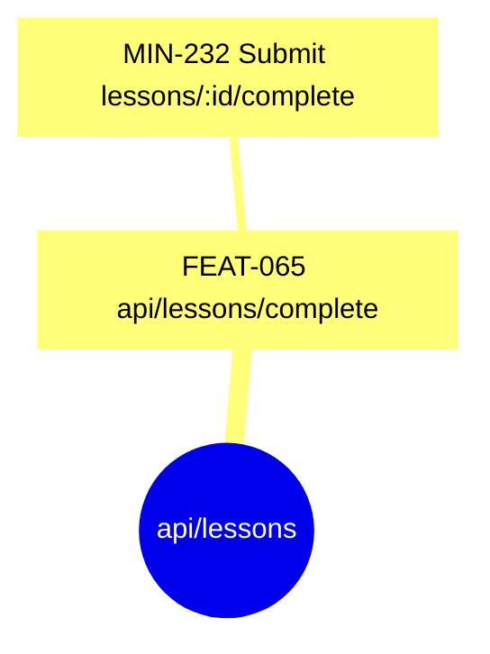

### FEAT-065 api/lessons/complete

api/lessons/complete

```mermaid
mindmap
  root((api/lessons/complete))
    MIN_232[MIN-232 Submit lessons/:id/complete]
      SUB_947[SUB-947 Access control]
        NANO_1521[NANO-1521 Requires a signed-in session]
      SUB_948[SUB-948 Business rules]
        SML_755[SML-755 Rule calculateCappedXp]
        SML_756[SML-756 Rule courseCompletionEvidence]
        SML_757[SML-757 Rule verifySequentialModuleProgress]
        SML_758[SML-758 Rule verifyLessonPrerequisites]
        SML_759[SML-759 Rule calculateCourseProgress]
        SML_760[SML-760 Rule mintCourseCertificate]
      SUB_949[SUB-949 Persistence - PARTIAL]
        SML_761[SML-761 Writes evidence]
        SML_762[SML-762 Writes evidence_skills]
      SUB_950[SUB-950 Background work]
        SML_763[SML-763 Enqueue evidence.propagate - PARTIAL]
        SML_764[SML-764 Enqueue lms.course.completed - PARTIAL]
      SUB_951[SUB-951 Responses]
        SML_765[SML-765 Success responses]
          NANO_1522[NANO-1522 HTTP 200]
        SML_766[SML-766 Failure branches]
          NANO_1523[NANO-1523 NOT_FOUND 404: Lesson with ID id not found.]
          NANO_1524[NANO-1524 NOT_FOUND 404: Module for lesson not found.]
          NANO_1525[NANO-1525 NOT_FOUND 404: Course for lesson not found.]
          NANO_1526[NANO-1526 NOT_FOUND 404: Profile not found.]
          NANO_1527[NANO-1527 FORBIDDEN 403: You must be actively enrolled in the...]
```

| ID        | Level | Parent   | Name                                                                            | Description                                                                                                                                                                                                                                                                                                                                     | Status                | Verification | Evidence                                                | Related                                                       |
| --------- | ----- | -------- | ------------------------------------------------------------------------------- | ----------------------------------------------------------------------------------------------------------------------------------------------------------------------------------------------------------------------------------------------------------------------------------------------------------------------------------------------- | --------------------- | ------------ | ------------------------------------------------------- | ------------------------------------------------------------- |
| FEAT-065  | MAJOR | MOD-073  | api/lessons/complete                                                            |                                                                                                                                                                                                                                                                                                                                                 | IMPLEMENTED           |              | apps/api/src/server.ts:5312                             |                                                               |
| MIN-232   | MINOR | FEAT-065 | Submit lessons/:id/complete                                                     | POST /api/v1/lessons/:id/complete for any signed-in session; calls calculateCappedXp, courseCompletionEvidence, verifySequentialModuleProgress, verifyLessonPrerequisites ...; ephemeral (process memory); writes evidence, evidence_skills; responds 200; 5 failure branch(es). Gaps: ephemeral: state held in process memory, lost on restart | IMPLEMENTED           | VERIFIED     | apps/api/src/server.ts:5312                             | API-106, TEST-094, TEST-111, TEST-170, TEST-175, TEST-179 ... |
| SUB-947   | SUB   | MIN-232  | Access control                                                                  | Who may call POST /api/v1/lessons/:id/complete: any signed-in session.                                                                                                                                                                                                                                                                          | IMPLEMENTED           | PATH_LEVEL   | apps/api/src/server.ts:5312                             |                                                               |
| NANO-1521 | NANO  | SUB-947  | Requires a signed-in session                                                    | Requests without a valid session token are rejected with 401 UNAUTHENTICATED.                                                                                                                                                                                                                                                                   | IMPLEMENTED           | PATH_LEVEL   | apps/api/src/server.ts:5312                             | ROLE-001                                                      |
| SUB-948   | SUB   | MIN-232  | Business rules                                                                  | Domain functions from packages/domain called by the handler (6).                                                                                                                                                                                                                                                                                | IMPLEMENTED           | PATH_LEVEL   | apps/api/src/server.ts:5312                             |                                                               |
| SML-755   | SMALL | SUB-948  | Rule calculateCappedXp                                                          | Calls calculateCappedXp (packages/domain/src/assessment.ts). Rule status IMPLEMENTED; its own tests: VERIFIED.                                                                                                                                                                                                                                  | IMPLEMENTED           | VERIFIED     | packages/domain/src/assessment.ts:130                   | RULE-047                                                      |
| SML-756   | SMALL | SUB-948  | Rule courseCompletionEvidence                                                   | Calls courseCompletionEvidence (packages/domain/src/evidence.ts). Rule status IMPLEMENTED; its own tests: VERIFIED.                                                                                                                                                                                                                             | IMPLEMENTED           | VERIFIED     | packages/domain/src/evidence.ts:77                      | RULE-096                                                      |
| SML-757   | SMALL | SUB-948  | Rule verifySequentialModuleProgress                                             | Calls verifySequentialModuleProgress (packages/domain/src/lms.ts). Rule status IMPLEMENTED; its own tests: VERIFIED.                                                                                                                                                                                                                            | IMPLEMENTED           | VERIFIED     | packages/domain/src/lms.ts:181                          | RULE-135                                                      |
| SML-758   | SMALL | SUB-948  | Rule verifyLessonPrerequisites                                                  | Calls verifyLessonPrerequisites (packages/domain/src/lms.ts). Rule status IMPLEMENTED; its own tests: VERIFIED.                                                                                                                                                                                                                                 | IMPLEMENTED           | VERIFIED     | packages/domain/src/lms.ts:211                          | RULE-136                                                      |
| SML-759   | SMALL | SUB-948  | Rule calculateCourseProgress                                                    | Calls calculateCourseProgress (packages/domain/src/lms.ts). Rule status IMPLEMENTED; its own tests: VERIFIED.                                                                                                                                                                                                                                   | IMPLEMENTED           | VERIFIED     | packages/domain/src/lms.ts:271                          | RULE-138                                                      |
| SML-760   | SMALL | SUB-948  | Rule mintCourseCertificate                                                      | Calls mintCourseCertificate (packages/domain/src/lms.ts). Rule status IMPLEMENTED; its own tests: VERIFIED.                                                                                                                                                                                                                                     | IMPLEMENTED           | VERIFIED     | packages/domain/src/lms.ts:294                          | RULE-140                                                      |
| SUB-949   | SUB   | MIN-232  | Persistence                                                                     | Ephemeral: state lives in API process memory and is lost on restart.                                                                                                                                                                                                                                                                            | PARTIALLY_IMPLEMENTED | PATH_LEVEL   | apps/api/src/server.ts:5312                             |                                                               |
| SML-761   | SMALL | SUB-949  | Writes evidence                                                                 | Writes table evidence (00001_core_schema.sql).                                                                                                                                                                                                                                                                                                  | IMPLEMENTED           | PATH_LEVEL   | supabase/migrations/00001_core_schema.sql:128           | DB-003                                                        |
| SML-762   | SMALL | SUB-949  | Writes evidence_skills                                                          | Writes table evidence_skills (00002_evidence_skills_schema.sql).                                                                                                                                                                                                                                                                                | IMPLEMENTED           | PATH_LEVEL   | supabase/migrations/00002_evidence_skills_schema.sql:39 | DB-012                                                        |
| SUB-950   | SUB   | MIN-232  | Background work                                                                 | Enqueues 2 background job kind(s) in background_jobs for apps/worker.                                                                                                                                                                                                                                                                           | IMPLEMENTED           | PATH_LEVEL   | apps/api/src/server.ts:5312                             |                                                               |
| SML-763   | SMALL | SUB-950  | Enqueue evidence.propagate                                                      | Dispatches job:evidence.propagate; worker handler: recordEvent (no-op: marks the event recorded).                                                                                                                                                                                                                                               | PARTIALLY_IMPLEMENTED | UNKNOWN      | packages/domain/src/background-jobs.ts:171              | SVC-020                                                       |
| SML-764   | SMALL | SUB-950  | Enqueue lms.course.completed                                                    | Dispatches job:lms.course.completed; worker handler: recordEvent (no-op: marks the event recorded).                                                                                                                                                                                                                                             | PARTIALLY_IMPLEMENTED | UNKNOWN      | packages/domain/src/background-jobs.ts:171              | SVC-029                                                       |
| SUB-951   | SUB   | MIN-232  | Responses                                                                       | Success 200; 5 explicit failure branch(es) besides validation and access errors.                                                                                                                                                                                                                                                                | IMPLEMENTED           | PATH_LEVEL   | apps/api/src/server.ts:5312                             |                                                               |
| SML-765   | SMALL | SUB-951  | Success responses                                                               | HTTP 200.                                                                                                                                                                                                                                                                                                                                       | IMPLEMENTED           | PATH_LEVEL   | apps/api/src/server.ts:5312                             |                                                               |
| NANO-1522 | NANO  | SML-765  | HTTP 200                                                                        | Replies 200 when the operation succeeds.                                                                                                                                                                                                                                                                                                        | IMPLEMENTED           | PATH_LEVEL   | apps/api/src/server.ts:5312                             |                                                               |
| SML-766   | SMALL | SUB-951  | Failure branches                                                                | 5 DomainError branch(es) in the handler, mapped to HTTP by the global error handler.                                                                                                                                                                                                                                                            | IMPLEMENTED           | PATH_LEVEL   | apps/api/src/server.ts:5312                             |                                                               |
| NANO-1523 | NANO  | SML-766  | NOT_FOUND 404: Lesson with ID "${id}" not found.                                | Throws DomainError(NOT_FOUND) "Lesson with ID "${id}" not found." -> HTTP 404.                                                                                                                                                                                                                                                                  | IMPLEMENTED           | PATH_LEVEL   | apps/api/src/server.ts:5319                             | ERR-120                                                       |
| NANO-1524 | NANO  | SML-766  | NOT_FOUND 404: Module for lesson not found.                                     | Throws DomainError(NOT_FOUND) "Module for lesson not found." -> HTTP 404.                                                                                                                                                                                                                                                                       | IMPLEMENTED           | PATH_LEVEL   | apps/api/src/server.ts:5324                             | ERR-121                                                       |
| NANO-1525 | NANO  | SML-766  | NOT_FOUND 404: Course for lesson not found.                                     | Throws DomainError(NOT_FOUND) "Course for lesson not found." -> HTTP 404.                                                                                                                                                                                                                                                                       | IMPLEMENTED           | PATH_LEVEL   | apps/api/src/server.ts:5329                             | ERR-122                                                       |
| NANO-1526 | NANO  | SML-766  | NOT_FOUND 404: Profile not found.                                               | Throws DomainError(NOT_FOUND) "Profile not found." -> HTTP 404.                                                                                                                                                                                                                                                                                 | IMPLEMENTED           | PATH_LEVEL   | apps/api/src/server.ts:5334                             | ERR-015                                                       |
| NANO-1527 | NANO  | SML-766  | FORBIDDEN 403: You must be actively enrolled in the course to complete lessons. | Throws DomainError(FORBIDDEN) "You must be actively enrolled in the course to complete lessons." -> HTTP 403.                                                                                                                                                                                                                                   | IMPLEMENTED           | PATH_LEVEL   | apps/api/src/server.ts:5339                             | ERR-123                                                       |

## api/moderation (MOD-093)

**Application:** apps/api (MOD-001). **Purpose:** API module: routes under /api/v1/moderation in apps/api/src/server.ts.

**Nodes by level:** MODULE 1, MAJOR 3, MINOR 10, SUB 48, SMALL 37, TINY 12, NANO 55. **Status:** IMPLEMENTED 152, PARTIALLY_IMPLEMENTED 14. **Verification:** PATH_LEVEL 139, UNKNOWN 4, VERIFIED 19.

**User roles that reach it:** anonymous, authenticated, moderator, platform_admin.

**Known gaps:** MIN-080 ephemeral: state held in process memory, lost on restart; MIN-080 no first-party web caller found; MIN-233 ephemeral: state held in process memory, lost on restart; MIN-233 no first-party web caller found; MIN-081 ephemeral: state held in process memory, lost on restart; MIN-081 no first-party web caller found; MIN-082 ephemeral: state held in process memory, lost on restart; MIN-082 no first-party web caller found; MIN-083 ephemeral: state held in process memory, lost on restart; MIN-083 no first-party web caller found; MIN-151 ephemeral: state held in process memory, lost on restart; MIN-151 no first-party web caller found; MIN-234 ephemeral: state held in process memory, lost on restart; MIN-234 no first-party web caller found; MIN-235 ephemeral: state held in process memory, lost on restart; MIN-235 no first-party web caller found; MIN-236 ephemeral: state held in process memory, lost on restart; MIN-236 no first-party web caller found; MIN-237 ephemeral: state held in process memory, lost on restart; MIN-237 no first-party web caller found.

### Module map (to minor features)

```mermaid
mindmap
  root((api/moderation))
    FEAT_142[FEAT-142 api/moderation/appeals]
      MIN_080[MIN-080 Read moderation/appeals]
      MIN_233[MIN-233 Submit moderation/appeals/:id/review]
    FEAT_141[FEAT-141 api/moderation/reports]
      MIN_081[MIN-081 Read moderation/reports]
      MIN_082[MIN-082 Read moderation/reports/:id]
      MIN_083[MIN-083 Read moderation/reports/my]
      MIN_151[MIN-151 Update moderation/reports/:id/status]
      MIN_234[MIN-234 Submit moderation/reports]
      MIN_235[MIN-235 Submit moderation/reports/:id/appeal]
      MIN_236[MIN-236 Submit moderation/reports/:id/resolve]
    FEAT_140[FEAT-140 api/moderation/scan]
      MIN_237[MIN-237 Submit moderation/scan]
```

### FEAT-142 api/moderation/appeals

api/moderation/appeals

```mermaid
mindmap
  root((api/moderation/appeals))
    MIN_080[MIN-080 Read moderation/appeals]
      SUB_285[SUB-285 Access control]
        NANO_325[NANO-325 Requires a signed-in session]
      SUB_286[SUB-286 Business rules]
        SML_180[SML-180 Rule assertModeratorAuthority]
      SUB_287[SUB-287 Persistence - PARTIAL]
      SUB_288[SUB-288 Responses]
        SML_181[SML-181 Success responses]
          NANO_326[NANO-326 HTTP 200]
    MIN_233[MIN-233 Submit moderation/appeals/:id/review]
      SUB_952[SUB-952 Access control]
        NANO_1528[NANO-1528 Requires a signed-in session]
      SUB_953[SUB-953 Request validation]
        SML_767[SML-767 ReviewModerationAppealInputSchema]
          TNY_353[TNY-353 Field decision]
            NANO_1529[NANO-1529 decision: one of: upheld, denied]
          TNY_354[TNY-354 Field decisionNotes]
            NANO_1530[NANO-1530 decisionNotes: minimum 3 characters]
            NANO_1531[NANO-1531 decisionNotes: maximum 2000 characters]
      SUB_954[SUB-954 Business rules]
        SML_768[SML-768 Rule reviewModerationAppeal]
      SUB_955[SUB-955 Persistence - PARTIAL]
        SML_769[SML-769 Writes users]
      SUB_956[SUB-956 Background work]
        SML_770[SML-770 Enqueue moderation.appeal_reviewed - PARTIAL]
      SUB_957[SUB-957 Responses]
        SML_771[SML-771 Success responses]
          NANO_1532[NANO-1532 HTTP 200]
        SML_772[SML-772 Failure branches]
          NANO_1533[NANO-1533 NOT_FOUND 404: Appeal with ID id not found.]
```

| ID        | Level | Parent   | Name                                             | Description                                                                                                                                                                                                                                                                                                                                                       | Status                | Verification | Evidence                                     | Related                               |
| --------- | ----- | -------- | ------------------------------------------------ | ----------------------------------------------------------------------------------------------------------------------------------------------------------------------------------------------------------------------------------------------------------------------------------------------------------------------------------------------------------------- | --------------------- | ------------ | -------------------------------------------- | ------------------------------------- |
| FEAT-142  | MAJOR | MOD-093  | api/moderation/appeals                           |                                                                                                                                                                                                                                                                                                                                                                   | IMPLEMENTED           |              | apps/api/src/server.ts:12218                 |                                       |
| MIN-080   | MINOR | FEAT-142 | Read moderation/appeals                          | 9. List appeals (Moderator Queue) GET /api/v1/moderation/appeals for any signed-in session; calls assertModeratorAuthority; ephemeral (process memory); responds 200. Gaps: ephemeral: state held in process memory, lost on restart; no first-party web caller found                                                                                             | IMPLEMENTED           | VERIFIED     | apps/api/src/server.ts:12218                 | API-250, TEST-114, TEST-145, TEST-193 |
| SUB-285   | SUB   | MIN-080  | Access control                                   | Who may call GET /api/v1/moderation/appeals: any signed-in session.                                                                                                                                                                                                                                                                                               | IMPLEMENTED           | PATH_LEVEL   | apps/api/src/server.ts:12218                 |                                       |
| NANO-325  | NANO  | SUB-285  | Requires a signed-in session                     | Requests without a valid session token are rejected with 401 UNAUTHENTICATED.                                                                                                                                                                                                                                                                                     | IMPLEMENTED           | PATH_LEVEL   | apps/api/src/server.ts:12218                 | ROLE-001                              |
| SUB-286   | SUB   | MIN-080  | Business rules                                   | Domain functions from packages/domain called by the handler (1).                                                                                                                                                                                                                                                                                                  | IMPLEMENTED           | PATH_LEVEL   | apps/api/src/server.ts:12218                 |                                       |
| SML-180   | SMALL | SUB-286  | Rule assertModeratorAuthority                    | Calls assertModeratorAuthority (packages/domain/src/moderation.ts). Rule status IMPLEMENTED; its own tests: VERIFIED.                                                                                                                                                                                                                                             | IMPLEMENTED           | VERIFIED     | packages/domain/src/moderation.ts:209        | RULE-149                              |
| SUB-287   | SUB   | MIN-080  | Persistence                                      | Ephemeral: state lives in API process memory and is lost on restart.                                                                                                                                                                                                                                                                                              | PARTIALLY_IMPLEMENTED | PATH_LEVEL   | apps/api/src/server.ts:12218                 |                                       |
| SUB-288   | SUB   | MIN-080  | Responses                                        | Success 200; 0 explicit failure branch(es) besides validation and access errors.                                                                                                                                                                                                                                                                                  | IMPLEMENTED           | PATH_LEVEL   | apps/api/src/server.ts:12218                 |                                       |
| SML-181   | SMALL | SUB-288  | Success responses                                | HTTP 200.                                                                                                                                                                                                                                                                                                                                                         | IMPLEMENTED           | PATH_LEVEL   | apps/api/src/server.ts:12218                 |                                       |
| NANO-326  | NANO  | SML-181  | HTTP 200                                         | Replies 200 when the operation succeeds.                                                                                                                                                                                                                                                                                                                          | IMPLEMENTED           | PATH_LEVEL   | apps/api/src/server.ts:12218                 |                                       |
| MIN-233   | MINOR | FEAT-142 | Submit moderation/appeals/:id/review             | 10. Review and decide on an appeal POST /api/v1/moderation/appeals/:id/review for any signed-in session; validates ReviewModerationAppealInputSchema; calls reviewModerationAppeal; ephemeral (process memory); writes users; responds 200; 1 failure branch(es). Gaps: ephemeral: state held in process memory, lost on restart; no first-party web caller found | IMPLEMENTED           | VERIFIED     | apps/api/src/server.ts:12227                 | API-251, TEST-114, TEST-145, TEST-193 |
| SUB-952   | SUB   | MIN-233  | Access control                                   | Who may call POST /api/v1/moderation/appeals/:id/review: any signed-in session.                                                                                                                                                                                                                                                                                   | IMPLEMENTED           | PATH_LEVEL   | apps/api/src/server.ts:12227                 |                                       |
| NANO-1528 | NANO  | SUB-952  | Requires a signed-in session                     | Requests without a valid session token are rejected with 401 UNAUTHENTICATED.                                                                                                                                                                                                                                                                                     | IMPLEMENTED           | PATH_LEVEL   | apps/api/src/server.ts:12227                 | ROLE-001                              |
| SUB-953   | SUB   | MIN-233  | Request validation                               | The request is parsed with ReviewModerationAppealInputSchema; a failure returns 400 with field details before any business logic runs.                                                                                                                                                                                                                            | IMPLEMENTED           | PATH_LEVEL   | apps/api/src/server.ts:12227                 |                                       |
| SML-767   | SMALL | SUB-953  | ReviewModerationAppealInputSchema                | ReviewModerationAppealInputSchema: 2 field(s)                                                                                                                                                                                                                                                                                                                     | IMPLEMENTED           | PATH_LEVEL   | packages/contracts/src/index.ts:867          | SCH-068                               |
| TNY-353   | TINY  | SML-767  | Field decision                                   | decision (enum, required): one of: upheld, denied                                                                                                                                                                                                                                                                                                                 | IMPLEMENTED           | PATH_LEVEL   | packages/contracts/src/index.ts:868          |                                       |
| NANO-1529 | NANO  | TNY-353  | decision: one of: upheld, denied                 | decision one of: upheld, denied.                                                                                                                                                                                                                                                                                                                                  | IMPLEMENTED           | PATH_LEVEL   | packages/contracts/src/index.ts:868          |                                       |
| TNY-354   | TINY  | SML-767  | Field decisionNotes                              | decisionNotes (string, required): minimum 3 characters; maximum 2000 characters                                                                                                                                                                                                                                                                                   | IMPLEMENTED           | PATH_LEVEL   | packages/contracts/src/index.ts:869          |                                       |
| NANO-1530 | NANO  | TNY-354  | decisionNotes: minimum 3 characters              | decisionNotes minimum 3 characters.                                                                                                                                                                                                                                                                                                                               | IMPLEMENTED           | PATH_LEVEL   | packages/contracts/src/index.ts:869          |                                       |
| NANO-1531 | NANO  | TNY-354  | decisionNotes: maximum 2000 characters           | decisionNotes maximum 2000 characters.                                                                                                                                                                                                                                                                                                                            | IMPLEMENTED           | PATH_LEVEL   | packages/contracts/src/index.ts:869          |                                       |
| SUB-954   | SUB   | MIN-233  | Business rules                                   | Domain functions from packages/domain called by the handler (1).                                                                                                                                                                                                                                                                                                  | IMPLEMENTED           | PATH_LEVEL   | apps/api/src/server.ts:12227                 |                                       |
| SML-768   | SMALL | SUB-954  | Rule reviewModerationAppeal                      | Calls reviewModerationAppeal (packages/domain/src/moderation.ts). Rule status IMPLEMENTED; its own tests: VERIFIED.                                                                                                                                                                                                                                               | IMPLEMENTED           | VERIFIED     | packages/domain/src/moderation.ts:387        | RULE-153                              |
| SUB-955   | SUB   | MIN-233  | Persistence                                      | Ephemeral: state lives in API process memory and is lost on restart.                                                                                                                                                                                                                                                                                              | PARTIALLY_IMPLEMENTED | PATH_LEVEL   | apps/api/src/server.ts:12227                 |                                       |
| SML-769   | SMALL | SUB-955  | Writes users                                     | Writes table users (00001_core_schema.sql).                                                                                                                                                                                                                                                                                                                       | IMPLEMENTED           | PATH_LEVEL   | supabase/migrations/00001_core_schema.sql:96 | DB-001                                |
| SUB-956   | SUB   | MIN-233  | Background work                                  | Enqueues 1 background job kind(s) in background_jobs for apps/worker.                                                                                                                                                                                                                                                                                             | IMPLEMENTED           | PATH_LEVEL   | apps/api/src/server.ts:12227                 |                                       |
| SML-770   | SMALL | SUB-956  | Enqueue moderation.appeal_reviewed               | Dispatches job:moderation.appeal_reviewed; worker handler: recordEvent (no-op: marks the event recorded).                                                                                                                                                                                                                                                         | PARTIALLY_IMPLEMENTED | UNKNOWN      | packages/domain/src/background-jobs.ts:171   | SVC-031                               |
| SUB-957   | SUB   | MIN-233  | Responses                                        | Success 200; 1 explicit failure branch(es) besides validation and access errors.                                                                                                                                                                                                                                                                                  | IMPLEMENTED           | PATH_LEVEL   | apps/api/src/server.ts:12227                 |                                       |
| SML-771   | SMALL | SUB-957  | Success responses                                | HTTP 200.                                                                                                                                                                                                                                                                                                                                                         | IMPLEMENTED           | PATH_LEVEL   | apps/api/src/server.ts:12227                 |                                       |
| NANO-1532 | NANO  | SML-771  | HTTP 200                                         | Replies 200 when the operation succeeds.                                                                                                                                                                                                                                                                                                                          | IMPLEMENTED           | PATH_LEVEL   | apps/api/src/server.ts:12227                 |                                       |
| SML-772   | SMALL | SUB-957  | Failure branches                                 | 1 DomainError branch(es) in the handler, mapped to HTTP by the global error handler.                                                                                                                                                                                                                                                                              | IMPLEMENTED           | PATH_LEVEL   | apps/api/src/server.ts:12227                 |                                       |
| NANO-1533 | NANO  | SML-772  | NOT_FOUND 404: Appeal with ID "${id}" not found. | Throws DomainError(NOT_FOUND) "Appeal with ID "${id}" not found." -> HTTP 404.                                                                                                                                                                                                                                                                                    | IMPLEMENTED           | PATH_LEVEL   | apps/api/src/server.ts:12236                 | ERR-226                               |

### FEAT-141 api/moderation/reports

api/moderation/reports

```mermaid
mindmap
  root((api/moderation/reports))
    MIN_081[MIN-081 Read moderation/reports]
      SUB_289[SUB-289 Access control]
        NANO_327[NANO-327 Requires a signed-in session]
      SUB_290[SUB-290 Business rules]
        SML_182[SML-182 Rule assertModeratorAuthority]
      SUB_291[SUB-291 Persistence - PARTIAL]
      SUB_292[SUB-292 Responses]
        SML_183[SML-183 Success responses]
          NANO_328[NANO-328 HTTP 200]
    MIN_082[MIN-082 Read moderation/reports/:id]
      SUB_293[SUB-293 Access control]
        NANO_329[NANO-329 Requires a signed-in session]
        NANO_330[NANO-330 Allowed role: moderator]
        NANO_331[NANO-331 Allowed role: platform_admin]
      SUB_294[SUB-294 Persistence - PARTIAL]
      SUB_295[SUB-295 Responses]
        SML_184[SML-184 Success responses]
          NANO_332[NANO-332 HTTP 200]
        SML_185[SML-185 Failure branches]
          NANO_333[NANO-333 NOT_FOUND 404: Moderation report with ID id not found.]
          NANO_334[NANO-334 FORBIDDEN 403: Access denied to this moderation report.]
    MIN_083[MIN-083 Read moderation/reports/my]
      SUB_296[SUB-296 Access control]
        NANO_335[NANO-335 Requires a signed-in session]
      SUB_297[SUB-297 Persistence - PARTIAL]
      SUB_298[SUB-298 Responses]
        SML_186[SML-186 Success responses]
          NANO_336[NANO-336 HTTP 200]
    MIN_151[MIN-151 Update moderation/reports/:id/status]
      SUB_549[SUB-549 Access control]
        NANO_685[NANO-685 Requires a signed-in session]
      SUB_550[SUB-550 Request validation]
        SML_367[SML-367 UpdateModerationReportStatusInputSchema]
          TNY_083[TNY-083 Field status]
            NANO_686[NANO-686 status: one of: pending, under_review, resolved, dis...]
      SUB_551[SUB-551 Business rules]
        SML_368[SML-368 Rule transitionReportStatus]
      SUB_552[SUB-552 Persistence - PARTIAL]
      SUB_553[SUB-553 Responses]
        SML_369[SML-369 Success responses]
          NANO_687[NANO-687 HTTP 200]
        SML_370[SML-370 Failure branches]
          NANO_688[NANO-688 NOT_FOUND 404: Moderation report with ID id not found.]
    MIN_234[MIN-234 Submit moderation/reports]
      SUB_958[SUB-958 Access control]
        NANO_1534[NANO-1534 Requires a signed-in session]
        NANO_1535[NANO-1535 Guard: canManageJobs]
      SUB_959[SUB-959 Request validation]
        SML_773[SML-773 CreateModerationReportInputSchema]
          TNY_355[TNY-355 Field targetType]
            NANO_1536[NANO-1536 targetType: one of: user, job, message, evidence, r...]
          TNY_356[TNY-356 Field targetId]
            NANO_1537[NANO-1537 targetId: minimum 1 characters]
            NANO_1538[NANO-1538 targetId: maximum 128 characters]
          TNY_357[TNY-357 Field reason]
            NANO_1539[NANO-1539 reason: one of: spam, harassment, fraud, inappropri...]
          TNY_358[TNY-358 Field details]
            NANO_1540[NANO-1540 details: maximum 2000 characters]
            NANO_1541[NANO-1541 details: optional]
      SUB_960[SUB-960 Business rules]
        SML_774[SML-774 Rule createModerationReport]
      SUB_961[SUB-961 Persistence - PARTIAL]
      SUB_962[SUB-962 Background work]
        SML_775[SML-775 Enqueue moderation.report_created - PARTIAL]
      SUB_963[SUB-963 Responses]
        SML_776[SML-776 Success responses]
          NANO_1542[NANO-1542 HTTP 201]
    MIN_235[MIN-235 Submit moderation/reports/:id/appeal]
      SUB_964[SUB-964 Access control]
        NANO_1543[NANO-1543 Requires a signed-in session]
      SUB_965[SUB-965 Request validation]
        SML_777[SML-777 CreateModerationAppealInputSchema]
          TNY_359[TNY-359 Field reason]
            NANO_1544[NANO-1544 reason: minimum 10 characters]
            NANO_1545[NANO-1545 reason: maximum 2000 characters]
      SUB_966[SUB-966 Business rules]
        SML_778[SML-778 Rule createModerationAppeal]
      SUB_967[SUB-967 Persistence - PARTIAL]
      SUB_968[SUB-968 Background work]
        SML_779[SML-779 Enqueue moderation.appeal_submitted - PARTIAL]
      SUB_969[SUB-969 Responses]
        SML_780[SML-780 Success responses]
          NANO_1546[NANO-1546 HTTP 201]
        SML_781[SML-781 Failure branches]
          NANO_1547[NANO-1547 NOT_FOUND 404: Moderation report with ID id not found.]
          NANO_1548[NANO-1548 FORBIDDEN 403: Only the person or team this decisio...]
    MIN_236[MIN-236 Submit moderation/reports/:id/resolve]
      SUB_970[SUB-970 Access control]
        NANO_1549[NANO-1549 Requires a signed-in session]
        NANO_1550[NANO-1550 Allowed role: platform_admin]
      SUB_971[SUB-971 Request validation]
        SML_782[SML-782 ResolveModerationReportInputSchema]
          TNY_360[TNY-360 Field action]
            NANO_1551[NANO-1551 action: one of: none, warning, content_removed, use...]
          TNY_361[TNY-361 Field resolutionNotes]
            NANO_1552[NANO-1552 resolutionNotes: minimum 3 characters]
            NANO_1553[NANO-1553 resolutionNotes: maximum 2000 characters]
          TNY_362[TNY-362 Field secondApproverId]
            NANO_1554[NANO-1554 secondApproverId: must be a UUID]
            NANO_1555[NANO-1555 secondApproverId: optional]
      SUB_972[SUB-972 Business rules]
        SML_783[SML-783 Rule resolveModerationReport]
      SUB_973[SUB-973 Persistence - PARTIAL]
        SML_784[SML-784 Writes users]
        SML_785[SML-785 Writes jobs]
        SML_786[SML-786 Writes job_skills]
      SUB_974[SUB-974 Background work]
        SML_787[SML-787 Enqueue moderation.report_resolved - PARTIAL]
      SUB_975[SUB-975 Responses]
        SML_788[SML-788 Success responses]
          NANO_1556[NANO-1556 HTTP 200]
          NANO_1557[NANO-1557 HTTP 202]
        SML_789[SML-789 Failure branches]
          NANO_1558[NANO-1558 NOT_FOUND 404: Moderation report with ID id not found.]
          NANO_1559[NANO-1559 FORBIDDEN 403: You cannot resolve a report you filed.]
          NANO_1560[NANO-1560 FORBIDDEN 403: Only a platform admin can suspend or...]
          NANO_1561[NANO-1561 INVALID_STATE_TRANSITION 422: Report with ID report...]
          NANO_1562[NANO-1562 FORBIDDEN 403: Permanent account termination requir...]
```

| ID        | Level | Parent   | Name                                                                                                     | Description                                                                                                                                                                                                                                                                                                                                                                                                                             | Status                | Verification | Evidence                                                  | Related                                         |
| --------- | ----- | -------- | -------------------------------------------------------------------------------------------------------- | --------------------------------------------------------------------------------------------------------------------------------------------------------------------------------------------------------------------------------------------------------------------------------------------------------------------------------------------------------------------------------------------------------------------------------------- | --------------------- | ------------ | --------------------------------------------------------- | ----------------------------------------------- |
| FEAT-141  | MAJOR | MOD-093  | api/moderation/reports                                                                                   |                                                                                                                                                                                                                                                                                                                                                                                                                                         | IMPLEMENTED           |              | apps/api/src/server.ts:11885                              |                                                 |
| MIN-081   | MINOR | FEAT-141 | Read moderation/reports                                                                                  | 4. Moderator Queue: List reports with optional filters GET /api/v1/moderation/reports for any signed-in session; calls assertModeratorAuthority; ephemeral (process memory); responds 200. Gaps: ephemeral: state held in process memory, lost on restart; no first-party web caller found                                                                                                                                              | IMPLEMENTED           | VERIFIED     | apps/api/src/server.ts:11978                              | API-245, TEST-114, TEST-145, TEST-193           |
| SUB-289   | SUB   | MIN-081  | Access control                                                                                           | Who may call GET /api/v1/moderation/reports: any signed-in session.                                                                                                                                                                                                                                                                                                                                                                     | IMPLEMENTED           | PATH_LEVEL   | apps/api/src/server.ts:11978                              |                                                 |
| NANO-327  | NANO  | SUB-289  | Requires a signed-in session                                                                             | Requests without a valid session token are rejected with 401 UNAUTHENTICATED.                                                                                                                                                                                                                                                                                                                                                           | IMPLEMENTED           | PATH_LEVEL   | apps/api/src/server.ts:11978                              | ROLE-001                                        |
| SUB-290   | SUB   | MIN-081  | Business rules                                                                                           | Domain functions from packages/domain called by the handler (1).                                                                                                                                                                                                                                                                                                                                                                        | IMPLEMENTED           | PATH_LEVEL   | apps/api/src/server.ts:11978                              |                                                 |
| SML-182   | SMALL | SUB-290  | Rule assertModeratorAuthority                                                                            | Calls assertModeratorAuthority (packages/domain/src/moderation.ts). Rule status IMPLEMENTED; its own tests: VERIFIED.                                                                                                                                                                                                                                                                                                                   | IMPLEMENTED           | VERIFIED     | packages/domain/src/moderation.ts:209                     | RULE-149                                        |
| SUB-291   | SUB   | MIN-081  | Persistence                                                                                              | Ephemeral: state lives in API process memory and is lost on restart.                                                                                                                                                                                                                                                                                                                                                                    | PARTIALLY_IMPLEMENTED | PATH_LEVEL   | apps/api/src/server.ts:11978                              |                                                 |
| SUB-292   | SUB   | MIN-081  | Responses                                                                                                | Success 200; 0 explicit failure branch(es) besides validation and access errors.                                                                                                                                                                                                                                                                                                                                                        | IMPLEMENTED           | PATH_LEVEL   | apps/api/src/server.ts:11978                              |                                                 |
| SML-183   | SMALL | SUB-292  | Success responses                                                                                        | HTTP 200.                                                                                                                                                                                                                                                                                                                                                                                                                               | IMPLEMENTED           | PATH_LEVEL   | apps/api/src/server.ts:11978                              |                                                 |
| NANO-328  | NANO  | SML-183  | HTTP 200                                                                                                 | Replies 200 when the operation succeeds.                                                                                                                                                                                                                                                                                                                                                                                                | IMPLEMENTED           | PATH_LEVEL   | apps/api/src/server.ts:11978                              |                                                 |
| MIN-082   | MINOR | FEAT-141 | Read moderation/reports/:id                                                                              | 5. Get report details GET /api/v1/moderation/reports/:id for roles moderator, platform_admin; ephemeral (process memory); responds 200; 2 failure branch(es). Gaps: ephemeral: state held in process memory, lost on restart; no first-party web caller found                                                                                                                                                                           | IMPLEMENTED           | VERIFIED     | apps/api/src/server.ts:12000                              | API-246, TEST-114, TEST-124, TEST-142, TEST-193 |
| SUB-293   | SUB   | MIN-082  | Access control                                                                                           | Who may call GET /api/v1/moderation/reports/:id: roles moderator, platform_admin.                                                                                                                                                                                                                                                                                                                                                       | IMPLEMENTED           | PATH_LEVEL   | apps/api/src/server.ts:12000                              |                                                 |
| NANO-329  | NANO  | SUB-293  | Requires a signed-in session                                                                             | Requests without a valid session token are rejected with 401 UNAUTHENTICATED.                                                                                                                                                                                                                                                                                                                                                           | IMPLEMENTED           | PATH_LEVEL   | apps/api/src/server.ts:12000                              | ROLE-001                                        |
| NANO-330  | NANO  | SUB-293  | Allowed role: moderator                                                                                  | moderator is one of the roles allowed here (moderator, platform_admin); a caller holding none of them is rejected with 403.                                                                                                                                                                                                                                                                                                             | IMPLEMENTED           | PATH_LEVEL   | apps/api/src/server.ts:12000                              | ROLE-009                                        |
| NANO-331  | NANO  | SUB-293  | Allowed role: platform_admin                                                                             | platform_admin is one of the roles allowed here (moderator, platform_admin); a caller holding none of them is rejected with 403.                                                                                                                                                                                                                                                                                                        | IMPLEMENTED           | PATH_LEVEL   | apps/api/src/server.ts:12000                              | ROLE-008                                        |
| SUB-294   | SUB   | MIN-082  | Persistence                                                                                              | Ephemeral: state lives in API process memory and is lost on restart.                                                                                                                                                                                                                                                                                                                                                                    | PARTIALLY_IMPLEMENTED | PATH_LEVEL   | apps/api/src/server.ts:12000                              |                                                 |
| SUB-295   | SUB   | MIN-082  | Responses                                                                                                | Success 200; 2 explicit failure branch(es) besides validation and access errors.                                                                                                                                                                                                                                                                                                                                                        | IMPLEMENTED           | PATH_LEVEL   | apps/api/src/server.ts:12000                              |                                                 |
| SML-184   | SMALL | SUB-295  | Success responses                                                                                        | HTTP 200.                                                                                                                                                                                                                                                                                                                                                                                                                               | IMPLEMENTED           | PATH_LEVEL   | apps/api/src/server.ts:12000                              |                                                 |
| NANO-332  | NANO  | SML-184  | HTTP 200                                                                                                 | Replies 200 when the operation succeeds.                                                                                                                                                                                                                                                                                                                                                                                                | IMPLEMENTED           | PATH_LEVEL   | apps/api/src/server.ts:12000                              |                                                 |
| SML-185   | SMALL | SUB-295  | Failure branches                                                                                         | 2 DomainError branch(es) in the handler, mapped to HTTP by the global error handler.                                                                                                                                                                                                                                                                                                                                                    | IMPLEMENTED           | PATH_LEVEL   | apps/api/src/server.ts:12000                              |                                                 |
| NANO-333  | NANO  | SML-185  | NOT_FOUND 404: Moderation report with ID "${id}" not found.                                              | Throws DomainError(NOT_FOUND) "Moderation report with ID "${id}" not found." -> HTTP 404.                                                                                                                                                                                                                                                                                                                                               | IMPLEMENTED           | PATH_LEVEL   | apps/api/src/server.ts:12007                              | ERR-219                                         |
| NANO-334  | NANO  | SML-185  | FORBIDDEN 403: Access denied to this moderation report.                                                  | Throws DomainError(FORBIDDEN) "Access denied to this moderation report." -> HTTP 403.                                                                                                                                                                                                                                                                                                                                                   | IMPLEMENTED           | PATH_LEVEL   | apps/api/src/server.ts:12013                              | ERR-220                                         |
| MIN-083   | MINOR | FEAT-141 | Read moderation/reports/my                                                                               | GET /api/v1/moderation/reports/my for any signed-in session; ephemeral (process memory); responds 200. Gaps: ephemeral: state held in process memory, lost on restart; no first-party web caller found                                                                                                                                                                                                                                  | IMPLEMENTED           | VERIFIED     | apps/api/src/server.ts:11953                              | API-244, TEST-114, TEST-124, TEST-142, TEST-193 |
| SUB-296   | SUB   | MIN-083  | Access control                                                                                           | Who may call GET /api/v1/moderation/reports/my: any signed-in session.                                                                                                                                                                                                                                                                                                                                                                  | IMPLEMENTED           | PATH_LEVEL   | apps/api/src/server.ts:11953                              |                                                 |
| NANO-335  | NANO  | SUB-296  | Requires a signed-in session                                                                             | Requests without a valid session token are rejected with 401 UNAUTHENTICATED.                                                                                                                                                                                                                                                                                                                                                           | IMPLEMENTED           | PATH_LEVEL   | apps/api/src/server.ts:11953                              | ROLE-001                                        |
| SUB-297   | SUB   | MIN-083  | Persistence                                                                                              | Ephemeral: state lives in API process memory and is lost on restart.                                                                                                                                                                                                                                                                                                                                                                    | PARTIALLY_IMPLEMENTED | PATH_LEVEL   | apps/api/src/server.ts:11953                              |                                                 |
| SUB-298   | SUB   | MIN-083  | Responses                                                                                                | Success 200; 0 explicit failure branch(es) besides validation and access errors.                                                                                                                                                                                                                                                                                                                                                        | IMPLEMENTED           | PATH_LEVEL   | apps/api/src/server.ts:11953                              |                                                 |
| SML-186   | SMALL | SUB-298  | Success responses                                                                                        | HTTP 200.                                                                                                                                                                                                                                                                                                                                                                                                                               | IMPLEMENTED           | PATH_LEVEL   | apps/api/src/server.ts:11953                              |                                                 |
| NANO-336  | NANO  | SML-186  | HTTP 200                                                                                                 | Replies 200 when the operation succeeds.                                                                                                                                                                                                                                                                                                                                                                                                | IMPLEMENTED           | PATH_LEVEL   | apps/api/src/server.ts:11953                              |                                                 |
| MIN-151   | MINOR | FEAT-141 | Update moderation/reports/:id/status                                                                     | 6. Transition report status (BR-34) PATCH /api/v1/moderation/reports/:id/status for any signed-in session; validates UpdateModerationReportStatusInputSchema; calls transitionReportStatus; ephemeral (process memory); responds 200; 1 failure branch(es). Gaps: ephemeral: state held in process memory, lost on restart; no first-party web caller found                                                                             | IMPLEMENTED           | VERIFIED     | apps/api/src/server.ts:12021                              | API-247, TEST-114, TEST-124, TEST-145, TEST-193 |
| SUB-549   | SUB   | MIN-151  | Access control                                                                                           | Who may call PATCH /api/v1/moderation/reports/:id/status: any signed-in session.                                                                                                                                                                                                                                                                                                                                                        | IMPLEMENTED           | PATH_LEVEL   | apps/api/src/server.ts:12021                              |                                                 |
| NANO-685  | NANO  | SUB-549  | Requires a signed-in session                                                                             | Requests without a valid session token are rejected with 401 UNAUTHENTICATED.                                                                                                                                                                                                                                                                                                                                                           | IMPLEMENTED           | PATH_LEVEL   | apps/api/src/server.ts:12021                              | ROLE-001                                        |
| SUB-550   | SUB   | MIN-151  | Request validation                                                                                       | The request is parsed with UpdateModerationReportStatusInputSchema; a failure returns 400 with field details before any business logic runs.                                                                                                                                                                                                                                                                                            | IMPLEMENTED           | PATH_LEVEL   | apps/api/src/server.ts:12021                              |                                                 |
| SML-367   | SMALL | SUB-550  | UpdateModerationReportStatusInputSchema                                                                  | UpdateModerationReportStatusInputSchema: 1 field(s)                                                                                                                                                                                                                                                                                                                                                                                     | IMPLEMENTED           | PATH_LEVEL   | packages/contracts/src/index.ts:838                       | SCH-065                                         |
| TNY-083   | TINY  | SML-367  | Field status                                                                                             | status (enum, required): one of: pending, under_review, resolved, dismissed                                                                                                                                                                                                                                                                                                                                                             | IMPLEMENTED           | PATH_LEVEL   | packages/contracts/src/index.ts:839                       |                                                 |
| NANO-686  | NANO  | TNY-083  | status: one of: pending, under_review, resolved, dismissed                                               | status one of: pending, under_review, resolved, dismissed.                                                                                                                                                                                                                                                                                                                                                                              | IMPLEMENTED           | PATH_LEVEL   | packages/contracts/src/index.ts:839                       |                                                 |
| SUB-551   | SUB   | MIN-151  | Business rules                                                                                           | Domain functions from packages/domain called by the handler (1).                                                                                                                                                                                                                                                                                                                                                                        | IMPLEMENTED           | PATH_LEVEL   | apps/api/src/server.ts:12021                              |                                                 |
| SML-368   | SMALL | SUB-551  | Rule transitionReportStatus                                                                              | Calls transitionReportStatus (packages/domain/src/moderation.ts). Rule status IMPLEMENTED; its own tests: VERIFIED.                                                                                                                                                                                                                                                                                                                     | IMPLEMENTED           | VERIFIED     | packages/domain/src/moderation.ts:222                     | RULE-150                                        |
| SUB-552   | SUB   | MIN-151  | Persistence                                                                                              | Ephemeral: state lives in API process memory and is lost on restart.                                                                                                                                                                                                                                                                                                                                                                    | PARTIALLY_IMPLEMENTED | PATH_LEVEL   | apps/api/src/server.ts:12021                              |                                                 |
| SUB-553   | SUB   | MIN-151  | Responses                                                                                                | Success 200; 1 explicit failure branch(es) besides validation and access errors.                                                                                                                                                                                                                                                                                                                                                        | IMPLEMENTED           | PATH_LEVEL   | apps/api/src/server.ts:12021                              |                                                 |
| SML-369   | SMALL | SUB-553  | Success responses                                                                                        | HTTP 200.                                                                                                                                                                                                                                                                                                                                                                                                                               | IMPLEMENTED           | PATH_LEVEL   | apps/api/src/server.ts:12021                              |                                                 |
| NANO-687  | NANO  | SML-369  | HTTP 200                                                                                                 | Replies 200 when the operation succeeds.                                                                                                                                                                                                                                                                                                                                                                                                | IMPLEMENTED           | PATH_LEVEL   | apps/api/src/server.ts:12021                              |                                                 |
| SML-370   | SMALL | SUB-553  | Failure branches                                                                                         | 1 DomainError branch(es) in the handler, mapped to HTTP by the global error handler.                                                                                                                                                                                                                                                                                                                                                    | IMPLEMENTED           | PATH_LEVEL   | apps/api/src/server.ts:12021                              |                                                 |
| NANO-688  | NANO  | SML-370  | NOT_FOUND 404: Moderation report with ID "${id}" not found.                                              | Throws DomainError(NOT_FOUND) "Moderation report with ID "${id}" not found." -> HTTP 404.                                                                                                                                                                                                                                                                                                                                               | IMPLEMENTED           | PATH_LEVEL   | apps/api/src/server.ts:12030                              | ERR-219                                         |
| MIN-234   | MINOR | FEAT-141 | Submit moderation/reports                                                                                | 2. Submit a moderation report POST /api/v1/moderation/reports for any signed-in session; validates CreateModerationReportInputSchema; calls createModerationReport; ephemeral (process memory); responds 201. Gaps: ephemeral: state held in process memory, lost on restart; no first-party web caller found                                                                                                                           | IMPLEMENTED           | VERIFIED     | apps/api/src/server.ts:11885                              | API-243, TEST-114, TEST-124, TEST-145, TEST-193 |
| SUB-958   | SUB   | MIN-234  | Access control                                                                                           | Who may call POST /api/v1/moderation/reports: any signed-in session.                                                                                                                                                                                                                                                                                                                                                                    | IMPLEMENTED           | PATH_LEVEL   | apps/api/src/server.ts:11885                              |                                                 |
| NANO-1534 | NANO  | SUB-958  | Requires a signed-in session                                                                             | Requests without a valid session token are rejected with 401 UNAUTHENTICATED.                                                                                                                                                                                                                                                                                                                                                           | IMPLEMENTED           | PATH_LEVEL   | apps/api/src/server.ts:11885                              | ROLE-001                                        |
| NANO-1535 | NANO  | SUB-958  | Guard: canManageJobs                                                                                     | Guard canManageJobs must pass before the handler runs.                                                                                                                                                                                                                                                                                                                                                                                  | IMPLEMENTED           | PATH_LEVEL   | apps/api/src/server.ts:11885                              |                                                 |
| SUB-959   | SUB   | MIN-234  | Request validation                                                                                       | The request is parsed with CreateModerationReportInputSchema; a failure returns 400 with field details before any business logic runs.                                                                                                                                                                                                                                                                                                  | IMPLEMENTED           | PATH_LEVEL   | apps/api/src/server.ts:11885                              |                                                 |
| SML-773   | SMALL | SUB-959  | CreateModerationReportInputSchema                                                                        | CreateModerationReportInputSchema: 4 field(s)                                                                                                                                                                                                                                                                                                                                                                                           | IMPLEMENTED           | PATH_LEVEL   | packages/contracts/src/index.ts:821                       | SCH-064                                         |
| TNY-355   | TINY  | SML-773  | Field targetType                                                                                         | targetType (enum, required): one of: user, job, message, evidence, review, portfolio_project                                                                                                                                                                                                                                                                                                                                            | IMPLEMENTED           | PATH_LEVEL   | packages/contracts/src/index.ts:822                       |                                                 |
| NANO-1536 | NANO  | TNY-355  | targetType: one of: user, job, message, evidence, review, portfolio_project                              | targetType one of: user, job, message, evidence, review, portfolio_project.                                                                                                                                                                                                                                                                                                                                                             | IMPLEMENTED           | PATH_LEVEL   | packages/contracts/src/index.ts:822                       |                                                 |
| TNY-356   | TINY  | SML-773  | Field targetId                                                                                           | targetId (string, required): minimum 1 characters; maximum 128 characters                                                                                                                                                                                                                                                                                                                                                               | IMPLEMENTED           | PATH_LEVEL   | packages/contracts/src/index.ts:823                       |                                                 |
| NANO-1537 | NANO  | TNY-356  | targetId: minimum 1 characters                                                                           | targetId minimum 1 characters.                                                                                                                                                                                                                                                                                                                                                                                                          | IMPLEMENTED           | PATH_LEVEL   | packages/contracts/src/index.ts:823                       |                                                 |
| NANO-1538 | NANO  | TNY-356  | targetId: maximum 128 characters                                                                         | targetId maximum 128 characters.                                                                                                                                                                                                                                                                                                                                                                                                        | IMPLEMENTED           | PATH_LEVEL   | packages/contracts/src/index.ts:823                       |                                                 |
| TNY-357   | TINY  | SML-773  | Field reason                                                                                             | reason (enum, required): one of: spam, harassment, fraud, inappropriate, intellectual_property, security_violation, other                                                                                                                                                                                                                                                                                                               | IMPLEMENTED           | PATH_LEVEL   | packages/contracts/src/index.ts:824                       |                                                 |
| NANO-1539 | NANO  | TNY-357  | reason: one of: spam, harassment, fraud, inappropriate, intellectual_property, security_violation, other | reason one of: spam, harassment, fraud, inappropriate, intellectual_property, security_violation, other.                                                                                                                                                                                                                                                                                                                                | IMPLEMENTED           | PATH_LEVEL   | packages/contracts/src/index.ts:824                       |                                                 |
| TNY-358   | TINY  | SML-773  | Field details                                                                                            | details (string, optional): maximum 2000 characters; optional                                                                                                                                                                                                                                                                                                                                                                           | IMPLEMENTED           | PATH_LEVEL   | packages/contracts/src/index.ts:833                       |                                                 |
| NANO-1540 | NANO  | TNY-358  | details: maximum 2000 characters                                                                         | details maximum 2000 characters.                                                                                                                                                                                                                                                                                                                                                                                                        | IMPLEMENTED           | PATH_LEVEL   | packages/contracts/src/index.ts:833                       |                                                 |
| NANO-1541 | NANO  | TNY-358  | details: optional                                                                                        | details optional.                                                                                                                                                                                                                                                                                                                                                                                                                       | IMPLEMENTED           | PATH_LEVEL   | packages/contracts/src/index.ts:833                       |                                                 |
| SUB-960   | SUB   | MIN-234  | Business rules                                                                                           | Domain functions from packages/domain called by the handler (1).                                                                                                                                                                                                                                                                                                                                                                        | IMPLEMENTED           | PATH_LEVEL   | apps/api/src/server.ts:11885                              |                                                 |
| SML-774   | SMALL | SUB-960  | Rule createModerationReport                                                                              | Calls createModerationReport (packages/domain/src/moderation.ts). Rule status IMPLEMENTED; its own tests: VERIFIED.                                                                                                                                                                                                                                                                                                                     | IMPLEMENTED           | VERIFIED     | packages/domain/src/moderation.ts:158                     | RULE-148                                        |
| SUB-961   | SUB   | MIN-234  | Persistence                                                                                              | Ephemeral: state lives in API process memory and is lost on restart.                                                                                                                                                                                                                                                                                                                                                                    | PARTIALLY_IMPLEMENTED | PATH_LEVEL   | apps/api/src/server.ts:11885                              |                                                 |
| SUB-962   | SUB   | MIN-234  | Background work                                                                                          | Enqueues 1 background job kind(s) in background_jobs for apps/worker.                                                                                                                                                                                                                                                                                                                                                                   | IMPLEMENTED           | PATH_LEVEL   | apps/api/src/server.ts:11885                              |                                                 |
| SML-775   | SMALL | SUB-962  | Enqueue moderation.report_created                                                                        | Dispatches job:moderation.report_created; worker handler: recordEvent (no-op: marks the event recorded).                                                                                                                                                                                                                                                                                                                                | PARTIALLY_IMPLEMENTED | UNKNOWN      | packages/domain/src/background-jobs.ts:171                | SVC-033                                         |
| SUB-963   | SUB   | MIN-234  | Responses                                                                                                | Success 201; 0 explicit failure branch(es) besides validation and access errors.                                                                                                                                                                                                                                                                                                                                                        | IMPLEMENTED           | PATH_LEVEL   | apps/api/src/server.ts:11885                              |                                                 |
| SML-776   | SMALL | SUB-963  | Success responses                                                                                        | HTTP 201.                                                                                                                                                                                                                                                                                                                                                                                                                               | IMPLEMENTED           | PATH_LEVEL   | apps/api/src/server.ts:11885                              |                                                 |
| NANO-1542 | NANO  | SML-776  | HTTP 201                                                                                                 | Replies 201 when the operation succeeds.                                                                                                                                                                                                                                                                                                                                                                                                | IMPLEMENTED           | PATH_LEVEL   | apps/api/src/server.ts:11885                              |                                                 |
| MIN-235   | MINOR | FEAT-141 | Submit moderation/reports/:id/appeal                                                                     | 8. Submit an appeal against an adverse moderation action (WIT-013, BR-154) POST /api/v1/moderation/reports/:id/appeal for any signed-in session; validates CreateModerationAppealInputSchema; calls createModerationAppeal; ephemeral (process memory); responds 201; 2 failure branch(es). Gaps: ephemeral: state held in process memory, lost on restart; no first-party web caller found                                             | IMPLEMENTED           | VERIFIED     | apps/api/src/server.ts:12181                              | API-249, TEST-114, TEST-145, TEST-193           |
| SUB-964   | SUB   | MIN-235  | Access control                                                                                           | Who may call POST /api/v1/moderation/reports/:id/appeal: any signed-in session.                                                                                                                                                                                                                                                                                                                                                         | IMPLEMENTED           | PATH_LEVEL   | apps/api/src/server.ts:12181                              |                                                 |
| NANO-1543 | NANO  | SUB-964  | Requires a signed-in session                                                                             | Requests without a valid session token are rejected with 401 UNAUTHENTICATED.                                                                                                                                                                                                                                                                                                                                                           | IMPLEMENTED           | PATH_LEVEL   | apps/api/src/server.ts:12181                              | ROLE-001                                        |
| SUB-965   | SUB   | MIN-235  | Request validation                                                                                       | The request is parsed with CreateModerationAppealInputSchema; a failure returns 400 with field details before any business logic runs.                                                                                                                                                                                                                                                                                                  | IMPLEMENTED           | PATH_LEVEL   | apps/api/src/server.ts:12181                              |                                                 |
| SML-777   | SMALL | SUB-965  | CreateModerationAppealInputSchema                                                                        | CreateModerationAppealInputSchema: 1 field(s)                                                                                                                                                                                                                                                                                                                                                                                           | IMPLEMENTED           | PATH_LEVEL   | packages/contracts/src/index.ts:861                       | SCH-067                                         |
| TNY-359   | TINY  | SML-777  | Field reason                                                                                             | reason (string, required): minimum 10 characters; maximum 2000 characters                                                                                                                                                                                                                                                                                                                                                               | IMPLEMENTED           | PATH_LEVEL   | packages/contracts/src/index.ts:862                       |                                                 |
| NANO-1544 | NANO  | TNY-359  | reason: minimum 10 characters                                                                            | reason minimum 10 characters.                                                                                                                                                                                                                                                                                                                                                                                                           | IMPLEMENTED           | PATH_LEVEL   | packages/contracts/src/index.ts:862                       |                                                 |
| NANO-1545 | NANO  | TNY-359  | reason: maximum 2000 characters                                                                          | reason maximum 2000 characters.                                                                                                                                                                                                                                                                                                                                                                                                         | IMPLEMENTED           | PATH_LEVEL   | packages/contracts/src/index.ts:862                       |                                                 |
| SUB-966   | SUB   | MIN-235  | Business rules                                                                                           | Domain functions from packages/domain called by the handler (1).                                                                                                                                                                                                                                                                                                                                                                        | IMPLEMENTED           | PATH_LEVEL   | apps/api/src/server.ts:12181                              |                                                 |
| SML-778   | SMALL | SUB-966  | Rule createModerationAppeal                                                                              | Calls createModerationAppeal (packages/domain/src/moderation.ts). Rule status IMPLEMENTED; its own tests: VERIFIED.                                                                                                                                                                                                                                                                                                                     | IMPLEMENTED           | VERIFIED     | packages/domain/src/moderation.ts:331                     | RULE-152                                        |
| SUB-967   | SUB   | MIN-235  | Persistence                                                                                              | Ephemeral: state lives in API process memory and is lost on restart.                                                                                                                                                                                                                                                                                                                                                                    | PARTIALLY_IMPLEMENTED | PATH_LEVEL   | apps/api/src/server.ts:12181                              |                                                 |
| SUB-968   | SUB   | MIN-235  | Background work                                                                                          | Enqueues 1 background job kind(s) in background_jobs for apps/worker.                                                                                                                                                                                                                                                                                                                                                                   | IMPLEMENTED           | PATH_LEVEL   | apps/api/src/server.ts:12181                              |                                                 |
| SML-779   | SMALL | SUB-968  | Enqueue moderation.appeal_submitted                                                                      | Dispatches job:moderation.appeal_submitted; worker handler: recordEvent (no-op: marks the event recorded).                                                                                                                                                                                                                                                                                                                              | PARTIALLY_IMPLEMENTED | UNKNOWN      | packages/domain/src/background-jobs.ts:171                | SVC-032                                         |
| SUB-969   | SUB   | MIN-235  | Responses                                                                                                | Success 201; 2 explicit failure branch(es) besides validation and access errors.                                                                                                                                                                                                                                                                                                                                                        | IMPLEMENTED           | PATH_LEVEL   | apps/api/src/server.ts:12181                              |                                                 |
| SML-780   | SMALL | SUB-969  | Success responses                                                                                        | HTTP 201.                                                                                                                                                                                                                                                                                                                                                                                                                               | IMPLEMENTED           | PATH_LEVEL   | apps/api/src/server.ts:12181                              |                                                 |
| NANO-1546 | NANO  | SML-780  | HTTP 201                                                                                                 | Replies 201 when the operation succeeds.                                                                                                                                                                                                                                                                                                                                                                                                | IMPLEMENTED           | PATH_LEVEL   | apps/api/src/server.ts:12181                              |                                                 |
| SML-781   | SMALL | SUB-969  | Failure branches                                                                                         | 2 DomainError branch(es) in the handler, mapped to HTTP by the global error handler.                                                                                                                                                                                                                                                                                                                                                    | IMPLEMENTED           | PATH_LEVEL   | apps/api/src/server.ts:12181                              |                                                 |
| NANO-1547 | NANO  | SML-781  | NOT_FOUND 404: Moderation report with ID "${id}" not found.                                              | Throws DomainError(NOT_FOUND) "Moderation report with ID "${id}" not found." -> HTTP 404.                                                                                                                                                                                                                                                                                                                                               | IMPLEMENTED           | PATH_LEVEL   | apps/api/src/server.ts:12190                              | ERR-219                                         |
| NANO-1548 | NANO  | SML-781  | FORBIDDEN 403: Only the person or team this decision was about can appeal it.                            | Throws DomainError(FORBIDDEN) "Only the person or team this decision was about can appeal it." -> HTTP 403.                                                                                                                                                                                                                                                                                                                             | IMPLEMENTED           | PATH_LEVEL   | apps/api/src/server.ts:12197                              | ERR-225                                         |
| MIN-236   | MINOR | FEAT-141 | Submit moderation/reports/:id/resolve                                                                    | 7. Resolve moderation report with enforcement action (BR-068, WIT-008, WIT-013) POST /api/v1/moderation/reports/:id/resolve for roles platform_admin; validates ResolveModerationReportInputSchema; calls resolveModerationReport; ephemeral (process memory); writes users, jobs, job_skills; responds 200, 202; 5 failure branch(es). Gaps: ephemeral: state held in process memory, lost on restart; no first-party web caller found | IMPLEMENTED           | VERIFIED     | apps/api/src/server.ts:12044                              | API-248, TEST-114, TEST-124, TEST-145, TEST-193 |
| SUB-970   | SUB   | MIN-236  | Access control                                                                                           | Who may call POST /api/v1/moderation/reports/:id/resolve: roles platform_admin.                                                                                                                                                                                                                                                                                                                                                         | IMPLEMENTED           | PATH_LEVEL   | apps/api/src/server.ts:12044                              |                                                 |
| NANO-1549 | NANO  | SUB-970  | Requires a signed-in session                                                                             | Requests without a valid session token are rejected with 401 UNAUTHENTICATED.                                                                                                                                                                                                                                                                                                                                                           | IMPLEMENTED           | PATH_LEVEL   | apps/api/src/server.ts:12044                              | ROLE-001                                        |
| NANO-1550 | NANO  | SUB-970  | Allowed role: platform_admin                                                                             | platform_admin is one of the roles allowed here (platform_admin); a caller holding none of them is rejected with 403.                                                                                                                                                                                                                                                                                                                   | IMPLEMENTED           | PATH_LEVEL   | apps/api/src/server.ts:12044                              | ROLE-008                                        |
| SUB-971   | SUB   | MIN-236  | Request validation                                                                                       | The request is parsed with ResolveModerationReportInputSchema; a failure returns 400 with field details before any business logic runs.                                                                                                                                                                                                                                                                                                 | IMPLEMENTED           | PATH_LEVEL   | apps/api/src/server.ts:12044                              |                                                 |
| SML-782   | SMALL | SUB-971  | ResolveModerationReportInputSchema                                                                       | ResolveModerationReportInputSchema: 3 field(s)                                                                                                                                                                                                                                                                                                                                                                                          | IMPLEMENTED           | PATH_LEVEL   | packages/contracts/src/index.ts:846                       | SCH-066                                         |
| TNY-360   | TINY  | SML-782  | Field action                                                                                             | action (enum, required): one of: none, warning, content_removed, user_suspended, user_banned, dismissed                                                                                                                                                                                                                                                                                                                                 | IMPLEMENTED           | PATH_LEVEL   | packages/contracts/src/index.ts:847                       |                                                 |
| NANO-1551 | NANO  | TNY-360  | action: one of: none, warning, content_removed, user_suspended, user_banned, dismissed                   | action one of: none, warning, content_removed, user_suspended, user_banned, dismissed.                                                                                                                                                                                                                                                                                                                                                  | IMPLEMENTED           | PATH_LEVEL   | packages/contracts/src/index.ts:847                       |                                                 |
| TNY-361   | TINY  | SML-782  | Field resolutionNotes                                                                                    | resolutionNotes (string, required): minimum 3 characters; maximum 2000 characters                                                                                                                                                                                                                                                                                                                                                       | IMPLEMENTED           | PATH_LEVEL   | packages/contracts/src/index.ts:855                       |                                                 |
| NANO-1552 | NANO  | TNY-361  | resolutionNotes: minimum 3 characters                                                                    | resolutionNotes minimum 3 characters.                                                                                                                                                                                                                                                                                                                                                                                                   | IMPLEMENTED           | PATH_LEVEL   | packages/contracts/src/index.ts:855                       |                                                 |
| NANO-1553 | NANO  | TNY-361  | resolutionNotes: maximum 2000 characters                                                                 | resolutionNotes maximum 2000 characters.                                                                                                                                                                                                                                                                                                                                                                                                | IMPLEMENTED           | PATH_LEVEL   | packages/contracts/src/index.ts:855                       |                                                 |
| TNY-362   | TINY  | SML-782  | Field secondApproverId                                                                                   | secondApproverId (string, optional): must be a UUID; optional                                                                                                                                                                                                                                                                                                                                                                           | IMPLEMENTED           | PATH_LEVEL   | packages/contracts/src/index.ts:856                       |                                                 |
| NANO-1554 | NANO  | TNY-362  | secondApproverId: must be a UUID                                                                         | secondApproverId must be a UUID.                                                                                                                                                                                                                                                                                                                                                                                                        | IMPLEMENTED           | PATH_LEVEL   | packages/contracts/src/index.ts:856                       |                                                 |
| NANO-1555 | NANO  | TNY-362  | secondApproverId: optional                                                                               | secondApproverId optional.                                                                                                                                                                                                                                                                                                                                                                                                              | IMPLEMENTED           | PATH_LEVEL   | packages/contracts/src/index.ts:856                       |                                                 |
| SUB-972   | SUB   | MIN-236  | Business rules                                                                                           | Domain functions from packages/domain called by the handler (1).                                                                                                                                                                                                                                                                                                                                                                        | IMPLEMENTED           | PATH_LEVEL   | apps/api/src/server.ts:12044                              |                                                 |
| SML-783   | SMALL | SUB-972  | Rule resolveModerationReport                                                                             | Calls resolveModerationReport (packages/domain/src/moderation.ts). Rule status IMPLEMENTED; its own tests: VERIFIED.                                                                                                                                                                                                                                                                                                                    | IMPLEMENTED           | VERIFIED     | packages/domain/src/moderation.ts:265                     | RULE-151                                        |
| SUB-973   | SUB   | MIN-236  | Persistence                                                                                              | Ephemeral: state lives in API process memory and is lost on restart.                                                                                                                                                                                                                                                                                                                                                                    | PARTIALLY_IMPLEMENTED | PATH_LEVEL   | apps/api/src/server.ts:12044                              |                                                 |
| SML-784   | SMALL | SUB-973  | Writes users                                                                                             | Writes table users (00001_core_schema.sql).                                                                                                                                                                                                                                                                                                                                                                                             | IMPLEMENTED           | PATH_LEVEL   | supabase/migrations/00001_core_schema.sql:96              | DB-001                                          |
| SML-785   | SMALL | SUB-973  | Writes jobs                                                                                              | Writes table jobs (00001_core_schema.sql).                                                                                                                                                                                                                                                                                                                                                                                              | IMPLEMENTED           | PATH_LEVEL   | supabase/migrations/00001_core_schema.sql:167             | DB-006                                          |
| SML-786   | SMALL | SUB-973  | Writes job_skills                                                                                        | Writes table job_skills (00003_jobs_applications_schema.sql).                                                                                                                                                                                                                                                                                                                                                                           | IMPLEMENTED           | PATH_LEVEL   | supabase/migrations/00003_jobs_applications_schema.sql:24 | DB-013                                          |
| SUB-974   | SUB   | MIN-236  | Background work                                                                                          | Enqueues 1 background job kind(s) in background_jobs for apps/worker.                                                                                                                                                                                                                                                                                                                                                                   | IMPLEMENTED           | PATH_LEVEL   | apps/api/src/server.ts:12044                              |                                                 |
| SML-787   | SMALL | SUB-974  | Enqueue moderation.report_resolved                                                                       | Dispatches job:moderation.report_resolved; worker handler: recordEvent (no-op: marks the event recorded).                                                                                                                                                                                                                                                                                                                               | PARTIALLY_IMPLEMENTED | UNKNOWN      | packages/domain/src/background-jobs.ts:171                | SVC-034                                         |
| SUB-975   | SUB   | MIN-236  | Responses                                                                                                | Success 200, 202; 5 explicit failure branch(es) besides validation and access errors.                                                                                                                                                                                                                                                                                                                                                   | IMPLEMENTED           | PATH_LEVEL   | apps/api/src/server.ts:12044                              |                                                 |
| SML-788   | SMALL | SUB-975  | Success responses                                                                                        | HTTP 200, 202.                                                                                                                                                                                                                                                                                                                                                                                                                          | IMPLEMENTED           | PATH_LEVEL   | apps/api/src/server.ts:12044                              |                                                 |
| NANO-1556 | NANO  | SML-788  | HTTP 200                                                                                                 | Replies 200 when the operation succeeds.                                                                                                                                                                                                                                                                                                                                                                                                | IMPLEMENTED           | PATH_LEVEL   | apps/api/src/server.ts:12044                              |                                                 |
| NANO-1557 | NANO  | SML-788  | HTTP 202                                                                                                 | Replies 202 when the operation succeeds.                                                                                                                                                                                                                                                                                                                                                                                                | IMPLEMENTED           | PATH_LEVEL   | apps/api/src/server.ts:12044                              |                                                 |
| SML-789   | SMALL | SUB-975  | Failure branches                                                                                         | 5 DomainError branch(es) in the handler, mapped to HTTP by the global error handler.                                                                                                                                                                                                                                                                                                                                                    | IMPLEMENTED           | PATH_LEVEL   | apps/api/src/server.ts:12044                              |                                                 |
| NANO-1558 | NANO  | SML-789  | NOT_FOUND 404: Moderation report with ID "${id}" not found.                                              | Throws DomainError(NOT_FOUND) "Moderation report with ID "${id}" not found." -> HTTP 404.                                                                                                                                                                                                                                                                                                                                               | IMPLEMENTED           | PATH_LEVEL   | apps/api/src/server.ts:12053                              | ERR-219                                         |
| NANO-1559 | NANO  | SML-789  | FORBIDDEN 403: You cannot resolve a report you filed.                                                    | Throws DomainError(FORBIDDEN) "You cannot resolve a report you filed." -> HTTP 403.                                                                                                                                                                                                                                                                                                                                                     | IMPLEMENTED           | PATH_LEVEL   | apps/api/src/server.ts:12058                              | ERR-221                                         |
| NANO-1560 | NANO  | SML-789  | FORBIDDEN 403: Only a platform admin can suspend or ban a platform admin.                                | Throws DomainError(FORBIDDEN) "Only a platform admin can suspend or ban a platform admin." -> HTTP 403.                                                                                                                                                                                                                                                                                                                                 | IMPLEMENTED           | PATH_LEVEL   | apps/api/src/server.ts:12068                              | ERR-222                                         |
| NANO-1561 | NANO  | SML-789  | INVALID_STATE_TRANSITION 422: Report with ID "${report.id}" has already reached terminal status "${r     | Throws DomainError(INVALID_STATE_TRANSITION) "Report with ID "${report.id}" has already reached terminal status "${report.status}"." -> HTTP 422.                                                                                                                                                                                                                                                                                       | IMPLEMENTED           | PATH_LEVEL   | apps/api/src/server.ts:12083                              | ERR-223                                         |
| NANO-1562 | NANO  | SML-789  | FORBIDDEN 403: Permanent account termination requires Platform Admin authority (BR-06                    | Throws DomainError(FORBIDDEN) "Permanent account termination requires Platform Admin authority (BR-068)." -> HTTP 403.                                                                                                                                                                                                                                                                                                                  | IMPLEMENTED           | VERIFIED     | apps/api/src/server.ts:12106                              | ERR-224, TEST-037                               |

### FEAT-140 api/moderation/scan

api/moderation/scan

```mermaid
mindmap
  root((api/moderation/scan))
    MIN_237[MIN-237 Submit moderation/scan]
      SUB_976[SUB-976 Access control]
        NANO_1563[NANO-1563 Open to anonymous callers]
      SUB_977[SUB-977 Request validation]
        SML_790[SML-790 ScanContentInputSchema]
          TNY_363[TNY-363 Field text]
            NANO_1564[NANO-1564 text: minimum 1 characters]
            NANO_1565[NANO-1565 text: maximum 10000 characters]
      SUB_978[SUB-978 Business rules]
        SML_791[SML-791 Rule scanContentForAbuse]
      SUB_979[SUB-979 Persistence - PARTIAL]
      SUB_980[SUB-980 Responses]
        SML_792[SML-792 Success responses]
          NANO_1566[NANO-1566 HTTP 200]
```

| ID        | Level | Parent   | Name                           | Description                                                                                                                                                                                                                                                                                                      | Status                | Verification | Evidence                             | Related                               |
| --------- | ----- | -------- | ------------------------------ | ---------------------------------------------------------------------------------------------------------------------------------------------------------------------------------------------------------------------------------------------------------------------------------------------------------------- | --------------------- | ------------ | ------------------------------------ | ------------------------------------- |
| FEAT-140  | MAJOR | MOD-093  | api/moderation/scan            |                                                                                                                                                                                                                                                                                                                  | IMPLEMENTED           |              | apps/api/src/server.ts:11878         |                                       |
| MIN-237   | MINOR | FEAT-140 | Submit moderation/scan         | 1. Scan content for abuse prior to publication (BR-125) POST /api/v1/moderation/scan for anyone (public); validates ScanContentInputSchema; calls scanContentForAbuse; ephemeral (process memory); responds 200. Gaps: ephemeral: state held in process memory, lost on restart; no first-party web caller found | IMPLEMENTED           | VERIFIED     | apps/api/src/server.ts:11878         | API-242, TEST-114, TEST-145, TEST-193 |
| SUB-976   | SUB   | MIN-237  | Access control                 | Who may call POST /api/v1/moderation/scan: anyone (public).                                                                                                                                                                                                                                                      | IMPLEMENTED           | PATH_LEVEL   | apps/api/src/server.ts:11878         |                                       |
| NANO-1563 | NANO  | SUB-976  | Open to anonymous callers      | auth: public.                                                                                                                                                                                                                                                                                                    | IMPLEMENTED           | PATH_LEVEL   | apps/api/src/server.ts:11878         | ROLE-001                              |
| SUB-977   | SUB   | MIN-237  | Request validation             | The request is parsed with ScanContentInputSchema; a failure returns 400 with field details before any business logic runs.                                                                                                                                                                                      | IMPLEMENTED           | PATH_LEVEL   | apps/api/src/server.ts:11878         |                                       |
| SML-790   | SMALL | SUB-977  | ScanContentInputSchema         | ScanContentInputSchema: 1 field(s)                                                                                                                                                                                                                                                                               | IMPLEMENTED           | PATH_LEVEL   | packages/contracts/src/index.ts:815  | SCH-063                               |
| TNY-363   | TINY  | SML-790  | Field text                     | text (string, required): minimum 1 characters; maximum 10000 characters                                                                                                                                                                                                                                          | IMPLEMENTED           | PATH_LEVEL   | packages/contracts/src/index.ts:816  |                                       |
| NANO-1564 | NANO  | TNY-363  | text: minimum 1 characters     | text minimum 1 characters.                                                                                                                                                                                                                                                                                       | IMPLEMENTED           | PATH_LEVEL   | packages/contracts/src/index.ts:816  |                                       |
| NANO-1565 | NANO  | TNY-363  | text: maximum 10000 characters | text maximum 10000 characters.                                                                                                                                                                                                                                                                                   | IMPLEMENTED           | PATH_LEVEL   | packages/contracts/src/index.ts:816  |                                       |
| SUB-978   | SUB   | MIN-237  | Business rules                 | Domain functions from packages/domain called by the handler (1).                                                                                                                                                                                                                                                 | IMPLEMENTED           | PATH_LEVEL   | apps/api/src/server.ts:11878         |                                       |
| SML-791   | SMALL | SUB-978  | Rule scanContentForAbuse       | Calls scanContentForAbuse (packages/domain/src/moderation.ts). Rule status IMPLEMENTED; its own tests: VERIFIED.                                                                                                                                                                                                 | IMPLEMENTED           | VERIFIED     | packages/domain/src/moderation.ts:90 | RULE-147                              |
| SUB-979   | SUB   | MIN-237  | Persistence                    | Ephemeral: state lives in API process memory and is lost on restart.                                                                                                                                                                                                                                             | PARTIALLY_IMPLEMENTED | PATH_LEVEL   | apps/api/src/server.ts:11878         |                                       |
| SUB-980   | SUB   | MIN-237  | Responses                      | Success 200; 0 explicit failure branch(es) besides validation and access errors.                                                                                                                                                                                                                                 | IMPLEMENTED           | PATH_LEVEL   | apps/api/src/server.ts:11878         |                                       |
| SML-792   | SMALL | SUB-980  | Success responses              | HTTP 200.                                                                                                                                                                                                                                                                                                        | IMPLEMENTED           | PATH_LEVEL   | apps/api/src/server.ts:11878         |                                       |
| NANO-1566 | NANO  | SML-792  | HTTP 200                       | Replies 200 when the operation succeeds.                                                                                                                                                                                                                                                                         | IMPLEMENTED           | PATH_LEVEL   | apps/api/src/server.ts:11878         |                                       |
