# apps/api modules, part 4 of 6

Generated by `docs/mindmap/tools/catalog.py` from `master/MASTER_PROJECT_GRAPH.json` at commit `eb166ea`. Do not edit by hand. Back to the [feature catalog](../FEATURE_CATALOG.md). Other parts: [part 1](api-1.md), [part 2](api-2.md), [part 3](api-3.md), [part 5](api-5.md), [part 6](api-6.md).

| Module                                         | ID      |
| ---------------------------------------------- | ------- |
| [api/modules](#apimodules-mod-072)             | MOD-072 |
| [api/networking](#apinetworking-mod-080)       | MOD-080 |
| [api/notifications](#apinotifications-mod-077) | MOD-077 |
| [api/organizations](#apiorganizations-mod-059) | MOD-059 |
| [api/portfolio](#apiportfolio-mod-087)         | MOD-087 |
| [api/profile](#apiprofile-mod-056)             | MOD-056 |
| [api/ready](#apiready-mod-053)                 | MOD-053 |
| [api/recruiter](#apirecruiter-mod-084)         | MOD-084 |
| [api/references](#apireferences-mod-095)       | MOD-095 |
| [api/referrals](#apireferrals-mod-081)         | MOD-081 |

## api/modules (MOD-072)

**Application:** apps/api (MOD-001). **Purpose:** API module: routes under /api/v1/modules in apps/api/src/server.ts.

**Nodes by level:** MODULE 1, MAJOR 1, MINOR 1, SUB 4, SMALL 3, TINY 7, NANO 21. **Status:** IMPLEMENTED 37, PARTIALLY_IMPLEMENTED 1. **Verification:** PATH_LEVEL 35, VERIFIED 1.

**User roles that reach it:** authenticated.

**Known gaps:** MIN-238 ephemeral: state held in process memory, lost on restart; MIN-238 no first-party web caller found.

### Module map (to minor features)

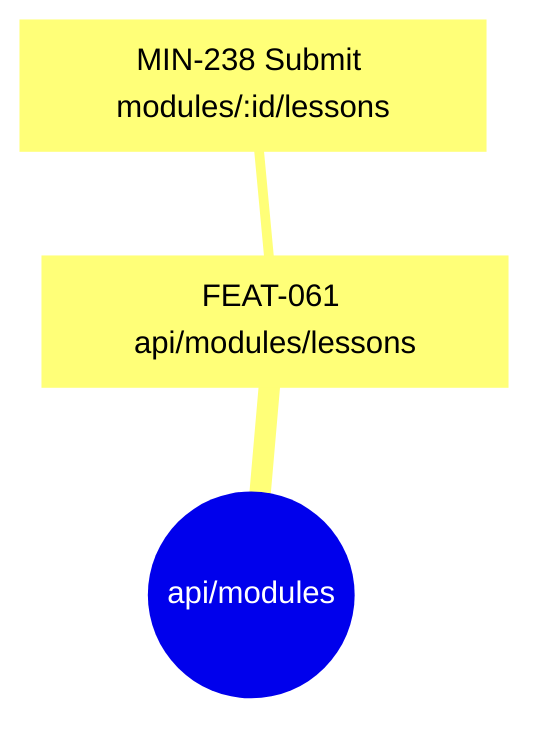

### FEAT-061 api/modules/lessons

api/modules/lessons

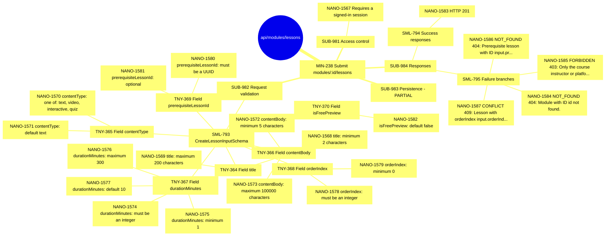

| ID        | Level | Parent   | Name                                                                                  | Description                                                                                                                                                                                                                                                    | Status                | Verification | Evidence                            | Related           |
| --------- | ----- | -------- | ------------------------------------------------------------------------------------- | -------------------------------------------------------------------------------------------------------------------------------------------------------------------------------------------------------------------------------------------------------------- | --------------------- | ------------ | ----------------------------------- | ----------------- |
| FEAT-061  | MAJOR | MOD-072  | api/modules/lessons                                                                   |                                                                                                                                                                                                                                                                | IMPLEMENTED           |              | apps/api/src/server.ts:5125         |                   |
| MIN-238   | MINOR | FEAT-061 | Submit modules/:id/lessons                                                            | POST /api/v1/modules/:id/lessons for any signed-in session; validates CreateLessonInputSchema; ephemeral (process memory); responds 201; 4 failure branch(es). Gaps: ephemeral: state held in process memory, lost on restart; no first-party web caller found | IMPLEMENTED           | VERIFIED     | apps/api/src/server.ts:5125         | API-102, TEST-111 |
| SUB-981   | SUB   | MIN-238  | Access control                                                                        | Who may call POST /api/v1/modules/:id/lessons: any signed-in session.                                                                                                                                                                                          | IMPLEMENTED           | PATH_LEVEL   | apps/api/src/server.ts:5125         |                   |
| NANO-1567 | NANO  | SUB-981  | Requires a signed-in session                                                          | Requests without a valid session token are rejected with 401 UNAUTHENTICATED.                                                                                                                                                                                  | IMPLEMENTED           | PATH_LEVEL   | apps/api/src/server.ts:5125         | ROLE-001          |
| SUB-982   | SUB   | MIN-238  | Request validation                                                                    | The request is parsed with CreateLessonInputSchema; a failure returns 400 with field details before any business logic runs.                                                                                                                                   | IMPLEMENTED           | PATH_LEVEL   | apps/api/src/server.ts:5125         |                   |
| SML-793   | SMALL | SUB-982  | CreateLessonInputSchema                                                               | CreateLessonInputSchema: 7 field(s)                                                                                                                                                                                                                            | IMPLEMENTED           | PATH_LEVEL   | packages/contracts/src/index.ts:377 | SCH-025           |
| TNY-364   | TINY  | SML-793  | Field title                                                                           | title (string, required): minimum 2 characters; maximum 200 characters                                                                                                                                                                                         | IMPLEMENTED           | PATH_LEVEL   | packages/contracts/src/index.ts:378 |                   |
| NANO-1568 | NANO  | TNY-364  | title: minimum 2 characters                                                           | title minimum 2 characters.                                                                                                                                                                                                                                    | IMPLEMENTED           | PATH_LEVEL   | packages/contracts/src/index.ts:378 |                   |
| NANO-1569 | NANO  | TNY-364  | title: maximum 200 characters                                                         | title maximum 200 characters.                                                                                                                                                                                                                                  | IMPLEMENTED           | PATH_LEVEL   | packages/contracts/src/index.ts:378 |                   |
| TNY-365   | TINY  | SML-793  | Field contentType                                                                     | contentType (enum, optional): one of: text, video, interactive, quiz; default 'text'                                                                                                                                                                           | IMPLEMENTED           | PATH_LEVEL   | packages/contracts/src/index.ts:379 |                   |
| NANO-1570 | NANO  | TNY-365  | contentType: one of: text, video, interactive, quiz                                   | contentType one of: text, video, interactive, quiz.                                                                                                                                                                                                            | IMPLEMENTED           | PATH_LEVEL   | packages/contracts/src/index.ts:379 |                   |
| NANO-1571 | NANO  | TNY-365  | contentType: default 'text'                                                           | contentType default 'text'; message "text".                                                                                                                                                                                                                    | IMPLEMENTED           | PATH_LEVEL   | packages/contracts/src/index.ts:379 |                   |
| TNY-366   | TINY  | SML-793  | Field contentBody                                                                     | contentBody (string, required): minimum 5 characters; maximum 100000 characters                                                                                                                                                                                | IMPLEMENTED           | PATH_LEVEL   | packages/contracts/src/index.ts:380 |                   |
| NANO-1572 | NANO  | TNY-366  | contentBody: minimum 5 characters                                                     | contentBody minimum 5 characters.                                                                                                                                                                                                                              | IMPLEMENTED           | PATH_LEVEL   | packages/contracts/src/index.ts:380 |                   |
| NANO-1573 | NANO  | TNY-366  | contentBody: maximum 100000 characters                                                | contentBody maximum 100000 characters.                                                                                                                                                                                                                         | IMPLEMENTED           | PATH_LEVEL   | packages/contracts/src/index.ts:380 |                   |
| TNY-367   | TINY  | SML-793  | Field durationMinutes                                                                 | durationMinutes (number, optional): must be an integer; minimum 1; maximum 300; default 10                                                                                                                                                                     | IMPLEMENTED           | PATH_LEVEL   | packages/contracts/src/index.ts:381 |                   |
| NANO-1574 | NANO  | TNY-367  | durationMinutes: must be an integer                                                   | durationMinutes must be an integer.                                                                                                                                                                                                                            | IMPLEMENTED           | PATH_LEVEL   | packages/contracts/src/index.ts:381 |                   |
| NANO-1575 | NANO  | TNY-367  | durationMinutes: minimum 1                                                            | durationMinutes minimum 1.                                                                                                                                                                                                                                     | IMPLEMENTED           | PATH_LEVEL   | packages/contracts/src/index.ts:381 |                   |
| NANO-1576 | NANO  | TNY-367  | durationMinutes: maximum 300                                                          | durationMinutes maximum 300.                                                                                                                                                                                                                                   | IMPLEMENTED           | PATH_LEVEL   | packages/contracts/src/index.ts:381 |                   |
| NANO-1577 | NANO  | TNY-367  | durationMinutes: default 10                                                           | durationMinutes default 10.                                                                                                                                                                                                                                    | IMPLEMENTED           | PATH_LEVEL   | packages/contracts/src/index.ts:381 |                   |
| TNY-368   | TINY  | SML-793  | Field orderIndex                                                                      | orderIndex (number, required): must be an integer; minimum 0                                                                                                                                                                                                   | IMPLEMENTED           | PATH_LEVEL   | packages/contracts/src/index.ts:382 |                   |
| NANO-1578 | NANO  | TNY-368  | orderIndex: must be an integer                                                        | orderIndex must be an integer.                                                                                                                                                                                                                                 | IMPLEMENTED           | PATH_LEVEL   | packages/contracts/src/index.ts:382 |                   |
| NANO-1579 | NANO  | TNY-368  | orderIndex: minimum 0                                                                 | orderIndex minimum 0.                                                                                                                                                                                                                                          | IMPLEMENTED           | PATH_LEVEL   | packages/contracts/src/index.ts:382 |                   |
| TNY-369   | TINY  | SML-793  | Field prerequisiteLessonId                                                            | prerequisiteLessonId (string, optional): must be a UUID; optional                                                                                                                                                                                              | IMPLEMENTED           | PATH_LEVEL   | packages/contracts/src/index.ts:383 |                   |
| NANO-1580 | NANO  | TNY-369  | prerequisiteLessonId: must be a UUID                                                  | prerequisiteLessonId must be a UUID.                                                                                                                                                                                                                           | IMPLEMENTED           | PATH_LEVEL   | packages/contracts/src/index.ts:383 |                   |
| NANO-1581 | NANO  | TNY-369  | prerequisiteLessonId: optional                                                        | prerequisiteLessonId optional.                                                                                                                                                                                                                                 | IMPLEMENTED           | PATH_LEVEL   | packages/contracts/src/index.ts:383 |                   |
| TNY-370   | TINY  | SML-793  | Field isFreePreview                                                                   | isFreePreview (boolean, optional): default false                                                                                                                                                                                                               | IMPLEMENTED           | PATH_LEVEL   | packages/contracts/src/index.ts:384 |                   |
| NANO-1582 | NANO  | TNY-370  | isFreePreview: default false                                                          | isFreePreview default false.                                                                                                                                                                                                                                   | IMPLEMENTED           | PATH_LEVEL   | packages/contracts/src/index.ts:384 |                   |
| SUB-983   | SUB   | MIN-238  | Persistence                                                                           | Ephemeral: state lives in API process memory and is lost on restart.                                                                                                                                                                                           | PARTIALLY_IMPLEMENTED | PATH_LEVEL   | apps/api/src/server.ts:5125         |                   |
| SUB-984   | SUB   | MIN-238  | Responses                                                                             | Success 201; 4 explicit failure branch(es) besides validation and access errors.                                                                                                                                                                               | IMPLEMENTED           | PATH_LEVEL   | apps/api/src/server.ts:5125         |                   |
| SML-794   | SMALL | SUB-984  | Success responses                                                                     | HTTP 201.                                                                                                                                                                                                                                                      | IMPLEMENTED           | PATH_LEVEL   | apps/api/src/server.ts:5125         |                   |
| NANO-1583 | NANO  | SML-794  | HTTP 201                                                                              | Replies 201 when the operation succeeds.                                                                                                                                                                                                                       | IMPLEMENTED           | PATH_LEVEL   | apps/api/src/server.ts:5125         |                   |
| SML-795   | SMALL | SUB-984  | Failure branches                                                                      | 4 DomainError branch(es) in the handler, mapped to HTTP by the global error handler.                                                                                                                                                                           | IMPLEMENTED           | PATH_LEVEL   | apps/api/src/server.ts:5125         |                   |
| NANO-1584 | NANO  | SML-795  | NOT_FOUND 404: Module with ID "${id}" not found.                                      | Throws DomainError(NOT_FOUND) "Module with ID "${id}" not found." -> HTTP 404.                                                                                                                                                                                 | IMPLEMENTED           | PATH_LEVEL   | apps/api/src/server.ts:5132         | ERR-113           |
| NANO-1585 | NANO  | SML-795  | FORBIDDEN 403: Only the course instructor or platform admin can add lessons.          | Throws DomainError(FORBIDDEN) "Only the course instructor or platform admin can add lessons." -> HTTP 403.                                                                                                                                                     | IMPLEMENTED           | PATH_LEVEL   | apps/api/src/server.ts:5141         | ERR-114           |
| NANO-1586 | NANO  | SML-795  | NOT_FOUND 404: Prerequisite lesson with ID "${input.prerequisiteLessonId}" not found. | Throws DomainError(NOT_FOUND) "Prerequisite lesson with ID "${input.prerequisiteLessonId}" not found." -> HTTP 404.                                                                                                                                            | IMPLEMENTED           | PATH_LEVEL   | apps/api/src/server.ts:5149         | ERR-115           |
| NANO-1587 | NANO  | SML-795  | CONFLICT 409: Lesson with orderIndex ${input.orderIndex} already exists in this modu  | Throws DomainError(CONFLICT) "Lesson with orderIndex ${input.orderIndex} already exists in this module." -> HTTP 409.                                                                                                                                          | IMPLEMENTED           | PATH_LEVEL   | apps/api/src/server.ts:5159         | ERR-116           |

## api/networking (MOD-080)

**Application:** apps/api (MOD-001). **Purpose:** API module: routes under /api/v1/networking in apps/api/src/server.ts.

**Nodes by level:** MODULE 1, MAJOR 1, MINOR 8, SUB 30, SMALL 17, TINY 9, NANO 34. **Status:** IMPLEMENTED 92, PARTIALLY_IMPLEMENTED 8. **Verification:** PATH_LEVEL 87, VERIFIED 11.

**User roles that reach it:** authenticated, platform_admin.

**Known gaps:** MIN-084 ephemeral: state held in process memory, lost on restart; MIN-084 no first-party web caller found; MIN-085 ephemeral: state held in process memory, lost on restart; MIN-085 no first-party web caller found; MIN-086 ephemeral: state held in process memory, lost on restart; MIN-086 no first-party web caller found; MIN-087 ephemeral: state held in process memory, lost on restart; MIN-087 no first-party web caller found; MIN-088 ephemeral: state held in process memory, lost on restart; MIN-088 no first-party web caller found; MIN-239 ephemeral: state held in process memory, lost on restart; MIN-239 no first-party web caller found; MIN-240 ephemeral: state held in process memory, lost on restart; MIN-240 no first-party web caller found; MIN-241 ephemeral: state held in process memory, lost on restart; MIN-241 no first-party web caller found.

### Module map (to minor features)

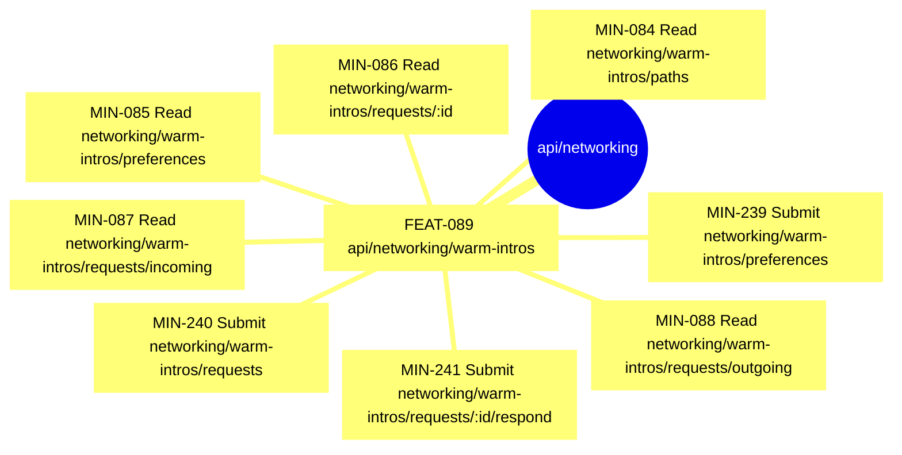

### FEAT-089 api/networking/warm-intros

api/networking/warm-intros

```mermaid
mindmap
  root((api/networking/warm-intros))
    MIN_084[MIN-084 Read networking/warm-intros/paths]
      SUB_299[SUB-299 Access control]
        NANO_337[NANO-337 Requires a signed-in session]
      SUB_300[SUB-300 Business rules]
        SML_187[SML-187 Rule discoverWarmIntroPaths]
      SUB_301[SUB-301 Persistence - PARTIAL]
      SUB_302[SUB-302 Responses]
        SML_188[SML-188 Success responses]
          NANO_338[NANO-338 HTTP 200]
        SML_189[SML-189 Failure branches]
          NANO_339[NANO-339 VALIDATION_FAILED 422: targetUserId query parameter...]
    MIN_085[MIN-085 Read networking/warm-intros/preferences]
      SUB_303[SUB-303 Access control]
        NANO_340[NANO-340 Requires a signed-in session]
      SUB_304[SUB-304 Persistence - PARTIAL]
      SUB_305[SUB-305 Responses]
        SML_190[SML-190 Success responses]
          NANO_341[NANO-341 HTTP 200]
    MIN_086[MIN-086 Read networking/warm-intros/requests/:id]
      SUB_306[SUB-306 Access control]
        NANO_342[NANO-342 Requires a signed-in session]
        NANO_343[NANO-343 Allowed role: platform_admin]
      SUB_307[SUB-307 Persistence - PARTIAL]
      SUB_308[SUB-308 Responses]
        SML_191[SML-191 Success responses]
          NANO_344[NANO-344 HTTP 200]
        SML_192[SML-192 Failure branches]
          NANO_345[NANO-345 NOT_FOUND 404: Warm intro request with ID id not found.]
          NANO_346[NANO-346 FORBIDDEN 403: Access denied to this introduction re...]
    MIN_087[MIN-087 Read networking/warm-intros/requests/incoming]
      SUB_309[SUB-309 Access control]
        NANO_347[NANO-347 Requires a signed-in session]
      SUB_310[SUB-310 Persistence - PARTIAL]
      SUB_311[SUB-311 Responses]
        SML_193[SML-193 Success responses]
          NANO_348[NANO-348 HTTP 200]
    MIN_088[MIN-088 Read networking/warm-intros/requests/outgoing]
      SUB_312[SUB-312 Access control]
        NANO_349[NANO-349 Requires a signed-in session]
      SUB_313[SUB-313 Persistence - PARTIAL]
      SUB_314[SUB-314 Responses]
        SML_194[SML-194 Success responses]
          NANO_350[NANO-350 HTTP 200]
    MIN_239[MIN-239 Submit networking/warm-intros/preferences]
      SUB_985[SUB-985 Access control]
        NANO_1588[NANO-1588 Requires a signed-in session]
      SUB_986[SUB-986 Request validation]
        SML_796[SML-796 UpdateWarmIntroPreferencesInputSchema]
          TNY_371[TNY-371 Field optOutIntroducer]
            NANO_1589[NANO-1589 optOutIntroducer: optional]
          TNY_372[TNY-372 Field blockAllIncomingIntros]
            NANO_1590[NANO-1590 blockAllIncomingIntros: optional]
          TNY_373[TNY-373 Field blockedUserIds]
            NANO_1591[NANO-1591 blockedUserIds: list of string]
            NANO_1592[NANO-1592 blockedUserIds: optional]
      SUB_987[SUB-987 Persistence - PARTIAL]
      SUB_988[SUB-988 Responses]
        SML_797[SML-797 Success responses]
          NANO_1593[NANO-1593 HTTP 200]
    MIN_240[MIN-240 Submit networking/warm-intros/requests]
      SUB_989[SUB-989 Access control]
        NANO_1594[NANO-1594 Requires a signed-in session]
      SUB_990[SUB-990 Request validation]
        SML_798[SML-798 CreateWarmIntroRequestInputSchema]
          TNY_374[TNY-374 Field targetUserId]
            NANO_1595[NANO-1595 targetUserId: must be a UUID]
          TNY_375[TNY-375 Field introducerUserId]
            NANO_1596[NANO-1596 introducerUserId: must be a UUID]
          TNY_376[TNY-376 Field purpose]
            NANO_1597[NANO-1597 purpose: minimum 1 characters]
            NANO_1598[NANO-1598 purpose: maximum 200 characters]
          TNY_377[TNY-377 Field note]
            NANO_1599[NANO-1599 note: minimum 1 characters]
            NANO_1600[NANO-1600 note: maximum 500 characters]
      SUB_991[SUB-991 Business rules]
        SML_799[SML-799 Rule createWarmIntroRequest]
      SUB_992[SUB-992 Persistence - PARTIAL]
      SUB_993[SUB-993 Responses]
        SML_800[SML-800 Success responses]
          NANO_1601[NANO-1601 HTTP 201]
    MIN_241[MIN-241 Submit networking/warm-intros/requests/:id/respond]
      SUB_994[SUB-994 Access control]
        NANO_1602[NANO-1602 Requires a signed-in session]
      SUB_995[SUB-995 Request validation]
        SML_801[SML-801 RespondWarmIntroRequestInputSchema]
          TNY_378[TNY-378 Field decision]
            NANO_1603[NANO-1603 decision: one of: approve, decline]
          TNY_379[TNY-379 Field reason]
            NANO_1604[NANO-1604 reason: maximum 500 characters]
            NANO_1605[NANO-1605 reason: optional]
      SUB_996[SUB-996 Business rules]
        SML_802[SML-802 Rule respondToIntroRequest]
      SUB_997[SUB-997 Persistence - PARTIAL]
      SUB_998[SUB-998 Responses]
        SML_803[SML-803 Success responses]
          NANO_1606[NANO-1606 HTTP 200]
        SML_804[SML-804 Failure branches]
          NANO_1607[NANO-1607 NOT_FOUND 404: Warm intro request with ID id not fo...]
```

| ID        | Level | Parent   | Name                                                             | Description                                                                                                                                                                                                                                                                                                                    | Status                | Verification | Evidence                                      | Related                               |
| --------- | ----- | -------- | ---------------------------------------------------------------- | ------------------------------------------------------------------------------------------------------------------------------------------------------------------------------------------------------------------------------------------------------------------------------------------------------------------------------ | --------------------- | ------------ | --------------------------------------------- | ------------------------------------- |
| FEAT-089  | MAJOR | MOD-080  | api/networking/warm-intros                                       |                                                                                                                                                                                                                                                                                                                                | IMPLEMENTED           |              | apps/api/src/server.ts:6791                   |                                       |
| MIN-084   | MINOR | FEAT-089 | Read networking/warm-intros/paths                                | GET /api/v1/networking/warm-intros/paths for any signed-in session; calls discoverWarmIntroPaths; ephemeral (process memory); responds 200; 1 failure branch(es). Gaps: ephemeral: state held in process memory, lost on restart; no first-party web caller found                                                              | IMPLEMENTED           | VERIFIED     | apps/api/src/server.ts:6833                   | API-142, TEST-138, TEST-219           |
| SUB-299   | SUB   | MIN-084  | Access control                                                   | Who may call GET /api/v1/networking/warm-intros/paths: any signed-in session.                                                                                                                                                                                                                                                  | IMPLEMENTED           | PATH_LEVEL   | apps/api/src/server.ts:6833                   |                                       |
| NANO-337  | NANO  | SUB-299  | Requires a signed-in session                                     | Requests without a valid session token are rejected with 401 UNAUTHENTICATED.                                                                                                                                                                                                                                                  | IMPLEMENTED           | PATH_LEVEL   | apps/api/src/server.ts:6833                   | ROLE-001                              |
| SUB-300   | SUB   | MIN-084  | Business rules                                                   | Domain functions from packages/domain called by the handler (1).                                                                                                                                                                                                                                                               | IMPLEMENTED           | PATH_LEVEL   | apps/api/src/server.ts:6833                   |                                       |
| SML-187   | SMALL | SUB-300  | Rule discoverWarmIntroPaths                                      | Calls discoverWarmIntroPaths (packages/domain/src/warm-introductions.ts). Rule status IMPLEMENTED; its own tests: VERIFIED.                                                                                                                                                                                                    | IMPLEMENTED           | VERIFIED     | packages/domain/src/warm-introductions.ts:50  | RULE-262                              |
| SUB-301   | SUB   | MIN-084  | Persistence                                                      | Ephemeral: state lives in API process memory and is lost on restart.                                                                                                                                                                                                                                                           | PARTIALLY_IMPLEMENTED | PATH_LEVEL   | apps/api/src/server.ts:6833                   |                                       |
| SUB-302   | SUB   | MIN-084  | Responses                                                        | Success 200; 1 explicit failure branch(es) besides validation and access errors.                                                                                                                                                                                                                                               | IMPLEMENTED           | PATH_LEVEL   | apps/api/src/server.ts:6833                   |                                       |
| SML-188   | SMALL | SUB-302  | Success responses                                                | HTTP 200.                                                                                                                                                                                                                                                                                                                      | IMPLEMENTED           | PATH_LEVEL   | apps/api/src/server.ts:6833                   |                                       |
| NANO-338  | NANO  | SML-188  | HTTP 200                                                         | Replies 200 when the operation succeeds.                                                                                                                                                                                                                                                                                       | IMPLEMENTED           | PATH_LEVEL   | apps/api/src/server.ts:6833                   |                                       |
| SML-189   | SMALL | SUB-302  | Failure branches                                                 | 1 DomainError branch(es) in the handler, mapped to HTTP by the global error handler.                                                                                                                                                                                                                                           | IMPLEMENTED           | PATH_LEVEL   | apps/api/src/server.ts:6833                   |                                       |
| NANO-339  | NANO  | SML-189  | VALIDATION_FAILED 422: targetUserId query parameter is required. | Throws DomainError(VALIDATION_FAILED) "targetUserId query parameter is required." -> HTTP 422.                                                                                                                                                                                                                                 | IMPLEMENTED           | PATH_LEVEL   | apps/api/src/server.ts:6839                   | ERR-143                               |
| MIN-085   | MINOR | FEAT-089 | Read networking/warm-intros/preferences                          | GET /api/v1/networking/warm-intros/preferences for any signed-in session; ephemeral (process memory); responds 200. Gaps: ephemeral: state held in process memory, lost on restart; no first-party web caller found                                                                                                            | IMPLEMENTED           | VERIFIED     | apps/api/src/server.ts:6818                   | API-141, TEST-125                     |
| SUB-303   | SUB   | MIN-085  | Access control                                                   | Who may call GET /api/v1/networking/warm-intros/preferences: any signed-in session.                                                                                                                                                                                                                                            | IMPLEMENTED           | PATH_LEVEL   | apps/api/src/server.ts:6818                   |                                       |
| NANO-340  | NANO  | SUB-303  | Requires a signed-in session                                     | Requests without a valid session token are rejected with 401 UNAUTHENTICATED.                                                                                                                                                                                                                                                  | IMPLEMENTED           | PATH_LEVEL   | apps/api/src/server.ts:6818                   | ROLE-001                              |
| SUB-304   | SUB   | MIN-085  | Persistence                                                      | Ephemeral: state lives in API process memory and is lost on restart.                                                                                                                                                                                                                                                           | PARTIALLY_IMPLEMENTED | PATH_LEVEL   | apps/api/src/server.ts:6818                   |                                       |
| SUB-305   | SUB   | MIN-085  | Responses                                                        | Success 200; 0 explicit failure branch(es) besides validation and access errors.                                                                                                                                                                                                                                               | IMPLEMENTED           | PATH_LEVEL   | apps/api/src/server.ts:6818                   |                                       |
| SML-190   | SMALL | SUB-305  | Success responses                                                | HTTP 200.                                                                                                                                                                                                                                                                                                                      | IMPLEMENTED           | PATH_LEVEL   | apps/api/src/server.ts:6818                   |                                       |
| NANO-341  | NANO  | SML-190  | HTTP 200                                                         | Replies 200 when the operation succeeds.                                                                                                                                                                                                                                                                                       | IMPLEMENTED           | PATH_LEVEL   | apps/api/src/server.ts:6818                   |                                       |
| MIN-086   | MINOR | FEAT-089 | Read networking/warm-intros/requests/:id                         | GET /api/v1/networking/warm-intros/requests/:id for roles platform_admin; ephemeral (process memory); responds 200; 2 failure branch(es). Gaps: ephemeral: state held in process memory, lost on restart; no first-party web caller found                                                                                      | IMPLEMENTED           | VERIFIED     | apps/api/src/server.ts:6956                   | API-146, TEST-138, TEST-219           |
| SUB-306   | SUB   | MIN-086  | Access control                                                   | Who may call GET /api/v1/networking/warm-intros/requests/:id: roles platform_admin.                                                                                                                                                                                                                                            | IMPLEMENTED           | PATH_LEVEL   | apps/api/src/server.ts:6956                   |                                       |
| NANO-342  | NANO  | SUB-306  | Requires a signed-in session                                     | Requests without a valid session token are rejected with 401 UNAUTHENTICATED.                                                                                                                                                                                                                                                  | IMPLEMENTED           | PATH_LEVEL   | apps/api/src/server.ts:6956                   | ROLE-001                              |
| NANO-343  | NANO  | SUB-306  | Allowed role: platform_admin                                     | platform_admin is one of the roles allowed here (platform_admin); a caller holding none of them is rejected with 403.                                                                                                                                                                                                          | IMPLEMENTED           | PATH_LEVEL   | apps/api/src/server.ts:6956                   | ROLE-008                              |
| SUB-307   | SUB   | MIN-086  | Persistence                                                      | Ephemeral: state lives in API process memory and is lost on restart.                                                                                                                                                                                                                                                           | PARTIALLY_IMPLEMENTED | PATH_LEVEL   | apps/api/src/server.ts:6956                   |                                       |
| SUB-308   | SUB   | MIN-086  | Responses                                                        | Success 200; 2 explicit failure branch(es) besides validation and access errors.                                                                                                                                                                                                                                               | IMPLEMENTED           | PATH_LEVEL   | apps/api/src/server.ts:6956                   |                                       |
| SML-191   | SMALL | SUB-308  | Success responses                                                | HTTP 200.                                                                                                                                                                                                                                                                                                                      | IMPLEMENTED           | PATH_LEVEL   | apps/api/src/server.ts:6956                   |                                       |
| NANO-344  | NANO  | SML-191  | HTTP 200                                                         | Replies 200 when the operation succeeds.                                                                                                                                                                                                                                                                                       | IMPLEMENTED           | PATH_LEVEL   | apps/api/src/server.ts:6956                   |                                       |
| SML-192   | SMALL | SUB-308  | Failure branches                                                 | 2 DomainError branch(es) in the handler, mapped to HTTP by the global error handler.                                                                                                                                                                                                                                           | IMPLEMENTED           | PATH_LEVEL   | apps/api/src/server.ts:6956                   |                                       |
| NANO-345  | NANO  | SML-192  | NOT_FOUND 404: Warm intro request with ID ${id} not found.       | Throws DomainError(NOT_FOUND) "Warm intro request with ID ${id} not found." -> HTTP 404.                                                                                                                                                                                                                                       | IMPLEMENTED           | PATH_LEVEL   | apps/api/src/server.ts:6964                   | ERR-144                               |
| NANO-346  | NANO  | SML-192  | FORBIDDEN 403: Access denied to this introduction request.       | Throws DomainError(FORBIDDEN) "Access denied to this introduction request." -> HTTP 403.                                                                                                                                                                                                                                       | IMPLEMENTED           | PATH_LEVEL   | apps/api/src/server.ts:6975                   | ERR-145                               |
| MIN-087   | MINOR | FEAT-089 | Read networking/warm-intros/requests/incoming                    | GET /api/v1/networking/warm-intros/requests/incoming for any signed-in session; ephemeral (process memory); responds 200. Gaps: ephemeral: state held in process memory, lost on restart; no first-party web caller found                                                                                                      | IMPLEMENTED           | VERIFIED     | apps/api/src/server.ts:6938                   | API-144, TEST-138                     |
| SUB-309   | SUB   | MIN-087  | Access control                                                   | Who may call GET /api/v1/networking/warm-intros/requests/incoming: any signed-in session.                                                                                                                                                                                                                                      | IMPLEMENTED           | PATH_LEVEL   | apps/api/src/server.ts:6938                   |                                       |
| NANO-347  | NANO  | SUB-309  | Requires a signed-in session                                     | Requests without a valid session token are rejected with 401 UNAUTHENTICATED.                                                                                                                                                                                                                                                  | IMPLEMENTED           | PATH_LEVEL   | apps/api/src/server.ts:6938                   | ROLE-001                              |
| SUB-310   | SUB   | MIN-087  | Persistence                                                      | Ephemeral: state lives in API process memory and is lost on restart.                                                                                                                                                                                                                                                           | PARTIALLY_IMPLEMENTED | PATH_LEVEL   | apps/api/src/server.ts:6938                   |                                       |
| SUB-311   | SUB   | MIN-087  | Responses                                                        | Success 200; 0 explicit failure branch(es) besides validation and access errors.                                                                                                                                                                                                                                               | IMPLEMENTED           | PATH_LEVEL   | apps/api/src/server.ts:6938                   |                                       |
| SML-193   | SMALL | SUB-311  | Success responses                                                | HTTP 200.                                                                                                                                                                                                                                                                                                                      | IMPLEMENTED           | PATH_LEVEL   | apps/api/src/server.ts:6938                   |                                       |
| NANO-348  | NANO  | SML-193  | HTTP 200                                                         | Replies 200 when the operation succeeds.                                                                                                                                                                                                                                                                                       | IMPLEMENTED           | PATH_LEVEL   | apps/api/src/server.ts:6938                   |                                       |
| MIN-088   | MINOR | FEAT-089 | Read networking/warm-intros/requests/outgoing                    | GET /api/v1/networking/warm-intros/requests/outgoing for any signed-in session; ephemeral (process memory); responds 200. Gaps: ephemeral: state held in process memory, lost on restart; no first-party web caller found                                                                                                      | IMPLEMENTED           | VERIFIED     | apps/api/src/server.ts:6947                   | API-145, TEST-138                     |
| SUB-312   | SUB   | MIN-088  | Access control                                                   | Who may call GET /api/v1/networking/warm-intros/requests/outgoing: any signed-in session.                                                                                                                                                                                                                                      | IMPLEMENTED           | PATH_LEVEL   | apps/api/src/server.ts:6947                   |                                       |
| NANO-349  | NANO  | SUB-312  | Requires a signed-in session                                     | Requests without a valid session token are rejected with 401 UNAUTHENTICATED.                                                                                                                                                                                                                                                  | IMPLEMENTED           | PATH_LEVEL   | apps/api/src/server.ts:6947                   | ROLE-001                              |
| SUB-313   | SUB   | MIN-088  | Persistence                                                      | Ephemeral: state lives in API process memory and is lost on restart.                                                                                                                                                                                                                                                           | PARTIALLY_IMPLEMENTED | PATH_LEVEL   | apps/api/src/server.ts:6947                   |                                       |
| SUB-314   | SUB   | MIN-088  | Responses                                                        | Success 200; 0 explicit failure branch(es) besides validation and access errors.                                                                                                                                                                                                                                               | IMPLEMENTED           | PATH_LEVEL   | apps/api/src/server.ts:6947                   |                                       |
| SML-194   | SMALL | SUB-314  | Success responses                                                | HTTP 200.                                                                                                                                                                                                                                                                                                                      | IMPLEMENTED           | PATH_LEVEL   | apps/api/src/server.ts:6947                   |                                       |
| NANO-350  | NANO  | SML-194  | HTTP 200                                                         | Replies 200 when the operation succeeds.                                                                                                                                                                                                                                                                                       | IMPLEMENTED           | PATH_LEVEL   | apps/api/src/server.ts:6947                   |                                       |
| MIN-239   | MINOR | FEAT-089 | Submit networking/warm-intros/preferences                        | POST /api/v1/networking/warm-intros/preferences for any signed-in session; validates UpdateWarmIntroPreferencesInputSchema; ephemeral (process memory); responds 200. Gaps: ephemeral: state held in process memory, lost on restart; no first-party web caller found                                                          | IMPLEMENTED           | VERIFIED     | apps/api/src/server.ts:6791                   | API-140, TEST-125, TEST-138, TEST-219 |
| SUB-985   | SUB   | MIN-239  | Access control                                                   | Who may call POST /api/v1/networking/warm-intros/preferences: any signed-in session.                                                                                                                                                                                                                                           | IMPLEMENTED           | PATH_LEVEL   | apps/api/src/server.ts:6791                   |                                       |
| NANO-1588 | NANO  | SUB-985  | Requires a signed-in session                                     | Requests without a valid session token are rejected with 401 UNAUTHENTICATED.                                                                                                                                                                                                                                                  | IMPLEMENTED           | PATH_LEVEL   | apps/api/src/server.ts:6791                   | ROLE-001                              |
| SUB-986   | SUB   | MIN-239  | Request validation                                               | The request is parsed with UpdateWarmIntroPreferencesInputSchema; a failure returns 400 with field details before any business logic runs.                                                                                                                                                                                     | IMPLEMENTED           | PATH_LEVEL   | apps/api/src/server.ts:6791                   |                                       |
| SML-796   | SMALL | SUB-986  | UpdateWarmIntroPreferencesInputSchema                            | UpdateWarmIntroPreferencesInputSchema: 3 field(s)                                                                                                                                                                                                                                                                              | IMPLEMENTED           | PATH_LEVEL   | packages/contracts/src/index.ts:1263          | SCH-096                               |
| TNY-371   | TINY  | SML-796  | Field optOutIntroducer                                           | optOutIntroducer (boolean, optional): optional                                                                                                                                                                                                                                                                                 | IMPLEMENTED           | PATH_LEVEL   | packages/contracts/src/index.ts:1264          |                                       |
| NANO-1589 | NANO  | TNY-371  | optOutIntroducer: optional                                       | optOutIntroducer optional.                                                                                                                                                                                                                                                                                                     | IMPLEMENTED           | PATH_LEVEL   | packages/contracts/src/index.ts:1264          |                                       |
| TNY-372   | TINY  | SML-796  | Field blockAllIncomingIntros                                     | blockAllIncomingIntros (boolean, optional): optional                                                                                                                                                                                                                                                                           | IMPLEMENTED           | PATH_LEVEL   | packages/contracts/src/index.ts:1265          |                                       |
| NANO-1590 | NANO  | TNY-372  | blockAllIncomingIntros: optional                                 | blockAllIncomingIntros optional.                                                                                                                                                                                                                                                                                               | IMPLEMENTED           | PATH_LEVEL   | packages/contracts/src/index.ts:1265          |                                       |
| TNY-373   | TINY  | SML-796  | Field blockedUserIds                                             | blockedUserIds (array, optional): list of string; optional                                                                                                                                                                                                                                                                     | IMPLEMENTED           | PATH_LEVEL   | packages/contracts/src/index.ts:1266          |                                       |
| NANO-1591 | NANO  | TNY-373  | blockedUserIds: list of string                                   | blockedUserIds list of string.                                                                                                                                                                                                                                                                                                 | IMPLEMENTED           | PATH_LEVEL   | packages/contracts/src/index.ts:1266          |                                       |
| NANO-1592 | NANO  | TNY-373  | blockedUserIds: optional                                         | blockedUserIds optional.                                                                                                                                                                                                                                                                                                       | IMPLEMENTED           | PATH_LEVEL   | packages/contracts/src/index.ts:1266          |                                       |
| SUB-987   | SUB   | MIN-239  | Persistence                                                      | Ephemeral: state lives in API process memory and is lost on restart.                                                                                                                                                                                                                                                           | PARTIALLY_IMPLEMENTED | PATH_LEVEL   | apps/api/src/server.ts:6791                   |                                       |
| SUB-988   | SUB   | MIN-239  | Responses                                                        | Success 200; 0 explicit failure branch(es) besides validation and access errors.                                                                                                                                                                                                                                               | IMPLEMENTED           | PATH_LEVEL   | apps/api/src/server.ts:6791                   |                                       |
| SML-797   | SMALL | SUB-988  | Success responses                                                | HTTP 200.                                                                                                                                                                                                                                                                                                                      | IMPLEMENTED           | PATH_LEVEL   | apps/api/src/server.ts:6791                   |                                       |
| NANO-1593 | NANO  | SML-797  | HTTP 200                                                         | Replies 200 when the operation succeeds.                                                                                                                                                                                                                                                                                       | IMPLEMENTED           | PATH_LEVEL   | apps/api/src/server.ts:6791                   |                                       |
| MIN-240   | MINOR | FEAT-089 | Submit networking/warm-intros/requests                           | POST /api/v1/networking/warm-intros/requests for any signed-in session; validates CreateWarmIntroRequestInputSchema; calls createWarmIntroRequest; ephemeral (process memory); responds 201. Gaps: ephemeral: state held in process memory, lost on restart; no first-party web caller found                                   | IMPLEMENTED           | VERIFIED     | apps/api/src/server.ts:6859                   | API-143, TEST-138, TEST-219           |
| SUB-989   | SUB   | MIN-240  | Access control                                                   | Who may call POST /api/v1/networking/warm-intros/requests: any signed-in session.                                                                                                                                                                                                                                              | IMPLEMENTED           | PATH_LEVEL   | apps/api/src/server.ts:6859                   |                                       |
| NANO-1594 | NANO  | SUB-989  | Requires a signed-in session                                     | Requests without a valid session token are rejected with 401 UNAUTHENTICATED.                                                                                                                                                                                                                                                  | IMPLEMENTED           | PATH_LEVEL   | apps/api/src/server.ts:6859                   | ROLE-001                              |
| SUB-990   | SUB   | MIN-240  | Request validation                                               | The request is parsed with CreateWarmIntroRequestInputSchema; a failure returns 400 with field details before any business logic runs.                                                                                                                                                                                         | IMPLEMENTED           | PATH_LEVEL   | apps/api/src/server.ts:6859                   |                                       |
| SML-798   | SMALL | SUB-990  | CreateWarmIntroRequestInputSchema                                | CreateWarmIntroRequestInputSchema: 4 field(s)                                                                                                                                                                                                                                                                                  | IMPLEMENTED           | PATH_LEVEL   | packages/contracts/src/index.ts:1271          | SCH-097                               |
| TNY-374   | TINY  | SML-798  | Field targetUserId                                               | targetUserId (string, required): must be a UUID                                                                                                                                                                                                                                                                                | IMPLEMENTED           | PATH_LEVEL   | packages/contracts/src/index.ts:1272          |                                       |
| NANO-1595 | NANO  | TNY-374  | targetUserId: must be a UUID                                     | targetUserId must be a UUID.                                                                                                                                                                                                                                                                                                   | IMPLEMENTED           | PATH_LEVEL   | packages/contracts/src/index.ts:1272          |                                       |
| TNY-375   | TINY  | SML-798  | Field introducerUserId                                           | introducerUserId (string, required): must be a UUID                                                                                                                                                                                                                                                                            | IMPLEMENTED           | PATH_LEVEL   | packages/contracts/src/index.ts:1273          |                                       |
| NANO-1596 | NANO  | TNY-375  | introducerUserId: must be a UUID                                 | introducerUserId must be a UUID.                                                                                                                                                                                                                                                                                               | IMPLEMENTED           | PATH_LEVEL   | packages/contracts/src/index.ts:1273          |                                       |
| TNY-376   | TINY  | SML-798  | Field purpose                                                    | purpose (string, required): minimum 1 characters; maximum 200 characters                                                                                                                                                                                                                                                       | IMPLEMENTED           | PATH_LEVEL   | packages/contracts/src/index.ts:1274          |                                       |
| NANO-1597 | NANO  | TNY-376  | purpose: minimum 1 characters                                    | purpose minimum 1 characters.                                                                                                                                                                                                                                                                                                  | IMPLEMENTED           | PATH_LEVEL   | packages/contracts/src/index.ts:1274          |                                       |
| NANO-1598 | NANO  | TNY-376  | purpose: maximum 200 characters                                  | purpose maximum 200 characters.                                                                                                                                                                                                                                                                                                | IMPLEMENTED           | PATH_LEVEL   | packages/contracts/src/index.ts:1274          |                                       |
| TNY-377   | TINY  | SML-798  | Field note                                                       | note (string, required): minimum 1 characters; maximum 500 characters                                                                                                                                                                                                                                                          | IMPLEMENTED           | PATH_LEVEL   | packages/contracts/src/index.ts:1275          |                                       |
| NANO-1599 | NANO  | TNY-377  | note: minimum 1 characters                                       | note minimum 1 characters.                                                                                                                                                                                                                                                                                                     | IMPLEMENTED           | PATH_LEVEL   | packages/contracts/src/index.ts:1275          |                                       |
| NANO-1600 | NANO  | TNY-377  | note: maximum 500 characters                                     | note maximum 500 characters.                                                                                                                                                                                                                                                                                                   | IMPLEMENTED           | PATH_LEVEL   | packages/contracts/src/index.ts:1275          |                                       |
| SUB-991   | SUB   | MIN-240  | Business rules                                                   | Domain functions from packages/domain called by the handler (1).                                                                                                                                                                                                                                                               | IMPLEMENTED           | PATH_LEVEL   | apps/api/src/server.ts:6859                   |                                       |
| SML-799   | SMALL | SUB-991  | Rule createWarmIntroRequest                                      | Calls createWarmIntroRequest (packages/domain/src/warm-introductions.ts). Rule status IMPLEMENTED; its own tests: VERIFIED.                                                                                                                                                                                                    | IMPLEMENTED           | VERIFIED     | packages/domain/src/warm-introductions.ts:98  | RULE-263                              |
| SUB-992   | SUB   | MIN-240  | Persistence                                                      | Ephemeral: state lives in API process memory and is lost on restart.                                                                                                                                                                                                                                                           | PARTIALLY_IMPLEMENTED | PATH_LEVEL   | apps/api/src/server.ts:6859                   |                                       |
| SUB-993   | SUB   | MIN-240  | Responses                                                        | Success 201; 0 explicit failure branch(es) besides validation and access errors.                                                                                                                                                                                                                                               | IMPLEMENTED           | PATH_LEVEL   | apps/api/src/server.ts:6859                   |                                       |
| SML-800   | SMALL | SUB-993  | Success responses                                                | HTTP 201.                                                                                                                                                                                                                                                                                                                      | IMPLEMENTED           | PATH_LEVEL   | apps/api/src/server.ts:6859                   |                                       |
| NANO-1601 | NANO  | SML-800  | HTTP 201                                                         | Replies 201 when the operation succeeds.                                                                                                                                                                                                                                                                                       | IMPLEMENTED           | PATH_LEVEL   | apps/api/src/server.ts:6859                   |                                       |
| MIN-241   | MINOR | FEAT-089 | Submit networking/warm-intros/requests/:id/respond               | POST /api/v1/networking/warm-intros/requests/:id/respond for any signed-in session; validates RespondWarmIntroRequestInputSchema; calls respondToIntroRequest; ephemeral (process memory); responds 200; 1 failure branch(es). Gaps: ephemeral: state held in process memory, lost on restart; no first-party web caller found | IMPLEMENTED           | VERIFIED     | apps/api/src/server.ts:6982                   | API-147, TEST-138, TEST-219           |
| SUB-994   | SUB   | MIN-241  | Access control                                                   | Who may call POST /api/v1/networking/warm-intros/requests/:id/respond: any signed-in session.                                                                                                                                                                                                                                  | IMPLEMENTED           | PATH_LEVEL   | apps/api/src/server.ts:6982                   |                                       |
| NANO-1602 | NANO  | SUB-994  | Requires a signed-in session                                     | Requests without a valid session token are rejected with 401 UNAUTHENTICATED.                                                                                                                                                                                                                                                  | IMPLEMENTED           | PATH_LEVEL   | apps/api/src/server.ts:6982                   | ROLE-001                              |
| SUB-995   | SUB   | MIN-241  | Request validation                                               | The request is parsed with RespondWarmIntroRequestInputSchema; a failure returns 400 with field details before any business logic runs.                                                                                                                                                                                        | IMPLEMENTED           | PATH_LEVEL   | apps/api/src/server.ts:6982                   |                                       |
| SML-801   | SMALL | SUB-995  | RespondWarmIntroRequestInputSchema                               | RespondWarmIntroRequestInputSchema: 2 field(s)                                                                                                                                                                                                                                                                                 | IMPLEMENTED           | PATH_LEVEL   | packages/contracts/src/index.ts:1280          | SCH-098                               |
| TNY-378   | TINY  | SML-801  | Field decision                                                   | decision (enum, required): one of: approve, decline                                                                                                                                                                                                                                                                            | IMPLEMENTED           | PATH_LEVEL   | packages/contracts/src/index.ts:1281          |                                       |
| NANO-1603 | NANO  | TNY-378  | decision: one of: approve, decline                               | decision one of: approve, decline.                                                                                                                                                                                                                                                                                             | IMPLEMENTED           | PATH_LEVEL   | packages/contracts/src/index.ts:1281          |                                       |
| TNY-379   | TINY  | SML-801  | Field reason                                                     | reason (string, optional): maximum 500 characters; optional                                                                                                                                                                                                                                                                    | IMPLEMENTED           | PATH_LEVEL   | packages/contracts/src/index.ts:1282          |                                       |
| NANO-1604 | NANO  | TNY-379  | reason: maximum 500 characters                                   | reason maximum 500 characters.                                                                                                                                                                                                                                                                                                 | IMPLEMENTED           | PATH_LEVEL   | packages/contracts/src/index.ts:1282          |                                       |
| NANO-1605 | NANO  | TNY-379  | reason: optional                                                 | reason optional.                                                                                                                                                                                                                                                                                                               | IMPLEMENTED           | PATH_LEVEL   | packages/contracts/src/index.ts:1282          |                                       |
| SUB-996   | SUB   | MIN-241  | Business rules                                                   | Domain functions from packages/domain called by the handler (1).                                                                                                                                                                                                                                                               | IMPLEMENTED           | PATH_LEVEL   | apps/api/src/server.ts:6982                   |                                       |
| SML-802   | SMALL | SUB-996  | Rule respondToIntroRequest                                       | Calls respondToIntroRequest (packages/domain/src/warm-introductions.ts). Rule status IMPLEMENTED; its own tests: VERIFIED.                                                                                                                                                                                                     | IMPLEMENTED           | VERIFIED     | packages/domain/src/warm-introductions.ts:177 | RULE-264                              |
| SUB-997   | SUB   | MIN-241  | Persistence                                                      | Ephemeral: state lives in API process memory and is lost on restart.                                                                                                                                                                                                                                                           | PARTIALLY_IMPLEMENTED | PATH_LEVEL   | apps/api/src/server.ts:6982                   |                                       |
| SUB-998   | SUB   | MIN-241  | Responses                                                        | Success 200; 1 explicit failure branch(es) besides validation and access errors.                                                                                                                                                                                                                                               | IMPLEMENTED           | PATH_LEVEL   | apps/api/src/server.ts:6982                   |                                       |
| SML-803   | SMALL | SUB-998  | Success responses                                                | HTTP 200.                                                                                                                                                                                                                                                                                                                      | IMPLEMENTED           | PATH_LEVEL   | apps/api/src/server.ts:6982                   |                                       |
| NANO-1606 | NANO  | SML-803  | HTTP 200                                                         | Replies 200 when the operation succeeds.                                                                                                                                                                                                                                                                                       | IMPLEMENTED           | PATH_LEVEL   | apps/api/src/server.ts:6982                   |                                       |
| SML-804   | SMALL | SUB-998  | Failure branches                                                 | 1 DomainError branch(es) in the handler, mapped to HTTP by the global error handler.                                                                                                                                                                                                                                           | IMPLEMENTED           | PATH_LEVEL   | apps/api/src/server.ts:6982                   |                                       |
| NANO-1607 | NANO  | SML-804  | NOT_FOUND 404: Warm intro request with ID ${id} not found.       | Throws DomainError(NOT_FOUND) "Warm intro request with ID ${id} not found." -> HTTP 404.                                                                                                                                                                                                                                       | IMPLEMENTED           | PATH_LEVEL   | apps/api/src/server.ts:6991                   | ERR-144                               |

## api/notifications (MOD-077)

**Application:** apps/api (MOD-001). **Purpose:** API module: routes under /api/v1/notifications in apps/api/src/server.ts.

**Nodes by level:** MODULE 1, MAJOR 4, MINOR 5, SUB 20, SMALL 17, TINY 7, NANO 24. **Status:** IMPLEMENTED 78. **Verification:** PATH_LEVEL 64, VERIFIED 9.

**User roles that reach it:** authenticated.

**Known gaps:** MIN-090 no first-party web caller found; MIN-152 no first-party web caller found.

**Called from (web screens and components):** FEAT-174 Screen /notifications

### Module map (to minor features)

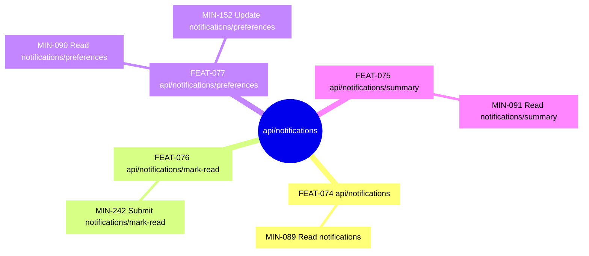

### FEAT-074 api/notifications

api/notifications

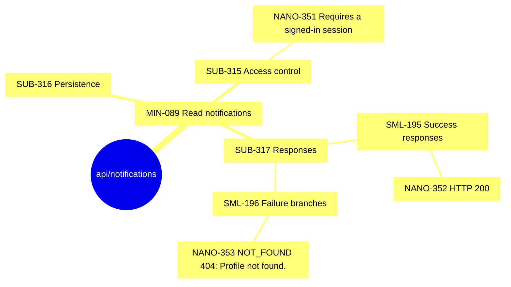

| ID       | Level | Parent   | Name                              | Description                                                                                                                                                 | Status      | Verification | Evidence                    | Related                                                       |
| -------- | ----- | -------- | --------------------------------- | ----------------------------------------------------------------------------------------------------------------------------------------------------------- | ----------- | ------------ | --------------------------- | ------------------------------------------------------------- |
| FEAT-074 | MAJOR | MOD-077  | api/notifications                 |                                                                                                                                                             | IMPLEMENTED |              | apps/api/src/server.ts:5978 |                                                               |
| MIN-089  | MINOR | FEAT-074 | Read notifications                | Notification Center Endpoints (F-14, BR-120) GET /api/v1/notifications for any signed-in session; durable (PostgreSQL); responds 200; 1 failure branch(es). | IMPLEMENTED | VERIFIED     | apps/api/src/server.ts:5978 | API-117, TEST-097, TEST-112, TEST-115, TEST-116, TEST-150 ... |
| SUB-315  | SUB   | MIN-089  | Access control                    | Who may call GET /api/v1/notifications: any signed-in session.                                                                                              | IMPLEMENTED | PATH_LEVEL   | apps/api/src/server.ts:5978 |                                                               |
| NANO-351 | NANO  | SUB-315  | Requires a signed-in session      | Requests without a valid session token are rejected with 401 UNAUTHENTICATED.                                                                               | IMPLEMENTED | PATH_LEVEL   | apps/api/src/server.ts:5978 | ROLE-001                                                      |
| SUB-316  | SUB   | MIN-089  | Persistence                       | Durable: writes go through the PostgreSQL store.                                                                                                            | IMPLEMENTED | PATH_LEVEL   | apps/api/src/server.ts:5978 |                                                               |
| SUB-317  | SUB   | MIN-089  | Responses                         | Success 200; 1 explicit failure branch(es) besides validation and access errors.                                                                            | IMPLEMENTED | PATH_LEVEL   | apps/api/src/server.ts:5978 |                                                               |
| SML-195  | SMALL | SUB-317  | Success responses                 | HTTP 200.                                                                                                                                                   | IMPLEMENTED | PATH_LEVEL   | apps/api/src/server.ts:5978 |                                                               |
| NANO-352 | NANO  | SML-195  | HTTP 200                          | Replies 200 when the operation succeeds.                                                                                                                    | IMPLEMENTED | PATH_LEVEL   | apps/api/src/server.ts:5978 |                                                               |
| SML-196  | SMALL | SUB-317  | Failure branches                  | 1 DomainError branch(es) in the handler, mapped to HTTP by the global error handler.                                                                        | IMPLEMENTED | PATH_LEVEL   | apps/api/src/server.ts:5978 |                                                               |
| NANO-353 | NANO  | SML-196  | NOT_FOUND 404: Profile not found. | Throws DomainError(NOT_FOUND) "Profile not found." -> HTTP 404.                                                                                             | IMPLEMENTED | PATH_LEVEL   | apps/api/src/server.ts:5987 | ERR-015                                                       |

### FEAT-076 api/notifications/mark-read

api/notifications/mark-read

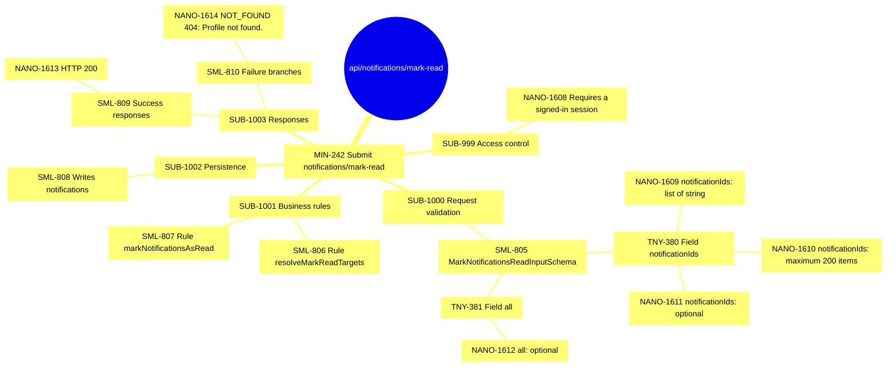

| ID        | Level | Parent   | Name                               | Description                                                                                                                                                                                                                                        | Status      | Verification | Evidence                                             | Related                                         |
| --------- | ----- | -------- | ---------------------------------- | -------------------------------------------------------------------------------------------------------------------------------------------------------------------------------------------------------------------------------------------------- | ----------- | ------------ | ---------------------------------------------------- | ----------------------------------------------- |
| FEAT-076  | MAJOR | MOD-077  | api/notifications/mark-read        |                                                                                                                                                                                                                                                    | IMPLEMENTED |              | apps/api/src/server.ts:6018                          |                                                 |
| MIN-242   | MINOR | FEAT-076 | Submit notifications/mark-read     | POST /api/v1/notifications/mark-read for any signed-in session; validates MarkNotificationsReadInputSchema; calls resolveMarkReadTargets, markNotificationsAsRead; durable (PostgreSQL); writes notifications; responds 200; 1 failure branch(es). | IMPLEMENTED | VERIFIED     | apps/api/src/server.ts:6018                          | API-119, TEST-097, TEST-116, TEST-156, TEST-191 |
| SUB-999   | SUB   | MIN-242  | Access control                     | Who may call POST /api/v1/notifications/mark-read: any signed-in session.                                                                                                                                                                          | IMPLEMENTED | PATH_LEVEL   | apps/api/src/server.ts:6018                          |                                                 |
| NANO-1608 | NANO  | SUB-999  | Requires a signed-in session       | Requests without a valid session token are rejected with 401 UNAUTHENTICATED.                                                                                                                                                                      | IMPLEMENTED | PATH_LEVEL   | apps/api/src/server.ts:6018                          | ROLE-001                                        |
| SUB-1000  | SUB   | MIN-242  | Request validation                 | The request is parsed with MarkNotificationsReadInputSchema; a failure returns 400 with field details before any business logic runs.                                                                                                              | IMPLEMENTED | PATH_LEVEL   | apps/api/src/server.ts:6018                          |                                                 |
| SML-805   | SMALL | SUB-1000 | MarkNotificationsReadInputSchema   | MarkNotificationsReadInputSchema: 2 field(s)                                                                                                                                                                                                       | IMPLEMENTED | PATH_LEVEL   | packages/contracts/src/index.ts:423                  | SCH-029                                         |
| TNY-380   | TINY  | SML-805  | Field notificationIds              | notificationIds (array, optional): list of string; maximum 200 items; optional                                                                                                                                                                     | IMPLEMENTED | PATH_LEVEL   | packages/contracts/src/index.ts:424                  |                                                 |
| NANO-1609 | NANO  | TNY-380  | notificationIds: list of string    | notificationIds list of string.                                                                                                                                                                                                                    | IMPLEMENTED | PATH_LEVEL   | packages/contracts/src/index.ts:424                  |                                                 |
| NANO-1610 | NANO  | TNY-380  | notificationIds: maximum 200 items | notificationIds maximum 200 items.                                                                                                                                                                                                                 | IMPLEMENTED | PATH_LEVEL   | packages/contracts/src/index.ts:424                  |                                                 |
| NANO-1611 | NANO  | TNY-380  | notificationIds: optional          | notificationIds optional.                                                                                                                                                                                                                          | IMPLEMENTED | PATH_LEVEL   | packages/contracts/src/index.ts:424                  |                                                 |
| TNY-381   | TINY  | SML-805  | Field all                          | all (boolean, optional): optional                                                                                                                                                                                                                  | IMPLEMENTED | PATH_LEVEL   | packages/contracts/src/index.ts:425                  |                                                 |
| NANO-1612 | NANO  | TNY-381  | all: optional                      | all optional.                                                                                                                                                                                                                                      | IMPLEMENTED | PATH_LEVEL   | packages/contracts/src/index.ts:425                  |                                                 |
| SUB-1001  | SUB   | MIN-242  | Business rules                     | Domain functions from packages/domain called by the handler (2).                                                                                                                                                                                   | IMPLEMENTED | PATH_LEVEL   | apps/api/src/server.ts:6018                          |                                                 |
| SML-806   | SMALL | SUB-1001 | Rule resolveMarkReadTargets        | Calls resolveMarkReadTargets (packages/domain/src/notifications.ts). Rule status IMPLEMENTED; its own tests: VERIFIED.                                                                                                                             | IMPLEMENTED | VERIFIED     | packages/domain/src/notifications.ts:149             | RULE-163                                        |
| SML-807   | SMALL | SUB-1001 | Rule markNotificationsAsRead       | Calls markNotificationsAsRead (packages/domain/src/notifications.ts). Rule status IMPLEMENTED; its own tests: VERIFIED.                                                                                                                            | IMPLEMENTED | VERIFIED     | packages/domain/src/notifications.ts:168             | RULE-164                                        |
| SUB-1002  | SUB   | MIN-242  | Persistence                        | Durable: writes go through the PostgreSQL store.                                                                                                                                                                                                   | IMPLEMENTED | PATH_LEVEL   | apps/api/src/server.ts:6018                          |                                                 |
| SML-808   | SMALL | SUB-1002 | Writes notifications               | Writes table notifications (00007_notifications_schema.sql).                                                                                                                                                                                       | IMPLEMENTED | PATH_LEVEL   | supabase/migrations/00007_notifications_schema.sql:6 | DB-029                                          |
| SUB-1003  | SUB   | MIN-242  | Responses                          | Success 200; 1 explicit failure branch(es) besides validation and access errors.                                                                                                                                                                   | IMPLEMENTED | PATH_LEVEL   | apps/api/src/server.ts:6018                          |                                                 |
| SML-809   | SMALL | SUB-1003 | Success responses                  | HTTP 200.                                                                                                                                                                                                                                          | IMPLEMENTED | PATH_LEVEL   | apps/api/src/server.ts:6018                          |                                                 |
| NANO-1613 | NANO  | SML-809  | HTTP 200                           | Replies 200 when the operation succeeds.                                                                                                                                                                                                           | IMPLEMENTED | PATH_LEVEL   | apps/api/src/server.ts:6018                          |                                                 |
| SML-810   | SMALL | SUB-1003 | Failure branches                   | 1 DomainError branch(es) in the handler, mapped to HTTP by the global error handler.                                                                                                                                                               | IMPLEMENTED | PATH_LEVEL   | apps/api/src/server.ts:6018                          |                                                 |
| NANO-1614 | NANO  | SML-810  | NOT_FOUND 404: Profile not found.  | Throws DomainError(NOT_FOUND) "Profile not found." -> HTTP 404.                                                                                                                                                                                    | IMPLEMENTED | PATH_LEVEL   | apps/api/src/server.ts:6022                          | ERR-015                                         |

### FEAT-077 api/notifications/preferences

api/notifications/preferences

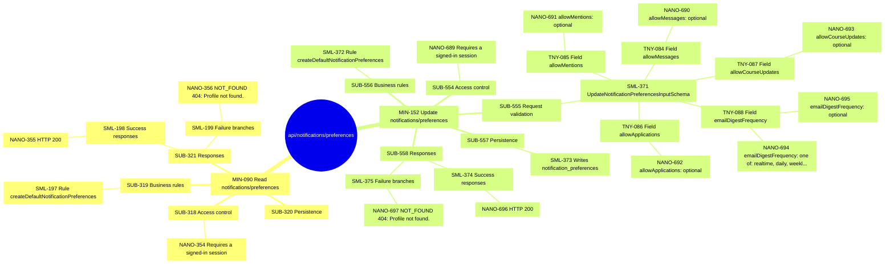

| ID       | Level | Parent   | Name                                                         | Description                                                                                                                                                                                                                                                                                         | Status      | Verification | Evidence                                              | Related                                         |
| -------- | ----- | -------- | ------------------------------------------------------------ | --------------------------------------------------------------------------------------------------------------------------------------------------------------------------------------------------------------------------------------------------------------------------------------------------- | ----------- | ------------ | ----------------------------------------------------- | ----------------------------------------------- |
| FEAT-077 | MAJOR | MOD-077  | api/notifications/preferences                                |                                                                                                                                                                                                                                                                                                     | IMPLEMENTED |              | apps/api/src/server.ts:6048                           |                                                 |
| MIN-090  | MINOR | FEAT-077 | Read notifications/preferences                               | GET /api/v1/notifications/preferences for any signed-in session; calls createDefaultNotificationPreferences; durable (PostgreSQL); responds 200; 1 failure branch(es). Gaps: no first-party web caller found                                                                                        | IMPLEMENTED | VERIFIED     | apps/api/src/server.ts:6048                           | API-120, TEST-097, TEST-116, TEST-156           |
| SUB-318  | SUB   | MIN-090  | Access control                                               | Who may call GET /api/v1/notifications/preferences: any signed-in session.                                                                                                                                                                                                                          | IMPLEMENTED | PATH_LEVEL   | apps/api/src/server.ts:6048                           |                                                 |
| NANO-354 | NANO  | SUB-318  | Requires a signed-in session                                 | Requests without a valid session token are rejected with 401 UNAUTHENTICATED.                                                                                                                                                                                                                       | IMPLEMENTED | PATH_LEVEL   | apps/api/src/server.ts:6048                           | ROLE-001                                        |
| SUB-319  | SUB   | MIN-090  | Business rules                                               | Domain functions from packages/domain called by the handler (1).                                                                                                                                                                                                                                    | IMPLEMENTED | PATH_LEVEL   | apps/api/src/server.ts:6048                           |                                                 |
| SML-197  | SMALL | SUB-319  | Rule createDefaultNotificationPreferences                    | Calls createDefaultNotificationPreferences (packages/domain/src/notifications.ts). Rule status IMPLEMENTED; its own tests: VERIFIED.                                                                                                                                                                | IMPLEMENTED | VERIFIED     | packages/domain/src/notifications.ts:70               | RULE-160                                        |
| SUB-320  | SUB   | MIN-090  | Persistence                                                  | Durable: writes go through the PostgreSQL store.                                                                                                                                                                                                                                                    | IMPLEMENTED | PATH_LEVEL   | apps/api/src/server.ts:6048                           |                                                 |
| SUB-321  | SUB   | MIN-090  | Responses                                                    | Success 200; 1 explicit failure branch(es) besides validation and access errors.                                                                                                                                                                                                                    | IMPLEMENTED | PATH_LEVEL   | apps/api/src/server.ts:6048                           |                                                 |
| SML-198  | SMALL | SUB-321  | Success responses                                            | HTTP 200.                                                                                                                                                                                                                                                                                           | IMPLEMENTED | PATH_LEVEL   | apps/api/src/server.ts:6048                           |                                                 |
| NANO-355 | NANO  | SML-198  | HTTP 200                                                     | Replies 200 when the operation succeeds.                                                                                                                                                                                                                                                            | IMPLEMENTED | PATH_LEVEL   | apps/api/src/server.ts:6048                           |                                                 |
| SML-199  | SMALL | SUB-321  | Failure branches                                             | 1 DomainError branch(es) in the handler, mapped to HTTP by the global error handler.                                                                                                                                                                                                                | IMPLEMENTED | PATH_LEVEL   | apps/api/src/server.ts:6048                           |                                                 |
| NANO-356 | NANO  | SML-199  | NOT_FOUND 404: Profile not found.                            | Throws DomainError(NOT_FOUND) "Profile not found." -> HTTP 404.                                                                                                                                                                                                                                     | IMPLEMENTED | PATH_LEVEL   | apps/api/src/server.ts:6052                           | ERR-015                                         |
| MIN-152  | MINOR | FEAT-077 | Update notifications/preferences                             | PATCH /api/v1/notifications/preferences for any signed-in session; validates UpdateNotificationPreferencesInputSchema; calls createDefaultNotificationPreferences; durable (PostgreSQL); writes notification_preferences; responds 200; 1 failure branch(es). Gaps: no first-party web caller found | IMPLEMENTED | VERIFIED     | apps/api/src/server.ts:6064                           | API-121, TEST-097, TEST-116, TEST-156, TEST-191 |
| SUB-554  | SUB   | MIN-152  | Access control                                               | Who may call PATCH /api/v1/notifications/preferences: any signed-in session.                                                                                                                                                                                                                        | IMPLEMENTED | PATH_LEVEL   | apps/api/src/server.ts:6064                           |                                                 |
| NANO-689 | NANO  | SUB-554  | Requires a signed-in session                                 | Requests without a valid session token are rejected with 401 UNAUTHENTICATED.                                                                                                                                                                                                                       | IMPLEMENTED | PATH_LEVEL   | apps/api/src/server.ts:6064                           | ROLE-001                                        |
| SUB-555  | SUB   | MIN-152  | Request validation                                           | The request is parsed with UpdateNotificationPreferencesInputSchema; a failure returns 400 with field details before any business logic runs.                                                                                                                                                       | IMPLEMENTED | PATH_LEVEL   | apps/api/src/server.ts:6064                           |                                                 |
| SML-371  | SMALL | SUB-555  | UpdateNotificationPreferencesInputSchema                     | UpdateNotificationPreferencesInputSchema: 5 field(s)                                                                                                                                                                                                                                                | IMPLEMENTED | PATH_LEVEL   | packages/contracts/src/index.ts:430                   | SCH-030                                         |
| TNY-084  | TINY  | SML-371  | Field allowMessages                                          | allowMessages (boolean, optional): optional                                                                                                                                                                                                                                                         | IMPLEMENTED | PATH_LEVEL   | packages/contracts/src/index.ts:431                   |                                                 |
| NANO-690 | NANO  | TNY-084  | allowMessages: optional                                      | allowMessages optional.                                                                                                                                                                                                                                                                             | IMPLEMENTED | PATH_LEVEL   | packages/contracts/src/index.ts:431                   |                                                 |
| TNY-085  | TINY  | SML-371  | Field allowMentions                                          | allowMentions (boolean, optional): optional                                                                                                                                                                                                                                                         | IMPLEMENTED | PATH_LEVEL   | packages/contracts/src/index.ts:432                   |                                                 |
| NANO-691 | NANO  | TNY-085  | allowMentions: optional                                      | allowMentions optional.                                                                                                                                                                                                                                                                             | IMPLEMENTED | PATH_LEVEL   | packages/contracts/src/index.ts:432                   |                                                 |
| TNY-086  | TINY  | SML-371  | Field allowApplications                                      | allowApplications (boolean, optional): optional                                                                                                                                                                                                                                                     | IMPLEMENTED | PATH_LEVEL   | packages/contracts/src/index.ts:433                   |                                                 |
| NANO-692 | NANO  | TNY-086  | allowApplications: optional                                  | allowApplications optional.                                                                                                                                                                                                                                                                         | IMPLEMENTED | PATH_LEVEL   | packages/contracts/src/index.ts:433                   |                                                 |
| TNY-087  | TINY  | SML-371  | Field allowCourseUpdates                                     | allowCourseUpdates (boolean, optional): optional                                                                                                                                                                                                                                                    | IMPLEMENTED | PATH_LEVEL   | packages/contracts/src/index.ts:434                   |                                                 |
| NANO-693 | NANO  | TNY-087  | allowCourseUpdates: optional                                 | allowCourseUpdates optional.                                                                                                                                                                                                                                                                        | IMPLEMENTED | PATH_LEVEL   | packages/contracts/src/index.ts:434                   |                                                 |
| TNY-088  | TINY  | SML-371  | Field emailDigestFrequency                                   | emailDigestFrequency (enum, optional): one of: realtime, daily, weekly, never; optional                                                                                                                                                                                                             | IMPLEMENTED | PATH_LEVEL   | packages/contracts/src/index.ts:435                   |                                                 |
| NANO-694 | NANO  | TNY-088  | emailDigestFrequency: one of: realtime, daily, weekly, never | emailDigestFrequency one of: realtime, daily, weekly, never.                                                                                                                                                                                                                                        | IMPLEMENTED | PATH_LEVEL   | packages/contracts/src/index.ts:435                   |                                                 |
| NANO-695 | NANO  | TNY-088  | emailDigestFrequency: optional                               | emailDigestFrequency optional.                                                                                                                                                                                                                                                                      | IMPLEMENTED | PATH_LEVEL   | packages/contracts/src/index.ts:435                   |                                                 |
| SUB-556  | SUB   | MIN-152  | Business rules                                               | Domain functions from packages/domain called by the handler (1).                                                                                                                                                                                                                                    | IMPLEMENTED | PATH_LEVEL   | apps/api/src/server.ts:6064                           |                                                 |
| SML-372  | SMALL | SUB-556  | Rule createDefaultNotificationPreferences                    | Calls createDefaultNotificationPreferences (packages/domain/src/notifications.ts). Rule status IMPLEMENTED; its own tests: VERIFIED.                                                                                                                                                                | IMPLEMENTED | VERIFIED     | packages/domain/src/notifications.ts:70               | RULE-160                                        |
| SUB-557  | SUB   | MIN-152  | Persistence                                                  | Durable: writes go through the PostgreSQL store.                                                                                                                                                                                                                                                    | IMPLEMENTED | PATH_LEVEL   | apps/api/src/server.ts:6064                           |                                                 |
| SML-373  | SMALL | SUB-557  | Writes notification_preferences                              | Writes table notification_preferences (00007_notifications_schema.sql).                                                                                                                                                                                                                             | IMPLEMENTED | PATH_LEVEL   | supabase/migrations/00007_notifications_schema.sql:24 | DB-030                                          |
| SUB-558  | SUB   | MIN-152  | Responses                                                    | Success 200; 1 explicit failure branch(es) besides validation and access errors.                                                                                                                                                                                                                    | IMPLEMENTED | PATH_LEVEL   | apps/api/src/server.ts:6064                           |                                                 |
| SML-374  | SMALL | SUB-558  | Success responses                                            | HTTP 200.                                                                                                                                                                                                                                                                                           | IMPLEMENTED | PATH_LEVEL   | apps/api/src/server.ts:6064                           |                                                 |
| NANO-696 | NANO  | SML-374  | HTTP 200                                                     | Replies 200 when the operation succeeds.                                                                                                                                                                                                                                                            | IMPLEMENTED | PATH_LEVEL   | apps/api/src/server.ts:6064                           |                                                 |
| SML-375  | SMALL | SUB-558  | Failure branches                                             | 1 DomainError branch(es) in the handler, mapped to HTTP by the global error handler.                                                                                                                                                                                                                | IMPLEMENTED | PATH_LEVEL   | apps/api/src/server.ts:6064                           |                                                 |
| NANO-697 | NANO  | SML-375  | NOT_FOUND 404: Profile not found.                            | Throws DomainError(NOT_FOUND) "Profile not found." -> HTTP 404.                                                                                                                                                                                                                                     | IMPLEMENTED | PATH_LEVEL   | apps/api/src/server.ts:6070                           | ERR-015                                         |

### FEAT-075 api/notifications/summary

api/notifications/summary

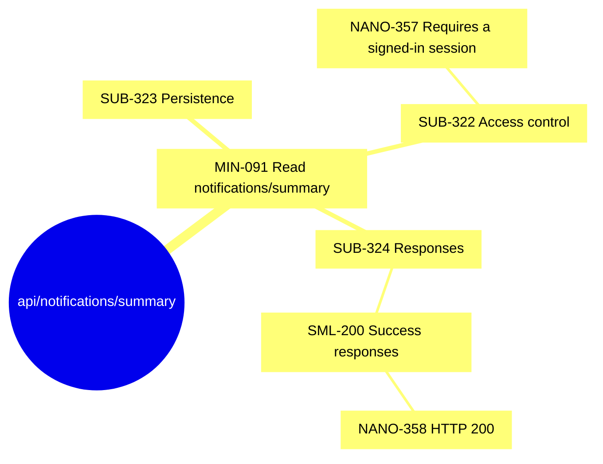

| ID       | Level | Parent   | Name                         | Description                                                                                                                                                           | Status      | Verification | Evidence                    | Related                                         |
| -------- | ----- | -------- | ---------------------------- | --------------------------------------------------------------------------------------------------------------------------------------------------------------------- | ----------- | ------------ | --------------------------- | ----------------------------------------------- |
| FEAT-075 | MAJOR | MOD-077  | api/notifications/summary    |                                                                                                                                                                       | IMPLEMENTED |              | apps/api/src/server.ts:6009 |                                                 |
| MIN-091  | MINOR | FEAT-075 | Read notifications/summary   | The header badge: one small read on every page, instead of the list. GET /api/v1/notifications/summary for any signed-in session; durable (PostgreSQL); responds 200. | IMPLEMENTED | VERIFIED     | apps/api/src/server.ts:6009 | API-118, TEST-056, TEST-097, TEST-112, TEST-156 |
| SUB-322  | SUB   | MIN-091  | Access control               | Who may call GET /api/v1/notifications/summary: any signed-in session.                                                                                                | IMPLEMENTED | PATH_LEVEL   | apps/api/src/server.ts:6009 |                                                 |
| NANO-357 | NANO  | SUB-322  | Requires a signed-in session | Requests without a valid session token are rejected with 401 UNAUTHENTICATED.                                                                                         | IMPLEMENTED | PATH_LEVEL   | apps/api/src/server.ts:6009 | ROLE-001                                        |
| SUB-323  | SUB   | MIN-091  | Persistence                  | Durable: writes go through the PostgreSQL store.                                                                                                                      | IMPLEMENTED | PATH_LEVEL   | apps/api/src/server.ts:6009 |                                                 |
| SUB-324  | SUB   | MIN-091  | Responses                    | Success 200; 0 explicit failure branch(es) besides validation and access errors.                                                                                      | IMPLEMENTED | PATH_LEVEL   | apps/api/src/server.ts:6009 |                                                 |
| SML-200  | SMALL | SUB-324  | Success responses            | HTTP 200.                                                                                                                                                             | IMPLEMENTED | PATH_LEVEL   | apps/api/src/server.ts:6009 |                                                 |
| NANO-358 | NANO  | SML-200  | HTTP 200                     | Replies 200 when the operation succeeds.                                                                                                                              | IMPLEMENTED | PATH_LEVEL   | apps/api/src/server.ts:6009 |                                                 |

## api/organizations (MOD-059)

**Application:** apps/api (MOD-001). **Purpose:** API module: routes under /api/v1/organizations in apps/api/src/server.ts.

**Nodes by level:** MODULE 1, MAJOR 5, MINOR 7, SUB 26, SMALL 22, TINY 12, NANO 50. **Status:** IMPLEMENTED 121, PARTIALLY_IMPLEMENTED 2. **Verification:** PATH_LEVEL 101, UNKNOWN 7, VERIFIED 9.

**User roles that reach it:** anonymous, authenticated, platform_admin.

**Known gaps:** MIN-092 no first-party web caller found; MIN-094 ephemeral: state held in process memory, lost on restart; MIN-094 no first-party web caller found; MIN-245 ephemeral: state held in process memory, lost on restart; MIN-245 no first-party web caller found; MIN-244 no first-party web caller found; MIN-095 no linked test.

**Called from (web screens and components):** FEAT-162 Screen /dashboard, FEAT-164 Screen /hiring

### Module map (to minor features)

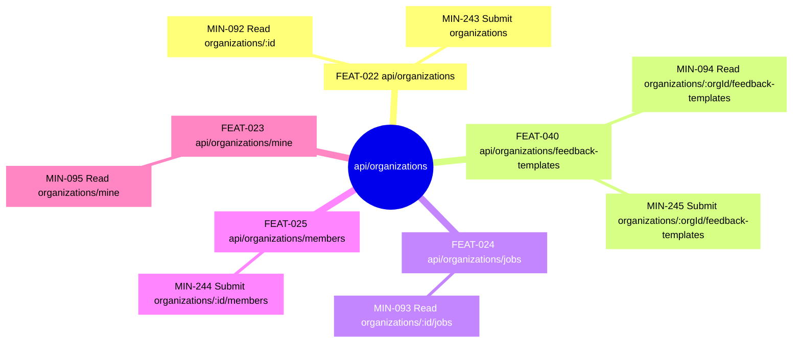

### FEAT-022 api/organizations

api/organizations

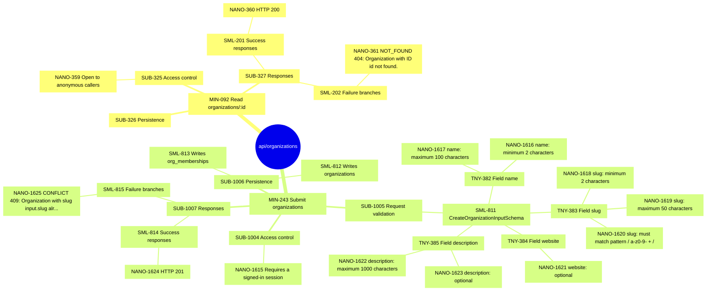

| ID        | Level | Parent   | Name                                                                 | Description                                                                                                                                                                                                            | Status      | Verification | Evidence                                      | Related                                                       |
| --------- | ----- | -------- | -------------------------------------------------------------------- | ---------------------------------------------------------------------------------------------------------------------------------------------------------------------------------------------------------------------- | ----------- | ------------ | --------------------------------------------- | ------------------------------------------------------------- |
| FEAT-022  | MAJOR | MOD-059  | api/organizations                                                    |                                                                                                                                                                                                                        | IMPLEMENTED |              | apps/api/src/server.ts:1884                   |                                                               |
| MIN-092   | MINOR | FEAT-022 | Read organizations/:id                                               | GET /api/v1/organizations/:id for anyone (public); durable (PostgreSQL); responds 200; 1 failure branch(es). Gaps: no first-party web caller found                                                                     | IMPLEMENTED | VERIFIED     | apps/api/src/server.ts:1955                   | API-029, TEST-100, TEST-125, TEST-145, TEST-180               |
| SUB-325   | SUB   | MIN-092  | Access control                                                       | Who may call GET /api/v1/organizations/:id: anyone (public).                                                                                                                                                           | IMPLEMENTED | PATH_LEVEL   | apps/api/src/server.ts:1955                   |                                                               |
| NANO-359  | NANO  | SUB-325  | Open to anonymous callers                                            | auth: public.                                                                                                                                                                                                          | IMPLEMENTED | PATH_LEVEL   | apps/api/src/server.ts:1955                   | ROLE-001                                                      |
| SUB-326   | SUB   | MIN-092  | Persistence                                                          | Durable: writes go through the PostgreSQL store.                                                                                                                                                                       | IMPLEMENTED | PATH_LEVEL   | apps/api/src/server.ts:1955                   |                                                               |
| SUB-327   | SUB   | MIN-092  | Responses                                                            | Success 200; 1 explicit failure branch(es) besides validation and access errors.                                                                                                                                       | IMPLEMENTED | PATH_LEVEL   | apps/api/src/server.ts:1955                   |                                                               |
| SML-201   | SMALL | SUB-327  | Success responses                                                    | HTTP 200.                                                                                                                                                                                                              | IMPLEMENTED | PATH_LEVEL   | apps/api/src/server.ts:1955                   |                                                               |
| NANO-360  | NANO  | SML-201  | HTTP 200                                                             | Replies 200 when the operation succeeds.                                                                                                                                                                               | IMPLEMENTED | PATH_LEVEL   | apps/api/src/server.ts:1955                   |                                                               |
| SML-202   | SMALL | SUB-327  | Failure branches                                                     | 1 DomainError branch(es) in the handler, mapped to HTTP by the global error handler.                                                                                                                                   | IMPLEMENTED | PATH_LEVEL   | apps/api/src/server.ts:1955                   |                                                               |
| NANO-361  | NANO  | SML-202  | NOT_FOUND 404: Organization with ID ${id} not found.                 | Throws DomainError(NOT_FOUND) "Organization with ID ${id} not found." -> HTTP 404.                                                                                                                                     | IMPLEMENTED | PATH_LEVEL   | apps/api/src/server.ts:1961                   | ERR-031                                                       |
| MIN-243   | MINOR | FEAT-022 | Submit organizations                                                 | Organization Endpoints POST /api/v1/organizations for any signed-in session; validates CreateOrganizationInputSchema; durable (PostgreSQL); writes organizations, org_memberships; responds 201; 1 failure branch(es). | IMPLEMENTED | VERIFIED     | apps/api/src/server.ts:1884                   | API-026, TEST-085, TEST-088, TEST-089, TEST-097, TEST-100 ... |
| SUB-1004  | SUB   | MIN-243  | Access control                                                       | Who may call POST /api/v1/organizations: any signed-in session.                                                                                                                                                        | IMPLEMENTED | PATH_LEVEL   | apps/api/src/server.ts:1884                   |                                                               |
| NANO-1615 | NANO  | SUB-1004 | Requires a signed-in session                                         | Requests without a valid session token are rejected with 401 UNAUTHENTICATED.                                                                                                                                          | IMPLEMENTED | PATH_LEVEL   | apps/api/src/server.ts:1884                   | ROLE-001                                                      |
| SUB-1005  | SUB   | MIN-243  | Request validation                                                   | The request is parsed with CreateOrganizationInputSchema; a failure returns 400 with field details before any business logic runs.                                                                                     | IMPLEMENTED | PATH_LEVEL   | apps/api/src/server.ts:1884                   |                                                               |
| SML-811   | SMALL | SUB-1005 | CreateOrganizationInputSchema                                        | CreateOrganizationInputSchema: 4 field(s)                                                                                                                                                                              | IMPLEMENTED | PATH_LEVEL   | packages/contracts/src/index.ts:215           | SCH-014                                                       |
| TNY-382   | TINY  | SML-811  | Field name                                                           | name (string, required): minimum 2 characters; maximum 100 characters                                                                                                                                                  | IMPLEMENTED | PATH_LEVEL   | packages/contracts/src/index.ts:216           |                                                               |
| NANO-1616 | NANO  | TNY-382  | name: minimum 2 characters                                           | name minimum 2 characters.                                                                                                                                                                                             | IMPLEMENTED | PATH_LEVEL   | packages/contracts/src/index.ts:216           |                                                               |
| NANO-1617 | NANO  | TNY-382  | name: maximum 100 characters                                         | name maximum 100 characters.                                                                                                                                                                                           | IMPLEMENTED | PATH_LEVEL   | packages/contracts/src/index.ts:216           |                                                               |
| TNY-383   | TINY  | SML-811  | Field slug                                                           | slug (string, required): minimum 2 characters; maximum 50 characters; must match pattern /^[a-z0-9-]+$/                                                                                                                | IMPLEMENTED | PATH_LEVEL   | packages/contracts/src/index.ts:217           |                                                               |
| NANO-1618 | NANO  | TNY-383  | slug: minimum 2 characters                                           | slug minimum 2 characters.                                                                                                                                                                                             | IMPLEMENTED | PATH_LEVEL   | packages/contracts/src/index.ts:217           |                                                               |
| NANO-1619 | NANO  | TNY-383  | slug: maximum 50 characters                                          | slug maximum 50 characters.                                                                                                                                                                                            | IMPLEMENTED | PATH_LEVEL   | packages/contracts/src/index.ts:217           |                                                               |
| NANO-1620 | NANO  | TNY-383  | slug: must match pattern /^[a-z0-9-]+$/                              | slug must match pattern /^[a-z0-9-]+$/; message "Slug must be lowercase alphanumeric with hyphens".                                                                                                                    | IMPLEMENTED | PATH_LEVEL   | packages/contracts/src/index.ts:217           |                                                               |
| TNY-384   | TINY  | SML-811  | Field website                                                        | website (httpUrl(), optional): optional                                                                                                                                                                                | IMPLEMENTED | PATH_LEVEL   | packages/contracts/src/index.ts:222           |                                                               |
| NANO-1621 | NANO  | TNY-384  | website: optional                                                    | website optional.                                                                                                                                                                                                      | IMPLEMENTED | PATH_LEVEL   | packages/contracts/src/index.ts:222           |                                                               |
| TNY-385   | TINY  | SML-811  | Field description                                                    | description (string, optional): maximum 1000 characters; optional                                                                                                                                                      | IMPLEMENTED | PATH_LEVEL   | packages/contracts/src/index.ts:223           |                                                               |
| NANO-1622 | NANO  | TNY-385  | description: maximum 1000 characters                                 | description maximum 1000 characters.                                                                                                                                                                                   | IMPLEMENTED | PATH_LEVEL   | packages/contracts/src/index.ts:223           |                                                               |
| NANO-1623 | NANO  | TNY-385  | description: optional                                                | description optional.                                                                                                                                                                                                  | IMPLEMENTED | PATH_LEVEL   | packages/contracts/src/index.ts:223           |                                                               |
| SUB-1006  | SUB   | MIN-243  | Persistence                                                          | Durable: writes go through the PostgreSQL store.                                                                                                                                                                       | IMPLEMENTED | PATH_LEVEL   | apps/api/src/server.ts:1884                   |                                                               |
| SML-812   | SMALL | SUB-1006 | Writes organizations                                                 | Writes table organizations (00001_core_schema.sql).                                                                                                                                                                    | IMPLEMENTED | PATH_LEVEL   | supabase/migrations/00001_core_schema.sql:146 | DB-004                                                        |
| SML-813   | SMALL | SUB-1006 | Writes org_memberships                                               | Writes table org_memberships (00001_core_schema.sql).                                                                                                                                                                  | IMPLEMENTED | PATH_LEVEL   | supabase/migrations/00001_core_schema.sql:157 | DB-005                                                        |
| SUB-1007  | SUB   | MIN-243  | Responses                                                            | Success 201; 1 explicit failure branch(es) besides validation and access errors.                                                                                                                                       | IMPLEMENTED | PATH_LEVEL   | apps/api/src/server.ts:1884                   |                                                               |
| SML-814   | SMALL | SUB-1007 | Success responses                                                    | HTTP 201.                                                                                                                                                                                                              | IMPLEMENTED | PATH_LEVEL   | apps/api/src/server.ts:1884                   |                                                               |
| NANO-1624 | NANO  | SML-814  | HTTP 201                                                             | Replies 201 when the operation succeeds.                                                                                                                                                                               | IMPLEMENTED | PATH_LEVEL   | apps/api/src/server.ts:1884                   |                                                               |
| SML-815   | SMALL | SUB-1007 | Failure branches                                                     | 1 DomainError branch(es) in the handler, mapped to HTTP by the global error handler.                                                                                                                                   | IMPLEMENTED | PATH_LEVEL   | apps/api/src/server.ts:1884                   |                                                               |
| NANO-1625 | NANO  | SML-815  | CONFLICT 409: Organization with slug "${input.slug}" already exists. | Throws DomainError(CONFLICT) "Organization with slug "${input.slug}" already exists." -> HTTP 409.                                                                                                                     | IMPLEMENTED | PATH_LEVEL   | apps/api/src/server.ts:1889                   | ERR-030                                                       |

### FEAT-040 api/organizations/feedback-templates

api/organizations/feedback-templates

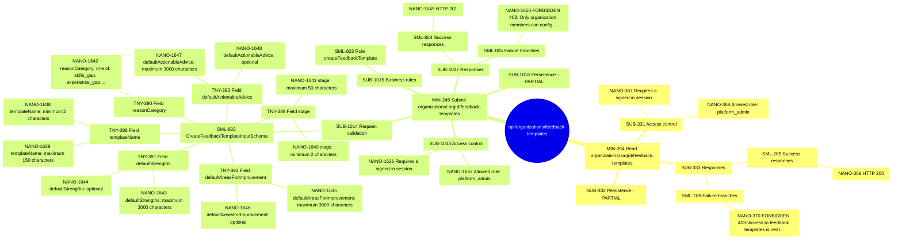

| ID        | Level | Parent   | Name                                                                                                                          | Description                                                                                                                                                                                                                                                                                                               | Status                | Verification | Evidence                                        | Related                     |
| --------- | ----- | -------- | ----------------------------------------------------------------------------------------------------------------------------- | ------------------------------------------------------------------------------------------------------------------------------------------------------------------------------------------------------------------------------------------------------------------------------------------------------------------------- | --------------------- | ------------ | ----------------------------------------------- | --------------------------- |
| FEAT-040  | MAJOR | MOD-059  | api/organizations/feedback-templates                                                                                          |                                                                                                                                                                                                                                                                                                                           | IMPLEMENTED           |              | apps/api/src/server.ts:3191                     |                             |
| MIN-094   | MINOR | FEAT-040 | Read organizations/:orgId/feedback-templates                                                                                  | GET /api/v1/organizations/:orgId/feedback-templates for roles platform_admin; ephemeral (process memory); responds 200; 1 failure branch(es). Gaps: ephemeral: state held in process memory, lost on restart; no first-party web caller found                                                                             | IMPLEMENTED           | VERIFIED     | apps/api/src/server.ts:3235                     | API-056, TEST-089, TEST-169 |
| SUB-331   | SUB   | MIN-094  | Access control                                                                                                                | Who may call GET /api/v1/organizations/:orgId/feedback-templates: roles platform_admin.                                                                                                                                                                                                                                   | IMPLEMENTED           | PATH_LEVEL   | apps/api/src/server.ts:3235                     |                             |
| NANO-367  | NANO  | SUB-331  | Requires a signed-in session                                                                                                  | Requests without a valid session token are rejected with 401 UNAUTHENTICATED.                                                                                                                                                                                                                                             | IMPLEMENTED           | PATH_LEVEL   | apps/api/src/server.ts:3235                     | ROLE-001                    |
| NANO-368  | NANO  | SUB-331  | Allowed role: platform_admin                                                                                                  | platform_admin is one of the roles allowed here (platform_admin); a caller holding none of them is rejected with 403.                                                                                                                                                                                                     | IMPLEMENTED           | PATH_LEVEL   | apps/api/src/server.ts:3235                     | ROLE-008                    |
| SUB-332   | SUB   | MIN-094  | Persistence                                                                                                                   | Ephemeral: state lives in API process memory and is lost on restart.                                                                                                                                                                                                                                                      | PARTIALLY_IMPLEMENTED | PATH_LEVEL   | apps/api/src/server.ts:3235                     |                             |
| SUB-333   | SUB   | MIN-094  | Responses                                                                                                                     | Success 200; 1 explicit failure branch(es) besides validation and access errors.                                                                                                                                                                                                                                          | IMPLEMENTED           | PATH_LEVEL   | apps/api/src/server.ts:3235                     |                             |
| SML-205   | SMALL | SUB-333  | Success responses                                                                                                             | HTTP 200.                                                                                                                                                                                                                                                                                                                 | IMPLEMENTED           | PATH_LEVEL   | apps/api/src/server.ts:3235                     |                             |
| NANO-369  | NANO  | SML-205  | HTTP 200                                                                                                                      | Replies 200 when the operation succeeds.                                                                                                                                                                                                                                                                                  | IMPLEMENTED           | PATH_LEVEL   | apps/api/src/server.ts:3235                     |                             |
| SML-206   | SMALL | SUB-333  | Failure branches                                                                                                              | 1 DomainError branch(es) in the handler, mapped to HTTP by the global error handler.                                                                                                                                                                                                                                      | IMPLEMENTED           | PATH_LEVEL   | apps/api/src/server.ts:3235                     |                             |
| NANO-370  | NANO  | SML-206  | FORBIDDEN 403: Access to feedback templates is restricted to organization members.                                            | Throws DomainError(FORBIDDEN) "Access to feedback templates is restricted to organization members." -> HTTP 403.                                                                                                                                                                                                          | IMPLEMENTED           | PATH_LEVEL   | apps/api/src/server.ts:3246                     | ERR-061                     |
| MIN-245   | MINOR | FEAT-040 | Submit organizations/:orgId/feedback-templates                                                                                | POST /api/v1/organizations/:orgId/feedback-templates for roles platform_admin; validates CreateFeedbackTemplateInputSchema; calls createFeedbackTemplate; ephemeral (process memory); responds 201; 1 failure branch(es). Gaps: ephemeral: state held in process memory, lost on restart; no first-party web caller found | IMPLEMENTED           | VERIFIED     | apps/api/src/server.ts:3191                     | API-055, TEST-089, TEST-169 |
| SUB-1013  | SUB   | MIN-245  | Access control                                                                                                                | Who may call POST /api/v1/organizations/:orgId/feedback-templates: roles platform_admin.                                                                                                                                                                                                                                  | IMPLEMENTED           | PATH_LEVEL   | apps/api/src/server.ts:3191                     |                             |
| NANO-1636 | NANO  | SUB-1013 | Requires a signed-in session                                                                                                  | Requests without a valid session token are rejected with 401 UNAUTHENTICATED.                                                                                                                                                                                                                                             | IMPLEMENTED           | PATH_LEVEL   | apps/api/src/server.ts:3191                     | ROLE-001                    |
| NANO-1637 | NANO  | SUB-1013 | Allowed role: platform_admin                                                                                                  | platform_admin is one of the roles allowed here (platform_admin); a caller holding none of them is rejected with 403.                                                                                                                                                                                                     | IMPLEMENTED           | PATH_LEVEL   | apps/api/src/server.ts:3191                     | ROLE-008                    |
| SUB-1014  | SUB   | MIN-245  | Request validation                                                                                                            | The request is parsed with CreateFeedbackTemplateInputSchema; a failure returns 400 with field details before any business logic runs.                                                                                                                                                                                    | IMPLEMENTED           | PATH_LEVEL   | apps/api/src/server.ts:3191                     |                             |
| SML-822   | SMALL | SUB-1014 | CreateFeedbackTemplateInputSchema                                                                                             | CreateFeedbackTemplateInputSchema: 6 field(s)                                                                                                                                                                                                                                                                             | IMPLEMENTED           | PATH_LEVEL   | packages/contracts/src/index.ts:1086            | SCH-085                     |
| TNY-388   | TINY  | SML-822  | Field templateName                                                                                                            | templateName (string, required): minimum 2 characters; maximum 150 characters                                                                                                                                                                                                                                             | IMPLEMENTED           | PATH_LEVEL   | packages/contracts/src/index.ts:1087            |                             |
| NANO-1638 | NANO  | TNY-388  | templateName: minimum 2 characters                                                                                            | templateName minimum 2 characters.                                                                                                                                                                                                                                                                                        | IMPLEMENTED           | PATH_LEVEL   | packages/contracts/src/index.ts:1087            |                             |
| NANO-1639 | NANO  | TNY-388  | templateName: maximum 150 characters                                                                                          | templateName maximum 150 characters.                                                                                                                                                                                                                                                                                      | IMPLEMENTED           | PATH_LEVEL   | packages/contracts/src/index.ts:1087            |                             |
| TNY-389   | TINY  | SML-822  | Field stage                                                                                                                   | stage (string, required): minimum 2 characters; maximum 50 characters                                                                                                                                                                                                                                                     | IMPLEMENTED           | PATH_LEVEL   | packages/contracts/src/index.ts:1088            |                             |
| NANO-1640 | NANO  | TNY-389  | stage: minimum 2 characters                                                                                                   | stage minimum 2 characters.                                                                                                                                                                                                                                                                                               | IMPLEMENTED           | PATH_LEVEL   | packages/contracts/src/index.ts:1088            |                             |
| NANO-1641 | NANO  | TNY-389  | stage: maximum 50 characters                                                                                                  | stage maximum 50 characters.                                                                                                                                                                                                                                                                                              | IMPLEMENTED           | PATH_LEVEL   | packages/contracts/src/index.ts:1088            |                             |
| TNY-390   | TINY  | SML-822  | Field reasonCategory                                                                                                          | reasonCategory (enum, required): one of: skills_gap, experience_gap, culture_fit, overqualified, position_filled, compensation_mismatch, other                                                                                                                                                                            | IMPLEMENTED           | PATH_LEVEL   | packages/contracts/src/index.ts:1089            |                             |
| NANO-1642 | NANO  | TNY-390  | reasonCategory: one of: skills_gap, experience_gap, culture_fit, overqualified, position_filled, compensation_mismatch, other | reasonCategory one of: skills_gap, experience_gap, culture_fit, overqualified, position_filled, compensation_mismatch, other.                                                                                                                                                                                             | IMPLEMENTED           | PATH_LEVEL   | packages/contracts/src/index.ts:1089            |                             |
| TNY-391   | TINY  | SML-822  | Field defaultStrengths                                                                                                        | defaultStrengths (string, optional): maximum 3000 characters; optional                                                                                                                                                                                                                                                    | IMPLEMENTED           | PATH_LEVEL   | packages/contracts/src/index.ts:1098            |                             |
| NANO-1643 | NANO  | TNY-391  | defaultStrengths: maximum 3000 characters                                                                                     | defaultStrengths maximum 3000 characters.                                                                                                                                                                                                                                                                                 | IMPLEMENTED           | PATH_LEVEL   | packages/contracts/src/index.ts:1098            |                             |
| NANO-1644 | NANO  | TNY-391  | defaultStrengths: optional                                                                                                    | defaultStrengths optional.                                                                                                                                                                                                                                                                                                | IMPLEMENTED           | PATH_LEVEL   | packages/contracts/src/index.ts:1098            |                             |
| TNY-392   | TINY  | SML-822  | Field defaultAreasForImprovement                                                                                              | defaultAreasForImprovement (string, optional): maximum 3000 characters; optional                                                                                                                                                                                                                                          | IMPLEMENTED           | PATH_LEVEL   | packages/contracts/src/index.ts:1099            |                             |
| NANO-1645 | NANO  | TNY-392  | defaultAreasForImprovement: maximum 3000 characters                                                                           | defaultAreasForImprovement maximum 3000 characters.                                                                                                                                                                                                                                                                       | IMPLEMENTED           | PATH_LEVEL   | packages/contracts/src/index.ts:1099            |                             |
| NANO-1646 | NANO  | TNY-392  | defaultAreasForImprovement: optional                                                                                          | defaultAreasForImprovement optional.                                                                                                                                                                                                                                                                                      | IMPLEMENTED           | PATH_LEVEL   | packages/contracts/src/index.ts:1099            |                             |
| TNY-393   | TINY  | SML-822  | Field defaultActionableAdvice                                                                                                 | defaultActionableAdvice (string, optional): maximum 3000 characters; optional                                                                                                                                                                                                                                             | IMPLEMENTED           | PATH_LEVEL   | packages/contracts/src/index.ts:1100            |                             |
| NANO-1647 | NANO  | TNY-393  | defaultActionableAdvice: maximum 3000 characters                                                                              | defaultActionableAdvice maximum 3000 characters.                                                                                                                                                                                                                                                                          | IMPLEMENTED           | PATH_LEVEL   | packages/contracts/src/index.ts:1100            |                             |
| NANO-1648 | NANO  | TNY-393  | defaultActionableAdvice: optional                                                                                             | defaultActionableAdvice optional.                                                                                                                                                                                                                                                                                         | IMPLEMENTED           | PATH_LEVEL   | packages/contracts/src/index.ts:1100            |                             |
| SUB-1015  | SUB   | MIN-245  | Business rules                                                                                                                | Domain functions from packages/domain called by the handler (1).                                                                                                                                                                                                                                                          | IMPLEMENTED           | PATH_LEVEL   | apps/api/src/server.ts:3191                     |                             |
| SML-823   | SMALL | SUB-1015 | Rule createFeedbackTemplate                                                                                                   | Calls createFeedbackTemplate (packages/domain/src/application-feedback.ts). Rule status IMPLEMENTED; its own tests: VERIFIED.                                                                                                                                                                                             | IMPLEMENTED           | VERIFIED     | packages/domain/src/application-feedback.ts:296 | RULE-040                    |
| SUB-1016  | SUB   | MIN-245  | Persistence                                                                                                                   | Ephemeral: state lives in API process memory and is lost on restart.                                                                                                                                                                                                                                                      | PARTIALLY_IMPLEMENTED | PATH_LEVEL   | apps/api/src/server.ts:3191                     |                             |
| SUB-1017  | SUB   | MIN-245  | Responses                                                                                                                     | Success 201; 1 explicit failure branch(es) besides validation and access errors.                                                                                                                                                                                                                                          | IMPLEMENTED           | PATH_LEVEL   | apps/api/src/server.ts:3191                     |                             |
| SML-824   | SMALL | SUB-1017 | Success responses                                                                                                             | HTTP 201.                                                                                                                                                                                                                                                                                                                 | IMPLEMENTED           | PATH_LEVEL   | apps/api/src/server.ts:3191                     |                             |
| NANO-1649 | NANO  | SML-824  | HTTP 201                                                                                                                      | Replies 201 when the operation succeeds.                                                                                                                                                                                                                                                                                  | IMPLEMENTED           | PATH_LEVEL   | apps/api/src/server.ts:3191                     |                             |
| SML-825   | SMALL | SUB-1017 | Failure branches                                                                                                              | 1 DomainError branch(es) in the handler, mapped to HTTP by the global error handler.                                                                                                                                                                                                                                      | IMPLEMENTED           | PATH_LEVEL   | apps/api/src/server.ts:3191                     |                             |
| NANO-1650 | NANO  | SML-825  | FORBIDDEN 403: Only organization members can configure feedback templates (BR-224).                                           | Throws DomainError(FORBIDDEN) "Only organization members can configure feedback templates (BR-224)." -> HTTP 403.                                                                                                                                                                                                         | IMPLEMENTED           | PATH_LEVEL   | apps/api/src/server.ts:3203                     | ERR-060                     |

### FEAT-024 api/organizations/jobs

api/organizations/jobs

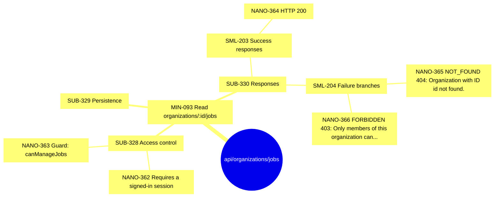

| ID       | Level | Parent   | Name                                                               | Description                                                                                                                                                                                                                                                                | Status      | Verification | Evidence                    | Related           |
| -------- | ----- | -------- | ------------------------------------------------------------------ | -------------------------------------------------------------------------------------------------------------------------------------------------------------------------------------------------------------------------------------------------------------------------- | ----------- | ------------ | --------------------------- | ----------------- |
| FEAT-024 | MAJOR | MOD-059  | api/organizations/jobs                                             |                                                                                                                                                                                                                                                                            | IMPLEMENTED |              | apps/api/src/server.ts:1931 |                   |
| MIN-093  | MINOR | FEAT-024 | Read organizations/:id/jobs                                        | Every posting of an organization, in any status — the hiring team's view. Includes per-job application counts by status for the pipeline overview. GET /api/v1/organizations/:id/jobs for any signed-in session; durable (PostgreSQL); responds 200; 2 failure branch(es). | IMPLEMENTED | VERIFIED     | apps/api/src/server.ts:1931 | API-028, TEST-142 |
| SUB-328  | SUB   | MIN-093  | Access control                                                     | Who may call GET /api/v1/organizations/:id/jobs: any signed-in session.                                                                                                                                                                                                    | IMPLEMENTED | PATH_LEVEL   | apps/api/src/server.ts:1931 |                   |
| NANO-362 | NANO  | SUB-328  | Requires a signed-in session                                       | Requests without a valid session token are rejected with 401 UNAUTHENTICATED.                                                                                                                                                                                              | IMPLEMENTED | PATH_LEVEL   | apps/api/src/server.ts:1931 | ROLE-001          |
| NANO-363 | NANO  | SUB-328  | Guard: canManageJobs                                               | Guard canManageJobs must pass before the handler runs.                                                                                                                                                                                                                     | IMPLEMENTED | PATH_LEVEL   | apps/api/src/server.ts:1931 |                   |
| SUB-329  | SUB   | MIN-093  | Persistence                                                        | Durable: writes go through the PostgreSQL store.                                                                                                                                                                                                                           | IMPLEMENTED | PATH_LEVEL   | apps/api/src/server.ts:1931 |                   |
| SUB-330  | SUB   | MIN-093  | Responses                                                          | Success 200; 2 explicit failure branch(es) besides validation and access errors.                                                                                                                                                                                           | IMPLEMENTED | PATH_LEVEL   | apps/api/src/server.ts:1931 |                   |
| SML-203  | SMALL | SUB-330  | Success responses                                                  | HTTP 200.                                                                                                                                                                                                                                                                  | IMPLEMENTED | PATH_LEVEL   | apps/api/src/server.ts:1931 |                   |
| NANO-364 | NANO  | SML-203  | HTTP 200                                                           | Replies 200 when the operation succeeds.                                                                                                                                                                                                                                   | IMPLEMENTED | PATH_LEVEL   | apps/api/src/server.ts:1931 |                   |
| SML-204  | SMALL | SUB-330  | Failure branches                                                   | 2 DomainError branch(es) in the handler, mapped to HTTP by the global error handler.                                                                                                                                                                                       | IMPLEMENTED | PATH_LEVEL   | apps/api/src/server.ts:1931 |                   |
| NANO-365 | NANO  | SML-204  | NOT_FOUND 404: Organization with ID ${id} not found.               | Throws DomainError(NOT_FOUND) "Organization with ID ${id} not found." -> HTTP 404.                                                                                                                                                                                         | IMPLEMENTED | PATH_LEVEL   | apps/api/src/server.ts:1937 | ERR-031           |
| NANO-366 | NANO  | SML-204  | FORBIDDEN 403: Only members of this organization can see its jobs. | Throws DomainError(FORBIDDEN) "Only members of this organization can see its jobs." -> HTTP 403.                                                                                                                                                                           | IMPLEMENTED | PATH_LEVEL   | apps/api/src/server.ts:1940 | ERR-032           |

### FEAT-025 api/organizations/members

api/organizations/members

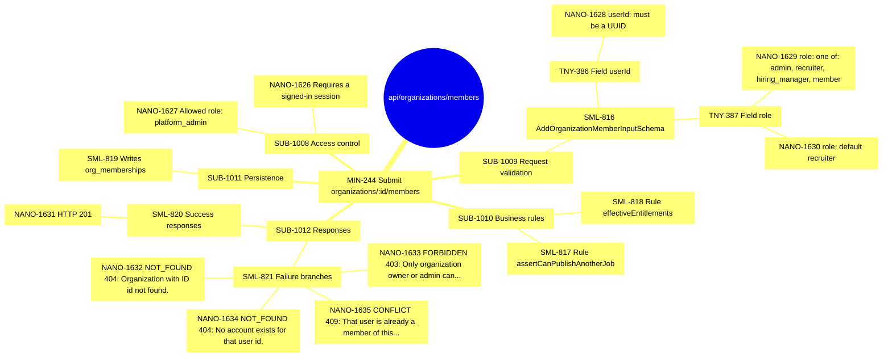

| ID        | Level | Parent   | Name                                                              | Description                                                                                                                                                                                                                                                                                   | Status      | Verification | Evidence                                      | Related                                                       |
| --------- | ----- | -------- | ----------------------------------------------------------------- | --------------------------------------------------------------------------------------------------------------------------------------------------------------------------------------------------------------------------------------------------------------------------------------------- | ----------- | ------------ | --------------------------------------------- | ------------------------------------------------------------- |
| FEAT-025  | MAJOR | MOD-059  | api/organizations/members                                         |                                                                                                                                                                                                                                                                                               | IMPLEMENTED |              | apps/api/src/server.ts:1967                   |                                                               |
| MIN-244   | MINOR | FEAT-025 | Submit organizations/:id/members                                  | POST /api/v1/organizations/:id/members for roles platform_admin; validates AddOrganizationMemberInputSchema; calls assertCanPublishAnotherJob, effectiveEntitlements; durable (PostgreSQL); writes org_memberships; responds 201; 4 failure branch(es). Gaps: no first-party web caller found | IMPLEMENTED | VERIFIED     | apps/api/src/server.ts:1967                   | API-030, TEST-097, TEST-101, TEST-112, TEST-120, TEST-126 ... |
| SUB-1008  | SUB   | MIN-244  | Access control                                                    | Who may call POST /api/v1/organizations/:id/members: roles platform_admin.                                                                                                                                                                                                                    | IMPLEMENTED | PATH_LEVEL   | apps/api/src/server.ts:1967                   |                                                               |
| NANO-1626 | NANO  | SUB-1008 | Requires a signed-in session                                      | Requests without a valid session token are rejected with 401 UNAUTHENTICATED.                                                                                                                                                                                                                 | IMPLEMENTED | PATH_LEVEL   | apps/api/src/server.ts:1967                   | ROLE-001                                                      |
| NANO-1627 | NANO  | SUB-1008 | Allowed role: platform_admin                                      | platform_admin is one of the roles allowed here (platform_admin); a caller holding none of them is rejected with 403.                                                                                                                                                                         | IMPLEMENTED | PATH_LEVEL   | apps/api/src/server.ts:1967                   | ROLE-008                                                      |
| SUB-1009  | SUB   | MIN-244  | Request validation                                                | The request is parsed with AddOrganizationMemberInputSchema; a failure returns 400 with field details before any business logic runs.                                                                                                                                                         | IMPLEMENTED | PATH_LEVEL   | apps/api/src/server.ts:1967                   |                                                               |
| SML-816   | SMALL | SUB-1009 | AddOrganizationMemberInputSchema                                  | AddOrganizationMemberInputSchema: 2 field(s)                                                                                                                                                                                                                                                  | IMPLEMENTED | PATH_LEVEL   | packages/contracts/src/index.ts:232           | SCH-015                                                       |
| TNY-386   | TINY  | SML-816  | Field userId                                                      | userId (string, required): must be a UUID                                                                                                                                                                                                                                                     | IMPLEMENTED | PATH_LEVEL   | packages/contracts/src/index.ts:233           |                                                               |
| NANO-1628 | NANO  | TNY-386  | userId: must be a UUID                                            | userId must be a UUID.                                                                                                                                                                                                                                                                        | IMPLEMENTED | PATH_LEVEL   | packages/contracts/src/index.ts:233           |                                                               |
| TNY-387   | TINY  | SML-816  | Field role                                                        | role (enum, optional): one of: admin, recruiter, hiring_manager, member; default 'recruiter'                                                                                                                                                                                                  | IMPLEMENTED | PATH_LEVEL   | packages/contracts/src/index.ts:234           |                                                               |
| NANO-1629 | NANO  | TNY-387  | role: one of: admin, recruiter, hiring_manager, member            | role one of: admin, recruiter, hiring_manager, member.                                                                                                                                                                                                                                        | IMPLEMENTED | PATH_LEVEL   | packages/contracts/src/index.ts:234           |                                                               |
| NANO-1630 | NANO  | TNY-387  | role: default 'recruiter'                                         | role default 'recruiter'; message "recruiter".                                                                                                                                                                                                                                                | IMPLEMENTED | PATH_LEVEL   | packages/contracts/src/index.ts:234           |                                                               |
| SUB-1010  | SUB   | MIN-244  | Business rules                                                    | Domain functions from packages/domain called by the handler (2).                                                                                                                                                                                                                              | IMPLEMENTED | PATH_LEVEL   | apps/api/src/server.ts:1967                   |                                                               |
| SML-817   | SMALL | SUB-1010 | Rule assertCanPublishAnotherJob                                   | Calls assertCanPublishAnotherJob (packages/domain/src/billing.ts). Rule status IMPLEMENTED; its own tests: VERIFIED.                                                                                                                                                                          | IMPLEMENTED | VERIFIED     | packages/domain/src/billing.ts:217            | RULE-072                                                      |
| SML-818   | SMALL | SUB-1010 | Rule effectiveEntitlements                                        | Calls effectiveEntitlements (packages/domain/src/stripe-billing.ts). Rule status IMPLEMENTED; its own tests: VERIFIED.                                                                                                                                                                        | IMPLEMENTED | VERIFIED     | packages/domain/src/stripe-billing.ts:125     | RULE-232                                                      |
| SUB-1011  | SUB   | MIN-244  | Persistence                                                       | Durable: writes go through the PostgreSQL store.                                                                                                                                                                                                                                              | IMPLEMENTED | PATH_LEVEL   | apps/api/src/server.ts:1967                   |                                                               |
| SML-819   | SMALL | SUB-1011 | Writes org_memberships                                            | Writes table org_memberships (00001_core_schema.sql).                                                                                                                                                                                                                                         | IMPLEMENTED | PATH_LEVEL   | supabase/migrations/00001_core_schema.sql:157 | DB-005                                                        |
| SUB-1012  | SUB   | MIN-244  | Responses                                                         | Success 201; 4 explicit failure branch(es) besides validation and access errors.                                                                                                                                                                                                              | IMPLEMENTED | PATH_LEVEL   | apps/api/src/server.ts:1967                   |                                                               |
| SML-820   | SMALL | SUB-1012 | Success responses                                                 | HTTP 201.                                                                                                                                                                                                                                                                                     | IMPLEMENTED | PATH_LEVEL   | apps/api/src/server.ts:1967                   |                                                               |
| NANO-1631 | NANO  | SML-820  | HTTP 201                                                          | Replies 201 when the operation succeeds.                                                                                                                                                                                                                                                      | IMPLEMENTED | PATH_LEVEL   | apps/api/src/server.ts:1967                   |                                                               |
| SML-821   | SMALL | SUB-1012 | Failure branches                                                  | 4 DomainError branch(es) in the handler, mapped to HTTP by the global error handler.                                                                                                                                                                                                          | IMPLEMENTED | PATH_LEVEL   | apps/api/src/server.ts:1967                   |                                                               |
| NANO-1632 | NANO  | SML-821  | NOT_FOUND 404: Organization with ID ${id} not found.              | Throws DomainError(NOT_FOUND) "Organization with ID ${id} not found." -> HTTP 404.                                                                                                                                                                                                            | IMPLEMENTED | PATH_LEVEL   | apps/api/src/server.ts:1974                   | ERR-031                                                       |
| NANO-1633 | NANO  | SML-821  | FORBIDDEN 403: Only organization owner or admin can add members.  | Throws DomainError(FORBIDDEN) "Only organization owner or admin can add members." -> HTTP 403.                                                                                                                                                                                                | IMPLEMENTED | PATH_LEVEL   | apps/api/src/server.ts:1983                   | ERR-033                                                       |
| NANO-1634 | NANO  | SML-821  | NOT_FOUND 404: No account exists for that user id.                | Throws DomainError(NOT_FOUND) "No account exists for that user id." -> HTTP 404.                                                                                                                                                                                                              | IMPLEMENTED | PATH_LEVEL   | apps/api/src/server.ts:1989                   | ERR-034                                                       |
| NANO-1635 | NANO  | SML-821  | CONFLICT 409: That user is already a member of this organization. | Throws DomainError(CONFLICT) "That user is already a member of this organization." -> HTTP 409.                                                                                                                                                                                               | IMPLEMENTED | PATH_LEVEL   | apps/api/src/server.ts:1996                   | ERR-035                                                       |

### FEAT-023 api/organizations/mine

api/organizations/mine

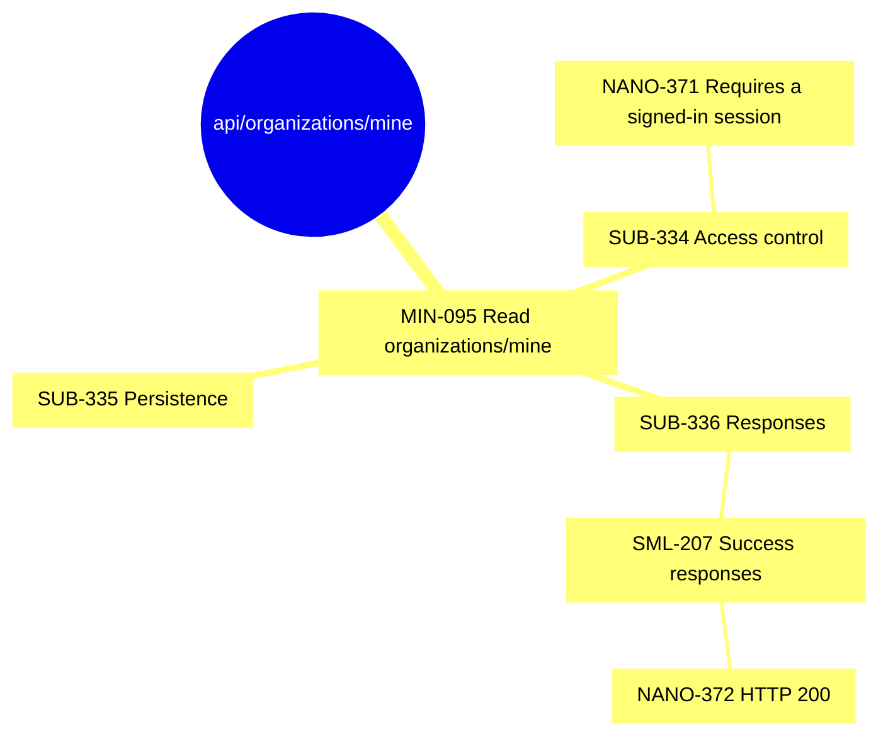

| ID       | Level | Parent   | Name                         | Description                                                                                                                                                                              | Status      | Verification | Evidence                    | Related  |
| -------- | ----- | -------- | ---------------------------- | ---------------------------------------------------------------------------------------------------------------------------------------------------------------------------------------- | ----------- | ------------ | --------------------------- | -------- |
| FEAT-023 | MAJOR | MOD-059  | api/organizations/mine       |                                                                                                                                                                                          | IMPLEMENTED |              | apps/api/src/server.ts:1918 |          |
| MIN-095  | MINOR | FEAT-023 | Read organizations/mine      | Organizations the signed-in user belongs to, with their role in each. GET /api/v1/organizations/mine for any signed-in session; durable (PostgreSQL); responds 200. Gaps: no linked test | IMPLEMENTED | UNKNOWN      | apps/api/src/server.ts:1918 | API-027  |
| SUB-334  | SUB   | MIN-095  | Access control               | Who may call GET /api/v1/organizations/mine: any signed-in session.                                                                                                                      | IMPLEMENTED | UNKNOWN      | apps/api/src/server.ts:1918 |          |
| NANO-371 | NANO  | SUB-334  | Requires a signed-in session | Requests without a valid session token are rejected with 401 UNAUTHENTICATED.                                                                                                            | IMPLEMENTED | UNKNOWN      | apps/api/src/server.ts:1918 | ROLE-001 |
| SUB-335  | SUB   | MIN-095  | Persistence                  | Durable: writes go through the PostgreSQL store.                                                                                                                                         | IMPLEMENTED | UNKNOWN      | apps/api/src/server.ts:1918 |          |
| SUB-336  | SUB   | MIN-095  | Responses                    | Success 200; 0 explicit failure branch(es) besides validation and access errors.                                                                                                         | IMPLEMENTED | UNKNOWN      | apps/api/src/server.ts:1918 |          |
| SML-207  | SMALL | SUB-336  | Success responses            | HTTP 200.                                                                                                                                                                                | IMPLEMENTED | UNKNOWN      | apps/api/src/server.ts:1918 |          |
| NANO-372 | NANO  | SML-207  | HTTP 200                     | Replies 200 when the operation succeeds.                                                                                                                                                 | IMPLEMENTED | UNKNOWN      | apps/api/src/server.ts:1918 |          |

## api/portfolio (MOD-087)

**Application:** apps/api (MOD-001). **Purpose:** API module: routes under /api/v1/portfolio in apps/api/src/server.ts.

**Nodes by level:** MODULE 1, MAJOR 2, MINOR 6, SUB 27, SMALL 21, TINY 10, NANO 38. **Status:** IMPLEMENTED 93, PARTIALLY_IMPLEMENTED 11, UNKNOWN 1. **Verification:** PATH_LEVEL 86, UNKNOWN 3, VERIFIED 13.

**User roles that reach it:** authenticated.

**Known gaps:** MIN-007 ephemeral: state held in process memory, lost on restart; MIN-007 no first-party web caller found; MIN-096 ephemeral: state held in process memory, lost on restart; MIN-097 ephemeral: state held in process memory, lost on restart; MIN-097 no first-party web caller found; MIN-153 ephemeral: state held in process memory, lost on restart; MIN-153 no first-party web caller found; MIN-246 ephemeral: state held in process memory, lost on restart; MIN-098 ephemeral: state held in process memory, lost on restart; MIN-098 no first-party web caller found.

**Called from (web screens and components):** FEAT-175 Screen /portfolio

### Module map (to minor features)

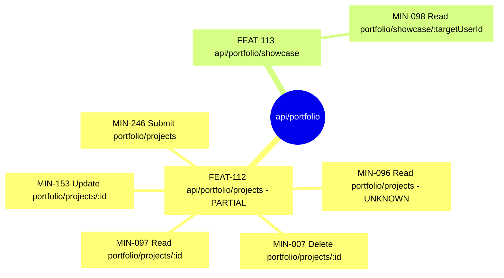

### FEAT-112 api/portfolio/projects

api/portfolio/projects

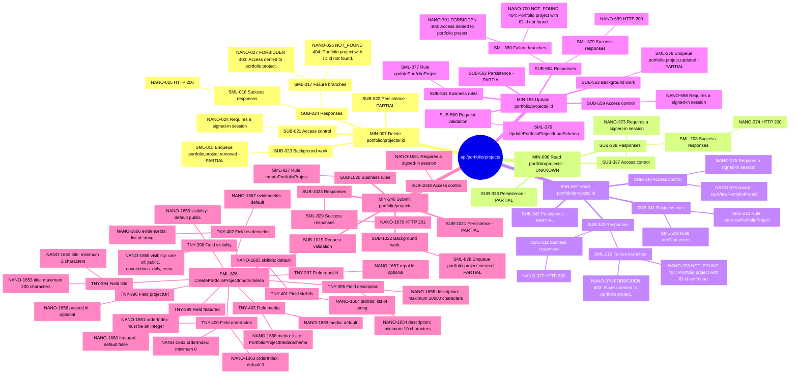

| ID        | Level | Parent   | Name                                                                   | Description                                                                                                                                                                                                                                                                                                | Status                | Verification | Evidence                                   | Related                                         |
| --------- | ----- | -------- | ---------------------------------------------------------------------- | ---------------------------------------------------------------------------------------------------------------------------------------------------------------------------------------------------------------------------------------------------------------------------------------------------------- | --------------------- | ------------ | ------------------------------------------ | ----------------------------------------------- |
| FEAT-112  | MAJOR | MOD-087  | api/portfolio/projects                                                 |                                                                                                                                                                                                                                                                                                            | PARTIALLY_IMPLEMENTED |              | apps/api/src/server.ts:9701                |                                                 |
| MIN-007   | MINOR | FEAT-112 | Delete portfolio/projects/:id                                          | DELETE /api/v1/portfolio/projects/:id for any signed-in session; ephemeral (process memory); responds 200; 2 failure branch(es). Gaps: ephemeral: state held in process memory, lost on restart; no first-party web caller found                                                                           | IMPLEMENTED           | VERIFIED     | apps/api/src/server.ts:9799                | API-205, TEST-119                               |
| SUB-021   | SUB   | MIN-007  | Access control                                                         | Who may call DELETE /api/v1/portfolio/projects/:id: any signed-in session.                                                                                                                                                                                                                                 | IMPLEMENTED           | PATH_LEVEL   | apps/api/src/server.ts:9799                |                                                 |
| NANO-024  | NANO  | SUB-021  | Requires a signed-in session                                           | Requests without a valid session token are rejected with 401 UNAUTHENTICATED.                                                                                                                                                                                                                              | IMPLEMENTED           | PATH_LEVEL   | apps/api/src/server.ts:9799                | ROLE-001                                        |
| SUB-022   | SUB   | MIN-007  | Persistence                                                            | Ephemeral: state lives in API process memory and is lost on restart.                                                                                                                                                                                                                                       | PARTIALLY_IMPLEMENTED | PATH_LEVEL   | apps/api/src/server.ts:9799                |                                                 |
| SUB-023   | SUB   | MIN-007  | Background work                                                        | Enqueues 1 background job kind(s) in background_jobs for apps/worker.                                                                                                                                                                                                                                      | IMPLEMENTED           | PATH_LEVEL   | apps/api/src/server.ts:9799                |                                                 |
| SML-015   | SMALL | SUB-023  | Enqueue portfolio.project.removed                                      | Dispatches job:portfolio.project.removed; worker handler: recordEvent (no-op: marks the event recorded).                                                                                                                                                                                                   | PARTIALLY_IMPLEMENTED | UNKNOWN      | packages/domain/src/background-jobs.ts:171 | SVC-036                                         |
| SUB-024   | SUB   | MIN-007  | Responses                                                              | Success 200; 2 explicit failure branch(es) besides validation and access errors.                                                                                                                                                                                                                           | IMPLEMENTED           | PATH_LEVEL   | apps/api/src/server.ts:9799                |                                                 |
| SML-016   | SMALL | SUB-024  | Success responses                                                      | HTTP 200.                                                                                                                                                                                                                                                                                                  | IMPLEMENTED           | PATH_LEVEL   | apps/api/src/server.ts:9799                |                                                 |
| NANO-025  | NANO  | SML-016  | HTTP 200                                                               | Replies 200 when the operation succeeds.                                                                                                                                                                                                                                                                   | IMPLEMENTED           | PATH_LEVEL   | apps/api/src/server.ts:9799                |                                                 |
| SML-017   | SMALL | SUB-024  | Failure branches                                                       | 2 DomainError branch(es) in the handler, mapped to HTTP by the global error handler.                                                                                                                                                                                                                       | IMPLEMENTED           | PATH_LEVEL   | apps/api/src/server.ts:9799                |                                                 |
| NANO-026  | NANO  | SML-017  | NOT_FOUND 404: Portfolio project with ID "${id}" not found.            | Throws DomainError(NOT_FOUND) "Portfolio project with ID "${id}" not found." -> HTTP 404.                                                                                                                                                                                                                  | IMPLEMENTED           | PATH_LEVEL   | apps/api/src/server.ts:9807                | ERR-200                                         |
| NANO-027  | NANO  | SML-017  | FORBIDDEN 403: Access denied to portfolio project.                     | Throws DomainError(FORBIDDEN) "Access denied to portfolio project." -> HTTP 403.                                                                                                                                                                                                                           | IMPLEMENTED           | PATH_LEVEL   | apps/api/src/server.ts:9811                | ERR-201                                         |
| MIN-096   | MINOR | FEAT-112 | Read portfolio/projects                                                | GET /api/v1/portfolio/projects for any signed-in session; ephemeral (process memory); responds 200. Gaps: ephemeral: state held in process memory, lost on restart                                                                                                                                         | UNKNOWN               | VERIFIED     | apps/api/src/server.ts:9726                | API-202, TEST-119                               |
| SUB-337   | SUB   | MIN-096  | Access control                                                         | Who may call GET /api/v1/portfolio/projects: any signed-in session.                                                                                                                                                                                                                                        | IMPLEMENTED           | PATH_LEVEL   | apps/api/src/server.ts:9726                |                                                 |
| NANO-373  | NANO  | SUB-337  | Requires a signed-in session                                           | Requests without a valid session token are rejected with 401 UNAUTHENTICATED.                                                                                                                                                                                                                              | IMPLEMENTED           | PATH_LEVEL   | apps/api/src/server.ts:9726                | ROLE-001                                        |
| SUB-338   | SUB   | MIN-096  | Persistence                                                            | Ephemeral: state lives in API process memory and is lost on restart.                                                                                                                                                                                                                                       | PARTIALLY_IMPLEMENTED | PATH_LEVEL   | apps/api/src/server.ts:9726                |                                                 |
| SUB-339   | SUB   | MIN-096  | Responses                                                              | Success 200; 0 explicit failure branch(es) besides validation and access errors.                                                                                                                                                                                                                           | IMPLEMENTED           | PATH_LEVEL   | apps/api/src/server.ts:9726                |                                                 |
| SML-208   | SMALL | SUB-339  | Success responses                                                      | HTTP 200.                                                                                                                                                                                                                                                                                                  | IMPLEMENTED           | PATH_LEVEL   | apps/api/src/server.ts:9726                |                                                 |
| NANO-374  | NANO  | SML-208  | HTTP 200                                                               | Replies 200 when the operation succeeds.                                                                                                                                                                                                                                                                   | IMPLEMENTED           | PATH_LEVEL   | apps/api/src/server.ts:9726                |                                                 |
| MIN-097   | MINOR | FEAT-112 | Read portfolio/projects/:id                                            | GET /api/v1/portfolio/projects/:id for any signed-in session; calls areConnected, canViewPortfolioProject; ephemeral (process memory); responds 200; 2 failure branch(es). Gaps: ephemeral: state held in process memory, lost on restart; no first-party web caller found                                 | IMPLEMENTED           | VERIFIED     | apps/api/src/server.ts:9732                | API-203, TEST-119, TEST-145, TEST-206           |
| SUB-340   | SUB   | MIN-097  | Access control                                                         | Who may call GET /api/v1/portfolio/projects/:id: any signed-in session.                                                                                                                                                                                                                                    | IMPLEMENTED           | PATH_LEVEL   | apps/api/src/server.ts:9732                |                                                 |
| NANO-375  | NANO  | SUB-340  | Requires a signed-in session                                           | Requests without a valid session token are rejected with 401 UNAUTHENTICATED.                                                                                                                                                                                                                              | IMPLEMENTED           | PATH_LEVEL   | apps/api/src/server.ts:9732                | ROLE-001                                        |
| NANO-376  | NANO  | SUB-340  | Guard: canViewPortfolioProject                                         | Guard canViewPortfolioProject must pass before the handler runs.                                                                                                                                                                                                                                           | IMPLEMENTED           | PATH_LEVEL   | apps/api/src/server.ts:9732                |                                                 |
| SUB-341   | SUB   | MIN-097  | Business rules                                                         | Domain functions from packages/domain called by the handler (2).                                                                                                                                                                                                                                           | IMPLEMENTED           | PATH_LEVEL   | apps/api/src/server.ts:9732                |                                                 |
| SML-209   | SMALL | SUB-341  | Rule areConnected                                                      | Calls areConnected (packages/domain/src/networking.ts). Rule status IMPLEMENTED; its own tests: VERIFIED.                                                                                                                                                                                                  | IMPLEMENTED           | VERIFIED     | packages/domain/src/networking.ts:156      | RULE-158                                        |
| SML-210   | SMALL | SUB-341  | Rule canViewPortfolioProject                                           | Calls canViewPortfolioProject (packages/domain/src/portfolio.ts). Rule status IMPLEMENTED; its own tests: VERIFIED.                                                                                                                                                                                        | IMPLEMENTED           | VERIFIED     | packages/domain/src/portfolio.ts:183       | RULE-175                                        |
| SUB-342   | SUB   | MIN-097  | Persistence                                                            | Ephemeral: state lives in API process memory and is lost on restart.                                                                                                                                                                                                                                       | PARTIALLY_IMPLEMENTED | PATH_LEVEL   | apps/api/src/server.ts:9732                |                                                 |
| SUB-343   | SUB   | MIN-097  | Responses                                                              | Success 200; 2 explicit failure branch(es) besides validation and access errors.                                                                                                                                                                                                                           | IMPLEMENTED           | PATH_LEVEL   | apps/api/src/server.ts:9732                |                                                 |
| SML-211   | SMALL | SUB-343  | Success responses                                                      | HTTP 200.                                                                                                                                                                                                                                                                                                  | IMPLEMENTED           | PATH_LEVEL   | apps/api/src/server.ts:9732                |                                                 |
| NANO-377  | NANO  | SML-211  | HTTP 200                                                               | Replies 200 when the operation succeeds.                                                                                                                                                                                                                                                                   | IMPLEMENTED           | PATH_LEVEL   | apps/api/src/server.ts:9732                |                                                 |
| SML-212   | SMALL | SUB-343  | Failure branches                                                       | 2 DomainError branch(es) in the handler, mapped to HTTP by the global error handler.                                                                                                                                                                                                                       | IMPLEMENTED           | PATH_LEVEL   | apps/api/src/server.ts:9732                |                                                 |
| NANO-378  | NANO  | SML-212  | NOT_FOUND 404: Portfolio project with ID "${id}" not found.            | Throws DomainError(NOT_FOUND) "Portfolio project with ID "${id}" not found." -> HTTP 404.                                                                                                                                                                                                                  | IMPLEMENTED           | PATH_LEVEL   | apps/api/src/server.ts:9738                | ERR-200                                         |
| NANO-379  | NANO  | SML-212  | FORBIDDEN 403: Access denied to portfolio project.                     | Throws DomainError(FORBIDDEN) "Access denied to portfolio project." -> HTTP 403.                                                                                                                                                                                                                           | IMPLEMENTED           | PATH_LEVEL   | apps/api/src/server.ts:9753                | ERR-201                                         |
| MIN-153   | MINOR | FEAT-112 | Update portfolio/projects/:id                                          | PATCH /api/v1/portfolio/projects/:id for any signed-in session; validates UpdatePortfolioProjectInputSchema; calls updatePortfolioProject; ephemeral (process memory); responds 200; 2 failure branch(es). Gaps: ephemeral: state held in process memory, lost on restart; no first-party web caller found | IMPLEMENTED           | VERIFIED     | apps/api/src/server.ts:9760                | API-204, TEST-119                               |
| SUB-559   | SUB   | MIN-153  | Access control                                                         | Who may call PATCH /api/v1/portfolio/projects/:id: any signed-in session.                                                                                                                                                                                                                                  | IMPLEMENTED           | PATH_LEVEL   | apps/api/src/server.ts:9760                |                                                 |
| NANO-698  | NANO  | SUB-559  | Requires a signed-in session                                           | Requests without a valid session token are rejected with 401 UNAUTHENTICATED.                                                                                                                                                                                                                              | IMPLEMENTED           | PATH_LEVEL   | apps/api/src/server.ts:9760                | ROLE-001                                        |
| SUB-560   | SUB   | MIN-153  | Request validation                                                     | The request is parsed with UpdatePortfolioProjectInputSchema; a failure returns 400 with field details before any business logic runs.                                                                                                                                                                     | IMPLEMENTED           | PATH_LEVEL   | apps/api/src/server.ts:9760                |                                                 |
| SML-376   | SMALL | SUB-560  | UpdatePortfolioProjectInputSchema                                      | UpdatePortfolioProjectInputSchema = CreatePortfolioProjectInputSchema.partial() (not a plain object; fields not decomposed)                                                                                                                                                                                | IMPLEMENTED           | PATH_LEVEL   | packages/contracts/src/index.ts:564        | SCH-043                                         |
| SUB-561   | SUB   | MIN-153  | Business rules                                                         | Domain functions from packages/domain called by the handler (1).                                                                                                                                                                                                                                           | IMPLEMENTED           | PATH_LEVEL   | apps/api/src/server.ts:9760                |                                                 |
| SML-377   | SMALL | SUB-561  | Rule updatePortfolioProject                                            | Calls updatePortfolioProject (packages/domain/src/portfolio.ts). Rule status IMPLEMENTED; its own tests: VERIFIED.                                                                                                                                                                                         | IMPLEMENTED           | VERIFIED     | packages/domain/src/portfolio.ts:115       | RULE-174                                        |
| SUB-562   | SUB   | MIN-153  | Persistence                                                            | Ephemeral: state lives in API process memory and is lost on restart.                                                                                                                                                                                                                                       | PARTIALLY_IMPLEMENTED | PATH_LEVEL   | apps/api/src/server.ts:9760                |                                                 |
| SUB-563   | SUB   | MIN-153  | Background work                                                        | Enqueues 1 background job kind(s) in background_jobs for apps/worker.                                                                                                                                                                                                                                      | IMPLEMENTED           | PATH_LEVEL   | apps/api/src/server.ts:9760                |                                                 |
| SML-378   | SMALL | SUB-563  | Enqueue portfolio.project.updated                                      | Dispatches job:portfolio.project.updated; worker handler: recordEvent (no-op: marks the event recorded).                                                                                                                                                                                                   | PARTIALLY_IMPLEMENTED | UNKNOWN      | packages/domain/src/background-jobs.ts:171 | SVC-037                                         |
| SUB-564   | SUB   | MIN-153  | Responses                                                              | Success 200; 2 explicit failure branch(es) besides validation and access errors.                                                                                                                                                                                                                           | IMPLEMENTED           | PATH_LEVEL   | apps/api/src/server.ts:9760                |                                                 |
| SML-379   | SMALL | SUB-564  | Success responses                                                      | HTTP 200.                                                                                                                                                                                                                                                                                                  | IMPLEMENTED           | PATH_LEVEL   | apps/api/src/server.ts:9760                |                                                 |
| NANO-699  | NANO  | SML-379  | HTTP 200                                                               | Replies 200 when the operation succeeds.                                                                                                                                                                                                                                                                   | IMPLEMENTED           | PATH_LEVEL   | apps/api/src/server.ts:9760                |                                                 |
| SML-380   | SMALL | SUB-564  | Failure branches                                                       | 2 DomainError branch(es) in the handler, mapped to HTTP by the global error handler.                                                                                                                                                                                                                       | IMPLEMENTED           | PATH_LEVEL   | apps/api/src/server.ts:9760                |                                                 |
| NANO-700  | NANO  | SML-380  | NOT_FOUND 404: Portfolio project with ID "${id}" not found.            | Throws DomainError(NOT_FOUND) "Portfolio project with ID "${id}" not found." -> HTTP 404.                                                                                                                                                                                                                  | IMPLEMENTED           | PATH_LEVEL   | apps/api/src/server.ts:9768                | ERR-200                                         |
| NANO-701  | NANO  | SML-380  | FORBIDDEN 403: Access denied to portfolio project.                     | Throws DomainError(FORBIDDEN) "Access denied to portfolio project." -> HTTP 403.                                                                                                                                                                                                                           | IMPLEMENTED           | PATH_LEVEL   | apps/api/src/server.ts:9772                | ERR-201                                         |
| MIN-246   | MINOR | FEAT-112 | Submit portfolio/projects                                              | POST /api/v1/portfolio/projects for any signed-in session; validates CreatePortfolioProjectInputSchema; calls createPortfolioProject; ephemeral (process memory); responds 201. Gaps: ephemeral: state held in process memory, lost on restart                                                             | IMPLEMENTED           | VERIFIED     | apps/api/src/server.ts:9701                | API-201, TEST-119, TEST-129, TEST-206, TEST-218 |
| SUB-1018  | SUB   | MIN-246  | Access control                                                         | Who may call POST /api/v1/portfolio/projects: any signed-in session.                                                                                                                                                                                                                                       | IMPLEMENTED           | PATH_LEVEL   | apps/api/src/server.ts:9701                |                                                 |
| NANO-1651 | NANO  | SUB-1018 | Requires a signed-in session                                           | Requests without a valid session token are rejected with 401 UNAUTHENTICATED.                                                                                                                                                                                                                              | IMPLEMENTED           | PATH_LEVEL   | apps/api/src/server.ts:9701                | ROLE-001                                        |
| SUB-1019  | SUB   | MIN-246  | Request validation                                                     | The request is parsed with CreatePortfolioProjectInputSchema; a failure returns 400 with field details before any business logic runs.                                                                                                                                                                     | IMPLEMENTED           | PATH_LEVEL   | apps/api/src/server.ts:9701                |                                                 |
| SML-826   | SMALL | SUB-1019 | CreatePortfolioProjectInputSchema                                      | CreatePortfolioProjectInputSchema: 10 field(s)                                                                                                                                                                                                                                                             | IMPLEMENTED           | PATH_LEVEL   | packages/contracts/src/index.ts:547        | SCH-042                                         |
| TNY-394   | TINY  | SML-826  | Field title                                                            | title (string, required): minimum 2 characters; maximum 200 characters                                                                                                                                                                                                                                     | IMPLEMENTED           | PATH_LEVEL   | packages/contracts/src/index.ts:548        |                                                 |
| NANO-1652 | NANO  | TNY-394  | title: minimum 2 characters                                            | title minimum 2 characters.                                                                                                                                                                                                                                                                                | IMPLEMENTED           | PATH_LEVEL   | packages/contracts/src/index.ts:548        |                                                 |
| NANO-1653 | NANO  | TNY-394  | title: maximum 200 characters                                          | title maximum 200 characters.                                                                                                                                                                                                                                                                              | IMPLEMENTED           | PATH_LEVEL   | packages/contracts/src/index.ts:548        |                                                 |
| TNY-395   | TINY  | SML-826  | Field description                                                      | description (string, required): minimum 10 characters; maximum 10000 characters                                                                                                                                                                                                                            | IMPLEMENTED           | PATH_LEVEL   | packages/contracts/src/index.ts:549        |                                                 |
| NANO-1654 | NANO  | TNY-395  | description: minimum 10 characters                                     | description minimum 10 characters.                                                                                                                                                                                                                                                                         | IMPLEMENTED           | PATH_LEVEL   | packages/contracts/src/index.ts:549        |                                                 |
| NANO-1655 | NANO  | TNY-395  | description: maximum 10000 characters                                  | description maximum 10000 characters.                                                                                                                                                                                                                                                                      | IMPLEMENTED           | PATH_LEVEL   | packages/contracts/src/index.ts:549        |                                                 |
| TNY-396   | TINY  | SML-826  | Field projectUrl                                                       | projectUrl (httpUrl(), optional): optional                                                                                                                                                                                                                                                                 | IMPLEMENTED           | PATH_LEVEL   | packages/contracts/src/index.ts:550        |                                                 |
| NANO-1656 | NANO  | TNY-396  | projectUrl: optional                                                   | projectUrl optional.                                                                                                                                                                                                                                                                                       | IMPLEMENTED           | PATH_LEVEL   | packages/contracts/src/index.ts:550        |                                                 |
| TNY-397   | TINY  | SML-826  | Field repoUrl                                                          | repoUrl (httpUrl(), optional): optional                                                                                                                                                                                                                                                                    | IMPLEMENTED           | PATH_LEVEL   | packages/contracts/src/index.ts:551        |                                                 |
| NANO-1657 | NANO  | TNY-397  | repoUrl: optional                                                      | repoUrl optional.                                                                                                                                                                                                                                                                                          | IMPLEMENTED           | PATH_LEVEL   | packages/contracts/src/index.ts:551        |                                                 |
| TNY-398   | TINY  | SML-826  | Field visibility                                                       | visibility (enum, optional): one of: public, connections_only, recruiters_only, private; default 'public'                                                                                                                                                                                                  | IMPLEMENTED           | PATH_LEVEL   | packages/contracts/src/index.ts:552        |                                                 |
| NANO-1658 | NANO  | TNY-398  | visibility: one of: public, connections_only, recruiters_only, private | visibility one of: public, connections_only, recruiters_only, private.                                                                                                                                                                                                                                     | IMPLEMENTED           | PATH_LEVEL   | packages/contracts/src/index.ts:552        |                                                 |
| NANO-1659 | NANO  | TNY-398  | visibility: default 'public'                                           | visibility default 'public'; message "public".                                                                                                                                                                                                                                                             | IMPLEMENTED           | PATH_LEVEL   | packages/contracts/src/index.ts:552        |                                                 |
| TNY-399   | TINY  | SML-826  | Field featured                                                         | featured (boolean, optional): default false                                                                                                                                                                                                                                                                | IMPLEMENTED           | PATH_LEVEL   | packages/contracts/src/index.ts:555        |                                                 |
| NANO-1660 | NANO  | TNY-399  | featured: default false                                                | featured default false.                                                                                                                                                                                                                                                                                    | IMPLEMENTED           | PATH_LEVEL   | packages/contracts/src/index.ts:555        |                                                 |
| TNY-400   | TINY  | SML-826  | Field orderIndex                                                       | orderIndex (number, optional): must be an integer; minimum 0; default 0                                                                                                                                                                                                                                    | IMPLEMENTED           | PATH_LEVEL   | packages/contracts/src/index.ts:556        |                                                 |
| NANO-1661 | NANO  | TNY-400  | orderIndex: must be an integer                                         | orderIndex must be an integer.                                                                                                                                                                                                                                                                             | IMPLEMENTED           | PATH_LEVEL   | packages/contracts/src/index.ts:556        |                                                 |
| NANO-1662 | NANO  | TNY-400  | orderIndex: minimum 0                                                  | orderIndex minimum 0.                                                                                                                                                                                                                                                                                      | IMPLEMENTED           | PATH_LEVEL   | packages/contracts/src/index.ts:556        |                                                 |
| NANO-1663 | NANO  | TNY-400  | orderIndex: default 0                                                  | orderIndex default 0.                                                                                                                                                                                                                                                                                      | IMPLEMENTED           | PATH_LEVEL   | packages/contracts/src/index.ts:556        |                                                 |
| TNY-401   | TINY  | SML-826  | Field skillIds                                                         | skillIds (array, optional): list of string; default []                                                                                                                                                                                                                                                     | IMPLEMENTED           | PATH_LEVEL   | packages/contracts/src/index.ts:557        |                                                 |
| NANO-1664 | NANO  | TNY-401  | skillIds: list of string                                               | skillIds list of string.                                                                                                                                                                                                                                                                                   | IMPLEMENTED           | PATH_LEVEL   | packages/contracts/src/index.ts:557        |                                                 |
| NANO-1665 | NANO  | TNY-401  | skillIds: default []                                                   | skillIds default [].                                                                                                                                                                                                                                                                                       | IMPLEMENTED           | PATH_LEVEL   | packages/contracts/src/index.ts:557        |                                                 |
| TNY-402   | TINY  | SML-826  | Field evidenceIds                                                      | evidenceIds (array, optional): list of string; default []                                                                                                                                                                                                                                                  | IMPLEMENTED           | PATH_LEVEL   | packages/contracts/src/index.ts:558        |                                                 |
| NANO-1666 | NANO  | TNY-402  | evidenceIds: list of string                                            | evidenceIds list of string.                                                                                                                                                                                                                                                                                | IMPLEMENTED           | PATH_LEVEL   | packages/contracts/src/index.ts:558        |                                                 |
| NANO-1667 | NANO  | TNY-402  | evidenceIds: default []                                                | evidenceIds default [].                                                                                                                                                                                                                                                                                    | IMPLEMENTED           | PATH_LEVEL   | packages/contracts/src/index.ts:558        |                                                 |
| TNY-403   | TINY  | SML-826  | Field media                                                            | media (array, optional): list of PortfolioProjectMediaSchema; default []                                                                                                                                                                                                                                   | IMPLEMENTED           | PATH_LEVEL   | packages/contracts/src/index.ts:559        |                                                 |
| NANO-1668 | NANO  | TNY-403  | media: list of PortfolioProjectMediaSchema                             | media list of PortfolioProjectMediaSchema.                                                                                                                                                                                                                                                                 | IMPLEMENTED           | PATH_LEVEL   | packages/contracts/src/index.ts:559        |                                                 |
| NANO-1669 | NANO  | TNY-403  | media: default []                                                      | media default [].                                                                                                                                                                                                                                                                                          | IMPLEMENTED           | PATH_LEVEL   | packages/contracts/src/index.ts:559        |                                                 |
| SUB-1020  | SUB   | MIN-246  | Business rules                                                         | Domain functions from packages/domain called by the handler (1).                                                                                                                                                                                                                                           | IMPLEMENTED           | PATH_LEVEL   | apps/api/src/server.ts:9701                |                                                 |
| SML-827   | SMALL | SUB-1020 | Rule createPortfolioProject                                            | Calls createPortfolioProject (packages/domain/src/portfolio.ts). Rule status IMPLEMENTED; its own tests: VERIFIED.                                                                                                                                                                                         | IMPLEMENTED           | VERIFIED     | packages/domain/src/portfolio.ts:61        | RULE-173                                        |
| SUB-1021  | SUB   | MIN-246  | Persistence                                                            | Ephemeral: state lives in API process memory and is lost on restart.                                                                                                                                                                                                                                       | PARTIALLY_IMPLEMENTED | PATH_LEVEL   | apps/api/src/server.ts:9701                |                                                 |
| SUB-1022  | SUB   | MIN-246  | Background work                                                        | Enqueues 1 background job kind(s) in background_jobs for apps/worker.                                                                                                                                                                                                                                      | IMPLEMENTED           | PATH_LEVEL   | apps/api/src/server.ts:9701                |                                                 |
| SML-828   | SMALL | SUB-1022 | Enqueue portfolio.project.created                                      | Dispatches job:portfolio.project.created; worker handler: recordEvent (no-op: marks the event recorded).                                                                                                                                                                                                   | PARTIALLY_IMPLEMENTED | UNKNOWN      | packages/domain/src/background-jobs.ts:171 | SVC-035                                         |
| SUB-1023  | SUB   | MIN-246  | Responses                                                              | Success 201; 0 explicit failure branch(es) besides validation and access errors.                                                                                                                                                                                                                           | IMPLEMENTED           | PATH_LEVEL   | apps/api/src/server.ts:9701                |                                                 |
| SML-829   | SMALL | SUB-1023 | Success responses                                                      | HTTP 201.                                                                                                                                                                                                                                                                                                  | IMPLEMENTED           | PATH_LEVEL   | apps/api/src/server.ts:9701                |                                                 |
| NANO-1670 | NANO  | SML-829  | HTTP 201                                                               | Replies 201 when the operation succeeds.                                                                                                                                                                                                                                                                   | IMPLEMENTED           | PATH_LEVEL   | apps/api/src/server.ts:9701                |                                                 |

### FEAT-113 api/portfolio/showcase

api/portfolio/showcase

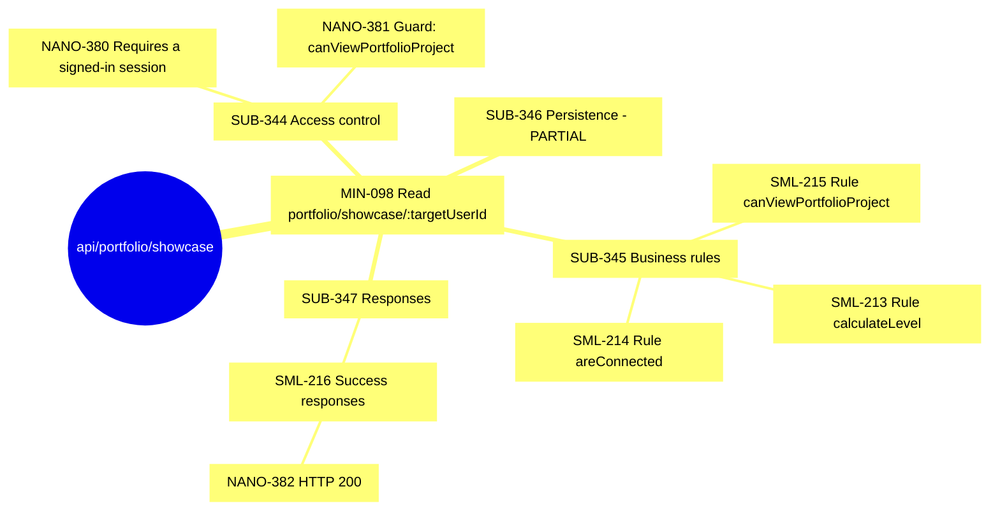

| ID       | Level | Parent   | Name                                  | Description                                                                                                                                                                                                                                                                    | Status                | Verification | Evidence                                | Related                     |
| -------- | ----- | -------- | ------------------------------------- | ------------------------------------------------------------------------------------------------------------------------------------------------------------------------------------------------------------------------------------------------------------------------------ | --------------------- | ------------ | --------------------------------------- | --------------------------- |
| FEAT-113 | MAJOR | MOD-087  | api/portfolio/showcase                |                                                                                                                                                                                                                                                                                | IMPLEMENTED           |              | apps/api/src/server.ts:9838             |                             |
| MIN-098  | MINOR | FEAT-113 | Read portfolio/showcase/:targetUserId | GET /api/v1/portfolio/showcase/:targetUserId for any signed-in session; calls calculateLevel, areConnected, canViewPortfolioProject; ephemeral (process memory); responds 200. Gaps: ephemeral: state held in process memory, lost on restart; no first-party web caller found | IMPLEMENTED           | VERIFIED     | apps/api/src/server.ts:9838             | API-206, TEST-119, TEST-145 |
| SUB-344  | SUB   | MIN-098  | Access control                        | Who may call GET /api/v1/portfolio/showcase/:targetUserId: any signed-in session.                                                                                                                                                                                              | IMPLEMENTED           | PATH_LEVEL   | apps/api/src/server.ts:9838             |                             |
| NANO-380 | NANO  | SUB-344  | Requires a signed-in session          | Requests without a valid session token are rejected with 401 UNAUTHENTICATED.                                                                                                                                                                                                  | IMPLEMENTED           | PATH_LEVEL   | apps/api/src/server.ts:9838             | ROLE-001                    |
| NANO-381 | NANO  | SUB-344  | Guard: canViewPortfolioProject        | Guard canViewPortfolioProject must pass before the handler runs.                                                                                                                                                                                                               | IMPLEMENTED           | PATH_LEVEL   | apps/api/src/server.ts:9838             |                             |
| SUB-345  | SUB   | MIN-098  | Business rules                        | Domain functions from packages/domain called by the handler (3).                                                                                                                                                                                                               | IMPLEMENTED           | PATH_LEVEL   | apps/api/src/server.ts:9838             |                             |
| SML-213  | SMALL | SUB-345  | Rule calculateLevel                   | Calls calculateLevel (packages/domain/src/gamification.ts). Rule status IMPLEMENTED; its own tests: VERIFIED.                                                                                                                                                                  | IMPLEMENTED           | VERIFIED     | packages/domain/src/gamification.ts:112 | RULE-104                    |
| SML-214  | SMALL | SUB-345  | Rule areConnected                     | Calls areConnected (packages/domain/src/networking.ts). Rule status IMPLEMENTED; its own tests: VERIFIED.                                                                                                                                                                      | IMPLEMENTED           | VERIFIED     | packages/domain/src/networking.ts:156   | RULE-158                    |
| SML-215  | SMALL | SUB-345  | Rule canViewPortfolioProject          | Calls canViewPortfolioProject (packages/domain/src/portfolio.ts). Rule status IMPLEMENTED; its own tests: VERIFIED.                                                                                                                                                            | IMPLEMENTED           | VERIFIED     | packages/domain/src/portfolio.ts:183    | RULE-175                    |
| SUB-346  | SUB   | MIN-098  | Persistence                           | Ephemeral: state lives in API process memory and is lost on restart.                                                                                                                                                                                                           | PARTIALLY_IMPLEMENTED | PATH_LEVEL   | apps/api/src/server.ts:9838             |                             |
| SUB-347  | SUB   | MIN-098  | Responses                             | Success 200; 0 explicit failure branch(es) besides validation and access errors.                                                                                                                                                                                               | IMPLEMENTED           | PATH_LEVEL   | apps/api/src/server.ts:9838             |                             |
| SML-216  | SMALL | SUB-347  | Success responses                     | HTTP 200.                                                                                                                                                                                                                                                                      | IMPLEMENTED           | PATH_LEVEL   | apps/api/src/server.ts:9838             |                             |
| NANO-382 | NANO  | SML-216  | HTTP 200                              | Replies 200 when the operation succeeds.                                                                                                                                                                                                                                       | IMPLEMENTED           | PATH_LEVEL   | apps/api/src/server.ts:9838             |                             |

## api/profile (MOD-056)

**Application:** apps/api (MOD-001). **Purpose:** API module: routes under /api/v1/profile in apps/api/src/server.ts.

**Nodes by level:** MODULE 1, MAJOR 2, MINOR 3, SUB 12, SMALL 14, TINY 5, NANO 21. **Status:** IMPLEMENTED 58. **Verification:** PATH_LEVEL 47, UNKNOWN 1, VERIFIED 7.

**User roles that reach it:** authenticated.

**Known gaps:** MIN-099 no first-party web caller found; MIN-100 no first-party web caller found.

**Called from (web screens and components):** FEAT-177 Screen /profile

### Module map (to minor features)

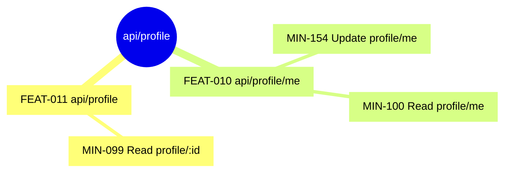

### FEAT-011 api/profile

api/profile

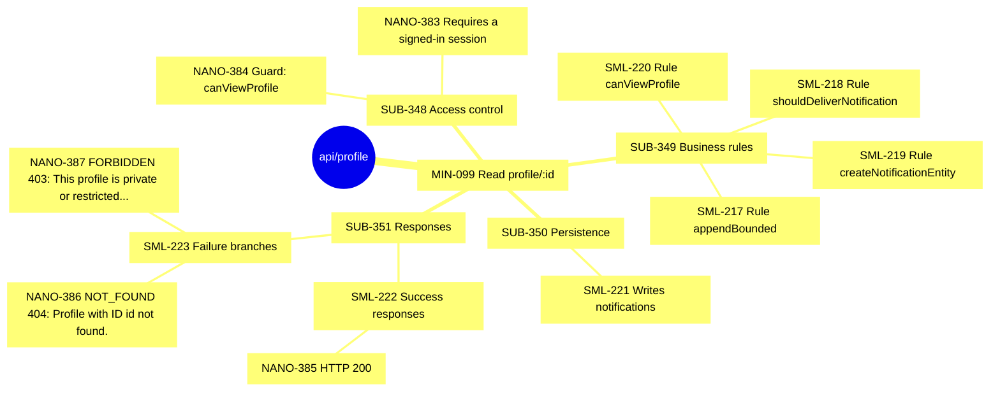

| ID       | Level | Parent   | Name                                                                      | Description                                                                                                                                                                                                                                                        | Status      | Verification | Evidence                                             | Related                                                       |
| -------- | ----- | -------- | ------------------------------------------------------------------------- | ------------------------------------------------------------------------------------------------------------------------------------------------------------------------------------------------------------------------------------------------------------------ | ----------- | ------------ | ---------------------------------------------------- | ------------------------------------------------------------- |
| FEAT-011 | MAJOR | MOD-056  | api/profile                                                               |                                                                                                                                                                                                                                                                    | IMPLEMENTED |              | apps/api/src/server.ts:1348                          |                                                               |
| MIN-099  | MINOR | FEAT-011 | Read profile/:id                                                          | GET /api/v1/profile/:id for any signed-in session; calls appendBounded, shouldDeliverNotification, createNotificationEntity, canViewProfile; durable (PostgreSQL); writes notifications; responds 200; 2 failure branch(es). Gaps: no first-party web caller found | IMPLEMENTED | VERIFIED     | apps/api/src/server.ts:1348                          | API-013, TEST-082, TEST-090, TEST-096, TEST-102, TEST-104 ... |
| SUB-348  | SUB   | MIN-099  | Access control                                                            | Who may call GET /api/v1/profile/:id: any signed-in session.                                                                                                                                                                                                       | IMPLEMENTED | PATH_LEVEL   | apps/api/src/server.ts:1348                          |                                                               |
| NANO-383 | NANO  | SUB-348  | Requires a signed-in session                                              | Requests without a valid session token are rejected with 401 UNAUTHENTICATED.                                                                                                                                                                                      | IMPLEMENTED | PATH_LEVEL   | apps/api/src/server.ts:1348                          | ROLE-001                                                      |
| NANO-384 | NANO  | SUB-348  | Guard: canViewProfile                                                     | Guard canViewProfile must pass before the handler runs.                                                                                                                                                                                                            | IMPLEMENTED | PATH_LEVEL   | apps/api/src/server.ts:1348                          |                                                               |
| SUB-349  | SUB   | MIN-099  | Business rules                                                            | Domain functions from packages/domain called by the handler (4).                                                                                                                                                                                                   | IMPLEMENTED | PATH_LEVEL   | apps/api/src/server.ts:1348                          |                                                               |
| SML-217  | SMALL | SUB-349  | Rule appendBounded                                                        | Calls appendBounded (packages/domain/src/analytics.ts). Rule status IMPLEMENTED; its own tests: VERIFIED.                                                                                                                                                          | IMPLEMENTED | VERIFIED     | packages/domain/src/analytics.ts:183                 | RULE-029                                                      |
| SML-218  | SMALL | SUB-349  | Rule shouldDeliverNotification                                            | Calls shouldDeliverNotification (packages/domain/src/notifications.ts). Rule status IMPLEMENTED; its own tests: VERIFIED.                                                                                                                                          | IMPLEMENTED | VERIFIED     | packages/domain/src/notifications.ts:89              | RULE-161                                                      |
| SML-219  | SMALL | SUB-349  | Rule createNotificationEntity                                             | Calls createNotificationEntity (packages/domain/src/notifications.ts). Rule status IMPLEMENTED; its own tests: VERIFIED.                                                                                                                                           | IMPLEMENTED | VERIFIED     | packages/domain/src/notifications.ts:117             | RULE-162                                                      |
| SML-220  | SMALL | SUB-349  | Rule canViewProfile                                                       | Calls canViewProfile (packages/domain/src/profile.ts). Rule status IMPLEMENTED; its own tests: VERIFIED.                                                                                                                                                           | IMPLEMENTED | VERIFIED     | packages/domain/src/profile.ts:36                    | RULE-178                                                      |
| SUB-350  | SUB   | MIN-099  | Persistence                                                               | Durable: writes go through the PostgreSQL store.                                                                                                                                                                                                                   | IMPLEMENTED | PATH_LEVEL   | apps/api/src/server.ts:1348                          |                                                               |
| SML-221  | SMALL | SUB-350  | Writes notifications                                                      | Writes table notifications (00007_notifications_schema.sql).                                                                                                                                                                                                       | IMPLEMENTED | PATH_LEVEL   | supabase/migrations/00007_notifications_schema.sql:6 | DB-029                                                        |
| SUB-351  | SUB   | MIN-099  | Responses                                                                 | Success 200; 2 explicit failure branch(es) besides validation and access errors.                                                                                                                                                                                   | IMPLEMENTED | PATH_LEVEL   | apps/api/src/server.ts:1348                          |                                                               |
| SML-222  | SMALL | SUB-351  | Success responses                                                         | HTTP 200.                                                                                                                                                                                                                                                          | IMPLEMENTED | PATH_LEVEL   | apps/api/src/server.ts:1348                          |                                                               |
| NANO-385 | NANO  | SML-222  | HTTP 200                                                                  | Replies 200 when the operation succeeds.                                                                                                                                                                                                                           | IMPLEMENTED | PATH_LEVEL   | apps/api/src/server.ts:1348                          |                                                               |
| SML-223  | SMALL | SUB-351  | Failure branches                                                          | 2 DomainError branch(es) in the handler, mapped to HTTP by the global error handler.                                                                                                                                                                               | IMPLEMENTED | PATH_LEVEL   | apps/api/src/server.ts:1348                          |                                                               |
| NANO-386 | NANO  | SML-223  | NOT_FOUND 404: Profile with ID ${id} not found.                           | Throws DomainError(NOT_FOUND) "Profile with ID ${id} not found." -> HTTP 404.                                                                                                                                                                                      | IMPLEMENTED | PATH_LEVEL   | apps/api/src/server.ts:1354                          | ERR-016                                                       |
| NANO-387 | NANO  | SML-223  | FORBIDDEN 403: This profile is private or restricted to authorized roles. | Throws DomainError(FORBIDDEN) "This profile is private or restricted to authorized roles." -> HTTP 403.                                                                                                                                                            | IMPLEMENTED | PATH_LEVEL   | apps/api/src/server.ts:1365                          | ERR-017                                                       |

### FEAT-010 api/profile/me

api/profile/me

```mermaid
mindmap
  root((api/profile/me))
    MIN_100[MIN-100 Read profile/me]
      SUB_352[SUB-352 Access control]
        NANO_388[NANO-388 Requires a signed-in session]
      SUB_353[SUB-353 Persistence]
      SUB_354[SUB-354 Responses]
        SML_224[SML-224 Success responses]
          NANO_389[NANO-389 HTTP 200]
        SML_225[SML-225 Failure branches]
          NANO_390[NANO-390 NOT_FOUND 404: Profile not found.]
    MIN_154[MIN-154 Update profile/me]
      SUB_565[SUB-565 Access control]
        NANO_702[NANO-702 Requires a signed-in session]
      SUB_566[SUB-566 Request validation]
        SML_381[SML-381 UpdateProfileInputSchema]
          TNY_089[TNY-089 Field fullName]
            NANO_703[NANO-703 fullName: minimum 2 characters]
            NANO_704[NANO-704 fullName: optional]
          TNY_090[TNY-090 Field headline]
            NANO_705[NANO-705 headline: maximum 160 characters]
            NANO_706[NANO-706 headline: optional]
          TNY_091[TNY-091 Field bio]
            NANO_707[NANO-707 bio: maximum 2000 characters]
            NANO_708[NANO-708 bio: optional]
          TNY_092[TNY-092 Field location]
            NANO_709[NANO-709 location: maximum 100 characters]
            NANO_710[NANO-710 location: optional]
          TNY_093[TNY-093 Field privacy]
            NANO_711[NANO-711 privacy: one of: public, connections_only, recruiter...]
            NANO_712[NANO-712 privacy: optional]
      SUB_567[SUB-567 Business rules]
        SML_382[SML-382 Rule updateProfileEntity]
      SUB_568[SUB-568 Persistence]
        SML_383[SML-383 Writes profiles]
      SUB_569[SUB-569 Responses]
        SML_384[SML-384 Success responses]
          NANO_713[NANO-713 HTTP 200]
        SML_385[SML-385 Failure branches]
          NANO_714[NANO-714 NOT_FOUND 404: Profile not found.]
```

| ID       | Level | Parent   | Name                                                                | Description                                                                                                                                                                                   | Status      | Verification | Evidence                                      | Related                                                       |
| -------- | ----- | -------- | ------------------------------------------------------------------- | --------------------------------------------------------------------------------------------------------------------------------------------------------------------------------------------- | ----------- | ------------ | --------------------------------------------- | ------------------------------------------------------------- |
| FEAT-010 | MAJOR | MOD-056  | api/profile/me                                                      |                                                                                                                                                                                               | IMPLEMENTED |              | apps/api/src/server.ts:1324                   |                                                               |
| MIN-100  | MINOR | FEAT-010 | Read profile/me                                                     | Profile Routes GET /api/v1/profile/me for any signed-in session; durable (PostgreSQL); responds 200; 1 failure branch(es). Gaps: no first-party web caller found                              | IMPLEMENTED | VERIFIED     | apps/api/src/server.ts:1324                   | API-011, TEST-082, TEST-090, TEST-096, TEST-102, TEST-104 ... |
| SUB-352  | SUB   | MIN-100  | Access control                                                      | Who may call GET /api/v1/profile/me: any signed-in session.                                                                                                                                   | IMPLEMENTED | PATH_LEVEL   | apps/api/src/server.ts:1324                   |                                                               |
| NANO-388 | NANO  | SUB-352  | Requires a signed-in session                                        | Requests without a valid session token are rejected with 401 UNAUTHENTICATED.                                                                                                                 | IMPLEMENTED | PATH_LEVEL   | apps/api/src/server.ts:1324                   | ROLE-001                                                      |
| SUB-353  | SUB   | MIN-100  | Persistence                                                         | Durable: writes go through the PostgreSQL store.                                                                                                                                              | IMPLEMENTED | PATH_LEVEL   | apps/api/src/server.ts:1324                   |                                                               |
| SUB-354  | SUB   | MIN-100  | Responses                                                           | Success 200; 1 explicit failure branch(es) besides validation and access errors.                                                                                                              | IMPLEMENTED | PATH_LEVEL   | apps/api/src/server.ts:1324                   |                                                               |
| SML-224  | SMALL | SUB-354  | Success responses                                                   | HTTP 200.                                                                                                                                                                                     | IMPLEMENTED | PATH_LEVEL   | apps/api/src/server.ts:1324                   |                                                               |
| NANO-389 | NANO  | SML-224  | HTTP 200                                                            | Replies 200 when the operation succeeds.                                                                                                                                                      | IMPLEMENTED | PATH_LEVEL   | apps/api/src/server.ts:1324                   |                                                               |
| SML-225  | SMALL | SUB-354  | Failure branches                                                    | 1 DomainError branch(es) in the handler, mapped to HTTP by the global error handler.                                                                                                          | IMPLEMENTED | PATH_LEVEL   | apps/api/src/server.ts:1324                   |                                                               |
| NANO-390 | NANO  | SML-225  | NOT_FOUND 404: Profile not found.                                   | Throws DomainError(NOT_FOUND) "Profile not found." -> HTTP 404.                                                                                                                               | IMPLEMENTED | PATH_LEVEL   | apps/api/src/server.ts:1328                   | ERR-015                                                       |
| MIN-154  | MINOR | FEAT-010 | Update profile/me                                                   | PATCH /api/v1/profile/me for any signed-in session; validates UpdateProfileInputSchema; calls updateProfileEntity; durable (PostgreSQL); writes profiles; responds 200; 1 failure branch(es). | IMPLEMENTED | VERIFIED     | apps/api/src/server.ts:1333                   | API-012, TEST-082, TEST-090, TEST-091, TEST-096, TEST-104 ... |
| SUB-565  | SUB   | MIN-154  | Access control                                                      | Who may call PATCH /api/v1/profile/me: any signed-in session.                                                                                                                                 | IMPLEMENTED | PATH_LEVEL   | apps/api/src/server.ts:1333                   |                                                               |
| NANO-702 | NANO  | SUB-565  | Requires a signed-in session                                        | Requests without a valid session token are rejected with 401 UNAUTHENTICATED.                                                                                                                 | IMPLEMENTED | PATH_LEVEL   | apps/api/src/server.ts:1333                   | ROLE-001                                                      |
| SUB-566  | SUB   | MIN-154  | Request validation                                                  | The request is parsed with UpdateProfileInputSchema; a failure returns 400 with field details before any business logic runs.                                                                 | IMPLEMENTED | PATH_LEVEL   | apps/api/src/server.ts:1333                   |                                                               |
| SML-381  | SMALL | SUB-566  | UpdateProfileInputSchema                                            | UpdateProfileInputSchema: 5 field(s)                                                                                                                                                          | IMPLEMENTED | PATH_LEVEL   | packages/contracts/src/index.ts:133           | SCH-007                                                       |
| TNY-089  | TINY  | SML-381  | Field fullName                                                      | fullName (string, optional): minimum 2 characters; optional                                                                                                                                   | IMPLEMENTED | PATH_LEVEL   | packages/contracts/src/index.ts:134           |                                                               |
| NANO-703 | NANO  | TNY-089  | fullName: minimum 2 characters                                      | fullName minimum 2 characters.                                                                                                                                                                | IMPLEMENTED | PATH_LEVEL   | packages/contracts/src/index.ts:134           |                                                               |
| NANO-704 | NANO  | TNY-089  | fullName: optional                                                  | fullName optional.                                                                                                                                                                            | IMPLEMENTED | PATH_LEVEL   | packages/contracts/src/index.ts:134           |                                                               |
| TNY-090  | TINY  | SML-381  | Field headline                                                      | headline (string, optional): maximum 160 characters; optional                                                                                                                                 | IMPLEMENTED | PATH_LEVEL   | packages/contracts/src/index.ts:135           |                                                               |
| NANO-705 | NANO  | TNY-090  | headline: maximum 160 characters                                    | headline maximum 160 characters.                                                                                                                                                              | IMPLEMENTED | PATH_LEVEL   | packages/contracts/src/index.ts:135           |                                                               |
| NANO-706 | NANO  | TNY-090  | headline: optional                                                  | headline optional.                                                                                                                                                                            | IMPLEMENTED | PATH_LEVEL   | packages/contracts/src/index.ts:135           |                                                               |
| TNY-091  | TINY  | SML-381  | Field bio                                                           | bio (string, optional): maximum 2000 characters; optional                                                                                                                                     | IMPLEMENTED | PATH_LEVEL   | packages/contracts/src/index.ts:136           |                                                               |
| NANO-707 | NANO  | TNY-091  | bio: maximum 2000 characters                                        | bio maximum 2000 characters.                                                                                                                                                                  | IMPLEMENTED | PATH_LEVEL   | packages/contracts/src/index.ts:136           |                                                               |
| NANO-708 | NANO  | TNY-091  | bio: optional                                                       | bio optional.                                                                                                                                                                                 | IMPLEMENTED | PATH_LEVEL   | packages/contracts/src/index.ts:136           |                                                               |
| TNY-092  | TINY  | SML-381  | Field location                                                      | location (string, optional): maximum 100 characters; optional                                                                                                                                 | IMPLEMENTED | PATH_LEVEL   | packages/contracts/src/index.ts:137           |                                                               |
| NANO-709 | NANO  | TNY-092  | location: maximum 100 characters                                    | location maximum 100 characters.                                                                                                                                                              | IMPLEMENTED | PATH_LEVEL   | packages/contracts/src/index.ts:137           |                                                               |
| NANO-710 | NANO  | TNY-092  | location: optional                                                  | location optional.                                                                                                                                                                            | IMPLEMENTED | PATH_LEVEL   | packages/contracts/src/index.ts:137           |                                                               |
| TNY-093  | TINY  | SML-381  | Field privacy                                                       | privacy (enum, optional): one of: public, connections_only, recruiters_only, private; optional                                                                                                | IMPLEMENTED | PATH_LEVEL   | packages/contracts/src/index.ts:138           |                                                               |
| NANO-711 | NANO  | TNY-093  | privacy: one of: public, connections_only, recruiters_only, private | privacy one of: public, connections_only, recruiters_only, private.                                                                                                                           | IMPLEMENTED | PATH_LEVEL   | packages/contracts/src/index.ts:138           |                                                               |
| NANO-712 | NANO  | TNY-093  | privacy: optional                                                   | privacy optional.                                                                                                                                                                             | IMPLEMENTED | PATH_LEVEL   | packages/contracts/src/index.ts:138           |                                                               |
| SUB-567  | SUB   | MIN-154  | Business rules                                                      | Domain functions from packages/domain called by the handler (1).                                                                                                                              | IMPLEMENTED | PATH_LEVEL   | apps/api/src/server.ts:1333                   |                                                               |
| SML-382  | SMALL | SUB-567  | Rule updateProfileEntity                                            | Calls updateProfileEntity (packages/domain/src/profile.ts). Rule status IMPLEMENTED; its own tests: UNKNOWN.                                                                                  | IMPLEMENTED | UNKNOWN      | packages/domain/src/profile.ts:15             | RULE-177                                                      |
| SUB-568  | SUB   | MIN-154  | Persistence                                                         | Durable: writes go through the PostgreSQL store.                                                                                                                                              | IMPLEMENTED | PATH_LEVEL   | apps/api/src/server.ts:1333                   |                                                               |
| SML-383  | SMALL | SUB-568  | Writes profiles                                                     | Writes table profiles (00001_core_schema.sql).                                                                                                                                                | IMPLEMENTED | PATH_LEVEL   | supabase/migrations/00001_core_schema.sql:114 | DB-002                                                        |
| SUB-569  | SUB   | MIN-154  | Responses                                                           | Success 200; 1 explicit failure branch(es) besides validation and access errors.                                                                                                              | IMPLEMENTED | PATH_LEVEL   | apps/api/src/server.ts:1333                   |                                                               |
| SML-384  | SMALL | SUB-569  | Success responses                                                   | HTTP 200.                                                                                                                                                                                     | IMPLEMENTED | PATH_LEVEL   | apps/api/src/server.ts:1333                   |                                                               |
| NANO-713 | NANO  | SML-384  | HTTP 200                                                            | Replies 200 when the operation succeeds.                                                                                                                                                      | IMPLEMENTED | PATH_LEVEL   | apps/api/src/server.ts:1333                   |                                                               |
| SML-385  | SMALL | SUB-569  | Failure branches                                                    | 1 DomainError branch(es) in the handler, mapped to HTTP by the global error handler.                                                                                                          | IMPLEMENTED | PATH_LEVEL   | apps/api/src/server.ts:1333                   |                                                               |
| NANO-714 | NANO  | SML-385  | NOT_FOUND 404: Profile not found.                                   | Throws DomainError(NOT_FOUND) "Profile not found." -> HTTP 404.                                                                                                                               | IMPLEMENTED | PATH_LEVEL   | apps/api/src/server.ts:1339                   | ERR-015                                                       |

## api/ready (MOD-053)

**Application:** apps/api (MOD-001). **Purpose:** API module: routes under /api/v1/ready in apps/api/src/server.ts.

**Nodes by level:** MODULE 1, MAJOR 1, MINOR 1, SUB 3, SMALL 1, NANO 3. **Status:** IMPLEMENTED 10. **Verification:** PATH_LEVEL 7, VERIFIED 1.

**User roles that reach it:** anonymous.

**Known gaps:** MIN-144 no first-party web caller found.

### Module map (to minor features)

```mermaid
mindmap
  root((api/ready))
    FEAT_002[FEAT-002 api/ready]
      MIN_144[MIN-144 Read ready]
```

### FEAT-002 api/ready

api/ready

```mermaid
mindmap
  root((api/ready))
    MIN_144[MIN-144 Read ready]
      SUB_517[SUB-517 Access control]
        NANO_616[NANO-616 Open to anonymous callers]
        NANO_617[NANO-617 Route-specific rate limit]
      SUB_518[SUB-518 Persistence]
      SUB_519[SUB-519 Responses]
        SML_336[SML-336 Success responses]
          NANO_618[NANO-618 HTTP 200]
```

| ID       | Level | Parent   | Name                      | Description                                                                                               | Status      | Verification | Evidence                   | Related                     |
| -------- | ----- | -------- | ------------------------- | --------------------------------------------------------------------------------------------------------- | ----------- | ------------ | -------------------------- | --------------------------- |
| FEAT-002 | MAJOR | MOD-053  | api/ready                 |                                                                                                           | IMPLEMENTED |              | apps/api/src/server.ts:807 |                             |
| MIN-144  | MINOR | FEAT-002 | Read ready                | GET /ready for anyone (public); durable (PostgreSQL); responds 200. Gaps: no first-party web caller found | IMPLEMENTED | VERIFIED     | apps/api/src/server.ts:807 | API-002, TEST-087, TEST-161 |
| SUB-517  | SUB   | MIN-144  | Access control            | Who may call GET /ready: anyone (public).                                                                 | IMPLEMENTED | PATH_LEVEL   | apps/api/src/server.ts:807 |                             |
| NANO-616 | NANO  | SUB-517  | Open to anonymous callers | auth: public.                                                                                             | IMPLEMENTED | PATH_LEVEL   | apps/api/src/server.ts:807 | ROLE-001                    |
| NANO-617 | NANO  | SUB-517  | Route-specific rate limit | This route sets its own rate-limit configuration (429 when exceeded).                                     | IMPLEMENTED | PATH_LEVEL   | apps/api/src/server.ts:807 |                             |
| SUB-518  | SUB   | MIN-144  | Persistence               | Durable: writes go through the PostgreSQL store.                                                          | IMPLEMENTED | PATH_LEVEL   | apps/api/src/server.ts:807 |                             |
| SUB-519  | SUB   | MIN-144  | Responses                 | Success 200; 0 explicit failure branch(es) besides validation and access errors.                          | IMPLEMENTED | PATH_LEVEL   | apps/api/src/server.ts:807 |                             |
| SML-336  | SMALL | SUB-519  | Success responses         | HTTP 200 (implicit).                                                                                      | IMPLEMENTED | PATH_LEVEL   | apps/api/src/server.ts:807 |                             |
| NANO-618 | NANO  | SML-336  | HTTP 200                  | Replies 200 when the operation succeeds (implicit default).                                               | IMPLEMENTED | PATH_LEVEL   | apps/api/src/server.ts:807 |                             |

## api/recruiter (MOD-084)

**Application:** apps/api (MOD-001). **Purpose:** API module: routes under /api/v1/recruiter in apps/api/src/server.ts.

**Nodes by level:** MODULE 1, MAJOR 3, MINOR 13, SUB 59, SMALL 47, TINY 42, NANO 170. **Status:** IMPLEMENTED 322, PARTIALLY_IMPLEMENTED 13. **Verification:** PATH_LEVEL 306, VERIFIED 25.

**User roles that reach it:** authenticated, institution_admin, platform_admin.

**Known gaps:** MIN-101 ephemeral: state held in process memory, lost on restart; MIN-101 no first-party web caller found; MIN-102 ephemeral: state held in process memory, lost on restart; MIN-102 no first-party web caller found; MIN-247 ephemeral: state held in process memory, lost on restart; MIN-247 no first-party web caller found; MIN-103 ephemeral: state held in process memory, lost on restart; MIN-103 no first-party web caller found; MIN-104 ephemeral: state held in process memory, lost on restart; MIN-104 no first-party web caller found; MIN-105 ephemeral: state held in process memory, lost on restart; MIN-105 no first-party web caller found; MIN-155 ephemeral: state held in process memory, lost on restart; MIN-155 no first-party web caller found; MIN-248 ephemeral: state held in process memory, lost on restart; MIN-248 no first-party web caller found; MIN-249 ephemeral: state held in process memory, lost on restart; MIN-249 no first-party web caller found; MIN-106 ephemeral: state held in process memory, lost on restart; MIN-106 no first-party web caller found; MIN-107 ephemeral: state held in process memory, lost on restart; MIN-107 no first-party web caller found; MIN-108 ephemeral: state held in process memory, lost on restart; MIN-108 no first-party web caller found; MIN-250 ephemeral: state held in process memory, lost on restart; MIN-250 no first-party web caller found.

### Module map (to minor features)

```mermaid
mindmap
  root((api/recruiter))
    FEAT_102[FEAT-102 api/recruiter/discovery]
      MIN_101[MIN-101 Read recruiter/discovery/behavioral]
      MIN_102[MIN-102 Read recruiter/discovery/behavioral/:candidateId]
      MIN_247[MIN-247 Submit recruiter/discovery/behavioral/compute]
    FEAT_101[FEAT-101 api/recruiter/talent-pools]
      MIN_103[MIN-103 Read recruiter/talent-pools]
      MIN_104[MIN-104 Read recruiter/talent-pools/:poolId]
      MIN_105[MIN-105 Read recruiter/talent-pools/:poolId/intelligence]
      MIN_155[MIN-155 Update recruiter/talent-pools/:poolId/members/:memberId]
      MIN_248[MIN-248 Submit recruiter/talent-pools]
      MIN_249[MIN-249 Submit recruiter/talent-pools/:poolId/members]
    FEAT_103[FEAT-103 api/recruiter/talent-segmentation]
      MIN_106[MIN-106 Read recruiter/talent-segmentation/candidates]
      MIN_107[MIN-107 Read recruiter/talent-segmentation/candidates/:candid...]
      MIN_108[MIN-108 Read recruiter/talent-segmentation/segments]
      MIN_250[MIN-250 Submit recruiter/talent-segmentation/classify]
```

### FEAT-102 api/recruiter/discovery

api/recruiter/discovery

```mermaid
mindmap
  root((api/recruiter/discovery))
    MIN_101[MIN-101 Read recruiter/discovery/behavioral]
      SUB_355[SUB-355 Access control]
        NANO_391[NANO-391 Requires a signed-in session]
      SUB_356[SUB-356 Request validation]
        SML_226[SML-226 DiscoverBehavioralTalentQuerySchema]
          TNY_028[TNY-028 Field skills]
            NANO_392[NANO-392 skills: optional]
          TNY_029[TNY-029 Field minCompositeScore]
            NANO_393[NANO-393 minCompositeScore: minimum 0]
            NANO_394[NANO-394 minCompositeScore: maximum 100]
            NANO_395[NANO-395 minCompositeScore: optional]
          TNY_030[TNY-030 Field minActivityScore]
            NANO_396[NANO-396 minActivityScore: minimum 0]
            NANO_397[NANO-397 minActivityScore: maximum 100]
            NANO_398[NANO-398 minActivityScore: optional]
          TNY_031[TNY-031 Field minReputationScore]
            NANO_399[NANO-399 minReputationScore: minimum 0]
            NANO_400[NANO-400 minReputationScore: maximum 100]
            NANO_401[NANO-401 minReputationScore: optional]
          TNY_032[TNY-032 Field maxDaysSinceActive]
            NANO_402[NANO-402 maxDaysSinceActive: must be an integer]
            NANO_403[NANO-403 maxDaysSinceActive: minimum 1]
            NANO_404[NANO-404 maxDaysSinceActive: maximum 365]
            NANO_405[NANO-405 maxDaysSinceActive: optional]
          TNY_033[TNY-033 Field minEndorsements]
            NANO_406[NANO-406 minEndorsements: must be an integer]
            NANO_407[NANO-407 minEndorsements: minimum 0]
            NANO_408[NANO-408 minEndorsements: maximum 100]
            NANO_409[NANO-409 minEndorsements: optional]
          TNY_034[TNY-034 Field limit]
            NANO_410[NANO-410 limit: must be an integer]
            NANO_411[NANO-411 limit: minimum 1]
            NANO_412[NANO-412 limit: maximum 100]
            NANO_413[NANO-413 limit: default 20]
          TNY_035[TNY-035 Field offset]
            NANO_414[NANO-414 offset: must be an integer]
            NANO_415[NANO-415 offset: minimum 0]
            NANO_416[NANO-416 offset: default 0]
      SUB_357[SUB-357 Business rules]
        SML_227[SML-227 Rule filterAndRankBehavioralTalent]
      SUB_358[SUB-358 Persistence - PARTIAL]
      SUB_359[SUB-359 Responses]
        SML_228[SML-228 Success responses]
          NANO_417[NANO-417 HTTP 200]
        SML_229[SML-229 Failure branches]
          NANO_418[NANO-418 FORBIDDEN 403: Access denied to recruiter talent dis...]
    MIN_102[MIN-102 Read recruiter/discovery/behavioral/:candidateId]
      SUB_360[SUB-360 Access control]
        NANO_419[NANO-419 Requires a signed-in session]
      SUB_361[SUB-361 Business rules]
        SML_230[SML-230 Rule evaluateBehavioralTalentProfile]
      SUB_362[SUB-362 Persistence - PARTIAL]
      SUB_363[SUB-363 Responses]
        SML_231[SML-231 Success responses]
          NANO_420[NANO-420 HTTP 200]
        SML_232[SML-232 Failure branches]
          NANO_421[NANO-421 FORBIDDEN 403: Access denied to candidate behavioral...]
          NANO_422[NANO-422 NOT_FOUND 404: Behavioral profile for candidate cand...]
    MIN_247[MIN-247 Submit recruiter/discovery/behavioral/compute]
      SUB_1024[SUB-1024 Access control]
        NANO_1671[NANO-1671 Requires a signed-in session]
        NANO_1672[NANO-1672 Allowed role: platform_admin]
      SUB_1025[SUB-1025 Request validation]
        SML_830[SML-830 ComputeBehavioralProfileInputSchema]
          TNY_404[TNY-404 Field candidateId]
            NANO_1673[NANO-1673 candidateId: must be a UUID]
            NANO_1674[NANO-1674 candidateId: optional]
          TNY_405[TNY-405 Field weights]
            NANO_1675[NANO-1675 weights: nested object]
            NANO_1676[NANO-1676 weights: optional]
          TNY_406[TNY-406 Field rawSignals]
            NANO_1677[NANO-1677 rawSignals: nested object]
            NANO_1678[NANO-1678 rawSignals: optional]
      SUB_1026[SUB-1026 Business rules]
        SML_831[SML-831 Rule evaluateBehavioralTalentProfile]
      SUB_1027[SUB-1027 Persistence - PARTIAL]
      SUB_1028[SUB-1028 Responses]
        SML_832[SML-832 Success responses]
          NANO_1679[NANO-1679 HTTP 200]
        SML_833[SML-833 Failure branches]
          NANO_1680[NANO-1680 FORBIDDEN 403: Insufficient permissions to compute...]
          NANO_1681[NANO-1681 FORBIDDEN 403: Behavioral profiles are computed fro...]
```

| ID        | Level | Parent   | Name                                                                                  | Description                                                                                                                                                                                                                                                                                                                                                                                         | Status                | Verification | Evidence                                               | Related                     |
| --------- | ----- | -------- | ------------------------------------------------------------------------------------- | --------------------------------------------------------------------------------------------------------------------------------------------------------------------------------------------------------------------------------------------------------------------------------------------------------------------------------------------------------------------------------------------------- | --------------------- | ------------ | ------------------------------------------------------ | --------------------------- |
| FEAT-102  | MAJOR | MOD-084  | api/recruiter/discovery                                                               |                                                                                                                                                                                                                                                                                                                                                                                                     | IMPLEMENTED           |              | apps/api/src/server.ts:8627                            |                             |
| MIN-101   | MINOR | FEAT-102 | Read recruiter/discovery/behavioral                                                   | 2. Discover & Rank Candidates by Behavioral Signals (F-159, F-146, F-130) GET /api/v1/recruiter/discovery/behavioral for any signed-in session; validates DiscoverBehavioralTalentQuerySchema; calls filterAndRankBehavioralTalent; ephemeral (process memory); responds 200; 1 failure branch(es). Gaps: ephemeral: state held in process memory, lost on restart; no first-party web caller found | IMPLEMENTED           | VERIFIED     | apps/api/src/server.ts:8678                            | API-179, TEST-091, TEST-172 |
| SUB-355   | SUB   | MIN-101  | Access control                                                                        | Who may call GET /api/v1/recruiter/discovery/behavioral: any signed-in session.                                                                                                                                                                                                                                                                                                                     | IMPLEMENTED           | PATH_LEVEL   | apps/api/src/server.ts:8678                            |                             |
| NANO-391  | NANO  | SUB-355  | Requires a signed-in session                                                          | Requests without a valid session token are rejected with 401 UNAUTHENTICATED.                                                                                                                                                                                                                                                                                                                       | IMPLEMENTED           | PATH_LEVEL   | apps/api/src/server.ts:8678                            | ROLE-001                    |
| SUB-356   | SUB   | MIN-101  | Request validation                                                                    | The request is parsed with DiscoverBehavioralTalentQuerySchema; a failure returns 400 with field details before any business logic runs.                                                                                                                                                                                                                                                            | IMPLEMENTED           | PATH_LEVEL   | apps/api/src/server.ts:8678                            |                             |
| SML-226   | SMALL | SUB-356  | DiscoverBehavioralTalentQuerySchema                                                   | DiscoverBehavioralTalentQuerySchema: 8 field(s)                                                                                                                                                                                                                                                                                                                                                     | IMPLEMENTED           | PATH_LEVEL   | packages/contracts/src/index.ts:1650                   | SCH-132                     |
| TNY-028   | TINY  | SML-226  | Field skills                                                                          | skills (string, optional): optional                                                                                                                                                                                                                                                                                                                                                                 | IMPLEMENTED           | PATH_LEVEL   | packages/contracts/src/index.ts:1651                   |                             |
| NANO-392  | NANO  | TNY-028  | skills: optional                                                                      | skills optional.                                                                                                                                                                                                                                                                                                                                                                                    | IMPLEMENTED           | PATH_LEVEL   | packages/contracts/src/index.ts:1651                   |                             |
| TNY-029   | TINY  | SML-226  | Field minCompositeScore                                                               | minCompositeScore (number, optional): minimum 0; maximum 100; optional                                                                                                                                                                                                                                                                                                                              | IMPLEMENTED           | PATH_LEVEL   | packages/contracts/src/index.ts:1652                   |                             |
| NANO-393  | NANO  | TNY-029  | minCompositeScore: minimum 0                                                          | minCompositeScore minimum 0.                                                                                                                                                                                                                                                                                                                                                                        | IMPLEMENTED           | PATH_LEVEL   | packages/contracts/src/index.ts:1652                   |                             |
| NANO-394  | NANO  | TNY-029  | minCompositeScore: maximum 100                                                        | minCompositeScore maximum 100.                                                                                                                                                                                                                                                                                                                                                                      | IMPLEMENTED           | PATH_LEVEL   | packages/contracts/src/index.ts:1652                   |                             |
| NANO-395  | NANO  | TNY-029  | minCompositeScore: optional                                                           | minCompositeScore optional.                                                                                                                                                                                                                                                                                                                                                                         | IMPLEMENTED           | PATH_LEVEL   | packages/contracts/src/index.ts:1652                   |                             |
| TNY-030   | TINY  | SML-226  | Field minActivityScore                                                                | minActivityScore (number, optional): minimum 0; maximum 100; optional                                                                                                                                                                                                                                                                                                                               | IMPLEMENTED           | PATH_LEVEL   | packages/contracts/src/index.ts:1653                   |                             |
| NANO-396  | NANO  | TNY-030  | minActivityScore: minimum 0                                                           | minActivityScore minimum 0.                                                                                                                                                                                                                                                                                                                                                                         | IMPLEMENTED           | PATH_LEVEL   | packages/contracts/src/index.ts:1653                   |                             |
| NANO-397  | NANO  | TNY-030  | minActivityScore: maximum 100                                                         | minActivityScore maximum 100.                                                                                                                                                                                                                                                                                                                                                                       | IMPLEMENTED           | PATH_LEVEL   | packages/contracts/src/index.ts:1653                   |                             |
| NANO-398  | NANO  | TNY-030  | minActivityScore: optional                                                            | minActivityScore optional.                                                                                                                                                                                                                                                                                                                                                                          | IMPLEMENTED           | PATH_LEVEL   | packages/contracts/src/index.ts:1653                   |                             |
| TNY-031   | TINY  | SML-226  | Field minReputationScore                                                              | minReputationScore (number, optional): minimum 0; maximum 100; optional                                                                                                                                                                                                                                                                                                                             | IMPLEMENTED           | PATH_LEVEL   | packages/contracts/src/index.ts:1654                   |                             |
| NANO-399  | NANO  | TNY-031  | minReputationScore: minimum 0                                                         | minReputationScore minimum 0.                                                                                                                                                                                                                                                                                                                                                                       | IMPLEMENTED           | PATH_LEVEL   | packages/contracts/src/index.ts:1654                   |                             |
| NANO-400  | NANO  | TNY-031  | minReputationScore: maximum 100                                                       | minReputationScore maximum 100.                                                                                                                                                                                                                                                                                                                                                                     | IMPLEMENTED           | PATH_LEVEL   | packages/contracts/src/index.ts:1654                   |                             |
| NANO-401  | NANO  | TNY-031  | minReputationScore: optional                                                          | minReputationScore optional.                                                                                                                                                                                                                                                                                                                                                                        | IMPLEMENTED           | PATH_LEVEL   | packages/contracts/src/index.ts:1654                   |                             |
| TNY-032   | TINY  | SML-226  | Field maxDaysSinceActive                                                              | maxDaysSinceActive (number, optional): must be an integer; minimum 1; maximum 365; optional                                                                                                                                                                                                                                                                                                         | IMPLEMENTED           | PATH_LEVEL   | packages/contracts/src/index.ts:1655                   |                             |
| NANO-402  | NANO  | TNY-032  | maxDaysSinceActive: must be an integer                                                | maxDaysSinceActive must be an integer.                                                                                                                                                                                                                                                                                                                                                              | IMPLEMENTED           | PATH_LEVEL   | packages/contracts/src/index.ts:1655                   |                             |
| NANO-403  | NANO  | TNY-032  | maxDaysSinceActive: minimum 1                                                         | maxDaysSinceActive minimum 1.                                                                                                                                                                                                                                                                                                                                                                       | IMPLEMENTED           | PATH_LEVEL   | packages/contracts/src/index.ts:1655                   |                             |
| NANO-404  | NANO  | TNY-032  | maxDaysSinceActive: maximum 365                                                       | maxDaysSinceActive maximum 365.                                                                                                                                                                                                                                                                                                                                                                     | IMPLEMENTED           | PATH_LEVEL   | packages/contracts/src/index.ts:1655                   |                             |
| NANO-405  | NANO  | TNY-032  | maxDaysSinceActive: optional                                                          | maxDaysSinceActive optional.                                                                                                                                                                                                                                                                                                                                                                        | IMPLEMENTED           | PATH_LEVEL   | packages/contracts/src/index.ts:1655                   |                             |
| TNY-033   | TINY  | SML-226  | Field minEndorsements                                                                 | minEndorsements (number, optional): must be an integer; minimum 0; maximum 100; optional                                                                                                                                                                                                                                                                                                            | IMPLEMENTED           | PATH_LEVEL   | packages/contracts/src/index.ts:1656                   |                             |
| NANO-406  | NANO  | TNY-033  | minEndorsements: must be an integer                                                   | minEndorsements must be an integer.                                                                                                                                                                                                                                                                                                                                                                 | IMPLEMENTED           | PATH_LEVEL   | packages/contracts/src/index.ts:1656                   |                             |
| NANO-407  | NANO  | TNY-033  | minEndorsements: minimum 0                                                            | minEndorsements minimum 0.                                                                                                                                                                                                                                                                                                                                                                          | IMPLEMENTED           | PATH_LEVEL   | packages/contracts/src/index.ts:1656                   |                             |
| NANO-408  | NANO  | TNY-033  | minEndorsements: maximum 100                                                          | minEndorsements maximum 100.                                                                                                                                                                                                                                                                                                                                                                        | IMPLEMENTED           | PATH_LEVEL   | packages/contracts/src/index.ts:1656                   |                             |
| NANO-409  | NANO  | TNY-033  | minEndorsements: optional                                                             | minEndorsements optional.                                                                                                                                                                                                                                                                                                                                                                           | IMPLEMENTED           | PATH_LEVEL   | packages/contracts/src/index.ts:1656                   |                             |
| TNY-034   | TINY  | SML-226  | Field limit                                                                           | limit (number, optional): must be an integer; minimum 1; maximum 100; default 20                                                                                                                                                                                                                                                                                                                    | IMPLEMENTED           | PATH_LEVEL   | packages/contracts/src/index.ts:1657                   |                             |
| NANO-410  | NANO  | TNY-034  | limit: must be an integer                                                             | limit must be an integer.                                                                                                                                                                                                                                                                                                                                                                           | IMPLEMENTED           | PATH_LEVEL   | packages/contracts/src/index.ts:1657                   |                             |
| NANO-411  | NANO  | TNY-034  | limit: minimum 1                                                                      | limit minimum 1.                                                                                                                                                                                                                                                                                                                                                                                    | IMPLEMENTED           | PATH_LEVEL   | packages/contracts/src/index.ts:1657                   |                             |
| NANO-412  | NANO  | TNY-034  | limit: maximum 100                                                                    | limit maximum 100.                                                                                                                                                                                                                                                                                                                                                                                  | IMPLEMENTED           | PATH_LEVEL   | packages/contracts/src/index.ts:1657                   |                             |
| NANO-413  | NANO  | TNY-034  | limit: default 20                                                                     | limit default 20.                                                                                                                                                                                                                                                                                                                                                                                   | IMPLEMENTED           | PATH_LEVEL   | packages/contracts/src/index.ts:1657                   |                             |
| TNY-035   | TINY  | SML-226  | Field offset                                                                          | offset (number, optional): must be an integer; minimum 0; default 0                                                                                                                                                                                                                                                                                                                                 | IMPLEMENTED           | PATH_LEVEL   | packages/contracts/src/index.ts:1658                   |                             |
| NANO-414  | NANO  | TNY-035  | offset: must be an integer                                                            | offset must be an integer.                                                                                                                                                                                                                                                                                                                                                                          | IMPLEMENTED           | PATH_LEVEL   | packages/contracts/src/index.ts:1658                   |                             |
| NANO-415  | NANO  | TNY-035  | offset: minimum 0                                                                     | offset minimum 0.                                                                                                                                                                                                                                                                                                                                                                                   | IMPLEMENTED           | PATH_LEVEL   | packages/contracts/src/index.ts:1658                   |                             |
| NANO-416  | NANO  | TNY-035  | offset: default 0                                                                     | offset default 0.                                                                                                                                                                                                                                                                                                                                                                                   | IMPLEMENTED           | PATH_LEVEL   | packages/contracts/src/index.ts:1658                   |                             |
| SUB-357   | SUB   | MIN-101  | Business rules                                                                        | Domain functions from packages/domain called by the handler (1).                                                                                                                                                                                                                                                                                                                                    | IMPLEMENTED           | PATH_LEVEL   | apps/api/src/server.ts:8678                            |                             |
| SML-227   | SMALL | SUB-357  | Rule filterAndRankBehavioralTalent                                                    | Calls filterAndRankBehavioralTalent (packages/domain/src/behavioral-talent-discovery.ts). Rule status IMPLEMENTED; its own tests: VERIFIED.                                                                                                                                                                                                                                                         | IMPLEMENTED           | VERIFIED     | packages/domain/src/behavioral-talent-discovery.ts:207 | RULE-069                    |
| SUB-358   | SUB   | MIN-101  | Persistence                                                                           | Ephemeral: state lives in API process memory and is lost on restart.                                                                                                                                                                                                                                                                                                                                | PARTIALLY_IMPLEMENTED | PATH_LEVEL   | apps/api/src/server.ts:8678                            |                             |
| SUB-359   | SUB   | MIN-101  | Responses                                                                             | Success 200; 1 explicit failure branch(es) besides validation and access errors.                                                                                                                                                                                                                                                                                                                    | IMPLEMENTED           | PATH_LEVEL   | apps/api/src/server.ts:8678                            |                             |
| SML-228   | SMALL | SUB-359  | Success responses                                                                     | HTTP 200.                                                                                                                                                                                                                                                                                                                                                                                           | IMPLEMENTED           | PATH_LEVEL   | apps/api/src/server.ts:8678                            |                             |
| NANO-417  | NANO  | SML-228  | HTTP 200                                                                              | Replies 200 when the operation succeeds.                                                                                                                                                                                                                                                                                                                                                            | IMPLEMENTED           | PATH_LEVEL   | apps/api/src/server.ts:8678                            |                             |
| SML-229   | SMALL | SUB-359  | Failure branches                                                                      | 1 DomainError branch(es) in the handler, mapped to HTTP by the global error handler.                                                                                                                                                                                                                                                                                                                | IMPLEMENTED           | PATH_LEVEL   | apps/api/src/server.ts:8678                            |                             |
| NANO-418  | NANO  | SML-229  | FORBIDDEN 403: Access denied to recruiter talent discovery.                           | Throws DomainError(FORBIDDEN) "Access denied to recruiter talent discovery." -> HTTP 403.                                                                                                                                                                                                                                                                                                           | IMPLEMENTED           | PATH_LEVEL   | apps/api/src/server.ts:8700                            | ERR-175                     |
| MIN-102   | MINOR | FEAT-102 | Read recruiter/discovery/behavioral/:candidateId                                      | 3. Get Behavioral Profile Breakdown for Candidate (F-159) GET /api/v1/recruiter/discovery/behavioral/:candidateId for any signed-in session; calls evaluateBehavioralTalentProfile; ephemeral (process memory); responds 200; 2 failure branch(es). Gaps: ephemeral: state held in process memory, lost on restart; no first-party web caller found                                                 | IMPLEMENTED           | VERIFIED     | apps/api/src/server.ts:8733                            | API-180, TEST-091, TEST-172 |
| SUB-360   | SUB   | MIN-102  | Access control                                                                        | Who may call GET /api/v1/recruiter/discovery/behavioral/:candidateId: any signed-in session.                                                                                                                                                                                                                                                                                                        | IMPLEMENTED           | PATH_LEVEL   | apps/api/src/server.ts:8733                            |                             |
| NANO-419  | NANO  | SUB-360  | Requires a signed-in session                                                          | Requests without a valid session token are rejected with 401 UNAUTHENTICATED.                                                                                                                                                                                                                                                                                                                       | IMPLEMENTED           | PATH_LEVEL   | apps/api/src/server.ts:8733                            | ROLE-001                    |
| SUB-361   | SUB   | MIN-102  | Business rules                                                                        | Domain functions from packages/domain called by the handler (1).                                                                                                                                                                                                                                                                                                                                    | IMPLEMENTED           | PATH_LEVEL   | apps/api/src/server.ts:8733                            |                             |
| SML-230   | SMALL | SUB-361  | Rule evaluateBehavioralTalentProfile                                                  | Calls evaluateBehavioralTalentProfile (packages/domain/src/behavioral-talent-discovery.ts). Rule status IMPLEMENTED; its own tests: VERIFIED.                                                                                                                                                                                                                                                       | IMPLEMENTED           | VERIFIED     | packages/domain/src/behavioral-talent-discovery.ts:161 | RULE-068                    |
| SUB-362   | SUB   | MIN-102  | Persistence                                                                           | Ephemeral: state lives in API process memory and is lost on restart.                                                                                                                                                                                                                                                                                                                                | PARTIALLY_IMPLEMENTED | PATH_LEVEL   | apps/api/src/server.ts:8733                            |                             |
| SUB-363   | SUB   | MIN-102  | Responses                                                                             | Success 200; 2 explicit failure branch(es) besides validation and access errors.                                                                                                                                                                                                                                                                                                                    | IMPLEMENTED           | PATH_LEVEL   | apps/api/src/server.ts:8733                            |                             |
| SML-231   | SMALL | SUB-363  | Success responses                                                                     | HTTP 200.                                                                                                                                                                                                                                                                                                                                                                                           | IMPLEMENTED           | PATH_LEVEL   | apps/api/src/server.ts:8733                            |                             |
| NANO-420  | NANO  | SML-231  | HTTP 200                                                                              | Replies 200 when the operation succeeds.                                                                                                                                                                                                                                                                                                                                                            | IMPLEMENTED           | PATH_LEVEL   | apps/api/src/server.ts:8733                            |                             |
| SML-232   | SMALL | SUB-363  | Failure branches                                                                      | 2 DomainError branch(es) in the handler, mapped to HTTP by the global error handler.                                                                                                                                                                                                                                                                                                                | IMPLEMENTED           | PATH_LEVEL   | apps/api/src/server.ts:8733                            |                             |
| NANO-421  | NANO  | SML-232  | FORBIDDEN 403: Access denied to candidate behavioral profile.                         | Throws DomainError(FORBIDDEN) "Access denied to candidate behavioral profile." -> HTTP 403.                                                                                                                                                                                                                                                                                                         | IMPLEMENTED           | PATH_LEVEL   | apps/api/src/server.ts:8743                            | ERR-176                     |
| NANO-422  | NANO  | SML-232  | NOT_FOUND 404: Behavioral profile for candidate "${candidateId}" not found.           | Throws DomainError(NOT_FOUND) "Behavioral profile for candidate "${candidateId}" not found." -> HTTP 404.                                                                                                                                                                                                                                                                                           | IMPLEMENTED           | PATH_LEVEL   | apps/api/src/server.ts:8755                            | ERR-177                     |
| MIN-247   | MINOR | FEAT-102 | Submit recruiter/discovery/behavioral/compute                                         | 1. Compute or Update Behavioral Talent Profile (F-159) POST /api/v1/recruiter/discovery/behavioral/compute for roles platform_admin; validates ComputeBehavioralProfileInputSchema; calls evaluateBehavioralTalentProfile; ephemeral (process memory); responds 200; 2 failure branch(es). Gaps: ephemeral: state held in process memory, lost on restart; no first-party web caller found          | IMPLEMENTED           | VERIFIED     | apps/api/src/server.ts:8627                            | API-178, TEST-091, TEST-172 |
| SUB-1024  | SUB   | MIN-247  | Access control                                                                        | Who may call POST /api/v1/recruiter/discovery/behavioral/compute: roles platform_admin.                                                                                                                                                                                                                                                                                                             | IMPLEMENTED           | PATH_LEVEL   | apps/api/src/server.ts:8627                            |                             |
| NANO-1671 | NANO  | SUB-1024 | Requires a signed-in session                                                          | Requests without a valid session token are rejected with 401 UNAUTHENTICATED.                                                                                                                                                                                                                                                                                                                       | IMPLEMENTED           | PATH_LEVEL   | apps/api/src/server.ts:8627                            | ROLE-001                    |
| NANO-1672 | NANO  | SUB-1024 | Allowed role: platform_admin                                                          | platform_admin is one of the roles allowed here (platform_admin); a caller holding none of them is rejected with 403.                                                                                                                                                                                                                                                                               | IMPLEMENTED           | PATH_LEVEL   | apps/api/src/server.ts:8627                            | ROLE-008                    |
| SUB-1025  | SUB   | MIN-247  | Request validation                                                                    | The request is parsed with ComputeBehavioralProfileInputSchema; a failure returns 400 with field details before any business logic runs.                                                                                                                                                                                                                                                            | IMPLEMENTED           | PATH_LEVEL   | apps/api/src/server.ts:8627                            |                             |
| SML-830   | SMALL | SUB-1025 | ComputeBehavioralProfileInputSchema                                                   | ComputeBehavioralProfileInputSchema: 3 field(s)                                                                                                                                                                                                                                                                                                                                                     | IMPLEMENTED           | PATH_LEVEL   | packages/contracts/src/index.ts:1663                   | SCH-133                     |
| TNY-404   | TINY  | SML-830  | Field candidateId                                                                     | candidateId (string, optional): must be a UUID; optional                                                                                                                                                                                                                                                                                                                                            | IMPLEMENTED           | PATH_LEVEL   | packages/contracts/src/index.ts:1664                   |                             |
| NANO-1673 | NANO  | TNY-404  | candidateId: must be a UUID                                                           | candidateId must be a UUID.                                                                                                                                                                                                                                                                                                                                                                         | IMPLEMENTED           | PATH_LEVEL   | packages/contracts/src/index.ts:1664                   |                             |
| NANO-1674 | NANO  | TNY-404  | candidateId: optional                                                                 | candidateId optional.                                                                                                                                                                                                                                                                                                                                                                               | IMPLEMENTED           | PATH_LEVEL   | packages/contracts/src/index.ts:1664                   |                             |
| TNY-405   | TINY  | SML-830  | Field weights                                                                         | weights (object, optional): nested object; optional                                                                                                                                                                                                                                                                                                                                                 | IMPLEMENTED           | PATH_LEVEL   | packages/contracts/src/index.ts:1665                   |                             |
| NANO-1675 | NANO  | TNY-405  | weights: nested object                                                                | weights nested object.                                                                                                                                                                                                                                                                                                                                                                              | IMPLEMENTED           | PATH_LEVEL   | packages/contracts/src/index.ts:1665                   |                             |
| NANO-1676 | NANO  | TNY-405  | weights: optional                                                                     | weights optional.                                                                                                                                                                                                                                                                                                                                                                                   | IMPLEMENTED           | PATH_LEVEL   | packages/contracts/src/index.ts:1665                   |                             |
| TNY-406   | TINY  | SML-830  | Field rawSignals                                                                      | rawSignals (object, optional): nested object; optional                                                                                                                                                                                                                                                                                                                                              | IMPLEMENTED           | PATH_LEVEL   | packages/contracts/src/index.ts:1674                   |                             |
| NANO-1677 | NANO  | TNY-406  | rawSignals: nested object                                                             | rawSignals nested object.                                                                                                                                                                                                                                                                                                                                                                           | IMPLEMENTED           | PATH_LEVEL   | packages/contracts/src/index.ts:1674                   |                             |
| NANO-1678 | NANO  | TNY-406  | rawSignals: optional                                                                  | rawSignals optional.                                                                                                                                                                                                                                                                                                                                                                                | IMPLEMENTED           | PATH_LEVEL   | packages/contracts/src/index.ts:1674                   |                             |
| SUB-1026  | SUB   | MIN-247  | Business rules                                                                        | Domain functions from packages/domain called by the handler (1).                                                                                                                                                                                                                                                                                                                                    | IMPLEMENTED           | PATH_LEVEL   | apps/api/src/server.ts:8627                            |                             |
| SML-831   | SMALL | SUB-1026 | Rule evaluateBehavioralTalentProfile                                                  | Calls evaluateBehavioralTalentProfile (packages/domain/src/behavioral-talent-discovery.ts). Rule status IMPLEMENTED; its own tests: VERIFIED.                                                                                                                                                                                                                                                       | IMPLEMENTED           | VERIFIED     | packages/domain/src/behavioral-talent-discovery.ts:161 | RULE-068                    |
| SUB-1027  | SUB   | MIN-247  | Persistence                                                                           | Ephemeral: state lives in API process memory and is lost on restart.                                                                                                                                                                                                                                                                                                                                | PARTIALLY_IMPLEMENTED | PATH_LEVEL   | apps/api/src/server.ts:8627                            |                             |
| SUB-1028  | SUB   | MIN-247  | Responses                                                                             | Success 200; 2 explicit failure branch(es) besides validation and access errors.                                                                                                                                                                                                                                                                                                                    | IMPLEMENTED           | PATH_LEVEL   | apps/api/src/server.ts:8627                            |                             |
| SML-832   | SMALL | SUB-1028 | Success responses                                                                     | HTTP 200.                                                                                                                                                                                                                                                                                                                                                                                           | IMPLEMENTED           | PATH_LEVEL   | apps/api/src/server.ts:8627                            |                             |
| NANO-1679 | NANO  | SML-832  | HTTP 200                                                                              | Replies 200 when the operation succeeds.                                                                                                                                                                                                                                                                                                                                                            | IMPLEMENTED           | PATH_LEVEL   | apps/api/src/server.ts:8627                            |                             |
| SML-833   | SMALL | SUB-1028 | Failure branches                                                                      | 2 DomainError branch(es) in the handler, mapped to HTTP by the global error handler.                                                                                                                                                                                                                                                                                                                | IMPLEMENTED           | PATH_LEVEL   | apps/api/src/server.ts:8627                            |                             |
| NANO-1680 | NANO  | SML-833  | FORBIDDEN 403: Insufficient permissions to compute behavioral profile for other candi | Throws DomainError(FORBIDDEN) "Insufficient permissions to compute behavioral profile for other candidates." -> HTTP 403.                                                                                                                                                                                                                                                                           | IMPLEMENTED           | PATH_LEVEL   | apps/api/src/server.ts:8638                            | ERR-173                     |
| NANO-1681 | NANO  | SML-833  | FORBIDDEN 403: Behavioral profiles are computed from recorded activity; supplied sign | Throws DomainError(FORBIDDEN) "Behavioral profiles are computed from recorded activity; supplied signals are accepted from platform admins only." -> HTTP 403.                                                                                                                                                                                                                                      | IMPLEMENTED           | PATH_LEVEL   | apps/api/src/server.ts:8647                            | ERR-174                     |

### FEAT-101 api/recruiter/talent-pools

api/recruiter/talent-pools

```mermaid
mindmap
  root((api/recruiter/talent-pools))
    MIN_103[MIN-103 Read recruiter/talent-pools]
      SUB_364[SUB-364 Access control]
        NANO_423[NANO-423 Requires a signed-in session]
        NANO_424[NANO-424 Allowed role: platform_admin]
      SUB_365[SUB-365 Persistence - PARTIAL]
      SUB_366[SUB-366 Responses]
        SML_233[SML-233 Success responses]
          NANO_425[NANO-425 HTTP 200]
        SML_234[SML-234 Failure branches]
          NANO_426[NANO-426 FORBIDDEN 403: User does not belong to any organizat...]
          NANO_427[NANO-427 FORBIDDEN 403: Access denied to organization talent...]
    MIN_104[MIN-104 Read recruiter/talent-pools/:poolId]
      SUB_367[SUB-367 Access control]
        NANO_428[NANO-428 Requires a signed-in session]
        NANO_429[NANO-429 Allowed role: platform_admin]
      SUB_368[SUB-368 Persistence - PARTIAL]
      SUB_369[SUB-369 Responses]
        SML_235[SML-235 Success responses]
          NANO_430[NANO-430 HTTP 200]
        SML_236[SML-236 Failure branches]
          NANO_431[NANO-431 NOT_FOUND 404: Talent pool with ID poolId not found.]
          NANO_432[NANO-432 FORBIDDEN 403: Access denied to this talent pool.]
    MIN_105[MIN-105 Read recruiter/talent-pools/:poolId/intelligence]
      SUB_370[SUB-370 Access control]
        NANO_433[NANO-433 Requires a signed-in session]
        NANO_434[NANO-434 Allowed role: platform_admin]
        NANO_435[NANO-435 Guard: canViewProfile]
      SUB_371[SUB-371 Request validation]
        SML_237[SML-237 QueryPoolIntelligenceInputSchema]
          TNY_036[TNY-036 Field kThreshold]
            NANO_436[NANO-436 kThreshold: must be an integer]
            NANO_437[NANO-437 kThreshold: minimum 5]
            NANO_438[NANO-438 kThreshold: maximum 50]
            NANO_439[NANO-439 kThreshold: default 10]
      SUB_372[SUB-372 Business rules]
        SML_238[SML-238 Rule canViewProfile]
        SML_239[SML-239 Rule generateTalentPoolIntelligence]
      SUB_373[SUB-373 Persistence - PARTIAL]
      SUB_374[SUB-374 Responses]
        SML_240[SML-240 Success responses]
          NANO_440[NANO-440 HTTP 200]
        SML_241[SML-241 Failure branches]
          NANO_441[NANO-441 NOT_FOUND 404: Talent pool with ID poolId not found.]
          NANO_442[NANO-442 FORBIDDEN 403: Access denied to this talent pool.]
          NANO_443[NANO-443 NOT_FOUND 404: Candidate candidateId not found.]
          NANO_444[NANO-444 FORBIDDEN 403: This candidate has not applied to you...]
    MIN_155[MIN-155 Update recruiter/talent-pools/:poolId/members/:memberId]
      SUB_570[SUB-570 Access control]
        NANO_715[NANO-715 Requires a signed-in session]
        NANO_716[NANO-716 Allowed role: platform_admin]
      SUB_571[SUB-571 Request validation]
        SML_386[SML-386 UpdatePoolMemberStatusInputSchema]
          TNY_094[TNY-094 Field status]
            NANO_717[NANO-717 status: one of: sourced, contacted, screening, inter...]
      SUB_572[SUB-572 Business rules]
        SML_387[SML-387 Rule updatePoolMemberStatus]
      SUB_573[SUB-573 Persistence - PARTIAL]
      SUB_574[SUB-574 Responses]
        SML_388[SML-388 Success responses]
          NANO_718[NANO-718 HTTP 200]
        SML_389[SML-389 Failure branches]
          NANO_719[NANO-719 NOT_FOUND 404: Talent pool with ID poolId not found.]
          NANO_720[NANO-720 FORBIDDEN 403: Access denied to this talent pool.]
          NANO_721[NANO-721 NOT_FOUND 404: Talent pool member with ID memberId n...]
    MIN_248[MIN-248 Submit recruiter/talent-pools]
      SUB_1029[SUB-1029 Access control]
        NANO_1682[NANO-1682 Requires a signed-in session]
        NANO_1683[NANO-1683 Allowed role: platform_admin]
      SUB_1030[SUB-1030 Request validation]
        SML_834[SML-834 CreateTalentPoolInputSchema]
          TNY_407[TNY-407 Field orgId]
            NANO_1684[NANO-1684 orgId: must be a UUID]
            NANO_1685[NANO-1685 orgId: optional]
          TNY_408[TNY-408 Field name]
            NANO_1686[NANO-1686 name: minimum 1 characters]
            NANO_1687[NANO-1687 name: maximum 120 characters]
          TNY_409[TNY-409 Field description]
            NANO_1688[NANO-1688 description: maximum 500 characters]
            NANO_1689[NANO-1689 description: optional]
          TNY_410[TNY-410 Field targetRole]
            NANO_1690[NANO-1690 targetRole: maximum 120 characters]
            NANO_1691[NANO-1691 targetRole: optional]
          TNY_411[TNY-411 Field targetSkills]
            NANO_1692[NANO-1692 targetSkills: list of string]
            NANO_1693[NANO-1693 targetSkills: default]
      SUB_1031[SUB-1031 Business rules]
        SML_835[SML-835 Rule createTalentPool]
      SUB_1032[SUB-1032 Persistence - PARTIAL]
      SUB_1033[SUB-1033 Responses]
        SML_836[SML-836 Success responses]
          NANO_1694[NANO-1694 HTTP 201]
        SML_837[SML-837 Failure branches]
          NANO_1695[NANO-1695 FORBIDDEN 403: User does not belong to any organiza...]
          NANO_1696[NANO-1696 FORBIDDEN 403: Access denied to organization talent...]
    MIN_249[MIN-249 Submit recruiter/talent-pools/:poolId/members]
      SUB_1034[SUB-1034 Access control]
        NANO_1697[NANO-1697 Requires a signed-in session]
        NANO_1698[NANO-1698 Allowed role: platform_admin]
      SUB_1035[SUB-1035 Request validation]
        SML_838[SML-838 AddPoolMemberInputSchema]
          TNY_412[TNY-412 Field candidateId]
            NANO_1699[NANO-1699 candidateId: must be a UUID]
          TNY_413[TNY-413 Field source]
            NANO_1700[NANO-1700 source: one of: search, referral, inbound_applicati...]
            NANO_1701[NANO-1701 source: default search]
          TNY_414[TNY-414 Field costMinorUnits]
            NANO_1702[NANO-1702 costMinorUnits: must be an integer]
            NANO_1703[NANO-1703 costMinorUnits: minimum 0]
            NANO_1704[NANO-1704 costMinorUnits: default 0]
          TNY_415[TNY-415 Field notes]
            NANO_1705[NANO-1705 notes: maximum 500 characters]
            NANO_1706[NANO-1706 notes: optional]
      SUB_1036[SUB-1036 Business rules]
        SML_839[SML-839 Rule addCandidateToPool]
      SUB_1037[SUB-1037 Persistence - PARTIAL]
      SUB_1038[SUB-1038 Responses]
        SML_840[SML-840 Success responses]
          NANO_1707[NANO-1707 HTTP 201]
        SML_841[SML-841 Failure branches]
          NANO_1708[NANO-1708 NOT_FOUND 404: Talent pool with ID poolId not found.]
          NANO_1709[NANO-1709 FORBIDDEN 403: Access denied to this talent pool.]
          NANO_1710[NANO-1710 CONFLICT 409: Candidate is already a member of this...]
```

| ID        | Level | Parent   | Name                                                                                  | Description                                                                                                                                                                                                                                                                                                                                                                                     | Status                | Verification | Evidence                                            | Related                     |
| --------- | ----- | -------- | ------------------------------------------------------------------------------------- | ----------------------------------------------------------------------------------------------------------------------------------------------------------------------------------------------------------------------------------------------------------------------------------------------------------------------------------------------------------------------------------------------- | --------------------- | ------------ | --------------------------------------------------- | --------------------------- |
| FEAT-101  | MAJOR | MOD-084  | api/recruiter/talent-pools                                                            |                                                                                                                                                                                                                                                                                                                                                                                                 | IMPLEMENTED           |              | apps/api/src/server.ts:8158                         |                             |
| MIN-103   | MINOR | FEAT-101 | Read recruiter/talent-pools                                                           | 2. List Organization Talent Pools GET /api/v1/recruiter/talent-pools for roles platform_admin; ephemeral (process memory); responds 200; 2 failure branch(es). Gaps: ephemeral: state held in process memory, lost on restart; no first-party web caller found                                                                                                                                  | IMPLEMENTED           | VERIFIED     | apps/api/src/server.ts:8208                         | API-173, TEST-135, TEST-214 |
| SUB-364   | SUB   | MIN-103  | Access control                                                                        | Who may call GET /api/v1/recruiter/talent-pools: roles platform_admin.                                                                                                                                                                                                                                                                                                                          | IMPLEMENTED           | PATH_LEVEL   | apps/api/src/server.ts:8208                         |                             |
| NANO-423  | NANO  | SUB-364  | Requires a signed-in session                                                          | Requests without a valid session token are rejected with 401 UNAUTHENTICATED.                                                                                                                                                                                                                                                                                                                   | IMPLEMENTED           | PATH_LEVEL   | apps/api/src/server.ts:8208                         | ROLE-001                    |
| NANO-424  | NANO  | SUB-364  | Allowed role: platform_admin                                                          | platform_admin is one of the roles allowed here (platform_admin); a caller holding none of them is rejected with 403.                                                                                                                                                                                                                                                                           | IMPLEMENTED           | PATH_LEVEL   | apps/api/src/server.ts:8208                         | ROLE-008                    |
| SUB-365   | SUB   | MIN-103  | Persistence                                                                           | Ephemeral: state lives in API process memory and is lost on restart.                                                                                                                                                                                                                                                                                                                            | PARTIALLY_IMPLEMENTED | PATH_LEVEL   | apps/api/src/server.ts:8208                         |                             |
| SUB-366   | SUB   | MIN-103  | Responses                                                                             | Success 200; 2 explicit failure branch(es) besides validation and access errors.                                                                                                                                                                                                                                                                                                                | IMPLEMENTED           | PATH_LEVEL   | apps/api/src/server.ts:8208                         |                             |
| SML-233   | SMALL | SUB-366  | Success responses                                                                     | HTTP 200.                                                                                                                                                                                                                                                                                                                                                                                       | IMPLEMENTED           | PATH_LEVEL   | apps/api/src/server.ts:8208                         |                             |
| NANO-425  | NANO  | SML-233  | HTTP 200                                                                              | Replies 200 when the operation succeeds.                                                                                                                                                                                                                                                                                                                                                        | IMPLEMENTED           | PATH_LEVEL   | apps/api/src/server.ts:8208                         |                             |
| SML-234   | SMALL | SUB-366  | Failure branches                                                                      | 2 DomainError branch(es) in the handler, mapped to HTTP by the global error handler.                                                                                                                                                                                                                                                                                                            | IMPLEMENTED           | PATH_LEVEL   | apps/api/src/server.ts:8208                         |                             |
| NANO-426  | NANO  | SML-234  | FORBIDDEN 403: User does not belong to any organization.                              | Throws DomainError(FORBIDDEN) "User does not belong to any organization." -> HTTP 403.                                                                                                                                                                                                                                                                                                          | IMPLEMENTED           | PATH_LEVEL   | apps/api/src/server.ts:8221                         | ERR-165                     |
| NANO-427  | NANO  | SML-234  | FORBIDDEN 403: Access denied to organization talent pools.                            | Throws DomainError(FORBIDDEN) "Access denied to organization talent pools." -> HTTP 403.                                                                                                                                                                                                                                                                                                        | IMPLEMENTED           | PATH_LEVEL   | apps/api/src/server.ts:8227                         | ERR-166                     |
| MIN-104   | MINOR | FEAT-101 | Read recruiter/talent-pools/:poolId                                                   | 3. Get Talent Pool Details GET /api/v1/recruiter/talent-pools/:poolId for roles platform_admin; ephemeral (process memory); responds 200; 2 failure branch(es). Gaps: ephemeral: state held in process memory, lost on restart; no first-party web caller found                                                                                                                                 | IMPLEMENTED           | VERIFIED     | apps/api/src/server.ts:8248                         | API-174, TEST-135           |
| SUB-367   | SUB   | MIN-104  | Access control                                                                        | Who may call GET /api/v1/recruiter/talent-pools/:poolId: roles platform_admin.                                                                                                                                                                                                                                                                                                                  | IMPLEMENTED           | PATH_LEVEL   | apps/api/src/server.ts:8248                         |                             |
| NANO-428  | NANO  | SUB-367  | Requires a signed-in session                                                          | Requests without a valid session token are rejected with 401 UNAUTHENTICATED.                                                                                                                                                                                                                                                                                                                   | IMPLEMENTED           | PATH_LEVEL   | apps/api/src/server.ts:8248                         | ROLE-001                    |
| NANO-429  | NANO  | SUB-367  | Allowed role: platform_admin                                                          | platform_admin is one of the roles allowed here (platform_admin); a caller holding none of them is rejected with 403.                                                                                                                                                                                                                                                                           | IMPLEMENTED           | PATH_LEVEL   | apps/api/src/server.ts:8248                         | ROLE-008                    |
| SUB-368   | SUB   | MIN-104  | Persistence                                                                           | Ephemeral: state lives in API process memory and is lost on restart.                                                                                                                                                                                                                                                                                                                            | PARTIALLY_IMPLEMENTED | PATH_LEVEL   | apps/api/src/server.ts:8248                         |                             |
| SUB-369   | SUB   | MIN-104  | Responses                                                                             | Success 200; 2 explicit failure branch(es) besides validation and access errors.                                                                                                                                                                                                                                                                                                                | IMPLEMENTED           | PATH_LEVEL   | apps/api/src/server.ts:8248                         |                             |
| SML-235   | SMALL | SUB-369  | Success responses                                                                     | HTTP 200.                                                                                                                                                                                                                                                                                                                                                                                       | IMPLEMENTED           | PATH_LEVEL   | apps/api/src/server.ts:8248                         |                             |
| NANO-430  | NANO  | SML-235  | HTTP 200                                                                              | Replies 200 when the operation succeeds.                                                                                                                                                                                                                                                                                                                                                        | IMPLEMENTED           | PATH_LEVEL   | apps/api/src/server.ts:8248                         |                             |
| SML-236   | SMALL | SUB-369  | Failure branches                                                                      | 2 DomainError branch(es) in the handler, mapped to HTTP by the global error handler.                                                                                                                                                                                                                                                                                                            | IMPLEMENTED           | PATH_LEVEL   | apps/api/src/server.ts:8248                         |                             |
| NANO-431  | NANO  | SML-236  | NOT_FOUND 404: Talent pool with ID "${poolId}" not found.                             | Throws DomainError(NOT_FOUND) "Talent pool with ID "${poolId}" not found." -> HTTP 404.                                                                                                                                                                                                                                                                                                         | IMPLEMENTED           | PATH_LEVEL   | apps/api/src/server.ts:8255                         | ERR-167                     |
| NANO-432  | NANO  | SML-236  | FORBIDDEN 403: Access denied to this talent pool.                                     | Throws DomainError(FORBIDDEN) "Access denied to this talent pool." -> HTTP 403.                                                                                                                                                                                                                                                                                                                 | IMPLEMENTED           | PATH_LEVEL   | apps/api/src/server.ts:8262                         | ERR-168                     |
| MIN-105   | MINOR | FEAT-101 | Read recruiter/talent-pools/:poolId/intelligence                                      | 6. Compute Talent Pool Intelligence (F-158) GET /api/v1/recruiter/talent-pools/:poolId/intelligence for roles platform_admin; validates QueryPoolIntelligenceInputSchema; calls canViewProfile, generateTalentPoolIntelligence; ephemeral (process memory); responds 200; 4 failure branch(es). Gaps: ephemeral: state held in process memory, lost on restart; no first-party web caller found | IMPLEMENTED           | VERIFIED     | apps/api/src/server.ts:8414                         | API-177, TEST-135, TEST-214 |
| SUB-370   | SUB   | MIN-105  | Access control                                                                        | Who may call GET /api/v1/recruiter/talent-pools/:poolId/intelligence: roles platform_admin.                                                                                                                                                                                                                                                                                                     | IMPLEMENTED           | PATH_LEVEL   | apps/api/src/server.ts:8414                         |                             |
| NANO-433  | NANO  | SUB-370  | Requires a signed-in session                                                          | Requests without a valid session token are rejected with 401 UNAUTHENTICATED.                                                                                                                                                                                                                                                                                                                   | IMPLEMENTED           | PATH_LEVEL   | apps/api/src/server.ts:8414                         | ROLE-001                    |
| NANO-434  | NANO  | SUB-370  | Allowed role: platform_admin                                                          | platform_admin is one of the roles allowed here (platform_admin); a caller holding none of them is rejected with 403.                                                                                                                                                                                                                                                                           | IMPLEMENTED           | PATH_LEVEL   | apps/api/src/server.ts:8414                         | ROLE-008                    |
| NANO-435  | NANO  | SUB-370  | Guard: canViewProfile                                                                 | Guard canViewProfile must pass before the handler runs.                                                                                                                                                                                                                                                                                                                                         | IMPLEMENTED           | PATH_LEVEL   | apps/api/src/server.ts:8414                         |                             |
| SUB-371   | SUB   | MIN-105  | Request validation                                                                    | The request is parsed with QueryPoolIntelligenceInputSchema; a failure returns 400 with field details before any business logic runs.                                                                                                                                                                                                                                                           | IMPLEMENTED           | PATH_LEVEL   | apps/api/src/server.ts:8414                         |                             |
| SML-237   | SMALL | SUB-371  | QueryPoolIntelligenceInputSchema                                                      | QueryPoolIntelligenceInputSchema: 1 field(s)                                                                                                                                                                                                                                                                                                                                                    | IMPLEMENTED           | PATH_LEVEL   | packages/contracts/src/index.ts:1641                | SCH-131                     |
| TNY-036   | TINY  | SML-237  | Field kThreshold                                                                      | kThreshold (number, optional): must be an integer; minimum 5; maximum 50; default 10                                                                                                                                                                                                                                                                                                            | IMPLEMENTED           | PATH_LEVEL   | packages/contracts/src/index.ts:1642                |                             |
| NANO-436  | NANO  | TNY-036  | kThreshold: must be an integer                                                        | kThreshold must be an integer.                                                                                                                                                                                                                                                                                                                                                                  | IMPLEMENTED           | PATH_LEVEL   | packages/contracts/src/index.ts:1642                |                             |
| NANO-437  | NANO  | TNY-036  | kThreshold: minimum 5                                                                 | kThreshold minimum 5.                                                                                                                                                                                                                                                                                                                                                                           | IMPLEMENTED           | PATH_LEVEL   | packages/contracts/src/index.ts:1642                |                             |
| NANO-438  | NANO  | TNY-036  | kThreshold: maximum 50                                                                | kThreshold maximum 50.                                                                                                                                                                                                                                                                                                                                                                          | IMPLEMENTED           | PATH_LEVEL   | packages/contracts/src/index.ts:1642                |                             |
| NANO-439  | NANO  | TNY-036  | kThreshold: default 10                                                                | kThreshold default 10.                                                                                                                                                                                                                                                                                                                                                                          | IMPLEMENTED           | PATH_LEVEL   | packages/contracts/src/index.ts:1642                |                             |
| SUB-372   | SUB   | MIN-105  | Business rules                                                                        | Domain functions from packages/domain called by the handler (2).                                                                                                                                                                                                                                                                                                                                | IMPLEMENTED           | PATH_LEVEL   | apps/api/src/server.ts:8414                         |                             |
| SML-238   | SMALL | SUB-372  | Rule canViewProfile                                                                   | Calls canViewProfile (packages/domain/src/profile.ts). Rule status IMPLEMENTED; its own tests: VERIFIED.                                                                                                                                                                                                                                                                                        | IMPLEMENTED           | VERIFIED     | packages/domain/src/profile.ts:36                   | RULE-178                    |
| SML-239   | SMALL | SUB-372  | Rule generateTalentPoolIntelligence                                                   | Calls generateTalentPoolIntelligence (packages/domain/src/talent-pool-intelligence.ts). Rule status IMPLEMENTED; its own tests: VERIFIED.                                                                                                                                                                                                                                                       | IMPLEMENTED           | VERIFIED     | packages/domain/src/talent-pool-intelligence.ts:491 | RULE-244                    |
| SUB-373   | SUB   | MIN-105  | Persistence                                                                           | Ephemeral: state lives in API process memory and is lost on restart.                                                                                                                                                                                                                                                                                                                            | PARTIALLY_IMPLEMENTED | PATH_LEVEL   | apps/api/src/server.ts:8414                         |                             |
| SUB-374   | SUB   | MIN-105  | Responses                                                                             | Success 200; 4 explicit failure branch(es) besides validation and access errors.                                                                                                                                                                                                                                                                                                                | IMPLEMENTED           | PATH_LEVEL   | apps/api/src/server.ts:8414                         |                             |
| SML-240   | SMALL | SUB-374  | Success responses                                                                     | HTTP 200.                                                                                                                                                                                                                                                                                                                                                                                       | IMPLEMENTED           | PATH_LEVEL   | apps/api/src/server.ts:8414                         |                             |
| NANO-440  | NANO  | SML-240  | HTTP 200                                                                              | Replies 200 when the operation succeeds.                                                                                                                                                                                                                                                                                                                                                        | IMPLEMENTED           | PATH_LEVEL   | apps/api/src/server.ts:8414                         |                             |
| SML-241   | SMALL | SUB-374  | Failure branches                                                                      | 4 DomainError branch(es) in the handler, mapped to HTTP by the global error handler.                                                                                                                                                                                                                                                                                                            | IMPLEMENTED           | PATH_LEVEL   | apps/api/src/server.ts:8414                         |                             |
| NANO-441  | NANO  | SML-241  | NOT_FOUND 404: Talent pool with ID "${poolId}" not found.                             | Throws DomainError(NOT_FOUND) "Talent pool with ID "${poolId}" not found." -> HTTP 404.                                                                                                                                                                                                                                                                                                         | IMPLEMENTED           | PATH_LEVEL   | apps/api/src/server.ts:8427                         | ERR-167                     |
| NANO-442  | NANO  | SML-241  | FORBIDDEN 403: Access denied to this talent pool.                                     | Throws DomainError(FORBIDDEN) "Access denied to this talent pool." -> HTTP 403.                                                                                                                                                                                                                                                                                                                 | IMPLEMENTED           | PATH_LEVEL   | apps/api/src/server.ts:8434                         | ERR-168                     |
| NANO-443  | NANO  | SML-241  | NOT_FOUND 404: Candidate "${candidateId}" not found.                                  | Throws DomainError(NOT_FOUND) "Candidate "${candidateId}" not found." -> HTTP 404.                                                                                                                                                                                                                                                                                                              | IMPLEMENTED           | PATH_LEVEL   | apps/api/src/server.ts:8616                         | ERR-171                     |
| NANO-444  | NANO  | SML-241  | FORBIDDEN 403: This candidate has not applied to your company and is not visible to r | Throws DomainError(FORBIDDEN) "This candidate has not applied to your company and is not visible to recruiters." -> HTTP 403.                                                                                                                                                                                                                                                                   | IMPLEMENTED           | PATH_LEVEL   | apps/api/src/server.ts:8619                         | ERR-172                     |
| MIN-155   | MINOR | FEAT-101 | Update recruiter/talent-pools/:poolId/members/:memberId                               | 5. Update Talent Pool Member Status PATCH /api/v1/recruiter/talent-pools/:poolId/members/:memberId for roles platform_admin; validates UpdatePoolMemberStatusInputSchema; calls updatePoolMemberStatus; ephemeral (process memory); responds 200; 3 failure branch(es). Gaps: ephemeral: state held in process memory, lost on restart; no first-party web caller found                         | IMPLEMENTED           | VERIFIED     | apps/api/src/server.ts:8367                         | API-176, TEST-135, TEST-214 |
| SUB-570   | SUB   | MIN-155  | Access control                                                                        | Who may call PATCH /api/v1/recruiter/talent-pools/:poolId/members/:memberId: roles platform_admin.                                                                                                                                                                                                                                                                                              | IMPLEMENTED           | PATH_LEVEL   | apps/api/src/server.ts:8367                         |                             |
| NANO-715  | NANO  | SUB-570  | Requires a signed-in session                                                          | Requests without a valid session token are rejected with 401 UNAUTHENTICATED.                                                                                                                                                                                                                                                                                                                   | IMPLEMENTED           | PATH_LEVEL   | apps/api/src/server.ts:8367                         | ROLE-001                    |
| NANO-716  | NANO  | SUB-570  | Allowed role: platform_admin                                                          | platform_admin is one of the roles allowed here (platform_admin); a caller holding none of them is rejected with 403.                                                                                                                                                                                                                                                                           | IMPLEMENTED           | PATH_LEVEL   | apps/api/src/server.ts:8367                         | ROLE-008                    |
| SUB-571   | SUB   | MIN-155  | Request validation                                                                    | The request is parsed with UpdatePoolMemberStatusInputSchema; a failure returns 400 with field details before any business logic runs.                                                                                                                                                                                                                                                          | IMPLEMENTED           | PATH_LEVEL   | apps/api/src/server.ts:8367                         |                             |
| SML-386   | SMALL | SUB-571  | UpdatePoolMemberStatusInputSchema                                                     | UpdatePoolMemberStatusInputSchema: 1 field(s)                                                                                                                                                                                                                                                                                                                                                   | IMPLEMENTED           | PATH_LEVEL   | packages/contracts/src/index.ts:1627                | SCH-130                     |
| TNY-094   | TINY  | SML-386  | Field status                                                                          | status (enum, required): one of: sourced, contacted, screening, interviewing, offered, hired, archived                                                                                                                                                                                                                                                                                          | IMPLEMENTED           | PATH_LEVEL   | packages/contracts/src/index.ts:1628                |                             |
| NANO-717  | NANO  | TNY-094  | status: one of: sourced, contacted, screening, interviewing, offered, hired, archived | status one of: sourced, contacted, screening, interviewing, offered, hired, archived.                                                                                                                                                                                                                                                                                                           | IMPLEMENTED           | PATH_LEVEL   | packages/contracts/src/index.ts:1628                |                             |
| SUB-572   | SUB   | MIN-155  | Business rules                                                                        | Domain functions from packages/domain called by the handler (1).                                                                                                                                                                                                                                                                                                                                | IMPLEMENTED           | PATH_LEVEL   | apps/api/src/server.ts:8367                         |                             |
| SML-387   | SMALL | SUB-572  | Rule updatePoolMemberStatus                                                           | Calls updatePoolMemberStatus (packages/domain/src/talent-pool-intelligence.ts). Rule status IMPLEMENTED; its own tests: VERIFIED.                                                                                                                                                                                                                                                               | IMPLEMENTED           | VERIFIED     | packages/domain/src/talent-pool-intelligence.ts:223 | RULE-238                    |
| SUB-573   | SUB   | MIN-155  | Persistence                                                                           | Ephemeral: state lives in API process memory and is lost on restart.                                                                                                                                                                                                                                                                                                                            | PARTIALLY_IMPLEMENTED | PATH_LEVEL   | apps/api/src/server.ts:8367                         |                             |
| SUB-574   | SUB   | MIN-155  | Responses                                                                             | Success 200; 3 explicit failure branch(es) besides validation and access errors.                                                                                                                                                                                                                                                                                                                | IMPLEMENTED           | PATH_LEVEL   | apps/api/src/server.ts:8367                         |                             |
| SML-388   | SMALL | SUB-574  | Success responses                                                                     | HTTP 200.                                                                                                                                                                                                                                                                                                                                                                                       | IMPLEMENTED           | PATH_LEVEL   | apps/api/src/server.ts:8367                         |                             |
| NANO-718  | NANO  | SML-388  | HTTP 200                                                                              | Replies 200 when the operation succeeds.                                                                                                                                                                                                                                                                                                                                                        | IMPLEMENTED           | PATH_LEVEL   | apps/api/src/server.ts:8367                         |                             |
| SML-389   | SMALL | SUB-574  | Failure branches                                                                      | 3 DomainError branch(es) in the handler, mapped to HTTP by the global error handler.                                                                                                                                                                                                                                                                                                            | IMPLEMENTED           | PATH_LEVEL   | apps/api/src/server.ts:8367                         |                             |
| NANO-719  | NANO  | SML-389  | NOT_FOUND 404: Talent pool with ID "${poolId}" not found.                             | Throws DomainError(NOT_FOUND) "Talent pool with ID "${poolId}" not found." -> HTTP 404.                                                                                                                                                                                                                                                                                                         | IMPLEMENTED           | PATH_LEVEL   | apps/api/src/server.ts:8377                         | ERR-167                     |
| NANO-720  | NANO  | SML-389  | FORBIDDEN 403: Access denied to this talent pool.                                     | Throws DomainError(FORBIDDEN) "Access denied to this talent pool." -> HTTP 403.                                                                                                                                                                                                                                                                                                                 | IMPLEMENTED           | PATH_LEVEL   | apps/api/src/server.ts:8384                         | ERR-168                     |
| NANO-721  | NANO  | SML-389  | NOT_FOUND 404: Talent pool member with ID "${memberId}" not found in this pool.       | Throws DomainError(NOT_FOUND) "Talent pool member with ID "${memberId}" not found in this pool." -> HTTP 404.                                                                                                                                                                                                                                                                                   | IMPLEMENTED           | PATH_LEVEL   | apps/api/src/server.ts:8389                         | ERR-170                     |
| MIN-248   | MINOR | FEAT-101 | Submit recruiter/talent-pools                                                         | 1. Create Talent Pool (F-158, F-92) POST /api/v1/recruiter/talent-pools for roles platform_admin; validates CreateTalentPoolInputSchema; calls createTalentPool; ephemeral (process memory); responds 201; 2 failure branch(es). Gaps: ephemeral: state held in process memory, lost on restart; no first-party web caller found                                                                | IMPLEMENTED           | VERIFIED     | apps/api/src/server.ts:8158                         | API-172, TEST-135, TEST-214 |
| SUB-1029  | SUB   | MIN-248  | Access control                                                                        | Who may call POST /api/v1/recruiter/talent-pools: roles platform_admin.                                                                                                                                                                                                                                                                                                                         | IMPLEMENTED           | PATH_LEVEL   | apps/api/src/server.ts:8158                         |                             |
| NANO-1682 | NANO  | SUB-1029 | Requires a signed-in session                                                          | Requests without a valid session token are rejected with 401 UNAUTHENTICATED.                                                                                                                                                                                                                                                                                                                   | IMPLEMENTED           | PATH_LEVEL   | apps/api/src/server.ts:8158                         | ROLE-001                    |
| NANO-1683 | NANO  | SUB-1029 | Allowed role: platform_admin                                                          | platform_admin is one of the roles allowed here (platform_admin); a caller holding none of them is rejected with 403.                                                                                                                                                                                                                                                                           | IMPLEMENTED           | PATH_LEVEL   | apps/api/src/server.ts:8158                         | ROLE-008                    |
| SUB-1030  | SUB   | MIN-248  | Request validation                                                                    | The request is parsed with CreateTalentPoolInputSchema; a failure returns 400 with field details before any business logic runs.                                                                                                                                                                                                                                                                | IMPLEMENTED           | PATH_LEVEL   | apps/api/src/server.ts:8158                         |                             |
| SML-834   | SMALL | SUB-1030 | CreateTalentPoolInputSchema                                                           | CreateTalentPoolInputSchema: 5 field(s)                                                                                                                                                                                                                                                                                                                                                         | IMPLEMENTED           | PATH_LEVEL   | packages/contracts/src/index.ts:1606                | SCH-128                     |
| TNY-407   | TINY  | SML-834  | Field orgId                                                                           | orgId (string, optional): must be a UUID; optional                                                                                                                                                                                                                                                                                                                                              | IMPLEMENTED           | PATH_LEVEL   | packages/contracts/src/index.ts:1607                |                             |
| NANO-1684 | NANO  | TNY-407  | orgId: must be a UUID                                                                 | orgId must be a UUID.                                                                                                                                                                                                                                                                                                                                                                           | IMPLEMENTED           | PATH_LEVEL   | packages/contracts/src/index.ts:1607                |                             |
| NANO-1685 | NANO  | TNY-407  | orgId: optional                                                                       | orgId optional.                                                                                                                                                                                                                                                                                                                                                                                 | IMPLEMENTED           | PATH_LEVEL   | packages/contracts/src/index.ts:1607                |                             |
| TNY-408   | TINY  | SML-834  | Field name                                                                            | name (string, required): minimum 1 characters; maximum 120 characters                                                                                                                                                                                                                                                                                                                           | IMPLEMENTED           | PATH_LEVEL   | packages/contracts/src/index.ts:1608                |                             |
| NANO-1686 | NANO  | TNY-408  | name: minimum 1 characters                                                            | name minimum 1 characters.                                                                                                                                                                                                                                                                                                                                                                      | IMPLEMENTED           | PATH_LEVEL   | packages/contracts/src/index.ts:1608                |                             |
| NANO-1687 | NANO  | TNY-408  | name: maximum 120 characters                                                          | name maximum 120 characters.                                                                                                                                                                                                                                                                                                                                                                    | IMPLEMENTED           | PATH_LEVEL   | packages/contracts/src/index.ts:1608                |                             |
| TNY-409   | TINY  | SML-834  | Field description                                                                     | description (string, optional): maximum 500 characters; optional                                                                                                                                                                                                                                                                                                                                | IMPLEMENTED           | PATH_LEVEL   | packages/contracts/src/index.ts:1609                |                             |
| NANO-1688 | NANO  | TNY-409  | description: maximum 500 characters                                                   | description maximum 500 characters.                                                                                                                                                                                                                                                                                                                                                             | IMPLEMENTED           | PATH_LEVEL   | packages/contracts/src/index.ts:1609                |                             |
| NANO-1689 | NANO  | TNY-409  | description: optional                                                                 | description optional.                                                                                                                                                                                                                                                                                                                                                                           | IMPLEMENTED           | PATH_LEVEL   | packages/contracts/src/index.ts:1609                |                             |
| TNY-410   | TINY  | SML-834  | Field targetRole                                                                      | targetRole (string, optional): maximum 120 characters; optional                                                                                                                                                                                                                                                                                                                                 | IMPLEMENTED           | PATH_LEVEL   | packages/contracts/src/index.ts:1610                |                             |
| NANO-1690 | NANO  | TNY-410  | targetRole: maximum 120 characters                                                    | targetRole maximum 120 characters.                                                                                                                                                                                                                                                                                                                                                              | IMPLEMENTED           | PATH_LEVEL   | packages/contracts/src/index.ts:1610                |                             |
| NANO-1691 | NANO  | TNY-410  | targetRole: optional                                                                  | targetRole optional.                                                                                                                                                                                                                                                                                                                                                                            | IMPLEMENTED           | PATH_LEVEL   | packages/contracts/src/index.ts:1610                |                             |
| TNY-411   | TINY  | SML-834  | Field targetSkills                                                                    | targetSkills (array, optional): list of string; default []                                                                                                                                                                                                                                                                                                                                      | IMPLEMENTED           | PATH_LEVEL   | packages/contracts/src/index.ts:1611                |                             |
| NANO-1692 | NANO  | TNY-411  | targetSkills: list of string                                                          | targetSkills list of string.                                                                                                                                                                                                                                                                                                                                                                    | IMPLEMENTED           | PATH_LEVEL   | packages/contracts/src/index.ts:1611                |                             |
| NANO-1693 | NANO  | TNY-411  | targetSkills: default []                                                              | targetSkills default [].                                                                                                                                                                                                                                                                                                                                                                        | IMPLEMENTED           | PATH_LEVEL   | packages/contracts/src/index.ts:1611                |                             |
| SUB-1031  | SUB   | MIN-248  | Business rules                                                                        | Domain functions from packages/domain called by the handler (1).                                                                                                                                                                                                                                                                                                                                | IMPLEMENTED           | PATH_LEVEL   | apps/api/src/server.ts:8158                         |                             |
| SML-835   | SMALL | SUB-1031 | Rule createTalentPool                                                                 | Calls createTalentPool (packages/domain/src/talent-pool-intelligence.ts). Rule status IMPLEMENTED; its own tests: VERIFIED.                                                                                                                                                                                                                                                                     | IMPLEMENTED           | VERIFIED     | packages/domain/src/talent-pool-intelligence.ts:156 | RULE-236                    |
| SUB-1032  | SUB   | MIN-248  | Persistence                                                                           | Ephemeral: state lives in API process memory and is lost on restart.                                                                                                                                                                                                                                                                                                                            | PARTIALLY_IMPLEMENTED | PATH_LEVEL   | apps/api/src/server.ts:8158                         |                             |
| SUB-1033  | SUB   | MIN-248  | Responses                                                                             | Success 201; 2 explicit failure branch(es) besides validation and access errors.                                                                                                                                                                                                                                                                                                                | IMPLEMENTED           | PATH_LEVEL   | apps/api/src/server.ts:8158                         |                             |
| SML-836   | SMALL | SUB-1033 | Success responses                                                                     | HTTP 201.                                                                                                                                                                                                                                                                                                                                                                                       | IMPLEMENTED           | PATH_LEVEL   | apps/api/src/server.ts:8158                         |                             |
| NANO-1694 | NANO  | SML-836  | HTTP 201                                                                              | Replies 201 when the operation succeeds.                                                                                                                                                                                                                                                                                                                                                        | IMPLEMENTED           | PATH_LEVEL   | apps/api/src/server.ts:8158                         |                             |
| SML-837   | SMALL | SUB-1033 | Failure branches                                                                      | 2 DomainError branch(es) in the handler, mapped to HTTP by the global error handler.                                                                                                                                                                                                                                                                                                            | IMPLEMENTED           | PATH_LEVEL   | apps/api/src/server.ts:8158                         |                             |
| NANO-1695 | NANO  | SML-837  | FORBIDDEN 403: User does not belong to any organization.                              | Throws DomainError(FORBIDDEN) "User does not belong to any organization." -> HTTP 403.                                                                                                                                                                                                                                                                                                          | IMPLEMENTED           | PATH_LEVEL   | apps/api/src/server.ts:8170                         | ERR-165                     |
| NANO-1696 | NANO  | SML-837  | FORBIDDEN 403: Access denied to organization talent pools.                            | Throws DomainError(FORBIDDEN) "Access denied to organization talent pools." -> HTTP 403.                                                                                                                                                                                                                                                                                                        | IMPLEMENTED           | PATH_LEVEL   | apps/api/src/server.ts:8176                         | ERR-166                     |
| MIN-249   | MINOR | FEAT-101 | Submit recruiter/talent-pools/:poolId/members                                         | 4. Add Candidate to Talent Pool (F-158, F-92, BR-064) POST /api/v1/recruiter/talent-pools/:poolId/members for roles platform_admin; validates AddPoolMemberInputSchema; calls addCandidateToPool; ephemeral (process memory); responds 201; 3 failure branch(es). Gaps: ephemeral: state held in process memory, lost on restart; no first-party web caller found                               | IMPLEMENTED           | VERIFIED     | apps/api/src/server.ts:8275                         | API-175, TEST-135, TEST-214 |
| SUB-1034  | SUB   | MIN-249  | Access control                                                                        | Who may call POST /api/v1/recruiter/talent-pools/:poolId/members: roles platform_admin.                                                                                                                                                                                                                                                                                                         | IMPLEMENTED           | PATH_LEVEL   | apps/api/src/server.ts:8275                         |                             |
| NANO-1697 | NANO  | SUB-1034 | Requires a signed-in session                                                          | Requests without a valid session token are rejected with 401 UNAUTHENTICATED.                                                                                                                                                                                                                                                                                                                   | IMPLEMENTED           | PATH_LEVEL   | apps/api/src/server.ts:8275                         | ROLE-001                    |
| NANO-1698 | NANO  | SUB-1034 | Allowed role: platform_admin                                                          | platform_admin is one of the roles allowed here (platform_admin); a caller holding none of them is rejected with 403.                                                                                                                                                                                                                                                                           | IMPLEMENTED           | PATH_LEVEL   | apps/api/src/server.ts:8275                         | ROLE-008                    |
| SUB-1035  | SUB   | MIN-249  | Request validation                                                                    | The request is parsed with AddPoolMemberInputSchema; a failure returns 400 with field details before any business logic runs.                                                                                                                                                                                                                                                                   | IMPLEMENTED           | PATH_LEVEL   | apps/api/src/server.ts:8275                         |                             |
| SML-838   | SMALL | SUB-1035 | AddPoolMemberInputSchema                                                              | AddPoolMemberInputSchema: 4 field(s)                                                                                                                                                                                                                                                                                                                                                            | IMPLEMENTED           | PATH_LEVEL   | packages/contracts/src/index.ts:1616                | SCH-129                     |
| TNY-412   | TINY  | SML-838  | Field candidateId                                                                     | candidateId (string, required): must be a UUID                                                                                                                                                                                                                                                                                                                                                  | IMPLEMENTED           | PATH_LEVEL   | packages/contracts/src/index.ts:1617                |                             |
| NANO-1699 | NANO  | TNY-412  | candidateId: must be a UUID                                                           | candidateId must be a UUID.                                                                                                                                                                                                                                                                                                                                                                     | IMPLEMENTED           | PATH_LEVEL   | packages/contracts/src/index.ts:1617                |                             |
| TNY-413   | TINY  | SML-838  | Field source                                                                          | source (enum, optional): one of: search, referral, inbound_application, alumni, outreach; default 'search'                                                                                                                                                                                                                                                                                      | IMPLEMENTED           | PATH_LEVEL   | packages/contracts/src/index.ts:1618                |                             |
| NANO-1700 | NANO  | TNY-413  | source: one of: search, referral, inbound_application, alumni, outreach               | source one of: search, referral, inbound_application, alumni, outreach.                                                                                                                                                                                                                                                                                                                         | IMPLEMENTED           | PATH_LEVEL   | packages/contracts/src/index.ts:1618                |                             |
| NANO-1701 | NANO  | TNY-413  | source: default 'search'                                                              | source default 'search'; message "search".                                                                                                                                                                                                                                                                                                                                                      | IMPLEMENTED           | PATH_LEVEL   | packages/contracts/src/index.ts:1618                |                             |
| TNY-414   | TINY  | SML-838  | Field costMinorUnits                                                                  | costMinorUnits (number, optional): must be an integer; minimum 0; default 0                                                                                                                                                                                                                                                                                                                     | IMPLEMENTED           | PATH_LEVEL   | packages/contracts/src/index.ts:1621                |                             |
| NANO-1702 | NANO  | TNY-414  | costMinorUnits: must be an integer                                                    | costMinorUnits must be an integer.                                                                                                                                                                                                                                                                                                                                                              | IMPLEMENTED           | PATH_LEVEL   | packages/contracts/src/index.ts:1621                |                             |
| NANO-1703 | NANO  | TNY-414  | costMinorUnits: minimum 0                                                             | costMinorUnits minimum 0.                                                                                                                                                                                                                                                                                                                                                                       | IMPLEMENTED           | PATH_LEVEL   | packages/contracts/src/index.ts:1621                |                             |
| NANO-1704 | NANO  | TNY-414  | costMinorUnits: default 0                                                             | costMinorUnits default 0.                                                                                                                                                                                                                                                                                                                                                                       | IMPLEMENTED           | PATH_LEVEL   | packages/contracts/src/index.ts:1621                |                             |
| TNY-415   | TINY  | SML-838  | Field notes                                                                           | notes (string, optional): maximum 500 characters; optional                                                                                                                                                                                                                                                                                                                                      | IMPLEMENTED           | PATH_LEVEL   | packages/contracts/src/index.ts:1622                |                             |
| NANO-1705 | NANO  | TNY-415  | notes: maximum 500 characters                                                         | notes maximum 500 characters.                                                                                                                                                                                                                                                                                                                                                                   | IMPLEMENTED           | PATH_LEVEL   | packages/contracts/src/index.ts:1622                |                             |
| NANO-1706 | NANO  | TNY-415  | notes: optional                                                                       | notes optional.                                                                                                                                                                                                                                                                                                                                                                                 | IMPLEMENTED           | PATH_LEVEL   | packages/contracts/src/index.ts:1622                |                             |
| SUB-1036  | SUB   | MIN-249  | Business rules                                                                        | Domain functions from packages/domain called by the handler (1).                                                                                                                                                                                                                                                                                                                                | IMPLEMENTED           | PATH_LEVEL   | apps/api/src/server.ts:8275                         |                             |
| SML-839   | SMALL | SUB-1036 | Rule addCandidateToPool                                                               | Calls addCandidateToPool (packages/domain/src/talent-pool-intelligence.ts). Rule status IMPLEMENTED; its own tests: VERIFIED.                                                                                                                                                                                                                                                                   | IMPLEMENTED           | VERIFIED     | packages/domain/src/talent-pool-intelligence.ts:189 | RULE-237                    |
| SUB-1037  | SUB   | MIN-249  | Persistence                                                                           | Ephemeral: state lives in API process memory and is lost on restart.                                                                                                                                                                                                                                                                                                                            | PARTIALLY_IMPLEMENTED | PATH_LEVEL   | apps/api/src/server.ts:8275                         |                             |
| SUB-1038  | SUB   | MIN-249  | Responses                                                                             | Success 201; 3 explicit failure branch(es) besides validation and access errors.                                                                                                                                                                                                                                                                                                                | IMPLEMENTED           | PATH_LEVEL   | apps/api/src/server.ts:8275                         |                             |
| SML-840   | SMALL | SUB-1038 | Success responses                                                                     | HTTP 201.                                                                                                                                                                                                                                                                                                                                                                                       | IMPLEMENTED           | PATH_LEVEL   | apps/api/src/server.ts:8275                         |                             |
| NANO-1707 | NANO  | SML-840  | HTTP 201                                                                              | Replies 201 when the operation succeeds.                                                                                                                                                                                                                                                                                                                                                        | IMPLEMENTED           | PATH_LEVEL   | apps/api/src/server.ts:8275                         |                             |
| SML-841   | SMALL | SUB-1038 | Failure branches                                                                      | 3 DomainError branch(es) in the handler, mapped to HTTP by the global error handler.                                                                                                                                                                                                                                                                                                            | IMPLEMENTED           | PATH_LEVEL   | apps/api/src/server.ts:8275                         |                             |
| NANO-1708 | NANO  | SML-841  | NOT_FOUND 404: Talent pool with ID "${poolId}" not found.                             | Throws DomainError(NOT_FOUND) "Talent pool with ID "${poolId}" not found." -> HTTP 404.                                                                                                                                                                                                                                                                                                         | IMPLEMENTED           | PATH_LEVEL   | apps/api/src/server.ts:8282                         | ERR-167                     |
| NANO-1709 | NANO  | SML-841  | FORBIDDEN 403: Access denied to this talent pool.                                     | Throws DomainError(FORBIDDEN) "Access denied to this talent pool." -> HTTP 403.                                                                                                                                                                                                                                                                                                                 | IMPLEMENTED           | PATH_LEVEL   | apps/api/src/server.ts:8289                         | ERR-168                     |
| NANO-1710 | NANO  | SML-841  | CONFLICT 409: Candidate is already a member of this talent pool.                      | Throws DomainError(CONFLICT) "Candidate is already a member of this talent pool." -> HTTP 409.                                                                                                                                                                                                                                                                                                  | IMPLEMENTED           | PATH_LEVEL   | apps/api/src/server.ts:8295                         | ERR-169                     |

### FEAT-103 api/recruiter/talent-segmentation

api/recruiter/talent-segmentation

```mermaid
mindmap
  root((api/recruiter/talent-segmentation))
    MIN_106[MIN-106 Read recruiter/talent-segmentation/candidates]
      SUB_375[SUB-375 Access control]
        NANO_445[NANO-445 Requires a signed-in session]
      SUB_376[SUB-376 Request validation]
        SML_242[SML-242 FilterSegmentedTalentQuerySchema]
          TNY_037[TNY-037 Field specialization]
            NANO_446[NANO-446 specialization: optional]
          TNY_038[TNY-038 Field seniorityTier]
            NANO_447[NANO-447 seniorityTier: optional]
          TNY_039[TNY-039 Field engagementSegment]
            NANO_448[NANO-448 engagementSegment: optional]
          TNY_040[TNY-040 Field readinessBand]
            NANO_449[NANO-449 readinessBand: optional]
          TNY_041[TNY-041 Field minConfidenceScore]
            NANO_450[NANO-450 minConfidenceScore: minimum 0]
            NANO_451[NANO-451 minConfidenceScore: maximum 100]
            NANO_452[NANO-452 minConfidenceScore: optional]
          TNY_042[TNY-042 Field minYearsOfExperience]
            NANO_453[NANO-453 minYearsOfExperience: minimum 0]
            NANO_454[NANO-454 minYearsOfExperience: maximum 50]
            NANO_455[NANO-455 minYearsOfExperience: optional]
          TNY_043[TNY-043 Field maxYearsOfExperience]
            NANO_456[NANO-456 maxYearsOfExperience: minimum 0]
            NANO_457[NANO-457 maxYearsOfExperience: maximum 50]
            NANO_458[NANO-458 maxYearsOfExperience: optional]
          TNY_044[TNY-044 Field limit]
            NANO_459[NANO-459 limit: must be an integer]
            NANO_460[NANO-460 limit: minimum 1]
            NANO_461[NANO-461 limit: maximum 100]
            NANO_462[NANO-462 limit: default 20]
          TNY_045[TNY-045 Field offset]
            NANO_463[NANO-463 offset: must be an integer]
            NANO_464[NANO-464 offset: minimum 0]
            NANO_465[NANO-465 offset: default 0]
      SUB_377[SUB-377 Business rules]
        SML_243[SML-243 Rule filterSegmentedTalent]
      SUB_378[SUB-378 Persistence - PARTIAL]
      SUB_379[SUB-379 Responses]
        SML_244[SML-244 Success responses]
          NANO_466[NANO-466 HTTP 200]
        SML_245[SML-245 Failure branches]
          NANO_467[NANO-467 FORBIDDEN 403: Access denied to recruiter talent seg...]
    MIN_107[MIN-107 Read recruiter/talent-segmentation/candidates/:candid...]
      SUB_380[SUB-380 Access control]
        NANO_468[NANO-468 Requires a signed-in session]
        NANO_469[NANO-469 Allowed role: institution_admin]
        NANO_470[NANO-470 Allowed role: platform_admin]
      SUB_381[SUB-381 Business rules]
        SML_246[SML-246 Rule classifyCandidate]
      SUB_382[SUB-382 Persistence - PARTIAL]
      SUB_383[SUB-383 Responses]
        SML_247[SML-247 Success responses]
          NANO_471[NANO-471 HTTP 200]
        SML_248[SML-248 Failure branches]
          NANO_472[NANO-472 FORBIDDEN 403: Access denied to candidate segmentati...]
          NANO_473[NANO-473 NOT_FOUND 404: Candidate with ID candidateId not found.]
    MIN_108[MIN-108 Read recruiter/talent-segmentation/segments]
      SUB_384[SUB-384 Access control]
        NANO_474[NANO-474 Requires a signed-in session]
      SUB_385[SUB-385 Request validation]
        SML_249[SML-249 QuerySegmentDistributionInputSchema]
          TNY_046[TNY-046 Field kThreshold]
            NANO_475[NANO-475 kThreshold: must be an integer]
            NANO_476[NANO-476 kThreshold: minimum 5]
            NANO_477[NANO-477 kThreshold: maximum 50]
            NANO_478[NANO-478 kThreshold: default 10]
      SUB_386[SUB-386 Business rules]
        SML_250[SML-250 Rule aggregateSegmentDistribution]
      SUB_387[SUB-387 Persistence - PARTIAL]
      SUB_388[SUB-388 Responses]
        SML_251[SML-251 Success responses]
          NANO_479[NANO-479 HTTP 200]
        SML_252[SML-252 Failure branches]
          NANO_480[NANO-480 FORBIDDEN 403: Access denied to recruiter talent seg...]
    MIN_250[MIN-250 Submit recruiter/talent-segmentation/classify]
      SUB_1039[SUB-1039 Access control]
        NANO_1711[NANO-1711 Requires a signed-in session]
        NANO_1712[NANO-1712 Allowed role: platform_admin]
      SUB_1040[SUB-1040 Request validation]
        SML_842[SML-842 ClassifyCandidateInputSchema]
          TNY_416[TNY-416 Field candidateId]
            NANO_1713[NANO-1713 candidateId: must be a UUID]
            NANO_1714[NANO-1714 candidateId: optional]
          TNY_417[TNY-417 Field skills]
            NANO_1715[NANO-1715 skills: list of string]
            NANO_1716[NANO-1716 skills: optional]
          TNY_418[TNY-418 Field yearsOfExperience]
            NANO_1717[NANO-1717 yearsOfExperience: minimum 0]
            NANO_1718[NANO-1718 yearsOfExperience: maximum 60]
            NANO_1719[NANO-1719 yearsOfExperience: optional]
          TNY_419[TNY-419 Field lastActiveDays]
            NANO_1720[NANO-1720 lastActiveDays: must be an integer]
            NANO_1721[NANO-1721 lastActiveDays: minimum 0]
            NANO_1722[NANO-1722 lastActiveDays: maximum 1000]
            NANO_1723[NANO-1723 lastActiveDays: optional]
          TNY_420[TNY-420 Field isStealthMode]
            NANO_1724[NANO-1724 isStealthMode: optional]
          TNY_421[TNY-421 Field recentApplicationCount]
            NANO_1725[NANO-1725 recentApplicationCount: must be an integer]
            NANO_1726[NANO-1726 recentApplicationCount: minimum 0]
            NANO_1727[NANO-1727 recentApplicationCount: optional]
          TNY_422[TNY-422 Field verifiedEvidenceCount]
            NANO_1728[NANO-1728 verifiedEvidenceCount: must be an integer]
            NANO_1729[NANO-1729 verifiedEvidenceCount: minimum 0]
            NANO_1730[NANO-1730 verifiedEvidenceCount: optional]
          TNY_423[TNY-423 Field assessmentsPassedCount]
            NANO_1731[NANO-1731 assessmentsPassedCount: must be an integer]
            NANO_1732[NANO-1732 assessmentsPassedCount: minimum 0]
            NANO_1733[NANO-1733 assessmentsPassedCount: optional]
          TNY_424[TNY-424 Field skillDecayRiskCount]
            NANO_1734[NANO-1734 skillDecayRiskCount: must be an integer]
            NANO_1735[NANO-1735 skillDecayRiskCount: minimum 0]
            NANO_1736[NANO-1736 skillDecayRiskCount: optional]
          TNY_425[TNY-425 Field milestoneReadinessScore]
            NANO_1737[NANO-1737 milestoneReadinessScore: minimum 0]
            NANO_1738[NANO-1738 milestoneReadinessScore: maximum 100]
            NANO_1739[NANO-1739 milestoneReadinessScore: optional]
      SUB_1041[SUB-1041 Business rules]
        SML_843[SML-843 Rule classifyCandidate]
      SUB_1042[SUB-1042 Persistence - PARTIAL]
      SUB_1043[SUB-1043 Responses]
        SML_844[SML-844 Success responses]
          NANO_1740[NANO-1740 HTTP 200]
        SML_845[SML-845 Failure branches]
          NANO_1741[NANO-1741 FORBIDDEN 403: Insufficient permissions to classify...]
          NANO_1742[NANO-1742 FORBIDDEN 403: measured.join , are measured from th...]
          NANO_1743[NANO-1743 FORBIDDEN 403: Only the candidate or a platform adm...]
```

| ID        | Level | Parent   | Name                                                                                  | Description                                                                                                                                                                                                                                                                                                                                                                                                      | Status                | Verification | Evidence                                       | Related                               |
| --------- | ----- | -------- | ------------------------------------------------------------------------------------- | ---------------------------------------------------------------------------------------------------------------------------------------------------------------------------------------------------------------------------------------------------------------------------------------------------------------------------------------------------------------------------------------------------------------- | --------------------- | ------------ | ---------------------------------------------- | ------------------------------------- |
| FEAT-103  | MAJOR | MOD-084  | api/recruiter/talent-segmentation                                                     |                                                                                                                                                                                                                                                                                                                                                                                                                  | IMPLEMENTED           |              | apps/api/src/server.ts:8855                    |                                       |
| MIN-106   | MINOR | FEAT-103 | Read recruiter/talent-segmentation/candidates                                         | 3. Filter and List Segmented Talent Candidates (F-160) GET /api/v1/recruiter/talent-segmentation/candidates for any signed-in session; validates FilterSegmentedTalentQuerySchema; calls filterSegmentedTalent; ephemeral (process memory); responds 200; 1 failure branch(es). Gaps: ephemeral: state held in process memory, lost on restart; no first-party web caller found                                  | IMPLEMENTED           | VERIFIED     | apps/api/src/server.ts:8953                    | API-183, TEST-124, TEST-136, TEST-215 |
| SUB-375   | SUB   | MIN-106  | Access control                                                                        | Who may call GET /api/v1/recruiter/talent-segmentation/candidates: any signed-in session.                                                                                                                                                                                                                                                                                                                        | IMPLEMENTED           | PATH_LEVEL   | apps/api/src/server.ts:8953                    |                                       |
| NANO-445  | NANO  | SUB-375  | Requires a signed-in session                                                          | Requests without a valid session token are rejected with 401 UNAUTHENTICATED.                                                                                                                                                                                                                                                                                                                                    | IMPLEMENTED           | PATH_LEVEL   | apps/api/src/server.ts:8953                    | ROLE-001                              |
| SUB-376   | SUB   | MIN-106  | Request validation                                                                    | The request is parsed with FilterSegmentedTalentQuerySchema; a failure returns 400 with field details before any business logic runs.                                                                                                                                                                                                                                                                            | IMPLEMENTED           | PATH_LEVEL   | apps/api/src/server.ts:8953                    |                                       |
| SML-242   | SMALL | SUB-376  | FilterSegmentedTalentQuerySchema                                                      | FilterSegmentedTalentQuerySchema: 9 field(s)                                                                                                                                                                                                                                                                                                                                                                     | IMPLEMENTED           | PATH_LEVEL   | packages/contracts/src/index.ts:1721           | SCH-136                               |
| TNY-037   | TINY  | SML-242  | Field specialization                                                                  | specialization (string, optional): optional                                                                                                                                                                                                                                                                                                                                                                      | IMPLEMENTED           | PATH_LEVEL   | packages/contracts/src/index.ts:1722           |                                       |
| NANO-446  | NANO  | TNY-037  | specialization: optional                                                              | specialization optional.                                                                                                                                                                                                                                                                                                                                                                                         | IMPLEMENTED           | PATH_LEVEL   | packages/contracts/src/index.ts:1722           |                                       |
| TNY-038   | TINY  | SML-242  | Field seniorityTier                                                                   | seniorityTier (string, optional): optional                                                                                                                                                                                                                                                                                                                                                                       | IMPLEMENTED           | PATH_LEVEL   | packages/contracts/src/index.ts:1723           |                                       |
| NANO-447  | NANO  | TNY-038  | seniorityTier: optional                                                               | seniorityTier optional.                                                                                                                                                                                                                                                                                                                                                                                          | IMPLEMENTED           | PATH_LEVEL   | packages/contracts/src/index.ts:1723           |                                       |
| TNY-039   | TINY  | SML-242  | Field engagementSegment                                                               | engagementSegment (string, optional): optional                                                                                                                                                                                                                                                                                                                                                                   | IMPLEMENTED           | PATH_LEVEL   | packages/contracts/src/index.ts:1724           |                                       |
| NANO-448  | NANO  | TNY-039  | engagementSegment: optional                                                           | engagementSegment optional.                                                                                                                                                                                                                                                                                                                                                                                      | IMPLEMENTED           | PATH_LEVEL   | packages/contracts/src/index.ts:1724           |                                       |
| TNY-040   | TINY  | SML-242  | Field readinessBand                                                                   | readinessBand (string, optional): optional                                                                                                                                                                                                                                                                                                                                                                       | IMPLEMENTED           | PATH_LEVEL   | packages/contracts/src/index.ts:1725           |                                       |
| NANO-449  | NANO  | TNY-040  | readinessBand: optional                                                               | readinessBand optional.                                                                                                                                                                                                                                                                                                                                                                                          | IMPLEMENTED           | PATH_LEVEL   | packages/contracts/src/index.ts:1725           |                                       |
| TNY-041   | TINY  | SML-242  | Field minConfidenceScore                                                              | minConfidenceScore (number, optional): minimum 0; maximum 100; optional                                                                                                                                                                                                                                                                                                                                          | IMPLEMENTED           | PATH_LEVEL   | packages/contracts/src/index.ts:1726           |                                       |
| NANO-450  | NANO  | TNY-041  | minConfidenceScore: minimum 0                                                         | minConfidenceScore minimum 0.                                                                                                                                                                                                                                                                                                                                                                                    | IMPLEMENTED           | PATH_LEVEL   | packages/contracts/src/index.ts:1726           |                                       |
| NANO-451  | NANO  | TNY-041  | minConfidenceScore: maximum 100                                                       | minConfidenceScore maximum 100.                                                                                                                                                                                                                                                                                                                                                                                  | IMPLEMENTED           | PATH_LEVEL   | packages/contracts/src/index.ts:1726           |                                       |
| NANO-452  | NANO  | TNY-041  | minConfidenceScore: optional                                                          | minConfidenceScore optional.                                                                                                                                                                                                                                                                                                                                                                                     | IMPLEMENTED           | PATH_LEVEL   | packages/contracts/src/index.ts:1726           |                                       |
| TNY-042   | TINY  | SML-242  | Field minYearsOfExperience                                                            | minYearsOfExperience (number, optional): minimum 0; maximum 50; optional                                                                                                                                                                                                                                                                                                                                         | IMPLEMENTED           | PATH_LEVEL   | packages/contracts/src/index.ts:1727           |                                       |
| NANO-453  | NANO  | TNY-042  | minYearsOfExperience: minimum 0                                                       | minYearsOfExperience minimum 0.                                                                                                                                                                                                                                                                                                                                                                                  | IMPLEMENTED           | PATH_LEVEL   | packages/contracts/src/index.ts:1727           |                                       |
| NANO-454  | NANO  | TNY-042  | minYearsOfExperience: maximum 50                                                      | minYearsOfExperience maximum 50.                                                                                                                                                                                                                                                                                                                                                                                 | IMPLEMENTED           | PATH_LEVEL   | packages/contracts/src/index.ts:1727           |                                       |
| NANO-455  | NANO  | TNY-042  | minYearsOfExperience: optional                                                        | minYearsOfExperience optional.                                                                                                                                                                                                                                                                                                                                                                                   | IMPLEMENTED           | PATH_LEVEL   | packages/contracts/src/index.ts:1727           |                                       |
| TNY-043   | TINY  | SML-242  | Field maxYearsOfExperience                                                            | maxYearsOfExperience (number, optional): minimum 0; maximum 50; optional                                                                                                                                                                                                                                                                                                                                         | IMPLEMENTED           | PATH_LEVEL   | packages/contracts/src/index.ts:1728           |                                       |
| NANO-456  | NANO  | TNY-043  | maxYearsOfExperience: minimum 0                                                       | maxYearsOfExperience minimum 0.                                                                                                                                                                                                                                                                                                                                                                                  | IMPLEMENTED           | PATH_LEVEL   | packages/contracts/src/index.ts:1728           |                                       |
| NANO-457  | NANO  | TNY-043  | maxYearsOfExperience: maximum 50                                                      | maxYearsOfExperience maximum 50.                                                                                                                                                                                                                                                                                                                                                                                 | IMPLEMENTED           | PATH_LEVEL   | packages/contracts/src/index.ts:1728           |                                       |
| NANO-458  | NANO  | TNY-043  | maxYearsOfExperience: optional                                                        | maxYearsOfExperience optional.                                                                                                                                                                                                                                                                                                                                                                                   | IMPLEMENTED           | PATH_LEVEL   | packages/contracts/src/index.ts:1728           |                                       |
| TNY-044   | TINY  | SML-242  | Field limit                                                                           | limit (number, optional): must be an integer; minimum 1; maximum 100; default 20                                                                                                                                                                                                                                                                                                                                 | IMPLEMENTED           | PATH_LEVEL   | packages/contracts/src/index.ts:1729           |                                       |
| NANO-459  | NANO  | TNY-044  | limit: must be an integer                                                             | limit must be an integer.                                                                                                                                                                                                                                                                                                                                                                                        | IMPLEMENTED           | PATH_LEVEL   | packages/contracts/src/index.ts:1729           |                                       |
| NANO-460  | NANO  | TNY-044  | limit: minimum 1                                                                      | limit minimum 1.                                                                                                                                                                                                                                                                                                                                                                                                 | IMPLEMENTED           | PATH_LEVEL   | packages/contracts/src/index.ts:1729           |                                       |
| NANO-461  | NANO  | TNY-044  | limit: maximum 100                                                                    | limit maximum 100.                                                                                                                                                                                                                                                                                                                                                                                               | IMPLEMENTED           | PATH_LEVEL   | packages/contracts/src/index.ts:1729           |                                       |
| NANO-462  | NANO  | TNY-044  | limit: default 20                                                                     | limit default 20.                                                                                                                                                                                                                                                                                                                                                                                                | IMPLEMENTED           | PATH_LEVEL   | packages/contracts/src/index.ts:1729           |                                       |
| TNY-045   | TINY  | SML-242  | Field offset                                                                          | offset (number, optional): must be an integer; minimum 0; default 0                                                                                                                                                                                                                                                                                                                                              | IMPLEMENTED           | PATH_LEVEL   | packages/contracts/src/index.ts:1730           |                                       |
| NANO-463  | NANO  | TNY-045  | offset: must be an integer                                                            | offset must be an integer.                                                                                                                                                                                                                                                                                                                                                                                       | IMPLEMENTED           | PATH_LEVEL   | packages/contracts/src/index.ts:1730           |                                       |
| NANO-464  | NANO  | TNY-045  | offset: minimum 0                                                                     | offset minimum 0.                                                                                                                                                                                                                                                                                                                                                                                                | IMPLEMENTED           | PATH_LEVEL   | packages/contracts/src/index.ts:1730           |                                       |
| NANO-465  | NANO  | TNY-045  | offset: default 0                                                                     | offset default 0.                                                                                                                                                                                                                                                                                                                                                                                                | IMPLEMENTED           | PATH_LEVEL   | packages/contracts/src/index.ts:1730           |                                       |
| SUB-377   | SUB   | MIN-106  | Business rules                                                                        | Domain functions from packages/domain called by the handler (1).                                                                                                                                                                                                                                                                                                                                                 | IMPLEMENTED           | PATH_LEVEL   | apps/api/src/server.ts:8953                    |                                       |
| SML-243   | SMALL | SUB-377  | Rule filterSegmentedTalent                                                            | Calls filterSegmentedTalent (packages/domain/src/talent-segmentation.ts). Rule status IMPLEMENTED; its own tests: VERIFIED.                                                                                                                                                                                                                                                                                      | IMPLEMENTED           | VERIFIED     | packages/domain/src/talent-segmentation.ts:405 | RULE-251                              |
| SUB-378   | SUB   | MIN-106  | Persistence                                                                           | Ephemeral: state lives in API process memory and is lost on restart.                                                                                                                                                                                                                                                                                                                                             | PARTIALLY_IMPLEMENTED | PATH_LEVEL   | apps/api/src/server.ts:8953                    |                                       |
| SUB-379   | SUB   | MIN-106  | Responses                                                                             | Success 200; 1 explicit failure branch(es) besides validation and access errors.                                                                                                                                                                                                                                                                                                                                 | IMPLEMENTED           | PATH_LEVEL   | apps/api/src/server.ts:8953                    |                                       |
| SML-244   | SMALL | SUB-379  | Success responses                                                                     | HTTP 200.                                                                                                                                                                                                                                                                                                                                                                                                        | IMPLEMENTED           | PATH_LEVEL   | apps/api/src/server.ts:8953                    |                                       |
| NANO-466  | NANO  | SML-244  | HTTP 200                                                                              | Replies 200 when the operation succeeds.                                                                                                                                                                                                                                                                                                                                                                         | IMPLEMENTED           | PATH_LEVEL   | apps/api/src/server.ts:8953                    |                                       |
| SML-245   | SMALL | SUB-379  | Failure branches                                                                      | 1 DomainError branch(es) in the handler, mapped to HTTP by the global error handler.                                                                                                                                                                                                                                                                                                                             | IMPLEMENTED           | PATH_LEVEL   | apps/api/src/server.ts:8953                    |                                       |
| NANO-467  | NANO  | SML-245  | FORBIDDEN 403: Access denied to recruiter talent segmentation.                        | Throws DomainError(FORBIDDEN) "Access denied to recruiter talent segmentation." -> HTTP 403.                                                                                                                                                                                                                                                                                                                     | IMPLEMENTED           | PATH_LEVEL   | apps/api/src/server.ts:8976                    | ERR-181                               |
| MIN-107   | MINOR | FEAT-103 | Read recruiter/talent-segmentation/candidates/:candidateId                            | 4. Get Candidate Segmentation Profile Breakdown (F-160) GET /api/v1/recruiter/talent-segmentation/candidates/:candidateId for roles institution_admin, platform_admin; calls classifyCandidate; ephemeral (process memory); responds 200; 2 failure branch(es). Gaps: ephemeral: state held in process memory, lost on restart; no first-party web caller found                                                  | IMPLEMENTED           | VERIFIED     | apps/api/src/server.ts:9016                    | API-184, TEST-136, TEST-215           |
| SUB-380   | SUB   | MIN-107  | Access control                                                                        | Who may call GET /api/v1/recruiter/talent-segmentation/candidates/:candidateId: roles institution_admin, platform_admin.                                                                                                                                                                                                                                                                                         | IMPLEMENTED           | PATH_LEVEL   | apps/api/src/server.ts:9016                    |                                       |
| NANO-468  | NANO  | SUB-380  | Requires a signed-in session                                                          | Requests without a valid session token are rejected with 401 UNAUTHENTICATED.                                                                                                                                                                                                                                                                                                                                    | IMPLEMENTED           | PATH_LEVEL   | apps/api/src/server.ts:9016                    | ROLE-001                              |
| NANO-469  | NANO  | SUB-380  | Allowed role: institution_admin                                                       | institution_admin is one of the roles allowed here (institution_admin, platform_admin); a caller holding none of them is rejected with 403.                                                                                                                                                                                                                                                                      | IMPLEMENTED           | PATH_LEVEL   | apps/api/src/server.ts:9016                    | ROLE-007                              |
| NANO-470  | NANO  | SUB-380  | Allowed role: platform_admin                                                          | platform_admin is one of the roles allowed here (institution_admin, platform_admin); a caller holding none of them is rejected with 403.                                                                                                                                                                                                                                                                         | IMPLEMENTED           | PATH_LEVEL   | apps/api/src/server.ts:9016                    | ROLE-008                              |
| SUB-381   | SUB   | MIN-107  | Business rules                                                                        | Domain functions from packages/domain called by the handler (1).                                                                                                                                                                                                                                                                                                                                                 | IMPLEMENTED           | PATH_LEVEL   | apps/api/src/server.ts:9016                    |                                       |
| SML-246   | SMALL | SUB-381  | Rule classifyCandidate                                                                | Calls classifyCandidate (packages/domain/src/talent-segmentation.ts). Rule status IMPLEMENTED; its own tests: VERIFIED.                                                                                                                                                                                                                                                                                          | IMPLEMENTED           | VERIFIED     | packages/domain/src/talent-segmentation.ts:281 | RULE-249                              |
| SUB-382   | SUB   | MIN-107  | Persistence                                                                           | Ephemeral: state lives in API process memory and is lost on restart.                                                                                                                                                                                                                                                                                                                                             | PARTIALLY_IMPLEMENTED | PATH_LEVEL   | apps/api/src/server.ts:9016                    |                                       |
| SUB-383   | SUB   | MIN-107  | Responses                                                                             | Success 200; 2 explicit failure branch(es) besides validation and access errors.                                                                                                                                                                                                                                                                                                                                 | IMPLEMENTED           | PATH_LEVEL   | apps/api/src/server.ts:9016                    |                                       |
| SML-247   | SMALL | SUB-383  | Success responses                                                                     | HTTP 200.                                                                                                                                                                                                                                                                                                                                                                                                        | IMPLEMENTED           | PATH_LEVEL   | apps/api/src/server.ts:9016                    |                                       |
| NANO-471  | NANO  | SML-247  | HTTP 200                                                                              | Replies 200 when the operation succeeds.                                                                                                                                                                                                                                                                                                                                                                         | IMPLEMENTED           | PATH_LEVEL   | apps/api/src/server.ts:9016                    |                                       |
| SML-248   | SMALL | SUB-383  | Failure branches                                                                      | 2 DomainError branch(es) in the handler, mapped to HTTP by the global error handler.                                                                                                                                                                                                                                                                                                                             | IMPLEMENTED           | PATH_LEVEL   | apps/api/src/server.ts:9016                    |                                       |
| NANO-472  | NANO  | SML-248  | FORBIDDEN 403: Access denied to candidate segmentation profile.                       | Throws DomainError(FORBIDDEN) "Access denied to candidate segmentation profile." -> HTTP 403.                                                                                                                                                                                                                                                                                                                    | IMPLEMENTED           | PATH_LEVEL   | apps/api/src/server.ts:9026                    | ERR-182                               |
| NANO-473  | NANO  | SML-248  | NOT_FOUND 404: Candidate with ID "${candidateId}" not found.                          | Throws DomainError(NOT_FOUND) "Candidate with ID "${candidateId}" not found." -> HTTP 404.                                                                                                                                                                                                                                                                                                                       | IMPLEMENTED           | PATH_LEVEL   | apps/api/src/server.ts:9037                    | ERR-183                               |
| MIN-108   | MINOR | FEAT-103 | Read recruiter/talent-segmentation/segments                                           | 2. Query Aggregate Talent Segment Distribution with K-Anonymity (F-160, BR-200) GET /api/v1/recruiter/talent-segmentation/segments for any signed-in session; validates QuerySegmentDistributionInputSchema; calls aggregateSegmentDistribution; ephemeral (process memory); responds 200; 1 failure branch(es). Gaps: ephemeral: state held in process memory, lost on restart; no first-party web caller found | IMPLEMENTED           | VERIFIED     | apps/api/src/server.ts:8928                    | API-182, TEST-136, TEST-215           |
| SUB-384   | SUB   | MIN-108  | Access control                                                                        | Who may call GET /api/v1/recruiter/talent-segmentation/segments: any signed-in session.                                                                                                                                                                                                                                                                                                                          | IMPLEMENTED           | PATH_LEVEL   | apps/api/src/server.ts:8928                    |                                       |
| NANO-474  | NANO  | SUB-384  | Requires a signed-in session                                                          | Requests without a valid session token are rejected with 401 UNAUTHENTICATED.                                                                                                                                                                                                                                                                                                                                    | IMPLEMENTED           | PATH_LEVEL   | apps/api/src/server.ts:8928                    | ROLE-001                              |
| SUB-385   | SUB   | MIN-108  | Request validation                                                                    | The request is parsed with QuerySegmentDistributionInputSchema; a failure returns 400 with field details before any business logic runs.                                                                                                                                                                                                                                                                         | IMPLEMENTED           | PATH_LEVEL   | apps/api/src/server.ts:8928                    |                                       |
| SML-249   | SMALL | SUB-385  | QuerySegmentDistributionInputSchema                                                   | QuerySegmentDistributionInputSchema: 1 field(s)                                                                                                                                                                                                                                                                                                                                                                  | IMPLEMENTED           | PATH_LEVEL   | packages/contracts/src/index.ts:1715           | SCH-135                               |
| TNY-046   | TINY  | SML-249  | Field kThreshold                                                                      | kThreshold (number, optional): must be an integer; minimum 5; maximum 50; default 10                                                                                                                                                                                                                                                                                                                             | IMPLEMENTED           | PATH_LEVEL   | packages/contracts/src/index.ts:1716           |                                       |
| NANO-475  | NANO  | TNY-046  | kThreshold: must be an integer                                                        | kThreshold must be an integer.                                                                                                                                                                                                                                                                                                                                                                                   | IMPLEMENTED           | PATH_LEVEL   | packages/contracts/src/index.ts:1716           |                                       |
| NANO-476  | NANO  | TNY-046  | kThreshold: minimum 5                                                                 | kThreshold minimum 5.                                                                                                                                                                                                                                                                                                                                                                                            | IMPLEMENTED           | PATH_LEVEL   | packages/contracts/src/index.ts:1716           |                                       |
| NANO-477  | NANO  | TNY-046  | kThreshold: maximum 50                                                                | kThreshold maximum 50.                                                                                                                                                                                                                                                                                                                                                                                           | IMPLEMENTED           | PATH_LEVEL   | packages/contracts/src/index.ts:1716           |                                       |
| NANO-478  | NANO  | TNY-046  | kThreshold: default 10                                                                | kThreshold default 10.                                                                                                                                                                                                                                                                                                                                                                                           | IMPLEMENTED           | PATH_LEVEL   | packages/contracts/src/index.ts:1716           |                                       |
| SUB-386   | SUB   | MIN-108  | Business rules                                                                        | Domain functions from packages/domain called by the handler (1).                                                                                                                                                                                                                                                                                                                                                 | IMPLEMENTED           | PATH_LEVEL   | apps/api/src/server.ts:8928                    |                                       |
| SML-250   | SMALL | SUB-386  | Rule aggregateSegmentDistribution                                                     | Calls aggregateSegmentDistribution (packages/domain/src/talent-segmentation.ts). Rule status IMPLEMENTED; its own tests: VERIFIED.                                                                                                                                                                                                                                                                               | IMPLEMENTED           | VERIFIED     | packages/domain/src/talent-segmentation.ts:363 | RULE-250                              |
| SUB-387   | SUB   | MIN-108  | Persistence                                                                           | Ephemeral: state lives in API process memory and is lost on restart.                                                                                                                                                                                                                                                                                                                                             | PARTIALLY_IMPLEMENTED | PATH_LEVEL   | apps/api/src/server.ts:8928                    |                                       |
| SUB-388   | SUB   | MIN-108  | Responses                                                                             | Success 200; 1 explicit failure branch(es) besides validation and access errors.                                                                                                                                                                                                                                                                                                                                 | IMPLEMENTED           | PATH_LEVEL   | apps/api/src/server.ts:8928                    |                                       |
| SML-251   | SMALL | SUB-388  | Success responses                                                                     | HTTP 200.                                                                                                                                                                                                                                                                                                                                                                                                        | IMPLEMENTED           | PATH_LEVEL   | apps/api/src/server.ts:8928                    |                                       |
| NANO-479  | NANO  | SML-251  | HTTP 200                                                                              | Replies 200 when the operation succeeds.                                                                                                                                                                                                                                                                                                                                                                         | IMPLEMENTED           | PATH_LEVEL   | apps/api/src/server.ts:8928                    |                                       |
| SML-252   | SMALL | SUB-388  | Failure branches                                                                      | 1 DomainError branch(es) in the handler, mapped to HTTP by the global error handler.                                                                                                                                                                                                                                                                                                                             | IMPLEMENTED           | PATH_LEVEL   | apps/api/src/server.ts:8928                    |                                       |
| NANO-480  | NANO  | SML-252  | FORBIDDEN 403: Access denied to recruiter talent segmentation.                        | Throws DomainError(FORBIDDEN) "Access denied to recruiter talent segmentation." -> HTTP 403.                                                                                                                                                                                                                                                                                                                     | IMPLEMENTED           | PATH_LEVEL   | apps/api/src/server.ts:8941                    | ERR-181                               |
| MIN-250   | MINOR | FEAT-103 | Submit recruiter/talent-segmentation/classify                                         | 1. Classify Candidate into Multidimensional Talent Segments (F-160) POST /api/v1/recruiter/talent-segmentation/classify for roles platform_admin; validates ClassifyCandidateInputSchema; calls classifyCandidate; ephemeral (process memory); responds 200; 3 failure branch(es). Gaps: ephemeral: state held in process memory, lost on restart; no first-party web caller found                               | IMPLEMENTED           | VERIFIED     | apps/api/src/server.ts:8855                    | API-181, TEST-124, TEST-136, TEST-215 |
| SUB-1039  | SUB   | MIN-250  | Access control                                                                        | Who may call POST /api/v1/recruiter/talent-segmentation/classify: roles platform_admin.                                                                                                                                                                                                                                                                                                                          | IMPLEMENTED           | PATH_LEVEL   | apps/api/src/server.ts:8855                    |                                       |
| NANO-1711 | NANO  | SUB-1039 | Requires a signed-in session                                                          | Requests without a valid session token are rejected with 401 UNAUTHENTICATED.                                                                                                                                                                                                                                                                                                                                    | IMPLEMENTED           | PATH_LEVEL   | apps/api/src/server.ts:8855                    | ROLE-001                              |
| NANO-1712 | NANO  | SUB-1039 | Allowed role: platform_admin                                                          | platform_admin is one of the roles allowed here (platform_admin); a caller holding none of them is rejected with 403.                                                                                                                                                                                                                                                                                            | IMPLEMENTED           | PATH_LEVEL   | apps/api/src/server.ts:8855                    | ROLE-008                              |
| SUB-1040  | SUB   | MIN-250  | Request validation                                                                    | The request is parsed with ClassifyCandidateInputSchema; a failure returns 400 with field details before any business logic runs.                                                                                                                                                                                                                                                                                | IMPLEMENTED           | PATH_LEVEL   | apps/api/src/server.ts:8855                    |                                       |
| SML-842   | SMALL | SUB-1040 | ClassifyCandidateInputSchema                                                          | ClassifyCandidateInputSchema: 10 field(s)                                                                                                                                                                                                                                                                                                                                                                        | IMPLEMENTED           | PATH_LEVEL   | packages/contracts/src/index.ts:1700           | SCH-134                               |
| TNY-416   | TINY  | SML-842  | Field candidateId                                                                     | candidateId (string, optional): must be a UUID; optional                                                                                                                                                                                                                                                                                                                                                         | IMPLEMENTED           | PATH_LEVEL   | packages/contracts/src/index.ts:1701           |                                       |
| NANO-1713 | NANO  | TNY-416  | candidateId: must be a UUID                                                           | candidateId must be a UUID.                                                                                                                                                                                                                                                                                                                                                                                      | IMPLEMENTED           | PATH_LEVEL   | packages/contracts/src/index.ts:1701           |                                       |
| NANO-1714 | NANO  | TNY-416  | candidateId: optional                                                                 | candidateId optional.                                                                                                                                                                                                                                                                                                                                                                                            | IMPLEMENTED           | PATH_LEVEL   | packages/contracts/src/index.ts:1701           |                                       |
| TNY-417   | TINY  | SML-842  | Field skills                                                                          | skills (array, optional): list of string; optional                                                                                                                                                                                                                                                                                                                                                               | IMPLEMENTED           | PATH_LEVEL   | packages/contracts/src/index.ts:1702           |                                       |
| NANO-1715 | NANO  | TNY-417  | skills: list of string                                                                | skills list of string.                                                                                                                                                                                                                                                                                                                                                                                           | IMPLEMENTED           | PATH_LEVEL   | packages/contracts/src/index.ts:1702           |                                       |
| NANO-1716 | NANO  | TNY-417  | skills: optional                                                                      | skills optional.                                                                                                                                                                                                                                                                                                                                                                                                 | IMPLEMENTED           | PATH_LEVEL   | packages/contracts/src/index.ts:1702           |                                       |
| TNY-418   | TINY  | SML-842  | Field yearsOfExperience                                                               | yearsOfExperience (number, optional): minimum 0; maximum 60; optional                                                                                                                                                                                                                                                                                                                                            | IMPLEMENTED           | PATH_LEVEL   | packages/contracts/src/index.ts:1703           |                                       |
| NANO-1717 | NANO  | TNY-418  | yearsOfExperience: minimum 0                                                          | yearsOfExperience minimum 0.                                                                                                                                                                                                                                                                                                                                                                                     | IMPLEMENTED           | PATH_LEVEL   | packages/contracts/src/index.ts:1703           |                                       |
| NANO-1718 | NANO  | TNY-418  | yearsOfExperience: maximum 60                                                         | yearsOfExperience maximum 60.                                                                                                                                                                                                                                                                                                                                                                                    | IMPLEMENTED           | PATH_LEVEL   | packages/contracts/src/index.ts:1703           |                                       |
| NANO-1719 | NANO  | TNY-418  | yearsOfExperience: optional                                                           | yearsOfExperience optional.                                                                                                                                                                                                                                                                                                                                                                                      | IMPLEMENTED           | PATH_LEVEL   | packages/contracts/src/index.ts:1703           |                                       |
| TNY-419   | TINY  | SML-842  | Field lastActiveDays                                                                  | lastActiveDays (number, optional): must be an integer; minimum 0; maximum 1000; optional                                                                                                                                                                                                                                                                                                                         | IMPLEMENTED           | PATH_LEVEL   | packages/contracts/src/index.ts:1704           |                                       |
| NANO-1720 | NANO  | TNY-419  | lastActiveDays: must be an integer                                                    | lastActiveDays must be an integer.                                                                                                                                                                                                                                                                                                                                                                               | IMPLEMENTED           | PATH_LEVEL   | packages/contracts/src/index.ts:1704           |                                       |
| NANO-1721 | NANO  | TNY-419  | lastActiveDays: minimum 0                                                             | lastActiveDays minimum 0.                                                                                                                                                                                                                                                                                                                                                                                        | IMPLEMENTED           | PATH_LEVEL   | packages/contracts/src/index.ts:1704           |                                       |
| NANO-1722 | NANO  | TNY-419  | lastActiveDays: maximum 1000                                                          | lastActiveDays maximum 1000.                                                                                                                                                                                                                                                                                                                                                                                     | IMPLEMENTED           | PATH_LEVEL   | packages/contracts/src/index.ts:1704           |                                       |
| NANO-1723 | NANO  | TNY-419  | lastActiveDays: optional                                                              | lastActiveDays optional.                                                                                                                                                                                                                                                                                                                                                                                         | IMPLEMENTED           | PATH_LEVEL   | packages/contracts/src/index.ts:1704           |                                       |
| TNY-420   | TINY  | SML-842  | Field isStealthMode                                                                   | isStealthMode (boolean, optional): optional                                                                                                                                                                                                                                                                                                                                                                      | IMPLEMENTED           | PATH_LEVEL   | packages/contracts/src/index.ts:1705           |                                       |
| NANO-1724 | NANO  | TNY-420  | isStealthMode: optional                                                               | isStealthMode optional.                                                                                                                                                                                                                                                                                                                                                                                          | IMPLEMENTED           | PATH_LEVEL   | packages/contracts/src/index.ts:1705           |                                       |
| TNY-421   | TINY  | SML-842  | Field recentApplicationCount                                                          | recentApplicationCount (number, optional): must be an integer; minimum 0; optional                                                                                                                                                                                                                                                                                                                               | IMPLEMENTED           | PATH_LEVEL   | packages/contracts/src/index.ts:1706           |                                       |
| NANO-1725 | NANO  | TNY-421  | recentApplicationCount: must be an integer                                            | recentApplicationCount must be an integer.                                                                                                                                                                                                                                                                                                                                                                       | IMPLEMENTED           | PATH_LEVEL   | packages/contracts/src/index.ts:1706           |                                       |
| NANO-1726 | NANO  | TNY-421  | recentApplicationCount: minimum 0                                                     | recentApplicationCount minimum 0.                                                                                                                                                                                                                                                                                                                                                                                | IMPLEMENTED           | PATH_LEVEL   | packages/contracts/src/index.ts:1706           |                                       |
| NANO-1727 | NANO  | TNY-421  | recentApplicationCount: optional                                                      | recentApplicationCount optional.                                                                                                                                                                                                                                                                                                                                                                                 | IMPLEMENTED           | PATH_LEVEL   | packages/contracts/src/index.ts:1706           |                                       |
| TNY-422   | TINY  | SML-842  | Field verifiedEvidenceCount                                                           | verifiedEvidenceCount (number, optional): must be an integer; minimum 0; optional                                                                                                                                                                                                                                                                                                                                | IMPLEMENTED           | PATH_LEVEL   | packages/contracts/src/index.ts:1707           |                                       |
| NANO-1728 | NANO  | TNY-422  | verifiedEvidenceCount: must be an integer                                             | verifiedEvidenceCount must be an integer.                                                                                                                                                                                                                                                                                                                                                                        | IMPLEMENTED           | PATH_LEVEL   | packages/contracts/src/index.ts:1707           |                                       |
| NANO-1729 | NANO  | TNY-422  | verifiedEvidenceCount: minimum 0                                                      | verifiedEvidenceCount minimum 0.                                                                                                                                                                                                                                                                                                                                                                                 | IMPLEMENTED           | PATH_LEVEL   | packages/contracts/src/index.ts:1707           |                                       |
| NANO-1730 | NANO  | TNY-422  | verifiedEvidenceCount: optional                                                       | verifiedEvidenceCount optional.                                                                                                                                                                                                                                                                                                                                                                                  | IMPLEMENTED           | PATH_LEVEL   | packages/contracts/src/index.ts:1707           |                                       |
| TNY-423   | TINY  | SML-842  | Field assessmentsPassedCount                                                          | assessmentsPassedCount (number, optional): must be an integer; minimum 0; optional                                                                                                                                                                                                                                                                                                                               | IMPLEMENTED           | PATH_LEVEL   | packages/contracts/src/index.ts:1708           |                                       |
| NANO-1731 | NANO  | TNY-423  | assessmentsPassedCount: must be an integer                                            | assessmentsPassedCount must be an integer.                                                                                                                                                                                                                                                                                                                                                                       | IMPLEMENTED           | PATH_LEVEL   | packages/contracts/src/index.ts:1708           |                                       |
| NANO-1732 | NANO  | TNY-423  | assessmentsPassedCount: minimum 0                                                     | assessmentsPassedCount minimum 0.                                                                                                                                                                                                                                                                                                                                                                                | IMPLEMENTED           | PATH_LEVEL   | packages/contracts/src/index.ts:1708           |                                       |
| NANO-1733 | NANO  | TNY-423  | assessmentsPassedCount: optional                                                      | assessmentsPassedCount optional.                                                                                                                                                                                                                                                                                                                                                                                 | IMPLEMENTED           | PATH_LEVEL   | packages/contracts/src/index.ts:1708           |                                       |
| TNY-424   | TINY  | SML-842  | Field skillDecayRiskCount                                                             | skillDecayRiskCount (number, optional): must be an integer; minimum 0; optional                                                                                                                                                                                                                                                                                                                                  | IMPLEMENTED           | PATH_LEVEL   | packages/contracts/src/index.ts:1709           |                                       |
| NANO-1734 | NANO  | TNY-424  | skillDecayRiskCount: must be an integer                                               | skillDecayRiskCount must be an integer.                                                                                                                                                                                                                                                                                                                                                                          | IMPLEMENTED           | PATH_LEVEL   | packages/contracts/src/index.ts:1709           |                                       |
| NANO-1735 | NANO  | TNY-424  | skillDecayRiskCount: minimum 0                                                        | skillDecayRiskCount minimum 0.                                                                                                                                                                                                                                                                                                                                                                                   | IMPLEMENTED           | PATH_LEVEL   | packages/contracts/src/index.ts:1709           |                                       |
| NANO-1736 | NANO  | TNY-424  | skillDecayRiskCount: optional                                                         | skillDecayRiskCount optional.                                                                                                                                                                                                                                                                                                                                                                                    | IMPLEMENTED           | PATH_LEVEL   | packages/contracts/src/index.ts:1709           |                                       |
| TNY-425   | TINY  | SML-842  | Field milestoneReadinessScore                                                         | milestoneReadinessScore (number, optional): minimum 0; maximum 100; optional                                                                                                                                                                                                                                                                                                                                     | IMPLEMENTED           | PATH_LEVEL   | packages/contracts/src/index.ts:1710           |                                       |
| NANO-1737 | NANO  | TNY-425  | milestoneReadinessScore: minimum 0                                                    | milestoneReadinessScore minimum 0.                                                                                                                                                                                                                                                                                                                                                                               | IMPLEMENTED           | PATH_LEVEL   | packages/contracts/src/index.ts:1710           |                                       |
| NANO-1738 | NANO  | TNY-425  | milestoneReadinessScore: maximum 100                                                  | milestoneReadinessScore maximum 100.                                                                                                                                                                                                                                                                                                                                                                             | IMPLEMENTED           | PATH_LEVEL   | packages/contracts/src/index.ts:1710           |                                       |
| NANO-1739 | NANO  | TNY-425  | milestoneReadinessScore: optional                                                     | milestoneReadinessScore optional.                                                                                                                                                                                                                                                                                                                                                                                | IMPLEMENTED           | PATH_LEVEL   | packages/contracts/src/index.ts:1710           |                                       |
| SUB-1041  | SUB   | MIN-250  | Business rules                                                                        | Domain functions from packages/domain called by the handler (1).                                                                                                                                                                                                                                                                                                                                                 | IMPLEMENTED           | PATH_LEVEL   | apps/api/src/server.ts:8855                    |                                       |
| SML-843   | SMALL | SUB-1041 | Rule classifyCandidate                                                                | Calls classifyCandidate (packages/domain/src/talent-segmentation.ts). Rule status IMPLEMENTED; its own tests: VERIFIED.                                                                                                                                                                                                                                                                                          | IMPLEMENTED           | VERIFIED     | packages/domain/src/talent-segmentation.ts:281 | RULE-249                              |
| SUB-1042  | SUB   | MIN-250  | Persistence                                                                           | Ephemeral: state lives in API process memory and is lost on restart.                                                                                                                                                                                                                                                                                                                                             | PARTIALLY_IMPLEMENTED | PATH_LEVEL   | apps/api/src/server.ts:8855                    |                                       |
| SUB-1043  | SUB   | MIN-250  | Responses                                                                             | Success 200; 3 explicit failure branch(es) besides validation and access errors.                                                                                                                                                                                                                                                                                                                                 | IMPLEMENTED           | PATH_LEVEL   | apps/api/src/server.ts:8855                    |                                       |
| SML-844   | SMALL | SUB-1043 | Success responses                                                                     | HTTP 200.                                                                                                                                                                                                                                                                                                                                                                                                        | IMPLEMENTED           | PATH_LEVEL   | apps/api/src/server.ts:8855                    |                                       |
| NANO-1740 | NANO  | SML-844  | HTTP 200                                                                              | Replies 200 when the operation succeeds.                                                                                                                                                                                                                                                                                                                                                                         | IMPLEMENTED           | PATH_LEVEL   | apps/api/src/server.ts:8855                    |                                       |
| SML-845   | SMALL | SUB-1043 | Failure branches                                                                      | 3 DomainError branch(es) in the handler, mapped to HTTP by the global error handler.                                                                                                                                                                                                                                                                                                                             | IMPLEMENTED           | PATH_LEVEL   | apps/api/src/server.ts:8855                    |                                       |
| NANO-1741 | NANO  | SML-845  | FORBIDDEN 403: Insufficient permissions to classify other candidates.                 | Throws DomainError(FORBIDDEN) "Insufficient permissions to classify other candidates." -> HTTP 403.                                                                                                                                                                                                                                                                                                              | IMPLEMENTED           | PATH_LEVEL   | apps/api/src/server.ts:8866                    | ERR-178                               |
| NANO-1742 | NANO  | SML-845  | FORBIDDEN 403: ${measured.join(', ')} are measured from the candidate's records; only | Throws DomainError(FORBIDDEN) "${measured.join(', ')} are measured from the candidate's records; only a platform admin can supply them." -> HTTP 403.                                                                                                                                                                                                                                                            | IMPLEMENTED           | PATH_LEVEL   | apps/api/src/server.ts:8894                    | ERR-179                               |
| NANO-1743 | NANO  | SML-845  | FORBIDDEN 403: Only the candidate or a platform admin can supply ${declared.join(', ' | Throws DomainError(FORBIDDEN) "Only the candidate or a platform admin can supply ${declared.join(', ')}; recruiters classify from recorded data." -> HTTP 403.                                                                                                                                                                                                                                                   | IMPLEMENTED           | PATH_LEVEL   | apps/api/src/server.ts:8900                    | ERR-180                               |

## api/references (MOD-095)

**Application:** apps/api (MOD-001). **Purpose:** API module: routes under /api/v1/references in apps/api/src/server.ts.

**Nodes by level:** MODULE 1, MAJOR 1, MINOR 1, SUB 4, SMALL 3, NANO 3. **Status:** IMPLEMENTED 13. **Verification:** PATH_LEVEL 9, UNKNOWN 1, VERIFIED 1.

**User roles that reach it:** anonymous.

**Called from (web screens and components):** FEAT-178 Screen /reference/:id

### Module map (to minor features)

```mermaid
mindmap
  root((api/references))
    FEAT_152[FEAT-152 api/references]
      MIN_109[MIN-109 Read references/:refId]
```

### FEAT-152 api/references

api/references

```mermaid
mindmap
  root((api/references))
    MIN_109[MIN-109 Read references/:refId]
      SUB_389[SUB-389 Access control]
        NANO_481[NANO-481 Open to anonymous callers]
      SUB_390[SUB-390 Business rules]
        SML_253[SML-253 Rule referenceLinkExpired]
      SUB_391[SUB-391 Persistence]
      SUB_392[SUB-392 Responses]
        SML_254[SML-254 Success responses]
          NANO_482[NANO-482 HTTP 200]
        SML_255[SML-255 Failure branches]
          NANO_483[NANO-483 NOT_FOUND 404: This reference link is invalid or has...]
```

| ID       | Level | Parent   | Name                                                            | Description                                                                                                                                                                                                                                                                         | Status      | Verification | Evidence                                      | Related                                                       |
| -------- | ----- | -------- | --------------------------------------------------------------- | ----------------------------------------------------------------------------------------------------------------------------------------------------------------------------------------------------------------------------------------------------------------------------------- | ----------- | ------------ | --------------------------------------------- | ------------------------------------------------------------- |
| FEAT-152 | MAJOR | MOD-095  | api/references                                                  |                                                                                                                                                                                                                                                                                     | IMPLEMENTED |              | apps/api/src/server.ts:13107                  |                                                               |
| MIN-109  | MINOR | FEAT-152 | Read references/:refId                                          | Referee-facing: what am I being asked to vouch for? Requires the emailed token (sent as a header so it stays out of URLs and access logs). GET /api/v1/references/:refId for anyone (public); calls referenceLinkExpired; durable (PostgreSQL); responds 200; 1 failure branch(es). | IMPLEMENTED | VERIFIED     | apps/api/src/server.ts:13107                  | API-274, TEST-097, TEST-139, TEST-140, TEST-145, TEST-151 ... |
| SUB-389  | SUB   | MIN-109  | Access control                                                  | Who may call GET /api/v1/references/:refId: anyone (public).                                                                                                                                                                                                                        | IMPLEMENTED | PATH_LEVEL   | apps/api/src/server.ts:13107                  |                                                               |
| NANO-481 | NANO  | SUB-389  | Open to anonymous callers                                       | auth: public.                                                                                                                                                                                                                                                                       | IMPLEMENTED | PATH_LEVEL   | apps/api/src/server.ts:13107                  | ROLE-001                                                      |
| SUB-390  | SUB   | MIN-109  | Business rules                                                  | Domain functions from packages/domain called by the handler (1).                                                                                                                                                                                                                    | IMPLEMENTED | PATH_LEVEL   | apps/api/src/server.ts:13107                  |                                                               |
| SML-253  | SMALL | SUB-390  | Rule referenceLinkExpired                                       | Calls referenceLinkExpired (packages/domain/src/work-history-graph.ts). Rule status IMPLEMENTED; its own tests: UNKNOWN.                                                                                                                                                            | IMPLEMENTED | UNKNOWN      | packages/domain/src/work-history-graph.ts:589 | RULE-276                                                      |
| SUB-391  | SUB   | MIN-109  | Persistence                                                     | Durable: writes go through the PostgreSQL store.                                                                                                                                                                                                                                    | IMPLEMENTED | PATH_LEVEL   | apps/api/src/server.ts:13107                  |                                                               |
| SUB-392  | SUB   | MIN-109  | Responses                                                       | Success 200; 1 explicit failure branch(es) besides validation and access errors.                                                                                                                                                                                                    | IMPLEMENTED | PATH_LEVEL   | apps/api/src/server.ts:13107                  |                                                               |
| SML-254  | SMALL | SUB-392  | Success responses                                               | HTTP 200.                                                                                                                                                                                                                                                                           | IMPLEMENTED | PATH_LEVEL   | apps/api/src/server.ts:13107                  |                                                               |
| NANO-482 | NANO  | SML-254  | HTTP 200                                                        | Replies 200 when the operation succeeds.                                                                                                                                                                                                                                            | IMPLEMENTED | PATH_LEVEL   | apps/api/src/server.ts:13107                  |                                                               |
| SML-255  | SMALL | SUB-392  | Failure branches                                                | 1 DomainError branch(es) in the handler, mapped to HTTP by the global error handler.                                                                                                                                                                                                | IMPLEMENTED | PATH_LEVEL   | apps/api/src/server.ts:13107                  |                                                               |
| NANO-483 | NANO  | SML-255  | NOT_FOUND 404: This reference link is invalid or has been used. | Throws DomainError(NOT_FOUND) "This reference link is invalid or has been used." -> HTTP 404.                                                                                                                                                                                       | IMPLEMENTED | PATH_LEVEL   | apps/api/src/server.ts:13122                  | ERR-246                                                       |

## api/referrals (MOD-081)

**Application:** apps/api (MOD-001). **Purpose:** API module: routes under /api/v1/referrals in apps/api/src/server.ts.

**Nodes by level:** MODULE 1, MAJOR 2, MINOR 6, SUB 22, SMALL 16, TINY 7, NANO 30. **Status:** IMPLEMENTED 78, PARTIALLY_IMPLEMENTED 6. **Verification:** PATH_LEVEL 73, VERIFIED 8.

**User roles that reach it:** authenticated, platform_admin.

**Known gaps:** MIN-110 ephemeral: state held in process memory, lost on restart; MIN-110 no first-party web caller found; MIN-111 ephemeral: state held in process memory, lost on restart; MIN-111 no first-party web caller found; MIN-112 ephemeral: state held in process memory, lost on restart; MIN-112 no first-party web caller found; MIN-113 ephemeral: state held in process memory, lost on restart; MIN-113 no first-party web caller found; MIN-251 ephemeral: state held in process memory, lost on restart; MIN-251 no first-party web caller found; MIN-252 ephemeral: state held in process memory, lost on restart; MIN-252 no first-party web caller found.

### Module map (to minor features)

```mermaid
mindmap
  root((api/referrals))
    FEAT_091[FEAT-091 api/referrals/outcomes]
      MIN_110[MIN-110 Read referrals/outcomes]
    FEAT_090[FEAT-090 api/referrals/requests]
      MIN_111[MIN-111 Read referrals/requests/:id]
      MIN_112[MIN-112 Read referrals/requests/incoming]
      MIN_113[MIN-113 Read referrals/requests/outgoing]
      MIN_251[MIN-251 Submit referrals/requests]
      MIN_252[MIN-252 Submit referrals/requests/:id/respond]
```

### FEAT-091 api/referrals/outcomes

api/referrals/outcomes

```mermaid
mindmap
  root((api/referrals/outcomes))
    MIN_110[MIN-110 Read referrals/outcomes]
      SUB_393[SUB-393 Access control]
        NANO_484[NANO-484 Requires a signed-in session]
        NANO_485[NANO-485 Allowed role: platform_admin]
      SUB_394[SUB-394 Persistence - PARTIAL]
      SUB_395[SUB-395 Responses]
        SML_256[SML-256 Success responses]
          NANO_486[NANO-486 HTTP 200]
        SML_257[SML-257 Failure branches]
          NANO_487[NANO-487 FORBIDDEN 403: Access denied to organization referra...]
```

| ID       | Level | Parent   | Name                                                            | Description                                                                                                                                                                                                              | Status                | Verification | Evidence                    | Related                     |
| -------- | ----- | -------- | --------------------------------------------------------------- | ------------------------------------------------------------------------------------------------------------------------------------------------------------------------------------------------------------------------ | --------------------- | ------------ | --------------------------- | --------------------------- |
| FEAT-091 | MAJOR | MOD-081  | api/referrals/outcomes                                          |                                                                                                                                                                                                                          | IMPLEMENTED           |              | apps/api/src/server.ts:7302 |                             |
| MIN-110  | MINOR | FEAT-091 | Read referrals/outcomes                                         | GET /api/v1/referrals/outcomes for roles platform_admin; ephemeral (process memory); responds 200; 1 failure branch(es). Gaps: ephemeral: state held in process memory, lost on restart; no first-party web caller found | IMPLEMENTED           | VERIFIED     | apps/api/src/server.ts:7302 | API-153, TEST-120, TEST-202 |
| SUB-393  | SUB   | MIN-110  | Access control                                                  | Who may call GET /api/v1/referrals/outcomes: roles platform_admin.                                                                                                                                                       | IMPLEMENTED           | PATH_LEVEL   | apps/api/src/server.ts:7302 |                             |
| NANO-484 | NANO  | SUB-393  | Requires a signed-in session                                    | Requests without a valid session token are rejected with 401 UNAUTHENTICATED.                                                                                                                                            | IMPLEMENTED           | PATH_LEVEL   | apps/api/src/server.ts:7302 | ROLE-001                    |
| NANO-485 | NANO  | SUB-393  | Allowed role: platform_admin                                    | platform_admin is one of the roles allowed here (platform_admin); a caller holding none of them is rejected with 403.                                                                                                    | IMPLEMENTED           | PATH_LEVEL   | apps/api/src/server.ts:7302 | ROLE-008                    |
| SUB-394  | SUB   | MIN-110  | Persistence                                                     | Ephemeral: state lives in API process memory and is lost on restart.                                                                                                                                                     | PARTIALLY_IMPLEMENTED | PATH_LEVEL   | apps/api/src/server.ts:7302 |                             |
| SUB-395  | SUB   | MIN-110  | Responses                                                       | Success 200; 1 explicit failure branch(es) besides validation and access errors.                                                                                                                                         | IMPLEMENTED           | PATH_LEVEL   | apps/api/src/server.ts:7302 |                             |
| SML-256  | SMALL | SUB-395  | Success responses                                               | HTTP 200.                                                                                                                                                                                                                | IMPLEMENTED           | PATH_LEVEL   | apps/api/src/server.ts:7302 |                             |
| NANO-486 | NANO  | SML-256  | HTTP 200                                                        | Replies 200 when the operation succeeds.                                                                                                                                                                                 | IMPLEMENTED           | PATH_LEVEL   | apps/api/src/server.ts:7302 |                             |
| SML-257  | SMALL | SUB-395  | Failure branches                                                | 1 DomainError branch(es) in the handler, mapped to HTTP by the global error handler.                                                                                                                                     | IMPLEMENTED           | PATH_LEVEL   | apps/api/src/server.ts:7302 |                             |
| NANO-487 | NANO  | SML-257  | FORBIDDEN 403: Access denied to organization referral outcomes. | Throws DomainError(FORBIDDEN) "Access denied to organization referral outcomes." -> HTTP 403.                                                                                                                            | IMPLEMENTED           | PATH_LEVEL   | apps/api/src/server.ts:7315 | ERR-149                     |

### FEAT-090 api/referrals/requests

api/referrals/requests

```mermaid
mindmap
  root((api/referrals/requests))
    MIN_111[MIN-111 Read referrals/requests/:id]
      SUB_396[SUB-396 Access control]
        NANO_488[NANO-488 Requires a signed-in session]
        NANO_489[NANO-489 Allowed role: platform_admin]
      SUB_397[SUB-397 Persistence - PARTIAL]
      SUB_398[SUB-398 Responses]
        SML_258[SML-258 Success responses]
          NANO_490[NANO-490 HTTP 200]
        SML_259[SML-259 Failure branches]
          NANO_491[NANO-491 NOT_FOUND 404: Referral request with ID id not found.]
          NANO_492[NANO-492 FORBIDDEN 403: Access denied to this referral request.]
    MIN_112[MIN-112 Read referrals/requests/incoming]
      SUB_399[SUB-399 Access control]
        NANO_493[NANO-493 Requires a signed-in session]
      SUB_400[SUB-400 Persistence - PARTIAL]
      SUB_401[SUB-401 Responses]
        SML_260[SML-260 Success responses]
          NANO_494[NANO-494 HTTP 200]
    MIN_113[MIN-113 Read referrals/requests/outgoing]
      SUB_402[SUB-402 Access control]
        NANO_495[NANO-495 Requires a signed-in session]
      SUB_403[SUB-403 Persistence - PARTIAL]
      SUB_404[SUB-404 Responses]
        SML_261[SML-261 Success responses]
          NANO_496[NANO-496 HTTP 200]
    MIN_251[MIN-251 Submit referrals/requests]
      SUB_1044[SUB-1044 Access control]
        NANO_1744[NANO-1744 Requires a signed-in session]
      SUB_1045[SUB-1045 Request validation]
        SML_846[SML-846 CreateReferralRequestInputSchema]
          TNY_426[TNY-426 Field referrerId]
            NANO_1745[NANO-1745 referrerId: must be a UUID]
          TNY_427[TNY-427 Field jobId]
            NANO_1746[NANO-1746 jobId: must be a UUID]
          TNY_428[TNY-428 Field pitch]
            NANO_1747[NANO-1747 pitch: minimum 1 characters]
            NANO_1748[NANO-1748 pitch: maximum 300 characters]
          TNY_429[TNY-429 Field resumeId]
            NANO_1749[NANO-1749 resumeId: must be a UUID]
            NANO_1750[NANO-1750 resumeId: optional]
      SUB_1046[SUB-1046 Business rules]
        SML_847[SML-847 Rule createReferralRequest]
      SUB_1047[SUB-1047 Persistence - PARTIAL]
      SUB_1048[SUB-1048 Responses]
        SML_848[SML-848 Success responses]
          NANO_1751[NANO-1751 HTTP 201]
        SML_849[SML-849 Failure branches]
          NANO_1752[NANO-1752 NOT_FOUND 404: Job with ID input.jobId not found.]
    MIN_252[MIN-252 Submit referrals/requests/:id/respond]
      SUB_1049[SUB-1049 Access control]
        NANO_1753[NANO-1753 Requires a signed-in session]
      SUB_1050[SUB-1050 Request validation]
        SML_850[SML-850 RespondReferralRequestInputSchema]
          TNY_430[TNY-430 Field action]
            NANO_1754[NANO-1754 action: one of: refer, forward, decline]
          TNY_431[TNY-431 Field declineReason]
            NANO_1755[NANO-1755 declineReason: maximum 500 characters]
            NANO_1756[NANO-1756 declineReason: optional]
          TNY_432[TNY-432 Field forwardedToUserId]
            NANO_1757[NANO-1757 forwardedToUserId: must be a UUID]
            NANO_1758[NANO-1758 forwardedToUserId: optional]
      SUB_1051[SUB-1051 Business rules]
        SML_851[SML-851 Rule respondToReferralRequest]
      SUB_1052[SUB-1052 Persistence - PARTIAL]
        SML_852[SML-852 Writes job_applications]
        SML_853[SML-853 Writes application_evidence]
      SUB_1053[SUB-1053 Responses]
        SML_854[SML-854 Success responses]
          NANO_1759[NANO-1759 HTTP 200]
        SML_855[SML-855 Failure branches]
          NANO_1760[NANO-1760 NOT_FOUND 404: Referral request with ID id not found.]
```

| ID        | Level | Parent   | Name                                                     | Description                                                                                                                                                                                                                                                                                                                                                        | Status                | Verification | Evidence                                                  | Related                                         |
| --------- | ----- | -------- | -------------------------------------------------------- | ------------------------------------------------------------------------------------------------------------------------------------------------------------------------------------------------------------------------------------------------------------------------------------------------------------------------------------------------------------------ | --------------------- | ------------ | --------------------------------------------------------- | ----------------------------------------------- |
| FEAT-090  | MAJOR | MOD-081  | api/referrals/requests                                   |                                                                                                                                                                                                                                                                                                                                                                    | IMPLEMENTED           |              | apps/api/src/server.ts:7063                               |                                                 |
| MIN-111   | MINOR | FEAT-090 | Read referrals/requests/:id                              | GET /api/v1/referrals/requests/:id for roles platform_admin; ephemeral (process memory); responds 200; 2 failure branch(es). Gaps: ephemeral: state held in process memory, lost on restart; no first-party web caller found                                                                                                                                       | IMPLEMENTED           | VERIFIED     | apps/api/src/server.ts:7163                               | API-151, TEST-101, TEST-120, TEST-202           |
| SUB-396   | SUB   | MIN-111  | Access control                                           | Who may call GET /api/v1/referrals/requests/:id: roles platform_admin.                                                                                                                                                                                                                                                                                             | IMPLEMENTED           | PATH_LEVEL   | apps/api/src/server.ts:7163                               |                                                 |
| NANO-488  | NANO  | SUB-396  | Requires a signed-in session                             | Requests without a valid session token are rejected with 401 UNAUTHENTICATED.                                                                                                                                                                                                                                                                                      | IMPLEMENTED           | PATH_LEVEL   | apps/api/src/server.ts:7163                               | ROLE-001                                        |
| NANO-489  | NANO  | SUB-396  | Allowed role: platform_admin                             | platform_admin is one of the roles allowed here (platform_admin); a caller holding none of them is rejected with 403.                                                                                                                                                                                                                                              | IMPLEMENTED           | PATH_LEVEL   | apps/api/src/server.ts:7163                               | ROLE-008                                        |
| SUB-397   | SUB   | MIN-111  | Persistence                                              | Ephemeral: state lives in API process memory and is lost on restart.                                                                                                                                                                                                                                                                                               | PARTIALLY_IMPLEMENTED | PATH_LEVEL   | apps/api/src/server.ts:7163                               |                                                 |
| SUB-398   | SUB   | MIN-111  | Responses                                                | Success 200; 2 explicit failure branch(es) besides validation and access errors.                                                                                                                                                                                                                                                                                   | IMPLEMENTED           | PATH_LEVEL   | apps/api/src/server.ts:7163                               |                                                 |
| SML-258   | SMALL | SUB-398  | Success responses                                        | HTTP 200.                                                                                                                                                                                                                                                                                                                                                          | IMPLEMENTED           | PATH_LEVEL   | apps/api/src/server.ts:7163                               |                                                 |
| NANO-490  | NANO  | SML-258  | HTTP 200                                                 | Replies 200 when the operation succeeds.                                                                                                                                                                                                                                                                                                                           | IMPLEMENTED           | PATH_LEVEL   | apps/api/src/server.ts:7163                               |                                                 |
| SML-259   | SMALL | SUB-398  | Failure branches                                         | 2 DomainError branch(es) in the handler, mapped to HTTP by the global error handler.                                                                                                                                                                                                                                                                               | IMPLEMENTED           | PATH_LEVEL   | apps/api/src/server.ts:7163                               |                                                 |
| NANO-491  | NANO  | SML-259  | NOT_FOUND 404: Referral request with ID ${id} not found. | Throws DomainError(NOT_FOUND) "Referral request with ID ${id} not found." -> HTTP 404.                                                                                                                                                                                                                                                                             | IMPLEMENTED           | PATH_LEVEL   | apps/api/src/server.ts:7171                               | ERR-147                                         |
| NANO-492  | NANO  | SML-259  | FORBIDDEN 403: Access denied to this referral request.   | Throws DomainError(FORBIDDEN) "Access denied to this referral request." -> HTTP 403.                                                                                                                                                                                                                                                                               | IMPLEMENTED           | PATH_LEVEL   | apps/api/src/server.ts:7181                               | ERR-148                                         |
| MIN-112   | MINOR | FEAT-090 | Read referrals/requests/incoming                         | GET /api/v1/referrals/requests/incoming for any signed-in session; ephemeral (process memory); responds 200. Gaps: ephemeral: state held in process memory, lost on restart; no first-party web caller found                                                                                                                                                       | IMPLEMENTED           | VERIFIED     | apps/api/src/server.ts:7145                               | API-149, TEST-101, TEST-120, TEST-202           |
| SUB-399   | SUB   | MIN-112  | Access control                                           | Who may call GET /api/v1/referrals/requests/incoming: any signed-in session.                                                                                                                                                                                                                                                                                       | IMPLEMENTED           | PATH_LEVEL   | apps/api/src/server.ts:7145                               |                                                 |
| NANO-493  | NANO  | SUB-399  | Requires a signed-in session                             | Requests without a valid session token are rejected with 401 UNAUTHENTICATED.                                                                                                                                                                                                                                                                                      | IMPLEMENTED           | PATH_LEVEL   | apps/api/src/server.ts:7145                               | ROLE-001                                        |
| SUB-400   | SUB   | MIN-112  | Persistence                                              | Ephemeral: state lives in API process memory and is lost on restart.                                                                                                                                                                                                                                                                                               | PARTIALLY_IMPLEMENTED | PATH_LEVEL   | apps/api/src/server.ts:7145                               |                                                 |
| SUB-401   | SUB   | MIN-112  | Responses                                                | Success 200; 0 explicit failure branch(es) besides validation and access errors.                                                                                                                                                                                                                                                                                   | IMPLEMENTED           | PATH_LEVEL   | apps/api/src/server.ts:7145                               |                                                 |
| SML-260   | SMALL | SUB-401  | Success responses                                        | HTTP 200.                                                                                                                                                                                                                                                                                                                                                          | IMPLEMENTED           | PATH_LEVEL   | apps/api/src/server.ts:7145                               |                                                 |
| NANO-494  | NANO  | SML-260  | HTTP 200                                                 | Replies 200 when the operation succeeds.                                                                                                                                                                                                                                                                                                                           | IMPLEMENTED           | PATH_LEVEL   | apps/api/src/server.ts:7145                               |                                                 |
| MIN-113   | MINOR | FEAT-090 | Read referrals/requests/outgoing                         | GET /api/v1/referrals/requests/outgoing for any signed-in session; ephemeral (process memory); responds 200. Gaps: ephemeral: state held in process memory, lost on restart; no first-party web caller found                                                                                                                                                       | IMPLEMENTED           | VERIFIED     | apps/api/src/server.ts:7154                               | API-150, TEST-120, TEST-202                     |
| SUB-402   | SUB   | MIN-113  | Access control                                           | Who may call GET /api/v1/referrals/requests/outgoing: any signed-in session.                                                                                                                                                                                                                                                                                       | IMPLEMENTED           | PATH_LEVEL   | apps/api/src/server.ts:7154                               |                                                 |
| NANO-495  | NANO  | SUB-402  | Requires a signed-in session                             | Requests without a valid session token are rejected with 401 UNAUTHENTICATED.                                                                                                                                                                                                                                                                                      | IMPLEMENTED           | PATH_LEVEL   | apps/api/src/server.ts:7154                               | ROLE-001                                        |
| SUB-403   | SUB   | MIN-113  | Persistence                                              | Ephemeral: state lives in API process memory and is lost on restart.                                                                                                                                                                                                                                                                                               | PARTIALLY_IMPLEMENTED | PATH_LEVEL   | apps/api/src/server.ts:7154                               |                                                 |
| SUB-404   | SUB   | MIN-113  | Responses                                                | Success 200; 0 explicit failure branch(es) besides validation and access errors.                                                                                                                                                                                                                                                                                   | IMPLEMENTED           | PATH_LEVEL   | apps/api/src/server.ts:7154                               |                                                 |
| SML-261   | SMALL | SUB-404  | Success responses                                        | HTTP 200.                                                                                                                                                                                                                                                                                                                                                          | IMPLEMENTED           | PATH_LEVEL   | apps/api/src/server.ts:7154                               |                                                 |
| NANO-496  | NANO  | SML-261  | HTTP 200                                                 | Replies 200 when the operation succeeds.                                                                                                                                                                                                                                                                                                                           | IMPLEMENTED           | PATH_LEVEL   | apps/api/src/server.ts:7154                               |                                                 |
| MIN-251   | MINOR | FEAT-090 | Submit referrals/requests                                | POST /api/v1/referrals/requests for any signed-in session; validates CreateReferralRequestInputSchema; calls createReferralRequest; ephemeral (process memory); responds 201; 1 failure branch(es). Gaps: ephemeral: state held in process memory, lost on restart; no first-party web caller found                                                                | IMPLEMENTED           | VERIFIED     | apps/api/src/server.ts:7063                               | API-148, TEST-101, TEST-120, TEST-126, TEST-202 |
| SUB-1044  | SUB   | MIN-251  | Access control                                           | Who may call POST /api/v1/referrals/requests: any signed-in session.                                                                                                                                                                                                                                                                                               | IMPLEMENTED           | PATH_LEVEL   | apps/api/src/server.ts:7063                               |                                                 |
| NANO-1744 | NANO  | SUB-1044 | Requires a signed-in session                             | Requests without a valid session token are rejected with 401 UNAUTHENTICATED.                                                                                                                                                                                                                                                                                      | IMPLEMENTED           | PATH_LEVEL   | apps/api/src/server.ts:7063                               | ROLE-001                                        |
| SUB-1045  | SUB   | MIN-251  | Request validation                                       | The request is parsed with CreateReferralRequestInputSchema; a failure returns 400 with field details before any business logic runs.                                                                                                                                                                                                                              | IMPLEMENTED           | PATH_LEVEL   | apps/api/src/server.ts:7063                               |                                                 |
| SML-846   | SMALL | SUB-1045 | CreateReferralRequestInputSchema                         | CreateReferralRequestInputSchema: 4 field(s)                                                                                                                                                                                                                                                                                                                       | IMPLEMENTED           | PATH_LEVEL   | packages/contracts/src/index.ts:1290                      | SCH-099                                         |
| TNY-426   | TINY  | SML-846  | Field referrerId                                         | referrerId (string, required): must be a UUID                                                                                                                                                                                                                                                                                                                      | IMPLEMENTED           | PATH_LEVEL   | packages/contracts/src/index.ts:1291                      |                                                 |
| NANO-1745 | NANO  | TNY-426  | referrerId: must be a UUID                               | referrerId must be a UUID.                                                                                                                                                                                                                                                                                                                                         | IMPLEMENTED           | PATH_LEVEL   | packages/contracts/src/index.ts:1291                      |                                                 |
| TNY-427   | TINY  | SML-846  | Field jobId                                              | jobId (string, required): must be a UUID                                                                                                                                                                                                                                                                                                                           | IMPLEMENTED           | PATH_LEVEL   | packages/contracts/src/index.ts:1292                      |                                                 |
| NANO-1746 | NANO  | TNY-427  | jobId: must be a UUID                                    | jobId must be a UUID.                                                                                                                                                                                                                                                                                                                                              | IMPLEMENTED           | PATH_LEVEL   | packages/contracts/src/index.ts:1292                      |                                                 |
| TNY-428   | TINY  | SML-846  | Field pitch                                              | pitch (string, required): minimum 1 characters; maximum 300 characters                                                                                                                                                                                                                                                                                             | IMPLEMENTED           | PATH_LEVEL   | packages/contracts/src/index.ts:1293                      |                                                 |
| NANO-1747 | NANO  | TNY-428  | pitch: minimum 1 characters                              | pitch minimum 1 characters.                                                                                                                                                                                                                                                                                                                                        | IMPLEMENTED           | PATH_LEVEL   | packages/contracts/src/index.ts:1293                      |                                                 |
| NANO-1748 | NANO  | TNY-428  | pitch: maximum 300 characters                            | pitch maximum 300 characters.                                                                                                                                                                                                                                                                                                                                      | IMPLEMENTED           | PATH_LEVEL   | packages/contracts/src/index.ts:1293                      |                                                 |
| TNY-429   | TINY  | SML-846  | Field resumeId                                           | resumeId (string, optional): must be a UUID; optional                                                                                                                                                                                                                                                                                                              | IMPLEMENTED           | PATH_LEVEL   | packages/contracts/src/index.ts:1294                      |                                                 |
| NANO-1749 | NANO  | TNY-429  | resumeId: must be a UUID                                 | resumeId must be a UUID.                                                                                                                                                                                                                                                                                                                                           | IMPLEMENTED           | PATH_LEVEL   | packages/contracts/src/index.ts:1294                      |                                                 |
| NANO-1750 | NANO  | TNY-429  | resumeId: optional                                       | resumeId optional.                                                                                                                                                                                                                                                                                                                                                 | IMPLEMENTED           | PATH_LEVEL   | packages/contracts/src/index.ts:1294                      |                                                 |
| SUB-1046  | SUB   | MIN-251  | Business rules                                           | Domain functions from packages/domain called by the handler (1).                                                                                                                                                                                                                                                                                                   | IMPLEMENTED           | PATH_LEVEL   | apps/api/src/server.ts:7063                               |                                                 |
| SML-847   | SMALL | SUB-1046 | Rule createReferralRequest                               | Calls createReferralRequest (packages/domain/src/referral-requests.ts). Rule status IMPLEMENTED; its own tests: VERIFIED.                                                                                                                                                                                                                                          | IMPLEMENTED           | VERIFIED     | packages/domain/src/referral-requests.ts:54               | RULE-180                                        |
| SUB-1047  | SUB   | MIN-251  | Persistence                                              | Ephemeral: state lives in API process memory and is lost on restart.                                                                                                                                                                                                                                                                                               | PARTIALLY_IMPLEMENTED | PATH_LEVEL   | apps/api/src/server.ts:7063                               |                                                 |
| SUB-1048  | SUB   | MIN-251  | Responses                                                | Success 201; 1 explicit failure branch(es) besides validation and access errors.                                                                                                                                                                                                                                                                                   | IMPLEMENTED           | PATH_LEVEL   | apps/api/src/server.ts:7063                               |                                                 |
| SML-848   | SMALL | SUB-1048 | Success responses                                        | HTTP 201.                                                                                                                                                                                                                                                                                                                                                          | IMPLEMENTED           | PATH_LEVEL   | apps/api/src/server.ts:7063                               |                                                 |
| NANO-1751 | NANO  | SML-848  | HTTP 201                                                 | Replies 201 when the operation succeeds.                                                                                                                                                                                                                                                                                                                           | IMPLEMENTED           | PATH_LEVEL   | apps/api/src/server.ts:7063                               |                                                 |
| SML-849   | SMALL | SUB-1048 | Failure branches                                         | 1 DomainError branch(es) in the handler, mapped to HTTP by the global error handler.                                                                                                                                                                                                                                                                               | IMPLEMENTED           | PATH_LEVEL   | apps/api/src/server.ts:7063                               |                                                 |
| NANO-1752 | NANO  | SML-849  | NOT_FOUND 404: Job with ID ${input.jobId} not found.     | Throws DomainError(NOT_FOUND) "Job with ID ${input.jobId} not found." -> HTTP 404.                                                                                                                                                                                                                                                                                 | IMPLEMENTED           | PATH_LEVEL   | apps/api/src/server.ts:7069                               | ERR-146                                         |
| MIN-252   | MINOR | FEAT-090 | Submit referrals/requests/:id/respond                    | POST /api/v1/referrals/requests/:id/respond for any signed-in session; validates RespondReferralRequestInputSchema; calls respondToReferralRequest; ephemeral (process memory); writes job_applications, application_evidence; responds 200; 1 failure branch(es). Gaps: ephemeral: state held in process memory, lost on restart; no first-party web caller found | IMPLEMENTED           | VERIFIED     | apps/api/src/server.ts:7188                               | API-152, TEST-120, TEST-202                     |
| SUB-1049  | SUB   | MIN-252  | Access control                                           | Who may call POST /api/v1/referrals/requests/:id/respond: any signed-in session.                                                                                                                                                                                                                                                                                   | IMPLEMENTED           | PATH_LEVEL   | apps/api/src/server.ts:7188                               |                                                 |
| NANO-1753 | NANO  | SUB-1049 | Requires a signed-in session                             | Requests without a valid session token are rejected with 401 UNAUTHENTICATED.                                                                                                                                                                                                                                                                                      | IMPLEMENTED           | PATH_LEVEL   | apps/api/src/server.ts:7188                               | ROLE-001                                        |
| SUB-1050  | SUB   | MIN-252  | Request validation                                       | The request is parsed with RespondReferralRequestInputSchema; a failure returns 400 with field details before any business logic runs.                                                                                                                                                                                                                             | IMPLEMENTED           | PATH_LEVEL   | apps/api/src/server.ts:7188                               |                                                 |
| SML-850   | SMALL | SUB-1050 | RespondReferralRequestInputSchema                        | RespondReferralRequestInputSchema: 3 field(s)                                                                                                                                                                                                                                                                                                                      | IMPLEMENTED           | PATH_LEVEL   | packages/contracts/src/index.ts:1299                      | SCH-100                                         |
| TNY-430   | TINY  | SML-850  | Field action                                             | action (enum, required): one of: refer, forward, decline                                                                                                                                                                                                                                                                                                           | IMPLEMENTED           | PATH_LEVEL   | packages/contracts/src/index.ts:1300                      |                                                 |
| NANO-1754 | NANO  | TNY-430  | action: one of: refer, forward, decline                  | action one of: refer, forward, decline.                                                                                                                                                                                                                                                                                                                            | IMPLEMENTED           | PATH_LEVEL   | packages/contracts/src/index.ts:1300                      |                                                 |
| TNY-431   | TINY  | SML-850  | Field declineReason                                      | declineReason (string, optional): maximum 500 characters; optional                                                                                                                                                                                                                                                                                                 | IMPLEMENTED           | PATH_LEVEL   | packages/contracts/src/index.ts:1301                      |                                                 |
| NANO-1755 | NANO  | TNY-431  | declineReason: maximum 500 characters                    | declineReason maximum 500 characters.                                                                                                                                                                                                                                                                                                                              | IMPLEMENTED           | PATH_LEVEL   | packages/contracts/src/index.ts:1301                      |                                                 |
| NANO-1756 | NANO  | TNY-431  | declineReason: optional                                  | declineReason optional.                                                                                                                                                                                                                                                                                                                                            | IMPLEMENTED           | PATH_LEVEL   | packages/contracts/src/index.ts:1301                      |                                                 |
| TNY-432   | TINY  | SML-850  | Field forwardedToUserId                                  | forwardedToUserId (string, optional): must be a UUID; optional                                                                                                                                                                                                                                                                                                     | IMPLEMENTED           | PATH_LEVEL   | packages/contracts/src/index.ts:1302                      |                                                 |
| NANO-1757 | NANO  | TNY-432  | forwardedToUserId: must be a UUID                        | forwardedToUserId must be a UUID.                                                                                                                                                                                                                                                                                                                                  | IMPLEMENTED           | PATH_LEVEL   | packages/contracts/src/index.ts:1302                      |                                                 |
| NANO-1758 | NANO  | TNY-432  | forwardedToUserId: optional                              | forwardedToUserId optional.                                                                                                                                                                                                                                                                                                                                        | IMPLEMENTED           | PATH_LEVEL   | packages/contracts/src/index.ts:1302                      |                                                 |
| SUB-1051  | SUB   | MIN-252  | Business rules                                           | Domain functions from packages/domain called by the handler (1).                                                                                                                                                                                                                                                                                                   | IMPLEMENTED           | PATH_LEVEL   | apps/api/src/server.ts:7188                               |                                                 |
| SML-851   | SMALL | SUB-1051 | Rule respondToReferralRequest                            | Calls respondToReferralRequest (packages/domain/src/referral-requests.ts). Rule status IMPLEMENTED; its own tests: VERIFIED.                                                                                                                                                                                                                                       | IMPLEMENTED           | VERIFIED     | packages/domain/src/referral-requests.ts:112              | RULE-181                                        |
| SUB-1052  | SUB   | MIN-252  | Persistence                                              | Ephemeral: state lives in API process memory and is lost on restart.                                                                                                                                                                                                                                                                                               | PARTIALLY_IMPLEMENTED | PATH_LEVEL   | apps/api/src/server.ts:7188                               |                                                 |
| SML-852   | SMALL | SUB-1052 | Writes job_applications                                  | Writes table job_applications (00001_core_schema.sql).                                                                                                                                                                                                                                                                                                             | IMPLEMENTED           | PATH_LEVEL   | supabase/migrations/00001_core_schema.sql:179             | DB-007                                          |
| SML-853   | SMALL | SUB-1052 | Writes application_evidence                              | Writes table application_evidence (00003_jobs_applications_schema.sql).                                                                                                                                                                                                                                                                                            | IMPLEMENTED           | PATH_LEVEL   | supabase/migrations/00003_jobs_applications_schema.sql:33 | DB-014                                          |
| SUB-1053  | SUB   | MIN-252  | Responses                                                | Success 200; 1 explicit failure branch(es) besides validation and access errors.                                                                                                                                                                                                                                                                                   | IMPLEMENTED           | PATH_LEVEL   | apps/api/src/server.ts:7188                               |                                                 |
| SML-854   | SMALL | SUB-1053 | Success responses                                        | HTTP 200.                                                                                                                                                                                                                                                                                                                                                          | IMPLEMENTED           | PATH_LEVEL   | apps/api/src/server.ts:7188                               |                                                 |
| NANO-1759 | NANO  | SML-854  | HTTP 200                                                 | Replies 200 when the operation succeeds.                                                                                                                                                                                                                                                                                                                           | IMPLEMENTED           | PATH_LEVEL   | apps/api/src/server.ts:7188                               |                                                 |
| SML-855   | SMALL | SUB-1053 | Failure branches                                         | 1 DomainError branch(es) in the handler, mapped to HTTP by the global error handler.                                                                                                                                                                                                                                                                               | IMPLEMENTED           | PATH_LEVEL   | apps/api/src/server.ts:7188                               |                                                 |
| NANO-1760 | NANO  | SML-855  | NOT_FOUND 404: Referral request with ID ${id} not found. | Throws DomainError(NOT_FOUND) "Referral request with ID ${id} not found." -> HTTP 404.                                                                                                                                                                                                                                                                             | IMPLEMENTED           | PATH_LEVEL   | apps/api/src/server.ts:7197                               | ERR-147                                         |
