# apps/api modules, part 5 of 6

Generated by `docs/mindmap/tools/catalog.py` from `master/MASTER_PROJECT_GRAPH.json` at commit `eb166ea`. Do not edit by hand. Back to the [feature catalog](../FEATURE_CATALOG.md). Other parts: [part 1](api-1.md), [part 2](api-2.md), [part 3](api-3.md), [part 4](api-4.md), [part 6](api-6.md).

| Module                                   | ID      |
| ---------------------------------------- | ------- |
| [api/reputation](#apireputation-mod-067) | MOD-067 |
| [api/resumes](#apiresumes-mod-078)       | MOD-078 |
| [api/salaries](#apisalaries-mod-062)     | MOD-062 |
| [api/search](#apisearch-mod-092)         | MOD-092 |
| [api/settings](#apisettings-mod-089)     | MOD-089 |
| [api/skills](#apiskills-mod-058)         | MOD-058 |

## api/reputation (MOD-067)

**Application:** apps/api (MOD-001). **Purpose:** API module: routes under /api/v1/reputation in apps/api/src/server.ts.

**Nodes by level:** MODULE 1, MAJOR 7, MINOR 15, SUB 68, SMALL 56, TINY 38, NANO 129. **Status:** IMPLEMENTED 294, PARTIALLY_IMPLEMENTED 19, UNKNOWN 1. **Verification:** PATH_LEVEL 269, UNKNOWN 2, VERIFIED 35.

**User roles that reach it:** anonymous, authenticated, platform_admin.

**Known gaps:** MIN-114 ephemeral: state held in process memory, lost on restart; MIN-114 no first-party web caller found; MIN-253 ephemeral: state held in process memory, lost on restart; MIN-253 no first-party web caller found; MIN-254 ephemeral: state held in process memory, lost on restart; MIN-254 no first-party web caller found; MIN-255 ephemeral: state held in process memory, lost on restart; MIN-255 no first-party web caller found; MIN-256 ephemeral: state held in process memory, lost on restart; MIN-256 no first-party web caller found; MIN-115 ephemeral: state held in process memory, lost on restart; MIN-115 no first-party web caller found; MIN-116 ephemeral: state held in process memory, lost on restart; MIN-116 no first-party web caller found; MIN-117 ephemeral: state held in process memory, lost on restart; MIN-117 no first-party web caller found; MIN-257 ephemeral: state held in process memory, lost on restart; MIN-257 no first-party web caller found; MIN-258 ephemeral: state held in process memory, lost on restart; MIN-258 no first-party web caller found; MIN-259 ephemeral: state held in process memory, lost on restart; MIN-259 no first-party web caller found; MIN-260 ephemeral: state held in process memory, lost on restart; MIN-260 no first-party web caller found; MIN-261 ephemeral: state held in process memory, lost on restart; MIN-261 no first-party web caller found; MIN-262 ephemeral: state held in process memory, lost on restart; MIN-262 no first-party web caller found; MIN-118 ephemeral: state held in process memory, lost on restart; MIN-118 no first-party web caller found.

### Module map (to minor features)

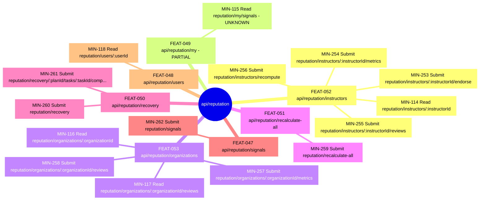

### FEAT-052 api/reputation/instructors

api/reputation/instructors

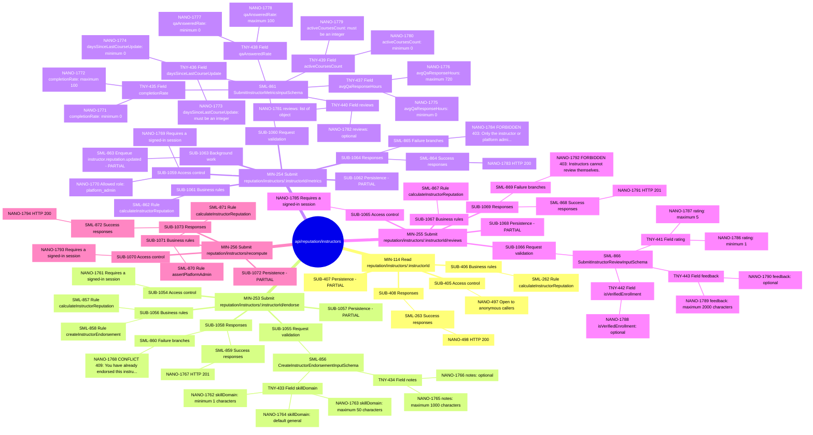

| ID        | Level | Parent   | Name                                                                                  | Description                                                                                                                                                                                                                                                                                                                                                                                                                  | Status                | Verification | Evidence                                         | Related                                         |
| --------- | ----- | -------- | ------------------------------------------------------------------------------------- | ---------------------------------------------------------------------------------------------------------------------------------------------------------------------------------------------------------------------------------------------------------------------------------------------------------------------------------------------------------------------------------------------------------------------------- | --------------------- | ------------ | ------------------------------------------------ | ----------------------------------------------- |
| FEAT-052  | MAJOR | MOD-067  | api/reputation/instructors                                                            |                                                                                                                                                                                                                                                                                                                                                                                                                              | IMPLEMENTED           |              | apps/api/src/server.ts:4331                      |                                                 |
| MIN-114   | MINOR | FEAT-052 | Read reputation/instructors/:instructorId                                             | 1. Get Transparent Instructor Reputation Breakdown (F-148) GET /api/v1/reputation/instructors/:instructorId for anyone (public); calls calculateInstructorReputation; ephemeral (process memory); responds 200. Gaps: ephemeral: state held in process memory, lost on restart; no first-party web caller found                                                                                                              | IMPLEMENTED           | VERIFIED     | apps/api/src/server.ts:4331                      | API-082, TEST-106, TEST-126, TEST-145, TEST-185 |
| SUB-405   | SUB   | MIN-114  | Access control                                                                        | Who may call GET /api/v1/reputation/instructors/:instructorId: anyone (public).                                                                                                                                                                                                                                                                                                                                              | IMPLEMENTED           | PATH_LEVEL   | apps/api/src/server.ts:4331                      |                                                 |
| NANO-497  | NANO  | SUB-405  | Open to anonymous callers                                                             | auth: public.                                                                                                                                                                                                                                                                                                                                                                                                                | IMPLEMENTED           | PATH_LEVEL   | apps/api/src/server.ts:4331                      | ROLE-001                                        |
| SUB-406   | SUB   | MIN-114  | Business rules                                                                        | Domain functions from packages/domain called by the handler (1).                                                                                                                                                                                                                                                                                                                                                             | IMPLEMENTED           | PATH_LEVEL   | apps/api/src/server.ts:4331                      |                                                 |
| SML-262   | SMALL | SUB-406  | Rule calculateInstructorReputation                                                    | Calls calculateInstructorReputation (packages/domain/src/instructor-reputation.ts). Rule status IMPLEMENTED; its own tests: VERIFIED.                                                                                                                                                                                                                                                                                        | IMPLEMENTED           | VERIFIED     | packages/domain/src/instructor-reputation.ts:208 | RULE-121                                        |
| SUB-407   | SUB   | MIN-114  | Persistence                                                                           | Ephemeral: state lives in API process memory and is lost on restart.                                                                                                                                                                                                                                                                                                                                                         | PARTIALLY_IMPLEMENTED | PATH_LEVEL   | apps/api/src/server.ts:4331                      |                                                 |
| SUB-408   | SUB   | MIN-114  | Responses                                                                             | Success 200; 0 explicit failure branch(es) besides validation and access errors.                                                                                                                                                                                                                                                                                                                                             | IMPLEMENTED           | PATH_LEVEL   | apps/api/src/server.ts:4331                      |                                                 |
| SML-263   | SMALL | SUB-408  | Success responses                                                                     | HTTP 200.                                                                                                                                                                                                                                                                                                                                                                                                                    | IMPLEMENTED           | PATH_LEVEL   | apps/api/src/server.ts:4331                      |                                                 |
| NANO-498  | NANO  | SML-263  | HTTP 200                                                                              | Replies 200 when the operation succeeds.                                                                                                                                                                                                                                                                                                                                                                                     | IMPLEMENTED           | PATH_LEVEL   | apps/api/src/server.ts:4331                      |                                                 |
| MIN-253   | MINOR | FEAT-052 | Submit reputation/instructors/:instructorId/endorse                                   | 3. Endorse an Instructor (Peer Instructor or Admin) POST /api/v1/reputation/instructors/:instructorId/endorse for any signed-in session; validates CreateInstructorEndorsementInputSchema; calls calculateInstructorReputation, createInstructorEndorsement; ephemeral (process memory); responds 201; 1 failure branch(es). Gaps: ephemeral: state held in process memory, lost on restart; no first-party web caller found | IMPLEMENTED           | VERIFIED     | apps/api/src/server.ts:4412                      | API-084, TEST-106                               |
| SUB-1054  | SUB   | MIN-253  | Access control                                                                        | Who may call POST /api/v1/reputation/instructors/:instructorId/endorse: any signed-in session.                                                                                                                                                                                                                                                                                                                               | IMPLEMENTED           | PATH_LEVEL   | apps/api/src/server.ts:4412                      |                                                 |
| NANO-1761 | NANO  | SUB-1054 | Requires a signed-in session                                                          | Requests without a valid session token are rejected with 401 UNAUTHENTICATED.                                                                                                                                                                                                                                                                                                                                                | IMPLEMENTED           | PATH_LEVEL   | apps/api/src/server.ts:4412                      | ROLE-001                                        |
| SUB-1055  | SUB   | MIN-253  | Request validation                                                                    | The request is parsed with CreateInstructorEndorsementInputSchema; a failure returns 400 with field details before any business logic runs.                                                                                                                                                                                                                                                                                  | IMPLEMENTED           | PATH_LEVEL   | apps/api/src/server.ts:4412                      |                                                 |
| SML-856   | SMALL | SUB-1055 | CreateInstructorEndorsementInputSchema                                                | CreateInstructorEndorsementInputSchema: 2 field(s)                                                                                                                                                                                                                                                                                                                                                                           | IMPLEMENTED           | PATH_LEVEL   | packages/contracts/src/index.ts:1343             | SCH-103                                         |
| TNY-433   | TINY  | SML-856  | Field skillDomain                                                                     | skillDomain (string, optional): minimum 1 characters; maximum 50 characters; default 'general'                                                                                                                                                                                                                                                                                                                               | IMPLEMENTED           | PATH_LEVEL   | packages/contracts/src/index.ts:1344             |                                                 |
| NANO-1762 | NANO  | TNY-433  | skillDomain: minimum 1 characters                                                     | skillDomain minimum 1 characters.                                                                                                                                                                                                                                                                                                                                                                                            | IMPLEMENTED           | PATH_LEVEL   | packages/contracts/src/index.ts:1344             |                                                 |
| NANO-1763 | NANO  | TNY-433  | skillDomain: maximum 50 characters                                                    | skillDomain maximum 50 characters.                                                                                                                                                                                                                                                                                                                                                                                           | IMPLEMENTED           | PATH_LEVEL   | packages/contracts/src/index.ts:1344             |                                                 |
| NANO-1764 | NANO  | TNY-433  | skillDomain: default 'general'                                                        | skillDomain default 'general'; message "general".                                                                                                                                                                                                                                                                                                                                                                            | IMPLEMENTED           | PATH_LEVEL   | packages/contracts/src/index.ts:1344             |                                                 |
| TNY-434   | TINY  | SML-856  | Field notes                                                                           | notes (string, optional): maximum 1000 characters; optional                                                                                                                                                                                                                                                                                                                                                                  | IMPLEMENTED           | PATH_LEVEL   | packages/contracts/src/index.ts:1345             |                                                 |
| NANO-1765 | NANO  | TNY-434  | notes: maximum 1000 characters                                                        | notes maximum 1000 characters.                                                                                                                                                                                                                                                                                                                                                                                               | IMPLEMENTED           | PATH_LEVEL   | packages/contracts/src/index.ts:1345             |                                                 |
| NANO-1766 | NANO  | TNY-434  | notes: optional                                                                       | notes optional.                                                                                                                                                                                                                                                                                                                                                                                                              | IMPLEMENTED           | PATH_LEVEL   | packages/contracts/src/index.ts:1345             |                                                 |
| SUB-1056  | SUB   | MIN-253  | Business rules                                                                        | Domain functions from packages/domain called by the handler (2).                                                                                                                                                                                                                                                                                                                                                             | IMPLEMENTED           | PATH_LEVEL   | apps/api/src/server.ts:4412                      |                                                 |
| SML-857   | SMALL | SUB-1056 | Rule calculateInstructorReputation                                                    | Calls calculateInstructorReputation (packages/domain/src/instructor-reputation.ts). Rule status IMPLEMENTED; its own tests: VERIFIED.                                                                                                                                                                                                                                                                                        | IMPLEMENTED           | VERIFIED     | packages/domain/src/instructor-reputation.ts:208 | RULE-121                                        |
| SML-858   | SMALL | SUB-1056 | Rule createInstructorEndorsement                                                      | Calls createInstructorEndorsement (packages/domain/src/instructor-reputation.ts). Rule status IMPLEMENTED; its own tests: VERIFIED.                                                                                                                                                                                                                                                                                          | IMPLEMENTED           | VERIFIED     | packages/domain/src/instructor-reputation.ts:321 | RULE-122                                        |
| SUB-1057  | SUB   | MIN-253  | Persistence                                                                           | Ephemeral: state lives in API process memory and is lost on restart.                                                                                                                                                                                                                                                                                                                                                         | PARTIALLY_IMPLEMENTED | PATH_LEVEL   | apps/api/src/server.ts:4412                      |                                                 |
| SUB-1058  | SUB   | MIN-253  | Responses                                                                             | Success 201; 1 explicit failure branch(es) besides validation and access errors.                                                                                                                                                                                                                                                                                                                                             | IMPLEMENTED           | PATH_LEVEL   | apps/api/src/server.ts:4412                      |                                                 |
| SML-859   | SMALL | SUB-1058 | Success responses                                                                     | HTTP 201.                                                                                                                                                                                                                                                                                                                                                                                                                    | IMPLEMENTED           | PATH_LEVEL   | apps/api/src/server.ts:4412                      |                                                 |
| NANO-1767 | NANO  | SML-859  | HTTP 201                                                                              | Replies 201 when the operation succeeds.                                                                                                                                                                                                                                                                                                                                                                                     | IMPLEMENTED           | PATH_LEVEL   | apps/api/src/server.ts:4412                      |                                                 |
| SML-860   | SMALL | SUB-1058 | Failure branches                                                                      | 1 DomainError branch(es) in the handler, mapped to HTTP by the global error handler.                                                                                                                                                                                                                                                                                                                                         | IMPLEMENTED           | PATH_LEVEL   | apps/api/src/server.ts:4412                      |                                                 |
| NANO-1768 | NANO  | SML-860  | CONFLICT 409: You have already endorsed this instructor for this skill domain.        | Throws DomainError(CONFLICT) "You have already endorsed this instructor for this skill domain." -> HTTP 409.                                                                                                                                                                                                                                                                                                                 | IMPLEMENTED           | PATH_LEVEL   | apps/api/src/server.ts:4432                      | ERR-095                                         |
| MIN-254   | MINOR | FEAT-052 | Submit reputation/instructors/:instructorId/metrics                                   | 2. Submit Operational Telemetry / Metrics (Instructor or Admin) POST /api/v1/reputation/instructors/:instructorId/metrics for roles platform_admin; validates SubmitInstructorMetricsInputSchema; calls calculateInstructorReputation; ephemeral (process memory); responds 200; 1 failure branch(es). Gaps: ephemeral: state held in process memory, lost on restart; no first-party web caller found                       | IMPLEMENTED           | VERIFIED     | apps/api/src/server.ts:4358                      | API-083, TEST-106, TEST-185                     |
| SUB-1059  | SUB   | MIN-254  | Access control                                                                        | Who may call POST /api/v1/reputation/instructors/:instructorId/metrics: roles platform_admin.                                                                                                                                                                                                                                                                                                                                | IMPLEMENTED           | PATH_LEVEL   | apps/api/src/server.ts:4358                      |                                                 |
| NANO-1769 | NANO  | SUB-1059 | Requires a signed-in session                                                          | Requests without a valid session token are rejected with 401 UNAUTHENTICATED.                                                                                                                                                                                                                                                                                                                                                | IMPLEMENTED           | PATH_LEVEL   | apps/api/src/server.ts:4358                      | ROLE-001                                        |
| NANO-1770 | NANO  | SUB-1059 | Allowed role: platform_admin                                                          | platform_admin is one of the roles allowed here (platform_admin); a caller holding none of them is rejected with 403.                                                                                                                                                                                                                                                                                                        | IMPLEMENTED           | PATH_LEVEL   | apps/api/src/server.ts:4358                      | ROLE-008                                        |
| SUB-1060  | SUB   | MIN-254  | Request validation                                                                    | The request is parsed with SubmitInstructorMetricsInputSchema; a failure returns 400 with field details before any business logic runs.                                                                                                                                                                                                                                                                                      | IMPLEMENTED           | PATH_LEVEL   | apps/api/src/server.ts:4358                      |                                                 |
| SML-861   | SMALL | SUB-1060 | SubmitInstructorMetricsInputSchema                                                    | SubmitInstructorMetricsInputSchema: 6 field(s)                                                                                                                                                                                                                                                                                                                                                                               | IMPLEMENTED           | PATH_LEVEL   | packages/contracts/src/index.ts:1323             | SCH-102                                         |
| TNY-435   | TINY  | SML-861  | Field completionRate                                                                  | completionRate (number, required): minimum 0; maximum 100                                                                                                                                                                                                                                                                                                                                                                    | IMPLEMENTED           | PATH_LEVEL   | packages/contracts/src/index.ts:1324             |                                                 |
| NANO-1771 | NANO  | TNY-435  | completionRate: minimum 0                                                             | completionRate minimum 0.                                                                                                                                                                                                                                                                                                                                                                                                    | IMPLEMENTED           | PATH_LEVEL   | packages/contracts/src/index.ts:1324             |                                                 |
| NANO-1772 | NANO  | TNY-435  | completionRate: maximum 100                                                           | completionRate maximum 100.                                                                                                                                                                                                                                                                                                                                                                                                  | IMPLEMENTED           | PATH_LEVEL   | packages/contracts/src/index.ts:1324             |                                                 |
| TNY-436   | TINY  | SML-861  | Field daysSinceLastCourseUpdate                                                       | daysSinceLastCourseUpdate (number, required): must be an integer; minimum 0                                                                                                                                                                                                                                                                                                                                                  | IMPLEMENTED           | PATH_LEVEL   | packages/contracts/src/index.ts:1325             |                                                 |
| NANO-1773 | NANO  | TNY-436  | daysSinceLastCourseUpdate: must be an integer                                         | daysSinceLastCourseUpdate must be an integer.                                                                                                                                                                                                                                                                                                                                                                                | IMPLEMENTED           | PATH_LEVEL   | packages/contracts/src/index.ts:1325             |                                                 |
| NANO-1774 | NANO  | TNY-436  | daysSinceLastCourseUpdate: minimum 0                                                  | daysSinceLastCourseUpdate minimum 0.                                                                                                                                                                                                                                                                                                                                                                                         | IMPLEMENTED           | PATH_LEVEL   | packages/contracts/src/index.ts:1325             |                                                 |
| TNY-437   | TINY  | SML-861  | Field avgQaResponseHours                                                              | avgQaResponseHours (number, required): minimum 0; maximum 720                                                                                                                                                                                                                                                                                                                                                                | IMPLEMENTED           | PATH_LEVEL   | packages/contracts/src/index.ts:1326             |                                                 |
| NANO-1775 | NANO  | TNY-437  | avgQaResponseHours: minimum 0                                                         | avgQaResponseHours minimum 0.                                                                                                                                                                                                                                                                                                                                                                                                | IMPLEMENTED           | PATH_LEVEL   | packages/contracts/src/index.ts:1326             |                                                 |
| NANO-1776 | NANO  | TNY-437  | avgQaResponseHours: maximum 720                                                       | avgQaResponseHours maximum 720.                                                                                                                                                                                                                                                                                                                                                                                              | IMPLEMENTED           | PATH_LEVEL   | packages/contracts/src/index.ts:1326             |                                                 |
| TNY-438   | TINY  | SML-861  | Field qaAnsweredRate                                                                  | qaAnsweredRate (number, required): minimum 0; maximum 100                                                                                                                                                                                                                                                                                                                                                                    | IMPLEMENTED           | PATH_LEVEL   | packages/contracts/src/index.ts:1327             |                                                 |
| NANO-1777 | NANO  | TNY-438  | qaAnsweredRate: minimum 0                                                             | qaAnsweredRate minimum 0.                                                                                                                                                                                                                                                                                                                                                                                                    | IMPLEMENTED           | PATH_LEVEL   | packages/contracts/src/index.ts:1327             |                                                 |
| NANO-1778 | NANO  | TNY-438  | qaAnsweredRate: maximum 100                                                           | qaAnsweredRate maximum 100.                                                                                                                                                                                                                                                                                                                                                                                                  | IMPLEMENTED           | PATH_LEVEL   | packages/contracts/src/index.ts:1327             |                                                 |
| TNY-439   | TINY  | SML-861  | Field activeCoursesCount                                                              | activeCoursesCount (number, required): must be an integer; minimum 0                                                                                                                                                                                                                                                                                                                                                         | IMPLEMENTED           | PATH_LEVEL   | packages/contracts/src/index.ts:1328             |                                                 |
| NANO-1779 | NANO  | TNY-439  | activeCoursesCount: must be an integer                                                | activeCoursesCount must be an integer.                                                                                                                                                                                                                                                                                                                                                                                       | IMPLEMENTED           | PATH_LEVEL   | packages/contracts/src/index.ts:1328             |                                                 |
| NANO-1780 | NANO  | TNY-439  | activeCoursesCount: minimum 0                                                         | activeCoursesCount minimum 0.                                                                                                                                                                                                                                                                                                                                                                                                | IMPLEMENTED           | PATH_LEVEL   | packages/contracts/src/index.ts:1328             |                                                 |
| TNY-440   | TINY  | SML-861  | Field reviews                                                                         | reviews (array, optional): list of object; optional                                                                                                                                                                                                                                                                                                                                                                          | IMPLEMENTED           | PATH_LEVEL   | packages/contracts/src/index.ts:1329             |                                                 |
| NANO-1781 | NANO  | TNY-440  | reviews: list of object                                                               | reviews list of object.                                                                                                                                                                                                                                                                                                                                                                                                      | IMPLEMENTED           | PATH_LEVEL   | packages/contracts/src/index.ts:1329             |                                                 |
| NANO-1782 | NANO  | TNY-440  | reviews: optional                                                                     | reviews optional.                                                                                                                                                                                                                                                                                                                                                                                                            | IMPLEMENTED           | PATH_LEVEL   | packages/contracts/src/index.ts:1329             |                                                 |
| SUB-1061  | SUB   | MIN-254  | Business rules                                                                        | Domain functions from packages/domain called by the handler (1).                                                                                                                                                                                                                                                                                                                                                             | IMPLEMENTED           | PATH_LEVEL   | apps/api/src/server.ts:4358                      |                                                 |
| SML-862   | SMALL | SUB-1061 | Rule calculateInstructorReputation                                                    | Calls calculateInstructorReputation (packages/domain/src/instructor-reputation.ts). Rule status IMPLEMENTED; its own tests: VERIFIED.                                                                                                                                                                                                                                                                                        | IMPLEMENTED           | VERIFIED     | packages/domain/src/instructor-reputation.ts:208 | RULE-121                                        |
| SUB-1062  | SUB   | MIN-254  | Persistence                                                                           | Ephemeral: state lives in API process memory and is lost on restart.                                                                                                                                                                                                                                                                                                                                                         | PARTIALLY_IMPLEMENTED | PATH_LEVEL   | apps/api/src/server.ts:4358                      |                                                 |
| SUB-1063  | SUB   | MIN-254  | Background work                                                                       | Enqueues 1 background job kind(s) in background_jobs for apps/worker.                                                                                                                                                                                                                                                                                                                                                        | IMPLEMENTED           | PATH_LEVEL   | apps/api/src/server.ts:4358                      |                                                 |
| SML-863   | SMALL | SUB-1063 | Enqueue instructor.reputation.updated                                                 | Dispatches job:instructor.reputation.updated; worker handler: recordEvent (no-op: marks the event recorded).                                                                                                                                                                                                                                                                                                                 | PARTIALLY_IMPLEMENTED | UNKNOWN      | packages/domain/src/background-jobs.ts:171       | SVC-027                                         |
| SUB-1064  | SUB   | MIN-254  | Responses                                                                             | Success 200; 1 explicit failure branch(es) besides validation and access errors.                                                                                                                                                                                                                                                                                                                                             | IMPLEMENTED           | PATH_LEVEL   | apps/api/src/server.ts:4358                      |                                                 |
| SML-864   | SMALL | SUB-1064 | Success responses                                                                     | HTTP 200.                                                                                                                                                                                                                                                                                                                                                                                                                    | IMPLEMENTED           | PATH_LEVEL   | apps/api/src/server.ts:4358                      |                                                 |
| NANO-1783 | NANO  | SML-864  | HTTP 200                                                                              | Replies 200 when the operation succeeds.                                                                                                                                                                                                                                                                                                                                                                                     | IMPLEMENTED           | PATH_LEVEL   | apps/api/src/server.ts:4358                      |                                                 |
| SML-865   | SMALL | SUB-1064 | Failure branches                                                                      | 1 DomainError branch(es) in the handler, mapped to HTTP by the global error handler.                                                                                                                                                                                                                                                                                                                                         | IMPLEMENTED           | PATH_LEVEL   | apps/api/src/server.ts:4358                      |                                                 |
| NANO-1784 | NANO  | SML-865  | FORBIDDEN 403: Only the instructor or platform administrator can update operational m | Throws DomainError(FORBIDDEN) "Only the instructor or platform administrator can update operational metrics." -> HTTP 403.                                                                                                                                                                                                                                                                                                   | IMPLEMENTED           | PATH_LEVEL   | apps/api/src/server.ts:4368                      | ERR-094                                         |
| MIN-255   | MINOR | FEAT-052 | Submit reputation/instructors/:instructorId/reviews                                   | 4. Submit Student Review with Anti-Manipulation Outlier Trimming POST /api/v1/reputation/instructors/:instructorId/reviews for any signed-in session; validates SubmitInstructorReviewInputSchema; calls calculateInstructorReputation; ephemeral (process memory); responds 201; 1 failure branch(es). Gaps: ephemeral: state held in process memory, lost on restart; no first-party web caller found                      | IMPLEMENTED           | VERIFIED     | apps/api/src/server.ts:4462                      | API-085, TEST-106, TEST-126, TEST-185           |
| SUB-1065  | SUB   | MIN-255  | Access control                                                                        | Who may call POST /api/v1/reputation/instructors/:instructorId/reviews: any signed-in session.                                                                                                                                                                                                                                                                                                                               | IMPLEMENTED           | PATH_LEVEL   | apps/api/src/server.ts:4462                      |                                                 |
| NANO-1785 | NANO  | SUB-1065 | Requires a signed-in session                                                          | Requests without a valid session token are rejected with 401 UNAUTHENTICATED.                                                                                                                                                                                                                                                                                                                                                | IMPLEMENTED           | PATH_LEVEL   | apps/api/src/server.ts:4462                      | ROLE-001                                        |
| SUB-1066  | SUB   | MIN-255  | Request validation                                                                    | The request is parsed with SubmitInstructorReviewInputSchema; a failure returns 400 with field details before any business logic runs.                                                                                                                                                                                                                                                                                       | IMPLEMENTED           | PATH_LEVEL   | apps/api/src/server.ts:4462                      |                                                 |
| SML-866   | SMALL | SUB-1066 | SubmitInstructorReviewInputSchema                                                     | SubmitInstructorReviewInputSchema: 3 field(s)                                                                                                                                                                                                                                                                                                                                                                                | IMPLEMENTED           | PATH_LEVEL   | packages/contracts/src/index.ts:1352             | SCH-104                                         |
| TNY-441   | TINY  | SML-866  | Field rating                                                                          | rating (number, required): minimum 1; maximum 5                                                                                                                                                                                                                                                                                                                                                                              | IMPLEMENTED           | PATH_LEVEL   | packages/contracts/src/index.ts:1353             |                                                 |
| NANO-1786 | NANO  | TNY-441  | rating: minimum 1                                                                     | rating minimum 1.                                                                                                                                                                                                                                                                                                                                                                                                            | IMPLEMENTED           | PATH_LEVEL   | packages/contracts/src/index.ts:1353             |                                                 |
| NANO-1787 | NANO  | TNY-441  | rating: maximum 5                                                                     | rating maximum 5.                                                                                                                                                                                                                                                                                                                                                                                                            | IMPLEMENTED           | PATH_LEVEL   | packages/contracts/src/index.ts:1353             |                                                 |
| TNY-442   | TINY  | SML-866  | Field isVerifiedEnrollment                                                            | isVerifiedEnrollment (boolean, optional): optional                                                                                                                                                                                                                                                                                                                                                                           | IMPLEMENTED           | PATH_LEVEL   | packages/contracts/src/index.ts:1355             |                                                 |
| NANO-1788 | NANO  | TNY-442  | isVerifiedEnrollment: optional                                                        | isVerifiedEnrollment optional.                                                                                                                                                                                                                                                                                                                                                                                               | IMPLEMENTED           | PATH_LEVEL   | packages/contracts/src/index.ts:1355             |                                                 |
| TNY-443   | TINY  | SML-866  | Field feedback                                                                        | feedback (string, optional): maximum 2000 characters; optional                                                                                                                                                                                                                                                                                                                                                               | IMPLEMENTED           | PATH_LEVEL   | packages/contracts/src/index.ts:1356             |                                                 |
| NANO-1789 | NANO  | TNY-443  | feedback: maximum 2000 characters                                                     | feedback maximum 2000 characters.                                                                                                                                                                                                                                                                                                                                                                                            | IMPLEMENTED           | PATH_LEVEL   | packages/contracts/src/index.ts:1356             |                                                 |
| NANO-1790 | NANO  | TNY-443  | feedback: optional                                                                    | feedback optional.                                                                                                                                                                                                                                                                                                                                                                                                           | IMPLEMENTED           | PATH_LEVEL   | packages/contracts/src/index.ts:1356             |                                                 |
| SUB-1067  | SUB   | MIN-255  | Business rules                                                                        | Domain functions from packages/domain called by the handler (1).                                                                                                                                                                                                                                                                                                                                                             | IMPLEMENTED           | PATH_LEVEL   | apps/api/src/server.ts:4462                      |                                                 |
| SML-867   | SMALL | SUB-1067 | Rule calculateInstructorReputation                                                    | Calls calculateInstructorReputation (packages/domain/src/instructor-reputation.ts). Rule status IMPLEMENTED; its own tests: VERIFIED.                                                                                                                                                                                                                                                                                        | IMPLEMENTED           | VERIFIED     | packages/domain/src/instructor-reputation.ts:208 | RULE-121                                        |
| SUB-1068  | SUB   | MIN-255  | Persistence                                                                           | Ephemeral: state lives in API process memory and is lost on restart.                                                                                                                                                                                                                                                                                                                                                         | PARTIALLY_IMPLEMENTED | PATH_LEVEL   | apps/api/src/server.ts:4462                      |                                                 |
| SUB-1069  | SUB   | MIN-255  | Responses                                                                             | Success 201; 1 explicit failure branch(es) besides validation and access errors.                                                                                                                                                                                                                                                                                                                                             | IMPLEMENTED           | PATH_LEVEL   | apps/api/src/server.ts:4462                      |                                                 |
| SML-868   | SMALL | SUB-1069 | Success responses                                                                     | HTTP 201.                                                                                                                                                                                                                                                                                                                                                                                                                    | IMPLEMENTED           | PATH_LEVEL   | apps/api/src/server.ts:4462                      |                                                 |
| NANO-1791 | NANO  | SML-868  | HTTP 201                                                                              | Replies 201 when the operation succeeds.                                                                                                                                                                                                                                                                                                                                                                                     | IMPLEMENTED           | PATH_LEVEL   | apps/api/src/server.ts:4462                      |                                                 |
| SML-869   | SMALL | SUB-1069 | Failure branches                                                                      | 1 DomainError branch(es) in the handler, mapped to HTTP by the global error handler.                                                                                                                                                                                                                                                                                                                                         | IMPLEMENTED           | PATH_LEVEL   | apps/api/src/server.ts:4462                      |                                                 |
| NANO-1792 | NANO  | SML-869  | FORBIDDEN 403: Instructors cannot review themselves.                                  | Throws DomainError(FORBIDDEN) "Instructors cannot review themselves." -> HTTP 403.                                                                                                                                                                                                                                                                                                                                           | IMPLEMENTED           | PATH_LEVEL   | apps/api/src/server.ts:4470                      | ERR-096                                         |
| MIN-256   | MINOR | FEAT-052 | Submit reputation/instructors/recompute                                               | 5. Nightly Batch Recalculation (SSOT F-148 Acceptance) POST /api/v1/reputation/instructors/recompute for any signed-in session; calls assertPlatformAdmin, calculateInstructorReputation; ephemeral (process memory); responds 200. Gaps: ephemeral: state held in process memory, lost on restart; no first-party web caller found                                                                                          | IMPLEMENTED           | VERIFIED     | apps/api/src/server.ts:4511                      | API-086, TEST-106                               |
| SUB-1070  | SUB   | MIN-256  | Access control                                                                        | Who may call POST /api/v1/reputation/instructors/recompute: any signed-in session.                                                                                                                                                                                                                                                                                                                                           | IMPLEMENTED           | PATH_LEVEL   | apps/api/src/server.ts:4511                      |                                                 |
| NANO-1793 | NANO  | SUB-1070 | Requires a signed-in session                                                          | Requests without a valid session token are rejected with 401 UNAUTHENTICATED.                                                                                                                                                                                                                                                                                                                                                | IMPLEMENTED           | PATH_LEVEL   | apps/api/src/server.ts:4511                      | ROLE-001                                        |
| SUB-1071  | SUB   | MIN-256  | Business rules                                                                        | Domain functions from packages/domain called by the handler (2).                                                                                                                                                                                                                                                                                                                                                             | IMPLEMENTED           | PATH_LEVEL   | apps/api/src/server.ts:4511                      |                                                 |
| SML-870   | SMALL | SUB-1071 | Rule assertPlatformAdmin                                                              | Calls assertPlatformAdmin (packages/domain/src/admin.ts). Rule status IMPLEMENTED; its own tests: VERIFIED.                                                                                                                                                                                                                                                                                                                  | IMPLEMENTED           | VERIFIED     | packages/domain/src/admin.ts:44                  | RULE-005                                        |
| SML-871   | SMALL | SUB-1071 | Rule calculateInstructorReputation                                                    | Calls calculateInstructorReputation (packages/domain/src/instructor-reputation.ts). Rule status IMPLEMENTED; its own tests: VERIFIED.                                                                                                                                                                                                                                                                                        | IMPLEMENTED           | VERIFIED     | packages/domain/src/instructor-reputation.ts:208 | RULE-121                                        |
| SUB-1072  | SUB   | MIN-256  | Persistence                                                                           | Ephemeral: state lives in API process memory and is lost on restart.                                                                                                                                                                                                                                                                                                                                                         | PARTIALLY_IMPLEMENTED | PATH_LEVEL   | apps/api/src/server.ts:4511                      |                                                 |
| SUB-1073  | SUB   | MIN-256  | Responses                                                                             | Success 200; 0 explicit failure branch(es) besides validation and access errors.                                                                                                                                                                                                                                                                                                                                             | IMPLEMENTED           | PATH_LEVEL   | apps/api/src/server.ts:4511                      |                                                 |
| SML-872   | SMALL | SUB-1073 | Success responses                                                                     | HTTP 200.                                                                                                                                                                                                                                                                                                                                                                                                                    | IMPLEMENTED           | PATH_LEVEL   | apps/api/src/server.ts:4511                      |                                                 |
| NANO-1794 | NANO  | SML-872  | HTTP 200                                                                              | Replies 200 when the operation succeeds.                                                                                                                                                                                                                                                                                                                                                                                     | IMPLEMENTED           | PATH_LEVEL   | apps/api/src/server.ts:4511                      |                                                 |

### FEAT-049 api/reputation/my

api/reputation/my

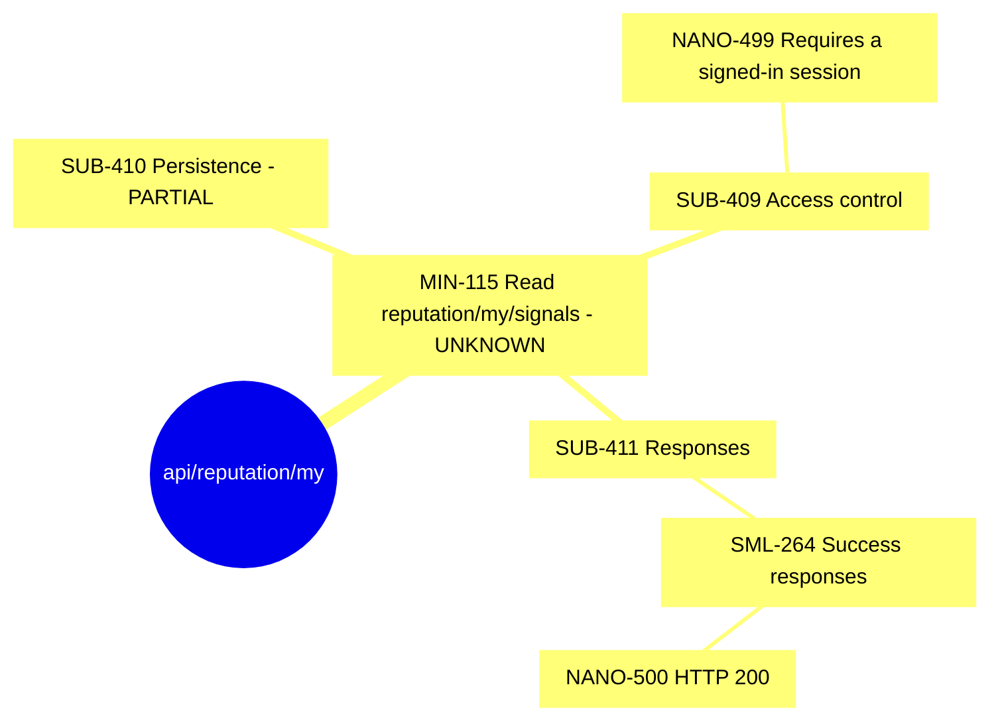

| ID       | Level | Parent   | Name                         | Description                                                                                                                                                                                            | Status                | Verification | Evidence                    | Related                     |
| -------- | ----- | -------- | ---------------------------- | ------------------------------------------------------------------------------------------------------------------------------------------------------------------------------------------------------ | --------------------- | ------------ | --------------------------- | --------------------------- |
| FEAT-049 | MAJOR | MOD-067  | api/reputation/my            |                                                                                                                                                                                                        | PARTIALLY_IMPLEMENTED |              | apps/api/src/server.ts:4174 |                             |
| MIN-115  | MINOR | FEAT-049 | Read reputation/my/signals   | GET /api/v1/reputation/my/signals for any signed-in session; ephemeral (process memory); responds 200. Gaps: ephemeral: state held in process memory, lost on restart; no first-party web caller found | UNKNOWN               | VERIFIED     | apps/api/src/server.ts:4174 | API-078, TEST-121, TEST-203 |
| SUB-409  | SUB   | MIN-115  | Access control               | Who may call GET /api/v1/reputation/my/signals: any signed-in session.                                                                                                                                 | IMPLEMENTED           | PATH_LEVEL   | apps/api/src/server.ts:4174 |                             |
| NANO-499 | NANO  | SUB-409  | Requires a signed-in session | Requests without a valid session token are rejected with 401 UNAUTHENTICATED.                                                                                                                          | IMPLEMENTED           | PATH_LEVEL   | apps/api/src/server.ts:4174 | ROLE-001                    |
| SUB-410  | SUB   | MIN-115  | Persistence                  | Ephemeral: state lives in API process memory and is lost on restart.                                                                                                                                   | PARTIALLY_IMPLEMENTED | PATH_LEVEL   | apps/api/src/server.ts:4174 |                             |
| SUB-411  | SUB   | MIN-115  | Responses                    | Success 200; 0 explicit failure branch(es) besides validation and access errors.                                                                                                                       | IMPLEMENTED           | PATH_LEVEL   | apps/api/src/server.ts:4174 |                             |
| SML-264  | SMALL | SUB-411  | Success responses            | HTTP 200.                                                                                                                                                                                              | IMPLEMENTED           | PATH_LEVEL   | apps/api/src/server.ts:4174 |                             |
| NANO-500 | NANO  | SML-264  | HTTP 200                     | Replies 200 when the operation succeeds.                                                                                                                                                               | IMPLEMENTED           | PATH_LEVEL   | apps/api/src/server.ts:4174 |                             |

### FEAT-053 api/reputation/organizations

api/reputation/organizations

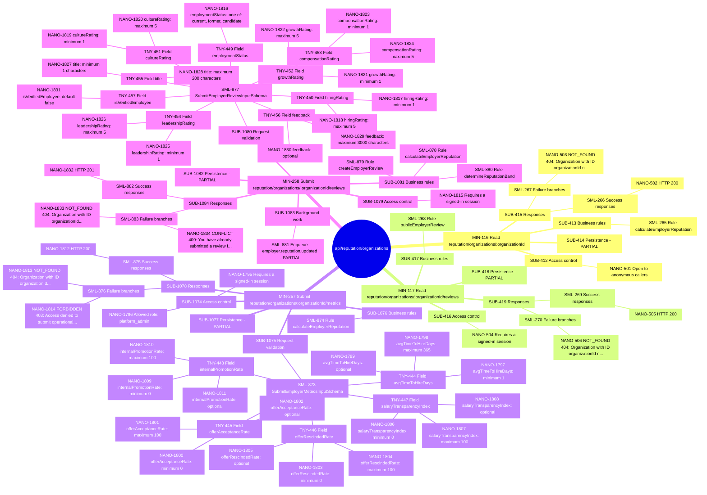

| ID        | Level | Parent   | Name                                                                          | Description                                                                                                                                                                                                                                                                                                                                                                                                     | Status                | Verification | Evidence                                       | Related                               |
| --------- | ----- | -------- | ----------------------------------------------------------------------------- | --------------------------------------------------------------------------------------------------------------------------------------------------------------------------------------------------------------------------------------------------------------------------------------------------------------------------------------------------------------------------------------------------------------- | --------------------- | ------------ | ---------------------------------------------- | ------------------------------------- |
| FEAT-053  | MAJOR | MOD-067  | api/reputation/organizations                                                  |                                                                                                                                                                                                                                                                                                                                                                                                                 | IMPLEMENTED           |              | apps/api/src/server.ts:4542                    |                                       |
| MIN-116   | MINOR | FEAT-053 | Read reputation/organizations/:organizationId                                 | 1. Get Employer Reputation Profile & Factor Breakdown GET /api/v1/reputation/organizations/:organizationId for anyone (public); calls calculateEmployerReputation; ephemeral (process memory); responds 200; 1 failure branch(es). Gaps: ephemeral: state held in process memory, lost on restart; no first-party web caller found                                                                              | IMPLEMENTED           | VERIFIED     | apps/api/src/server.ts:4542                    | API-087, TEST-100, TEST-145, TEST-180 |
| SUB-412   | SUB   | MIN-116  | Access control                                                                | Who may call GET /api/v1/reputation/organizations/:organizationId: anyone (public).                                                                                                                                                                                                                                                                                                                             | IMPLEMENTED           | PATH_LEVEL   | apps/api/src/server.ts:4542                    |                                       |
| NANO-501  | NANO  | SUB-412  | Open to anonymous callers                                                     | auth: public.                                                                                                                                                                                                                                                                                                                                                                                                   | IMPLEMENTED           | PATH_LEVEL   | apps/api/src/server.ts:4542                    | ROLE-001                              |
| SUB-413   | SUB   | MIN-116  | Business rules                                                                | Domain functions from packages/domain called by the handler (1).                                                                                                                                                                                                                                                                                                                                                | IMPLEMENTED           | PATH_LEVEL   | apps/api/src/server.ts:4542                    |                                       |
| SML-265   | SMALL | SUB-413  | Rule calculateEmployerReputation                                              | Calls calculateEmployerReputation (packages/domain/src/employer-reputation.ts). Rule status IMPLEMENTED; its own tests: VERIFIED.                                                                                                                                                                                                                                                                               | IMPLEMENTED           | VERIFIED     | packages/domain/src/employer-reputation.ts:163 | RULE-093                              |
| SUB-414   | SUB   | MIN-116  | Persistence                                                                   | Ephemeral: state lives in API process memory and is lost on restart.                                                                                                                                                                                                                                                                                                                                            | PARTIALLY_IMPLEMENTED | PATH_LEVEL   | apps/api/src/server.ts:4542                    |                                       |
| SUB-415   | SUB   | MIN-116  | Responses                                                                     | Success 200; 1 explicit failure branch(es) besides validation and access errors.                                                                                                                                                                                                                                                                                                                                | IMPLEMENTED           | PATH_LEVEL   | apps/api/src/server.ts:4542                    |                                       |
| SML-266   | SMALL | SUB-415  | Success responses                                                             | HTTP 200.                                                                                                                                                                                                                                                                                                                                                                                                       | IMPLEMENTED           | PATH_LEVEL   | apps/api/src/server.ts:4542                    |                                       |
| NANO-502  | NANO  | SML-266  | HTTP 200                                                                      | Replies 200 when the operation succeeds.                                                                                                                                                                                                                                                                                                                                                                        | IMPLEMENTED           | PATH_LEVEL   | apps/api/src/server.ts:4542                    |                                       |
| SML-267   | SMALL | SUB-415  | Failure branches                                                              | 1 DomainError branch(es) in the handler, mapped to HTTP by the global error handler.                                                                                                                                                                                                                                                                                                                            | IMPLEMENTED           | PATH_LEVEL   | apps/api/src/server.ts:4542                    |                                       |
| NANO-503  | NANO  | SML-267  | NOT_FOUND 404: Organization with ID "${organizationId}" not found.            | Throws DomainError(NOT_FOUND) "Organization with ID "${organizationId}" not found." -> HTTP 404.                                                                                                                                                                                                                                                                                                                | IMPLEMENTED           | PATH_LEVEL   | apps/api/src/server.ts:4549                    | ERR-097                               |
| MIN-117   | MINOR | FEAT-053 | Read reputation/organizations/:organizationId/reviews                         | 4. List Reviews for Employer GET /api/v1/reputation/organizations/:organizationId/reviews for any signed-in session; calls publicEmployerReview; ephemeral (process memory); responds 200; 1 failure branch(es). Gaps: ephemeral: state held in process memory, lost on restart; no first-party web caller found                                                                                                | IMPLEMENTED           | VERIFIED     | apps/api/src/server.ts:4694                    | API-090, TEST-100, TEST-145, TEST-180 |
| SUB-416   | SUB   | MIN-117  | Access control                                                                | Who may call GET /api/v1/reputation/organizations/:organizationId/reviews: any signed-in session.                                                                                                                                                                                                                                                                                                               | IMPLEMENTED           | PATH_LEVEL   | apps/api/src/server.ts:4694                    |                                       |
| NANO-504  | NANO  | SUB-416  | Requires a signed-in session                                                  | Requests without a valid session token are rejected with 401 UNAUTHENTICATED.                                                                                                                                                                                                                                                                                                                                   | IMPLEMENTED           | PATH_LEVEL   | apps/api/src/server.ts:4694                    | ROLE-001                              |
| SUB-417   | SUB   | MIN-117  | Business rules                                                                | Domain functions from packages/domain called by the handler (1).                                                                                                                                                                                                                                                                                                                                                | IMPLEMENTED           | PATH_LEVEL   | apps/api/src/server.ts:4694                    |                                       |
| SML-268   | SMALL | SUB-417  | Rule publicEmployerReview                                                     | Calls publicEmployerReview (packages/domain/src/employer-reputation.ts). Rule status IMPLEMENTED; its own tests: VERIFIED.                                                                                                                                                                                                                                                                                      | IMPLEMENTED           | VERIFIED     | packages/domain/src/employer-reputation.ts:61  | RULE-089                              |
| SUB-418   | SUB   | MIN-117  | Persistence                                                                   | Ephemeral: state lives in API process memory and is lost on restart.                                                                                                                                                                                                                                                                                                                                            | PARTIALLY_IMPLEMENTED | PATH_LEVEL   | apps/api/src/server.ts:4694                    |                                       |
| SUB-419   | SUB   | MIN-117  | Responses                                                                     | Success 200; 1 explicit failure branch(es) besides validation and access errors.                                                                                                                                                                                                                                                                                                                                | IMPLEMENTED           | PATH_LEVEL   | apps/api/src/server.ts:4694                    |                                       |
| SML-269   | SMALL | SUB-419  | Success responses                                                             | HTTP 200.                                                                                                                                                                                                                                                                                                                                                                                                       | IMPLEMENTED           | PATH_LEVEL   | apps/api/src/server.ts:4694                    |                                       |
| NANO-505  | NANO  | SML-269  | HTTP 200                                                                      | Replies 200 when the operation succeeds.                                                                                                                                                                                                                                                                                                                                                                        | IMPLEMENTED           | PATH_LEVEL   | apps/api/src/server.ts:4694                    |                                       |
| SML-270   | SMALL | SUB-419  | Failure branches                                                              | 1 DomainError branch(es) in the handler, mapped to HTTP by the global error handler.                                                                                                                                                                                                                                                                                                                            | IMPLEMENTED           | PATH_LEVEL   | apps/api/src/server.ts:4694                    |                                       |
| NANO-506  | NANO  | SML-270  | NOT_FOUND 404: Organization with ID "${organizationId}" not found.            | Throws DomainError(NOT_FOUND) "Organization with ID "${organizationId}" not found." -> HTTP 404.                                                                                                                                                                                                                                                                                                                | IMPLEMENTED           | PATH_LEVEL   | apps/api/src/server.ts:4701                    | ERR-097                               |
| MIN-257   | MINOR | FEAT-053 | Submit reputation/organizations/:organizationId/metrics                       | 3. Submit Operational Metrics for Employer POST /api/v1/reputation/organizations/:organizationId/metrics for roles platform_admin; validates SubmitEmployerMetricsInputSchema; calls calculateEmployerReputation; ephemeral (process memory); responds 200; 2 failure branch(es). Gaps: ephemeral: state held in process memory, lost on restart; no first-party web caller found                               | IMPLEMENTED           | VERIFIED     | apps/api/src/server.ts:4649                    | API-089, TEST-100, TEST-180           |
| SUB-1074  | SUB   | MIN-257  | Access control                                                                | Who may call POST /api/v1/reputation/organizations/:organizationId/metrics: roles platform_admin.                                                                                                                                                                                                                                                                                                               | IMPLEMENTED           | PATH_LEVEL   | apps/api/src/server.ts:4649                    |                                       |
| NANO-1795 | NANO  | SUB-1074 | Requires a signed-in session                                                  | Requests without a valid session token are rejected with 401 UNAUTHENTICATED.                                                                                                                                                                                                                                                                                                                                   | IMPLEMENTED           | PATH_LEVEL   | apps/api/src/server.ts:4649                    | ROLE-001                              |
| NANO-1796 | NANO  | SUB-1074 | Allowed role: platform_admin                                                  | platform_admin is one of the roles allowed here (platform_admin); a caller holding none of them is rejected with 403.                                                                                                                                                                                                                                                                                           | IMPLEMENTED           | PATH_LEVEL   | apps/api/src/server.ts:4649                    | ROLE-008                              |
| SUB-1075  | SUB   | MIN-257  | Request validation                                                            | The request is parsed with SubmitEmployerMetricsInputSchema; a failure returns 400 with field details before any business logic runs.                                                                                                                                                                                                                                                                           | IMPLEMENTED           | PATH_LEVEL   | apps/api/src/server.ts:4649                    |                                       |
| SML-873   | SMALL | SUB-1075 | SubmitEmployerMetricsInputSchema                                              | SubmitEmployerMetricsInputSchema: 5 field(s)                                                                                                                                                                                                                                                                                                                                                                    | IMPLEMENTED           | PATH_LEVEL   | packages/contracts/src/index.ts:1452           | SCH-114                               |
| TNY-444   | TINY  | SML-873  | Field avgTimeToHireDays                                                       | avgTimeToHireDays (number, optional): minimum 1; maximum 365; optional                                                                                                                                                                                                                                                                                                                                          | IMPLEMENTED           | PATH_LEVEL   | packages/contracts/src/index.ts:1453           |                                       |
| NANO-1797 | NANO  | TNY-444  | avgTimeToHireDays: minimum 1                                                  | avgTimeToHireDays minimum 1.                                                                                                                                                                                                                                                                                                                                                                                    | IMPLEMENTED           | PATH_LEVEL   | packages/contracts/src/index.ts:1453           |                                       |
| NANO-1798 | NANO  | TNY-444  | avgTimeToHireDays: maximum 365                                                | avgTimeToHireDays maximum 365.                                                                                                                                                                                                                                                                                                                                                                                  | IMPLEMENTED           | PATH_LEVEL   | packages/contracts/src/index.ts:1453           |                                       |
| NANO-1799 | NANO  | TNY-444  | avgTimeToHireDays: optional                                                   | avgTimeToHireDays optional.                                                                                                                                                                                                                                                                                                                                                                                     | IMPLEMENTED           | PATH_LEVEL   | packages/contracts/src/index.ts:1453           |                                       |
| TNY-445   | TINY  | SML-873  | Field offerAcceptanceRate                                                     | offerAcceptanceRate (number, optional): minimum 0; maximum 100; optional                                                                                                                                                                                                                                                                                                                                        | IMPLEMENTED           | PATH_LEVEL   | packages/contracts/src/index.ts:1454           |                                       |
| NANO-1800 | NANO  | TNY-445  | offerAcceptanceRate: minimum 0                                                | offerAcceptanceRate minimum 0.                                                                                                                                                                                                                                                                                                                                                                                  | IMPLEMENTED           | PATH_LEVEL   | packages/contracts/src/index.ts:1454           |                                       |
| NANO-1801 | NANO  | TNY-445  | offerAcceptanceRate: maximum 100                                              | offerAcceptanceRate maximum 100.                                                                                                                                                                                                                                                                                                                                                                                | IMPLEMENTED           | PATH_LEVEL   | packages/contracts/src/index.ts:1454           |                                       |
| NANO-1802 | NANO  | TNY-445  | offerAcceptanceRate: optional                                                 | offerAcceptanceRate optional.                                                                                                                                                                                                                                                                                                                                                                                   | IMPLEMENTED           | PATH_LEVEL   | packages/contracts/src/index.ts:1454           |                                       |
| TNY-446   | TINY  | SML-873  | Field offerRescindedRate                                                      | offerRescindedRate (number, optional): minimum 0; maximum 100; optional                                                                                                                                                                                                                                                                                                                                         | IMPLEMENTED           | PATH_LEVEL   | packages/contracts/src/index.ts:1455           |                                       |
| NANO-1803 | NANO  | TNY-446  | offerRescindedRate: minimum 0                                                 | offerRescindedRate minimum 0.                                                                                                                                                                                                                                                                                                                                                                                   | IMPLEMENTED           | PATH_LEVEL   | packages/contracts/src/index.ts:1455           |                                       |
| NANO-1804 | NANO  | TNY-446  | offerRescindedRate: maximum 100                                               | offerRescindedRate maximum 100.                                                                                                                                                                                                                                                                                                                                                                                 | IMPLEMENTED           | PATH_LEVEL   | packages/contracts/src/index.ts:1455           |                                       |
| NANO-1805 | NANO  | TNY-446  | offerRescindedRate: optional                                                  | offerRescindedRate optional.                                                                                                                                                                                                                                                                                                                                                                                    | IMPLEMENTED           | PATH_LEVEL   | packages/contracts/src/index.ts:1455           |                                       |
| TNY-447   | TINY  | SML-873  | Field salaryTransparencyIndex                                                 | salaryTransparencyIndex (number, optional): minimum 0; maximum 100; optional                                                                                                                                                                                                                                                                                                                                    | IMPLEMENTED           | PATH_LEVEL   | packages/contracts/src/index.ts:1456           |                                       |
| NANO-1806 | NANO  | TNY-447  | salaryTransparencyIndex: minimum 0                                            | salaryTransparencyIndex minimum 0.                                                                                                                                                                                                                                                                                                                                                                              | IMPLEMENTED           | PATH_LEVEL   | packages/contracts/src/index.ts:1456           |                                       |
| NANO-1807 | NANO  | TNY-447  | salaryTransparencyIndex: maximum 100                                          | salaryTransparencyIndex maximum 100.                                                                                                                                                                                                                                                                                                                                                                            | IMPLEMENTED           | PATH_LEVEL   | packages/contracts/src/index.ts:1456           |                                       |
| NANO-1808 | NANO  | TNY-447  | salaryTransparencyIndex: optional                                             | salaryTransparencyIndex optional.                                                                                                                                                                                                                                                                                                                                                                               | IMPLEMENTED           | PATH_LEVEL   | packages/contracts/src/index.ts:1456           |                                       |
| TNY-448   | TINY  | SML-873  | Field internalPromotionRate                                                   | internalPromotionRate (number, optional): minimum 0; maximum 100; optional                                                                                                                                                                                                                                                                                                                                      | IMPLEMENTED           | PATH_LEVEL   | packages/contracts/src/index.ts:1457           |                                       |
| NANO-1809 | NANO  | TNY-448  | internalPromotionRate: minimum 0                                              | internalPromotionRate minimum 0.                                                                                                                                                                                                                                                                                                                                                                                | IMPLEMENTED           | PATH_LEVEL   | packages/contracts/src/index.ts:1457           |                                       |
| NANO-1810 | NANO  | TNY-448  | internalPromotionRate: maximum 100                                            | internalPromotionRate maximum 100.                                                                                                                                                                                                                                                                                                                                                                              | IMPLEMENTED           | PATH_LEVEL   | packages/contracts/src/index.ts:1457           |                                       |
| NANO-1811 | NANO  | TNY-448  | internalPromotionRate: optional                                               | internalPromotionRate optional.                                                                                                                                                                                                                                                                                                                                                                                 | IMPLEMENTED           | PATH_LEVEL   | packages/contracts/src/index.ts:1457           |                                       |
| SUB-1076  | SUB   | MIN-257  | Business rules                                                                | Domain functions from packages/domain called by the handler (1).                                                                                                                                                                                                                                                                                                                                                | IMPLEMENTED           | PATH_LEVEL   | apps/api/src/server.ts:4649                    |                                       |
| SML-874   | SMALL | SUB-1076 | Rule calculateEmployerReputation                                              | Calls calculateEmployerReputation (packages/domain/src/employer-reputation.ts). Rule status IMPLEMENTED; its own tests: VERIFIED.                                                                                                                                                                                                                                                                               | IMPLEMENTED           | VERIFIED     | packages/domain/src/employer-reputation.ts:163 | RULE-093                              |
| SUB-1077  | SUB   | MIN-257  | Persistence                                                                   | Ephemeral: state lives in API process memory and is lost on restart.                                                                                                                                                                                                                                                                                                                                            | PARTIALLY_IMPLEMENTED | PATH_LEVEL   | apps/api/src/server.ts:4649                    |                                       |
| SUB-1078  | SUB   | MIN-257  | Responses                                                                     | Success 200; 2 explicit failure branch(es) besides validation and access errors.                                                                                                                                                                                                                                                                                                                                | IMPLEMENTED           | PATH_LEVEL   | apps/api/src/server.ts:4649                    |                                       |
| SML-875   | SMALL | SUB-1078 | Success responses                                                             | HTTP 200.                                                                                                                                                                                                                                                                                                                                                                                                       | IMPLEMENTED           | PATH_LEVEL   | apps/api/src/server.ts:4649                    |                                       |
| NANO-1812 | NANO  | SML-875  | HTTP 200                                                                      | Replies 200 when the operation succeeds.                                                                                                                                                                                                                                                                                                                                                                        | IMPLEMENTED           | PATH_LEVEL   | apps/api/src/server.ts:4649                    |                                       |
| SML-876   | SMALL | SUB-1078 | Failure branches                                                              | 2 DomainError branch(es) in the handler, mapped to HTTP by the global error handler.                                                                                                                                                                                                                                                                                                                            | IMPLEMENTED           | PATH_LEVEL   | apps/api/src/server.ts:4649                    |                                       |
| NANO-1813 | NANO  | SML-876  | NOT_FOUND 404: Organization with ID "${organizationId}" not found.            | Throws DomainError(NOT_FOUND) "Organization with ID "${organizationId}" not found." -> HTTP 404.                                                                                                                                                                                                                                                                                                                | IMPLEMENTED           | PATH_LEVEL   | apps/api/src/server.ts:4657                    | ERR-097                               |
| NANO-1814 | NANO  | SML-876  | FORBIDDEN 403: Access denied to submit operational metrics for this employer. | Throws DomainError(FORBIDDEN) "Access denied to submit operational metrics for this employer." -> HTTP 403.                                                                                                                                                                                                                                                                                                     | IMPLEMENTED           | PATH_LEVEL   | apps/api/src/server.ts:4664                    | ERR-099                               |
| MIN-258   | MINOR | FEAT-053 | Submit reputation/organizations/:organizationId/reviews                       | 2. Submit Employer Review POST /api/v1/reputation/organizations/:organizationId/reviews for any signed-in session; validates SubmitEmployerReviewInputSchema; calls calculateEmployerReputation, createEmployerReview, determineReputationBand; ephemeral (process memory); responds 201; 2 failure branch(es). Gaps: ephemeral: state held in process memory, lost on restart; no first-party web caller found | IMPLEMENTED           | VERIFIED     | apps/api/src/server.ts:4565                    | API-088, TEST-100, TEST-180           |
| SUB-1079  | SUB   | MIN-258  | Access control                                                                | Who may call POST /api/v1/reputation/organizations/:organizationId/reviews: any signed-in session.                                                                                                                                                                                                                                                                                                              | IMPLEMENTED           | PATH_LEVEL   | apps/api/src/server.ts:4565                    |                                       |
| NANO-1815 | NANO  | SUB-1079 | Requires a signed-in session                                                  | Requests without a valid session token are rejected with 401 UNAUTHENTICATED.                                                                                                                                                                                                                                                                                                                                   | IMPLEMENTED           | PATH_LEVEL   | apps/api/src/server.ts:4565                    | ROLE-001                              |
| SUB-1080  | SUB   | MIN-258  | Request validation                                                            | The request is parsed with SubmitEmployerReviewInputSchema; a failure returns 400 with field details before any business logic runs.                                                                                                                                                                                                                                                                            | IMPLEMENTED           | PATH_LEVEL   | apps/api/src/server.ts:4565                    |                                       |
| SML-877   | SMALL | SUB-1080 | SubmitEmployerReviewInputSchema                                               | SubmitEmployerReviewInputSchema: 9 field(s)                                                                                                                                                                                                                                                                                                                                                                     | IMPLEMENTED           | PATH_LEVEL   | packages/contracts/src/index.ts:1438           | SCH-113                               |
| TNY-449   | TINY  | SML-877  | Field employmentStatus                                                        | employmentStatus (enum, required): one of: current, former, candidate                                                                                                                                                                                                                                                                                                                                           | IMPLEMENTED           | PATH_LEVEL   | packages/contracts/src/index.ts:1439           |                                       |
| NANO-1816 | NANO  | TNY-449  | employmentStatus: one of: current, former, candidate                          | employmentStatus one of: current, former, candidate.                                                                                                                                                                                                                                                                                                                                                            | IMPLEMENTED           | PATH_LEVEL   | packages/contracts/src/index.ts:1439           |                                       |
| TNY-450   | TINY  | SML-877  | Field hiringRating                                                            | hiringRating (number, required): minimum 1; maximum 5                                                                                                                                                                                                                                                                                                                                                           | IMPLEMENTED           | PATH_LEVEL   | packages/contracts/src/index.ts:1440           |                                       |
| NANO-1817 | NANO  | TNY-450  | hiringRating: minimum 1                                                       | hiringRating minimum 1.                                                                                                                                                                                                                                                                                                                                                                                         | IMPLEMENTED           | PATH_LEVEL   | packages/contracts/src/index.ts:1440           |                                       |
| NANO-1818 | NANO  | TNY-450  | hiringRating: maximum 5                                                       | hiringRating maximum 5.                                                                                                                                                                                                                                                                                                                                                                                         | IMPLEMENTED           | PATH_LEVEL   | packages/contracts/src/index.ts:1440           |                                       |
| TNY-451   | TINY  | SML-877  | Field cultureRating                                                           | cultureRating (number, required): minimum 1; maximum 5                                                                                                                                                                                                                                                                                                                                                          | IMPLEMENTED           | PATH_LEVEL   | packages/contracts/src/index.ts:1441           |                                       |
| NANO-1819 | NANO  | TNY-451  | cultureRating: minimum 1                                                      | cultureRating minimum 1.                                                                                                                                                                                                                                                                                                                                                                                        | IMPLEMENTED           | PATH_LEVEL   | packages/contracts/src/index.ts:1441           |                                       |
| NANO-1820 | NANO  | TNY-451  | cultureRating: maximum 5                                                      | cultureRating maximum 5.                                                                                                                                                                                                                                                                                                                                                                                        | IMPLEMENTED           | PATH_LEVEL   | packages/contracts/src/index.ts:1441           |                                       |
| TNY-452   | TINY  | SML-877  | Field growthRating                                                            | growthRating (number, required): minimum 1; maximum 5                                                                                                                                                                                                                                                                                                                                                           | IMPLEMENTED           | PATH_LEVEL   | packages/contracts/src/index.ts:1442           |                                       |
| NANO-1821 | NANO  | TNY-452  | growthRating: minimum 1                                                       | growthRating minimum 1.                                                                                                                                                                                                                                                                                                                                                                                         | IMPLEMENTED           | PATH_LEVEL   | packages/contracts/src/index.ts:1442           |                                       |
| NANO-1822 | NANO  | TNY-452  | growthRating: maximum 5                                                       | growthRating maximum 5.                                                                                                                                                                                                                                                                                                                                                                                         | IMPLEMENTED           | PATH_LEVEL   | packages/contracts/src/index.ts:1442           |                                       |
| TNY-453   | TINY  | SML-877  | Field compensationRating                                                      | compensationRating (number, required): minimum 1; maximum 5                                                                                                                                                                                                                                                                                                                                                     | IMPLEMENTED           | PATH_LEVEL   | packages/contracts/src/index.ts:1443           |                                       |
| NANO-1823 | NANO  | TNY-453  | compensationRating: minimum 1                                                 | compensationRating minimum 1.                                                                                                                                                                                                                                                                                                                                                                                   | IMPLEMENTED           | PATH_LEVEL   | packages/contracts/src/index.ts:1443           |                                       |
| NANO-1824 | NANO  | TNY-453  | compensationRating: maximum 5                                                 | compensationRating maximum 5.                                                                                                                                                                                                                                                                                                                                                                                   | IMPLEMENTED           | PATH_LEVEL   | packages/contracts/src/index.ts:1443           |                                       |
| TNY-454   | TINY  | SML-877  | Field leadershipRating                                                        | leadershipRating (number, required): minimum 1; maximum 5                                                                                                                                                                                                                                                                                                                                                       | IMPLEMENTED           | PATH_LEVEL   | packages/contracts/src/index.ts:1444           |                                       |
| NANO-1825 | NANO  | TNY-454  | leadershipRating: minimum 1                                                   | leadershipRating minimum 1.                                                                                                                                                                                                                                                                                                                                                                                     | IMPLEMENTED           | PATH_LEVEL   | packages/contracts/src/index.ts:1444           |                                       |
| NANO-1826 | NANO  | TNY-454  | leadershipRating: maximum 5                                                   | leadershipRating maximum 5.                                                                                                                                                                                                                                                                                                                                                                                     | IMPLEMENTED           | PATH_LEVEL   | packages/contracts/src/index.ts:1444           |                                       |
| TNY-455   | TINY  | SML-877  | Field title                                                                   | title (string, required): minimum 1 characters; maximum 200 characters                                                                                                                                                                                                                                                                                                                                          | IMPLEMENTED           | PATH_LEVEL   | packages/contracts/src/index.ts:1445           |                                       |
| NANO-1827 | NANO  | TNY-455  | title: minimum 1 characters                                                   | title minimum 1 characters.                                                                                                                                                                                                                                                                                                                                                                                     | IMPLEMENTED           | PATH_LEVEL   | packages/contracts/src/index.ts:1445           |                                       |
| NANO-1828 | NANO  | TNY-455  | title: maximum 200 characters                                                 | title maximum 200 characters.                                                                                                                                                                                                                                                                                                                                                                                   | IMPLEMENTED           | PATH_LEVEL   | packages/contracts/src/index.ts:1445           |                                       |
| TNY-456   | TINY  | SML-877  | Field feedback                                                                | feedback (string, optional): maximum 3000 characters; optional                                                                                                                                                                                                                                                                                                                                                  | IMPLEMENTED           | PATH_LEVEL   | packages/contracts/src/index.ts:1446           |                                       |
| NANO-1829 | NANO  | TNY-456  | feedback: maximum 3000 characters                                             | feedback maximum 3000 characters.                                                                                                                                                                                                                                                                                                                                                                               | IMPLEMENTED           | PATH_LEVEL   | packages/contracts/src/index.ts:1446           |                                       |
| NANO-1830 | NANO  | TNY-456  | feedback: optional                                                            | feedback optional.                                                                                                                                                                                                                                                                                                                                                                                              | IMPLEMENTED           | PATH_LEVEL   | packages/contracts/src/index.ts:1446           |                                       |
| TNY-457   | TINY  | SML-877  | Field isVerifiedEmployee                                                      | isVerifiedEmployee (boolean, optional): default false                                                                                                                                                                                                                                                                                                                                                           | IMPLEMENTED           | PATH_LEVEL   | packages/contracts/src/index.ts:1447           |                                       |
| NANO-1831 | NANO  | TNY-457  | isVerifiedEmployee: default false                                             | isVerifiedEmployee default false.                                                                                                                                                                                                                                                                                                                                                                               | IMPLEMENTED           | PATH_LEVEL   | packages/contracts/src/index.ts:1447           |                                       |
| SUB-1081  | SUB   | MIN-258  | Business rules                                                                | Domain functions from packages/domain called by the handler (3).                                                                                                                                                                                                                                                                                                                                                | IMPLEMENTED           | PATH_LEVEL   | apps/api/src/server.ts:4565                    |                                       |
| SML-878   | SMALL | SUB-1081 | Rule calculateEmployerReputation                                              | Calls calculateEmployerReputation (packages/domain/src/employer-reputation.ts). Rule status IMPLEMENTED; its own tests: VERIFIED.                                                                                                                                                                                                                                                                               | IMPLEMENTED           | VERIFIED     | packages/domain/src/employer-reputation.ts:163 | RULE-093                              |
| SML-879   | SMALL | SUB-1081 | Rule createEmployerReview                                                     | Calls createEmployerReview (packages/domain/src/employer-reputation.ts). Rule status IMPLEMENTED; its own tests: VERIFIED.                                                                                                                                                                                                                                                                                      | IMPLEMENTED           | VERIFIED     | packages/domain/src/employer-reputation.ts:292 | RULE-094                              |
| SML-880   | SMALL | SUB-1081 | Rule determineReputationBand                                                  | Calls determineReputationBand (packages/domain/src/reputation-engine.ts). Rule status IMPLEMENTED; its own tests: VERIFIED.                                                                                                                                                                                                                                                                                     | IMPLEMENTED           | VERIFIED     | packages/domain/src/reputation-engine.ts:93    | RULE-182                              |
| SUB-1082  | SUB   | MIN-258  | Persistence                                                                   | Ephemeral: state lives in API process memory and is lost on restart.                                                                                                                                                                                                                                                                                                                                            | PARTIALLY_IMPLEMENTED | PATH_LEVEL   | apps/api/src/server.ts:4565                    |                                       |
| SUB-1083  | SUB   | MIN-258  | Background work                                                               | Enqueues 1 background job kind(s) in background_jobs for apps/worker.                                                                                                                                                                                                                                                                                                                                           | IMPLEMENTED           | PATH_LEVEL   | apps/api/src/server.ts:4565                    |                                       |
| SML-881   | SMALL | SUB-1083 | Enqueue employer.reputation.updated                                           | Dispatches job:employer.reputation.updated; worker handler: recordEvent (no-op: marks the event recorded).                                                                                                                                                                                                                                                                                                      | PARTIALLY_IMPLEMENTED | UNKNOWN      | packages/domain/src/background-jobs.ts:171     | SVC-019                               |
| SUB-1084  | SUB   | MIN-258  | Responses                                                                     | Success 201; 2 explicit failure branch(es) besides validation and access errors.                                                                                                                                                                                                                                                                                                                                | IMPLEMENTED           | PATH_LEVEL   | apps/api/src/server.ts:4565                    |                                       |
| SML-882   | SMALL | SUB-1084 | Success responses                                                             | HTTP 201.                                                                                                                                                                                                                                                                                                                                                                                                       | IMPLEMENTED           | PATH_LEVEL   | apps/api/src/server.ts:4565                    |                                       |
| NANO-1832 | NANO  | SML-882  | HTTP 201                                                                      | Replies 201 when the operation succeeds.                                                                                                                                                                                                                                                                                                                                                                        | IMPLEMENTED           | PATH_LEVEL   | apps/api/src/server.ts:4565                    |                                       |
| SML-883   | SMALL | SUB-1084 | Failure branches                                                              | 2 DomainError branch(es) in the handler, mapped to HTTP by the global error handler.                                                                                                                                                                                                                                                                                                                            | IMPLEMENTED           | PATH_LEVEL   | apps/api/src/server.ts:4565                    |                                       |
| NANO-1833 | NANO  | SML-883  | NOT_FOUND 404: Organization with ID "${organizationId}" not found.            | Throws DomainError(NOT_FOUND) "Organization with ID "${organizationId}" not found." -> HTTP 404.                                                                                                                                                                                                                                                                                                                | IMPLEMENTED           | PATH_LEVEL   | apps/api/src/server.ts:4573                    | ERR-097                               |
| NANO-1834 | NANO  | SML-883  | CONFLICT 409: You have already submitted a review for this employer.          | Throws DomainError(CONFLICT) "You have already submitted a review for this employer." -> HTTP 409.                                                                                                                                                                                                                                                                                                              | IMPLEMENTED           | PATH_LEVEL   | apps/api/src/server.ts:4581                    | ERR-098                               |

### FEAT-051 api/reputation/recalculate-all

api/reputation/recalculate-all

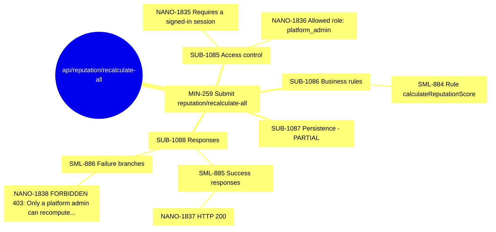

| ID        | Level | Parent   | Name                                                                       | Description                                                                                                                                                                                                                                                       | Status                | Verification | Evidence                                     | Related                     |
| --------- | ----- | -------- | -------------------------------------------------------------------------- | ----------------------------------------------------------------------------------------------------------------------------------------------------------------------------------------------------------------------------------------------------------------- | --------------------- | ------------ | -------------------------------------------- | --------------------------- |
| FEAT-051  | MAJOR | MOD-067  | api/reputation/recalculate-all                                             |                                                                                                                                                                                                                                                                   | IMPLEMENTED           |              | apps/api/src/server.ts:4276                  |                             |
| MIN-259   | MINOR | FEAT-051 | Submit reputation/recalculate-all                                          | POST /api/v1/reputation/recalculate-all for roles platform_admin; calls calculateReputationScore; ephemeral (process memory); responds 200; 1 failure branch(es). Gaps: ephemeral: state held in process memory, lost on restart; no first-party web caller found | IMPLEMENTED           | VERIFIED     | apps/api/src/server.ts:4276                  | API-081, TEST-121, TEST-203 |
| SUB-1085  | SUB   | MIN-259  | Access control                                                             | Who may call POST /api/v1/reputation/recalculate-all: roles platform_admin.                                                                                                                                                                                       | IMPLEMENTED           | PATH_LEVEL   | apps/api/src/server.ts:4276                  |                             |
| NANO-1835 | NANO  | SUB-1085 | Requires a signed-in session                                               | Requests without a valid session token are rejected with 401 UNAUTHENTICATED.                                                                                                                                                                                     | IMPLEMENTED           | PATH_LEVEL   | apps/api/src/server.ts:4276                  | ROLE-001                    |
| NANO-1836 | NANO  | SUB-1085 | Allowed role: platform_admin                                               | platform_admin is one of the roles allowed here (platform_admin); a caller holding none of them is rejected with 403.                                                                                                                                             | IMPLEMENTED           | PATH_LEVEL   | apps/api/src/server.ts:4276                  | ROLE-008                    |
| SUB-1086  | SUB   | MIN-259  | Business rules                                                             | Domain functions from packages/domain called by the handler (1).                                                                                                                                                                                                  | IMPLEMENTED           | PATH_LEVEL   | apps/api/src/server.ts:4276                  |                             |
| SML-884   | SMALL | SUB-1086 | Rule calculateReputationScore                                              | Calls calculateReputationScore (packages/domain/src/reputation-engine.ts). Rule status IMPLEMENTED; its own tests: VERIFIED.                                                                                                                                      | IMPLEMENTED           | VERIFIED     | packages/domain/src/reputation-engine.ts:146 | RULE-184                    |
| SUB-1087  | SUB   | MIN-259  | Persistence                                                                | Ephemeral: state lives in API process memory and is lost on restart.                                                                                                                                                                                              | PARTIALLY_IMPLEMENTED | PATH_LEVEL   | apps/api/src/server.ts:4276                  |                             |
| SUB-1088  | SUB   | MIN-259  | Responses                                                                  | Success 200; 1 explicit failure branch(es) besides validation and access errors.                                                                                                                                                                                  | IMPLEMENTED           | PATH_LEVEL   | apps/api/src/server.ts:4276                  |                             |
| SML-885   | SMALL | SUB-1088 | Success responses                                                          | HTTP 200.                                                                                                                                                                                                                                                         | IMPLEMENTED           | PATH_LEVEL   | apps/api/src/server.ts:4276                  |                             |
| NANO-1837 | NANO  | SML-885  | HTTP 200                                                                   | Replies 200 when the operation succeeds.                                                                                                                                                                                                                          | IMPLEMENTED           | PATH_LEVEL   | apps/api/src/server.ts:4276                  |                             |
| SML-886   | SMALL | SUB-1088 | Failure branches                                                           | 1 DomainError branch(es) in the handler, mapped to HTTP by the global error handler.                                                                                                                                                                              | IMPLEMENTED           | PATH_LEVEL   | apps/api/src/server.ts:4276                  |                             |
| NANO-1838 | NANO  | SML-886  | FORBIDDEN 403: Only a platform admin can recompute every reputation score. | Throws DomainError(FORBIDDEN) "Only a platform admin can recompute every reputation score." -> HTTP 403.                                                                                                                                                          | IMPLEMENTED           | PATH_LEVEL   | apps/api/src/server.ts:4283                  | ERR-093                     |

### FEAT-050 api/reputation/recovery

api/reputation/recovery

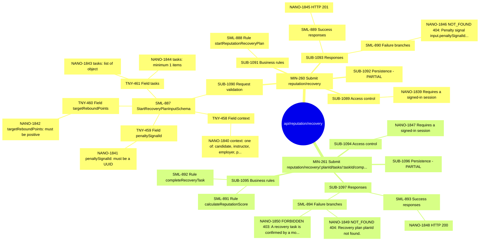

| ID        | Level | Parent   | Name                                                                          | Description                                                                                                                                                                                                                                                                                                      | Status                | Verification | Evidence                                     | Related                     |
| --------- | ----- | -------- | ----------------------------------------------------------------------------- | ---------------------------------------------------------------------------------------------------------------------------------------------------------------------------------------------------------------------------------------------------------------------------------------------------------------- | --------------------- | ------------ | -------------------------------------------- | --------------------------- |
| FEAT-050  | MAJOR | MOD-067  | api/reputation/recovery                                                       |                                                                                                                                                                                                                                                                                                                  | IMPLEMENTED           |              | apps/api/src/server.ts:4180                  |                             |
| MIN-260   | MINOR | FEAT-050 | Submit reputation/recovery                                                    | POST /api/v1/reputation/recovery for any signed-in session; validates StartRecoveryPlanInputSchema; calls startReputationRecoveryPlan; ephemeral (process memory); responds 201; 1 failure branch(es). Gaps: ephemeral: state held in process memory, lost on restart; no first-party web caller found           | IMPLEMENTED           | VERIFIED     | apps/api/src/server.ts:4180                  | API-079, TEST-121, TEST-203 |
| SUB-1089  | SUB   | MIN-260  | Access control                                                                | Who may call POST /api/v1/reputation/recovery: any signed-in session.                                                                                                                                                                                                                                            | IMPLEMENTED           | PATH_LEVEL   | apps/api/src/server.ts:4180                  |                             |
| NANO-1839 | NANO  | SUB-1089 | Requires a signed-in session                                                  | Requests without a valid session token are rejected with 401 UNAUTHENTICATED.                                                                                                                                                                                                                                    | IMPLEMENTED           | PATH_LEVEL   | apps/api/src/server.ts:4180                  | ROLE-001                    |
| SUB-1090  | SUB   | MIN-260  | Request validation                                                            | The request is parsed with StartRecoveryPlanInputSchema; a failure returns 400 with field details before any business logic runs.                                                                                                                                                                                | IMPLEMENTED           | PATH_LEVEL   | apps/api/src/server.ts:4180                  |                             |
| SML-887   | SMALL | SUB-1090 | StartRecoveryPlanInputSchema                                                  | StartRecoveryPlanInputSchema: 4 field(s)                                                                                                                                                                                                                                                                         | IMPLEMENTED           | PATH_LEVEL   | packages/contracts/src/index.ts:1244         | SCH-095                     |
| TNY-458   | TINY  | SML-887  | Field context                                                                 | context (enum, required): one of: candidate, instructor, employer, peer, community, mentor                                                                                                                                                                                                                       | IMPLEMENTED           | PATH_LEVEL   | packages/contracts/src/index.ts:1245         |                             |
| NANO-1840 | NANO  | TNY-458  | context: one of: candidate, instructor, employer, peer, community, mentor     | context one of: candidate, instructor, employer, peer, community, mentor.                                                                                                                                                                                                                                        | IMPLEMENTED           | PATH_LEVEL   | packages/contracts/src/index.ts:1245         |                             |
| TNY-459   | TINY  | SML-887  | Field penaltySignalId                                                         | penaltySignalId (string, required): must be a UUID                                                                                                                                                                                                                                                               | IMPLEMENTED           | PATH_LEVEL   | packages/contracts/src/index.ts:1246         |                             |
| NANO-1841 | NANO  | TNY-459  | penaltySignalId: must be a UUID                                               | penaltySignalId must be a UUID.                                                                                                                                                                                                                                                                                  | IMPLEMENTED           | PATH_LEVEL   | packages/contracts/src/index.ts:1246         |                             |
| TNY-460   | TINY  | SML-887  | Field targetReboundPoints                                                     | targetReboundPoints (number, required): must be positive                                                                                                                                                                                                                                                         | IMPLEMENTED           | PATH_LEVEL   | packages/contracts/src/index.ts:1247         |                             |
| NANO-1842 | NANO  | TNY-460  | targetReboundPoints: must be positive                                         | targetReboundPoints must be positive.                                                                                                                                                                                                                                                                            | IMPLEMENTED           | PATH_LEVEL   | packages/contracts/src/index.ts:1247         |                             |
| TNY-461   | TINY  | SML-887  | Field tasks                                                                   | tasks (array, required): list of object; minimum 1 items                                                                                                                                                                                                                                                         | IMPLEMENTED           | PATH_LEVEL   | packages/contracts/src/index.ts:1248         |                             |
| NANO-1843 | NANO  | TNY-461  | tasks: list of object                                                         | tasks list of object.                                                                                                                                                                                                                                                                                            | IMPLEMENTED           | PATH_LEVEL   | packages/contracts/src/index.ts:1248         |                             |
| NANO-1844 | NANO  | TNY-461  | tasks: minimum 1 items                                                        | tasks minimum 1 items.                                                                                                                                                                                                                                                                                           | IMPLEMENTED           | PATH_LEVEL   | packages/contracts/src/index.ts:1248         |                             |
| SUB-1091  | SUB   | MIN-260  | Business rules                                                                | Domain functions from packages/domain called by the handler (1).                                                                                                                                                                                                                                                 | IMPLEMENTED           | PATH_LEVEL   | apps/api/src/server.ts:4180                  |                             |
| SML-888   | SMALL | SUB-1091 | Rule startReputationRecoveryPlan                                              | Calls startReputationRecoveryPlan (packages/domain/src/reputation-engine.ts). Rule status IMPLEMENTED; its own tests: VERIFIED.                                                                                                                                                                                  | IMPLEMENTED           | VERIFIED     | packages/domain/src/reputation-engine.ts:203 | RULE-185                    |
| SUB-1092  | SUB   | MIN-260  | Persistence                                                                   | Ephemeral: state lives in API process memory and is lost on restart.                                                                                                                                                                                                                                             | PARTIALLY_IMPLEMENTED | PATH_LEVEL   | apps/api/src/server.ts:4180                  |                             |
| SUB-1093  | SUB   | MIN-260  | Responses                                                                     | Success 201; 1 explicit failure branch(es) besides validation and access errors.                                                                                                                                                                                                                                 | IMPLEMENTED           | PATH_LEVEL   | apps/api/src/server.ts:4180                  |                             |
| SML-889   | SMALL | SUB-1093 | Success responses                                                             | HTTP 201.                                                                                                                                                                                                                                                                                                        | IMPLEMENTED           | PATH_LEVEL   | apps/api/src/server.ts:4180                  |                             |
| NANO-1845 | NANO  | SML-889  | HTTP 201                                                                      | Replies 201 when the operation succeeds.                                                                                                                                                                                                                                                                         | IMPLEMENTED           | PATH_LEVEL   | apps/api/src/server.ts:4180                  |                             |
| SML-890   | SMALL | SUB-1093 | Failure branches                                                              | 1 DomainError branch(es) in the handler, mapped to HTTP by the global error handler.                                                                                                                                                                                                                             | IMPLEMENTED           | PATH_LEVEL   | apps/api/src/server.ts:4180                  |                             |
| NANO-1846 | NANO  | SML-890  | NOT_FOUND 404: Penalty signal ${input.penaltySignalId} not found.             | Throws DomainError(NOT_FOUND) "Penalty signal ${input.penaltySignalId} not found." -> HTTP 404.                                                                                                                                                                                                                  | IMPLEMENTED           | PATH_LEVEL   | apps/api/src/server.ts:4187                  | ERR-090                     |
| MIN-261   | MINOR | FEAT-050 | Submit reputation/recovery/:planId/tasks/:taskId/complete                     | POST /api/v1/reputation/recovery/:planId/tasks/:taskId/complete for any signed-in session; calls calculateReputationScore, completeRecoveryTask; ephemeral (process memory); responds 200; 2 failure branch(es). Gaps: ephemeral: state held in process memory, lost on restart; no first-party web caller found | IMPLEMENTED           | VERIFIED     | apps/api/src/server.ts:4211                  | API-080, TEST-121, TEST-203 |
| SUB-1094  | SUB   | MIN-261  | Access control                                                                | Who may call POST /api/v1/reputation/recovery/:planId/tasks/:taskId/complete: any signed-in session.                                                                                                                                                                                                             | IMPLEMENTED           | PATH_LEVEL   | apps/api/src/server.ts:4211                  |                             |
| NANO-1847 | NANO  | SUB-1094 | Requires a signed-in session                                                  | Requests without a valid session token are rejected with 401 UNAUTHENTICATED.                                                                                                                                                                                                                                    | IMPLEMENTED           | PATH_LEVEL   | apps/api/src/server.ts:4211                  | ROLE-001                    |
| SUB-1095  | SUB   | MIN-261  | Business rules                                                                | Domain functions from packages/domain called by the handler (2).                                                                                                                                                                                                                                                 | IMPLEMENTED           | PATH_LEVEL   | apps/api/src/server.ts:4211                  |                             |
| SML-891   | SMALL | SUB-1095 | Rule calculateReputationScore                                                 | Calls calculateReputationScore (packages/domain/src/reputation-engine.ts). Rule status IMPLEMENTED; its own tests: VERIFIED.                                                                                                                                                                                     | IMPLEMENTED           | VERIFIED     | packages/domain/src/reputation-engine.ts:146 | RULE-184                    |
| SML-892   | SMALL | SUB-1095 | Rule completeRecoveryTask                                                     | Calls completeRecoveryTask (packages/domain/src/reputation-engine.ts). Rule status IMPLEMENTED; its own tests: VERIFIED.                                                                                                                                                                                         | IMPLEMENTED           | VERIFIED     | packages/domain/src/reputation-engine.ts:242 | RULE-186                    |
| SUB-1096  | SUB   | MIN-261  | Persistence                                                                   | Ephemeral: state lives in API process memory and is lost on restart.                                                                                                                                                                                                                                             | PARTIALLY_IMPLEMENTED | PATH_LEVEL   | apps/api/src/server.ts:4211                  |                             |
| SUB-1097  | SUB   | MIN-261  | Responses                                                                     | Success 200; 2 explicit failure branch(es) besides validation and access errors.                                                                                                                                                                                                                                 | IMPLEMENTED           | PATH_LEVEL   | apps/api/src/server.ts:4211                  |                             |
| SML-893   | SMALL | SUB-1097 | Success responses                                                             | HTTP 200.                                                                                                                                                                                                                                                                                                        | IMPLEMENTED           | PATH_LEVEL   | apps/api/src/server.ts:4211                  |                             |
| NANO-1848 | NANO  | SML-893  | HTTP 200                                                                      | Replies 200 when the operation succeeds.                                                                                                                                                                                                                                                                         | IMPLEMENTED           | PATH_LEVEL   | apps/api/src/server.ts:4211                  |                             |
| SML-894   | SMALL | SUB-1097 | Failure branches                                                              | 2 DomainError branch(es) in the handler, mapped to HTTP by the global error handler.                                                                                                                                                                                                                             | IMPLEMENTED           | PATH_LEVEL   | apps/api/src/server.ts:4211                  |                             |
| NANO-1849 | NANO  | SML-894  | NOT_FOUND 404: Recovery plan ${planId} not found.                             | Throws DomainError(NOT_FOUND) "Recovery plan ${planId} not found." -> HTTP 404.                                                                                                                                                                                                                                  | IMPLEMENTED           | PATH_LEVEL   | apps/api/src/server.ts:4222                  | ERR-091                     |
| NANO-1850 | NANO  | SML-894  | FORBIDDEN 403: A recovery task is confirmed by a moderator or platform admin. | Throws DomainError(FORBIDDEN) "A recovery task is confirmed by a moderator or platform admin." -> HTTP 403.                                                                                                                                                                                                      | IMPLEMENTED           | PATH_LEVEL   | apps/api/src/server.ts:4228                  | ERR-092                     |

### FEAT-047 api/reputation/signals

api/reputation/signals

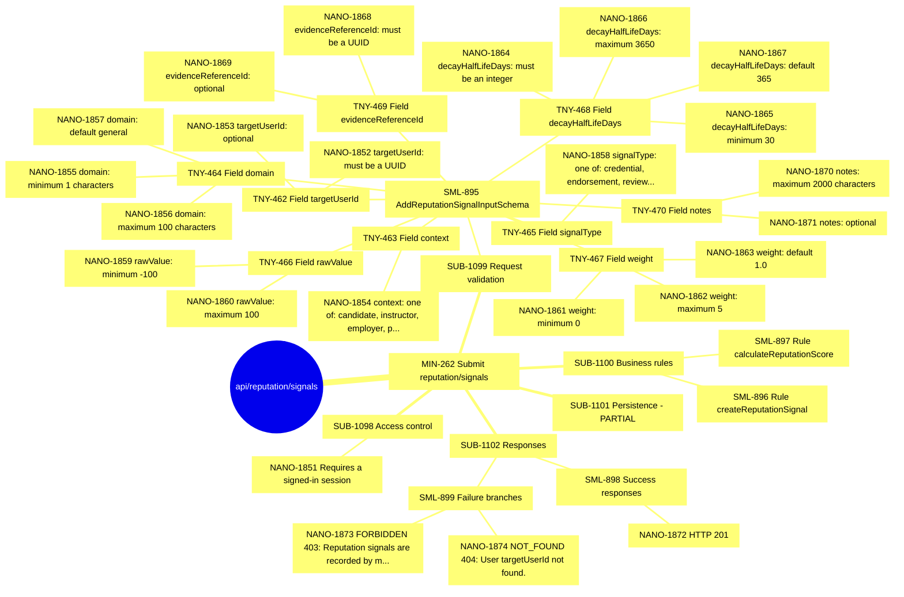

| ID        | Level | Parent   | Name                                                                                                  | Description                                                                                                                                                                                                                                                                                                                                                                                          | Status                | Verification | Evidence                                     | Related                     |
| --------- | ----- | -------- | ----------------------------------------------------------------------------------------------------- | ---------------------------------------------------------------------------------------------------------------------------------------------------------------------------------------------------------------------------------------------------------------------------------------------------------------------------------------------------------------------------------------------------- | --------------------- | ------------ | -------------------------------------------- | --------------------------- |
| FEAT-047  | MAJOR | MOD-067  | api/reputation/signals                                                                                |                                                                                                                                                                                                                                                                                                                                                                                                      | IMPLEMENTED           |              | apps/api/src/server.ts:4039                  |                             |
| MIN-262   | MINOR | FEAT-047 | Submit reputation/signals                                                                             | Multi-Context Reputation Engine Endpoints (F-144, S-03, BR-247..BR-254) POST /api/v1/reputation/signals for any signed-in session; validates AddReputationSignalInputSchema; calls createReputationSignal, calculateReputationScore; ephemeral (process memory); responds 201; 2 failure branch(es). Gaps: ephemeral: state held in process memory, lost on restart; no first-party web caller found | IMPLEMENTED           | VERIFIED     | apps/api/src/server.ts:4039                  | API-076, TEST-121, TEST-203 |
| SUB-1098  | SUB   | MIN-262  | Access control                                                                                        | Who may call POST /api/v1/reputation/signals: any signed-in session.                                                                                                                                                                                                                                                                                                                                 | IMPLEMENTED           | PATH_LEVEL   | apps/api/src/server.ts:4039                  |                             |
| NANO-1851 | NANO  | SUB-1098 | Requires a signed-in session                                                                          | Requests without a valid session token are rejected with 401 UNAUTHENTICATED.                                                                                                                                                                                                                                                                                                                        | IMPLEMENTED           | PATH_LEVEL   | apps/api/src/server.ts:4039                  | ROLE-001                    |
| SUB-1099  | SUB   | MIN-262  | Request validation                                                                                    | The request is parsed with AddReputationSignalInputSchema; a failure returns 400 with field details before any business logic runs.                                                                                                                                                                                                                                                                  | IMPLEMENTED           | PATH_LEVEL   | apps/api/src/server.ts:4039                  |                             |
| SML-895   | SMALL | SUB-1099 | AddReputationSignalInputSchema                                                                        | AddReputationSignalInputSchema: 9 field(s)                                                                                                                                                                                                                                                                                                                                                           | IMPLEMENTED           | PATH_LEVEL   | packages/contracts/src/index.ts:1222         | SCH-094                     |
| TNY-462   | TINY  | SML-895  | Field targetUserId                                                                                    | targetUserId (string, optional): must be a UUID; optional                                                                                                                                                                                                                                                                                                                                            | IMPLEMENTED           | PATH_LEVEL   | packages/contracts/src/index.ts:1223         |                             |
| NANO-1852 | NANO  | TNY-462  | targetUserId: must be a UUID                                                                          | targetUserId must be a UUID.                                                                                                                                                                                                                                                                                                                                                                         | IMPLEMENTED           | PATH_LEVEL   | packages/contracts/src/index.ts:1223         |                             |
| NANO-1853 | NANO  | TNY-462  | targetUserId: optional                                                                                | targetUserId optional.                                                                                                                                                                                                                                                                                                                                                                               | IMPLEMENTED           | PATH_LEVEL   | packages/contracts/src/index.ts:1223         |                             |
| TNY-463   | TINY  | SML-895  | Field context                                                                                         | context (enum, required): one of: candidate, instructor, employer, peer, community, mentor                                                                                                                                                                                                                                                                                                           | IMPLEMENTED           | PATH_LEVEL   | packages/contracts/src/index.ts:1224         |                             |
| NANO-1854 | NANO  | TNY-463  | context: one of: candidate, instructor, employer, peer, community, mentor                             | context one of: candidate, instructor, employer, peer, community, mentor.                                                                                                                                                                                                                                                                                                                            | IMPLEMENTED           | PATH_LEVEL   | packages/contracts/src/index.ts:1224         |                             |
| TNY-464   | TINY  | SML-895  | Field domain                                                                                          | domain (string, optional): minimum 1 characters; maximum 100 characters; default 'general'                                                                                                                                                                                                                                                                                                           | IMPLEMENTED           | PATH_LEVEL   | packages/contracts/src/index.ts:1225         |                             |
| NANO-1855 | NANO  | TNY-464  | domain: minimum 1 characters                                                                          | domain minimum 1 characters.                                                                                                                                                                                                                                                                                                                                                                         | IMPLEMENTED           | PATH_LEVEL   | packages/contracts/src/index.ts:1225         |                             |
| NANO-1856 | NANO  | TNY-464  | domain: maximum 100 characters                                                                        | domain maximum 100 characters.                                                                                                                                                                                                                                                                                                                                                                       | IMPLEMENTED           | PATH_LEVEL   | packages/contracts/src/index.ts:1225         |                             |
| NANO-1857 | NANO  | TNY-464  | domain: default 'general'                                                                             | domain default 'general'; message "general".                                                                                                                                                                                                                                                                                                                                                         | IMPLEMENTED           | PATH_LEVEL   | packages/contracts/src/index.ts:1225         |                             |
| TNY-465   | TINY  | SML-895  | Field signalType                                                                                      | signalType (enum, required): one of: credential, endorsement, review, contribution, peer_feedback, assessment, penalty                                                                                                                                                                                                                                                                               | IMPLEMENTED           | PATH_LEVEL   | packages/contracts/src/index.ts:1226         |                             |
| NANO-1858 | NANO  | TNY-465  | signalType: one of: credential, endorsement, review, contribution, peer_feedback, assessment, penalty | signalType one of: credential, endorsement, review, contribution, peer_feedback, assessment, penalty.                                                                                                                                                                                                                                                                                                | IMPLEMENTED           | PATH_LEVEL   | packages/contracts/src/index.ts:1226         |                             |
| TNY-466   | TINY  | SML-895  | Field rawValue                                                                                        | rawValue (number, required): minimum -100; maximum 100                                                                                                                                                                                                                                                                                                                                               | IMPLEMENTED           | PATH_LEVEL   | packages/contracts/src/index.ts:1235         |                             |
| NANO-1859 | NANO  | TNY-466  | rawValue: minimum -100                                                                                | rawValue minimum -100.                                                                                                                                                                                                                                                                                                                                                                               | IMPLEMENTED           | PATH_LEVEL   | packages/contracts/src/index.ts:1235         |                             |
| NANO-1860 | NANO  | TNY-466  | rawValue: maximum 100                                                                                 | rawValue maximum 100.                                                                                                                                                                                                                                                                                                                                                                                | IMPLEMENTED           | PATH_LEVEL   | packages/contracts/src/index.ts:1235         |                             |
| TNY-467   | TINY  | SML-895  | Field weight                                                                                          | weight (number, optional): minimum 0; maximum 5; default 1.0                                                                                                                                                                                                                                                                                                                                         | IMPLEMENTED           | PATH_LEVEL   | packages/contracts/src/index.ts:1236         |                             |
| NANO-1861 | NANO  | TNY-467  | weight: minimum 0                                                                                     | weight minimum 0.                                                                                                                                                                                                                                                                                                                                                                                    | IMPLEMENTED           | PATH_LEVEL   | packages/contracts/src/index.ts:1236         |                             |
| NANO-1862 | NANO  | TNY-467  | weight: maximum 5                                                                                     | weight maximum 5.                                                                                                                                                                                                                                                                                                                                                                                    | IMPLEMENTED           | PATH_LEVEL   | packages/contracts/src/index.ts:1236         |                             |
| NANO-1863 | NANO  | TNY-467  | weight: default 1.0                                                                                   | weight default 1.0.                                                                                                                                                                                                                                                                                                                                                                                  | IMPLEMENTED           | PATH_LEVEL   | packages/contracts/src/index.ts:1236         |                             |
| TNY-468   | TINY  | SML-895  | Field decayHalfLifeDays                                                                               | decayHalfLifeDays (number, optional): must be an integer; minimum 30; maximum 3650; default 365                                                                                                                                                                                                                                                                                                      | IMPLEMENTED           | PATH_LEVEL   | packages/contracts/src/index.ts:1237         |                             |
| NANO-1864 | NANO  | TNY-468  | decayHalfLifeDays: must be an integer                                                                 | decayHalfLifeDays must be an integer.                                                                                                                                                                                                                                                                                                                                                                | IMPLEMENTED           | PATH_LEVEL   | packages/contracts/src/index.ts:1237         |                             |
| NANO-1865 | NANO  | TNY-468  | decayHalfLifeDays: minimum 30                                                                         | decayHalfLifeDays minimum 30.                                                                                                                                                                                                                                                                                                                                                                        | IMPLEMENTED           | PATH_LEVEL   | packages/contracts/src/index.ts:1237         |                             |
| NANO-1866 | NANO  | TNY-468  | decayHalfLifeDays: maximum 3650                                                                       | decayHalfLifeDays maximum 3650.                                                                                                                                                                                                                                                                                                                                                                      | IMPLEMENTED           | PATH_LEVEL   | packages/contracts/src/index.ts:1237         |                             |
| NANO-1867 | NANO  | TNY-468  | decayHalfLifeDays: default 365                                                                        | decayHalfLifeDays default 365.                                                                                                                                                                                                                                                                                                                                                                       | IMPLEMENTED           | PATH_LEVEL   | packages/contracts/src/index.ts:1237         |                             |
| TNY-469   | TINY  | SML-895  | Field evidenceReferenceId                                                                             | evidenceReferenceId (string, optional): must be a UUID; optional                                                                                                                                                                                                                                                                                                                                     | IMPLEMENTED           | PATH_LEVEL   | packages/contracts/src/index.ts:1238         |                             |
| NANO-1868 | NANO  | TNY-469  | evidenceReferenceId: must be a UUID                                                                   | evidenceReferenceId must be a UUID.                                                                                                                                                                                                                                                                                                                                                                  | IMPLEMENTED           | PATH_LEVEL   | packages/contracts/src/index.ts:1238         |                             |
| NANO-1869 | NANO  | TNY-469  | evidenceReferenceId: optional                                                                         | evidenceReferenceId optional.                                                                                                                                                                                                                                                                                                                                                                        | IMPLEMENTED           | PATH_LEVEL   | packages/contracts/src/index.ts:1238         |                             |
| TNY-470   | TINY  | SML-895  | Field notes                                                                                           | notes (string, optional): maximum 2000 characters; optional                                                                                                                                                                                                                                                                                                                                          | IMPLEMENTED           | PATH_LEVEL   | packages/contracts/src/index.ts:1239         |                             |
| NANO-1870 | NANO  | TNY-470  | notes: maximum 2000 characters                                                                        | notes maximum 2000 characters.                                                                                                                                                                                                                                                                                                                                                                       | IMPLEMENTED           | PATH_LEVEL   | packages/contracts/src/index.ts:1239         |                             |
| NANO-1871 | NANO  | TNY-470  | notes: optional                                                                                       | notes optional.                                                                                                                                                                                                                                                                                                                                                                                      | IMPLEMENTED           | PATH_LEVEL   | packages/contracts/src/index.ts:1239         |                             |
| SUB-1100  | SUB   | MIN-262  | Business rules                                                                                        | Domain functions from packages/domain called by the handler (2).                                                                                                                                                                                                                                                                                                                                     | IMPLEMENTED           | PATH_LEVEL   | apps/api/src/server.ts:4039                  |                             |
| SML-896   | SMALL | SUB-1100 | Rule createReputationSignal                                                                           | Calls createReputationSignal (packages/domain/src/reputation-engine.ts). Rule status IMPLEMENTED; its own tests: VERIFIED.                                                                                                                                                                                                                                                                           | IMPLEMENTED           | VERIFIED     | packages/domain/src/reputation-engine.ts:104 | RULE-183                    |
| SML-897   | SMALL | SUB-1100 | Rule calculateReputationScore                                                                         | Calls calculateReputationScore (packages/domain/src/reputation-engine.ts). Rule status IMPLEMENTED; its own tests: VERIFIED.                                                                                                                                                                                                                                                                         | IMPLEMENTED           | VERIFIED     | packages/domain/src/reputation-engine.ts:146 | RULE-184                    |
| SUB-1101  | SUB   | MIN-262  | Persistence                                                                                           | Ephemeral: state lives in API process memory and is lost on restart.                                                                                                                                                                                                                                                                                                                                 | PARTIALLY_IMPLEMENTED | PATH_LEVEL   | apps/api/src/server.ts:4039                  |                             |
| SUB-1102  | SUB   | MIN-262  | Responses                                                                                             | Success 201; 2 explicit failure branch(es) besides validation and access errors.                                                                                                                                                                                                                                                                                                                     | IMPLEMENTED           | PATH_LEVEL   | apps/api/src/server.ts:4039                  |                             |
| SML-898   | SMALL | SUB-1102 | Success responses                                                                                     | HTTP 201.                                                                                                                                                                                                                                                                                                                                                                                            | IMPLEMENTED           | PATH_LEVEL   | apps/api/src/server.ts:4039                  |                             |
| NANO-1872 | NANO  | SML-898  | HTTP 201                                                                                              | Replies 201 when the operation succeeds.                                                                                                                                                                                                                                                                                                                                                             | IMPLEMENTED           | PATH_LEVEL   | apps/api/src/server.ts:4039                  |                             |
| SML-899   | SMALL | SUB-1102 | Failure branches                                                                                      | 2 DomainError branch(es) in the handler, mapped to HTTP by the global error handler.                                                                                                                                                                                                                                                                                                                 | IMPLEMENTED           | PATH_LEVEL   | apps/api/src/server.ts:4039                  |                             |
| NANO-1873 | NANO  | SML-899  | FORBIDDEN 403: Reputation signals are recorded by moderators and platform admins.                     | Throws DomainError(FORBIDDEN) "Reputation signals are recorded by moderators and platform admins." -> HTTP 403.                                                                                                                                                                                                                                                                                      | IMPLEMENTED           | PATH_LEVEL   | apps/api/src/server.ts:4046                  | ERR-086                     |
| NANO-1874 | NANO  | SML-899  | NOT_FOUND 404: User ${targetUserId} not found.                                                        | Throws DomainError(NOT_FOUND) "User ${targetUserId} not found." -> HTTP 404.                                                                                                                                                                                                                                                                                                                         | IMPLEMENTED           | PATH_LEVEL   | apps/api/src/server.ts:4056                  | ERR-087                     |

### FEAT-048 api/reputation/users

api/reputation/users

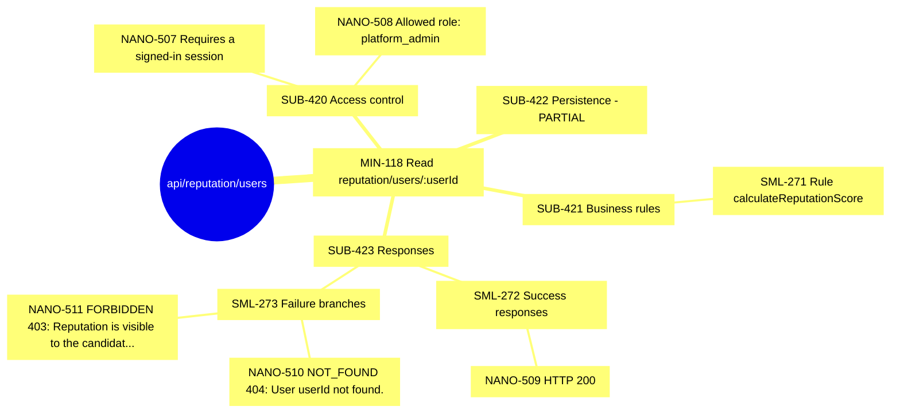

| ID       | Level | Parent   | Name                                                                                  | Description                                                                                                                                                                                                                                                    | Status                | Verification | Evidence                                     | Related                               |
| -------- | ----- | -------- | ------------------------------------------------------------------------------------- | -------------------------------------------------------------------------------------------------------------------------------------------------------------------------------------------------------------------------------------------------------------- | --------------------- | ------------ | -------------------------------------------- | ------------------------------------- |
| FEAT-048 | MAJOR | MOD-067  | api/reputation/users                                                                  |                                                                                                                                                                                                                                                                | IMPLEMENTED           |              | apps/api/src/server.ts:4102                  |                                       |
| MIN-118  | MINOR | FEAT-048 | Read reputation/users/:userId                                                         | GET /api/v1/reputation/users/:userId for roles platform_admin; calls calculateReputationScore; ephemeral (process memory); responds 200; 2 failure branch(es). Gaps: ephemeral: state held in process memory, lost on restart; no first-party web caller found | IMPLEMENTED           | VERIFIED     | apps/api/src/server.ts:4102                  | API-077, TEST-121, TEST-122, TEST-203 |
| SUB-420  | SUB   | MIN-118  | Access control                                                                        | Who may call GET /api/v1/reputation/users/:userId: roles platform_admin.                                                                                                                                                                                       | IMPLEMENTED           | PATH_LEVEL   | apps/api/src/server.ts:4102                  |                                       |
| NANO-507 | NANO  | SUB-420  | Requires a signed-in session                                                          | Requests without a valid session token are rejected with 401 UNAUTHENTICATED.                                                                                                                                                                                  | IMPLEMENTED           | PATH_LEVEL   | apps/api/src/server.ts:4102                  | ROLE-001                              |
| NANO-508 | NANO  | SUB-420  | Allowed role: platform_admin                                                          | platform_admin is one of the roles allowed here (platform_admin); a caller holding none of them is rejected with 403.                                                                                                                                          | IMPLEMENTED           | PATH_LEVEL   | apps/api/src/server.ts:4102                  | ROLE-008                              |
| SUB-421  | SUB   | MIN-118  | Business rules                                                                        | Domain functions from packages/domain called by the handler (1).                                                                                                                                                                                               | IMPLEMENTED           | PATH_LEVEL   | apps/api/src/server.ts:4102                  |                                       |
| SML-271  | SMALL | SUB-421  | Rule calculateReputationScore                                                         | Calls calculateReputationScore (packages/domain/src/reputation-engine.ts). Rule status IMPLEMENTED; its own tests: VERIFIED.                                                                                                                                   | IMPLEMENTED           | VERIFIED     | packages/domain/src/reputation-engine.ts:146 | RULE-184                              |
| SUB-422  | SUB   | MIN-118  | Persistence                                                                           | Ephemeral: state lives in API process memory and is lost on restart.                                                                                                                                                                                           | PARTIALLY_IMPLEMENTED | PATH_LEVEL   | apps/api/src/server.ts:4102                  |                                       |
| SUB-423  | SUB   | MIN-118  | Responses                                                                             | Success 200; 2 explicit failure branch(es) besides validation and access errors.                                                                                                                                                                               | IMPLEMENTED           | PATH_LEVEL   | apps/api/src/server.ts:4102                  |                                       |
| SML-272  | SMALL | SUB-423  | Success responses                                                                     | HTTP 200.                                                                                                                                                                                                                                                      | IMPLEMENTED           | PATH_LEVEL   | apps/api/src/server.ts:4102                  |                                       |
| NANO-509 | NANO  | SML-272  | HTTP 200                                                                              | Replies 200 when the operation succeeds.                                                                                                                                                                                                                       | IMPLEMENTED           | PATH_LEVEL   | apps/api/src/server.ts:4102                  |                                       |
| SML-273  | SMALL | SUB-423  | Failure branches                                                                      | 2 DomainError branch(es) in the handler, mapped to HTTP by the global error handler.                                                                                                                                                                           | IMPLEMENTED           | PATH_LEVEL   | apps/api/src/server.ts:4102                  |                                       |
| NANO-510 | NANO  | SML-273  | NOT_FOUND 404: User ${userId} not found.                                              | Throws DomainError(NOT_FOUND) "User ${userId} not found." -> HTTP 404.                                                                                                                                                                                         | IMPLEMENTED           | PATH_LEVEL   | apps/api/src/server.ts:4117                  | ERR-088                               |
| NANO-511 | NANO  | SML-273  | FORBIDDEN 403: Reputation is visible to the candidate and to hiring teams they applie | Throws DomainError(FORBIDDEN) "Reputation is visible to the candidate and to hiring teams they applied to (BR-167)." -> HTTP 403.                                                                                                                              | IMPLEMENTED           | PATH_LEVEL   | apps/api/src/server.ts:4144                  | ERR-089                               |

## api/resumes (MOD-078)

**Application:** apps/api (MOD-001). **Purpose:** API module: routes under /api/v1/resumes in apps/api/src/server.ts.

**Nodes by level:** MODULE 1, MAJOR 3, MINOR 7, SUB 29, SMALL 21, TINY 14, NANO 51. **Status:** IMPLEMENTED 115, PARTIALLY_IMPLEMENTED 10, UNKNOWN 1. **Verification:** PATH_LEVEL 109, UNKNOWN 1, VERIFIED 12.

**User roles that reach it:** authenticated.

**Known gaps:** MIN-119 ephemeral: state held in process memory, lost on restart; MIN-120 ephemeral: state held in process memory, lost on restart; MIN-120 no first-party web caller found; MIN-156 ephemeral: state held in process memory, lost on restart; MIN-156 no first-party web caller found; MIN-263 ephemeral: state held in process memory, lost on restart; MIN-264 ephemeral: state held in process memory, lost on restart; MIN-264 no first-party web caller found; MIN-008 ephemeral: state held in process memory, lost on restart; MIN-008 no first-party web caller found; MIN-121 ephemeral: state held in process memory, lost on restart; MIN-121 no first-party web caller found.

**Called from (web screens and components):** FEAT-179 Screen /resumes

### Module map (to minor features)

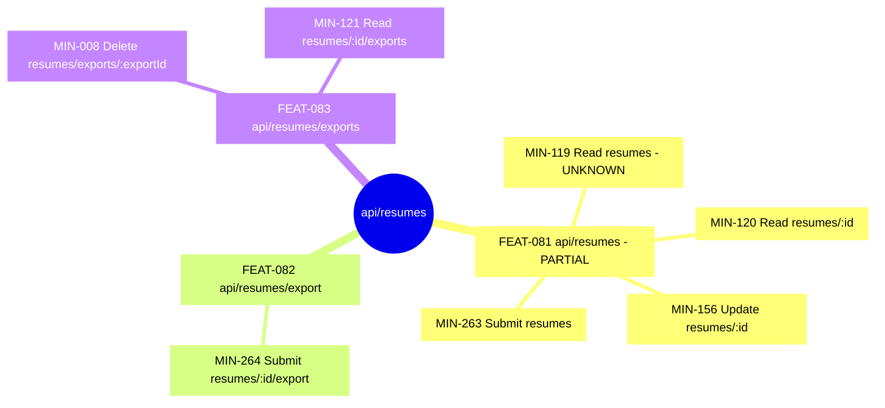

### FEAT-081 api/resumes

api/resumes

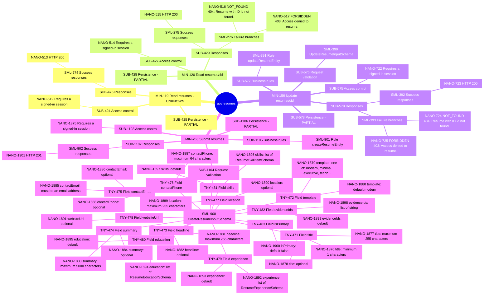

| ID        | Level | Parent   | Name                                                    | Description                                                                                                                                                                                                                                                                       | Status                | Verification | Evidence                            | Related                                                       |
| --------- | ----- | -------- | ------------------------------------------------------- | --------------------------------------------------------------------------------------------------------------------------------------------------------------------------------------------------------------------------------------------------------------------------------- | --------------------- | ------------ | ----------------------------------- | ------------------------------------------------------------- |
| FEAT-081  | MAJOR | MOD-078  | api/resumes                                             |                                                                                                                                                                                                                                                                                   | PARTIALLY_IMPLEMENTED |              | apps/api/src/server.ts:6295         |                                                               |
| MIN-119   | MINOR | FEAT-081 | Read resumes                                            | GET /api/v1/resumes for any signed-in session; ephemeral (process memory); responds 200. Gaps: ephemeral: state held in process memory, lost on restart                                                                                                                           | UNKNOWN               | VERIFIED     | apps/api/src/server.ts:6309         | API-128, TEST-123, TEST-141, TEST-199, TEST-200, TEST-217 ... |
| SUB-424   | SUB   | MIN-119  | Access control                                          | Who may call GET /api/v1/resumes: any signed-in session.                                                                                                                                                                                                                          | IMPLEMENTED           | PATH_LEVEL   | apps/api/src/server.ts:6309         |                                                               |
| NANO-512  | NANO  | SUB-424  | Requires a signed-in session                            | Requests without a valid session token are rejected with 401 UNAUTHENTICATED.                                                                                                                                                                                                     | IMPLEMENTED           | PATH_LEVEL   | apps/api/src/server.ts:6309         | ROLE-001                                                      |
| SUB-425   | SUB   | MIN-119  | Persistence                                             | Ephemeral: state lives in API process memory and is lost on restart.                                                                                                                                                                                                              | PARTIALLY_IMPLEMENTED | PATH_LEVEL   | apps/api/src/server.ts:6309         |                                                               |
| SUB-426   | SUB   | MIN-119  | Responses                                               | Success 200; 0 explicit failure branch(es) besides validation and access errors.                                                                                                                                                                                                  | IMPLEMENTED           | PATH_LEVEL   | apps/api/src/server.ts:6309         |                                                               |
| SML-274   | SMALL | SUB-426  | Success responses                                       | HTTP 200.                                                                                                                                                                                                                                                                         | IMPLEMENTED           | PATH_LEVEL   | apps/api/src/server.ts:6309         |                                                               |
| NANO-513  | NANO  | SML-274  | HTTP 200                                                | Replies 200 when the operation succeeds.                                                                                                                                                                                                                                          | IMPLEMENTED           | PATH_LEVEL   | apps/api/src/server.ts:6309         |                                                               |
| MIN-120   | MINOR | FEAT-081 | Read resumes/:id                                        | GET /api/v1/resumes/:id for any signed-in session; ephemeral (process memory); responds 200; 2 failure branch(es). Gaps: ephemeral: state held in process memory, lost on restart; no first-party web caller found                                                                | IMPLEMENTED           | VERIFIED     | apps/api/src/server.ts:6315         | API-129, TEST-123, TEST-141                                   |
| SUB-427   | SUB   | MIN-120  | Access control                                          | Who may call GET /api/v1/resumes/:id: any signed-in session.                                                                                                                                                                                                                      | IMPLEMENTED           | PATH_LEVEL   | apps/api/src/server.ts:6315         |                                                               |
| NANO-514  | NANO  | SUB-427  | Requires a signed-in session                            | Requests without a valid session token are rejected with 401 UNAUTHENTICATED.                                                                                                                                                                                                     | IMPLEMENTED           | PATH_LEVEL   | apps/api/src/server.ts:6315         | ROLE-001                                                      |
| SUB-428   | SUB   | MIN-120  | Persistence                                             | Ephemeral: state lives in API process memory and is lost on restart.                                                                                                                                                                                                              | PARTIALLY_IMPLEMENTED | PATH_LEVEL   | apps/api/src/server.ts:6315         |                                                               |
| SUB-429   | SUB   | MIN-120  | Responses                                               | Success 200; 2 explicit failure branch(es) besides validation and access errors.                                                                                                                                                                                                  | IMPLEMENTED           | PATH_LEVEL   | apps/api/src/server.ts:6315         |                                                               |
| SML-275   | SMALL | SUB-429  | Success responses                                       | HTTP 200.                                                                                                                                                                                                                                                                         | IMPLEMENTED           | PATH_LEVEL   | apps/api/src/server.ts:6315         |                                                               |
| NANO-515  | NANO  | SML-275  | HTTP 200                                                | Replies 200 when the operation succeeds.                                                                                                                                                                                                                                          | IMPLEMENTED           | PATH_LEVEL   | apps/api/src/server.ts:6315         |                                                               |
| SML-276   | SMALL | SUB-429  | Failure branches                                        | 2 DomainError branch(es) in the handler, mapped to HTTP by the global error handler.                                                                                                                                                                                              | IMPLEMENTED           | PATH_LEVEL   | apps/api/src/server.ts:6315         |                                                               |
| NANO-516  | NANO  | SML-276  | NOT_FOUND 404: Resume with ID "${id}" not found.        | Throws DomainError(NOT_FOUND) "Resume with ID "${id}" not found." -> HTTP 404.                                                                                                                                                                                                    | IMPLEMENTED           | PATH_LEVEL   | apps/api/src/server.ts:6323         | ERR-136                                                       |
| NANO-517  | NANO  | SML-276  | FORBIDDEN 403: Access denied to resume.                 | Throws DomainError(FORBIDDEN) "Access denied to resume." -> HTTP 403.                                                                                                                                                                                                             | IMPLEMENTED           | PATH_LEVEL   | apps/api/src/server.ts:6327         | ERR-135                                                       |
| MIN-156   | MINOR | FEAT-081 | Update resumes/:id                                      | PATCH /api/v1/resumes/:id for any signed-in session; validates UpdateResumeInputSchema; calls updateResumeEntity; ephemeral (process memory); responds 200; 2 failure branch(es). Gaps: ephemeral: state held in process memory, lost on restart; no first-party web caller found | IMPLEMENTED           | VERIFIED     | apps/api/src/server.ts:6334         | API-130, TEST-123, TEST-141                                   |
| SUB-575   | SUB   | MIN-156  | Access control                                          | Who may call PATCH /api/v1/resumes/:id: any signed-in session.                                                                                                                                                                                                                    | IMPLEMENTED           | PATH_LEVEL   | apps/api/src/server.ts:6334         |                                                               |
| NANO-722  | NANO  | SUB-575  | Requires a signed-in session                            | Requests without a valid session token are rejected with 401 UNAUTHENTICATED.                                                                                                                                                                                                     | IMPLEMENTED           | PATH_LEVEL   | apps/api/src/server.ts:6334         | ROLE-001                                                      |
| SUB-576   | SUB   | MIN-156  | Request validation                                      | The request is parsed with UpdateResumeInputSchema; a failure returns 400 with field details before any business logic runs.                                                                                                                                                      | IMPLEMENTED           | PATH_LEVEL   | apps/api/src/server.ts:6334         |                                                               |
| SML-390   | SMALL | SUB-576  | UpdateResumeInputSchema                                 | UpdateResumeInputSchema = CreateResumeInputSchema.partial() (not a plain object; fields not decomposed)                                                                                                                                                                           | IMPLEMENTED           | PATH_LEVEL   | packages/contracts/src/index.ts:509 | SCH-037                                                       |
| SUB-577   | SUB   | MIN-156  | Business rules                                          | Domain functions from packages/domain called by the handler (1).                                                                                                                                                                                                                  | IMPLEMENTED           | PATH_LEVEL   | apps/api/src/server.ts:6334         |                                                               |
| SML-391   | SMALL | SUB-577  | Rule updateResumeEntity                                 | Calls updateResumeEntity (packages/domain/src/resumes.ts). Rule status IMPLEMENTED; its own tests: VERIFIED.                                                                                                                                                                      | IMPLEMENTED           | VERIFIED     | packages/domain/src/resumes.ts:101  | RULE-188                                                      |
| SUB-578   | SUB   | MIN-156  | Persistence                                             | Ephemeral: state lives in API process memory and is lost on restart.                                                                                                                                                                                                              | PARTIALLY_IMPLEMENTED | PATH_LEVEL   | apps/api/src/server.ts:6334         |                                                               |
| SUB-579   | SUB   | MIN-156  | Responses                                               | Success 200; 2 explicit failure branch(es) besides validation and access errors.                                                                                                                                                                                                  | IMPLEMENTED           | PATH_LEVEL   | apps/api/src/server.ts:6334         |                                                               |
| SML-392   | SMALL | SUB-579  | Success responses                                       | HTTP 200.                                                                                                                                                                                                                                                                         | IMPLEMENTED           | PATH_LEVEL   | apps/api/src/server.ts:6334         |                                                               |
| NANO-723  | NANO  | SML-392  | HTTP 200                                                | Replies 200 when the operation succeeds.                                                                                                                                                                                                                                          | IMPLEMENTED           | PATH_LEVEL   | apps/api/src/server.ts:6334         |                                                               |
| SML-393   | SMALL | SUB-579  | Failure branches                                        | 2 DomainError branch(es) in the handler, mapped to HTTP by the global error handler.                                                                                                                                                                                              | IMPLEMENTED           | PATH_LEVEL   | apps/api/src/server.ts:6334         |                                                               |
| NANO-724  | NANO  | SML-393  | NOT_FOUND 404: Resume with ID "${id}" not found.        | Throws DomainError(NOT_FOUND) "Resume with ID "${id}" not found." -> HTTP 404.                                                                                                                                                                                                    | IMPLEMENTED           | PATH_LEVEL   | apps/api/src/server.ts:6342         | ERR-136                                                       |
| NANO-725  | NANO  | SML-393  | FORBIDDEN 403: Access denied to resume.                 | Throws DomainError(FORBIDDEN) "Access denied to resume." -> HTTP 403.                                                                                                                                                                                                             | IMPLEMENTED           | PATH_LEVEL   | apps/api/src/server.ts:6346         | ERR-135                                                       |
| MIN-263   | MINOR | FEAT-081 | Submit resumes                                          | POST /api/v1/resumes for any signed-in session; validates CreateResumeInputSchema; calls createResumeEntity; ephemeral (process memory); responds 201. Gaps: ephemeral: state held in process memory, lost on restart                                                             | IMPLEMENTED           | VERIFIED     | apps/api/src/server.ts:6295         | API-127, TEST-123, TEST-126, TEST-141, TEST-206, TEST-224     |
| SUB-1103  | SUB   | MIN-263  | Access control                                          | Who may call POST /api/v1/resumes: any signed-in session.                                                                                                                                                                                                                         | IMPLEMENTED           | PATH_LEVEL   | apps/api/src/server.ts:6295         |                                                               |
| NANO-1875 | NANO  | SUB-1103 | Requires a signed-in session                            | Requests without a valid session token are rejected with 401 UNAUTHENTICATED.                                                                                                                                                                                                     | IMPLEMENTED           | PATH_LEVEL   | apps/api/src/server.ts:6295         | ROLE-001                                                      |
| SUB-1104  | SUB   | MIN-263  | Request validation                                      | The request is parsed with CreateResumeInputSchema; a failure returns 400 with field details before any business logic runs.                                                                                                                                                      | IMPLEMENTED           | PATH_LEVEL   | apps/api/src/server.ts:6295         |                                                               |
| SML-900   | SMALL | SUB-1104 | CreateResumeInputSchema                                 | CreateResumeInputSchema: 13 field(s)                                                                                                                                                                                                                                              | IMPLEMENTED           | PATH_LEVEL   | packages/contracts/src/index.ts:491 | SCH-036                                                       |
| TNY-471   | TINY  | SML-900  | Field title                                             | title (string, optional): minimum 1 characters; maximum 255 characters; optional                                                                                                                                                                                                  | IMPLEMENTED           | PATH_LEVEL   | packages/contracts/src/index.ts:492 |                                                               |
| NANO-1876 | NANO  | TNY-471  | title: minimum 1 characters                             | title minimum 1 characters.                                                                                                                                                                                                                                                       | IMPLEMENTED           | PATH_LEVEL   | packages/contracts/src/index.ts:492 |                                                               |
| NANO-1877 | NANO  | TNY-471  | title: maximum 255 characters                           | title maximum 255 characters.                                                                                                                                                                                                                                                     | IMPLEMENTED           | PATH_LEVEL   | packages/contracts/src/index.ts:492 |                                                               |
| NANO-1878 | NANO  | TNY-471  | title: optional                                         | title optional.                                                                                                                                                                                                                                                                   | IMPLEMENTED           | PATH_LEVEL   | packages/contracts/src/index.ts:492 |                                                               |
| TNY-472   | TINY  | SML-900  | Field template                                          | template (enum, optional): one of: modern, minimal, executive, technical; default 'modern'                                                                                                                                                                                        | IMPLEMENTED           | PATH_LEVEL   | packages/contracts/src/index.ts:493 |                                                               |
| NANO-1879 | NANO  | TNY-472  | template: one of: modern, minimal, executive, technical | template one of: modern, minimal, executive, technical.                                                                                                                                                                                                                           | IMPLEMENTED           | PATH_LEVEL   | packages/contracts/src/index.ts:493 |                                                               |
| NANO-1880 | NANO  | TNY-472  | template: default 'modern'                              | template default 'modern'; message "modern".                                                                                                                                                                                                                                      | IMPLEMENTED           | PATH_LEVEL   | packages/contracts/src/index.ts:493 |                                                               |
| TNY-473   | TINY  | SML-900  | Field headline                                          | headline (string, optional): maximum 255 characters; optional                                                                                                                                                                                                                     | IMPLEMENTED           | PATH_LEVEL   | packages/contracts/src/index.ts:494 |                                                               |
| NANO-1881 | NANO  | TNY-473  | headline: maximum 255 characters                        | headline maximum 255 characters.                                                                                                                                                                                                                                                  | IMPLEMENTED           | PATH_LEVEL   | packages/contracts/src/index.ts:494 |                                                               |
| NANO-1882 | NANO  | TNY-473  | headline: optional                                      | headline optional.                                                                                                                                                                                                                                                                | IMPLEMENTED           | PATH_LEVEL   | packages/contracts/src/index.ts:494 |                                                               |
| TNY-474   | TINY  | SML-900  | Field summary                                           | summary (string, optional): maximum 5000 characters; optional                                                                                                                                                                                                                     | IMPLEMENTED           | PATH_LEVEL   | packages/contracts/src/index.ts:495 |                                                               |
| NANO-1883 | NANO  | TNY-474  | summary: maximum 5000 characters                        | summary maximum 5000 characters.                                                                                                                                                                                                                                                  | IMPLEMENTED           | PATH_LEVEL   | packages/contracts/src/index.ts:495 |                                                               |
| NANO-1884 | NANO  | TNY-474  | summary: optional                                       | summary optional.                                                                                                                                                                                                                                                                 | IMPLEMENTED           | PATH_LEVEL   | packages/contracts/src/index.ts:495 |                                                               |
| TNY-475   | TINY  | SML-900  | Field contactEmail                                      | contactEmail (string, optional): must be an email address; optional                                                                                                                                                                                                               | IMPLEMENTED           | PATH_LEVEL   | packages/contracts/src/index.ts:496 |                                                               |
| NANO-1885 | NANO  | TNY-475  | contactEmail: must be an email address                  | contactEmail must be an email address.                                                                                                                                                                                                                                            | IMPLEMENTED           | PATH_LEVEL   | packages/contracts/src/index.ts:496 |                                                               |
| NANO-1886 | NANO  | TNY-475  | contactEmail: optional                                  | contactEmail optional.                                                                                                                                                                                                                                                            | IMPLEMENTED           | PATH_LEVEL   | packages/contracts/src/index.ts:496 |                                                               |
| TNY-476   | TINY  | SML-900  | Field contactPhone                                      | contactPhone (string, optional): maximum 64 characters; optional                                                                                                                                                                                                                  | IMPLEMENTED           | PATH_LEVEL   | packages/contracts/src/index.ts:497 |                                                               |
| NANO-1887 | NANO  | TNY-476  | contactPhone: maximum 64 characters                     | contactPhone maximum 64 characters.                                                                                                                                                                                                                                               | IMPLEMENTED           | PATH_LEVEL   | packages/contracts/src/index.ts:497 |                                                               |
| NANO-1888 | NANO  | TNY-476  | contactPhone: optional                                  | contactPhone optional.                                                                                                                                                                                                                                                            | IMPLEMENTED           | PATH_LEVEL   | packages/contracts/src/index.ts:497 |                                                               |
| TNY-477   | TINY  | SML-900  | Field location                                          | location (string, optional): maximum 255 characters; optional                                                                                                                                                                                                                     | IMPLEMENTED           | PATH_LEVEL   | packages/contracts/src/index.ts:498 |                                                               |
| NANO-1889 | NANO  | TNY-477  | location: maximum 255 characters                        | location maximum 255 characters.                                                                                                                                                                                                                                                  | IMPLEMENTED           | PATH_LEVEL   | packages/contracts/src/index.ts:498 |                                                               |
| NANO-1890 | NANO  | TNY-477  | location: optional                                      | location optional.                                                                                                                                                                                                                                                                | IMPLEMENTED           | PATH_LEVEL   | packages/contracts/src/index.ts:498 |                                                               |
| TNY-478   | TINY  | SML-900  | Field websiteUrl                                        | websiteUrl (httpUrl(), optional): optional                                                                                                                                                                                                                                        | IMPLEMENTED           | PATH_LEVEL   | packages/contracts/src/index.ts:499 |                                                               |
| NANO-1891 | NANO  | TNY-478  | websiteUrl: optional                                    | websiteUrl optional.                                                                                                                                                                                                                                                              | IMPLEMENTED           | PATH_LEVEL   | packages/contracts/src/index.ts:499 |                                                               |
| TNY-479   | TINY  | SML-900  | Field experience                                        | experience (array, optional): list of ResumeExperienceSchema; default []                                                                                                                                                                                                          | IMPLEMENTED           | PATH_LEVEL   | packages/contracts/src/index.ts:500 |                                                               |
| NANO-1892 | NANO  | TNY-479  | experience: list of ResumeExperienceSchema              | experience list of ResumeExperienceSchema.                                                                                                                                                                                                                                        | IMPLEMENTED           | PATH_LEVEL   | packages/contracts/src/index.ts:500 |                                                               |
| NANO-1893 | NANO  | TNY-479  | experience: default []                                  | experience default [].                                                                                                                                                                                                                                                            | IMPLEMENTED           | PATH_LEVEL   | packages/contracts/src/index.ts:500 |                                                               |
| TNY-480   | TINY  | SML-900  | Field education                                         | education (array, optional): list of ResumeEducationSchema; default []                                                                                                                                                                                                            | IMPLEMENTED           | PATH_LEVEL   | packages/contracts/src/index.ts:501 |                                                               |
| NANO-1894 | NANO  | TNY-480  | education: list of ResumeEducationSchema                | education list of ResumeEducationSchema.                                                                                                                                                                                                                                          | IMPLEMENTED           | PATH_LEVEL   | packages/contracts/src/index.ts:501 |                                                               |
| NANO-1895 | NANO  | TNY-480  | education: default []                                   | education default [].                                                                                                                                                                                                                                                             | IMPLEMENTED           | PATH_LEVEL   | packages/contracts/src/index.ts:501 |                                                               |
| TNY-481   | TINY  | SML-900  | Field skills                                            | skills (array, optional): list of ResumeSkillItemSchema; default []                                                                                                                                                                                                               | IMPLEMENTED           | PATH_LEVEL   | packages/contracts/src/index.ts:502 |                                                               |
| NANO-1896 | NANO  | TNY-481  | skills: list of ResumeSkillItemSchema                   | skills list of ResumeSkillItemSchema.                                                                                                                                                                                                                                             | IMPLEMENTED           | PATH_LEVEL   | packages/contracts/src/index.ts:502 |                                                               |
| NANO-1897 | NANO  | TNY-481  | skills: default []                                      | skills default [].                                                                                                                                                                                                                                                                | IMPLEMENTED           | PATH_LEVEL   | packages/contracts/src/index.ts:502 |                                                               |
| TNY-482   | TINY  | SML-900  | Field evidenceIds                                       | evidenceIds (array, optional): list of string; default []                                                                                                                                                                                                                         | IMPLEMENTED           | PATH_LEVEL   | packages/contracts/src/index.ts:503 |                                                               |
| NANO-1898 | NANO  | TNY-482  | evidenceIds: list of string                             | evidenceIds list of string.                                                                                                                                                                                                                                                       | IMPLEMENTED           | PATH_LEVEL   | packages/contracts/src/index.ts:503 |                                                               |
| NANO-1899 | NANO  | TNY-482  | evidenceIds: default []                                 | evidenceIds default [].                                                                                                                                                                                                                                                           | IMPLEMENTED           | PATH_LEVEL   | packages/contracts/src/index.ts:503 |                                                               |
| TNY-483   | TINY  | SML-900  | Field isPrimary                                         | isPrimary (boolean, optional): default false                                                                                                                                                                                                                                      | IMPLEMENTED           | PATH_LEVEL   | packages/contracts/src/index.ts:504 |                                                               |
| NANO-1900 | NANO  | TNY-483  | isPrimary: default false                                | isPrimary default false.                                                                                                                                                                                                                                                          | IMPLEMENTED           | PATH_LEVEL   | packages/contracts/src/index.ts:504 |                                                               |
| SUB-1105  | SUB   | MIN-263  | Business rules                                          | Domain functions from packages/domain called by the handler (1).                                                                                                                                                                                                                  | IMPLEMENTED           | PATH_LEVEL   | apps/api/src/server.ts:6295         |                                                               |
| SML-901   | SMALL | SUB-1105 | Rule createResumeEntity                                 | Calls createResumeEntity (packages/domain/src/resumes.ts). Rule status IMPLEMENTED; its own tests: VERIFIED.                                                                                                                                                                      | IMPLEMENTED           | VERIFIED     | packages/domain/src/resumes.ts:71   | RULE-187                                                      |
| SUB-1106  | SUB   | MIN-263  | Persistence                                             | Ephemeral: state lives in API process memory and is lost on restart.                                                                                                                                                                                                              | PARTIALLY_IMPLEMENTED | PATH_LEVEL   | apps/api/src/server.ts:6295         |                                                               |
| SUB-1107  | SUB   | MIN-263  | Responses                                               | Success 201; 0 explicit failure branch(es) besides validation and access errors.                                                                                                                                                                                                  | IMPLEMENTED           | PATH_LEVEL   | apps/api/src/server.ts:6295         |                                                               |
| SML-902   | SMALL | SUB-1107 | Success responses                                       | HTTP 201.                                                                                                                                                                                                                                                                         | IMPLEMENTED           | PATH_LEVEL   | apps/api/src/server.ts:6295         |                                                               |
| NANO-1901 | NANO  | SML-902  | HTTP 201                                                | Replies 201 when the operation succeeds.                                                                                                                                                                                                                                          | IMPLEMENTED           | PATH_LEVEL   | apps/api/src/server.ts:6295         |                                                               |

### FEAT-082 api/resumes/export

api/resumes/export

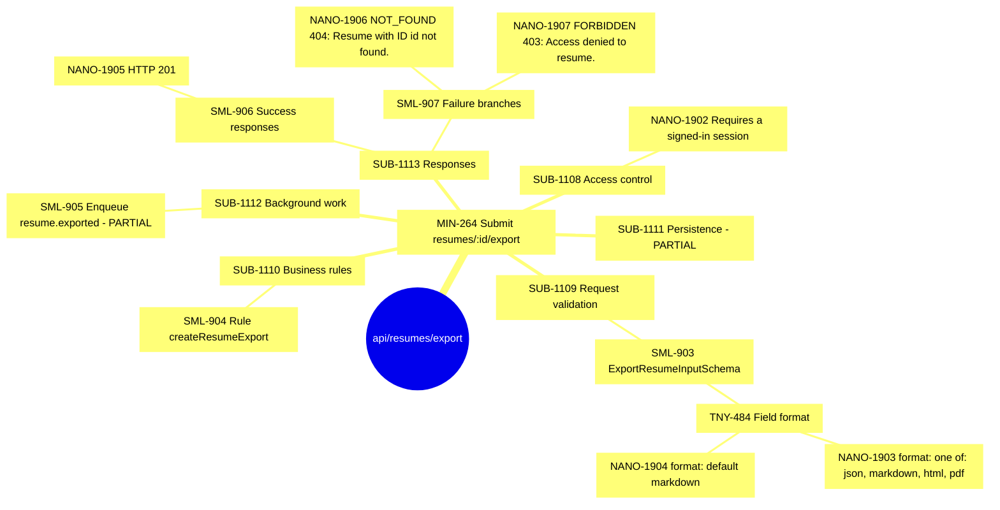

| ID        | Level | Parent   | Name                                             | Description                                                                                                                                                                                                                                                                             | Status                | Verification | Evidence                                   | Related                     |
| --------- | ----- | -------- | ------------------------------------------------ | --------------------------------------------------------------------------------------------------------------------------------------------------------------------------------------------------------------------------------------------------------------------------------------- | --------------------- | ------------ | ------------------------------------------ | --------------------------- |
| FEAT-082  | MAJOR | MOD-078  | api/resumes/export                               |                                                                                                                                                                                                                                                                                         | IMPLEMENTED           |              | apps/api/src/server.ts:6365                |                             |
| MIN-264   | MINOR | FEAT-082 | Submit resumes/:id/export                        | POST /api/v1/resumes/:id/export for any signed-in session; validates ExportResumeInputSchema; calls createResumeExport; ephemeral (process memory); responds 201; 2 failure branch(es). Gaps: ephemeral: state held in process memory, lost on restart; no first-party web caller found | IMPLEMENTED           | VERIFIED     | apps/api/src/server.ts:6365                | API-131, TEST-123, TEST-206 |
| SUB-1108  | SUB   | MIN-264  | Access control                                   | Who may call POST /api/v1/resumes/:id/export: any signed-in session.                                                                                                                                                                                                                    | IMPLEMENTED           | PATH_LEVEL   | apps/api/src/server.ts:6365                |                             |
| NANO-1902 | NANO  | SUB-1108 | Requires a signed-in session                     | Requests without a valid session token are rejected with 401 UNAUTHENTICATED.                                                                                                                                                                                                           | IMPLEMENTED           | PATH_LEVEL   | apps/api/src/server.ts:6365                | ROLE-001                    |
| SUB-1109  | SUB   | MIN-264  | Request validation                               | The request is parsed with ExportResumeInputSchema; a failure returns 400 with field details before any business logic runs.                                                                                                                                                            | IMPLEMENTED           | PATH_LEVEL   | apps/api/src/server.ts:6365                |                             |
| SML-903   | SMALL | SUB-1109 | ExportResumeInputSchema                          | ExportResumeInputSchema: 1 field(s)                                                                                                                                                                                                                                                     | IMPLEMENTED           | PATH_LEVEL   | packages/contracts/src/index.ts:512        | SCH-038                     |
| TNY-484   | TINY  | SML-903  | Field format                                     | format (enum, optional): one of: json, markdown, html, pdf; default 'markdown'                                                                                                                                                                                                          | IMPLEMENTED           | PATH_LEVEL   | packages/contracts/src/index.ts:513        |                             |
| NANO-1903 | NANO  | TNY-484  | format: one of: json, markdown, html, pdf        | format one of: json, markdown, html, pdf.                                                                                                                                                                                                                                               | IMPLEMENTED           | PATH_LEVEL   | packages/contracts/src/index.ts:513        |                             |
| NANO-1904 | NANO  | TNY-484  | format: default 'markdown'                       | format default 'markdown'; message "markdown".                                                                                                                                                                                                                                          | IMPLEMENTED           | PATH_LEVEL   | packages/contracts/src/index.ts:513        |                             |
| SUB-1110  | SUB   | MIN-264  | Business rules                                   | Domain functions from packages/domain called by the handler (1).                                                                                                                                                                                                                        | IMPLEMENTED           | PATH_LEVEL   | apps/api/src/server.ts:6365                |                             |
| SML-904   | SMALL | SUB-1110 | Rule createResumeExport                          | Calls createResumeExport (packages/domain/src/resumes.ts). Rule status IMPLEMENTED; its own tests: VERIFIED.                                                                                                                                                                            | IMPLEMENTED           | VERIFIED     | packages/domain/src/resumes.ts:202         | RULE-190                    |
| SUB-1111  | SUB   | MIN-264  | Persistence                                      | Ephemeral: state lives in API process memory and is lost on restart.                                                                                                                                                                                                                    | PARTIALLY_IMPLEMENTED | PATH_LEVEL   | apps/api/src/server.ts:6365                |                             |
| SUB-1112  | SUB   | MIN-264  | Background work                                  | Enqueues 1 background job kind(s) in background_jobs for apps/worker.                                                                                                                                                                                                                   | IMPLEMENTED           | PATH_LEVEL   | apps/api/src/server.ts:6365                |                             |
| SML-905   | SMALL | SUB-1112 | Enqueue resume.exported                          | Dispatches job:resume.exported; worker handler: recordEvent (no-op: marks the event recorded).                                                                                                                                                                                          | PARTIALLY_IMPLEMENTED | UNKNOWN      | packages/domain/src/background-jobs.ts:171 | SVC-039                     |
| SUB-1113  | SUB   | MIN-264  | Responses                                        | Success 201; 2 explicit failure branch(es) besides validation and access errors.                                                                                                                                                                                                        | IMPLEMENTED           | PATH_LEVEL   | apps/api/src/server.ts:6365                |                             |
| SML-906   | SMALL | SUB-1113 | Success responses                                | HTTP 201.                                                                                                                                                                                                                                                                               | IMPLEMENTED           | PATH_LEVEL   | apps/api/src/server.ts:6365                |                             |
| NANO-1905 | NANO  | SML-906  | HTTP 201                                         | Replies 201 when the operation succeeds.                                                                                                                                                                                                                                                | IMPLEMENTED           | PATH_LEVEL   | apps/api/src/server.ts:6365                |                             |
| SML-907   | SMALL | SUB-1113 | Failure branches                                 | 2 DomainError branch(es) in the handler, mapped to HTTP by the global error handler.                                                                                                                                                                                                    | IMPLEMENTED           | PATH_LEVEL   | apps/api/src/server.ts:6365                |                             |
| NANO-1906 | NANO  | SML-907  | NOT_FOUND 404: Resume with ID "${id}" not found. | Throws DomainError(NOT_FOUND) "Resume with ID "${id}" not found." -> HTTP 404.                                                                                                                                                                                                          | IMPLEMENTED           | PATH_LEVEL   | apps/api/src/server.ts:6373                | ERR-136                     |
| NANO-1907 | NANO  | SML-907  | FORBIDDEN 403: Access denied to resume.          | Throws DomainError(FORBIDDEN) "Access denied to resume." -> HTTP 403.                                                                                                                                                                                                                   | IMPLEMENTED           | PATH_LEVEL   | apps/api/src/server.ts:6377                | ERR-135                     |

### FEAT-083 api/resumes/exports

api/resumes/exports

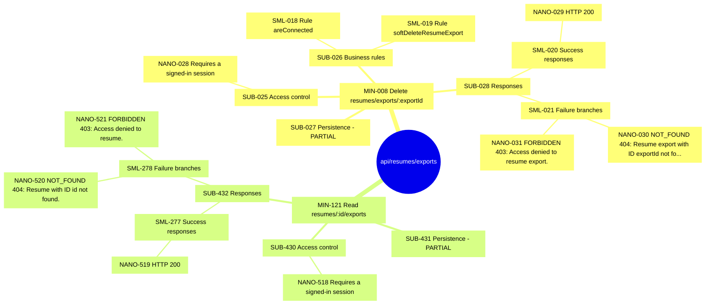

| ID       | Level | Parent   | Name                                                          | Description                                                                                                                                                                                                                                                                     | Status                | Verification | Evidence                              | Related                     |
| -------- | ----- | -------- | ------------------------------------------------------------- | ------------------------------------------------------------------------------------------------------------------------------------------------------------------------------------------------------------------------------------------------------------------------------- | --------------------- | ------------ | ------------------------------------- | --------------------------- |
| FEAT-083 | MAJOR | MOD-078  | api/resumes/exports                                           |                                                                                                                                                                                                                                                                                 | IMPLEMENTED           |              | apps/api/src/server.ts:6406           |                             |
| MIN-008  | MINOR | FEAT-083 | Delete resumes/exports/:exportId                              | DELETE /api/v1/resumes/exports/:exportId for any signed-in session; calls areConnected, softDeleteResumeExport; ephemeral (process memory); responds 200; 2 failure branch(es). Gaps: ephemeral: state held in process memory, lost on restart; no first-party web caller found | IMPLEMENTED           | VERIFIED     | apps/api/src/server.ts:6434           | API-133, TEST-123, TEST-206 |
| SUB-025  | SUB   | MIN-008  | Access control                                                | Who may call DELETE /api/v1/resumes/exports/:exportId: any signed-in session.                                                                                                                                                                                                   | IMPLEMENTED           | PATH_LEVEL   | apps/api/src/server.ts:6434           |                             |
| NANO-028 | NANO  | SUB-025  | Requires a signed-in session                                  | Requests without a valid session token are rejected with 401 UNAUTHENTICATED.                                                                                                                                                                                                   | IMPLEMENTED           | PATH_LEVEL   | apps/api/src/server.ts:6434           | ROLE-001                    |
| SUB-026  | SUB   | MIN-008  | Business rules                                                | Domain functions from packages/domain called by the handler (2).                                                                                                                                                                                                                | IMPLEMENTED           | PATH_LEVEL   | apps/api/src/server.ts:6434           |                             |
| SML-018  | SMALL | SUB-026  | Rule areConnected                                             | Calls areConnected (packages/domain/src/networking.ts). Rule status IMPLEMENTED; its own tests: VERIFIED.                                                                                                                                                                       | IMPLEMENTED           | VERIFIED     | packages/domain/src/networking.ts:156 | RULE-158                    |
| SML-019  | SMALL | SUB-026  | Rule softDeleteResumeExport                                   | Calls softDeleteResumeExport (packages/domain/src/resumes.ts). Rule status IMPLEMENTED; its own tests: VERIFIED.                                                                                                                                                                | IMPLEMENTED           | VERIFIED     | packages/domain/src/resumes.ts:243    | RULE-191                    |
| SUB-027  | SUB   | MIN-008  | Persistence                                                   | Ephemeral: state lives in API process memory and is lost on restart.                                                                                                                                                                                                            | PARTIALLY_IMPLEMENTED | PATH_LEVEL   | apps/api/src/server.ts:6434           |                             |
| SUB-028  | SUB   | MIN-008  | Responses                                                     | Success 200; 2 explicit failure branch(es) besides validation and access errors.                                                                                                                                                                                                | IMPLEMENTED           | PATH_LEVEL   | apps/api/src/server.ts:6434           |                             |
| SML-020  | SMALL | SUB-028  | Success responses                                             | HTTP 200.                                                                                                                                                                                                                                                                       | IMPLEMENTED           | PATH_LEVEL   | apps/api/src/server.ts:6434           |                             |
| NANO-029 | NANO  | SML-020  | HTTP 200                                                      | Replies 200 when the operation succeeds.                                                                                                                                                                                                                                        | IMPLEMENTED           | PATH_LEVEL   | apps/api/src/server.ts:6434           |                             |
| SML-021  | SMALL | SUB-028  | Failure branches                                              | 2 DomainError branch(es) in the handler, mapped to HTTP by the global error handler.                                                                                                                                                                                            | IMPLEMENTED           | PATH_LEVEL   | apps/api/src/server.ts:6434           |                             |
| NANO-030 | NANO  | SML-021  | NOT_FOUND 404: Resume export with ID "${exportId}" not found. | Throws DomainError(NOT_FOUND) "Resume export with ID "${exportId}" not found." -> HTTP 404.                                                                                                                                                                                     | IMPLEMENTED           | PATH_LEVEL   | apps/api/src/server.ts:6442           | ERR-137                     |
| NANO-031 | NANO  | SML-021  | FORBIDDEN 403: Access denied to resume export.                | Throws DomainError(FORBIDDEN) "Access denied to resume export." -> HTTP 403.                                                                                                                                                                                                    | IMPLEMENTED           | PATH_LEVEL   | apps/api/src/server.ts:6446           | ERR-138                     |
| MIN-121  | MINOR | FEAT-083 | Read resumes/:id/exports                                      | GET /api/v1/resumes/:id/exports for any signed-in session; ephemeral (process memory); responds 200; 2 failure branch(es). Gaps: ephemeral: state held in process memory, lost on restart; no first-party web caller found                                                      | IMPLEMENTED           | VERIFIED     | apps/api/src/server.ts:6406           | API-132, TEST-123, TEST-206 |
| SUB-430  | SUB   | MIN-121  | Access control                                                | Who may call GET /api/v1/resumes/:id/exports: any signed-in session.                                                                                                                                                                                                            | IMPLEMENTED           | PATH_LEVEL   | apps/api/src/server.ts:6406           |                             |
| NANO-518 | NANO  | SUB-430  | Requires a signed-in session                                  | Requests without a valid session token are rejected with 401 UNAUTHENTICATED.                                                                                                                                                                                                   | IMPLEMENTED           | PATH_LEVEL   | apps/api/src/server.ts:6406           | ROLE-001                    |
| SUB-431  | SUB   | MIN-121  | Persistence                                                   | Ephemeral: state lives in API process memory and is lost on restart.                                                                                                                                                                                                            | PARTIALLY_IMPLEMENTED | PATH_LEVEL   | apps/api/src/server.ts:6406           |                             |
| SUB-432  | SUB   | MIN-121  | Responses                                                     | Success 200; 2 explicit failure branch(es) besides validation and access errors.                                                                                                                                                                                                | IMPLEMENTED           | PATH_LEVEL   | apps/api/src/server.ts:6406           |                             |
| SML-277  | SMALL | SUB-432  | Success responses                                             | HTTP 200.                                                                                                                                                                                                                                                                       | IMPLEMENTED           | PATH_LEVEL   | apps/api/src/server.ts:6406           |                             |
| NANO-519 | NANO  | SML-277  | HTTP 200                                                      | Replies 200 when the operation succeeds.                                                                                                                                                                                                                                        | IMPLEMENTED           | PATH_LEVEL   | apps/api/src/server.ts:6406           |                             |
| SML-278  | SMALL | SUB-432  | Failure branches                                              | 2 DomainError branch(es) in the handler, mapped to HTTP by the global error handler.                                                                                                                                                                                            | IMPLEMENTED           | PATH_LEVEL   | apps/api/src/server.ts:6406           |                             |
| NANO-520 | NANO  | SML-278  | NOT_FOUND 404: Resume with ID "${id}" not found.              | Throws DomainError(NOT_FOUND) "Resume with ID "${id}" not found." -> HTTP 404.                                                                                                                                                                                                  | IMPLEMENTED           | PATH_LEVEL   | apps/api/src/server.ts:6417           | ERR-136                     |
| NANO-521 | NANO  | SML-278  | FORBIDDEN 403: Access denied to resume.                       | Throws DomainError(FORBIDDEN) "Access denied to resume." -> HTTP 403.                                                                                                                                                                                                           | IMPLEMENTED           | PATH_LEVEL   | apps/api/src/server.ts:6421           | ERR-135                     |

## api/salaries (MOD-062)

**Application:** apps/api (MOD-001). **Purpose:** API module: routes under /api/v1/salaries in apps/api/src/server.ts.

**Nodes by level:** MODULE 1, MAJOR 3, MINOR 5, SUB 21, SMALL 13, TINY 20, NANO 52. **Status:** IMPLEMENTED 107, PARTIALLY_IMPLEMENTED 7, UNKNOWN 1. **Verification:** PATH_LEVEL 101, VERIFIED 10.

**User roles that reach it:** anonymous, authenticated.

**Known gaps:** MIN-122 ephemeral: state held in process memory, lost on restart; MIN-122 no first-party web caller found; MIN-123 ephemeral: state held in process memory, lost on restart; MIN-123 no first-party web caller found; MIN-009 ephemeral: state held in process memory, lost on restart; MIN-009 no first-party web caller found; MIN-124 ephemeral: state held in process memory, lost on restart; MIN-124 no first-party web caller found; MIN-265 ephemeral: state held in process memory, lost on restart; MIN-265 no first-party web caller found.

### Module map (to minor features)

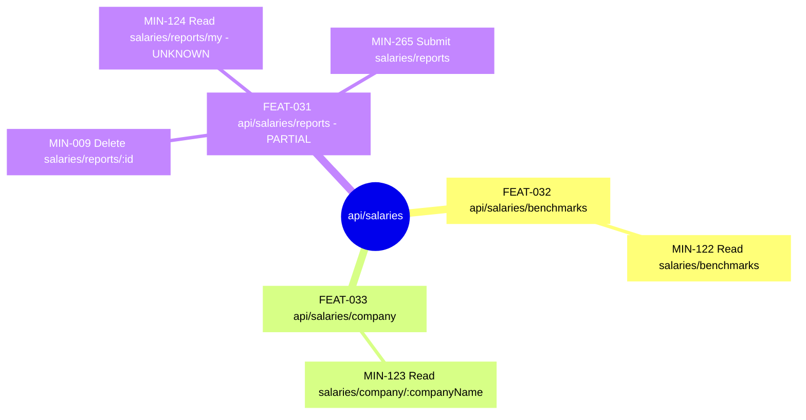

### FEAT-032 api/salaries/benchmarks

api/salaries/benchmarks

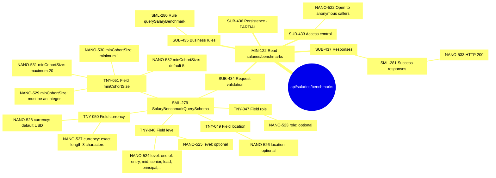

| ID       | Level | Parent   | Name                                                                    | Description                                                                                                                                                                                                                                                      | Status                | Verification | Evidence                                       | Related                                         |
| -------- | ----- | -------- | ----------------------------------------------------------------------- | ---------------------------------------------------------------------------------------------------------------------------------------------------------------------------------------------------------------------------------------------------------------- | --------------------- | ------------ | ---------------------------------------------- | ----------------------------------------------- |
| FEAT-032 | MAJOR | MOD-062  | api/salaries/benchmarks                                                 |                                                                                                                                                                                                                                                                  | IMPLEMENTED           |              | apps/api/src/server.ts:2692                    |                                                 |
| MIN-122  | MINOR | FEAT-032 | Read salaries/benchmarks                                                | GET /api/v1/salaries/benchmarks for anyone (public); validates SalaryBenchmarkQuerySchema; calls querySalaryBenchmark; ephemeral (process memory); responds 200. Gaps: ephemeral: state held in process memory, lost on restart; no first-party web caller found | IMPLEMENTED           | VERIFIED     | apps/api/src/server.ts:2692                    | API-045, TEST-101, TEST-127, TEST-145, TEST-207 |
| SUB-433  | SUB   | MIN-122  | Access control                                                          | Who may call GET /api/v1/salaries/benchmarks: anyone (public).                                                                                                                                                                                                   | IMPLEMENTED           | PATH_LEVEL   | apps/api/src/server.ts:2692                    |                                                 |
| NANO-522 | NANO  | SUB-433  | Open to anonymous callers                                               | auth: public.                                                                                                                                                                                                                                                    | IMPLEMENTED           | PATH_LEVEL   | apps/api/src/server.ts:2692                    | ROLE-001                                        |
| SUB-434  | SUB   | MIN-122  | Request validation                                                      | The request is parsed with SalaryBenchmarkQuerySchema; a failure returns 400 with field details before any business logic runs.                                                                                                                                  | IMPLEMENTED           | PATH_LEVEL   | apps/api/src/server.ts:2692                    |                                                 |
| SML-279  | SMALL | SUB-434  | SalaryBenchmarkQuerySchema                                              | SalaryBenchmarkQuerySchema: 5 field(s)                                                                                                                                                                                                                           | IMPLEMENTED           | PATH_LEVEL   | packages/contracts/src/index.ts:1049           | SCH-083                                         |
| TNY-047  | TINY  | SML-279  | Field role                                                              | role (string, optional): optional                                                                                                                                                                                                                                | IMPLEMENTED           | PATH_LEVEL   | packages/contracts/src/index.ts:1050           |                                                 |
| NANO-523 | NANO  | TNY-047  | role: optional                                                          | role optional.                                                                                                                                                                                                                                                   | IMPLEMENTED           | PATH_LEVEL   | packages/contracts/src/index.ts:1050           |                                                 |
| TNY-048  | TINY  | SML-279  | Field level                                                             | level (enum, optional): one of: entry, mid, senior, lead, principal, director, executive; optional                                                                                                                                                               | IMPLEMENTED           | PATH_LEVEL   | packages/contracts/src/index.ts:1051           |                                                 |
| NANO-524 | NANO  | TNY-048  | level: one of: entry, mid, senior, lead, principal, director, executive | level one of: entry, mid, senior, lead, principal, director, executive.                                                                                                                                                                                          | IMPLEMENTED           | PATH_LEVEL   | packages/contracts/src/index.ts:1051           |                                                 |
| NANO-525 | NANO  | TNY-048  | level: optional                                                         | level optional.                                                                                                                                                                                                                                                  | IMPLEMENTED           | PATH_LEVEL   | packages/contracts/src/index.ts:1051           |                                                 |
| TNY-049  | TINY  | SML-279  | Field location                                                          | location (string, optional): optional                                                                                                                                                                                                                            | IMPLEMENTED           | PATH_LEVEL   | packages/contracts/src/index.ts:1054           |                                                 |
| NANO-526 | NANO  | TNY-049  | location: optional                                                      | location optional.                                                                                                                                                                                                                                               | IMPLEMENTED           | PATH_LEVEL   | packages/contracts/src/index.ts:1054           |                                                 |
| TNY-050  | TINY  | SML-279  | Field currency                                                          | currency (string, optional): exact length 3 characters; default 'USD'                                                                                                                                                                                            | IMPLEMENTED           | PATH_LEVEL   | packages/contracts/src/index.ts:1055           |                                                 |
| NANO-527 | NANO  | TNY-050  | currency: exact length 3 characters                                     | currency exact length 3 characters.                                                                                                                                                                                                                              | IMPLEMENTED           | PATH_LEVEL   | packages/contracts/src/index.ts:1055           |                                                 |
| NANO-528 | NANO  | TNY-050  | currency: default 'USD'                                                 | currency default 'USD'; message "USD".                                                                                                                                                                                                                           | IMPLEMENTED           | PATH_LEVEL   | packages/contracts/src/index.ts:1055           |                                                 |
| TNY-051  | TINY  | SML-279  | Field minCohortSize                                                     | minCohortSize (number, optional): must be an integer; minimum 1; maximum 20; default 5                                                                                                                                                                           | IMPLEMENTED           | PATH_LEVEL   | packages/contracts/src/index.ts:1057           |                                                 |
| NANO-529 | NANO  | TNY-051  | minCohortSize: must be an integer                                       | minCohortSize must be an integer.                                                                                                                                                                                                                                | IMPLEMENTED           | PATH_LEVEL   | packages/contracts/src/index.ts:1057           |                                                 |
| NANO-530 | NANO  | TNY-051  | minCohortSize: minimum 1                                                | minCohortSize minimum 1.                                                                                                                                                                                                                                         | IMPLEMENTED           | PATH_LEVEL   | packages/contracts/src/index.ts:1057           |                                                 |
| NANO-531 | NANO  | TNY-051  | minCohortSize: maximum 20                                               | minCohortSize maximum 20.                                                                                                                                                                                                                                        | IMPLEMENTED           | PATH_LEVEL   | packages/contracts/src/index.ts:1057           |                                                 |
| NANO-532 | NANO  | TNY-051  | minCohortSize: default 5                                                | minCohortSize default 5.                                                                                                                                                                                                                                         | IMPLEMENTED           | PATH_LEVEL   | packages/contracts/src/index.ts:1057           |                                                 |
| SUB-435  | SUB   | MIN-122  | Business rules                                                          | Domain functions from packages/domain called by the handler (1).                                                                                                                                                                                                 | IMPLEMENTED           | PATH_LEVEL   | apps/api/src/server.ts:2692                    |                                                 |
| SML-280  | SMALL | SUB-435  | Rule querySalaryBenchmark                                               | Calls querySalaryBenchmark (packages/domain/src/salary-intelligence.ts). Rule status IMPLEMENTED; its own tests: VERIFIED.                                                                                                                                       | IMPLEMENTED           | VERIFIED     | packages/domain/src/salary-intelligence.ts:317 | RULE-197                                        |
| SUB-436  | SUB   | MIN-122  | Persistence                                                             | Ephemeral: state lives in API process memory and is lost on restart.                                                                                                                                                                                             | PARTIALLY_IMPLEMENTED | PATH_LEVEL   | apps/api/src/server.ts:2692                    |                                                 |
| SUB-437  | SUB   | MIN-122  | Responses                                                               | Success 200; 0 explicit failure branch(es) besides validation and access errors.                                                                                                                                                                                 | IMPLEMENTED           | PATH_LEVEL   | apps/api/src/server.ts:2692                    |                                                 |
| SML-281  | SMALL | SUB-437  | Success responses                                                       | HTTP 200.                                                                                                                                                                                                                                                        | IMPLEMENTED           | PATH_LEVEL   | apps/api/src/server.ts:2692                    |                                                 |
| NANO-533 | NANO  | SML-281  | HTTP 200                                                                | Replies 200 when the operation succeeds.                                                                                                                                                                                                                         | IMPLEMENTED           | PATH_LEVEL   | apps/api/src/server.ts:2692                    |                                                 |

### FEAT-033 api/salaries/company

api/salaries/company

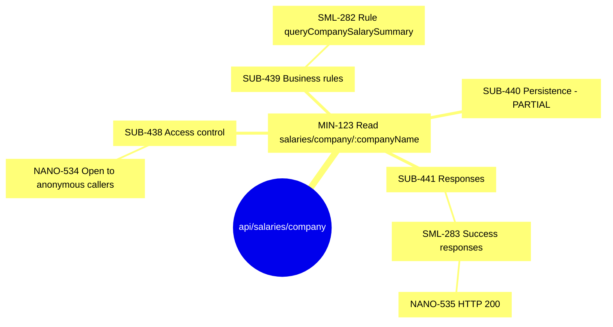

| ID       | Level | Parent   | Name                               | Description                                                                                                                                                                                                                               | Status                | Verification | Evidence                                       | Related                               |
| -------- | ----- | -------- | ---------------------------------- | ----------------------------------------------------------------------------------------------------------------------------------------------------------------------------------------------------------------------------------------- | --------------------- | ------------ | ---------------------------------------------- | ------------------------------------- |
| FEAT-033 | MAJOR | MOD-062  | api/salaries/company               |                                                                                                                                                                                                                                           | IMPLEMENTED           |              | apps/api/src/server.ts:2710                    |                                       |
| MIN-123  | MINOR | FEAT-033 | Read salaries/company/:companyName | GET /api/v1/salaries/company/:companyName for anyone (public); calls queryCompanySalarySummary; ephemeral (process memory); responds 200. Gaps: ephemeral: state held in process memory, lost on restart; no first-party web caller found | IMPLEMENTED           | VERIFIED     | apps/api/src/server.ts:2710                    | API-046, TEST-127, TEST-145, TEST-207 |
| SUB-438  | SUB   | MIN-123  | Access control                     | Who may call GET /api/v1/salaries/company/:companyName: anyone (public).                                                                                                                                                                  | IMPLEMENTED           | PATH_LEVEL   | apps/api/src/server.ts:2710                    |                                       |
| NANO-534 | NANO  | SUB-438  | Open to anonymous callers          | auth: public.                                                                                                                                                                                                                             | IMPLEMENTED           | PATH_LEVEL   | apps/api/src/server.ts:2710                    | ROLE-001                              |
| SUB-439  | SUB   | MIN-123  | Business rules                     | Domain functions from packages/domain called by the handler (1).                                                                                                                                                                          | IMPLEMENTED           | PATH_LEVEL   | apps/api/src/server.ts:2710                    |                                       |
| SML-282  | SMALL | SUB-439  | Rule queryCompanySalarySummary     | Calls queryCompanySalarySummary (packages/domain/src/salary-intelligence.ts). Rule status IMPLEMENTED; its own tests: VERIFIED.                                                                                                           | IMPLEMENTED           | VERIFIED     | packages/domain/src/salary-intelligence.ts:375 | RULE-198                              |
| SUB-440  | SUB   | MIN-123  | Persistence                        | Ephemeral: state lives in API process memory and is lost on restart.                                                                                                                                                                      | PARTIALLY_IMPLEMENTED | PATH_LEVEL   | apps/api/src/server.ts:2710                    |                                       |
| SUB-441  | SUB   | MIN-123  | Responses                          | Success 200; 0 explicit failure branch(es) besides validation and access errors.                                                                                                                                                          | IMPLEMENTED           | PATH_LEVEL   | apps/api/src/server.ts:2710                    |                                       |
| SML-283  | SMALL | SUB-441  | Success responses                  | HTTP 200.                                                                                                                                                                                                                                 | IMPLEMENTED           | PATH_LEVEL   | apps/api/src/server.ts:2710                    |                                       |
| NANO-535 | NANO  | SML-283  | HTTP 200                           | Replies 200 when the operation succeeds.                                                                                                                                                                                                  | IMPLEMENTED           | PATH_LEVEL   | apps/api/src/server.ts:2710                    |                                       |

### FEAT-031 api/salaries/reports

api/salaries/reports

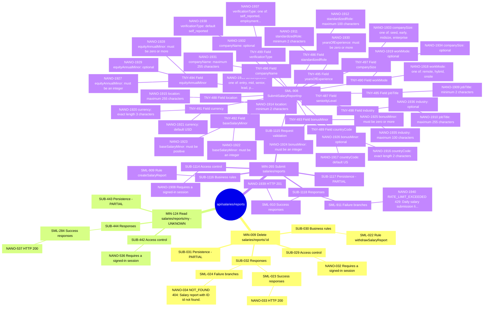

| ID        | Level | Parent   | Name                                                                                | Description                                                                                                                                                                                                                                                                                                                                                                | Status                | Verification | Evidence                                       | Related                                          |
| --------- | ----- | -------- | ----------------------------------------------------------------------------------- | -------------------------------------------------------------------------------------------------------------------------------------------------------------------------------------------------------------------------------------------------------------------------------------------------------------------------------------------------------------------------- | --------------------- | ------------ | ---------------------------------------------- | ------------------------------------------------ |
| FEAT-031  | MAJOR | MOD-062  | api/salaries/reports                                                                |                                                                                                                                                                                                                                                                                                                                                                            | PARTIALLY_IMPLEMENTED |              | apps/api/src/server.ts:2592                    |                                                  |
| MIN-009   | MINOR | FEAT-031 | Delete salaries/reports/:id                                                         | DELETE /api/v1/salaries/reports/:id for any signed-in session; calls withdrawSalaryReport; ephemeral (process memory); responds 200; 1 failure branch(es). Gaps: ephemeral: state held in process memory, lost on restart; no first-party web caller found                                                                                                                 | IMPLEMENTED           | VERIFIED     | apps/api/src/server.ts:2660                    | API-044, TEST-127, TEST-207                      |
| SUB-029   | SUB   | MIN-009  | Access control                                                                      | Who may call DELETE /api/v1/salaries/reports/:id: any signed-in session.                                                                                                                                                                                                                                                                                                   | IMPLEMENTED           | PATH_LEVEL   | apps/api/src/server.ts:2660                    |                                                  |
| NANO-032  | NANO  | SUB-029  | Requires a signed-in session                                                        | Requests without a valid session token are rejected with 401 UNAUTHENTICATED.                                                                                                                                                                                                                                                                                              | IMPLEMENTED           | PATH_LEVEL   | apps/api/src/server.ts:2660                    | ROLE-001                                         |
| SUB-030   | SUB   | MIN-009  | Business rules                                                                      | Domain functions from packages/domain called by the handler (1).                                                                                                                                                                                                                                                                                                           | IMPLEMENTED           | PATH_LEVEL   | apps/api/src/server.ts:2660                    |                                                  |
| SML-022   | SMALL | SUB-030  | Rule withdrawSalaryReport                                                           | Calls withdrawSalaryReport (packages/domain/src/salary-intelligence.ts). Rule status IMPLEMENTED; its own tests: VERIFIED.                                                                                                                                                                                                                                                 | IMPLEMENTED           | VERIFIED     | packages/domain/src/salary-intelligence.ts:222 | RULE-195                                         |
| SUB-031   | SUB   | MIN-009  | Persistence                                                                         | Ephemeral: state lives in API process memory and is lost on restart.                                                                                                                                                                                                                                                                                                       | PARTIALLY_IMPLEMENTED | PATH_LEVEL   | apps/api/src/server.ts:2660                    |                                                  |
| SUB-032   | SUB   | MIN-009  | Responses                                                                           | Success 200; 1 explicit failure branch(es) besides validation and access errors.                                                                                                                                                                                                                                                                                           | IMPLEMENTED           | PATH_LEVEL   | apps/api/src/server.ts:2660                    |                                                  |
| SML-023   | SMALL | SUB-032  | Success responses                                                                   | HTTP 200.                                                                                                                                                                                                                                                                                                                                                                  | IMPLEMENTED           | PATH_LEVEL   | apps/api/src/server.ts:2660                    |                                                  |
| NANO-033  | NANO  | SML-023  | HTTP 200                                                                            | Replies 200 when the operation succeeds.                                                                                                                                                                                                                                                                                                                                   | IMPLEMENTED           | PATH_LEVEL   | apps/api/src/server.ts:2660                    |                                                  |
| SML-024   | SMALL | SUB-032  | Failure branches                                                                    | 1 DomainError branch(es) in the handler, mapped to HTTP by the global error handler.                                                                                                                                                                                                                                                                                       | IMPLEMENTED           | PATH_LEVEL   | apps/api/src/server.ts:2660                    |                                                  |
| NANO-034  | NANO  | SML-024  | NOT_FOUND 404: Salary report with ID ${id} not found.                               | Throws DomainError(NOT_FOUND) "Salary report with ID ${id} not found." -> HTTP 404.                                                                                                                                                                                                                                                                                        | IMPLEMENTED           | PATH_LEVEL   | apps/api/src/server.ts:2668                    | ERR-046                                          |
| MIN-124   | MINOR | FEAT-031 | Read salaries/reports/my                                                            | GET /api/v1/salaries/reports/my for any signed-in session; ephemeral (process memory); responds 200. Gaps: ephemeral: state held in process memory, lost on restart; no first-party web caller found                                                                                                                                                                       | UNKNOWN               | VERIFIED     | apps/api/src/server.ts:2654                    | API-043, TEST-127                                |
| SUB-442   | SUB   | MIN-124  | Access control                                                                      | Who may call GET /api/v1/salaries/reports/my: any signed-in session.                                                                                                                                                                                                                                                                                                       | IMPLEMENTED           | PATH_LEVEL   | apps/api/src/server.ts:2654                    |                                                  |
| NANO-536  | NANO  | SUB-442  | Requires a signed-in session                                                        | Requests without a valid session token are rejected with 401 UNAUTHENTICATED.                                                                                                                                                                                                                                                                                              | IMPLEMENTED           | PATH_LEVEL   | apps/api/src/server.ts:2654                    | ROLE-001                                         |
| SUB-443   | SUB   | MIN-124  | Persistence                                                                         | Ephemeral: state lives in API process memory and is lost on restart.                                                                                                                                                                                                                                                                                                       | PARTIALLY_IMPLEMENTED | PATH_LEVEL   | apps/api/src/server.ts:2654                    |                                                  |
| SUB-444   | SUB   | MIN-124  | Responses                                                                           | Success 200; 0 explicit failure branch(es) besides validation and access errors.                                                                                                                                                                                                                                                                                           | IMPLEMENTED           | PATH_LEVEL   | apps/api/src/server.ts:2654                    |                                                  |
| SML-284   | SMALL | SUB-444  | Success responses                                                                   | HTTP 200.                                                                                                                                                                                                                                                                                                                                                                  | IMPLEMENTED           | PATH_LEVEL   | apps/api/src/server.ts:2654                    |                                                  |
| NANO-537  | NANO  | SML-284  | HTTP 200                                                                            | Replies 200 when the operation succeeds.                                                                                                                                                                                                                                                                                                                                   | IMPLEMENTED           | PATH_LEVEL   | apps/api/src/server.ts:2654                    |                                                  |
| MIN-265   | MINOR | FEAT-031 | Submit salaries/reports                                                             | Salary Intelligence & Compensation Benchmarks Endpoints (F-86, BR-177..BR-183) POST /api/v1/salaries/reports for any signed-in session; validates SubmitSalaryReportInputSchema; calls createSalaryReport; ephemeral (process memory); responds 201; 1 failure branch(es). Gaps: ephemeral: state held in process memory, lost on restart; no first-party web caller found | IMPLEMENTED           | VERIFIED     | apps/api/src/server.ts:2592                    | API-042, TEST-101, TEST-127, TEST-207            |
| SUB-1114  | SUB   | MIN-265  | Access control                                                                      | Who may call POST /api/v1/salaries/reports: any signed-in session.                                                                                                                                                                                                                                                                                                         | IMPLEMENTED           | PATH_LEVEL   | apps/api/src/server.ts:2592                    |                                                  |
| NANO-1908 | NANO  | SUB-1114 | Requires a signed-in session                                                        | Requests without a valid session token are rejected with 401 UNAUTHENTICATED.                                                                                                                                                                                                                                                                                              | IMPLEMENTED           | PATH_LEVEL   | apps/api/src/server.ts:2592                    | ROLE-001                                         |
| SUB-1115  | SUB   | MIN-265  | Request validation                                                                  | The request is parsed with SubmitSalaryReportInputSchema; a failure returns 400 with field details before any business logic runs.                                                                                                                                                                                                                                         | IMPLEMENTED           | PATH_LEVEL   | apps/api/src/server.ts:2592                    |                                                  |
| SML-908   | SMALL | SUB-1115 | SubmitSalaryReportInputSchema                                                       | SubmitSalaryReportInputSchema: 15 field(s)                                                                                                                                                                                                                                                                                                                                 | IMPLEMENTED           | PATH_LEVEL   | packages/contracts/src/index.ts:1029           | SCH-082                                          |
| TNY-485   | TINY  | SML-908  | Field jobTitle                                                                      | jobTitle (string, required): minimum 2 characters; maximum 255 characters                                                                                                                                                                                                                                                                                                  | IMPLEMENTED           | PATH_LEVEL   | packages/contracts/src/index.ts:1030           |                                                  |
| NANO-1909 | NANO  | TNY-485  | jobTitle: minimum 2 characters                                                      | jobTitle minimum 2 characters.                                                                                                                                                                                                                                                                                                                                             | IMPLEMENTED           | PATH_LEVEL   | packages/contracts/src/index.ts:1030           |                                                  |
| NANO-1910 | NANO  | TNY-485  | jobTitle: maximum 255 characters                                                    | jobTitle maximum 255 characters.                                                                                                                                                                                                                                                                                                                                           | IMPLEMENTED           | PATH_LEVEL   | packages/contracts/src/index.ts:1030           |                                                  |
| TNY-486   | TINY  | SML-908  | Field standardizedRole                                                              | standardizedRole (string, required): minimum 2 characters; maximum 100 characters                                                                                                                                                                                                                                                                                          | IMPLEMENTED           | PATH_LEVEL   | packages/contracts/src/index.ts:1031           |                                                  |
| NANO-1911 | NANO  | TNY-486  | standardizedRole: minimum 2 characters                                              | standardizedRole minimum 2 characters.                                                                                                                                                                                                                                                                                                                                     | IMPLEMENTED           | PATH_LEVEL   | packages/contracts/src/index.ts:1031           |                                                  |
| NANO-1912 | NANO  | TNY-486  | standardizedRole: maximum 100 characters                                            | standardizedRole maximum 100 characters.                                                                                                                                                                                                                                                                                                                                   | IMPLEMENTED           | PATH_LEVEL   | packages/contracts/src/index.ts:1031           |                                                  |
| TNY-487   | TINY  | SML-908  | Field seniorityLevel                                                                | seniorityLevel (enum, required): one of: entry, mid, senior, lead, principal, director, executive                                                                                                                                                                                                                                                                          | IMPLEMENTED           | PATH_LEVEL   | packages/contracts/src/index.ts:1032           |                                                  |
| NANO-1913 | NANO  | TNY-487  | seniorityLevel: one of: entry, mid, senior, lead, principal, director, executive    | seniorityLevel one of: entry, mid, senior, lead, principal, director, executive.                                                                                                                                                                                                                                                                                           | IMPLEMENTED           | PATH_LEVEL   | packages/contracts/src/index.ts:1032           |                                                  |
| TNY-488   | TINY  | SML-908  | Field location                                                                      | location (string, required): minimum 2 characters; maximum 255 characters                                                                                                                                                                                                                                                                                                  | IMPLEMENTED           | PATH_LEVEL   | packages/contracts/src/index.ts:1033           |                                                  |
| NANO-1914 | NANO  | TNY-488  | location: minimum 2 characters                                                      | location minimum 2 characters.                                                                                                                                                                                                                                                                                                                                             | IMPLEMENTED           | PATH_LEVEL   | packages/contracts/src/index.ts:1033           |                                                  |
| NANO-1915 | NANO  | TNY-488  | location: maximum 255 characters                                                    | location maximum 255 characters.                                                                                                                                                                                                                                                                                                                                           | IMPLEMENTED           | PATH_LEVEL   | packages/contracts/src/index.ts:1033           |                                                  |
| TNY-489   | TINY  | SML-908  | Field countryCode                                                                   | countryCode (string, optional): exact length 2 characters; default 'US'                                                                                                                                                                                                                                                                                                    | IMPLEMENTED           | PATH_LEVEL   | packages/contracts/src/index.ts:1034           |                                                  |
| NANO-1916 | NANO  | TNY-489  | countryCode: exact length 2 characters                                              | countryCode exact length 2 characters.                                                                                                                                                                                                                                                                                                                                     | IMPLEMENTED           | PATH_LEVEL   | packages/contracts/src/index.ts:1034           |                                                  |
| NANO-1917 | NANO  | TNY-489  | countryCode: default 'US'                                                           | countryCode default 'US'.                                                                                                                                                                                                                                                                                                                                                  | IMPLEMENTED           | PATH_LEVEL   | packages/contracts/src/index.ts:1034           |                                                  |
| TNY-490   | TINY  | SML-908  | Field workMode                                                                      | workMode (enum, optional): one of: remote, hybrid, onsite; optional                                                                                                                                                                                                                                                                                                        | IMPLEMENTED           | PATH_LEVEL   | packages/contracts/src/index.ts:1035           |                                                  |
| NANO-1918 | NANO  | TNY-490  | workMode: one of: remote, hybrid, onsite                                            | workMode one of: remote, hybrid, onsite.                                                                                                                                                                                                                                                                                                                                   | IMPLEMENTED           | PATH_LEVEL   | packages/contracts/src/index.ts:1035           |                                                  |
| NANO-1919 | NANO  | TNY-490  | workMode: optional                                                                  | workMode optional.                                                                                                                                                                                                                                                                                                                                                         | IMPLEMENTED           | PATH_LEVEL   | packages/contracts/src/index.ts:1035           |                                                  |
| TNY-491   | TINY  | SML-908  | Field currency                                                                      | currency (string, optional): exact length 3 characters; default 'USD'                                                                                                                                                                                                                                                                                                      | IMPLEMENTED           | PATH_LEVEL   | packages/contracts/src/index.ts:1036           |                                                  |
| NANO-1920 | NANO  | TNY-491  | currency: exact length 3 characters                                                 | currency exact length 3 characters.                                                                                                                                                                                                                                                                                                                                        | IMPLEMENTED           | PATH_LEVEL   | packages/contracts/src/index.ts:1036           |                                                  |
| NANO-1921 | NANO  | TNY-491  | currency: default 'USD'                                                             | currency default 'USD'; message "USD".                                                                                                                                                                                                                                                                                                                                     | IMPLEMENTED           | PATH_LEVEL   | packages/contracts/src/index.ts:1036           |                                                  |
| TNY-492   | TINY  | SML-908  | Field baseSalaryMinor                                                               | baseSalaryMinor (number, required): must be an integer; must be positive                                                                                                                                                                                                                                                                                                   | IMPLEMENTED           | PATH_LEVEL   | packages/contracts/src/index.ts:1037           |                                                  |
| NANO-1922 | NANO  | TNY-492  | baseSalaryMinor: must be an integer                                                 | baseSalaryMinor must be an integer.                                                                                                                                                                                                                                                                                                                                        | IMPLEMENTED           | PATH_LEVEL   | packages/contracts/src/index.ts:1037           |                                                  |
| NANO-1923 | NANO  | TNY-492  | baseSalaryMinor: must be positive                                                   | baseSalaryMinor must be positive.                                                                                                                                                                                                                                                                                                                                          | IMPLEMENTED           | PATH_LEVEL   | packages/contracts/src/index.ts:1037           |                                                  |
| TNY-493   | TINY  | SML-908  | Field bonusMinor                                                                    | bonusMinor (number, optional): must be an integer; must be zero or more; optional                                                                                                                                                                                                                                                                                          | IMPLEMENTED           | PATH_LEVEL   | packages/contracts/src/index.ts:1038           |                                                  |
| NANO-1924 | NANO  | TNY-493  | bonusMinor: must be an integer                                                      | bonusMinor must be an integer.                                                                                                                                                                                                                                                                                                                                             | IMPLEMENTED           | PATH_LEVEL   | packages/contracts/src/index.ts:1038           |                                                  |
| NANO-1925 | NANO  | TNY-493  | bonusMinor: must be zero or more                                                    | bonusMinor must be zero or more.                                                                                                                                                                                                                                                                                                                                           | IMPLEMENTED           | PATH_LEVEL   | packages/contracts/src/index.ts:1038           |                                                  |
| NANO-1926 | NANO  | TNY-493  | bonusMinor: optional                                                                | bonusMinor optional.                                                                                                                                                                                                                                                                                                                                                       | IMPLEMENTED           | PATH_LEVEL   | packages/contracts/src/index.ts:1038           |                                                  |
| TNY-494   | TINY  | SML-908  | Field equityAnnualMinor                                                             | equityAnnualMinor (number, optional): must be an integer; must be zero or more; optional                                                                                                                                                                                                                                                                                   | IMPLEMENTED           | PATH_LEVEL   | packages/contracts/src/index.ts:1039           |                                                  |
| NANO-1927 | NANO  | TNY-494  | equityAnnualMinor: must be an integer                                               | equityAnnualMinor must be an integer.                                                                                                                                                                                                                                                                                                                                      | IMPLEMENTED           | PATH_LEVEL   | packages/contracts/src/index.ts:1039           |                                                  |
| NANO-1928 | NANO  | TNY-494  | equityAnnualMinor: must be zero or more                                             | equityAnnualMinor must be zero or more.                                                                                                                                                                                                                                                                                                                                    | IMPLEMENTED           | PATH_LEVEL   | packages/contracts/src/index.ts:1039           |                                                  |
| NANO-1929 | NANO  | TNY-494  | equityAnnualMinor: optional                                                         | equityAnnualMinor optional.                                                                                                                                                                                                                                                                                                                                                | IMPLEMENTED           | PATH_LEVEL   | packages/contracts/src/index.ts:1039           |                                                  |
| TNY-495   | TINY  | SML-908  | Field yearsOfExperience                                                             | yearsOfExperience (number, required): must be zero or more                                                                                                                                                                                                                                                                                                                 | IMPLEMENTED           | PATH_LEVEL   | packages/contracts/src/index.ts:1040           |                                                  |
| NANO-1930 | NANO  | TNY-495  | yearsOfExperience: must be zero or more                                             | yearsOfExperience must be zero or more.                                                                                                                                                                                                                                                                                                                                    | IMPLEMENTED           | PATH_LEVEL   | packages/contracts/src/index.ts:1040           |                                                  |
| TNY-496   | TINY  | SML-908  | Field companyName                                                                   | companyName (string, optional): maximum 255 characters; optional                                                                                                                                                                                                                                                                                                           | IMPLEMENTED           | PATH_LEVEL   | packages/contracts/src/index.ts:1041           |                                                  |
| NANO-1931 | NANO  | TNY-496  | companyName: maximum 255 characters                                                 | companyName maximum 255 characters.                                                                                                                                                                                                                                                                                                                                        | IMPLEMENTED           | PATH_LEVEL   | packages/contracts/src/index.ts:1041           |                                                  |
| NANO-1932 | NANO  | TNY-496  | companyName: optional                                                               | companyName optional.                                                                                                                                                                                                                                                                                                                                                      | IMPLEMENTED           | PATH_LEVEL   | packages/contracts/src/index.ts:1041           |                                                  |
| TNY-497   | TINY  | SML-908  | Field companySize                                                                   | companySize (enum, optional): one of: seed, early, midsize, enterprise; optional                                                                                                                                                                                                                                                                                           | IMPLEMENTED           | PATH_LEVEL   | packages/contracts/src/index.ts:1042           |                                                  |
| NANO-1933 | NANO  | TNY-497  | companySize: one of: seed, early, midsize, enterprise                               | companySize one of: seed, early, midsize, enterprise.                                                                                                                                                                                                                                                                                                                      | IMPLEMENTED           | PATH_LEVEL   | packages/contracts/src/index.ts:1042           |                                                  |
| NANO-1934 | NANO  | TNY-497  | companySize: optional                                                               | companySize optional.                                                                                                                                                                                                                                                                                                                                                      | IMPLEMENTED           | PATH_LEVEL   | packages/contracts/src/index.ts:1042           |                                                  |
| TNY-498   | TINY  | SML-908  | Field industry                                                                      | industry (string, optional): maximum 100 characters; optional                                                                                                                                                                                                                                                                                                              | IMPLEMENTED           | PATH_LEVEL   | packages/contracts/src/index.ts:1043           |                                                  |
| NANO-1935 | NANO  | TNY-498  | industry: maximum 100 characters                                                    | industry maximum 100 characters.                                                                                                                                                                                                                                                                                                                                           | IMPLEMENTED           | PATH_LEVEL   | packages/contracts/src/index.ts:1043           |                                                  |
| NANO-1936 | NANO  | TNY-498  | industry: optional                                                                  | industry optional.                                                                                                                                                                                                                                                                                                                                                         | IMPLEMENTED           | PATH_LEVEL   | packages/contracts/src/index.ts:1043           |                                                  |
| TNY-499   | TINY  | SML-908  | Field verificationType                                                              | verificationType (enum, optional): one of: self_reported, employment_verified; default 'self_reported'                                                                                                                                                                                                                                                                     | IMPLEMENTED           | PATH_LEVEL   | packages/contracts/src/index.ts:1044           |                                                  |
| NANO-1937 | NANO  | TNY-499  | verificationType: one of: self_reported, employment_verified                        | verificationType one of: self_reported, employment_verified.                                                                                                                                                                                                                                                                                                               | IMPLEMENTED           | PATH_LEVEL   | packages/contracts/src/index.ts:1044           |                                                  |
| NANO-1938 | NANO  | TNY-499  | verificationType: default 'self_reported'                                           | verificationType default 'self_reported'; message "self_reported".                                                                                                                                                                                                                                                                                                         | IMPLEMENTED           | VERIFIED     | packages/contracts/src/index.ts:1044           | TEST-207, TEST-101, TEST-103, TEST-127, TEST-053 |
| SUB-1116  | SUB   | MIN-265  | Business rules                                                                      | Domain functions from packages/domain called by the handler (1).                                                                                                                                                                                                                                                                                                           | IMPLEMENTED           | PATH_LEVEL   | apps/api/src/server.ts:2592                    |                                                  |
| SML-909   | SMALL | SUB-1116 | Rule createSalaryReport                                                             | Calls createSalaryReport (packages/domain/src/salary-intelligence.ts). Rule status IMPLEMENTED; its own tests: VERIFIED.                                                                                                                                                                                                                                                   | IMPLEMENTED           | VERIFIED     | packages/domain/src/salary-intelligence.ts:160 | RULE-194                                         |
| SUB-1117  | SUB   | MIN-265  | Persistence                                                                         | Ephemeral: state lives in API process memory and is lost on restart.                                                                                                                                                                                                                                                                                                       | PARTIALLY_IMPLEMENTED | PATH_LEVEL   | apps/api/src/server.ts:2592                    |                                                  |
| SUB-1118  | SUB   | MIN-265  | Responses                                                                           | Success 201; 1 explicit failure branch(es) besides validation and access errors.                                                                                                                                                                                                                                                                                           | IMPLEMENTED           | PATH_LEVEL   | apps/api/src/server.ts:2592                    |                                                  |
| SML-910   | SMALL | SUB-1118 | Success responses                                                                   | HTTP 201.                                                                                                                                                                                                                                                                                                                                                                  | IMPLEMENTED           | PATH_LEVEL   | apps/api/src/server.ts:2592                    |                                                  |
| NANO-1939 | NANO  | SML-910  | HTTP 201                                                                            | Replies 201 when the operation succeeds.                                                                                                                                                                                                                                                                                                                                   | IMPLEMENTED           | PATH_LEVEL   | apps/api/src/server.ts:2592                    |                                                  |
| SML-911   | SMALL | SUB-1118 | Failure branches                                                                    | 1 DomainError branch(es) in the handler, mapped to HTTP by the global error handler.                                                                                                                                                                                                                                                                                       | IMPLEMENTED           | PATH_LEVEL   | apps/api/src/server.ts:2592                    |                                                  |
| NANO-1940 | NANO  | SML-911  | RATE_LIMIT_EXCEEDED 429: Daily salary submission limit reached (5 submissions/day). | Throws DomainError(RATE_LIMIT_EXCEEDED) "Daily salary submission limit reached (5 submissions/day)." -> HTTP 429.                                                                                                                                                                                                                                                          | IMPLEMENTED           | PATH_LEVEL   | apps/api/src/server.ts:2600                    | ERR-045                                          |

## api/search (MOD-092)

**Application:** apps/api (MOD-001). **Purpose:** API module: routes under /api/v1/search in apps/api/src/server.ts.

**Nodes by level:** MODULE 1, MAJOR 4, MINOR 5, SUB 22, SMALL 18, TINY 9, NANO 36. **Status:** IMPLEMENTED 89, PARTIALLY_IMPLEMENTED 6. **Verification:** PATH_LEVEL 75, UNKNOWN 1, VERIFIED 14.

**User roles that reach it:** authenticated.

**Known gaps:** MIN-125 ephemeral: state held in process memory, lost on restart; MIN-126 ephemeral: state held in process memory, lost on restart; MIN-126 no first-party web caller found; MIN-127 ephemeral: state held in process memory, lost on restart; MIN-127 no first-party web caller found; MIN-010 ephemeral: state held in process memory, lost on restart; MIN-010 no first-party web caller found; MIN-128 ephemeral: state held in process memory, lost on restart; MIN-128 no first-party web caller found.

**Called from (web screens and components):** FEAT-173 Screen /network

### Module map (to minor features)

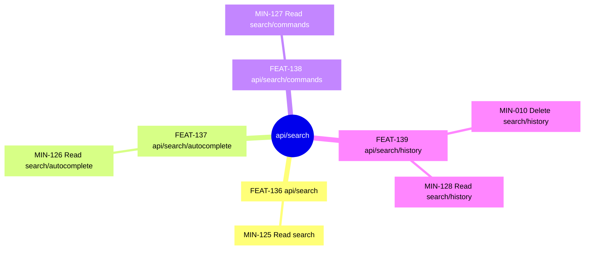

### FEAT-136 api/search

api/search

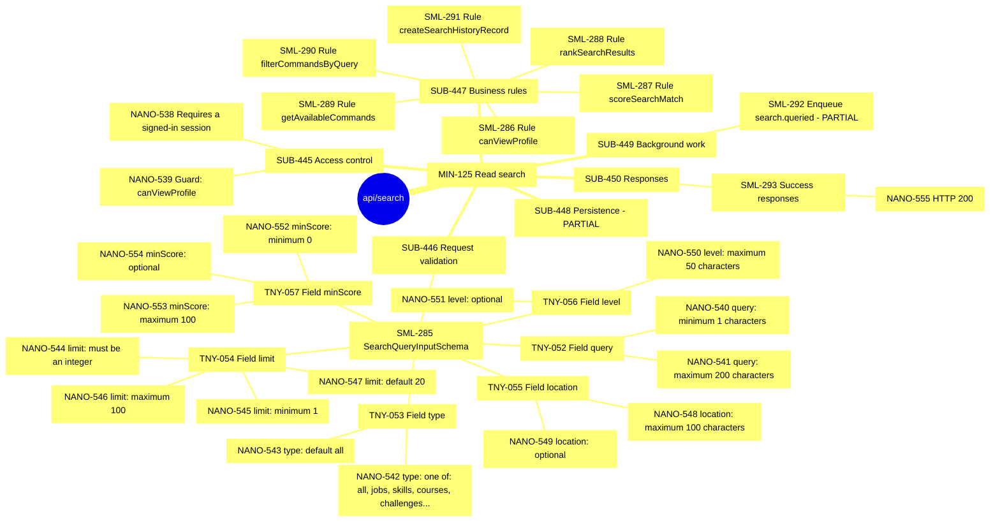

| ID       | Level | Parent   | Name                                                                                          | Description                                                                                                                                                                                                                                                                                                  | Status                | Verification | Evidence                                   | Related                                                   |
| -------- | ----- | -------- | --------------------------------------------------------------------------------------------- | ------------------------------------------------------------------------------------------------------------------------------------------------------------------------------------------------------------------------------------------------------------------------------------------------------------ | --------------------- | ------------ | ------------------------------------------ | --------------------------------------------------------- |
| FEAT-136 | MAJOR | MOD-092  | api/search                                                                                    |                                                                                                                                                                                                                                                                                                              | IMPLEMENTED           |              | apps/api/src/server.ts:11501               |                                                           |
| MIN-125  | MINOR | FEAT-136 | Read search                                                                                   | 1. Unified Multi-Entity Search GET /api/v1/search for any signed-in session; validates SearchQueryInputSchema; calls canViewProfile, scoreSearchMatch, rankSearchResults, getAvailableCommands ...; ephemeral (process memory); responds 200. Gaps: ephemeral: state held in process memory, lost on restart | IMPLEMENTED           | VERIFIED     | apps/api/src/server.ts:11501               | API-237, TEST-107, TEST-129, TEST-145, TEST-183, TEST-218 |
| SUB-445  | SUB   | MIN-125  | Access control                                                                                | Who may call GET /api/v1/search: any signed-in session.                                                                                                                                                                                                                                                      | IMPLEMENTED           | PATH_LEVEL   | apps/api/src/server.ts:11501               |                                                           |
| NANO-538 | NANO  | SUB-445  | Requires a signed-in session                                                                  | Requests without a valid session token are rejected with 401 UNAUTHENTICATED.                                                                                                                                                                                                                                | IMPLEMENTED           | PATH_LEVEL   | apps/api/src/server.ts:11501               | ROLE-001                                                  |
| NANO-539 | NANO  | SUB-445  | Guard: canViewProfile                                                                         | Guard canViewProfile must pass before the handler runs.                                                                                                                                                                                                                                                      | IMPLEMENTED           | PATH_LEVEL   | apps/api/src/server.ts:11501               |                                                           |
| SUB-446  | SUB   | MIN-125  | Request validation                                                                            | The request is parsed with SearchQueryInputSchema; a failure returns 400 with field details before any business logic runs.                                                                                                                                                                                  | IMPLEMENTED           | PATH_LEVEL   | apps/api/src/server.ts:11501               |                                                           |
| SML-285  | SMALL | SUB-446  | SearchQueryInputSchema                                                                        | SearchQueryInputSchema: 6 field(s)                                                                                                                                                                                                                                                                           | IMPLEMENTED           | PATH_LEVEL   | packages/contracts/src/index.ts:776        | SCH-060                                                   |
| TNY-052  | TINY  | SML-285  | Field query                                                                                   | query (string, required): minimum 1 characters; maximum 200 characters                                                                                                                                                                                                                                       | IMPLEMENTED           | PATH_LEVEL   | packages/contracts/src/index.ts:777        |                                                           |
| NANO-540 | NANO  | TNY-052  | query: minimum 1 characters                                                                   | query minimum 1 characters.                                                                                                                                                                                                                                                                                  | IMPLEMENTED           | PATH_LEVEL   | packages/contracts/src/index.ts:777        |                                                           |
| NANO-541 | NANO  | TNY-052  | query: maximum 200 characters                                                                 | query maximum 200 characters.                                                                                                                                                                                                                                                                                | IMPLEMENTED           | PATH_LEVEL   | packages/contracts/src/index.ts:777        |                                                           |
| TNY-053  | TINY  | SML-285  | Field type                                                                                    | type (enum, optional): one of: all, jobs, skills, courses, challenges, profiles, commands, companies, projects; default 'all'                                                                                                                                                                                | IMPLEMENTED           | PATH_LEVEL   | packages/contracts/src/index.ts:778        |                                                           |
| NANO-542 | NANO  | TNY-053  | type: one of: all, jobs, skills, courses, challenges, profiles, commands, companies, projects | type one of: all, jobs, skills, courses, challenges, profiles, commands, companies, projects.                                                                                                                                                                                                                | IMPLEMENTED           | PATH_LEVEL   | packages/contracts/src/index.ts:778        |                                                           |
| NANO-543 | NANO  | TNY-053  | type: default 'all'                                                                           | type default 'all'; message "all".                                                                                                                                                                                                                                                                           | IMPLEMENTED           | PATH_LEVEL   | packages/contracts/src/index.ts:778        |                                                           |
| TNY-054  | TINY  | SML-285  | Field limit                                                                                   | limit (number, optional): must be an integer; minimum 1; maximum 100; default 20                                                                                                                                                                                                                             | IMPLEMENTED           | PATH_LEVEL   | packages/contracts/src/index.ts:791        |                                                           |
| NANO-544 | NANO  | TNY-054  | limit: must be an integer                                                                     | limit must be an integer.                                                                                                                                                                                                                                                                                    | IMPLEMENTED           | PATH_LEVEL   | packages/contracts/src/index.ts:791        |                                                           |
| NANO-545 | NANO  | TNY-054  | limit: minimum 1                                                                              | limit minimum 1.                                                                                                                                                                                                                                                                                             | IMPLEMENTED           | PATH_LEVEL   | packages/contracts/src/index.ts:791        |                                                           |
| NANO-546 | NANO  | TNY-054  | limit: maximum 100                                                                            | limit maximum 100.                                                                                                                                                                                                                                                                                           | IMPLEMENTED           | PATH_LEVEL   | packages/contracts/src/index.ts:791        |                                                           |
| NANO-547 | NANO  | TNY-054  | limit: default 20                                                                             | limit default 20.                                                                                                                                                                                                                                                                                            | IMPLEMENTED           | PATH_LEVEL   | packages/contracts/src/index.ts:791        |                                                           |
| TNY-055  | TINY  | SML-285  | Field location                                                                                | location (string, optional): maximum 100 characters; optional                                                                                                                                                                                                                                                | IMPLEMENTED           | PATH_LEVEL   | packages/contracts/src/index.ts:792        |                                                           |
| NANO-548 | NANO  | TNY-055  | location: maximum 100 characters                                                              | location maximum 100 characters.                                                                                                                                                                                                                                                                             | IMPLEMENTED           | PATH_LEVEL   | packages/contracts/src/index.ts:792        |                                                           |
| NANO-549 | NANO  | TNY-055  | location: optional                                                                            | location optional.                                                                                                                                                                                                                                                                                           | IMPLEMENTED           | PATH_LEVEL   | packages/contracts/src/index.ts:792        |                                                           |
| TNY-056  | TINY  | SML-285  | Field level                                                                                   | level (string, optional): maximum 50 characters; optional                                                                                                                                                                                                                                                    | IMPLEMENTED           | PATH_LEVEL   | packages/contracts/src/index.ts:793        |                                                           |
| NANO-550 | NANO  | TNY-056  | level: maximum 50 characters                                                                  | level maximum 50 characters.                                                                                                                                                                                                                                                                                 | IMPLEMENTED           | PATH_LEVEL   | packages/contracts/src/index.ts:793        |                                                           |
| NANO-551 | NANO  | TNY-056  | level: optional                                                                               | level optional.                                                                                                                                                                                                                                                                                              | IMPLEMENTED           | PATH_LEVEL   | packages/contracts/src/index.ts:793        |                                                           |
| TNY-057  | TINY  | SML-285  | Field minScore                                                                                | minScore (number, optional): minimum 0; maximum 100; optional                                                                                                                                                                                                                                                | IMPLEMENTED           | PATH_LEVEL   | packages/contracts/src/index.ts:794        |                                                           |
| NANO-552 | NANO  | TNY-057  | minScore: minimum 0                                                                           | minScore minimum 0.                                                                                                                                                                                                                                                                                          | IMPLEMENTED           | PATH_LEVEL   | packages/contracts/src/index.ts:794        |                                                           |
| NANO-553 | NANO  | TNY-057  | minScore: maximum 100                                                                         | minScore maximum 100.                                                                                                                                                                                                                                                                                        | IMPLEMENTED           | PATH_LEVEL   | packages/contracts/src/index.ts:794        |                                                           |
| NANO-554 | NANO  | TNY-057  | minScore: optional                                                                            | minScore optional.                                                                                                                                                                                                                                                                                           | IMPLEMENTED           | PATH_LEVEL   | packages/contracts/src/index.ts:794        |                                                           |
| SUB-447  | SUB   | MIN-125  | Business rules                                                                                | Domain functions from packages/domain called by the handler (6).                                                                                                                                                                                                                                             | IMPLEMENTED           | PATH_LEVEL   | apps/api/src/server.ts:11501               |                                                           |
| SML-286  | SMALL | SUB-447  | Rule canViewProfile                                                                           | Calls canViewProfile (packages/domain/src/profile.ts). Rule status IMPLEMENTED; its own tests: VERIFIED.                                                                                                                                                                                                     | IMPLEMENTED           | VERIFIED     | packages/domain/src/profile.ts:36          | RULE-178                                                  |
| SML-287  | SMALL | SUB-447  | Rule scoreSearchMatch                                                                         | Calls scoreSearchMatch (packages/domain/src/search.ts). Rule status IMPLEMENTED; its own tests: VERIFIED.                                                                                                                                                                                                    | IMPLEMENTED           | VERIFIED     | packages/domain/src/search.ts:193          | RULE-206                                                  |
| SML-288  | SMALL | SUB-447  | Rule rankSearchResults                                                                        | Calls rankSearchResults (packages/domain/src/search.ts). Rule status IMPLEMENTED; its own tests: VERIFIED.                                                                                                                                                                                                   | IMPLEMENTED           | VERIFIED     | packages/domain/src/search.ts:260          | RULE-208                                                  |
| SML-289  | SMALL | SUB-447  | Rule getAvailableCommands                                                                     | Calls getAvailableCommands (packages/domain/src/search.ts). Rule status IMPLEMENTED; its own tests: VERIFIED.                                                                                                                                                                                                | IMPLEMENTED           | VERIFIED     | packages/domain/src/search.ts:272          | RULE-209                                                  |
| SML-290  | SMALL | SUB-447  | Rule filterCommandsByQuery                                                                    | Calls filterCommandsByQuery (packages/domain/src/search.ts). Rule status IMPLEMENTED; its own tests: VERIFIED.                                                                                                                                                                                               | IMPLEMENTED           | VERIFIED     | packages/domain/src/search.ts:284          | RULE-210                                                  |
| SML-291  | SMALL | SUB-447  | Rule createSearchHistoryRecord                                                                | Calls createSearchHistoryRecord (packages/domain/src/search.ts). Rule status IMPLEMENTED; its own tests: VERIFIED.                                                                                                                                                                                           | IMPLEMENTED           | VERIFIED     | packages/domain/src/search.ts:299          | RULE-211                                                  |
| SUB-448  | SUB   | MIN-125  | Persistence                                                                                   | Ephemeral: state lives in API process memory and is lost on restart.                                                                                                                                                                                                                                         | PARTIALLY_IMPLEMENTED | PATH_LEVEL   | apps/api/src/server.ts:11501               |                                                           |
| SUB-449  | SUB   | MIN-125  | Background work                                                                               | Enqueues 1 background job kind(s) in background_jobs for apps/worker.                                                                                                                                                                                                                                        | IMPLEMENTED           | PATH_LEVEL   | apps/api/src/server.ts:11501               |                                                           |
| SML-292  | SMALL | SUB-449  | Enqueue search.queried                                                                        | Dispatches job:search.queried; worker handler: recordEvent (no-op: marks the event recorded).                                                                                                                                                                                                                | PARTIALLY_IMPLEMENTED | UNKNOWN      | packages/domain/src/background-jobs.ts:171 | SVC-040                                                   |
| SUB-450  | SUB   | MIN-125  | Responses                                                                                     | Success 200; 0 explicit failure branch(es) besides validation and access errors.                                                                                                                                                                                                                             | IMPLEMENTED           | PATH_LEVEL   | apps/api/src/server.ts:11501               |                                                           |
| SML-293  | SMALL | SUB-450  | Success responses                                                                             | HTTP 200.                                                                                                                                                                                                                                                                                                    | IMPLEMENTED           | PATH_LEVEL   | apps/api/src/server.ts:11501               |                                                           |
| NANO-555 | NANO  | SML-293  | HTTP 200                                                                                      | Replies 200 when the operation succeeds.                                                                                                                                                                                                                                                                     | IMPLEMENTED           | PATH_LEVEL   | apps/api/src/server.ts:11501               |                                                           |

### FEAT-137 api/search/autocomplete

api/search/autocomplete

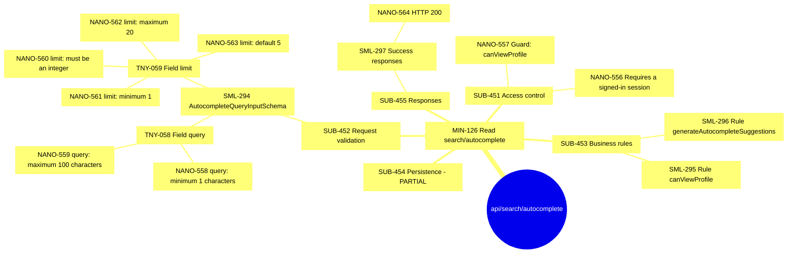

| ID       | Level | Parent   | Name                                 | Description                                                                                                                                                                                                                                                                                                                                 | Status                | Verification | Evidence                            | Related                               |
| -------- | ----- | -------- | ------------------------------------ | ------------------------------------------------------------------------------------------------------------------------------------------------------------------------------------------------------------------------------------------------------------------------------------------------------------------------------------------- | --------------------- | ------------ | ----------------------------------- | ------------------------------------- |
| FEAT-137 | MAJOR | MOD-092  | api/search/autocomplete              |                                                                                                                                                                                                                                                                                                                                             | IMPLEMENTED           |              | apps/api/src/server.ts:11753        |                                       |
| MIN-126  | MINOR | FEAT-137 | Read search/autocomplete             | 1b. Search Autocomplete (F-147, BR-265) GET /api/v1/search/autocomplete for any signed-in session; validates AutocompleteQueryInputSchema; calls canViewProfile, generateAutocompleteSuggestions; ephemeral (process memory); responds 200. Gaps: ephemeral: state held in process memory, lost on restart; no first-party web caller found | IMPLEMENTED           | VERIFIED     | apps/api/src/server.ts:11753        | API-238, TEST-129, TEST-145, TEST-218 |
| SUB-451  | SUB   | MIN-126  | Access control                       | Who may call GET /api/v1/search/autocomplete: any signed-in session.                                                                                                                                                                                                                                                                        | IMPLEMENTED           | PATH_LEVEL   | apps/api/src/server.ts:11753        |                                       |
| NANO-556 | NANO  | SUB-451  | Requires a signed-in session         | Requests without a valid session token are rejected with 401 UNAUTHENTICATED.                                                                                                                                                                                                                                                               | IMPLEMENTED           | PATH_LEVEL   | apps/api/src/server.ts:11753        | ROLE-001                              |
| NANO-557 | NANO  | SUB-451  | Guard: canViewProfile                | Guard canViewProfile must pass before the handler runs.                                                                                                                                                                                                                                                                                     | IMPLEMENTED           | PATH_LEVEL   | apps/api/src/server.ts:11753        |                                       |
| SUB-452  | SUB   | MIN-126  | Request validation                   | The request is parsed with AutocompleteQueryInputSchema; a failure returns 400 with field details before any business logic runs.                                                                                                                                                                                                           | IMPLEMENTED           | PATH_LEVEL   | apps/api/src/server.ts:11753        |                                       |
| SML-294  | SMALL | SUB-452  | AutocompleteQueryInputSchema         | AutocompleteQueryInputSchema: 2 field(s)                                                                                                                                                                                                                                                                                                    | IMPLEMENTED           | PATH_LEVEL   | packages/contracts/src/index.ts:799 | SCH-061                               |
| TNY-058  | TINY  | SML-294  | Field query                          | query (string, required): minimum 1 characters; maximum 100 characters                                                                                                                                                                                                                                                                      | IMPLEMENTED           | PATH_LEVEL   | packages/contracts/src/index.ts:800 |                                       |
| NANO-558 | NANO  | TNY-058  | query: minimum 1 characters          | query minimum 1 characters.                                                                                                                                                                                                                                                                                                                 | IMPLEMENTED           | PATH_LEVEL   | packages/contracts/src/index.ts:800 |                                       |
| NANO-559 | NANO  | TNY-058  | query: maximum 100 characters        | query maximum 100 characters.                                                                                                                                                                                                                                                                                                               | IMPLEMENTED           | PATH_LEVEL   | packages/contracts/src/index.ts:800 |                                       |
| TNY-059  | TINY  | SML-294  | Field limit                          | limit (number, optional): must be an integer; minimum 1; maximum 20; default 5                                                                                                                                                                                                                                                              | IMPLEMENTED           | PATH_LEVEL   | packages/contracts/src/index.ts:801 |                                       |
| NANO-560 | NANO  | TNY-059  | limit: must be an integer            | limit must be an integer.                                                                                                                                                                                                                                                                                                                   | IMPLEMENTED           | PATH_LEVEL   | packages/contracts/src/index.ts:801 |                                       |
| NANO-561 | NANO  | TNY-059  | limit: minimum 1                     | limit minimum 1.                                                                                                                                                                                                                                                                                                                            | IMPLEMENTED           | PATH_LEVEL   | packages/contracts/src/index.ts:801 |                                       |
| NANO-562 | NANO  | TNY-059  | limit: maximum 20                    | limit maximum 20.                                                                                                                                                                                                                                                                                                                           | IMPLEMENTED           | PATH_LEVEL   | packages/contracts/src/index.ts:801 |                                       |
| NANO-563 | NANO  | TNY-059  | limit: default 5                     | limit default 5.                                                                                                                                                                                                                                                                                                                            | IMPLEMENTED           | PATH_LEVEL   | packages/contracts/src/index.ts:801 |                                       |
| SUB-453  | SUB   | MIN-126  | Business rules                       | Domain functions from packages/domain called by the handler (2).                                                                                                                                                                                                                                                                            | IMPLEMENTED           | PATH_LEVEL   | apps/api/src/server.ts:11753        |                                       |
| SML-295  | SMALL | SUB-453  | Rule canViewProfile                  | Calls canViewProfile (packages/domain/src/profile.ts). Rule status IMPLEMENTED; its own tests: VERIFIED.                                                                                                                                                                                                                                    | IMPLEMENTED           | VERIFIED     | packages/domain/src/profile.ts:36   | RULE-178                              |
| SML-296  | SMALL | SUB-453  | Rule generateAutocompleteSuggestions | Calls generateAutocompleteSuggestions (packages/domain/src/search.ts). Rule status IMPLEMENTED; its own tests: VERIFIED.                                                                                                                                                                                                                    | IMPLEMENTED           | VERIFIED     | packages/domain/src/search.ts:229   | RULE-207                              |
| SUB-454  | SUB   | MIN-126  | Persistence                          | Ephemeral: state lives in API process memory and is lost on restart.                                                                                                                                                                                                                                                                        | PARTIALLY_IMPLEMENTED | PATH_LEVEL   | apps/api/src/server.ts:11753        |                                       |
| SUB-455  | SUB   | MIN-126  | Responses                            | Success 200; 0 explicit failure branch(es) besides validation and access errors.                                                                                                                                                                                                                                                            | IMPLEMENTED           | PATH_LEVEL   | apps/api/src/server.ts:11753        |                                       |
| SML-297  | SMALL | SUB-455  | Success responses                    | HTTP 200.                                                                                                                                                                                                                                                                                                                                   | IMPLEMENTED           | PATH_LEVEL   | apps/api/src/server.ts:11753        |                                       |
| NANO-564 | NANO  | SML-297  | HTTP 200                             | Replies 200 when the operation succeeds.                                                                                                                                                                                                                                                                                                    | IMPLEMENTED           | PATH_LEVEL   | apps/api/src/server.ts:11753        |                                       |

### FEAT-138 api/search/commands

api/search/commands

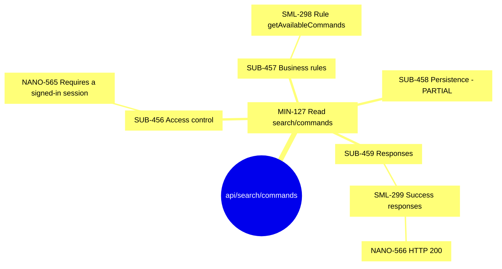

| ID       | Level | Parent   | Name                         | Description                                                                                                                                                                                                                                                                 | Status                | Verification | Evidence                          | Related                               |
| -------- | ----- | -------- | ---------------------------- | --------------------------------------------------------------------------------------------------------------------------------------------------------------------------------------------------------------------------------------------------------------------------- | --------------------- | ------------ | --------------------------------- | ------------------------------------- |
| FEAT-138 | MAJOR | MOD-092  | api/search/commands          |                                                                                                                                                                                                                                                                             | IMPLEMENTED           |              | apps/api/src/server.ts:11835      |                                       |
| MIN-127  | MINOR | FEAT-138 | Read search/commands         | 2. Get Available Commands (Command Palette ⌘K) GET /api/v1/search/commands for any signed-in session; calls getAvailableCommands; ephemeral (process memory); responds 200. Gaps: ephemeral: state held in process memory, lost on restart; no first-party web caller found | IMPLEMENTED           | VERIFIED     | apps/api/src/server.ts:11835      | API-239, TEST-129, TEST-145, TEST-183 |
| SUB-456  | SUB   | MIN-127  | Access control               | Who may call GET /api/v1/search/commands: any signed-in session.                                                                                                                                                                                                            | IMPLEMENTED           | PATH_LEVEL   | apps/api/src/server.ts:11835      |                                       |
| NANO-565 | NANO  | SUB-456  | Requires a signed-in session | Requests without a valid session token are rejected with 401 UNAUTHENTICATED.                                                                                                                                                                                               | IMPLEMENTED           | PATH_LEVEL   | apps/api/src/server.ts:11835      | ROLE-001                              |
| SUB-457  | SUB   | MIN-127  | Business rules               | Domain functions from packages/domain called by the handler (1).                                                                                                                                                                                                            | IMPLEMENTED           | PATH_LEVEL   | apps/api/src/server.ts:11835      |                                       |
| SML-298  | SMALL | SUB-457  | Rule getAvailableCommands    | Calls getAvailableCommands (packages/domain/src/search.ts). Rule status IMPLEMENTED; its own tests: VERIFIED.                                                                                                                                                               | IMPLEMENTED           | VERIFIED     | packages/domain/src/search.ts:272 | RULE-209                              |
| SUB-458  | SUB   | MIN-127  | Persistence                  | Ephemeral: state lives in API process memory and is lost on restart.                                                                                                                                                                                                        | PARTIALLY_IMPLEMENTED | PATH_LEVEL   | apps/api/src/server.ts:11835      |                                       |
| SUB-459  | SUB   | MIN-127  | Responses                    | Success 200; 0 explicit failure branch(es) besides validation and access errors.                                                                                                                                                                                            | IMPLEMENTED           | PATH_LEVEL   | apps/api/src/server.ts:11835      |                                       |
| SML-299  | SMALL | SUB-459  | Success responses            | HTTP 200.                                                                                                                                                                                                                                                                   | IMPLEMENTED           | PATH_LEVEL   | apps/api/src/server.ts:11835      |                                       |
| NANO-566 | NANO  | SML-299  | HTTP 200                     | Replies 200 when the operation succeeds.                                                                                                                                                                                                                                    | IMPLEMENTED           | PATH_LEVEL   | apps/api/src/server.ts:11835      |                                       |

### FEAT-139 api/search/history

api/search/history

```mermaid
mindmap
  root((api/search/history))
    MIN_010[MIN-010 Delete search/history]
      SUB_033[SUB-033 Access control]
        NANO_035[NANO-035 Requires a signed-in session]
      SUB_034[SUB-034 Request validation]
        SML_025[SML-025 ClearSearchHistoryInputSchema]
          TNY_001[TNY-001 Field olderThanDays]
            NANO_036[NANO-036 olderThanDays: must be an integer]
            NANO_037[NANO-037 olderThanDays: minimum 0]
            NANO_038[NANO-038 olderThanDays: optional]
      SUB_035[SUB-035 Persistence - PARTIAL]
      SUB_036[SUB-036 Responses]
        SML_026[SML-026 Success responses]
          NANO_039[NANO-039 HTTP 200]
    MIN_128[MIN-128 Read search/history]
      SUB_460[SUB-460 Access control]
        NANO_567[NANO-567 Requires a signed-in session]
      SUB_461[SUB-461 Persistence - PARTIAL]
      SUB_462[SUB-462 Responses]
        SML_300[SML-300 Success responses]
          NANO_568[NANO-568 HTTP 200]
```

| ID       | Level | Parent   | Name                              | Description                                                                                                                                                                                                                                                              | Status                | Verification | Evidence                            | Related           |
| -------- | ----- | -------- | --------------------------------- | ------------------------------------------------------------------------------------------------------------------------------------------------------------------------------------------------------------------------------------------------------------------------ | --------------------- | ------------ | ----------------------------------- | ----------------- |
| FEAT-139 | MAJOR | MOD-092  | api/search/history                |                                                                                                                                                                                                                                                                          | IMPLEMENTED           |              | apps/api/src/server.ts:11845        |                   |
| MIN-010  | MINOR | FEAT-139 | Delete search/history             | 4. Clear User Search History DELETE /api/v1/search/history for any signed-in session; validates ClearSearchHistoryInputSchema; ephemeral (process memory); responds 200. Gaps: ephemeral: state held in process memory, lost on restart; no first-party web caller found | IMPLEMENTED           | VERIFIED     | apps/api/src/server.ts:11855        | API-241, TEST-129 |
| SUB-033  | SUB   | MIN-010  | Access control                    | Who may call DELETE /api/v1/search/history: any signed-in session.                                                                                                                                                                                                       | IMPLEMENTED           | PATH_LEVEL   | apps/api/src/server.ts:11855        |                   |
| NANO-035 | NANO  | SUB-033  | Requires a signed-in session      | Requests without a valid session token are rejected with 401 UNAUTHENTICATED.                                                                                                                                                                                            | IMPLEMENTED           | PATH_LEVEL   | apps/api/src/server.ts:11855        | ROLE-001          |
| SUB-034  | SUB   | MIN-010  | Request validation                | The request is parsed with ClearSearchHistoryInputSchema; a failure returns 400 with field details before any business logic runs.                                                                                                                                       | IMPLEMENTED           | PATH_LEVEL   | apps/api/src/server.ts:11855        |                   |
| SML-025  | SMALL | SUB-034  | ClearSearchHistoryInputSchema     | ClearSearchHistoryInputSchema: 1 field(s)                                                                                                                                                                                                                                | IMPLEMENTED           | PATH_LEVEL   | packages/contracts/src/index.ts:806 | SCH-062           |
| TNY-001  | TINY  | SML-025  | Field olderThanDays               | olderThanDays (number, optional): must be an integer; minimum 0; optional                                                                                                                                                                                                | IMPLEMENTED           | PATH_LEVEL   | packages/contracts/src/index.ts:807 |                   |
| NANO-036 | NANO  | TNY-001  | olderThanDays: must be an integer | olderThanDays must be an integer.                                                                                                                                                                                                                                        | IMPLEMENTED           | PATH_LEVEL   | packages/contracts/src/index.ts:807 |                   |
| NANO-037 | NANO  | TNY-001  | olderThanDays: minimum 0          | olderThanDays minimum 0.                                                                                                                                                                                                                                                 | IMPLEMENTED           | PATH_LEVEL   | packages/contracts/src/index.ts:807 |                   |
| NANO-038 | NANO  | TNY-001  | olderThanDays: optional           | olderThanDays optional.                                                                                                                                                                                                                                                  | IMPLEMENTED           | PATH_LEVEL   | packages/contracts/src/index.ts:807 |                   |
| SUB-035  | SUB   | MIN-010  | Persistence                       | Ephemeral: state lives in API process memory and is lost on restart.                                                                                                                                                                                                     | PARTIALLY_IMPLEMENTED | PATH_LEVEL   | apps/api/src/server.ts:11855        |                   |
| SUB-036  | SUB   | MIN-010  | Responses                         | Success 200; 0 explicit failure branch(es) besides validation and access errors.                                                                                                                                                                                         | IMPLEMENTED           | PATH_LEVEL   | apps/api/src/server.ts:11855        |                   |
| SML-026  | SMALL | SUB-036  | Success responses                 | HTTP 200.                                                                                                                                                                                                                                                                | IMPLEMENTED           | PATH_LEVEL   | apps/api/src/server.ts:11855        |                   |
| NANO-039 | NANO  | SML-026  | HTTP 200                          | Replies 200 when the operation succeeds.                                                                                                                                                                                                                                 | IMPLEMENTED           | PATH_LEVEL   | apps/api/src/server.ts:11855        |                   |
| MIN-128  | MINOR | FEAT-139 | Read search/history               | 3. Get User Search History GET /api/v1/search/history for any signed-in session; ephemeral (process memory); responds 200. Gaps: ephemeral: state held in process memory, lost on restart; no first-party web caller found                                               | IMPLEMENTED           | VERIFIED     | apps/api/src/server.ts:11845        | API-240, TEST-129 |
| SUB-460  | SUB   | MIN-128  | Access control                    | Who may call GET /api/v1/search/history: any signed-in session.                                                                                                                                                                                                          | IMPLEMENTED           | PATH_LEVEL   | apps/api/src/server.ts:11845        |                   |
| NANO-567 | NANO  | SUB-460  | Requires a signed-in session      | Requests without a valid session token are rejected with 401 UNAUTHENTICATED.                                                                                                                                                                                            | IMPLEMENTED           | PATH_LEVEL   | apps/api/src/server.ts:11845        | ROLE-001          |
| SUB-461  | SUB   | MIN-128  | Persistence                       | Ephemeral: state lives in API process memory and is lost on restart.                                                                                                                                                                                                     | PARTIALLY_IMPLEMENTED | PATH_LEVEL   | apps/api/src/server.ts:11845        |                   |
| SUB-462  | SUB   | MIN-128  | Responses                         | Success 200; 0 explicit failure branch(es) besides validation and access errors.                                                                                                                                                                                         | IMPLEMENTED           | PATH_LEVEL   | apps/api/src/server.ts:11845        |                   |
| SML-300  | SMALL | SUB-462  | Success responses                 | HTTP 200.                                                                                                                                                                                                                                                                | IMPLEMENTED           | PATH_LEVEL   | apps/api/src/server.ts:11845        |                   |
| NANO-568 | NANO  | SML-300  | HTTP 200                          | Replies 200 when the operation succeeds.                                                                                                                                                                                                                                 | IMPLEMENTED           | PATH_LEVEL   | apps/api/src/server.ts:11845        |                   |

## api/settings (MOD-089)

**Application:** apps/api (MOD-001). **Purpose:** API module: routes under /api/v1/settings in apps/api/src/server.ts.

**Nodes by level:** MODULE 1, MAJOR 3, MINOR 8, SUB 38, SMALL 39, TINY 21, NANO 60. **Status:** IMPLEMENTED 163, PARTIALLY_IMPLEMENTED 7. **Verification:** PATH_LEVEL 144, UNKNOWN 6, VERIFIED 16.

**User roles that reach it:** authenticated.

**Known gaps:** MIN-130 no first-party web caller found; MIN-266 no first-party web caller found; MIN-267 ephemeral: state held in process memory, lost on restart; MIN-268 no first-party web caller found; MIN-131 no first-party web caller found; MIN-269 ephemeral: state held in process memory, lost on restart.

**Called from (web screens and components):** FEAT-177 Screen /profile, FEAT-180 Screen /settings

### Module map (to minor features)

```mermaid
mindmap
  root((api/settings))
    FEAT_119[FEAT-119 api/settings]
      MIN_129[MIN-129 Read settings]
      MIN_157[MIN-157 Update settings]
    FEAT_121[FEAT-121 api/settings/erasure]
      MIN_130[MIN-130 Read settings/erasure/status]
      MIN_266[MIN-266 Submit settings/erasure/cancel]
      MIN_267[MIN-267 Submit settings/erasure/execute]
      MIN_268[MIN-268 Submit settings/erasure/request]
    FEAT_120[FEAT-120 api/settings/export]
      MIN_131[MIN-131 Read settings/export/latest]
      MIN_269[MIN-269 Submit settings/export]
```

### FEAT-119 api/settings

api/settings

```mermaid
mindmap
  root((api/settings))
    MIN_129[MIN-129 Read settings]
      SUB_463[SUB-463 Access control]
        NANO_569[NANO-569 Requires a signed-in session]
      SUB_464[SUB-464 Persistence]
      SUB_465[SUB-465 Responses]
        SML_301[SML-301 Success responses]
          NANO_570[NANO-570 HTTP 200]
    MIN_157[MIN-157 Update settings]
      SUB_580[SUB-580 Access control]
        NANO_726[NANO-726 Requires a signed-in session]
      SUB_581[SUB-581 Request validation]
        SML_394[SML-394 UpdateUserSettingsInputSchema]
          TNY_095[TNY-095 Field theme]
            NANO_727[NANO-727 theme: one of: light, dark, system]
            NANO_728[NANO-728 theme: optional]
          TNY_096[TNY-096 Field language]
            NANO_729[NANO-729 language: minimum 2 characters]
            NANO_730[NANO-730 language: maximum 10 characters]
            NANO_731[NANO-731 language: custom check]
            NANO_732[NANO-732 language: optional]
          TNY_097[TNY-097 Field timezone]
            NANO_733[NANO-733 timezone: minimum 1 characters]
            NANO_734[NANO-734 timezone: maximum 64 characters]
            NANO_735[NANO-735 timezone: custom check]
            NANO_736[NANO-736 timezone: optional]
          TNY_098[TNY-098 Field profileVisibility]
            NANO_737[NANO-737 profileVisibility: one of: public, connections_only,...]
            NANO_738[NANO-738 profileVisibility: optional]
          TNY_099[TNY-099 Field showEmail]
            NANO_739[NANO-739 showEmail: optional]
          TNY_100[TNY-100 Field showActivity]
            NANO_740[NANO-740 showActivity: optional]
          TNY_101[TNY-101 Field allowConnectionRequests]
            NANO_741[NANO-741 allowConnectionRequests: optional]
          TNY_102[TNY-102 Field allowDirectMessages]
            NANO_742[NANO-742 allowDirectMessages: one of: everyone, connections_o...]
            NANO_743[NANO-743 allowDirectMessages: optional]
          TNY_103[TNY-103 Field searchEngineIndexing]
            NANO_744[NANO-744 searchEngineIndexing: optional]
          TNY_104[TNY-104 Field emailNotifications]
            NANO_745[NANO-745 emailNotifications: optional]
          TNY_105[TNY-105 Field pushNotifications]
            NANO_746[NANO-746 pushNotifications: optional]
          TNY_106[TNY-106 Field marketingEmails]
            NANO_747[NANO-747 marketingEmails: optional]
          TNY_107[TNY-107 Field digestFrequency]
            NANO_748[NANO-748 digestFrequency: one of: realtime, daily, weekly, none]
            NANO_749[NANO-749 digestFrequency: optional]
          TNY_108[TNY-108 Field twoFactorEnabled]
            NANO_750[NANO-750 twoFactorEnabled: optional]
          TNY_109[TNY-109 Field byoAiKey]
            NANO_751[NANO-751 byoAiKey: maximum 256 characters]
            NANO_752[NANO-752 byoAiKey: may be null]
            NANO_753[NANO-753 byoAiKey: optional]
          TNY_110[TNY-110 Field aiDataUsageConsent]
            NANO_754[NANO-754 aiDataUsageConsent: optional]
      SUB_582[SUB-582 Business rules]
        SML_395[SML-395 Rule updateUserSettings]
      SUB_583[SUB-583 Persistence]
        SML_396[SML-396 Writes profiles]
      SUB_584[SUB-584 Background work]
        SML_397[SML-397 Enqueue user.settings.updated - PARTIAL]
      SUB_585[SUB-585 Responses]
        SML_398[SML-398 Success responses]
          NANO_755[NANO-755 HTTP 200]
        SML_399[SML-399 Failure branches]
          NANO_756[NANO-756 SERVICE_UNAVAILABLE 503: Saving a BYO AI key require...]
```

| ID       | Level | Parent   | Name                                                                                          | Description                                                                                                                                                                                                             | Status                | Verification | Evidence                                      | Related                                                       |
| -------- | ----- | -------- | --------------------------------------------------------------------------------------------- | ----------------------------------------------------------------------------------------------------------------------------------------------------------------------------------------------------------------------- | --------------------- | ------------ | --------------------------------------------- | ------------------------------------------------------------- |
| FEAT-119 | MAJOR | MOD-089  | api/settings                                                                                  |                                                                                                                                                                                                                         | IMPLEMENTED           |              | apps/api/src/server.ts:10152                  |                                                               |
| MIN-129  | MINOR | FEAT-119 | Read settings                                                                                 | 1. Get current user settings (creates defaults if not yet initialized) GET /api/v1/settings for any signed-in session; durable (PostgreSQL); responds 200.                                                              | IMPLEMENTED           | VERIFIED     | apps/api/src/server.ts:10152                  | API-212, TEST-082, TEST-096, TEST-130, TEST-143, TEST-150 ... |
| SUB-463  | SUB   | MIN-129  | Access control                                                                                | Who may call GET /api/v1/settings: any signed-in session.                                                                                                                                                               | IMPLEMENTED           | PATH_LEVEL   | apps/api/src/server.ts:10152                  |                                                               |
| NANO-569 | NANO  | SUB-463  | Requires a signed-in session                                                                  | Requests without a valid session token are rejected with 401 UNAUTHENTICATED.                                                                                                                                           | IMPLEMENTED           | PATH_LEVEL   | apps/api/src/server.ts:10152                  | ROLE-001                                                      |
| SUB-464  | SUB   | MIN-129  | Persistence                                                                                   | Durable: writes go through the PostgreSQL store.                                                                                                                                                                        | IMPLEMENTED           | PATH_LEVEL   | apps/api/src/server.ts:10152                  |                                                               |
| SUB-465  | SUB   | MIN-129  | Responses                                                                                     | Success 200; 0 explicit failure branch(es) besides validation and access errors.                                                                                                                                        | IMPLEMENTED           | PATH_LEVEL   | apps/api/src/server.ts:10152                  |                                                               |
| SML-301  | SMALL | SUB-465  | Success responses                                                                             | HTTP 200.                                                                                                                                                                                                               | IMPLEMENTED           | PATH_LEVEL   | apps/api/src/server.ts:10152                  |                                                               |
| NANO-570 | NANO  | SML-301  | HTTP 200                                                                                      | Replies 200 when the operation succeeds.                                                                                                                                                                                | IMPLEMENTED           | PATH_LEVEL   | apps/api/src/server.ts:10152                  |                                                               |
| MIN-157  | MINOR | FEAT-119 | Update settings                                                                               | 2. Update user settings PATCH /api/v1/settings for any signed-in session; validates UpdateUserSettingsInputSchema; calls updateUserSettings; durable (PostgreSQL); writes profiles; responds 200; 1 failure branch(es). | IMPLEMENTED           | VERIFIED     | apps/api/src/server.ts:10162                  | API-213, TEST-082, TEST-086, TEST-096, TEST-130, TEST-148 ... |
| SUB-580  | SUB   | MIN-157  | Access control                                                                                | Who may call PATCH /api/v1/settings: any signed-in session.                                                                                                                                                             | IMPLEMENTED           | PATH_LEVEL   | apps/api/src/server.ts:10162                  |                                                               |
| NANO-726 | NANO  | SUB-580  | Requires a signed-in session                                                                  | Requests without a valid session token are rejected with 401 UNAUTHENTICATED.                                                                                                                                           | IMPLEMENTED           | PATH_LEVEL   | apps/api/src/server.ts:10162                  | ROLE-001                                                      |
| SUB-581  | SUB   | MIN-157  | Request validation                                                                            | The request is parsed with UpdateUserSettingsInputSchema; a failure returns 400 with field details before any business logic runs.                                                                                      | IMPLEMENTED           | PATH_LEVEL   | apps/api/src/server.ts:10162                  |                                                               |
| SML-394  | SMALL | SUB-581  | UpdateUserSettingsInputSchema                                                                 | UpdateUserSettingsInputSchema: 16 field(s)                                                                                                                                                                              | IMPLEMENTED           | PATH_LEVEL   | packages/contracts/src/index.ts:606           | SCH-046                                                       |
| TNY-095  | TINY  | SML-394  | Field theme                                                                                   | theme (enum, optional): one of: light, dark, system; optional                                                                                                                                                           | IMPLEMENTED           | PATH_LEVEL   | packages/contracts/src/index.ts:607           |                                                               |
| NANO-727 | NANO  | TNY-095  | theme: one of: light, dark, system                                                            | theme one of: light, dark, system.                                                                                                                                                                                      | IMPLEMENTED           | PATH_LEVEL   | packages/contracts/src/index.ts:607           |                                                               |
| NANO-728 | NANO  | TNY-095  | theme: optional                                                                               | theme optional.                                                                                                                                                                                                         | IMPLEMENTED           | PATH_LEVEL   | packages/contracts/src/index.ts:607           |                                                               |
| TNY-096  | TINY  | SML-394  | Field language                                                                                | language (string, optional): minimum 2 characters; maximum 10 characters; custom check; optional                                                                                                                        | IMPLEMENTED           | PATH_LEVEL   | packages/contracts/src/index.ts:608           |                                                               |
| NANO-729 | NANO  | TNY-096  | language: minimum 2 characters                                                                | language minimum 2 characters.                                                                                                                                                                                          | IMPLEMENTED           | PATH_LEVEL   | packages/contracts/src/index.ts:608           |                                                               |
| NANO-730 | NANO  | TNY-096  | language: maximum 10 characters                                                               | language maximum 10 characters.                                                                                                                                                                                         | IMPLEMENTED           | PATH_LEVEL   | packages/contracts/src/index.ts:608           |                                                               |
| NANO-731 | NANO  | TNY-096  | language: custom check                                                                        | language custom check; message "Use a language tag such as en or en-GB.".                                                                                                                                               | IMPLEMENTED           | PATH_LEVEL   | packages/contracts/src/index.ts:608           |                                                               |
| NANO-732 | NANO  | TNY-096  | language: optional                                                                            | language optional.                                                                                                                                                                                                      | IMPLEMENTED           | PATH_LEVEL   | packages/contracts/src/index.ts:608           |                                                               |
| TNY-097  | TINY  | SML-394  | Field timezone                                                                                | timezone (string, optional): minimum 1 characters; maximum 64 characters; custom check; optional                                                                                                                        | IMPLEMENTED           | PATH_LEVEL   | packages/contracts/src/index.ts:614           |                                                               |
| NANO-733 | NANO  | TNY-097  | timezone: minimum 1 characters                                                                | timezone minimum 1 characters.                                                                                                                                                                                          | IMPLEMENTED           | PATH_LEVEL   | packages/contracts/src/index.ts:614           |                                                               |
| NANO-734 | NANO  | TNY-097  | timezone: maximum 64 characters                                                               | timezone maximum 64 characters.                                                                                                                                                                                         | IMPLEMENTED           | PATH_LEVEL   | packages/contracts/src/index.ts:614           |                                                               |
| NANO-735 | NANO  | TNY-097  | timezone: custom check                                                                        | timezone custom check; message "Use a time zone such as UTC or Europe/London.".                                                                                                                                         | IMPLEMENTED           | PATH_LEVEL   | packages/contracts/src/index.ts:614           |                                                               |
| NANO-736 | NANO  | TNY-097  | timezone: optional                                                                            | timezone optional.                                                                                                                                                                                                      | IMPLEMENTED           | PATH_LEVEL   | packages/contracts/src/index.ts:614           |                                                               |
| TNY-098  | TINY  | SML-394  | Field profileVisibility                                                                       | profileVisibility (enum, optional): one of: public, connections_only, recruiters_only, private; optional                                                                                                                | IMPLEMENTED           | PATH_LEVEL   | packages/contracts/src/index.ts:620           |                                                               |
| NANO-737 | NANO  | TNY-098  | profileVisibility: one of: public, connections_only, recruiters_only, private                 | profileVisibility one of: public, connections_only, recruiters_only, private.                                                                                                                                           | IMPLEMENTED           | PATH_LEVEL   | packages/contracts/src/index.ts:620           |                                                               |
| NANO-738 | NANO  | TNY-098  | profileVisibility: optional                                                                   | profileVisibility optional.                                                                                                                                                                                             | IMPLEMENTED           | PATH_LEVEL   | packages/contracts/src/index.ts:620           |                                                               |
| TNY-099  | TINY  | SML-394  | Field showEmail                                                                               | showEmail (boolean, optional): optional                                                                                                                                                                                 | IMPLEMENTED           | PATH_LEVEL   | packages/contracts/src/index.ts:623           |                                                               |
| NANO-739 | NANO  | TNY-099  | showEmail: optional                                                                           | showEmail optional.                                                                                                                                                                                                     | IMPLEMENTED           | PATH_LEVEL   | packages/contracts/src/index.ts:623           |                                                               |
| TNY-100  | TINY  | SML-394  | Field showActivity                                                                            | showActivity (boolean, optional): optional                                                                                                                                                                              | IMPLEMENTED           | PATH_LEVEL   | packages/contracts/src/index.ts:624           |                                                               |
| NANO-740 | NANO  | TNY-100  | showActivity: optional                                                                        | showActivity optional.                                                                                                                                                                                                  | IMPLEMENTED           | PATH_LEVEL   | packages/contracts/src/index.ts:624           |                                                               |
| TNY-101  | TINY  | SML-394  | Field allowConnectionRequests                                                                 | allowConnectionRequests (boolean, optional): optional                                                                                                                                                                   | IMPLEMENTED           | PATH_LEVEL   | packages/contracts/src/index.ts:625           |                                                               |
| NANO-741 | NANO  | TNY-101  | allowConnectionRequests: optional                                                             | allowConnectionRequests optional.                                                                                                                                                                                       | IMPLEMENTED           | PATH_LEVEL   | packages/contracts/src/index.ts:625           |                                                               |
| TNY-102  | TINY  | SML-394  | Field allowDirectMessages                                                                     | allowDirectMessages (enum, optional): one of: everyone, connections_only, none; optional                                                                                                                                | IMPLEMENTED           | PATH_LEVEL   | packages/contracts/src/index.ts:626           |                                                               |
| NANO-742 | NANO  | TNY-102  | allowDirectMessages: one of: everyone, connections_only, none                                 | allowDirectMessages one of: everyone, connections_only, none.                                                                                                                                                           | IMPLEMENTED           | PATH_LEVEL   | packages/contracts/src/index.ts:626           |                                                               |
| NANO-743 | NANO  | TNY-102  | allowDirectMessages: optional                                                                 | allowDirectMessages optional.                                                                                                                                                                                           | IMPLEMENTED           | PATH_LEVEL   | packages/contracts/src/index.ts:626           |                                                               |
| TNY-103  | TINY  | SML-394  | Field searchEngineIndexing                                                                    | searchEngineIndexing (boolean, optional): optional                                                                                                                                                                      | IMPLEMENTED           | PATH_LEVEL   | packages/contracts/src/index.ts:627           |                                                               |
| NANO-744 | NANO  | TNY-103  | searchEngineIndexing: optional                                                                | searchEngineIndexing optional.                                                                                                                                                                                          | IMPLEMENTED           | PATH_LEVEL   | packages/contracts/src/index.ts:627           |                                                               |
| TNY-104  | TINY  | SML-394  | Field emailNotifications                                                                      | emailNotifications (boolean, optional): optional                                                                                                                                                                        | IMPLEMENTED           | PATH_LEVEL   | packages/contracts/src/index.ts:628           |                                                               |
| NANO-745 | NANO  | TNY-104  | emailNotifications: optional                                                                  | emailNotifications optional.                                                                                                                                                                                            | IMPLEMENTED           | PATH_LEVEL   | packages/contracts/src/index.ts:628           |                                                               |
| TNY-105  | TINY  | SML-394  | Field pushNotifications                                                                       | pushNotifications (boolean, optional): optional                                                                                                                                                                         | IMPLEMENTED           | PATH_LEVEL   | packages/contracts/src/index.ts:629           |                                                               |
| NANO-746 | NANO  | TNY-105  | pushNotifications: optional                                                                   | pushNotifications optional.                                                                                                                                                                                             | IMPLEMENTED           | PATH_LEVEL   | packages/contracts/src/index.ts:629           |                                                               |
| TNY-106  | TINY  | SML-394  | Field marketingEmails                                                                         | marketingEmails (boolean, optional): optional                                                                                                                                                                           | IMPLEMENTED           | PATH_LEVEL   | packages/contracts/src/index.ts:630           |                                                               |
| NANO-747 | NANO  | TNY-106  | marketingEmails: optional                                                                     | marketingEmails optional.                                                                                                                                                                                               | IMPLEMENTED           | PATH_LEVEL   | packages/contracts/src/index.ts:630           |                                                               |
| TNY-107  | TINY  | SML-394  | Field digestFrequency                                                                         | digestFrequency (enum, optional): one of: realtime, daily, weekly, none; optional                                                                                                                                       | IMPLEMENTED           | PATH_LEVEL   | packages/contracts/src/index.ts:631           |                                                               |
| NANO-748 | NANO  | TNY-107  | digestFrequency: one of: realtime, daily, weekly, none                                        | digestFrequency one of: realtime, daily, weekly, none.                                                                                                                                                                  | IMPLEMENTED           | PATH_LEVEL   | packages/contracts/src/index.ts:631           |                                                               |
| NANO-749 | NANO  | TNY-107  | digestFrequency: optional                                                                     | digestFrequency optional.                                                                                                                                                                                               | IMPLEMENTED           | PATH_LEVEL   | packages/contracts/src/index.ts:631           |                                                               |
| TNY-108  | TINY  | SML-394  | Field twoFactorEnabled                                                                        | twoFactorEnabled (boolean, optional): optional                                                                                                                                                                          | IMPLEMENTED           | PATH_LEVEL   | packages/contracts/src/index.ts:632           |                                                               |
| NANO-750 | NANO  | TNY-108  | twoFactorEnabled: optional                                                                    | twoFactorEnabled optional.                                                                                                                                                                                              | IMPLEMENTED           | PATH_LEVEL   | packages/contracts/src/index.ts:632           |                                                               |
| TNY-109  | TINY  | SML-394  | Field byoAiKey                                                                                | byoAiKey (string, optional): maximum 256 characters; may be null; optional                                                                                                                                              | IMPLEMENTED           | PATH_LEVEL   | packages/contracts/src/index.ts:633           |                                                               |
| NANO-751 | NANO  | TNY-109  | byoAiKey: maximum 256 characters                                                              | byoAiKey maximum 256 characters.                                                                                                                                                                                        | IMPLEMENTED           | PATH_LEVEL   | packages/contracts/src/index.ts:633           |                                                               |
| NANO-752 | NANO  | TNY-109  | byoAiKey: may be null                                                                         | byoAiKey may be null.                                                                                                                                                                                                   | IMPLEMENTED           | PATH_LEVEL   | packages/contracts/src/index.ts:633           |                                                               |
| NANO-753 | NANO  | TNY-109  | byoAiKey: optional                                                                            | byoAiKey optional.                                                                                                                                                                                                      | IMPLEMENTED           | PATH_LEVEL   | packages/contracts/src/index.ts:633           |                                                               |
| TNY-110  | TINY  | SML-394  | Field aiDataUsageConsent                                                                      | aiDataUsageConsent (boolean, optional): optional                                                                                                                                                                        | IMPLEMENTED           | PATH_LEVEL   | packages/contracts/src/index.ts:634           |                                                               |
| NANO-754 | NANO  | TNY-110  | aiDataUsageConsent: optional                                                                  | aiDataUsageConsent optional.                                                                                                                                                                                            | IMPLEMENTED           | PATH_LEVEL   | packages/contracts/src/index.ts:634           |                                                               |
| SUB-582  | SUB   | MIN-157  | Business rules                                                                                | Domain functions from packages/domain called by the handler (1).                                                                                                                                                        | IMPLEMENTED           | PATH_LEVEL   | apps/api/src/server.ts:10162                  |                                                               |
| SML-395  | SMALL | SUB-582  | Rule updateUserSettings                                                                       | Calls updateUserSettings (packages/domain/src/settings.ts). Rule status IMPLEMENTED; its own tests: VERIFIED.                                                                                                           | IMPLEMENTED           | VERIFIED     | packages/domain/src/settings.ts:144           | RULE-214                                                      |
| SUB-583  | SUB   | MIN-157  | Persistence                                                                                   | Durable: writes go through the PostgreSQL store; store calls accountMetadata.saveSettings.                                                                                                                              | IMPLEMENTED           | PATH_LEVEL   | apps/api/src/server.ts:10162                  |                                                               |
| SML-396  | SMALL | SUB-583  | Writes profiles                                                                               | Writes table profiles (00001_core_schema.sql).                                                                                                                                                                          | IMPLEMENTED           | PATH_LEVEL   | supabase/migrations/00001_core_schema.sql:114 | DB-002                                                        |
| SUB-584  | SUB   | MIN-157  | Background work                                                                               | Enqueues 1 background job kind(s) in background_jobs for apps/worker.                                                                                                                                                   | IMPLEMENTED           | PATH_LEVEL   | apps/api/src/server.ts:10162                  |                                                               |
| SML-397  | SMALL | SUB-584  | Enqueue user.settings.updated                                                                 | Dispatches job:user.settings.updated; worker handler: recordEvent (no-op: marks the event recorded).                                                                                                                    | PARTIALLY_IMPLEMENTED | UNKNOWN      | packages/domain/src/background-jobs.ts:171    | SVC-044                                                       |
| SUB-585  | SUB   | MIN-157  | Responses                                                                                     | Success 200; 1 explicit failure branch(es) besides validation and access errors.                                                                                                                                        | IMPLEMENTED           | PATH_LEVEL   | apps/api/src/server.ts:10162                  |                                                               |
| SML-398  | SMALL | SUB-585  | Success responses                                                                             | HTTP 200.                                                                                                                                                                                                               | IMPLEMENTED           | PATH_LEVEL   | apps/api/src/server.ts:10162                  |                                                               |
| NANO-755 | NANO  | SML-398  | HTTP 200                                                                                      | Replies 200 when the operation succeeds.                                                                                                                                                                                | IMPLEMENTED           | PATH_LEVEL   | apps/api/src/server.ts:10162                  |                                                               |
| SML-399  | SMALL | SUB-585  | Failure branches                                                                              | 1 DomainError branch(es) in the handler, mapped to HTTP by the global error handler.                                                                                                                                    | IMPLEMENTED           | PATH_LEVEL   | apps/api/src/server.ts:10162                  |                                                               |
| NANO-756 | NANO  | SML-399  | SERVICE_UNAVAILABLE 503: Saving a BYO AI key requires encrypted secret storage configuration. | Throws DomainError(SERVICE_UNAVAILABLE) "Saving a BYO AI key requires encrypted secret storage configuration." -> HTTP 503.                                                                                             | IMPLEMENTED           | PATH_LEVEL   | apps/api/src/server.ts:10169                  | ERR-202                                                       |

### FEAT-121 api/settings/erasure

api/settings/erasure

```mermaid
mindmap
  root((api/settings/erasure))
    MIN_130[MIN-130 Read settings/erasure/status]
      SUB_466[SUB-466 Access control]
        NANO_571[NANO-571 Requires a signed-in session]
      SUB_467[SUB-467 Persistence]
      SUB_468[SUB-468 Responses]
        SML_302[SML-302 Success responses]
          NANO_572[NANO-572 HTTP 200]
    MIN_266[MIN-266 Submit settings/erasure/cancel]
      SUB_1119[SUB-1119 Access control]
        NANO_1941[NANO-1941 Requires a signed-in session]
      SUB_1120[SUB-1120 Request validation]
        SML_912[SML-912 CancelErasureInputSchema]
          TNY_500[TNY-500 Field requestId]
            NANO_1942[NANO-1942 requestId: must be a UUID]
      SUB_1121[SUB-1121 Persistence]
      SUB_1122[SUB-1122 Background work]
        SML_913[SML-913 Enqueue gdpr.erasure.cancelled - PARTIAL]
      SUB_1123[SUB-1123 Responses]
        SML_914[SML-914 Success responses]
          NANO_1943[NANO-1943 HTTP 200]
    MIN_267[MIN-267 Submit settings/erasure/execute]
      SUB_1124[SUB-1124 Access control]
        NANO_1944[NANO-1944 Requires a signed-in session]
        NANO_1945[NANO-1945 Route-specific rate limit]
      SUB_1125[SUB-1125 Request validation]
        SML_915[SML-915 ExecuteErasureInputSchema]
          TNY_501[TNY-501 Field currentPassword]
            NANO_1946[NANO-1946 currentPassword: minimum 1 characters]
            NANO_1947[NANO-1947 currentPassword: maximum 1024 characters]
      SUB_1126[SUB-1126 Business rules]
        SML_916[SML-916 Rule verifyPassword]
        SML_917[SML-917 Rule verifySessionToken]
        SML_918[SML-918 Rule executeLogicalAnonymization]
        SML_919[SML-919 Rule buildPriceCatalog]
      SUB_1127[SUB-1127 Persistence - PARTIAL]
        SML_920[SML-920 Writes users]
        SML_921[SML-921 Writes profiles]
        SML_922[SML-922 Writes evidence]
        SML_923[SML-923 Writes job_applications]
        SML_924[SML-924 Writes application_evidence]
        SML_925[SML-925 Writes thread_participants]
        SML_926[SML-926 Writes messages]
        SML_927[SML-927 Writes notifications]
        SML_928[SML-928 Writes verified_work_histories]
      SUB_1128[SUB-1128 Background work]
        SML_929[SML-929 Enqueue gdpr.erasure.completed - PARTIAL]
      SUB_1129[SUB-1129 Responses]
        SML_930[SML-930 Success responses]
          NANO_1948[NANO-1948 HTTP 200]
        SML_931[SML-931 Failure branches]
          NANO_1949[NANO-1949 NOT_FOUND 404: User or profile not found for erasur...]
          NANO_1950[NANO-1950 VALIDATION_FAILED 422: Your current password is not...]
          NANO_1951[NANO-1951 CONFLICT 409: Account erasure is already in progress.]
          NANO_1952[NANO-1952 SERVICE_UNAVAILABLE 503: Stripe billing is not enab...]
    MIN_268[MIN-268 Submit settings/erasure/request]
      SUB_1130[SUB-1130 Access control]
        NANO_1953[NANO-1953 Requires a signed-in session]
      SUB_1131[SUB-1131 Request validation]
        SML_932[SML-932 RequestErasureInputSchema]
          TNY_502[TNY-502 Field reason]
            NANO_1954[NANO-1954 reason: maximum 1000 characters]
            NANO_1955[NANO-1955 reason: optional]
          TNY_503[TNY-503 Field confirm]
            NANO_1956[NANO-1956 confirm: must equal true, errorMap: = to message: Y...]
      SUB_1132[SUB-1132 Business rules]
        SML_933[SML-933 Rule requestAccountErasure]
      SUB_1133[SUB-1133 Persistence]
      SUB_1134[SUB-1134 Background work]
        SML_934[SML-934 Enqueue gdpr.erasure.requested - PARTIAL]
      SUB_1135[SUB-1135 Responses]
        SML_935[SML-935 Success responses]
          NANO_1957[NANO-1957 HTTP 201]
```

| ID        | Level | Parent   | Name                                                                                                                                               | Description                                                                                                                                                                                                                                                                                                                                                                                                                                                                     | Status                | Verification | Evidence                                                     | Related                                                       |
| --------- | ----- | -------- | -------------------------------------------------------------------------------------------------------------------------------------------------- | ------------------------------------------------------------------------------------------------------------------------------------------------------------------------------------------------------------------------------------------------------------------------------------------------------------------------------------------------------------------------------------------------------------------------------------------------------------------------------- | --------------------- | ------------ | ------------------------------------------------------------ | ------------------------------------------------------------- |
| FEAT-121  | MAJOR | MOD-089  | api/settings/erasure                                                                                                                               |                                                                                                                                                                                                                                                                                                                                                                                                                                                                                 | IMPLEMENTED           |              | apps/api/src/server.ts:10321                                 |                                                               |
| MIN-130   | MINOR | FEAT-121 | Read settings/erasure/status                                                                                                                       | 6. Get Account Erasure Request Status GET /api/v1/settings/erasure/status for any signed-in session; durable (PostgreSQL); responds 200. Gaps: no first-party web caller found                                                                                                                                                                                                                                                                                                  | IMPLEMENTED           | VERIFIED     | apps/api/src/server.ts:10346                                 | API-217, TEST-130, TEST-151                                   |
| SUB-466   | SUB   | MIN-130  | Access control                                                                                                                                     | Who may call GET /api/v1/settings/erasure/status: any signed-in session.                                                                                                                                                                                                                                                                                                                                                                                                        | IMPLEMENTED           | PATH_LEVEL   | apps/api/src/server.ts:10346                                 |                                                               |
| NANO-571  | NANO  | SUB-466  | Requires a signed-in session                                                                                                                       | Requests without a valid session token are rejected with 401 UNAUTHENTICATED.                                                                                                                                                                                                                                                                                                                                                                                                   | IMPLEMENTED           | PATH_LEVEL   | apps/api/src/server.ts:10346                                 | ROLE-001                                                      |
| SUB-467   | SUB   | MIN-130  | Persistence                                                                                                                                        | Durable: writes go through the PostgreSQL store; store calls erasureRequests.list.                                                                                                                                                                                                                                                                                                                                                                                              | IMPLEMENTED           | PATH_LEVEL   | apps/api/src/server.ts:10346                                 |                                                               |
| SUB-468   | SUB   | MIN-130  | Responses                                                                                                                                          | Success 200; 0 explicit failure branch(es) besides validation and access errors.                                                                                                                                                                                                                                                                                                                                                                                                | IMPLEMENTED           | PATH_LEVEL   | apps/api/src/server.ts:10346                                 |                                                               |
| SML-302   | SMALL | SUB-468  | Success responses                                                                                                                                  | HTTP 200.                                                                                                                                                                                                                                                                                                                                                                                                                                                                       | IMPLEMENTED           | PATH_LEVEL   | apps/api/src/server.ts:10346                                 |                                                               |
| NANO-572  | NANO  | SML-302  | HTTP 200                                                                                                                                           | Replies 200 when the operation succeeds.                                                                                                                                                                                                                                                                                                                                                                                                                                        | IMPLEMENTED           | PATH_LEVEL   | apps/api/src/server.ts:10346                                 |                                                               |
| MIN-266   | MINOR | FEAT-121 | Submit settings/erasure/cancel                                                                                                                     | 7. Cancel Account Erasure within 30-Day Grace Period POST /api/v1/settings/erasure/cancel for any signed-in session; validates CancelErasureInputSchema; durable (PostgreSQL); responds 200. Gaps: no first-party web caller found                                                                                                                                                                                                                                              | IMPLEMENTED           | VERIFIED     | apps/api/src/server.ts:10361                                 | API-218, TEST-130, TEST-151, TEST-171                         |
| SUB-1119  | SUB   | MIN-266  | Access control                                                                                                                                     | Who may call POST /api/v1/settings/erasure/cancel: any signed-in session.                                                                                                                                                                                                                                                                                                                                                                                                       | IMPLEMENTED           | PATH_LEVEL   | apps/api/src/server.ts:10361                                 |                                                               |
| NANO-1941 | NANO  | SUB-1119 | Requires a signed-in session                                                                                                                       | Requests without a valid session token are rejected with 401 UNAUTHENTICATED.                                                                                                                                                                                                                                                                                                                                                                                                   | IMPLEMENTED           | PATH_LEVEL   | apps/api/src/server.ts:10361                                 | ROLE-001                                                      |
| SUB-1120  | SUB   | MIN-266  | Request validation                                                                                                                                 | The request is parsed with CancelErasureInputSchema; a failure returns 400 with field details before any business logic runs.                                                                                                                                                                                                                                                                                                                                                   | IMPLEMENTED           | PATH_LEVEL   | apps/api/src/server.ts:10361                                 |                                                               |
| SML-912   | SMALL | SUB-1120 | CancelErasureInputSchema                                                                                                                           | CancelErasureInputSchema: 1 field(s)                                                                                                                                                                                                                                                                                                                                                                                                                                            | IMPLEMENTED           | PATH_LEVEL   | packages/contracts/src/index.ts:650                          | SCH-048                                                       |
| TNY-500   | TINY  | SML-912  | Field requestId                                                                                                                                    | requestId (string, required): must be a UUID                                                                                                                                                                                                                                                                                                                                                                                                                                    | IMPLEMENTED           | PATH_LEVEL   | packages/contracts/src/index.ts:651                          |                                                               |
| NANO-1942 | NANO  | TNY-500  | requestId: must be a UUID                                                                                                                          | requestId must be a UUID.                                                                                                                                                                                                                                                                                                                                                                                                                                                       | IMPLEMENTED           | PATH_LEVEL   | packages/contracts/src/index.ts:651                          |                                                               |
| SUB-1121  | SUB   | MIN-266  | Persistence                                                                                                                                        | Durable: writes go through the PostgreSQL store; store calls erasureRequests.cancel.                                                                                                                                                                                                                                                                                                                                                                                            | IMPLEMENTED           | PATH_LEVEL   | apps/api/src/server.ts:10361                                 |                                                               |
| SUB-1122  | SUB   | MIN-266  | Background work                                                                                                                                    | Enqueues 1 background job kind(s) in background_jobs for apps/worker.                                                                                                                                                                                                                                                                                                                                                                                                           | IMPLEMENTED           | PATH_LEVEL   | apps/api/src/server.ts:10361                                 |                                                               |
| SML-913   | SMALL | SUB-1122 | Enqueue gdpr.erasure.cancelled                                                                                                                     | Dispatches job:gdpr.erasure.cancelled; worker handler: recordEvent (no-op: marks the event recorded).                                                                                                                                                                                                                                                                                                                                                                           | PARTIALLY_IMPLEMENTED | UNKNOWN      | packages/domain/src/background-jobs.ts:171                   | SVC-024                                                       |
| SUB-1123  | SUB   | MIN-266  | Responses                                                                                                                                          | Success 200; 0 explicit failure branch(es) besides validation and access errors.                                                                                                                                                                                                                                                                                                                                                                                                | IMPLEMENTED           | PATH_LEVEL   | apps/api/src/server.ts:10361                                 |                                                               |
| SML-914   | SMALL | SUB-1123 | Success responses                                                                                                                                  | HTTP 200.                                                                                                                                                                                                                                                                                                                                                                                                                                                                       | IMPLEMENTED           | PATH_LEVEL   | apps/api/src/server.ts:10361                                 |                                                               |
| NANO-1943 | NANO  | SML-914  | HTTP 200                                                                                                                                           | Replies 200 when the operation succeeds.                                                                                                                                                                                                                                                                                                                                                                                                                                        | IMPLEMENTED           | PATH_LEVEL   | apps/api/src/server.ts:10361                                 |                                                               |
| MIN-267   | MINOR | FEAT-121 | Submit settings/erasure/execute                                                                                                                    | 8. Execute Immediate Account Erasure / Logical Anonymization (§31.4) POST /api/v1/settings/erasure/execute for any signed-in session; validates ExecuteErasureInputSchema; calls verifyPassword, verifySessionToken, executeLogicalAnonymization, buildPriceCatalog; ephemeral (process memory); writes users, profiles, evidence, job_applications, application_evidence, thread_participants, messages, notifi Gaps: ephemeral: state held in process memory, lost on restart | IMPLEMENTED           | VERIFIED     | apps/api/src/server.ts:10383                                 | API-219, TEST-097, TEST-101, TEST-102, TEST-112, TEST-130 ... |
| SUB-1124  | SUB   | MIN-267  | Access control                                                                                                                                     | Who may call POST /api/v1/settings/erasure/execute: any signed-in session.                                                                                                                                                                                                                                                                                                                                                                                                      | IMPLEMENTED           | PATH_LEVEL   | apps/api/src/server.ts:10383                                 |                                                               |
| NANO-1944 | NANO  | SUB-1124 | Requires a signed-in session                                                                                                                       | Requests without a valid session token are rejected with 401 UNAUTHENTICATED.                                                                                                                                                                                                                                                                                                                                                                                                   | IMPLEMENTED           | PATH_LEVEL   | apps/api/src/server.ts:10383                                 | ROLE-001                                                      |
| NANO-1945 | NANO  | SUB-1124 | Route-specific rate limit                                                                                                                          | This route sets its own rate-limit configuration (429 when exceeded).                                                                                                                                                                                                                                                                                                                                                                                                           | IMPLEMENTED           | PATH_LEVEL   | apps/api/src/server.ts:10383                                 |                                                               |
| SUB-1125  | SUB   | MIN-267  | Request validation                                                                                                                                 | The request is parsed with ExecuteErasureInputSchema; a failure returns 400 with field details before any business logic runs.                                                                                                                                                                                                                                                                                                                                                  | IMPLEMENTED           | PATH_LEVEL   | apps/api/src/server.ts:10383                                 |                                                               |
| SML-915   | SMALL | SUB-1125 | ExecuteErasureInputSchema                                                                                                                          | ExecuteErasureInputSchema: 1 field(s)                                                                                                                                                                                                                                                                                                                                                                                                                                           | IMPLEMENTED           | PATH_LEVEL   | packages/contracts/src/index.ts:659                          | SCH-049                                                       |
| TNY-501   | TINY  | SML-915  | Field currentPassword                                                                                                                              | currentPassword (string, required): minimum 1 characters; maximum 1024 characters                                                                                                                                                                                                                                                                                                                                                                                               | IMPLEMENTED           | PATH_LEVEL   | packages/contracts/src/index.ts:660                          |                                                               |
| NANO-1946 | NANO  | TNY-501  | currentPassword: minimum 1 characters                                                                                                              | currentPassword minimum 1 characters; message "Enter your current password to delete your account.".                                                                                                                                                                                                                                                                                                                                                                            | IMPLEMENTED           | PATH_LEVEL   | packages/contracts/src/index.ts:660                          |                                                               |
| NANO-1947 | NANO  | TNY-501  | currentPassword: maximum 1024 characters                                                                                                           | currentPassword maximum 1024 characters.                                                                                                                                                                                                                                                                                                                                                                                                                                        | IMPLEMENTED           | PATH_LEVEL   | packages/contracts/src/index.ts:660                          |                                                               |
| SUB-1126  | SUB   | MIN-267  | Business rules                                                                                                                                     | Domain functions from packages/domain called by the handler (4).                                                                                                                                                                                                                                                                                                                                                                                                                | IMPLEMENTED           | PATH_LEVEL   | apps/api/src/server.ts:10383                                 |                                                               |
| SML-916   | SMALL | SUB-1126 | Rule verifyPassword                                                                                                                                | Calls verifyPassword (packages/domain/src/auth.ts). Rule status IMPLEMENTED; its own tests: VERIFIED.                                                                                                                                                                                                                                                                                                                                                                           | IMPLEMENTED           | VERIFIED     | packages/domain/src/auth.ts:69                               | RULE-050                                                      |
| SML-917   | SMALL | SUB-1126 | Rule verifySessionToken                                                                                                                            | Calls verifySessionToken (packages/domain/src/auth.ts). Rule status IMPLEMENTED; its own tests: UNKNOWN.                                                                                                                                                                                                                                                                                                                                                                        | IMPLEMENTED           | UNKNOWN      | packages/domain/src/auth.ts:168                              | RULE-055                                                      |
| SML-918   | SMALL | SUB-1126 | Rule executeLogicalAnonymization                                                                                                                   | Calls executeLogicalAnonymization (packages/domain/src/settings.ts). Rule status IMPLEMENTED; its own tests: VERIFIED.                                                                                                                                                                                                                                                                                                                                                          | IMPLEMENTED           | VERIFIED     | packages/domain/src/settings.ts:279                          | RULE-217                                                      |
| SML-919   | SMALL | SUB-1126 | Rule buildPriceCatalog                                                                                                                             | Calls buildPriceCatalog (packages/domain/src/stripe-billing.ts). Rule status IMPLEMENTED; its own tests: VERIFIED.                                                                                                                                                                                                                                                                                                                                                              | IMPLEMENTED           | VERIFIED     | packages/domain/src/stripe-billing.ts:74                     | RULE-229                                                      |
| SUB-1127  | SUB   | MIN-267  | Persistence                                                                                                                                        | Ephemeral: state lives in API process memory and is lost on restart; store calls accountMetadata.erase, applicationDrafts.eraseCandidate, connections.eraseUser, erasureRequests.beginExecution, erasureRequests.completeActive, erasureRequests.list.                                                                                                                                                                                                                          | PARTIALLY_IMPLEMENTED | PATH_LEVEL   | apps/api/src/server.ts:10383                                 |                                                               |
| SML-920   | SMALL | SUB-1127 | Writes users                                                                                                                                       | Writes table users (00001_core_schema.sql).                                                                                                                                                                                                                                                                                                                                                                                                                                     | IMPLEMENTED           | PATH_LEVEL   | supabase/migrations/00001_core_schema.sql:96                 | DB-001                                                        |
| SML-921   | SMALL | SUB-1127 | Writes profiles                                                                                                                                    | Writes table profiles (00001_core_schema.sql).                                                                                                                                                                                                                                                                                                                                                                                                                                  | IMPLEMENTED           | PATH_LEVEL   | supabase/migrations/00001_core_schema.sql:114                | DB-002                                                        |
| SML-922   | SMALL | SUB-1127 | Writes evidence                                                                                                                                    | Writes table evidence (00001_core_schema.sql).                                                                                                                                                                                                                                                                                                                                                                                                                                  | IMPLEMENTED           | PATH_LEVEL   | supabase/migrations/00001_core_schema.sql:128                | DB-003                                                        |
| SML-923   | SMALL | SUB-1127 | Writes job_applications                                                                                                                            | Writes table job_applications (00001_core_schema.sql).                                                                                                                                                                                                                                                                                                                                                                                                                          | IMPLEMENTED           | PATH_LEVEL   | supabase/migrations/00001_core_schema.sql:179                | DB-007                                                        |
| SML-924   | SMALL | SUB-1127 | Writes application_evidence                                                                                                                        | Writes table application_evidence (00003_jobs_applications_schema.sql).                                                                                                                                                                                                                                                                                                                                                                                                         | IMPLEMENTED           | PATH_LEVEL   | supabase/migrations/00003_jobs_applications_schema.sql:33    | DB-014                                                        |
| SML-925   | SMALL | SUB-1127 | Writes thread_participants                                                                                                                         | Writes table thread_participants (00006_messaging_schema.sql).                                                                                                                                                                                                                                                                                                                                                                                                                  | IMPLEMENTED           | PATH_LEVEL   | supabase/migrations/00006_messaging_schema.sql:17            | DB-027                                                        |
| SML-926   | SMALL | SUB-1127 | Writes messages                                                                                                                                    | Writes table messages (00006_messaging_schema.sql).                                                                                                                                                                                                                                                                                                                                                                                                                             | IMPLEMENTED           | PATH_LEVEL   | supabase/migrations/00006_messaging_schema.sql:30            | DB-028                                                        |
| SML-927   | SMALL | SUB-1127 | Writes notifications                                                                                                                               | Writes table notifications (00007_notifications_schema.sql).                                                                                                                                                                                                                                                                                                                                                                                                                    | IMPLEMENTED           | PATH_LEVEL   | supabase/migrations/00007_notifications_schema.sql:6         | DB-029                                                        |
| SML-928   | SMALL | SUB-1127 | Writes verified_work_histories                                                                                                                     | Writes table verified_work_histories (00041_verified_work_history_schema.sql).                                                                                                                                                                                                                                                                                                                                                                                                  | IMPLEMENTED           | PATH_LEVEL   | supabase/migrations/00041_verified_work_history_schema.sql:5 | DB-105                                                        |
| SUB-1128  | SUB   | MIN-267  | Background work                                                                                                                                    | Enqueues 1 background job kind(s) in background_jobs for apps/worker.                                                                                                                                                                                                                                                                                                                                                                                                           | IMPLEMENTED           | PATH_LEVEL   | apps/api/src/server.ts:10383                                 |                                                               |
| SML-929   | SMALL | SUB-1128 | Enqueue gdpr.erasure.completed                                                                                                                     | Dispatches job:gdpr.erasure.completed; worker handler: recordEvent (no-op: marks the event recorded).                                                                                                                                                                                                                                                                                                                                                                           | PARTIALLY_IMPLEMENTED | UNKNOWN      | packages/domain/src/background-jobs.ts:171                   | SVC-025                                                       |
| SUB-1129  | SUB   | MIN-267  | Responses                                                                                                                                          | Success 200; 4 explicit failure branch(es) besides validation and access errors.                                                                                                                                                                                                                                                                                                                                                                                                | IMPLEMENTED           | PATH_LEVEL   | apps/api/src/server.ts:10383                                 |                                                               |
| SML-930   | SMALL | SUB-1129 | Success responses                                                                                                                                  | HTTP 200.                                                                                                                                                                                                                                                                                                                                                                                                                                                                       | IMPLEMENTED           | PATH_LEVEL   | apps/api/src/server.ts:10383                                 |                                                               |
| NANO-1948 | NANO  | SML-930  | HTTP 200                                                                                                                                           | Replies 200 when the operation succeeds.                                                                                                                                                                                                                                                                                                                                                                                                                                        | IMPLEMENTED           | PATH_LEVEL   | apps/api/src/server.ts:10383                                 |                                                               |
| SML-931   | SMALL | SUB-1129 | Failure branches                                                                                                                                   | 4 DomainError branch(es) in the handler, mapped to HTTP by the global error handler.                                                                                                                                                                                                                                                                                                                                                                                            | IMPLEMENTED           | PATH_LEVEL   | apps/api/src/server.ts:10383                                 |                                                               |
| NANO-1949 | NANO  | SML-931  | NOT_FOUND 404: User or profile not found for erasure execution.                                                                                    | Throws DomainError(NOT_FOUND) "User or profile not found for erasure execution." -> HTTP 404.                                                                                                                                                                                                                                                                                                                                                                                   | IMPLEMENTED           | PATH_LEVEL   | apps/api/src/server.ts:10448                                 | ERR-205                                                       |
| NANO-1950 | NANO  | SML-931  | VALIDATION_FAILED 422: Your current password is not correct.                                                                                       | Throws DomainError(VALIDATION_FAILED) "Your current password is not correct." -> HTTP 422.                                                                                                                                                                                                                                                                                                                                                                                      | IMPLEMENTED           | VERIFIED     | apps/api/src/server.ts:10456                                 | ERR-012, TEST-163, TEST-164                                   |
| NANO-1951 | NANO  | SML-931  | CONFLICT 409: Account erasure is already in progress.                                                                                              | Throws DomainError(CONFLICT) "Account erasure is already in progress." -> HTTP 409.                                                                                                                                                                                                                                                                                                                                                                                             | IMPLEMENTED           | PATH_LEVEL   | apps/api/src/server.ts:10464                                 | ERR-206                                                       |
| NANO-1952 | NANO  | SML-931  | SERVICE_UNAVAILABLE 503: Stripe billing is not enabled on this server.                                                                             | Throws DomainError(SERVICE_UNAVAILABLE) "Stripe billing is not enabled on this server." -> HTTP 503.                                                                                                                                                                                                                                                                                                                                                                            | IMPLEMENTED           | PATH_LEVEL   | apps/api/src/server.ts:10824                                 | ERR-207                                                       |
| MIN-268   | MINOR | FEAT-121 | Submit settings/erasure/request                                                                                                                    | 5. Request Account Erasure (GDPR Art 17 with mandatory 30-day grace period) POST /api/v1/settings/erasure/request for any signed-in session; validates RequestErasureInputSchema; calls requestAccountErasure; durable (PostgreSQL); responds 201. Gaps: no first-party web caller found                                                                                                                                                                                        | IMPLEMENTED           | VERIFIED     | apps/api/src/server.ts:10321                                 | API-216, TEST-130, TEST-151, TEST-171                         |
| SUB-1130  | SUB   | MIN-268  | Access control                                                                                                                                     | Who may call POST /api/v1/settings/erasure/request: any signed-in session.                                                                                                                                                                                                                                                                                                                                                                                                      | IMPLEMENTED           | PATH_LEVEL   | apps/api/src/server.ts:10321                                 |                                                               |
| NANO-1953 | NANO  | SUB-1130 | Requires a signed-in session                                                                                                                       | Requests without a valid session token are rejected with 401 UNAUTHENTICATED.                                                                                                                                                                                                                                                                                                                                                                                                   | IMPLEMENTED           | PATH_LEVEL   | apps/api/src/server.ts:10321                                 | ROLE-001                                                      |
| SUB-1131  | SUB   | MIN-268  | Request validation                                                                                                                                 | The request is parsed with RequestErasureInputSchema; a failure returns 400 with field details before any business logic runs.                                                                                                                                                                                                                                                                                                                                                  | IMPLEMENTED           | PATH_LEVEL   | apps/api/src/server.ts:10321                                 |                                                               |
| SML-932   | SMALL | SUB-1131 | RequestErasureInputSchema                                                                                                                          | RequestErasureInputSchema: 2 field(s)                                                                                                                                                                                                                                                                                                                                                                                                                                           | IMPLEMENTED           | PATH_LEVEL   | packages/contracts/src/index.ts:639                          | SCH-047                                                       |
| TNY-502   | TINY  | SML-932  | Field reason                                                                                                                                       | reason (string, optional): maximum 1000 characters; optional                                                                                                                                                                                                                                                                                                                                                                                                                    | IMPLEMENTED           | PATH_LEVEL   | packages/contracts/src/index.ts:640                          |                                                               |
| NANO-1954 | NANO  | TNY-502  | reason: maximum 1000 characters                                                                                                                    | reason maximum 1000 characters.                                                                                                                                                                                                                                                                                                                                                                                                                                                 | IMPLEMENTED           | PATH_LEVEL   | packages/contracts/src/index.ts:640                          |                                                               |
| NANO-1955 | NANO  | TNY-502  | reason: optional                                                                                                                                   | reason optional.                                                                                                                                                                                                                                                                                                                                                                                                                                                                | IMPLEMENTED           | PATH_LEVEL   | packages/contracts/src/index.ts:640                          |                                                               |
| TNY-503   | TINY  | SML-932  | Field confirm                                                                                                                                      | confirm (literal, required): must equal true, { errorMap: () => ({ message: 'You must explicitly confirm account deletion to initiate the 30-day grace period.', }), }                                                                                                                                                                                                                                                                                                          | IMPLEMENTED           | PATH_LEVEL   | packages/contracts/src/index.ts:641                          |                                                               |
| NANO-1956 | NANO  | TNY-503  | confirm: must equal true, { errorMap: () => ({ message: 'You must explicitly confirm account deletion to initiate the 30-day grace period.', }), } | confirm must equal true, { errorMap: () => ({ message: 'You must explicitly confirm account deletion to initiate the 30-day grace period.', }), }.                                                                                                                                                                                                                                                                                                                              | IMPLEMENTED           | PATH_LEVEL   | packages/contracts/src/index.ts:641                          |                                                               |
| SUB-1132  | SUB   | MIN-268  | Business rules                                                                                                                                     | Domain functions from packages/domain called by the handler (1).                                                                                                                                                                                                                                                                                                                                                                                                                | IMPLEMENTED           | PATH_LEVEL   | apps/api/src/server.ts:10321                                 |                                                               |
| SML-933   | SMALL | SUB-1132 | Rule requestAccountErasure                                                                                                                         | Calls requestAccountErasure (packages/domain/src/settings.ts). Rule status IMPLEMENTED; its own tests: VERIFIED.                                                                                                                                                                                                                                                                                                                                                                | IMPLEMENTED           | VERIFIED     | packages/domain/src/settings.ts:201                          | RULE-215                                                      |
| SUB-1133  | SUB   | MIN-268  | Persistence                                                                                                                                        | Durable: writes go through the PostgreSQL store; store calls erasureRequests.create.                                                                                                                                                                                                                                                                                                                                                                                            | IMPLEMENTED           | PATH_LEVEL   | apps/api/src/server.ts:10321                                 |                                                               |
| SUB-1134  | SUB   | MIN-268  | Background work                                                                                                                                    | Enqueues 1 background job kind(s) in background_jobs for apps/worker.                                                                                                                                                                                                                                                                                                                                                                                                           | IMPLEMENTED           | PATH_LEVEL   | apps/api/src/server.ts:10321                                 |                                                               |
| SML-934   | SMALL | SUB-1134 | Enqueue gdpr.erasure.requested                                                                                                                     | Dispatches job:gdpr.erasure.requested; worker handler: recordEvent (no-op: marks the event recorded).                                                                                                                                                                                                                                                                                                                                                                           | PARTIALLY_IMPLEMENTED | UNKNOWN      | packages/domain/src/background-jobs.ts:171                   | SVC-026                                                       |
| SUB-1135  | SUB   | MIN-268  | Responses                                                                                                                                          | Success 201; 0 explicit failure branch(es) besides validation and access errors.                                                                                                                                                                                                                                                                                                                                                                                                | IMPLEMENTED           | PATH_LEVEL   | apps/api/src/server.ts:10321                                 |                                                               |
| SML-935   | SMALL | SUB-1135 | Success responses                                                                                                                                  | HTTP 201.                                                                                                                                                                                                                                                                                                                                                                                                                                                                       | IMPLEMENTED           | PATH_LEVEL   | apps/api/src/server.ts:10321                                 |                                                               |
| NANO-1957 | NANO  | SML-935  | HTTP 201                                                                                                                                           | Replies 201 when the operation succeeds.                                                                                                                                                                                                                                                                                                                                                                                                                                        | IMPLEMENTED           | PATH_LEVEL   | apps/api/src/server.ts:10321                                 |                                                               |

### FEAT-120 api/settings/export

api/settings/export

```mermaid
mindmap
  root((api/settings/export))
    MIN_131[MIN-131 Read settings/export/latest]
      SUB_469[SUB-469 Access control]
        NANO_573[NANO-573 Requires a signed-in session]
      SUB_470[SUB-470 Persistence]
      SUB_471[SUB-471 Responses]
        SML_303[SML-303 Success responses]
          NANO_574[NANO-574 HTTP 200]
    MIN_269[MIN-269 Submit settings/export]
      SUB_1136[SUB-1136 Access control]
        NANO_1958[NANO-1958 Requires a signed-in session]
      SUB_1137[SUB-1137 Request validation]
        SML_936[SML-936 RequestDataExportInputSchema]
          TNY_504[TNY-504 Field format]
            NANO_1959[NANO-1959 format: one of: json, csv]
            NANO_1960[NANO-1960 format: default json]
      SUB_1138[SUB-1138 Business rules]
        SML_937[SML-937 Rule withProfileVisibility]
        SML_938[SML-938 Rule compileDataExportArchive]
      SUB_1139[SUB-1139 Persistence - PARTIAL]
      SUB_1140[SUB-1140 Background work]
        SML_939[SML-939 Enqueue gdpr.data.exported - PARTIAL]
      SUB_1141[SUB-1141 Responses]
        SML_940[SML-940 Success responses]
          NANO_1961[NANO-1961 HTTP 200]
        SML_941[SML-941 Failure branches]
          NANO_1962[NANO-1962 SERVICE_UNAVAILABLE 503: CSV exports are not availa...]
          NANO_1963[NANO-1963 NOT_FOUND 404: Account profile is unavailable for e...]
```

| ID        | Level | Parent   | Name                                                                                            | Description                                                                                                                                                                                                                                                                                                                                    | Status                | Verification | Evidence                                   | Related                                         |
| --------- | ----- | -------- | ----------------------------------------------------------------------------------------------- | ---------------------------------------------------------------------------------------------------------------------------------------------------------------------------------------------------------------------------------------------------------------------------------------------------------------------------------------------- | --------------------- | ------------ | ------------------------------------------ | ----------------------------------------------- |
| FEAT-120  | MAJOR | MOD-089  | api/settings/export                                                                             |                                                                                                                                                                                                                                                                                                                                                | IMPLEMENTED           |              | apps/api/src/server.ts:10205               |                                                 |
| MIN-131   | MINOR | FEAT-120 | Read settings/export/latest                                                                     | 4. Get Latest Data Export Request Status GET /api/v1/settings/export/latest for any signed-in session; durable (PostgreSQL); responds 200. Gaps: no first-party web caller found                                                                                                                                                               | IMPLEMENTED           | VERIFIED     | apps/api/src/server.ts:10311               | API-215, TEST-130, TEST-151                     |
| SUB-469   | SUB   | MIN-131  | Access control                                                                                  | Who may call GET /api/v1/settings/export/latest: any signed-in session.                                                                                                                                                                                                                                                                        | IMPLEMENTED           | PATH_LEVEL   | apps/api/src/server.ts:10311               |                                                 |
| NANO-573  | NANO  | SUB-469  | Requires a signed-in session                                                                    | Requests without a valid session token are rejected with 401 UNAUTHENTICATED.                                                                                                                                                                                                                                                                  | IMPLEMENTED           | PATH_LEVEL   | apps/api/src/server.ts:10311               | ROLE-001                                        |
| SUB-470   | SUB   | MIN-131  | Persistence                                                                                     | Durable: writes go through the PostgreSQL store; store calls accountMetadata.latestExport.                                                                                                                                                                                                                                                     | IMPLEMENTED           | PATH_LEVEL   | apps/api/src/server.ts:10311               |                                                 |
| SUB-471   | SUB   | MIN-131  | Responses                                                                                       | Success 200; 0 explicit failure branch(es) besides validation and access errors.                                                                                                                                                                                                                                                               | IMPLEMENTED           | PATH_LEVEL   | apps/api/src/server.ts:10311               |                                                 |
| SML-303   | SMALL | SUB-471  | Success responses                                                                               | HTTP 200.                                                                                                                                                                                                                                                                                                                                      | IMPLEMENTED           | PATH_LEVEL   | apps/api/src/server.ts:10311               |                                                 |
| NANO-574  | NANO  | SML-303  | HTTP 200                                                                                        | Replies 200 when the operation succeeds.                                                                                                                                                                                                                                                                                                       | IMPLEMENTED           | PATH_LEVEL   | apps/api/src/server.ts:10311               |                                                 |
| MIN-269   | MINOR | FEAT-120 | Submit settings/export                                                                          | 3. Initiate Data Portability / Export (GDPR Art 15 & 20) POST /api/v1/settings/export for any signed-in session; validates RequestDataExportInputSchema; calls withProfileVisibility, compileDataExportArchive; ephemeral (process memory); responds 200; 2 failure branch(es). Gaps: ephemeral: state held in process memory, lost on restart | IMPLEMENTED           | VERIFIED     | apps/api/src/server.ts:10205               | API-214, TEST-130, TEST-150, TEST-151, TEST-171 |
| SUB-1136  | SUB   | MIN-269  | Access control                                                                                  | Who may call POST /api/v1/settings/export: any signed-in session.                                                                                                                                                                                                                                                                              | IMPLEMENTED           | PATH_LEVEL   | apps/api/src/server.ts:10205               |                                                 |
| NANO-1958 | NANO  | SUB-1136 | Requires a signed-in session                                                                    | Requests without a valid session token are rejected with 401 UNAUTHENTICATED.                                                                                                                                                                                                                                                                  | IMPLEMENTED           | PATH_LEVEL   | apps/api/src/server.ts:10205               | ROLE-001                                        |
| SUB-1137  | SUB   | MIN-269  | Request validation                                                                              | The request is parsed with RequestDataExportInputSchema; a failure returns 400 with field details before any business logic runs.                                                                                                                                                                                                              | IMPLEMENTED           | PATH_LEVEL   | apps/api/src/server.ts:10205               |                                                 |
| SML-936   | SMALL | SUB-1137 | RequestDataExportInputSchema                                                                    | RequestDataExportInputSchema: 1 field(s)                                                                                                                                                                                                                                                                                                       | IMPLEMENTED           | PATH_LEVEL   | packages/contracts/src/index.ts:668        | SCH-050                                         |
| TNY-504   | TINY  | SML-936  | Field format                                                                                    | format (enum, optional): one of: json, csv; default 'json'                                                                                                                                                                                                                                                                                     | IMPLEMENTED           | PATH_LEVEL   | packages/contracts/src/index.ts:669        |                                                 |
| NANO-1959 | NANO  | TNY-504  | format: one of: json, csv                                                                       | format one of: json, csv.                                                                                                                                                                                                                                                                                                                      | IMPLEMENTED           | PATH_LEVEL   | packages/contracts/src/index.ts:669        |                                                 |
| NANO-1960 | NANO  | TNY-504  | format: default 'json'                                                                          | format default 'json'; message "json".                                                                                                                                                                                                                                                                                                         | IMPLEMENTED           | PATH_LEVEL   | packages/contracts/src/index.ts:669        |                                                 |
| SUB-1138  | SUB   | MIN-269  | Business rules                                                                                  | Domain functions from packages/domain called by the handler (2).                                                                                                                                                                                                                                                                               | IMPLEMENTED           | PATH_LEVEL   | apps/api/src/server.ts:10205               |                                                 |
| SML-937   | SMALL | SUB-1138 | Rule withProfileVisibility                                                                      | Calls withProfileVisibility (packages/domain/src/settings.ts). Rule status IMPLEMENTED; its own tests: VERIFIED.                                                                                                                                                                                                                               | IMPLEMENTED           | VERIFIED     | packages/domain/src/settings.ts:134        | RULE-213                                        |
| SML-938   | SMALL | SUB-1138 | Rule compileDataExportArchive                                                                   | Calls compileDataExportArchive (packages/domain/src/settings.ts). Rule status IMPLEMENTED; its own tests: VERIFIED.                                                                                                                                                                                                                            | IMPLEMENTED           | VERIFIED     | packages/domain/src/settings.ts:323        | RULE-218                                        |
| SUB-1139  | SUB   | MIN-269  | Persistence                                                                                     | Ephemeral: state lives in API process memory and is lost on restart; store calls accountMetadata.recordExport.                                                                                                                                                                                                                                 | PARTIALLY_IMPLEMENTED | PATH_LEVEL   | apps/api/src/server.ts:10205               |                                                 |
| SUB-1140  | SUB   | MIN-269  | Background work                                                                                 | Enqueues 1 background job kind(s) in background_jobs for apps/worker.                                                                                                                                                                                                                                                                          | IMPLEMENTED           | PATH_LEVEL   | apps/api/src/server.ts:10205               |                                                 |
| SML-939   | SMALL | SUB-1140 | Enqueue gdpr.data.exported                                                                      | Dispatches job:gdpr.data.exported; worker handler: recordEvent (no-op: marks the event recorded).                                                                                                                                                                                                                                              | PARTIALLY_IMPLEMENTED | UNKNOWN      | packages/domain/src/background-jobs.ts:171 | SVC-023                                         |
| SUB-1141  | SUB   | MIN-269  | Responses                                                                                       | Success 200; 2 explicit failure branch(es) besides validation and access errors.                                                                                                                                                                                                                                                               | IMPLEMENTED           | PATH_LEVEL   | apps/api/src/server.ts:10205               |                                                 |
| SML-940   | SMALL | SUB-1141 | Success responses                                                                               | HTTP 200.                                                                                                                                                                                                                                                                                                                                      | IMPLEMENTED           | PATH_LEVEL   | apps/api/src/server.ts:10205               |                                                 |
| NANO-1961 | NANO  | SML-940  | HTTP 200                                                                                        | Replies 200 when the operation succeeds.                                                                                                                                                                                                                                                                                                       | IMPLEMENTED           | PATH_LEVEL   | apps/api/src/server.ts:10205               |                                                 |
| SML-941   | SMALL | SUB-1141 | Failure branches                                                                                | 2 DomainError branch(es) in the handler, mapped to HTTP by the global error handler.                                                                                                                                                                                                                                                           | IMPLEMENTED           | PATH_LEVEL   | apps/api/src/server.ts:10205               |                                                 |
| NANO-1962 | NANO  | SML-941  | SERVICE_UNAVAILABLE 503: CSV exports are not available. Request the supported JSON snapshot ins | Throws DomainError(SERVICE_UNAVAILABLE) "CSV exports are not available. Request the supported JSON snapshot instead." -> HTTP 503.                                                                                                                                                                                                             | IMPLEMENTED           | PATH_LEVEL   | apps/api/src/server.ts:10209               | ERR-203                                         |
| NANO-1963 | NANO  | SML-941  | NOT_FOUND 404: Account profile is unavailable for export.                                       | Throws DomainError(NOT_FOUND) "Account profile is unavailable for export." -> HTTP 404.                                                                                                                                                                                                                                                        | IMPLEMENTED           | PATH_LEVEL   | apps/api/src/server.ts:10219               | ERR-204                                         |

## api/skills (MOD-058)

**Application:** apps/api (MOD-001). **Purpose:** API module: routes under /api/v1/skills in apps/api/src/server.ts.

**Nodes by level:** MODULE 1, MAJOR 8, MINOR 16, SUB 72, SMALL 56, TINY 26, NANO 117. **Status:** IMPLEMENTED 276, PARTIALLY_IMPLEMENTED 19, UNKNOWN 1. **Verification:** PATH_LEVEL 252, UNKNOWN 3, VERIFIED 32.

**User roles that reach it:** anonymous, authenticated, platform_admin.

**Known gaps:** MIN-270 no first-party web caller found; MIN-011 ephemeral: state held in process memory, lost on restart; MIN-011 no first-party web caller found; MIN-135 ephemeral: state held in process memory, lost on restart; MIN-135 no first-party web caller found; MIN-136 ephemeral: state held in process memory, lost on restart; MIN-136 no first-party web caller found; MIN-274 ephemeral: state held in process memory, lost on restart; MIN-274 no first-party web caller found; MIN-134 ephemeral: state held in process memory, lost on restart; MIN-134 no first-party web caller found; MIN-137 ephemeral: state held in process memory, lost on restart; MIN-137 no first-party web caller found; MIN-271 ephemeral: state held in process memory, lost on restart; MIN-271 no first-party web caller found; MIN-138 ephemeral: state held in process memory, lost on restart; MIN-275 ephemeral: state held in process memory, lost on restart; MIN-276 ephemeral: state held in process memory, lost on restart; MIN-276 no first-party web caller found; MIN-133 ephemeral: state held in process memory, lost on restart; MIN-272 ephemeral: state held in process memory, lost on restart; MIN-272 no first-party web caller found; MIN-277 ephemeral: state held in process memory, lost on restart; MIN-277 no first-party web caller found; MIN-273 ephemeral: state held in process memory, lost on restart; MIN-273 no first-party web caller found.

**Called from (web screens and components):** FEAT-160 Screen /career, FEAT-164 Screen /hiring, FEAT-195 Component SkillsSection

### Module map (to minor features)

```mermaid
mindmap
  root((api/skills))
    FEAT_019[FEAT-019 api/skills - PARTIAL]
      MIN_132[MIN-132 Read skills - UNKNOWN]
      MIN_270[MIN-270 Submit skills]
    FEAT_092[FEAT-092 api/skills/endorsements]
      MIN_011[MIN-011 Delete skills/endorsements/:id]
      MIN_135[MIN-135 Read skills/endorsements/my/given]
      MIN_136[MIN-136 Read skills/endorsements/recipients/:recipientId]
      MIN_274[MIN-274 Submit skills/endorsements]
    FEAT_093[FEAT-093 api/skills/forecast]
      MIN_134[MIN-134 Read skills/:skillId/forecast]
      MIN_137[MIN-137 Read skills/forecast/top-growth]
      MIN_271[MIN-271 Submit skills/:skillId/forecast/generate]
    FEAT_042[FEAT-042 api/skills/freshness]
      MIN_138[MIN-138 Read skills/freshness/my]
      MIN_275[MIN-275 Submit skills/freshness]
      MIN_276[MIN-276 Submit skills/freshness/refresh-all]
    FEAT_021[FEAT-021 api/skills/graph]
      MIN_133[MIN-133 Read skills/:id/graph]
    FEAT_094[FEAT-094 api/skills/market-signals]
      MIN_272[MIN-272 Submit skills/:skillId/market-signals]
    FEAT_020[FEAT-020 api/skills/relationships]
      MIN_277[MIN-277 Submit skills/relationships]
    FEAT_044[FEAT-044 api/skills/reverify]
      MIN_273[MIN-273 Submit skills/:skillId/reverify]
```

### FEAT-019 api/skills

api/skills

```mermaid
mindmap
  root((api/skills))
    MIN_132[MIN-132 Read skills - UNKNOWN]
      SUB_472[SUB-472 Access control]
        NANO_575[NANO-575 Open to anonymous callers]
      SUB_473[SUB-473 Persistence]
      SUB_474[SUB-474 Responses]
        SML_304[SML-304 Success responses]
          NANO_576[NANO-576 HTTP 200]
    MIN_270[MIN-270 Submit skills]
      SUB_1142[SUB-1142 Access control]
        NANO_1964[NANO-1964 Requires a signed-in session]
        NANO_1965[NANO-1965 Allowed role: platform_admin]
      SUB_1143[SUB-1143 Request validation]
        SML_942[SML-942 CreateSkillInputSchema]
          TNY_505[TNY-505 Field slug]
            NANO_1966[NANO-1966 slug: minimum 2 characters]
            NANO_1967[NANO-1967 slug: maximum 50 characters]
            NANO_1968[NANO-1968 slug: must match pattern / a-z0-9- + /]
          TNY_506[TNY-506 Field name]
            NANO_1969[NANO-1969 name: minimum 2 characters]
            NANO_1970[NANO-1970 name: maximum 100 characters]
          TNY_507[TNY-507 Field category]
            NANO_1971[NANO-1971 category: minimum 2 characters]
            NANO_1972[NANO-1972 category: maximum 100 characters]
          TNY_508[TNY-508 Field description]
            NANO_1973[NANO-1973 description: maximum 1000 characters]
            NANO_1974[NANO-1974 description: optional]
      SUB_1144[SUB-1144 Persistence]
        SML_943[SML-943 Writes skills]
      SUB_1145[SUB-1145 Responses]
        SML_944[SML-944 Success responses]
          NANO_1975[NANO-1975 HTTP 201]
        SML_945[SML-945 Failure branches]
          NANO_1976[NANO-1976 UNAUTHORIZED 403: Skills taxonomy is curated by Pla...]
          NANO_1977[NANO-1977 CONFLICT 409: Skill with slug input.slug already ex...]
```

| ID        | Level | Parent   | Name                                                                          | Description                                                                                                                                                                                    | Status                | Verification | Evidence                                                | Related                                                       |
| --------- | ----- | -------- | ----------------------------------------------------------------------------- | ---------------------------------------------------------------------------------------------------------------------------------------------------------------------------------------------- | --------------------- | ------------ | ------------------------------------------------------- | ------------------------------------------------------------- |
| FEAT-019  | MAJOR | MOD-058  | api/skills                                                                    |                                                                                                                                                                                                | PARTIALLY_IMPLEMENTED |              | apps/api/src/server.ts:1778                             |                                                               |
| MIN-132   | MINOR | FEAT-019 | Read skills                                                                   | Skills Taxonomy Endpoints (F-84, BR-141..147) GET /api/v1/skills for anyone (public); durable (PostgreSQL); responds 200.                                                                      | UNKNOWN               | VERIFIED     | apps/api/src/server.ts:1778                             | API-022, TEST-084, TEST-089, TEST-101, TEST-108, TEST-117 ... |
| SUB-472   | SUB   | MIN-132  | Access control                                                                | Who may call GET /api/v1/skills: anyone (public).                                                                                                                                              | IMPLEMENTED           | PATH_LEVEL   | apps/api/src/server.ts:1778                             |                                                               |
| NANO-575  | NANO  | SUB-472  | Open to anonymous callers                                                     | auth: public.                                                                                                                                                                                  | IMPLEMENTED           | PATH_LEVEL   | apps/api/src/server.ts:1778                             | ROLE-001                                                      |
| SUB-473   | SUB   | MIN-132  | Persistence                                                                   | Durable: writes go through the PostgreSQL store.                                                                                                                                               | IMPLEMENTED           | PATH_LEVEL   | apps/api/src/server.ts:1778                             |                                                               |
| SUB-474   | SUB   | MIN-132  | Responses                                                                     | Success 200; 0 explicit failure branch(es) besides validation and access errors.                                                                                                               | IMPLEMENTED           | PATH_LEVEL   | apps/api/src/server.ts:1778                             |                                                               |
| SML-304   | SMALL | SUB-474  | Success responses                                                             | HTTP 200 (implicit).                                                                                                                                                                           | IMPLEMENTED           | PATH_LEVEL   | apps/api/src/server.ts:1778                             |                                                               |
| NANO-576  | NANO  | SML-304  | HTTP 200                                                                      | Replies 200 when the operation succeeds (implicit default).                                                                                                                                    | IMPLEMENTED           | PATH_LEVEL   | apps/api/src/server.ts:1778                             |                                                               |
| MIN-270   | MINOR | FEAT-019 | Submit skills                                                                 | POST /api/v1/skills for roles platform_admin; validates CreateSkillInputSchema; durable (PostgreSQL); writes skills; responds 201; 2 failure branch(es). Gaps: no first-party web caller found | IMPLEMENTED           | VERIFIED     | apps/api/src/server.ts:1782                             | API-023, TEST-103, TEST-145, TEST-213                         |
| SUB-1142  | SUB   | MIN-270  | Access control                                                                | Who may call POST /api/v1/skills: roles platform_admin.                                                                                                                                        | IMPLEMENTED           | PATH_LEVEL   | apps/api/src/server.ts:1782                             |                                                               |
| NANO-1964 | NANO  | SUB-1142 | Requires a signed-in session                                                  | Requests without a valid session token are rejected with 401 UNAUTHENTICATED.                                                                                                                  | IMPLEMENTED           | PATH_LEVEL   | apps/api/src/server.ts:1782                             | ROLE-001                                                      |
| NANO-1965 | NANO  | SUB-1142 | Allowed role: platform_admin                                                  | platform_admin is one of the roles allowed here (platform_admin); a caller holding none of them is rejected with 403.                                                                          | IMPLEMENTED           | PATH_LEVEL   | apps/api/src/server.ts:1782                             | ROLE-008                                                      |
| SUB-1143  | SUB   | MIN-270  | Request validation                                                            | The request is parsed with CreateSkillInputSchema; a failure returns 400 with field details before any business logic runs.                                                                    | IMPLEMENTED           | PATH_LEVEL   | apps/api/src/server.ts:1782                             |                                                               |
| SML-942   | SMALL | SUB-1143 | CreateSkillInputSchema                                                        | CreateSkillInputSchema: 4 field(s)                                                                                                                                                             | IMPLEMENTED           | PATH_LEVEL   | packages/contracts/src/index.ts:190                     | SCH-012                                                       |
| TNY-505   | TINY  | SML-942  | Field slug                                                                    | slug (string, required): minimum 2 characters; maximum 50 characters; must match pattern /^[a-z0-9-]+$/                                                                                        | IMPLEMENTED           | PATH_LEVEL   | packages/contracts/src/index.ts:191                     |                                                               |
| NANO-1966 | NANO  | TNY-505  | slug: minimum 2 characters                                                    | slug minimum 2 characters.                                                                                                                                                                     | IMPLEMENTED           | PATH_LEVEL   | packages/contracts/src/index.ts:191                     |                                                               |
| NANO-1967 | NANO  | TNY-505  | slug: maximum 50 characters                                                   | slug maximum 50 characters.                                                                                                                                                                    | IMPLEMENTED           | PATH_LEVEL   | packages/contracts/src/index.ts:191                     |                                                               |
| NANO-1968 | NANO  | TNY-505  | slug: must match pattern /^[a-z0-9-]+$/                                       | slug must match pattern /^[a-z0-9-]+$/; message "Slug must be lowercase alphanumeric with hyphens".                                                                                            | IMPLEMENTED           | PATH_LEVEL   | packages/contracts/src/index.ts:191                     |                                                               |
| TNY-506   | TINY  | SML-942  | Field name                                                                    | name (string, required): minimum 2 characters; maximum 100 characters                                                                                                                          | IMPLEMENTED           | PATH_LEVEL   | packages/contracts/src/index.ts:196                     |                                                               |
| NANO-1969 | NANO  | TNY-506  | name: minimum 2 characters                                                    | name minimum 2 characters.                                                                                                                                                                     | IMPLEMENTED           | PATH_LEVEL   | packages/contracts/src/index.ts:196                     |                                                               |
| NANO-1970 | NANO  | TNY-506  | name: maximum 100 characters                                                  | name maximum 100 characters.                                                                                                                                                                   | IMPLEMENTED           | PATH_LEVEL   | packages/contracts/src/index.ts:196                     |                                                               |
| TNY-507   | TINY  | SML-942  | Field category                                                                | category (string, required): minimum 2 characters; maximum 100 characters                                                                                                                      | IMPLEMENTED           | PATH_LEVEL   | packages/contracts/src/index.ts:197                     |                                                               |
| NANO-1971 | NANO  | TNY-507  | category: minimum 2 characters                                                | category minimum 2 characters.                                                                                                                                                                 | IMPLEMENTED           | PATH_LEVEL   | packages/contracts/src/index.ts:197                     |                                                               |
| NANO-1972 | NANO  | TNY-507  | category: maximum 100 characters                                              | category maximum 100 characters.                                                                                                                                                               | IMPLEMENTED           | PATH_LEVEL   | packages/contracts/src/index.ts:197                     |                                                               |
| TNY-508   | TINY  | SML-942  | Field description                                                             | description (string, optional): maximum 1000 characters; optional                                                                                                                              | IMPLEMENTED           | PATH_LEVEL   | packages/contracts/src/index.ts:198                     |                                                               |
| NANO-1973 | NANO  | TNY-508  | description: maximum 1000 characters                                          | description maximum 1000 characters.                                                                                                                                                           | IMPLEMENTED           | PATH_LEVEL   | packages/contracts/src/index.ts:198                     |                                                               |
| NANO-1974 | NANO  | TNY-508  | description: optional                                                         | description optional.                                                                                                                                                                          | IMPLEMENTED           | PATH_LEVEL   | packages/contracts/src/index.ts:198                     |                                                               |
| SUB-1144  | SUB   | MIN-270  | Persistence                                                                   | Durable: writes go through the PostgreSQL store.                                                                                                                                               | IMPLEMENTED           | PATH_LEVEL   | apps/api/src/server.ts:1782                             |                                                               |
| SML-943   | SMALL | SUB-1144 | Writes skills                                                                 | Writes table skills (00002_evidence_skills_schema.sql).                                                                                                                                        | IMPLEMENTED           | PATH_LEVEL   | supabase/migrations/00002_evidence_skills_schema.sql:17 | DB-010                                                        |
| SUB-1145  | SUB   | MIN-270  | Responses                                                                     | Success 201; 2 explicit failure branch(es) besides validation and access errors.                                                                                                               | IMPLEMENTED           | PATH_LEVEL   | apps/api/src/server.ts:1782                             |                                                               |
| SML-944   | SMALL | SUB-1145 | Success responses                                                             | HTTP 201.                                                                                                                                                                                      | IMPLEMENTED           | PATH_LEVEL   | apps/api/src/server.ts:1782                             |                                                               |
| NANO-1975 | NANO  | SML-944  | HTTP 201                                                                      | Replies 201 when the operation succeeds.                                                                                                                                                       | IMPLEMENTED           | PATH_LEVEL   | apps/api/src/server.ts:1782                             |                                                               |
| SML-945   | SMALL | SUB-1145 | Failure branches                                                              | 2 DomainError branch(es) in the handler, mapped to HTTP by the global error handler.                                                                                                           | IMPLEMENTED           | PATH_LEVEL   | apps/api/src/server.ts:1782                             |                                                               |
| NANO-1976 | NANO  | SML-945  | UNAUTHORIZED 403: Skills taxonomy is curated by Platform Admin only (BR-141). | Throws DomainError(UNAUTHORIZED) "Skills taxonomy is curated by Platform Admin only (BR-141)." -> HTTP 403.                                                                                    | IMPLEMENTED           | PATH_LEVEL   | apps/api/src/server.ts:1785                             | ERR-024                                                       |
| NANO-1977 | NANO  | SML-945  | CONFLICT 409: Skill with slug "${input.slug}" already exists.                 | Throws DomainError(CONFLICT) "Skill with slug "${input.slug}" already exists." -> HTTP 409.                                                                                                    | IMPLEMENTED           | PATH_LEVEL   | apps/api/src/server.ts:1793                             | ERR-025                                                       |

### FEAT-092 api/skills/endorsements

api/skills/endorsements

```mermaid
mindmap
  root((api/skills/endorsements))
    MIN_011[MIN-011 Delete skills/endorsements/:id]
      SUB_037[SUB-037 Access control]
        NANO_040[NANO-040 Requires a signed-in session]
      SUB_038[SUB-038 Business rules]
        SML_027[SML-027 Rule revokeSkillEndorsement]
      SUB_039[SUB-039 Persistence - PARTIAL]
      SUB_040[SUB-040 Responses]
        SML_028[SML-028 Success responses]
          NANO_041[NANO-041 HTTP 200]
        SML_029[SML-029 Failure branches]
          NANO_042[NANO-042 NOT_FOUND 404: Endorsement with ID id not found.]
    MIN_135[MIN-135 Read skills/endorsements/my/given]
      SUB_484[SUB-484 Access control]
        NANO_588[NANO-588 Requires a signed-in session]
      SUB_485[SUB-485 Persistence - PARTIAL]
      SUB_486[SUB-486 Responses]
        SML_312[SML-312 Success responses]
          NANO_589[NANO-589 HTTP 200]
    MIN_136[MIN-136 Read skills/endorsements/recipients/:recipientId]
      SUB_487[SUB-487 Access control]
        NANO_590[NANO-590 Open to anonymous callers]
      SUB_488[SUB-488 Business rules]
        SML_313[SML-313 Rule aggregateSkillEndorsements]
      SUB_489[SUB-489 Persistence - PARTIAL]
      SUB_490[SUB-490 Responses]
        SML_314[SML-314 Success responses]
          NANO_591[NANO-591 HTTP 200]
    MIN_274[MIN-274 Submit skills/endorsements]
      SUB_1163[SUB-1163 Access control]
        NANO_2014[NANO-2014 Requires a signed-in session]
      SUB_1164[SUB-1164 Request validation]
        SML_962[SML-962 CreateSkillEndorsementInputSchema]
          TNY_518[TNY-518 Field recipientId]
            NANO_2015[NANO-2015 recipientId: must be a UUID]
          TNY_519[TNY-519 Field skillId]
            NANO_2016[NANO-2016 skillId: minimum 1 characters]
            NANO_2017[NANO-2017 skillId: maximum 128 characters]
          TNY_520[TNY-520 Field notes]
            NANO_2018[NANO-2018 notes: maximum 1000 characters]
            NANO_2019[NANO-2019 notes: optional]
      SUB_1165[SUB-1165 Business rules]
        SML_963[SML-963 Rule createSkillEndorsement]
      SUB_1166[SUB-1166 Persistence - PARTIAL]
      SUB_1167[SUB-1167 Background work]
        SML_964[SML-964 Enqueue skill.endorsed - PARTIAL]
      SUB_1168[SUB-1168 Responses]
        SML_965[SML-965 Success responses]
          NANO_2020[NANO-2020 HTTP 201]
        SML_966[SML-966 Failure branches]
          NANO_2021[NANO-2021 NOT_FOUND 404: Skill with ID input.skillId not found.]
          NANO_2022[NANO-2022 NOT_FOUND 404: The person you are endorsing was not...]
          NANO_2023[NANO-2023 CONFLICT 409: You have already endorsed this skill...]
```

| ID        | Level | Parent   | Name                                                              | Description                                                                                                                                                                                                                                                                                                                          | Status                | Verification | Evidence                                    | Related                                         |
| --------- | ----- | -------- | ----------------------------------------------------------------- | ------------------------------------------------------------------------------------------------------------------------------------------------------------------------------------------------------------------------------------------------------------------------------------------------------------------------------------ | --------------------- | ------------ | ------------------------------------------- | ----------------------------------------------- |
| FEAT-092  | MAJOR | MOD-058  | api/skills/endorsements                                           |                                                                                                                                                                                                                                                                                                                                      | IMPLEMENTED           |              | apps/api/src/server.ts:7356                 |                                                 |
| MIN-011   | MINOR | FEAT-092 | Delete skills/endorsements/:id                                    | 3. Revoke Endorsement within 30-day window DELETE /api/v1/skills/endorsements/:id for any signed-in session; calls revokeSkillEndorsement; ephemeral (process memory); responds 200; 1 failure branch(es). Gaps: ephemeral: state held in process memory, lost on restart; no first-party web caller found                           | IMPLEMENTED           | VERIFIED     | apps/api/src/server.ts:7474                 | API-156, TEST-117, TEST-198                     |
| SUB-037   | SUB   | MIN-011  | Access control                                                    | Who may call DELETE /api/v1/skills/endorsements/:id: any signed-in session.                                                                                                                                                                                                                                                          | IMPLEMENTED           | PATH_LEVEL   | apps/api/src/server.ts:7474                 |                                                 |
| NANO-040  | NANO  | SUB-037  | Requires a signed-in session                                      | Requests without a valid session token are rejected with 401 UNAUTHENTICATED.                                                                                                                                                                                                                                                        | IMPLEMENTED           | PATH_LEVEL   | apps/api/src/server.ts:7474                 | ROLE-001                                        |
| SUB-038   | SUB   | MIN-011  | Business rules                                                    | Domain functions from packages/domain called by the handler (1).                                                                                                                                                                                                                                                                     | IMPLEMENTED           | PATH_LEVEL   | apps/api/src/server.ts:7474                 |                                                 |
| SML-027   | SMALL | SUB-038  | Rule revokeSkillEndorsement                                       | Calls revokeSkillEndorsement (packages/domain/src/peer-credibility.ts). Rule status IMPLEMENTED; its own tests: VERIFIED.                                                                                                                                                                                                            | IMPLEMENTED           | VERIFIED     | packages/domain/src/peer-credibility.ts:171 | RULE-171                                        |
| SUB-039   | SUB   | MIN-011  | Persistence                                                       | Ephemeral: state lives in API process memory and is lost on restart.                                                                                                                                                                                                                                                                 | PARTIALLY_IMPLEMENTED | PATH_LEVEL   | apps/api/src/server.ts:7474                 |                                                 |
| SUB-040   | SUB   | MIN-011  | Responses                                                         | Success 200; 1 explicit failure branch(es) besides validation and access errors.                                                                                                                                                                                                                                                     | IMPLEMENTED           | PATH_LEVEL   | apps/api/src/server.ts:7474                 |                                                 |
| SML-028   | SMALL | SUB-040  | Success responses                                                 | HTTP 200.                                                                                                                                                                                                                                                                                                                            | IMPLEMENTED           | PATH_LEVEL   | apps/api/src/server.ts:7474                 |                                                 |
| NANO-041  | NANO  | SML-028  | HTTP 200                                                          | Replies 200 when the operation succeeds.                                                                                                                                                                                                                                                                                             | IMPLEMENTED           | PATH_LEVEL   | apps/api/src/server.ts:7474                 |                                                 |
| SML-029   | SMALL | SUB-040  | Failure branches                                                  | 1 DomainError branch(es) in the handler, mapped to HTTP by the global error handler.                                                                                                                                                                                                                                                 | IMPLEMENTED           | PATH_LEVEL   | apps/api/src/server.ts:7474                 |                                                 |
| NANO-042  | NANO  | SML-029  | NOT_FOUND 404: Endorsement with ID ${id} not found.               | Throws DomainError(NOT_FOUND) "Endorsement with ID ${id} not found." -> HTTP 404.                                                                                                                                                                                                                                                    | IMPLEMENTED           | PATH_LEVEL   | apps/api/src/server.ts:7482                 | ERR-153                                         |
| MIN-135   | MINOR | FEAT-092 | Read skills/endorsements/my/given                                 | 4. Query Endorsements Given by Authenticated User GET /api/v1/skills/endorsements/my/given for any signed-in session; ephemeral (process memory); responds 200. Gaps: ephemeral: state held in process memory, lost on restart; no first-party web caller found                                                                      | IMPLEMENTED           | VERIFIED     | apps/api/src/server.ts:7504                 | API-157, TEST-101, TEST-117                     |
| SUB-484   | SUB   | MIN-135  | Access control                                                    | Who may call GET /api/v1/skills/endorsements/my/given: any signed-in session.                                                                                                                                                                                                                                                        | IMPLEMENTED           | PATH_LEVEL   | apps/api/src/server.ts:7504                 |                                                 |
| NANO-588  | NANO  | SUB-484  | Requires a signed-in session                                      | Requests without a valid session token are rejected with 401 UNAUTHENTICATED.                                                                                                                                                                                                                                                        | IMPLEMENTED           | PATH_LEVEL   | apps/api/src/server.ts:7504                 | ROLE-001                                        |
| SUB-485   | SUB   | MIN-135  | Persistence                                                       | Ephemeral: state lives in API process memory and is lost on restart.                                                                                                                                                                                                                                                                 | PARTIALLY_IMPLEMENTED | PATH_LEVEL   | apps/api/src/server.ts:7504                 |                                                 |
| SUB-486   | SUB   | MIN-135  | Responses                                                         | Success 200; 0 explicit failure branch(es) besides validation and access errors.                                                                                                                                                                                                                                                     | IMPLEMENTED           | PATH_LEVEL   | apps/api/src/server.ts:7504                 |                                                 |
| SML-312   | SMALL | SUB-486  | Success responses                                                 | HTTP 200.                                                                                                                                                                                                                                                                                                                            | IMPLEMENTED           | PATH_LEVEL   | apps/api/src/server.ts:7504                 |                                                 |
| NANO-589  | NANO  | SML-312  | HTTP 200                                                          | Replies 200 when the operation succeeds.                                                                                                                                                                                                                                                                                             | IMPLEMENTED           | PATH_LEVEL   | apps/api/src/server.ts:7504                 |                                                 |
| MIN-136   | MINOR | FEAT-092 | Read skills/endorsements/recipients/:recipientId                  | 2. Query Skill Endorsements for a Candidate (with aggregated strength) GET /api/v1/skills/endorsements/recipients/:recipientId for anyone (public); calls aggregateSkillEndorsements; ephemeral (process memory); responds 200. Gaps: ephemeral: state held in process memory, lost on restart; no first-party web caller found      | IMPLEMENTED           | VERIFIED     | apps/api/src/server.ts:7447                 | API-155, TEST-101, TEST-117, TEST-145, TEST-198 |
| SUB-487   | SUB   | MIN-136  | Access control                                                    | Who may call GET /api/v1/skills/endorsements/recipients/:recipientId: anyone (public).                                                                                                                                                                                                                                               | IMPLEMENTED           | PATH_LEVEL   | apps/api/src/server.ts:7447                 |                                                 |
| NANO-590  | NANO  | SUB-487  | Open to anonymous callers                                         | auth: public.                                                                                                                                                                                                                                                                                                                        | IMPLEMENTED           | PATH_LEVEL   | apps/api/src/server.ts:7447                 | ROLE-001                                        |
| SUB-488   | SUB   | MIN-136  | Business rules                                                    | Domain functions from packages/domain called by the handler (1).                                                                                                                                                                                                                                                                     | IMPLEMENTED           | PATH_LEVEL   | apps/api/src/server.ts:7447                 |                                                 |
| SML-313   | SMALL | SUB-488  | Rule aggregateSkillEndorsements                                   | Calls aggregateSkillEndorsements (packages/domain/src/peer-credibility.ts). Rule status IMPLEMENTED; its own tests: VERIFIED.                                                                                                                                                                                                        | IMPLEMENTED           | VERIFIED     | packages/domain/src/peer-credibility.ts:205 | RULE-172                                        |
| SUB-489   | SUB   | MIN-136  | Persistence                                                       | Ephemeral: state lives in API process memory and is lost on restart.                                                                                                                                                                                                                                                                 | PARTIALLY_IMPLEMENTED | PATH_LEVEL   | apps/api/src/server.ts:7447                 |                                                 |
| SUB-490   | SUB   | MIN-136  | Responses                                                         | Success 200; 0 explicit failure branch(es) besides validation and access errors.                                                                                                                                                                                                                                                     | IMPLEMENTED           | PATH_LEVEL   | apps/api/src/server.ts:7447                 |                                                 |
| SML-314   | SMALL | SUB-490  | Success responses                                                 | HTTP 200.                                                                                                                                                                                                                                                                                                                            | IMPLEMENTED           | PATH_LEVEL   | apps/api/src/server.ts:7447                 |                                                 |
| NANO-591  | NANO  | SML-314  | HTTP 200                                                          | Replies 200 when the operation succeeds.                                                                                                                                                                                                                                                                                             | IMPLEMENTED           | PATH_LEVEL   | apps/api/src/server.ts:7447                 |                                                 |
| MIN-274   | MINOR | FEAT-092 | Submit skills/endorsements                                        | 1. Create a Skill Endorsement POST /api/v1/skills/endorsements for any signed-in session; validates CreateSkillEndorsementInputSchema; calls createSkillEndorsement; ephemeral (process memory); responds 201; 3 failure branch(es). Gaps: ephemeral: state held in process memory, lost on restart; no first-party web caller found | IMPLEMENTED           | VERIFIED     | apps/api/src/server.ts:7356                 | API-154, TEST-101, TEST-117, TEST-198           |
| SUB-1163  | SUB   | MIN-274  | Access control                                                    | Who may call POST /api/v1/skills/endorsements: any signed-in session.                                                                                                                                                                                                                                                                | IMPLEMENTED           | PATH_LEVEL   | apps/api/src/server.ts:7356                 |                                                 |
| NANO-2014 | NANO  | SUB-1163 | Requires a signed-in session                                      | Requests without a valid session token are rejected with 401 UNAUTHENTICATED.                                                                                                                                                                                                                                                        | IMPLEMENTED           | PATH_LEVEL   | apps/api/src/server.ts:7356                 | ROLE-001                                        |
| SUB-1164  | SUB   | MIN-274  | Request validation                                                | The request is parsed with CreateSkillEndorsementInputSchema; a failure returns 400 with field details before any business logic runs.                                                                                                                                                                                               | IMPLEMENTED           | PATH_LEVEL   | apps/api/src/server.ts:7356                 |                                                 |
| SML-962   | SMALL | SUB-1164 | CreateSkillEndorsementInputSchema                                 | CreateSkillEndorsementInputSchema: 3 field(s)                                                                                                                                                                                                                                                                                        | IMPLEMENTED           | PATH_LEVEL   | packages/contracts/src/index.ts:1364        | SCH-105                                         |
| TNY-518   | TINY  | SML-962  | Field recipientId                                                 | recipientId (string, required): must be a UUID                                                                                                                                                                                                                                                                                       | IMPLEMENTED           | PATH_LEVEL   | packages/contracts/src/index.ts:1365        |                                                 |
| NANO-2015 | NANO  | TNY-518  | recipientId: must be a UUID                                       | recipientId must be a UUID.                                                                                                                                                                                                                                                                                                          | IMPLEMENTED           | PATH_LEVEL   | packages/contracts/src/index.ts:1365        |                                                 |
| TNY-519   | TINY  | SML-962  | Field skillId                                                     | skillId (string, required): minimum 1 characters; maximum 128 characters                                                                                                                                                                                                                                                             | IMPLEMENTED           | PATH_LEVEL   | packages/contracts/src/index.ts:1366        |                                                 |
| NANO-2016 | NANO  | TNY-519  | skillId: minimum 1 characters                                     | skillId minimum 1 characters.                                                                                                                                                                                                                                                                                                        | IMPLEMENTED           | PATH_LEVEL   | packages/contracts/src/index.ts:1366        |                                                 |
| NANO-2017 | NANO  | TNY-519  | skillId: maximum 128 characters                                   | skillId maximum 128 characters.                                                                                                                                                                                                                                                                                                      | IMPLEMENTED           | PATH_LEVEL   | packages/contracts/src/index.ts:1366        |                                                 |
| TNY-520   | TINY  | SML-962  | Field notes                                                       | notes (string, optional): maximum 1000 characters; optional                                                                                                                                                                                                                                                                          | IMPLEMENTED           | PATH_LEVEL   | packages/contracts/src/index.ts:1367        |                                                 |
| NANO-2018 | NANO  | TNY-520  | notes: maximum 1000 characters                                    | notes maximum 1000 characters.                                                                                                                                                                                                                                                                                                       | IMPLEMENTED           | PATH_LEVEL   | packages/contracts/src/index.ts:1367        |                                                 |
| NANO-2019 | NANO  | TNY-520  | notes: optional                                                   | notes optional.                                                                                                                                                                                                                                                                                                                      | IMPLEMENTED           | PATH_LEVEL   | packages/contracts/src/index.ts:1367        |                                                 |
| SUB-1165  | SUB   | MIN-274  | Business rules                                                    | Domain functions from packages/domain called by the handler (1).                                                                                                                                                                                                                                                                     | IMPLEMENTED           | PATH_LEVEL   | apps/api/src/server.ts:7356                 |                                                 |
| SML-963   | SMALL | SUB-1165 | Rule createSkillEndorsement                                       | Calls createSkillEndorsement (packages/domain/src/peer-credibility.ts). Rule status IMPLEMENTED; its own tests: VERIFIED.                                                                                                                                                                                                            | IMPLEMENTED           | VERIFIED     | packages/domain/src/peer-credibility.ts:124 | RULE-170                                        |
| SUB-1166  | SUB   | MIN-274  | Persistence                                                       | Ephemeral: state lives in API process memory and is lost on restart.                                                                                                                                                                                                                                                                 | PARTIALLY_IMPLEMENTED | PATH_LEVEL   | apps/api/src/server.ts:7356                 |                                                 |
| SUB-1167  | SUB   | MIN-274  | Background work                                                   | Enqueues 1 background job kind(s) in background_jobs for apps/worker.                                                                                                                                                                                                                                                                | IMPLEMENTED           | PATH_LEVEL   | apps/api/src/server.ts:7356                 |                                                 |
| SML-964   | SMALL | SUB-1167 | Enqueue skill.endorsed                                            | Dispatches job:skill.endorsed; worker handler: recordEvent (no-op: marks the event recorded).                                                                                                                                                                                                                                        | PARTIALLY_IMPLEMENTED | UNKNOWN      | packages/domain/src/background-jobs.ts:171  | SVC-041                                         |
| SUB-1168  | SUB   | MIN-274  | Responses                                                         | Success 201; 3 explicit failure branch(es) besides validation and access errors.                                                                                                                                                                                                                                                     | IMPLEMENTED           | PATH_LEVEL   | apps/api/src/server.ts:7356                 |                                                 |
| SML-965   | SMALL | SUB-1168 | Success responses                                                 | HTTP 201.                                                                                                                                                                                                                                                                                                                            | IMPLEMENTED           | PATH_LEVEL   | apps/api/src/server.ts:7356                 |                                                 |
| NANO-2020 | NANO  | SML-965  | HTTP 201                                                          | Replies 201 when the operation succeeds.                                                                                                                                                                                                                                                                                             | IMPLEMENTED           | PATH_LEVEL   | apps/api/src/server.ts:7356                 |                                                 |
| SML-966   | SMALL | SUB-1168 | Failure branches                                                  | 3 DomainError branch(es) in the handler, mapped to HTTP by the global error handler.                                                                                                                                                                                                                                                 | IMPLEMENTED           | PATH_LEVEL   | apps/api/src/server.ts:7356                 |                                                 |
| NANO-2021 | NANO  | SML-966  | NOT_FOUND 404: Skill with ID ${input.skillId} not found.          | Throws DomainError(NOT_FOUND) "Skill with ID ${input.skillId} not found." -> HTTP 404.                                                                                                                                                                                                                                               | IMPLEMENTED           | PATH_LEVEL   | apps/api/src/server.ts:7362                 | ERR-150                                         |
| NANO-2022 | NANO  | SML-966  | NOT_FOUND 404: The person you are endorsing was not found.        | Throws DomainError(NOT_FOUND) "The person you are endorsing was not found." -> HTTP 404.                                                                                                                                                                                                                                             | IMPLEMENTED           | PATH_LEVEL   | apps/api/src/server.ts:7365                 | ERR-151                                         |
| NANO-2023 | NANO  | SML-966  | CONFLICT 409: You have already endorsed this skill for this user. | Throws DomainError(CONFLICT) "You have already endorsed this skill for this user." -> HTTP 409.                                                                                                                                                                                                                                      | IMPLEMENTED           | PATH_LEVEL   | apps/api/src/server.ts:7381                 | ERR-152                                         |

### FEAT-093 api/skills/forecast

api/skills/forecast

```mermaid
mindmap
  root((api/skills/forecast))
    MIN_134[MIN-134 Read skills/:skillId/forecast]
      SUB_479[SUB-479 Access control]
        NANO_580[NANO-580 Open to anonymous callers]
      SUB_480[SUB-480 Request validation]
        SML_308[SML-308 QuerySkillForecastInputSchema]
          TNY_060[TNY-060 Field forecastHorizonMonths]
            NANO_581[NANO-581 forecastHorizonMonths: must be an integer]
            NANO_582[NANO-582 forecastHorizonMonths: minimum 1]
            NANO_583[NANO-583 forecastHorizonMonths: maximum 36]
            NANO_584[NANO-584 forecastHorizonMonths: default 12]
      SUB_481[SUB-481 Business rules]
        SML_309[SML-309 Rule computeSkillForecast]
      SUB_482[SUB-482 Persistence - PARTIAL]
      SUB_483[SUB-483 Responses]
        SML_310[SML-310 Success responses]
          NANO_585[NANO-585 HTTP 200]
        SML_311[SML-311 Failure branches]
          NANO_586[NANO-586 NOT_FOUND 404: Skill with ID skillId not found.]
          NANO_587[NANO-587 NOT_FOUND 404: No market data has been recorded for...]
    MIN_137[MIN-137 Read skills/forecast/top-growth]
      SUB_491[SUB-491 Access control]
        NANO_592[NANO-592 Open to anonymous callers]
      SUB_492[SUB-492 Request validation]
        SML_315[SML-315 TopEmergingSkillsQuerySchema]
          TNY_061[TNY-061 Field limit]
            NANO_593[NANO-593 limit: must be an integer]
            NANO_594[NANO-594 limit: minimum 1]
            NANO_595[NANO-595 limit: maximum 50]
            NANO_596[NANO-596 limit: default 10]
      SUB_493[SUB-493 Business rules]
        SML_316[SML-316 Rule computeSkillForecast]
        SML_317[SML-317 Rule rankTopEmergingSkills]
      SUB_494[SUB-494 Persistence - PARTIAL]
      SUB_495[SUB-495 Responses]
        SML_318[SML-318 Success responses]
          NANO_597[NANO-597 HTTP 200]
    MIN_271[MIN-271 Submit skills/:skillId/forecast/generate]
      SUB_1146[SUB-1146 Access control]
        NANO_1978[NANO-1978 Requires a signed-in session]
      SUB_1147[SUB-1147 Request validation]
        SML_946[SML-946 GenerateSkillForecastInputSchema]
          TNY_509[TNY-509 Field forecastHorizonMonths]
            NANO_1979[NANO-1979 forecastHorizonMonths: must be an integer]
            NANO_1980[NANO-1980 forecastHorizonMonths: minimum 1]
            NANO_1981[NANO-1981 forecastHorizonMonths: maximum 36]
            NANO_1982[NANO-1982 forecastHorizonMonths: default 12]
          TNY_510[TNY-510 Field skillCategory]
            NANO_1983[NANO-1983 skillCategory: maximum 100 characters]
            NANO_1984[NANO-1984 skillCategory: optional]
          TNY_511[TNY-511 Field prerequisiteDepth]
            NANO_1985[NANO-1985 prerequisiteDepth: must be an integer]
            NANO_1986[NANO-1986 prerequisiteDepth: minimum 0]
            NANO_1987[NANO-1987 prerequisiteDepth: maximum 10]
            NANO_1988[NANO-1988 prerequisiteDepth: default 0]
      SUB_1148[SUB-1148 Business rules]
        SML_947[SML-947 Rule computeSkillForecast]
      SUB_1149[SUB-1149 Persistence - PARTIAL]
      SUB_1150[SUB-1150 Background work]
        SML_948[SML-948 Enqueue skill.forecast_generated - PARTIAL]
      SUB_1151[SUB-1151 Responses]
        SML_949[SML-949 Success responses]
          NANO_1989[NANO-1989 HTTP 201]
        SML_950[SML-950 Failure branches]
          NANO_1990[NANO-1990 FORBIDDEN 403: Only recruiters and platform admins...]
          NANO_1991[NANO-1991 NOT_FOUND 404: Skill with ID skillId not found.]
          NANO_1992[NANO-1992 NOT_FOUND 404: No market data has been recorded for...]
```

| ID        | Level | Parent   | Name                                                                         | Description                                                                                                                                                                                                                                                                                                                                                                            | Status                | Verification | Evidence                                     | Related                               |
| --------- | ----- | -------- | ---------------------------------------------------------------------------- | -------------------------------------------------------------------------------------------------------------------------------------------------------------------------------------------------------------------------------------------------------------------------------------------------------------------------------------------------------------------------------------- | --------------------- | ------------ | -------------------------------------------- | ------------------------------------- |
| FEAT-093  | MAJOR | MOD-058  | api/skills/forecast                                                          |                                                                                                                                                                                                                                                                                                                                                                                        | IMPLEMENTED           |              | apps/api/src/server.ts:7532                  |                                       |
| MIN-134   | MINOR | FEAT-093 | Read skills/:skillId/forecast                                                | 3. Query 12-Month (or custom) Skill Supply/Demand Forecast GET /api/v1/skills/:skillId/forecast for anyone (public); validates QuerySkillForecastInputSchema; calls computeSkillForecast; ephemeral (process memory); responds 200; 2 failure branch(es). Gaps: ephemeral: state held in process memory, lost on restart; no first-party web caller found                              | IMPLEMENTED           | VERIFIED     | apps/api/src/server.ts:7629                  | API-160, TEST-132, TEST-145, TEST-212 |
| SUB-479   | SUB   | MIN-134  | Access control                                                               | Who may call GET /api/v1/skills/:skillId/forecast: anyone (public).                                                                                                                                                                                                                                                                                                                    | IMPLEMENTED           | PATH_LEVEL   | apps/api/src/server.ts:7629                  |                                       |
| NANO-580  | NANO  | SUB-479  | Open to anonymous callers                                                    | auth: public.                                                                                                                                                                                                                                                                                                                                                                          | IMPLEMENTED           | PATH_LEVEL   | apps/api/src/server.ts:7629                  | ROLE-001                              |
| SUB-480   | SUB   | MIN-134  | Request validation                                                           | The request is parsed with QuerySkillForecastInputSchema; a failure returns 400 with field details before any business logic runs.                                                                                                                                                                                                                                                     | IMPLEMENTED           | PATH_LEVEL   | apps/api/src/server.ts:7629                  |                                       |
| SML-308   | SMALL | SUB-480  | QuerySkillForecastInputSchema                                                | QuerySkillForecastInputSchema: 1 field(s)                                                                                                                                                                                                                                                                                                                                              | IMPLEMENTED           | PATH_LEVEL   | packages/contracts/src/index.ts:1483         | SCH-117                               |
| TNY-060   | TINY  | SML-308  | Field forecastHorizonMonths                                                  | forecastHorizonMonths (number, optional): must be an integer; minimum 1; maximum 36; default 12                                                                                                                                                                                                                                                                                        | IMPLEMENTED           | PATH_LEVEL   | packages/contracts/src/index.ts:1484         |                                       |
| NANO-581  | NANO  | TNY-060  | forecastHorizonMonths: must be an integer                                    | forecastHorizonMonths must be an integer.                                                                                                                                                                                                                                                                                                                                              | IMPLEMENTED           | PATH_LEVEL   | packages/contracts/src/index.ts:1484         |                                       |
| NANO-582  | NANO  | TNY-060  | forecastHorizonMonths: minimum 1                                             | forecastHorizonMonths minimum 1.                                                                                                                                                                                                                                                                                                                                                       | IMPLEMENTED           | PATH_LEVEL   | packages/contracts/src/index.ts:1484         |                                       |
| NANO-583  | NANO  | TNY-060  | forecastHorizonMonths: maximum 36                                            | forecastHorizonMonths maximum 36.                                                                                                                                                                                                                                                                                                                                                      | IMPLEMENTED           | PATH_LEVEL   | packages/contracts/src/index.ts:1484         |                                       |
| NANO-584  | NANO  | TNY-060  | forecastHorizonMonths: default 12                                            | forecastHorizonMonths default 12.                                                                                                                                                                                                                                                                                                                                                      | IMPLEMENTED           | PATH_LEVEL   | packages/contracts/src/index.ts:1484         |                                       |
| SUB-481   | SUB   | MIN-134  | Business rules                                                               | Domain functions from packages/domain called by the handler (1).                                                                                                                                                                                                                                                                                                                       | IMPLEMENTED           | PATH_LEVEL   | apps/api/src/server.ts:7629                  |                                       |
| SML-309   | SMALL | SUB-481  | Rule computeSkillForecast                                                    | Calls computeSkillForecast (packages/domain/src/skill-forecasting.ts). Rule status IMPLEMENTED; its own tests: VERIFIED.                                                                                                                                                                                                                                                               | IMPLEMENTED           | VERIFIED     | packages/domain/src/skill-forecasting.ts:113 | RULE-224                              |
| SUB-482   | SUB   | MIN-134  | Persistence                                                                  | Ephemeral: state lives in API process memory and is lost on restart.                                                                                                                                                                                                                                                                                                                   | PARTIALLY_IMPLEMENTED | PATH_LEVEL   | apps/api/src/server.ts:7629                  |                                       |
| SUB-483   | SUB   | MIN-134  | Responses                                                                    | Success 200; 2 explicit failure branch(es) besides validation and access errors.                                                                                                                                                                                                                                                                                                       | IMPLEMENTED           | PATH_LEVEL   | apps/api/src/server.ts:7629                  |                                       |
| SML-310   | SMALL | SUB-483  | Success responses                                                            | HTTP 200.                                                                                                                                                                                                                                                                                                                                                                              | IMPLEMENTED           | PATH_LEVEL   | apps/api/src/server.ts:7629                  |                                       |
| NANO-585  | NANO  | SML-310  | HTTP 200                                                                     | Replies 200 when the operation succeeds.                                                                                                                                                                                                                                                                                                                                               | IMPLEMENTED           | PATH_LEVEL   | apps/api/src/server.ts:7629                  |                                       |
| SML-311   | SMALL | SUB-483  | Failure branches                                                             | 2 DomainError branch(es) in the handler, mapped to HTTP by the global error handler.                                                                                                                                                                                                                                                                                                   | IMPLEMENTED           | PATH_LEVEL   | apps/api/src/server.ts:7629                  |                                       |
| NANO-586  | NANO  | SML-311  | NOT_FOUND 404: Skill with ID "${skillId}" not found.                         | Throws DomainError(NOT_FOUND) "Skill with ID "${skillId}" not found." -> HTTP 404.                                                                                                                                                                                                                                                                                                     | IMPLEMENTED           | PATH_LEVEL   | apps/api/src/server.ts:7636                  | ERR-154                               |
| NANO-587  | NANO  | SML-311  | NOT_FOUND 404: No market data has been recorded for this skill yet.          | Throws DomainError(NOT_FOUND) "No market data has been recorded for this skill yet." -> HTTP 404.                                                                                                                                                                                                                                                                                      | IMPLEMENTED           | PATH_LEVEL   | apps/api/src/server.ts:7644                  | ERR-155                               |
| MIN-137   | MINOR | FEAT-093 | Read skills/forecast/top-growth                                              | 1. Get Top Emerging Skills (trajectory & scarcity ranking) GET /api/v1/skills/forecast/top-growth for anyone (public); validates TopEmergingSkillsQuerySchema; calls computeSkillForecast, rankTopEmergingSkills; ephemeral (process memory); responds 200. Gaps: ephemeral: state held in process memory, lost on restart; no first-party web caller found                            | IMPLEMENTED           | VERIFIED     | apps/api/src/server.ts:7532                  | API-158, TEST-132, TEST-145, TEST-212 |
| SUB-491   | SUB   | MIN-137  | Access control                                                               | Who may call GET /api/v1/skills/forecast/top-growth: anyone (public).                                                                                                                                                                                                                                                                                                                  | IMPLEMENTED           | PATH_LEVEL   | apps/api/src/server.ts:7532                  |                                       |
| NANO-592  | NANO  | SUB-491  | Open to anonymous callers                                                    | auth: public.                                                                                                                                                                                                                                                                                                                                                                          | IMPLEMENTED           | PATH_LEVEL   | apps/api/src/server.ts:7532                  | ROLE-001                              |
| SUB-492   | SUB   | MIN-137  | Request validation                                                           | The request is parsed with TopEmergingSkillsQuerySchema; a failure returns 400 with field details before any business logic runs.                                                                                                                                                                                                                                                      | IMPLEMENTED           | PATH_LEVEL   | apps/api/src/server.ts:7532                  |                                       |
| SML-315   | SMALL | SUB-492  | TopEmergingSkillsQuerySchema                                                 | TopEmergingSkillsQuerySchema: 1 field(s)                                                                                                                                                                                                                                                                                                                                               | IMPLEMENTED           | PATH_LEVEL   | packages/contracts/src/index.ts:1489         | SCH-118                               |
| TNY-061   | TINY  | SML-315  | Field limit                                                                  | limit (number, optional): must be an integer; minimum 1; maximum 50; default 10                                                                                                                                                                                                                                                                                                        | IMPLEMENTED           | PATH_LEVEL   | packages/contracts/src/index.ts:1490         |                                       |
| NANO-593  | NANO  | TNY-061  | limit: must be an integer                                                    | limit must be an integer.                                                                                                                                                                                                                                                                                                                                                              | IMPLEMENTED           | PATH_LEVEL   | packages/contracts/src/index.ts:1490         |                                       |
| NANO-594  | NANO  | TNY-061  | limit: minimum 1                                                             | limit minimum 1.                                                                                                                                                                                                                                                                                                                                                                       | IMPLEMENTED           | PATH_LEVEL   | packages/contracts/src/index.ts:1490         |                                       |
| NANO-595  | NANO  | TNY-061  | limit: maximum 50                                                            | limit maximum 50.                                                                                                                                                                                                                                                                                                                                                                      | IMPLEMENTED           | PATH_LEVEL   | packages/contracts/src/index.ts:1490         |                                       |
| NANO-596  | NANO  | TNY-061  | limit: default 10                                                            | limit default 10.                                                                                                                                                                                                                                                                                                                                                                      | IMPLEMENTED           | PATH_LEVEL   | packages/contracts/src/index.ts:1490         |                                       |
| SUB-493   | SUB   | MIN-137  | Business rules                                                               | Domain functions from packages/domain called by the handler (2).                                                                                                                                                                                                                                                                                                                       | IMPLEMENTED           | PATH_LEVEL   | apps/api/src/server.ts:7532                  |                                       |
| SML-316   | SMALL | SUB-493  | Rule computeSkillForecast                                                    | Calls computeSkillForecast (packages/domain/src/skill-forecasting.ts). Rule status IMPLEMENTED; its own tests: VERIFIED.                                                                                                                                                                                                                                                               | IMPLEMENTED           | VERIFIED     | packages/domain/src/skill-forecasting.ts:113 | RULE-224                              |
| SML-317   | SMALL | SUB-493  | Rule rankTopEmergingSkills                                                   | Calls rankTopEmergingSkills (packages/domain/src/skill-forecasting.ts). Rule status IMPLEMENTED; its own tests: VERIFIED.                                                                                                                                                                                                                                                              | IMPLEMENTED           | VERIFIED     | packages/domain/src/skill-forecasting.ts:308 | RULE-225                              |
| SUB-494   | SUB   | MIN-137  | Persistence                                                                  | Ephemeral: state lives in API process memory and is lost on restart.                                                                                                                                                                                                                                                                                                                   | PARTIALLY_IMPLEMENTED | PATH_LEVEL   | apps/api/src/server.ts:7532                  |                                       |
| SUB-495   | SUB   | MIN-137  | Responses                                                                    | Success 200; 0 explicit failure branch(es) besides validation and access errors.                                                                                                                                                                                                                                                                                                       | IMPLEMENTED           | PATH_LEVEL   | apps/api/src/server.ts:7532                  |                                       |
| SML-318   | SMALL | SUB-495  | Success responses                                                            | HTTP 200.                                                                                                                                                                                                                                                                                                                                                                              | IMPLEMENTED           | PATH_LEVEL   | apps/api/src/server.ts:7532                  |                                       |
| NANO-597  | NANO  | SML-318  | HTTP 200                                                                     | Replies 200 when the operation succeeds.                                                                                                                                                                                                                                                                                                                                               | IMPLEMENTED           | PATH_LEVEL   | apps/api/src/server.ts:7532                  |                                       |
| MIN-271   | MINOR | FEAT-093 | Submit skills/:skillId/forecast/generate                                     | 4. Generate/Recompute Skill Forecast (Admin / Recruiter / On-demand) POST /api/v1/skills/:skillId/forecast/generate for any signed-in session; validates GenerateSkillForecastInputSchema; calls computeSkillForecast; ephemeral (process memory); responds 201; 3 failure branch(es). Gaps: ephemeral: state held in process memory, lost on restart; no first-party web caller found | IMPLEMENTED           | VERIFIED     | apps/api/src/server.ts:7668                  | API-161, TEST-132, TEST-212           |
| SUB-1146  | SUB   | MIN-271  | Access control                                                               | Who may call POST /api/v1/skills/:skillId/forecast/generate: any signed-in session.                                                                                                                                                                                                                                                                                                    | IMPLEMENTED           | PATH_LEVEL   | apps/api/src/server.ts:7668                  |                                       |
| NANO-1978 | NANO  | SUB-1146 | Requires a signed-in session                                                 | Requests without a valid session token are rejected with 401 UNAUTHENTICATED.                                                                                                                                                                                                                                                                                                          | IMPLEMENTED           | PATH_LEVEL   | apps/api/src/server.ts:7668                  | ROLE-001                              |
| SUB-1147  | SUB   | MIN-271  | Request validation                                                           | The request is parsed with GenerateSkillForecastInputSchema; a failure returns 400 with field details before any business logic runs.                                                                                                                                                                                                                                                  | IMPLEMENTED           | PATH_LEVEL   | apps/api/src/server.ts:7668                  |                                       |
| SML-946   | SMALL | SUB-1147 | GenerateSkillForecastInputSchema                                             | GenerateSkillForecastInputSchema: 3 field(s)                                                                                                                                                                                                                                                                                                                                           | IMPLEMENTED           | PATH_LEVEL   | packages/contracts/src/index.ts:1475         | SCH-116                               |
| TNY-509   | TINY  | SML-946  | Field forecastHorizonMonths                                                  | forecastHorizonMonths (number, optional): must be an integer; minimum 1; maximum 36; default 12                                                                                                                                                                                                                                                                                        | IMPLEMENTED           | PATH_LEVEL   | packages/contracts/src/index.ts:1476         |                                       |
| NANO-1979 | NANO  | TNY-509  | forecastHorizonMonths: must be an integer                                    | forecastHorizonMonths must be an integer.                                                                                                                                                                                                                                                                                                                                              | IMPLEMENTED           | PATH_LEVEL   | packages/contracts/src/index.ts:1476         |                                       |
| NANO-1980 | NANO  | TNY-509  | forecastHorizonMonths: minimum 1                                             | forecastHorizonMonths minimum 1.                                                                                                                                                                                                                                                                                                                                                       | IMPLEMENTED           | PATH_LEVEL   | packages/contracts/src/index.ts:1476         |                                       |
| NANO-1981 | NANO  | TNY-509  | forecastHorizonMonths: maximum 36                                            | forecastHorizonMonths maximum 36.                                                                                                                                                                                                                                                                                                                                                      | IMPLEMENTED           | PATH_LEVEL   | packages/contracts/src/index.ts:1476         |                                       |
| NANO-1982 | NANO  | TNY-509  | forecastHorizonMonths: default 12                                            | forecastHorizonMonths default 12.                                                                                                                                                                                                                                                                                                                                                      | IMPLEMENTED           | PATH_LEVEL   | packages/contracts/src/index.ts:1476         |                                       |
| TNY-510   | TINY  | SML-946  | Field skillCategory                                                          | skillCategory (string, optional): maximum 100 characters; optional                                                                                                                                                                                                                                                                                                                     | IMPLEMENTED           | PATH_LEVEL   | packages/contracts/src/index.ts:1477         |                                       |
| NANO-1983 | NANO  | TNY-510  | skillCategory: maximum 100 characters                                        | skillCategory maximum 100 characters.                                                                                                                                                                                                                                                                                                                                                  | IMPLEMENTED           | PATH_LEVEL   | packages/contracts/src/index.ts:1477         |                                       |
| NANO-1984 | NANO  | TNY-510  | skillCategory: optional                                                      | skillCategory optional.                                                                                                                                                                                                                                                                                                                                                                | IMPLEMENTED           | PATH_LEVEL   | packages/contracts/src/index.ts:1477         |                                       |
| TNY-511   | TINY  | SML-946  | Field prerequisiteDepth                                                      | prerequisiteDepth (number, optional): must be an integer; minimum 0; maximum 10; default 0                                                                                                                                                                                                                                                                                             | IMPLEMENTED           | PATH_LEVEL   | packages/contracts/src/index.ts:1478         |                                       |
| NANO-1985 | NANO  | TNY-511  | prerequisiteDepth: must be an integer                                        | prerequisiteDepth must be an integer.                                                                                                                                                                                                                                                                                                                                                  | IMPLEMENTED           | PATH_LEVEL   | packages/contracts/src/index.ts:1478         |                                       |
| NANO-1986 | NANO  | TNY-511  | prerequisiteDepth: minimum 0                                                 | prerequisiteDepth minimum 0.                                                                                                                                                                                                                                                                                                                                                           | IMPLEMENTED           | PATH_LEVEL   | packages/contracts/src/index.ts:1478         |                                       |
| NANO-1987 | NANO  | TNY-511  | prerequisiteDepth: maximum 10                                                | prerequisiteDepth maximum 10.                                                                                                                                                                                                                                                                                                                                                          | IMPLEMENTED           | PATH_LEVEL   | packages/contracts/src/index.ts:1478         |                                       |
| NANO-1988 | NANO  | TNY-511  | prerequisiteDepth: default 0                                                 | prerequisiteDepth default 0.                                                                                                                                                                                                                                                                                                                                                           | IMPLEMENTED           | PATH_LEVEL   | packages/contracts/src/index.ts:1478         |                                       |
| SUB-1148  | SUB   | MIN-271  | Business rules                                                               | Domain functions from packages/domain called by the handler (1).                                                                                                                                                                                                                                                                                                                       | IMPLEMENTED           | PATH_LEVEL   | apps/api/src/server.ts:7668                  |                                       |
| SML-947   | SMALL | SUB-1148 | Rule computeSkillForecast                                                    | Calls computeSkillForecast (packages/domain/src/skill-forecasting.ts). Rule status IMPLEMENTED; its own tests: VERIFIED.                                                                                                                                                                                                                                                               | IMPLEMENTED           | VERIFIED     | packages/domain/src/skill-forecasting.ts:113 | RULE-224                              |
| SUB-1149  | SUB   | MIN-271  | Persistence                                                                  | Ephemeral: state lives in API process memory and is lost on restart.                                                                                                                                                                                                                                                                                                                   | PARTIALLY_IMPLEMENTED | PATH_LEVEL   | apps/api/src/server.ts:7668                  |                                       |
| SUB-1150  | SUB   | MIN-271  | Background work                                                              | Enqueues 1 background job kind(s) in background_jobs for apps/worker.                                                                                                                                                                                                                                                                                                                  | IMPLEMENTED           | PATH_LEVEL   | apps/api/src/server.ts:7668                  |                                       |
| SML-948   | SMALL | SUB-1150 | Enqueue skill.forecast_generated                                             | Dispatches job:skill.forecast_generated; worker handler: recordEvent (no-op: marks the event recorded).                                                                                                                                                                                                                                                                                | PARTIALLY_IMPLEMENTED | UNKNOWN      | packages/domain/src/background-jobs.ts:171   | SVC-042                               |
| SUB-1151  | SUB   | MIN-271  | Responses                                                                    | Success 201; 3 explicit failure branch(es) besides validation and access errors.                                                                                                                                                                                                                                                                                                       | IMPLEMENTED           | PATH_LEVEL   | apps/api/src/server.ts:7668                  |                                       |
| SML-949   | SMALL | SUB-1151 | Success responses                                                            | HTTP 201.                                                                                                                                                                                                                                                                                                                                                                              | IMPLEMENTED           | PATH_LEVEL   | apps/api/src/server.ts:7668                  |                                       |
| NANO-1989 | NANO  | SML-949  | HTTP 201                                                                     | Replies 201 when the operation succeeds.                                                                                                                                                                                                                                                                                                                                               | IMPLEMENTED           | PATH_LEVEL   | apps/api/src/server.ts:7668                  |                                       |
| SML-950   | SMALL | SUB-1151 | Failure branches                                                             | 3 DomainError branch(es) in the handler, mapped to HTTP by the global error handler.                                                                                                                                                                                                                                                                                                   | IMPLEMENTED           | PATH_LEVEL   | apps/api/src/server.ts:7668                  |                                       |
| NANO-1990 | NANO  | SML-950  | FORBIDDEN 403: Only recruiters and platform admins can regenerate forecasts. | Throws DomainError(FORBIDDEN) "Only recruiters and platform admins can regenerate forecasts." -> HTTP 403.                                                                                                                                                                                                                                                                             | IMPLEMENTED           | PATH_LEVEL   | apps/api/src/server.ts:7676                  | ERR-156                               |
| NANO-1991 | NANO  | SML-950  | NOT_FOUND 404: Skill with ID "${skillId}" not found.                         | Throws DomainError(NOT_FOUND) "Skill with ID "${skillId}" not found." -> HTTP 404.                                                                                                                                                                                                                                                                                                     | IMPLEMENTED           | PATH_LEVEL   | apps/api/src/server.ts:7685                  | ERR-154                               |
| NANO-1992 | NANO  | SML-950  | NOT_FOUND 404: No market data has been recorded for this skill yet.          | Throws DomainError(NOT_FOUND) "No market data has been recorded for this skill yet." -> HTTP 404.                                                                                                                                                                                                                                                                                      | IMPLEMENTED           | PATH_LEVEL   | apps/api/src/server.ts:7692                  | ERR-155                               |

### FEAT-042 api/skills/freshness

api/skills/freshness

```mermaid
mindmap
  root((api/skills/freshness))
    MIN_138[MIN-138 Read skills/freshness/my]
      SUB_496[SUB-496 Access control]
        NANO_598[NANO-598 Requires a signed-in session]
      SUB_497[SUB-497 Persistence - PARTIAL]
      SUB_498[SUB-498 Responses]
        SML_319[SML-319 Success responses]
          NANO_599[NANO-599 HTTP 200]
        SML_320[SML-320 Failure branches]
          NANO_600[NANO-600 NOT_FOUND 404: Profile not found.]
    MIN_275[MIN-275 Submit skills/freshness]
      SUB_1169[SUB-1169 Access control]
        NANO_2024[NANO-2024 Requires a signed-in session]
      SUB_1170[SUB-1170 Request validation]
        SML_967[SML-967 RegisterSkillFreshnessInputSchema]
          TNY_521[TNY-521 Field skillId]
            NANO_2025[NANO-2025 skillId: minimum 1 characters]
            NANO_2026[NANO-2026 skillId: maximum 100 characters]
          TNY_522[TNY-522 Field category]
            NANO_2027[NANO-2027 category: one of: fast_changing, moderate, stable,...]
            NANO_2028[NANO-2028 category: default moderate]
          TNY_523[TNY-523 Field lastVerifiedAt]
            NANO_2029[NANO-2029 lastVerifiedAt: must be an ISO date-time]
            NANO_2030[NANO-2030 lastVerifiedAt: optional]
          TNY_524[TNY-524 Field verificationSource]
            NANO_2031[NANO-2031 verificationSource: one of: challenge, course, cert...]
            NANO_2032[NANO-2032 verificationSource: default evidence]
      SUB_1171[SUB-1171 Business rules]
        SML_968[SML-968 Rule createSkillFreshnessRecord]
      SUB_1172[SUB-1172 Persistence - PARTIAL]
      SUB_1173[SUB-1173 Responses]
        SML_969[SML-969 Success responses]
          NANO_2033[NANO-2033 HTTP 201]
        SML_970[SML-970 Failure branches]
          NANO_2034[NANO-2034 NOT_FOUND 404: Candidate profile required to track...]
          NANO_2035[NANO-2035 VALIDATION_FAILED 422: Skill ID input.skillId is no...]
    MIN_276[MIN-276 Submit skills/freshness/refresh-all]
      SUB_1174[SUB-1174 Access control]
        NANO_2036[NANO-2036 Requires a signed-in session]
        NANO_2037[NANO-2037 Allowed role: platform_admin]
      SUB_1175[SUB-1175 Business rules]
        SML_971[SML-971 Rule calculateFreshnessScore]
      SUB_1176[SUB-1176 Persistence - PARTIAL]
      SUB_1177[SUB-1177 Responses]
        SML_972[SML-972 Success responses]
          NANO_2038[NANO-2038 HTTP 200]
        SML_973[SML-973 Failure branches]
          NANO_2039[NANO-2039 FORBIDDEN 403: Only a platform admin can recompute...]
```

| ID        | Level | Parent   | Name                                                                                      | Description                                                                                                                                                                                                                                                                                                                               | Status                | Verification | Evidence                               | Related                                         |
| --------- | ----- | -------- | ----------------------------------------------------------------------------------------- | ----------------------------------------------------------------------------------------------------------------------------------------------------------------------------------------------------------------------------------------------------------------------------------------------------------------------------------------- | --------------------- | ------------ | -------------------------------------- | ----------------------------------------------- |
| FEAT-042  | MAJOR | MOD-058  | api/skills/freshness                                                                      |                                                                                                                                                                                                                                                                                                                                           | IMPLEMENTED           |              | apps/api/src/server.ts:3267            |                                                 |
| MIN-138   | MINOR | FEAT-042 | Read skills/freshness/my                                                                  | GET /api/v1/skills/freshness/my for any signed-in session; ephemeral (process memory); responds 200; 1 failure branch(es). Gaps: ephemeral: state held in process memory, lost on restart                                                                                                                                                 | IMPLEMENTED           | VERIFIED     | apps/api/src/server.ts:3308            | API-059, TEST-131, TEST-211                     |
| SUB-496   | SUB   | MIN-138  | Access control                                                                            | Who may call GET /api/v1/skills/freshness/my: any signed-in session.                                                                                                                                                                                                                                                                      | IMPLEMENTED           | PATH_LEVEL   | apps/api/src/server.ts:3308            |                                                 |
| NANO-598  | NANO  | SUB-496  | Requires a signed-in session                                                              | Requests without a valid session token are rejected with 401 UNAUTHENTICATED.                                                                                                                                                                                                                                                             | IMPLEMENTED           | PATH_LEVEL   | apps/api/src/server.ts:3308            | ROLE-001                                        |
| SUB-497   | SUB   | MIN-138  | Persistence                                                                               | Ephemeral: state lives in API process memory and is lost on restart.                                                                                                                                                                                                                                                                      | PARTIALLY_IMPLEMENTED | PATH_LEVEL   | apps/api/src/server.ts:3308            |                                                 |
| SUB-498   | SUB   | MIN-138  | Responses                                                                                 | Success 200; 1 explicit failure branch(es) besides validation and access errors.                                                                                                                                                                                                                                                          | IMPLEMENTED           | PATH_LEVEL   | apps/api/src/server.ts:3308            |                                                 |
| SML-319   | SMALL | SUB-498  | Success responses                                                                         | HTTP 200.                                                                                                                                                                                                                                                                                                                                 | IMPLEMENTED           | PATH_LEVEL   | apps/api/src/server.ts:3308            |                                                 |
| NANO-599  | NANO  | SML-319  | HTTP 200                                                                                  | Replies 200 when the operation succeeds.                                                                                                                                                                                                                                                                                                  | IMPLEMENTED           | PATH_LEVEL   | apps/api/src/server.ts:3308            |                                                 |
| SML-320   | SMALL | SUB-498  | Failure branches                                                                          | 1 DomainError branch(es) in the handler, mapped to HTTP by the global error handler.                                                                                                                                                                                                                                                      | IMPLEMENTED           | PATH_LEVEL   | apps/api/src/server.ts:3308            |                                                 |
| NANO-600  | NANO  | SML-320  | NOT_FOUND 404: Profile not found.                                                         | Throws DomainError(NOT_FOUND) "Profile not found." -> HTTP 404.                                                                                                                                                                                                                                                                           | IMPLEMENTED           | PATH_LEVEL   | apps/api/src/server.ts:3312            | ERR-015                                         |
| MIN-275   | MINOR | FEAT-042 | Submit skills/freshness                                                                   | Skill Decay & Freshness Tracking Endpoints (F-123, BR-225..BR-232) POST /api/v1/skills/freshness for any signed-in session; validates RegisterSkillFreshnessInputSchema; calls createSkillFreshnessRecord; ephemeral (process memory); responds 201; 2 failure branch(es). Gaps: ephemeral: state held in process memory, lost on restart | IMPLEMENTED           | VERIFIED     | apps/api/src/server.ts:3267            | API-058, TEST-084, TEST-131, TEST-173, TEST-211 |
| SUB-1169  | SUB   | MIN-275  | Access control                                                                            | Who may call POST /api/v1/skills/freshness: any signed-in session.                                                                                                                                                                                                                                                                        | IMPLEMENTED           | PATH_LEVEL   | apps/api/src/server.ts:3267            |                                                 |
| NANO-2024 | NANO  | SUB-1169 | Requires a signed-in session                                                              | Requests without a valid session token are rejected with 401 UNAUTHENTICATED.                                                                                                                                                                                                                                                             | IMPLEMENTED           | PATH_LEVEL   | apps/api/src/server.ts:3267            | ROLE-001                                        |
| SUB-1170  | SUB   | MIN-275  | Request validation                                                                        | The request is parsed with RegisterSkillFreshnessInputSchema; a failure returns 400 with field details before any business logic runs.                                                                                                                                                                                                    | IMPLEMENTED           | PATH_LEVEL   | apps/api/src/server.ts:3267            |                                                 |
| SML-967   | SMALL | SUB-1170 | RegisterSkillFreshnessInputSchema                                                         | RegisterSkillFreshnessInputSchema: 4 field(s)                                                                                                                                                                                                                                                                                             | IMPLEMENTED           | PATH_LEVEL   | packages/contracts/src/index.ts:1108   | SCH-086                                         |
| TNY-521   | TINY  | SML-967  | Field skillId                                                                             | skillId (string, required): minimum 1 characters; maximum 100 characters                                                                                                                                                                                                                                                                  | IMPLEMENTED           | PATH_LEVEL   | packages/contracts/src/index.ts:1109   |                                                 |
| NANO-2025 | NANO  | TNY-521  | skillId: minimum 1 characters                                                             | skillId minimum 1 characters.                                                                                                                                                                                                                                                                                                             | IMPLEMENTED           | PATH_LEVEL   | packages/contracts/src/index.ts:1109   |                                                 |
| NANO-2026 | NANO  | TNY-521  | skillId: maximum 100 characters                                                           | skillId maximum 100 characters.                                                                                                                                                                                                                                                                                                           | IMPLEMENTED           | PATH_LEVEL   | packages/contracts/src/index.ts:1109   |                                                 |
| TNY-522   | TINY  | SML-967  | Field category                                                                            | category (enum, optional): one of: fast_changing, moderate, stable, foundational; default 'moderate'                                                                                                                                                                                                                                      | IMPLEMENTED           | PATH_LEVEL   | packages/contracts/src/index.ts:1110   |                                                 |
| NANO-2027 | NANO  | TNY-522  | category: one of: fast_changing, moderate, stable, foundational                           | category one of: fast_changing, moderate, stable, foundational.                                                                                                                                                                                                                                                                           | IMPLEMENTED           | PATH_LEVEL   | packages/contracts/src/index.ts:1110   |                                                 |
| NANO-2028 | NANO  | TNY-522  | category: default 'moderate'                                                              | category default 'moderate'; message "moderate".                                                                                                                                                                                                                                                                                          | IMPLEMENTED           | PATH_LEVEL   | packages/contracts/src/index.ts:1110   |                                                 |
| TNY-523   | TINY  | SML-967  | Field lastVerifiedAt                                                                      | lastVerifiedAt (string, optional): must be an ISO date-time; optional                                                                                                                                                                                                                                                                     | IMPLEMENTED           | PATH_LEVEL   | packages/contracts/src/index.ts:1111   |                                                 |
| NANO-2029 | NANO  | TNY-523  | lastVerifiedAt: must be an ISO date-time                                                  | lastVerifiedAt must be an ISO date-time.                                                                                                                                                                                                                                                                                                  | IMPLEMENTED           | PATH_LEVEL   | packages/contracts/src/index.ts:1111   |                                                 |
| NANO-2030 | NANO  | TNY-523  | lastVerifiedAt: optional                                                                  | lastVerifiedAt optional.                                                                                                                                                                                                                                                                                                                  | IMPLEMENTED           | PATH_LEVEL   | packages/contracts/src/index.ts:1111   |                                                 |
| TNY-524   | TINY  | SML-967  | Field verificationSource                                                                  | verificationSource (enum, optional): one of: challenge, course, certification, evidence, self_attestation; default 'evidence'                                                                                                                                                                                                             | IMPLEMENTED           | PATH_LEVEL   | packages/contracts/src/index.ts:1112   |                                                 |
| NANO-2031 | NANO  | TNY-524  | verificationSource: one of: challenge, course, certification, evidence, self_attestation  | verificationSource one of: challenge, course, certification, evidence, self_attestation.                                                                                                                                                                                                                                                  | IMPLEMENTED           | PATH_LEVEL   | packages/contracts/src/index.ts:1112   |                                                 |
| NANO-2032 | NANO  | TNY-524  | verificationSource: default 'evidence'                                                    | verificationSource default 'evidence'; message "evidence".                                                                                                                                                                                                                                                                                | IMPLEMENTED           | PATH_LEVEL   | packages/contracts/src/index.ts:1112   |                                                 |
| SUB-1171  | SUB   | MIN-275  | Business rules                                                                            | Domain functions from packages/domain called by the handler (1).                                                                                                                                                                                                                                                                          | IMPLEMENTED           | PATH_LEVEL   | apps/api/src/server.ts:3267            |                                                 |
| SML-968   | SMALL | SUB-1171 | Rule createSkillFreshnessRecord                                                           | Calls createSkillFreshnessRecord (packages/domain/src/skill-decay.ts). Rule status IMPLEMENTED; its own tests: VERIFIED.                                                                                                                                                                                                                  | IMPLEMENTED           | VERIFIED     | packages/domain/src/skill-decay.ts:103 | RULE-221                                        |
| SUB-1172  | SUB   | MIN-275  | Persistence                                                                               | Ephemeral: state lives in API process memory and is lost on restart.                                                                                                                                                                                                                                                                      | PARTIALLY_IMPLEMENTED | PATH_LEVEL   | apps/api/src/server.ts:3267            |                                                 |
| SUB-1173  | SUB   | MIN-275  | Responses                                                                                 | Success 201; 2 explicit failure branch(es) besides validation and access errors.                                                                                                                                                                                                                                                          | IMPLEMENTED           | PATH_LEVEL   | apps/api/src/server.ts:3267            |                                                 |
| SML-969   | SMALL | SUB-1173 | Success responses                                                                         | HTTP 201.                                                                                                                                                                                                                                                                                                                                 | IMPLEMENTED           | PATH_LEVEL   | apps/api/src/server.ts:3267            |                                                 |
| NANO-2033 | NANO  | SML-969  | HTTP 201                                                                                  | Replies 201 when the operation succeeds.                                                                                                                                                                                                                                                                                                  | IMPLEMENTED           | PATH_LEVEL   | apps/api/src/server.ts:3267            |                                                 |
| SML-970   | SMALL | SUB-1173 | Failure branches                                                                          | 2 DomainError branch(es) in the handler, mapped to HTTP by the global error handler.                                                                                                                                                                                                                                                      | IMPLEMENTED           | PATH_LEVEL   | apps/api/src/server.ts:3267            |                                                 |
| NANO-2034 | NANO  | SML-970  | NOT_FOUND 404: Candidate profile required to track skill freshness.                       | Throws DomainError(NOT_FOUND) "Candidate profile required to track skill freshness." -> HTTP 404.                                                                                                                                                                                                                                         | IMPLEMENTED           | PATH_LEVEL   | apps/api/src/server.ts:3271            | ERR-062                                         |
| NANO-2035 | NANO  | SML-970  | VALIDATION_FAILED 422: Skill ID ${input.skillId} is not a valid canonical skill (BR-144). | Throws DomainError(VALIDATION_FAILED) "Skill ID ${input.skillId} is not a valid canonical skill (BR-144)." -> HTTP 422.                                                                                                                                                                                                                   | IMPLEMENTED           | PATH_LEVEL   | apps/api/src/server.ts:3276            | ERR-063                                         |
| MIN-276   | MINOR | FEAT-042 | Submit skills/freshness/refresh-all                                                       | POST /api/v1/skills/freshness/refresh-all for roles platform_admin; calls calculateFreshnessScore; ephemeral (process memory); responds 200; 1 failure branch(es). Gaps: ephemeral: state held in process memory, lost on restart; no first-party web caller found                                                                        | IMPLEMENTED           | VERIFIED     | apps/api/src/server.ts:3411            | API-062, TEST-131, TEST-211                     |
| SUB-1174  | SUB   | MIN-276  | Access control                                                                            | Who may call POST /api/v1/skills/freshness/refresh-all: roles platform_admin.                                                                                                                                                                                                                                                             | IMPLEMENTED           | PATH_LEVEL   | apps/api/src/server.ts:3411            |                                                 |
| NANO-2036 | NANO  | SUB-1174 | Requires a signed-in session                                                              | Requests without a valid session token are rejected with 401 UNAUTHENTICATED.                                                                                                                                                                                                                                                             | IMPLEMENTED           | PATH_LEVEL   | apps/api/src/server.ts:3411            | ROLE-001                                        |
| NANO-2037 | NANO  | SUB-1174 | Allowed role: platform_admin                                                              | platform_admin is one of the roles allowed here (platform_admin); a caller holding none of them is rejected with 403.                                                                                                                                                                                                                     | IMPLEMENTED           | PATH_LEVEL   | apps/api/src/server.ts:3411            | ROLE-008                                        |
| SUB-1175  | SUB   | MIN-276  | Business rules                                                                            | Domain functions from packages/domain called by the handler (1).                                                                                                                                                                                                                                                                          | IMPLEMENTED           | PATH_LEVEL   | apps/api/src/server.ts:3411            |                                                 |
| SML-971   | SMALL | SUB-1175 | Rule calculateFreshnessScore                                                              | Calls calculateFreshnessScore (packages/domain/src/skill-decay.ts). Rule status IMPLEMENTED; its own tests: VERIFIED.                                                                                                                                                                                                                     | IMPLEMENTED           | VERIFIED     | packages/domain/src/skill-decay.ts:57  | RULE-220                                        |
| SUB-1176  | SUB   | MIN-276  | Persistence                                                                               | Ephemeral: state lives in API process memory and is lost on restart.                                                                                                                                                                                                                                                                      | PARTIALLY_IMPLEMENTED | PATH_LEVEL   | apps/api/src/server.ts:3411            |                                                 |
| SUB-1177  | SUB   | MIN-276  | Responses                                                                                 | Success 200; 1 explicit failure branch(es) besides validation and access errors.                                                                                                                                                                                                                                                          | IMPLEMENTED           | PATH_LEVEL   | apps/api/src/server.ts:3411            |                                                 |
| SML-972   | SMALL | SUB-1177 | Success responses                                                                         | HTTP 200.                                                                                                                                                                                                                                                                                                                                 | IMPLEMENTED           | PATH_LEVEL   | apps/api/src/server.ts:3411            |                                                 |
| NANO-2038 | NANO  | SML-972  | HTTP 200                                                                                  | Replies 200 when the operation succeeds.                                                                                                                                                                                                                                                                                                  | IMPLEMENTED           | PATH_LEVEL   | apps/api/src/server.ts:3411            |                                                 |
| SML-973   | SMALL | SUB-1177 | Failure branches                                                                          | 1 DomainError branch(es) in the handler, mapped to HTTP by the global error handler.                                                                                                                                                                                                                                                      | IMPLEMENTED           | PATH_LEVEL   | apps/api/src/server.ts:3411            |                                                 |
| NANO-2039 | NANO  | SML-973  | FORBIDDEN 403: Only a platform admin can recompute every freshness score.                 | Throws DomainError(FORBIDDEN) "Only a platform admin can recompute every freshness score." -> HTTP 403.                                                                                                                                                                                                                                   | IMPLEMENTED           | PATH_LEVEL   | apps/api/src/server.ts:3418            | ERR-067                                         |

### FEAT-021 api/skills/graph

api/skills/graph

```mermaid
mindmap
  root((api/skills/graph))
    MIN_133[MIN-133 Read skills/:id/graph]
      SUB_475[SUB-475 Access control]
        NANO_577[NANO-577 Open to anonymous callers]
      SUB_476[SUB-476 Business rules]
        SML_305[SML-305 Rule traverseSkillGraph]
      SUB_477[SUB-477 Persistence - PARTIAL]
      SUB_478[SUB-478 Responses]
        SML_306[SML-306 Success responses]
          NANO_578[NANO-578 HTTP 200]
        SML_307[SML-307 Failure branches]
          NANO_579[NANO-579 NOT_FOUND 404: Skill with ID id not found.]
```

| ID       | Level | Parent   | Name                                          | Description                                                                                                                                                                                                | Status                | Verification | Evidence                          | Related                               |
| -------- | ----- | -------- | --------------------------------------------- | ---------------------------------------------------------------------------------------------------------------------------------------------------------------------------------------------------------- | --------------------- | ------------ | --------------------------------- | ------------------------------------- |
| FEAT-021 | MAJOR | MOD-058  | api/skills/graph                              |                                                                                                                                                                                                            | IMPLEMENTED           |              | apps/api/src/server.ts:1841       |                                       |
| MIN-133  | MINOR | FEAT-021 | Read skills/:id/graph                         | GET /api/v1/skills/:id/graph for anyone (public); calls traverseSkillGraph; ephemeral (process memory); responds 200; 1 failure branch(es). Gaps: ephemeral: state held in process memory, lost on restart | IMPLEMENTED           | VERIFIED     | apps/api/src/server.ts:1841       | API-025, TEST-103, TEST-145, TEST-181 |
| SUB-475  | SUB   | MIN-133  | Access control                                | Who may call GET /api/v1/skills/:id/graph: anyone (public).                                                                                                                                                | IMPLEMENTED           | PATH_LEVEL   | apps/api/src/server.ts:1841       |                                       |
| NANO-577 | NANO  | SUB-475  | Open to anonymous callers                     | auth: public.                                                                                                                                                                                              | IMPLEMENTED           | PATH_LEVEL   | apps/api/src/server.ts:1841       | ROLE-001                              |
| SUB-476  | SUB   | MIN-133  | Business rules                                | Domain functions from packages/domain called by the handler (1).                                                                                                                                           | IMPLEMENTED           | PATH_LEVEL   | apps/api/src/server.ts:1841       |                                       |
| SML-305  | SMALL | SUB-476  | Rule traverseSkillGraph                       | Calls traverseSkillGraph (packages/domain/src/skills.ts). Rule status IMPLEMENTED; its own tests: VERIFIED.                                                                                                | IMPLEMENTED           | VERIFIED     | packages/domain/src/skills.ts:126 | RULE-228                              |
| SUB-477  | SUB   | MIN-133  | Persistence                                   | Ephemeral: state lives in API process memory and is lost on restart.                                                                                                                                       | PARTIALLY_IMPLEMENTED | PATH_LEVEL   | apps/api/src/server.ts:1841       |                                       |
| SUB-478  | SUB   | MIN-133  | Responses                                     | Success 200; 1 explicit failure branch(es) besides validation and access errors.                                                                                                                           | IMPLEMENTED           | PATH_LEVEL   | apps/api/src/server.ts:1841       |                                       |
| SML-306  | SMALL | SUB-478  | Success responses                             | HTTP 200.                                                                                                                                                                                                  | IMPLEMENTED           | PATH_LEVEL   | apps/api/src/server.ts:1841       |                                       |
| NANO-578 | NANO  | SML-306  | HTTP 200                                      | Replies 200 when the operation succeeds.                                                                                                                                                                   | IMPLEMENTED           | PATH_LEVEL   | apps/api/src/server.ts:1841       |                                       |
| SML-307  | SMALL | SUB-478  | Failure branches                              | 1 DomainError branch(es) in the handler, mapped to HTTP by the global error handler.                                                                                                                       | IMPLEMENTED           | PATH_LEVEL   | apps/api/src/server.ts:1841       |                                       |
| NANO-579 | NANO  | SML-307  | NOT_FOUND 404: Skill with ID ${id} not found. | Throws DomainError(NOT_FOUND) "Skill with ID ${id} not found." -> HTTP 404.                                                                                                                                | IMPLEMENTED           | PATH_LEVEL   | apps/api/src/server.ts:1847       | ERR-029                               |

### FEAT-094 api/skills/market-signals

api/skills/market-signals

```mermaid
mindmap
  root((api/skills/market-signals))
    MIN_272[MIN-272 Submit skills/:skillId/market-signals]
      SUB_1152[SUB-1152 Access control]
        NANO_1993[NANO-1993 Requires a signed-in session]
      SUB_1153[SUB-1153 Request validation]
        SML_951[SML-951 RecordSkillMarketSignalInputSchema]
          TNY_512[TNY-512 Field demandPostingsCount]
            NANO_1994[NANO-1994 demandPostingsCount: must be an integer]
            NANO_1995[NANO-1995 demandPostingsCount: minimum 0]
          TNY_513[TNY-513 Field activeCandidatesCount]
            NANO_1996[NANO-1996 activeCandidatesCount: must be an integer]
            NANO_1997[NANO-1997 activeCandidatesCount: minimum 0]
          TNY_514[TNY-514 Field avgSalaryOffered]
            NANO_1998[NANO-1998 avgSalaryOffered: must be positive]
            NANO_1999[NANO-1999 avgSalaryOffered: optional]
          TNY_515[TNY-515 Field geographicRegion]
            NANO_2000[NANO-2000 geographicRegion: minimum 1 characters]
            NANO_2001[NANO-2001 geographicRegion: maximum 100 characters]
            NANO_2002[NANO-2002 geographicRegion: default Global]
          TNY_516[TNY-516 Field industry]
            NANO_2003[NANO-2003 industry: minimum 1 characters]
            NANO_2004[NANO-2004 industry: maximum 100 characters]
            NANO_2005[NANO-2005 industry: default Technology]
      SUB_1154[SUB-1154 Business rules]
        SML_952[SML-952 Rule assertPlatformAdmin]
        SML_953[SML-953 Rule recordSkillMarketSignal]
      SUB_1155[SUB-1155 Persistence - PARTIAL]
      SUB_1156[SUB-1156 Background work]
        SML_954[SML-954 Enqueue skill.market_signal_recorded - PARTIAL]
      SUB_1157[SUB-1157 Responses]
        SML_955[SML-955 Success responses]
          NANO_2006[NANO-2006 HTTP 201]
        SML_956[SML-956 Failure branches]
          NANO_2007[NANO-2007 NOT_FOUND 404: Skill with ID skillId not found.]
```

| ID        | Level | Parent   | Name                                                 | Description                                                                                                                                                                                                                                                                                                                                                                                  | Status                | Verification | Evidence                                    | Related                     |
| --------- | ----- | -------- | ---------------------------------------------------- | -------------------------------------------------------------------------------------------------------------------------------------------------------------------------------------------------------------------------------------------------------------------------------------------------------------------------------------------------------------------------------------------- | --------------------- | ------------ | ------------------------------------------- | --------------------------- |
| FEAT-094  | MAJOR | MOD-058  | api/skills/market-signals                            |                                                                                                                                                                                                                                                                                                                                                                                              | IMPLEMENTED           |              | apps/api/src/server.ts:7577                 |                             |
| MIN-272   | MINOR | FEAT-094 | Submit skills/:skillId/market-signals                | 2. Record Real-time Labor Market Signal for a Skill POST /api/v1/skills/:skillId/market-signals for any signed-in session; validates RecordSkillMarketSignalInputSchema; calls assertPlatformAdmin, recordSkillMarketSignal; ephemeral (process memory); responds 201; 1 failure branch(es). Gaps: ephemeral: state held in process memory, lost on restart; no first-party web caller found | IMPLEMENTED           | VERIFIED     | apps/api/src/server.ts:7577                 | API-159, TEST-132, TEST-212 |
| SUB-1152  | SUB   | MIN-272  | Access control                                       | Who may call POST /api/v1/skills/:skillId/market-signals: any signed-in session.                                                                                                                                                                                                                                                                                                             | IMPLEMENTED           | PATH_LEVEL   | apps/api/src/server.ts:7577                 |                             |
| NANO-1993 | NANO  | SUB-1152 | Requires a signed-in session                         | Requests without a valid session token are rejected with 401 UNAUTHENTICATED.                                                                                                                                                                                                                                                                                                                | IMPLEMENTED           | PATH_LEVEL   | apps/api/src/server.ts:7577                 | ROLE-001                    |
| SUB-1153  | SUB   | MIN-272  | Request validation                                   | The request is parsed with RecordSkillMarketSignalInputSchema; a failure returns 400 with field details before any business logic runs.                                                                                                                                                                                                                                                      | IMPLEMENTED           | PATH_LEVEL   | apps/api/src/server.ts:7577                 |                             |
| SML-951   | SMALL | SUB-1153 | RecordSkillMarketSignalInputSchema                   | RecordSkillMarketSignalInputSchema: 5 field(s)                                                                                                                                                                                                                                                                                                                                               | IMPLEMENTED           | PATH_LEVEL   | packages/contracts/src/index.ts:1465        | SCH-115                     |
| TNY-512   | TINY  | SML-951  | Field demandPostingsCount                            | demandPostingsCount (number, required): must be an integer; minimum 0                                                                                                                                                                                                                                                                                                                        | IMPLEMENTED           | PATH_LEVEL   | packages/contracts/src/index.ts:1466        |                             |
| NANO-1994 | NANO  | TNY-512  | demandPostingsCount: must be an integer              | demandPostingsCount must be an integer.                                                                                                                                                                                                                                                                                                                                                      | IMPLEMENTED           | PATH_LEVEL   | packages/contracts/src/index.ts:1466        |                             |
| NANO-1995 | NANO  | TNY-512  | demandPostingsCount: minimum 0                       | demandPostingsCount minimum 0.                                                                                                                                                                                                                                                                                                                                                               | IMPLEMENTED           | PATH_LEVEL   | packages/contracts/src/index.ts:1466        |                             |
| TNY-513   | TINY  | SML-951  | Field activeCandidatesCount                          | activeCandidatesCount (number, required): must be an integer; minimum 0                                                                                                                                                                                                                                                                                                                      | IMPLEMENTED           | PATH_LEVEL   | packages/contracts/src/index.ts:1467        |                             |
| NANO-1996 | NANO  | TNY-513  | activeCandidatesCount: must be an integer            | activeCandidatesCount must be an integer.                                                                                                                                                                                                                                                                                                                                                    | IMPLEMENTED           | PATH_LEVEL   | packages/contracts/src/index.ts:1467        |                             |
| NANO-1997 | NANO  | TNY-513  | activeCandidatesCount: minimum 0                     | activeCandidatesCount minimum 0.                                                                                                                                                                                                                                                                                                                                                             | IMPLEMENTED           | PATH_LEVEL   | packages/contracts/src/index.ts:1467        |                             |
| TNY-514   | TINY  | SML-951  | Field avgSalaryOffered                               | avgSalaryOffered (number, optional): must be positive; optional                                                                                                                                                                                                                                                                                                                              | IMPLEMENTED           | PATH_LEVEL   | packages/contracts/src/index.ts:1468        |                             |
| NANO-1998 | NANO  | TNY-514  | avgSalaryOffered: must be positive                   | avgSalaryOffered must be positive.                                                                                                                                                                                                                                                                                                                                                           | IMPLEMENTED           | PATH_LEVEL   | packages/contracts/src/index.ts:1468        |                             |
| NANO-1999 | NANO  | TNY-514  | avgSalaryOffered: optional                           | avgSalaryOffered optional.                                                                                                                                                                                                                                                                                                                                                                   | IMPLEMENTED           | PATH_LEVEL   | packages/contracts/src/index.ts:1468        |                             |
| TNY-515   | TINY  | SML-951  | Field geographicRegion                               | geographicRegion (string, optional): minimum 1 characters; maximum 100 characters; default 'Global'                                                                                                                                                                                                                                                                                          | IMPLEMENTED           | PATH_LEVEL   | packages/contracts/src/index.ts:1469        |                             |
| NANO-2000 | NANO  | TNY-515  | geographicRegion: minimum 1 characters               | geographicRegion minimum 1 characters.                                                                                                                                                                                                                                                                                                                                                       | IMPLEMENTED           | PATH_LEVEL   | packages/contracts/src/index.ts:1469        |                             |
| NANO-2001 | NANO  | TNY-515  | geographicRegion: maximum 100 characters             | geographicRegion maximum 100 characters.                                                                                                                                                                                                                                                                                                                                                     | IMPLEMENTED           | PATH_LEVEL   | packages/contracts/src/index.ts:1469        |                             |
| NANO-2002 | NANO  | TNY-515  | geographicRegion: default 'Global'                   | geographicRegion default 'Global'; message "Global".                                                                                                                                                                                                                                                                                                                                         | IMPLEMENTED           | PATH_LEVEL   | packages/contracts/src/index.ts:1469        |                             |
| TNY-516   | TINY  | SML-951  | Field industry                                       | industry (string, optional): minimum 1 characters; maximum 100 characters; default 'Technology'                                                                                                                                                                                                                                                                                              | IMPLEMENTED           | PATH_LEVEL   | packages/contracts/src/index.ts:1470        |                             |
| NANO-2003 | NANO  | TNY-516  | industry: minimum 1 characters                       | industry minimum 1 characters.                                                                                                                                                                                                                                                                                                                                                               | IMPLEMENTED           | PATH_LEVEL   | packages/contracts/src/index.ts:1470        |                             |
| NANO-2004 | NANO  | TNY-516  | industry: maximum 100 characters                     | industry maximum 100 characters.                                                                                                                                                                                                                                                                                                                                                             | IMPLEMENTED           | PATH_LEVEL   | packages/contracts/src/index.ts:1470        |                             |
| NANO-2005 | NANO  | TNY-516  | industry: default 'Technology'                       | industry default 'Technology'; message "Technology".                                                                                                                                                                                                                                                                                                                                         | IMPLEMENTED           | PATH_LEVEL   | packages/contracts/src/index.ts:1470        |                             |
| SUB-1154  | SUB   | MIN-272  | Business rules                                       | Domain functions from packages/domain called by the handler (2).                                                                                                                                                                                                                                                                                                                             | IMPLEMENTED           | PATH_LEVEL   | apps/api/src/server.ts:7577                 |                             |
| SML-952   | SMALL | SUB-1154 | Rule assertPlatformAdmin                             | Calls assertPlatformAdmin (packages/domain/src/admin.ts). Rule status IMPLEMENTED; its own tests: VERIFIED.                                                                                                                                                                                                                                                                                  | IMPLEMENTED           | VERIFIED     | packages/domain/src/admin.ts:44             | RULE-005                    |
| SML-953   | SMALL | SUB-1154 | Rule recordSkillMarketSignal                         | Calls recordSkillMarketSignal (packages/domain/src/skill-forecasting.ts). Rule status IMPLEMENTED; its own tests: VERIFIED.                                                                                                                                                                                                                                                                  | IMPLEMENTED           | VERIFIED     | packages/domain/src/skill-forecasting.ts:56 | RULE-223                    |
| SUB-1155  | SUB   | MIN-272  | Persistence                                          | Ephemeral: state lives in API process memory and is lost on restart.                                                                                                                                                                                                                                                                                                                         | PARTIALLY_IMPLEMENTED | PATH_LEVEL   | apps/api/src/server.ts:7577                 |                             |
| SUB-1156  | SUB   | MIN-272  | Background work                                      | Enqueues 1 background job kind(s) in background_jobs for apps/worker.                                                                                                                                                                                                                                                                                                                        | IMPLEMENTED           | PATH_LEVEL   | apps/api/src/server.ts:7577                 |                             |
| SML-954   | SMALL | SUB-1156 | Enqueue skill.market_signal_recorded                 | Dispatches job:skill.market_signal_recorded; worker handler: recordEvent (no-op: marks the event recorded).                                                                                                                                                                                                                                                                                  | PARTIALLY_IMPLEMENTED | UNKNOWN      | packages/domain/src/background-jobs.ts:171  | SVC-043                     |
| SUB-1157  | SUB   | MIN-272  | Responses                                            | Success 201; 1 explicit failure branch(es) besides validation and access errors.                                                                                                                                                                                                                                                                                                             | IMPLEMENTED           | PATH_LEVEL   | apps/api/src/server.ts:7577                 |                             |
| SML-955   | SMALL | SUB-1157 | Success responses                                    | HTTP 201.                                                                                                                                                                                                                                                                                                                                                                                    | IMPLEMENTED           | PATH_LEVEL   | apps/api/src/server.ts:7577                 |                             |
| NANO-2006 | NANO  | SML-955  | HTTP 201                                             | Replies 201 when the operation succeeds.                                                                                                                                                                                                                                                                                                                                                     | IMPLEMENTED           | PATH_LEVEL   | apps/api/src/server.ts:7577                 |                             |
| SML-956   | SMALL | SUB-1157 | Failure branches                                     | 1 DomainError branch(es) in the handler, mapped to HTTP by the global error handler.                                                                                                                                                                                                                                                                                                         | IMPLEMENTED           | PATH_LEVEL   | apps/api/src/server.ts:7577                 |                             |
| NANO-2007 | NANO  | SML-956  | NOT_FOUND 404: Skill with ID "${skillId}" not found. | Throws DomainError(NOT_FOUND) "Skill with ID "${skillId}" not found." -> HTTP 404.                                                                                                                                                                                                                                                                                                           | IMPLEMENTED           | PATH_LEVEL   | apps/api/src/server.ts:7588                 | ERR-154                     |

### FEAT-020 api/skills/relationships

api/skills/relationships

```mermaid
mindmap
  root((api/skills/relationships))
    MIN_277[MIN-277 Submit skills/relationships]
      SUB_1178[SUB-1178 Access control]
        NANO_2040[NANO-2040 Requires a signed-in session]
        NANO_2041[NANO-2041 Allowed role: platform_admin]
      SUB_1179[SUB-1179 Request validation]
        SML_974[SML-974 CreateSkillRelationshipInputSchema]
          TNY_525[TNY-525 Field sourceSkillId]
            NANO_2042[NANO-2042 sourceSkillId: must be a UUID]
          TNY_526[TNY-526 Field targetSkillId]
            NANO_2043[NANO-2043 targetSkillId: must be a UUID]
          TNY_527[TNY-527 Field relationshipType]
            NANO_2044[NANO-2044 relationshipType: one of: prerequisite_of, subskill...]
          TNY_528[TNY-528 Field weight]
            NANO_2045[NANO-2045 weight: minimum 0]
            NANO_2046[NANO-2046 weight: maximum 1]
            NANO_2047[NANO-2047 weight: default 1.0]
      SUB_1180[SUB-1180 Business rules]
        SML_975[SML-975 Rule createSkillRelationship]
      SUB_1181[SUB-1181 Persistence - PARTIAL]
      SUB_1182[SUB-1182 Responses]
        SML_976[SML-976 Success responses]
          NANO_2048[NANO-2048 HTTP 201]
        SML_977[SML-977 Failure branches]
          NANO_2049[NANO-2049 UNAUTHORIZED 403: Only Platform Admins may define s...]
          NANO_2050[NANO-2050 NOT_FOUND 404: Source skill input.sourceSkillId not...]
          NANO_2051[NANO-2051 NOT_FOUND 404: Target skill input.targetSkillId not...]
```

| ID        | Level | Parent   | Name                                                                                | Description                                                                                                                                                                                                                                                                                              | Status                | Verification | Evidence                            | Related                     |
| --------- | ----- | -------- | ----------------------------------------------------------------------------------- | -------------------------------------------------------------------------------------------------------------------------------------------------------------------------------------------------------------------------------------------------------------------------------------------------------- | --------------------- | ------------ | ----------------------------------- | --------------------------- |
| FEAT-020  | MAJOR | MOD-058  | api/skills/relationships                                                            |                                                                                                                                                                                                                                                                                                          | IMPLEMENTED           |              | apps/api/src/server.ts:1812         |                             |
| MIN-277   | MINOR | FEAT-020 | Submit skills/relationships                                                         | POST /api/v1/skills/relationships for roles platform_admin; validates CreateSkillRelationshipInputSchema; calls createSkillRelationship; ephemeral (process memory); responds 201; 3 failure branch(es). Gaps: ephemeral: state held in process memory, lost on restart; no first-party web caller found | IMPLEMENTED           | VERIFIED     | apps/api/src/server.ts:1812         | API-024, TEST-103, TEST-213 |
| SUB-1178  | SUB   | MIN-277  | Access control                                                                      | Who may call POST /api/v1/skills/relationships: roles platform_admin.                                                                                                                                                                                                                                    | IMPLEMENTED           | PATH_LEVEL   | apps/api/src/server.ts:1812         |                             |
| NANO-2040 | NANO  | SUB-1178 | Requires a signed-in session                                                        | Requests without a valid session token are rejected with 401 UNAUTHENTICATED.                                                                                                                                                                                                                            | IMPLEMENTED           | PATH_LEVEL   | apps/api/src/server.ts:1812         | ROLE-001                    |
| NANO-2041 | NANO  | SUB-1178 | Allowed role: platform_admin                                                        | platform_admin is one of the roles allowed here (platform_admin); a caller holding none of them is rejected with 403.                                                                                                                                                                                    | IMPLEMENTED           | PATH_LEVEL   | apps/api/src/server.ts:1812         | ROLE-008                    |
| SUB-1179  | SUB   | MIN-277  | Request validation                                                                  | The request is parsed with CreateSkillRelationshipInputSchema; a failure returns 400 with field details before any business logic runs.                                                                                                                                                                  | IMPLEMENTED           | PATH_LEVEL   | apps/api/src/server.ts:1812         |                             |
| SML-974   | SMALL | SUB-1179 | CreateSkillRelationshipInputSchema                                                  | CreateSkillRelationshipInputSchema: 4 field(s)                                                                                                                                                                                                                                                           | IMPLEMENTED           | PATH_LEVEL   | packages/contracts/src/index.ts:203 | SCH-013                     |
| TNY-525   | TINY  | SML-974  | Field sourceSkillId                                                                 | sourceSkillId (string, required): must be a UUID                                                                                                                                                                                                                                                         | IMPLEMENTED           | PATH_LEVEL   | packages/contracts/src/index.ts:204 |                             |
| NANO-2042 | NANO  | TNY-525  | sourceSkillId: must be a UUID                                                       | sourceSkillId must be a UUID.                                                                                                                                                                                                                                                                            | IMPLEMENTED           | PATH_LEVEL   | packages/contracts/src/index.ts:204 |                             |
| TNY-526   | TINY  | SML-974  | Field targetSkillId                                                                 | targetSkillId (string, required): must be a UUID                                                                                                                                                                                                                                                         | IMPLEMENTED           | PATH_LEVEL   | packages/contracts/src/index.ts:205 |                             |
| NANO-2043 | NANO  | TNY-526  | targetSkillId: must be a UUID                                                       | targetSkillId must be a UUID.                                                                                                                                                                                                                                                                            | IMPLEMENTED           | PATH_LEVEL   | packages/contracts/src/index.ts:205 |                             |
| TNY-527   | TINY  | SML-974  | Field relationshipType                                                              | relationshipType (enum, required): one of: prerequisite_of, subskill_of, supersedes, correlates_with                                                                                                                                                                                                     | IMPLEMENTED           | PATH_LEVEL   | packages/contracts/src/index.ts:206 |                             |
| NANO-2044 | NANO  | TNY-527  | relationshipType: one of: prerequisite_of, subskill_of, supersedes, correlates_with | relationshipType one of: prerequisite_of, subskill_of, supersedes, correlates_with.                                                                                                                                                                                                                      | IMPLEMENTED           | PATH_LEVEL   | packages/contracts/src/index.ts:206 |                             |
| TNY-528   | TINY  | SML-974  | Field weight                                                                        | weight (number, optional): minimum 0; maximum 1; default 1.0                                                                                                                                                                                                                                             | IMPLEMENTED           | PATH_LEVEL   | packages/contracts/src/index.ts:207 |                             |
| NANO-2045 | NANO  | TNY-528  | weight: minimum 0                                                                   | weight minimum 0.                                                                                                                                                                                                                                                                                        | IMPLEMENTED           | PATH_LEVEL   | packages/contracts/src/index.ts:207 |                             |
| NANO-2046 | NANO  | TNY-528  | weight: maximum 1                                                                   | weight maximum 1.                                                                                                                                                                                                                                                                                        | IMPLEMENTED           | PATH_LEVEL   | packages/contracts/src/index.ts:207 |                             |
| NANO-2047 | NANO  | TNY-528  | weight: default 1.0                                                                 | weight default 1.0.                                                                                                                                                                                                                                                                                      | IMPLEMENTED           | PATH_LEVEL   | packages/contracts/src/index.ts:207 |                             |
| SUB-1180  | SUB   | MIN-277  | Business rules                                                                      | Domain functions from packages/domain called by the handler (1).                                                                                                                                                                                                                                         | IMPLEMENTED           | PATH_LEVEL   | apps/api/src/server.ts:1812         |                             |
| SML-975   | SMALL | SUB-1180 | Rule createSkillRelationship                                                        | Calls createSkillRelationship (packages/domain/src/skills.ts). Rule status IMPLEMENTED; its own tests: VERIFIED.                                                                                                                                                                                         | IMPLEMENTED           | VERIFIED     | packages/domain/src/skills.ts:84    | RULE-227                    |
| SUB-1181  | SUB   | MIN-277  | Persistence                                                                         | Ephemeral: state lives in API process memory and is lost on restart.                                                                                                                                                                                                                                     | PARTIALLY_IMPLEMENTED | PATH_LEVEL   | apps/api/src/server.ts:1812         |                             |
| SUB-1182  | SUB   | MIN-277  | Responses                                                                           | Success 201; 3 explicit failure branch(es) besides validation and access errors.                                                                                                                                                                                                                         | IMPLEMENTED           | PATH_LEVEL   | apps/api/src/server.ts:1812         |                             |
| SML-976   | SMALL | SUB-1182 | Success responses                                                                   | HTTP 201.                                                                                                                                                                                                                                                                                                | IMPLEMENTED           | PATH_LEVEL   | apps/api/src/server.ts:1812         |                             |
| NANO-2048 | NANO  | SML-976  | HTTP 201                                                                            | Replies 201 when the operation succeeds.                                                                                                                                                                                                                                                                 | IMPLEMENTED           | PATH_LEVEL   | apps/api/src/server.ts:1812         |                             |
| SML-977   | SMALL | SUB-1182 | Failure branches                                                                    | 3 DomainError branch(es) in the handler, mapped to HTTP by the global error handler.                                                                                                                                                                                                                     | IMPLEMENTED           | PATH_LEVEL   | apps/api/src/server.ts:1812         |                             |
| NANO-2049 | NANO  | SML-977  | UNAUTHORIZED 403: Only Platform Admins may define skill relationships (BR-141).     | Throws DomainError(UNAUTHORIZED) "Only Platform Admins may define skill relationships (BR-141)." -> HTTP 403.                                                                                                                                                                                            | IMPLEMENTED           | PATH_LEVEL   | apps/api/src/server.ts:1815         | ERR-026                     |
| NANO-2050 | NANO  | SML-977  | NOT_FOUND 404: Source skill ${input.sourceSkillId} not found.                       | Throws DomainError(NOT_FOUND) "Source skill ${input.sourceSkillId} not found." -> HTTP 404.                                                                                                                                                                                                              | IMPLEMENTED           | PATH_LEVEL   | apps/api/src/server.ts:1823         | ERR-027                     |
| NANO-2051 | NANO  | SML-977  | NOT_FOUND 404: Target skill ${input.targetSkillId} not found.                       | Throws DomainError(NOT_FOUND) "Target skill ${input.targetSkillId} not found." -> HTTP 404.                                                                                                                                                                                                              | IMPLEMENTED           | PATH_LEVEL   | apps/api/src/server.ts:1826         | ERR-028                     |

### FEAT-044 api/skills/reverify

api/skills/reverify

```mermaid
mindmap
  root((api/skills/reverify))
    MIN_273[MIN-273 Submit skills/:skillId/reverify]
      SUB_1158[SUB-1158 Access control]
        NANO_2008[NANO-2008 Requires a signed-in session]
      SUB_1159[SUB-1159 Request validation]
        SML_957[SML-957 ReverifySkillInputSchema]
          TNY_517[TNY-517 Field source]
            NANO_2009[NANO-2009 source: one of: challenge, course, certification, e...]
            NANO_2010[NANO-2010 source: default self_attestation]
      SUB_1160[SUB-1160 Business rules]
        SML_958[SML-958 Rule createSkillFreshnessRecord]
        SML_959[SML-959 Rule reverifySkill]
      SUB_1161[SUB-1161 Persistence - PARTIAL]
      SUB_1162[SUB-1162 Responses]
        SML_960[SML-960 Success responses]
          NANO_2011[NANO-2011 HTTP 200]
        SML_961[SML-961 Failure branches]
          NANO_2012[NANO-2012 NOT_FOUND 404: Candidate profile required for skill...]
          NANO_2013[NANO-2013 VALIDATION_FAILED 422: Skill ID skillId is not a va...]
```

| ID        | Level | Parent   | Name                                                                                | Description                                                                                                                                                                                                                                                                                                           | Status                | Verification | Evidence                               | Related                                |
| --------- | ----- | -------- | ----------------------------------------------------------------------------------- | --------------------------------------------------------------------------------------------------------------------------------------------------------------------------------------------------------------------------------------------------------------------------------------------------------------------- | --------------------- | ------------ | -------------------------------------- | -------------------------------------- |
| FEAT-044  | MAJOR | MOD-058  | api/skills/reverify                                                                 |                                                                                                                                                                                                                                                                                                                       | IMPLEMENTED           |              | apps/api/src/server.ts:3358            |                                        |
| MIN-273   | MINOR | FEAT-044 | Submit skills/:skillId/reverify                                                     | POST /api/v1/skills/:skillId/reverify for any signed-in session; validates ReverifySkillInputSchema; calls createSkillFreshnessRecord, reverifySkill; ephemeral (process memory); responds 200; 2 failure branch(es). Gaps: ephemeral: state held in process memory, lost on restart; no first-party web caller found | IMPLEMENTED           | VERIFIED     | apps/api/src/server.ts:3358            | API-061, TEST-131, TEST-211            |
| SUB-1158  | SUB   | MIN-273  | Access control                                                                      | Who may call POST /api/v1/skills/:skillId/reverify: any signed-in session.                                                                                                                                                                                                                                            | IMPLEMENTED           | PATH_LEVEL   | apps/api/src/server.ts:3358            |                                        |
| NANO-2008 | NANO  | SUB-1158 | Requires a signed-in session                                                        | Requests without a valid session token are rejected with 401 UNAUTHENTICATED.                                                                                                                                                                                                                                         | IMPLEMENTED           | PATH_LEVEL   | apps/api/src/server.ts:3358            | ROLE-001                               |
| SUB-1159  | SUB   | MIN-273  | Request validation                                                                  | The request is parsed with ReverifySkillInputSchema; a failure returns 400 with field details before any business logic runs.                                                                                                                                                                                         | IMPLEMENTED           | PATH_LEVEL   | apps/api/src/server.ts:3358            |                                        |
| SML-957   | SMALL | SUB-1159 | ReverifySkillInputSchema                                                            | ReverifySkillInputSchema: 1 field(s)                                                                                                                                                                                                                                                                                  | IMPLEMENTED           | PATH_LEVEL   | packages/contracts/src/index.ts:1119   | SCH-087                                |
| TNY-517   | TINY  | SML-957  | Field source                                                                        | source (enum, optional): one of: challenge, course, certification, evidence, self_attestation; default 'self_attestation'                                                                                                                                                                                             | IMPLEMENTED           | PATH_LEVEL   | packages/contracts/src/index.ts:1120   |                                        |
| NANO-2009 | NANO  | TNY-517  | source: one of: challenge, course, certification, evidence, self_attestation        | source one of: challenge, course, certification, evidence, self_attestation.                                                                                                                                                                                                                                          | IMPLEMENTED           | PATH_LEVEL   | packages/contracts/src/index.ts:1120   |                                        |
| NANO-2010 | NANO  | TNY-517  | source: default 'self_attestation'                                                  | source default 'self_attestation'; message "self_attestation".                                                                                                                                                                                                                                                        | IMPLEMENTED           | VERIFIED     | packages/contracts/src/index.ts:1120   | TEST-173, TEST-211, TEST-131, TEST-059 |
| SUB-1160  | SUB   | MIN-273  | Business rules                                                                      | Domain functions from packages/domain called by the handler (2).                                                                                                                                                                                                                                                      | IMPLEMENTED           | PATH_LEVEL   | apps/api/src/server.ts:3358            |                                        |
| SML-958   | SMALL | SUB-1160 | Rule createSkillFreshnessRecord                                                     | Calls createSkillFreshnessRecord (packages/domain/src/skill-decay.ts). Rule status IMPLEMENTED; its own tests: VERIFIED.                                                                                                                                                                                              | IMPLEMENTED           | VERIFIED     | packages/domain/src/skill-decay.ts:103 | RULE-221                               |
| SML-959   | SMALL | SUB-1160 | Rule reverifySkill                                                                  | Calls reverifySkill (packages/domain/src/skill-decay.ts). Rule status IMPLEMENTED; its own tests: VERIFIED.                                                                                                                                                                                                           | IMPLEMENTED           | VERIFIED     | packages/domain/src/skill-decay.ts:138 | RULE-222                               |
| SUB-1161  | SUB   | MIN-273  | Persistence                                                                         | Ephemeral: state lives in API process memory and is lost on restart.                                                                                                                                                                                                                                                  | PARTIALLY_IMPLEMENTED | PATH_LEVEL   | apps/api/src/server.ts:3358            |                                        |
| SUB-1162  | SUB   | MIN-273  | Responses                                                                           | Success 200; 2 explicit failure branch(es) besides validation and access errors.                                                                                                                                                                                                                                      | IMPLEMENTED           | PATH_LEVEL   | apps/api/src/server.ts:3358            |                                        |
| SML-960   | SMALL | SUB-1162 | Success responses                                                                   | HTTP 200.                                                                                                                                                                                                                                                                                                             | IMPLEMENTED           | PATH_LEVEL   | apps/api/src/server.ts:3358            |                                        |
| NANO-2011 | NANO  | SML-960  | HTTP 200                                                                            | Replies 200 when the operation succeeds.                                                                                                                                                                                                                                                                              | IMPLEMENTED           | PATH_LEVEL   | apps/api/src/server.ts:3358            |                                        |
| SML-961   | SMALL | SUB-1162 | Failure branches                                                                    | 2 DomainError branch(es) in the handler, mapped to HTTP by the global error handler.                                                                                                                                                                                                                                  | IMPLEMENTED           | PATH_LEVEL   | apps/api/src/server.ts:3358            |                                        |
| NANO-2012 | NANO  | SML-961  | NOT_FOUND 404: Candidate profile required for skill re-verification.                | Throws DomainError(NOT_FOUND) "Candidate profile required for skill re-verification." -> HTTP 404.                                                                                                                                                                                                                    | IMPLEMENTED           | PATH_LEVEL   | apps/api/src/server.ts:3365            | ERR-066                                |
| NANO-2013 | NANO  | SML-961  | VALIDATION_FAILED 422: Skill ID ${skillId} is not a valid canonical skill (BR-144). | Throws DomainError(VALIDATION_FAILED) "Skill ID ${skillId} is not a valid canonical skill (BR-144)." -> HTTP 422.                                                                                                                                                                                                     | IMPLEMENTED           | PATH_LEVEL   | apps/api/src/server.ts:3369            | ERR-039                                |
