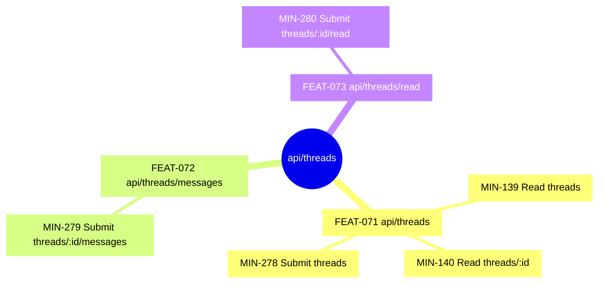
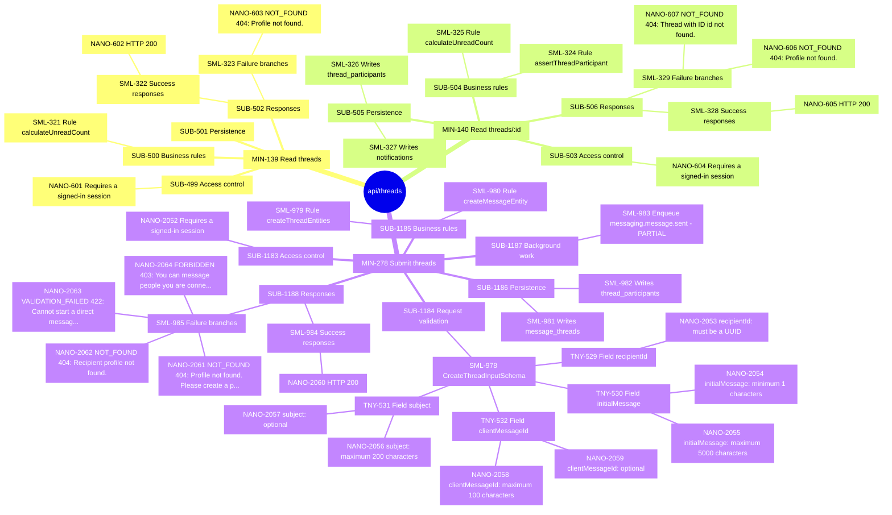
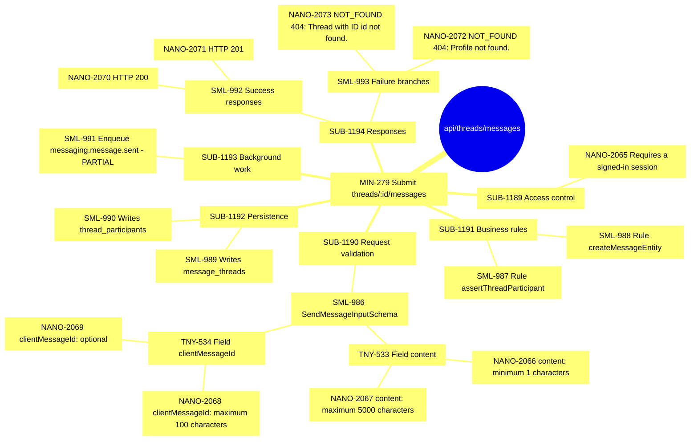
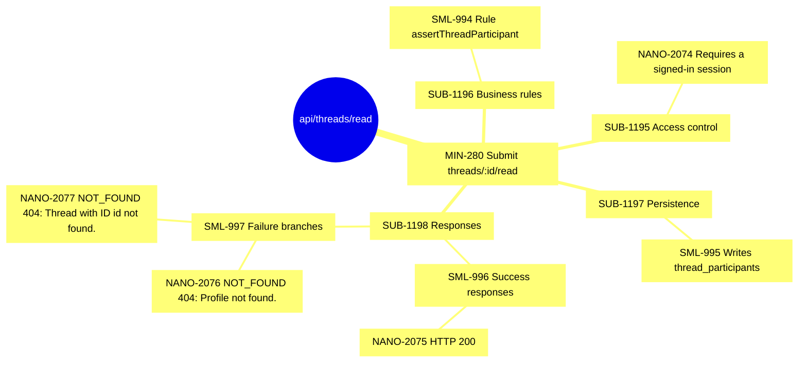
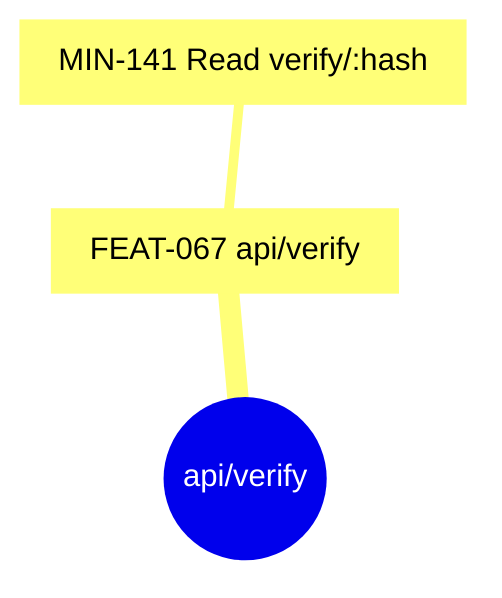
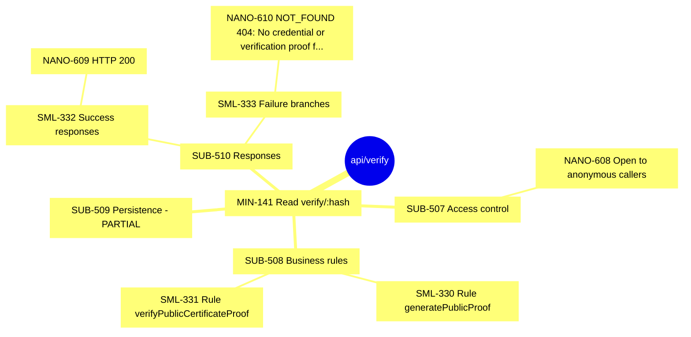
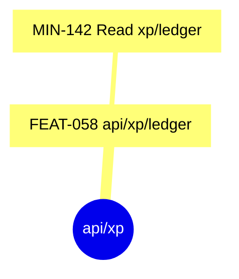
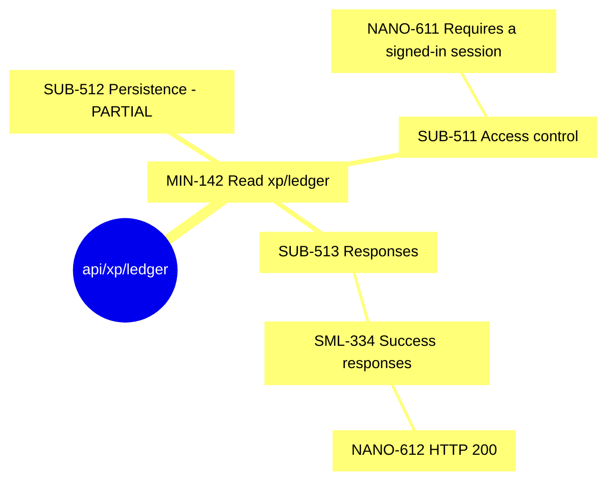

# apps/api modules, part 6 of 6

Generated by `docs/mindmap/tools/catalog.py` from `master/MASTER_PROJECT_GRAPH.json` at commit `eb166ea`. Do not edit by hand. Back to the [feature catalog](../FEATURE_CATALOG.md). Other parts: [part 1](api-1.md), [part 2](api-2.md), [part 3](api-3.md), [part 4](api-4.md), [part 5](api-5.md).

| Module                             | ID      |
| ---------------------------------- | ------- |
| [api/threads](#apithreads-mod-076) | MOD-076 |
| [api/verify](#apiverify-mod-075)   | MOD-075 |
| [api/xp](#apixp-mod-070)           | MOD-070 |

## api/threads (MOD-076)

**Application:** apps/api (MOD-001). **Purpose:** API module: routes under /api/v1/threads in apps/api/src/server.ts.

**Nodes by level:** MODULE 1, MAJOR 3, MINOR 5, SUB 24, SMALL 29, TINY 6, NANO 33. **Status:** IMPLEMENTED 99, PARTIALLY_IMPLEMENTED 2. **Verification:** PATH_LEVEL 82, UNKNOWN 2, VERIFIED 13.

**User roles that reach it:** authenticated.

**Known gaps:** MIN-280 no first-party web caller found.

**Called from (web screens and components):** FEAT-165 Screen /hiring/jobs/:id, FEAT-171 Screen /messages, FEAT-172 Screen /messages/:id

### Module map (to minor features)

### FEAT-071 api/threads

api/threads

| ID        | Level | Parent   | Name                                                                                  | Description                                                                                                                                                                                                                                | Status                | Verification | Evidence                                             | Related                                                       |
| --------- | ----- | -------- | ------------------------------------------------------------------------------------- | ------------------------------------------------------------------------------------------------------------------------------------------------------------------------------------------------------------------------------------------ | --------------------- | ------------ | ---------------------------------------------------- | ------------------------------------------------------------- |
| FEAT-071  | MAJOR | MOD-076  | api/threads                                                                           |                                                                                                                                                                                                                                            | IMPLEMENTED           |              | apps/api/src/server.ts:5723                          |                                                               |
| MIN-139   | MINOR | FEAT-071 | Read threads                                                                          | Messaging Endpoints (F-10) GET /api/v1/threads for any signed-in session; calls calculateUnreadCount; durable (PostgreSQL); responds 200; 1 failure branch(es).                                                                            | IMPLEMENTED           | VERIFIED     | apps/api/src/server.ts:5723                          | API-112, TEST-112, TEST-113, TEST-116, TEST-155               |
| SUB-499   | SUB   | MIN-139  | Access control                                                                        | Who may call GET /api/v1/threads: any signed-in session.                                                                                                                                                                                   | IMPLEMENTED           | PATH_LEVEL   | apps/api/src/server.ts:5723                          |                                                               |
| NANO-601  | NANO  | SUB-499  | Requires a signed-in session                                                          | Requests without a valid session token are rejected with 401 UNAUTHENTICATED.                                                                                                                                                              | IMPLEMENTED           | PATH_LEVEL   | apps/api/src/server.ts:5723                          | ROLE-001                                                      |
| SUB-500   | SUB   | MIN-139  | Business rules                                                                        | Domain functions from packages/domain called by the handler (1).                                                                                                                                                                           | IMPLEMENTED           | PATH_LEVEL   | apps/api/src/server.ts:5723                          |                                                               |
| SML-321   | SMALL | SUB-500  | Rule calculateUnreadCount                                                             | Calls calculateUnreadCount (packages/domain/src/messaging.ts). Rule status IMPLEMENTED; its own tests: VERIFIED.                                                                                                                           | IMPLEMENTED           | VERIFIED     | packages/domain/src/messaging.ts:136                 | RULE-146                                                      |
| SUB-501   | SUB   | MIN-139  | Persistence                                                                           | Durable: writes go through the PostgreSQL store.                                                                                                                                                                                           | IMPLEMENTED           | PATH_LEVEL   | apps/api/src/server.ts:5723                          |                                                               |
| SUB-502   | SUB   | MIN-139  | Responses                                                                             | Success 200; 1 explicit failure branch(es) besides validation and access errors.                                                                                                                                                           | IMPLEMENTED           | PATH_LEVEL   | apps/api/src/server.ts:5723                          |                                                               |
| SML-322   | SMALL | SUB-502  | Success responses                                                                     | HTTP 200 (implicit).                                                                                                                                                                                                                       | IMPLEMENTED           | PATH_LEVEL   | apps/api/src/server.ts:5723                          |                                                               |
| NANO-602  | NANO  | SML-322  | HTTP 200                                                                              | Replies 200 when the operation succeeds (implicit default).                                                                                                                                                                                | IMPLEMENTED           | PATH_LEVEL   | apps/api/src/server.ts:5723                          |                                                               |
| SML-323   | SMALL | SUB-502  | Failure branches                                                                      | 1 DomainError branch(es) in the handler, mapped to HTTP by the global error handler.                                                                                                                                                       | IMPLEMENTED           | PATH_LEVEL   | apps/api/src/server.ts:5723                          |                                                               |
| NANO-603  | NANO  | SML-323  | NOT_FOUND 404: Profile not found.                                                     | Throws DomainError(NOT_FOUND) "Profile not found." -> HTTP 404.                                                                                                                                                                            | IMPLEMENTED           | PATH_LEVEL   | apps/api/src/server.ts:5727                          | ERR-015                                                       |
| MIN-140   | MINOR | FEAT-071 | Read threads/:id                                                                      | GET /api/v1/threads/:id for any signed-in session; calls assertThreadParticipant, calculateUnreadCount; durable (PostgreSQL); writes thread_participants, notifications; responds 200; 2 failure branch(es).                               | IMPLEMENTED           | VERIFIED     | apps/api/src/server.ts:5846                          | API-114, TEST-112, TEST-113, TEST-155                         |
| SUB-503   | SUB   | MIN-140  | Access control                                                                        | Who may call GET /api/v1/threads/:id: any signed-in session.                                                                                                                                                                               | IMPLEMENTED           | PATH_LEVEL   | apps/api/src/server.ts:5846                          |                                                               |
| NANO-604  | NANO  | SUB-503  | Requires a signed-in session                                                          | Requests without a valid session token are rejected with 401 UNAUTHENTICATED.                                                                                                                                                              | IMPLEMENTED           | PATH_LEVEL   | apps/api/src/server.ts:5846                          | ROLE-001                                                      |
| SUB-504   | SUB   | MIN-140  | Business rules                                                                        | Domain functions from packages/domain called by the handler (2).                                                                                                                                                                           | IMPLEMENTED           | PATH_LEVEL   | apps/api/src/server.ts:5846                          |                                                               |
| SML-324   | SMALL | SUB-504  | Rule assertThreadParticipant                                                          | Calls assertThreadParticipant (packages/domain/src/messaging.ts). Rule status IMPLEMENTED; its own tests: VERIFIED.                                                                                                                        | IMPLEMENTED           | VERIFIED     | packages/domain/src/messaging.ts:89                  | RULE-144                                                      |
| SML-325   | SMALL | SUB-504  | Rule calculateUnreadCount                                                             | Calls calculateUnreadCount (packages/domain/src/messaging.ts). Rule status IMPLEMENTED; its own tests: VERIFIED.                                                                                                                           | IMPLEMENTED           | VERIFIED     | packages/domain/src/messaging.ts:136                 | RULE-146                                                      |
| SUB-505   | SUB   | MIN-140  | Persistence                                                                           | Durable: writes go through the PostgreSQL store.                                                                                                                                                                                           | IMPLEMENTED           | PATH_LEVEL   | apps/api/src/server.ts:5846                          |                                                               |
| SML-326   | SMALL | SUB-505  | Writes thread_participants                                                            | Writes table thread_participants (00006_messaging_schema.sql).                                                                                                                                                                             | IMPLEMENTED           | PATH_LEVEL   | supabase/migrations/00006_messaging_schema.sql:17    | DB-027                                                        |
| SML-327   | SMALL | SUB-505  | Writes notifications                                                                  | Writes table notifications (00007_notifications_schema.sql).                                                                                                                                                                               | IMPLEMENTED           | PATH_LEVEL   | supabase/migrations/00007_notifications_schema.sql:6 | DB-029                                                        |
| SUB-506   | SUB   | MIN-140  | Responses                                                                             | Success 200; 2 explicit failure branch(es) besides validation and access errors.                                                                                                                                                           | IMPLEMENTED           | PATH_LEVEL   | apps/api/src/server.ts:5846                          |                                                               |
| SML-328   | SMALL | SUB-506  | Success responses                                                                     | HTTP 200.                                                                                                                                                                                                                                  | IMPLEMENTED           | PATH_LEVEL   | apps/api/src/server.ts:5846                          |                                                               |
| NANO-605  | NANO  | SML-328  | HTTP 200                                                                              | Replies 200 when the operation succeeds.                                                                                                                                                                                                   | IMPLEMENTED           | PATH_LEVEL   | apps/api/src/server.ts:5846                          |                                                               |
| SML-329   | SMALL | SUB-506  | Failure branches                                                                      | 2 DomainError branch(es) in the handler, mapped to HTTP by the global error handler.                                                                                                                                                       | IMPLEMENTED           | PATH_LEVEL   | apps/api/src/server.ts:5846                          |                                                               |
| NANO-606  | NANO  | SML-329  | NOT_FOUND 404: Profile not found.                                                     | Throws DomainError(NOT_FOUND) "Profile not found." -> HTTP 404.                                                                                                                                                                            | IMPLEMENTED           | PATH_LEVEL   | apps/api/src/server.ts:5852                          | ERR-015                                                       |
| NANO-607  | NANO  | SML-329  | NOT_FOUND 404: Thread with ID "${id}" not found.                                      | Throws DomainError(NOT_FOUND) "Thread with ID "${id}" not found." -> HTTP 404.                                                                                                                                                             | IMPLEMENTED           | PATH_LEVEL   | apps/api/src/server.ts:5858                          | ERR-130                                                       |
| MIN-278   | MINOR | FEAT-071 | Submit threads                                                                        | POST /api/v1/threads for any signed-in session; validates CreateThreadInputSchema; calls createThreadEntities, createMessageEntity; durable (PostgreSQL); writes message_threads, thread_participants; responds 200; 4 failure branch(es). | IMPLEMENTED           | VERIFIED     | apps/api/src/server.ts:5755                          | API-113, TEST-112, TEST-113, TEST-116, TEST-155, TEST-191 ... |
| SUB-1183  | SUB   | MIN-278  | Access control                                                                        | Who may call POST /api/v1/threads: any signed-in session.                                                                                                                                                                                  | IMPLEMENTED           | PATH_LEVEL   | apps/api/src/server.ts:5755                          |                                                               |
| NANO-2052 | NANO  | SUB-1183 | Requires a signed-in session                                                          | Requests without a valid session token are rejected with 401 UNAUTHENTICATED.                                                                                                                                                              | IMPLEMENTED           | PATH_LEVEL   | apps/api/src/server.ts:5755                          | ROLE-001                                                      |
| SUB-1184  | SUB   | MIN-278  | Request validation                                                                    | The request is parsed with CreateThreadInputSchema; a failure returns 400 with field details before any business logic runs.                                                                                                               | IMPLEMENTED           | PATH_LEVEL   | apps/api/src/server.ts:5755                          |                                                               |
| SML-978   | SMALL | SUB-1184 | CreateThreadInputSchema                                                               | CreateThreadInputSchema: 4 field(s)                                                                                                                                                                                                        | IMPLEMENTED           | PATH_LEVEL   | packages/contracts/src/index.ts:404                  | SCH-027                                                       |
| TNY-529   | TINY  | SML-978  | Field recipientId                                                                     | recipientId (string, required): must be a UUID                                                                                                                                                                                             | IMPLEMENTED           | PATH_LEVEL   | packages/contracts/src/index.ts:405                  |                                                               |
| NANO-2053 | NANO  | TNY-529  | recipientId: must be a UUID                                                           | recipientId must be a UUID.                                                                                                                                                                                                                | IMPLEMENTED           | PATH_LEVEL   | packages/contracts/src/index.ts:405                  |                                                               |
| TNY-530   | TINY  | SML-978  | Field initialMessage                                                                  | initialMessage (string, required): minimum 1 characters; maximum 5000 characters                                                                                                                                                           | IMPLEMENTED           | PATH_LEVEL   | packages/contracts/src/index.ts:406                  |                                                               |
| NANO-2054 | NANO  | TNY-530  | initialMessage: minimum 1 characters                                                  | initialMessage minimum 1 characters.                                                                                                                                                                                                       | IMPLEMENTED           | PATH_LEVEL   | packages/contracts/src/index.ts:406                  |                                                               |
| NANO-2055 | NANO  | TNY-530  | initialMessage: maximum 5000 characters                                               | initialMessage maximum 5000 characters.                                                                                                                                                                                                    | IMPLEMENTED           | PATH_LEVEL   | packages/contracts/src/index.ts:406                  |                                                               |
| TNY-531   | TINY  | SML-978  | Field subject                                                                         | subject (string, optional): maximum 200 characters; optional                                                                                                                                                                               | IMPLEMENTED           | PATH_LEVEL   | packages/contracts/src/index.ts:407                  |                                                               |
| NANO-2056 | NANO  | TNY-531  | subject: maximum 200 characters                                                       | subject maximum 200 characters.                                                                                                                                                                                                            | IMPLEMENTED           | PATH_LEVEL   | packages/contracts/src/index.ts:407                  |                                                               |
| NANO-2057 | NANO  | TNY-531  | subject: optional                                                                     | subject optional.                                                                                                                                                                                                                          | IMPLEMENTED           | PATH_LEVEL   | packages/contracts/src/index.ts:407                  |                                                               |
| TNY-532   | TINY  | SML-978  | Field clientMessageId                                                                 | clientMessageId (string, optional): maximum 100 characters; optional                                                                                                                                                                       | IMPLEMENTED           | PATH_LEVEL   | packages/contracts/src/index.ts:408                  |                                                               |
| NANO-2058 | NANO  | TNY-532  | clientMessageId: maximum 100 characters                                               | clientMessageId maximum 100 characters.                                                                                                                                                                                                    | IMPLEMENTED           | PATH_LEVEL   | packages/contracts/src/index.ts:408                  |                                                               |
| NANO-2059 | NANO  | TNY-532  | clientMessageId: optional                                                             | clientMessageId optional.                                                                                                                                                                                                                  | IMPLEMENTED           | PATH_LEVEL   | packages/contracts/src/index.ts:408                  |                                                               |
| SUB-1185  | SUB   | MIN-278  | Business rules                                                                        | Domain functions from packages/domain called by the handler (2).                                                                                                                                                                           | IMPLEMENTED           | PATH_LEVEL   | apps/api/src/server.ts:5755                          |                                                               |
| SML-979   | SMALL | SUB-1185 | Rule createThreadEntities                                                             | Calls createThreadEntities (packages/domain/src/messaging.ts). Rule status IMPLEMENTED; its own tests: VERIFIED.                                                                                                                           | IMPLEMENTED           | VERIFIED     | packages/domain/src/messaging.ts:35                  | RULE-143                                                      |
| SML-980   | SMALL | SUB-1185 | Rule createMessageEntity                                                              | Calls createMessageEntity (packages/domain/src/messaging.ts). Rule status IMPLEMENTED; its own tests: VERIFIED.                                                                                                                            | IMPLEMENTED           | VERIFIED     | packages/domain/src/messaging.ts:103                 | RULE-145                                                      |
| SUB-1186  | SUB   | MIN-278  | Persistence                                                                           | Durable: writes go through the PostgreSQL store.                                                                                                                                                                                           | IMPLEMENTED           | PATH_LEVEL   | apps/api/src/server.ts:5755                          |                                                               |
| SML-981   | SMALL | SUB-1186 | Writes message_threads                                                                | Writes table message_threads (00006_messaging_schema.sql).                                                                                                                                                                                 | IMPLEMENTED           | PATH_LEVEL   | supabase/migrations/00006_messaging_schema.sql:6     | DB-026                                                        |
| SML-982   | SMALL | SUB-1186 | Writes thread_participants                                                            | Writes table thread_participants (00006_messaging_schema.sql).                                                                                                                                                                             | IMPLEMENTED           | PATH_LEVEL   | supabase/migrations/00006_messaging_schema.sql:17    | DB-027                                                        |
| SUB-1187  | SUB   | MIN-278  | Background work                                                                       | Enqueues 1 background job kind(s) in background_jobs for apps/worker.                                                                                                                                                                      | IMPLEMENTED           | PATH_LEVEL   | apps/api/src/server.ts:5755                          |                                                               |
| SML-983   | SMALL | SUB-1187 | Enqueue messaging.message.sent                                                        | Dispatches job:messaging.message.sent; worker handler: recordEvent (no-op: marks the event recorded).                                                                                                                                      | PARTIALLY_IMPLEMENTED | UNKNOWN      | packages/domain/src/background-jobs.ts:171           | SVC-030                                                       |
| SUB-1188  | SUB   | MIN-278  | Responses                                                                             | Success 200; 4 explicit failure branch(es) besides validation and access errors.                                                                                                                                                           | IMPLEMENTED           | PATH_LEVEL   | apps/api/src/server.ts:5755                          |                                                               |
| SML-984   | SMALL | SUB-1188 | Success responses                                                                     | HTTP 200.                                                                                                                                                                                                                                  | IMPLEMENTED           | PATH_LEVEL   | apps/api/src/server.ts:5755                          |                                                               |
| NANO-2060 | NANO  | SML-984  | HTTP 200                                                                              | Replies 200 when the operation succeeds.                                                                                                                                                                                                   | IMPLEMENTED           | PATH_LEVEL   | apps/api/src/server.ts:5755                          |                                                               |
| SML-985   | SMALL | SUB-1188 | Failure branches                                                                      | 4 DomainError branch(es) in the handler, mapped to HTTP by the global error handler.                                                                                                                                                       | IMPLEMENTED           | PATH_LEVEL   | apps/api/src/server.ts:5755                          |                                                               |
| NANO-2061 | NANO  | SML-985  | NOT_FOUND 404: Profile not found. Please create a profile first.                      | Throws DomainError(NOT_FOUND) "Profile not found. Please create a profile first." -> HTTP 404.                                                                                                                                             | IMPLEMENTED           | PATH_LEVEL   | apps/api/src/server.ts:5759                          | ERR-107                                                       |
| NANO-2062 | NANO  | SML-985  | NOT_FOUND 404: Recipient profile not found.                                           | Throws DomainError(NOT_FOUND) "Recipient profile not found." -> HTTP 404.                                                                                                                                                                  | IMPLEMENTED           | PATH_LEVEL   | apps/api/src/server.ts:5765                          | ERR-127                                                       |
| NANO-2063 | NANO  | SML-985  | VALIDATION_FAILED 422: Cannot start a direct message thread solely with yourself.     | Throws DomainError(VALIDATION_FAILED) "Cannot start a direct message thread solely with yourself." -> HTTP 422.                                                                                                                            | IMPLEMENTED           | PATH_LEVEL   | apps/api/src/server.ts:5768                          | ERR-128                                                       |
| NANO-2064 | NANO  | SML-985  | FORBIDDEN 403: You can message people you are connected with. A hiring team and a can | Throws DomainError(FORBIDDEN) "You can message people you are connected with. A hiring team and a candidate who applied to one of its jobs can message each other." -> HTTP 403.                                                           | IMPLEMENTED           | PATH_LEVEL   | apps/api/src/server.ts:5774                          | ERR-129                                                       |

### FEAT-072 api/threads/messages

api/threads/messages

| ID        | Level | Parent   | Name                                             | Description                                                                                                                                                                                                                                                    | Status                | Verification | Evidence                                          | Related                                                       |
| --------- | ----- | -------- | ------------------------------------------------ | -------------------------------------------------------------------------------------------------------------------------------------------------------------------------------------------------------------------------------------------------------------- | --------------------- | ------------ | ------------------------------------------------- | ------------------------------------------------------------- |
| FEAT-072  | MAJOR | MOD-076  | api/threads/messages                             |                                                                                                                                                                                                                                                                | IMPLEMENTED           |              | apps/api/src/server.ts:5889                       |                                                               |
| MIN-279   | MINOR | FEAT-072 | Submit threads/:id/messages                      | POST /api/v1/threads/:id/messages for any signed-in session; validates SendMessageInputSchema; calls assertThreadParticipant, createMessageEntity; durable (PostgreSQL); writes message_threads, thread_participants; responds 200, 201; 2 failure branch(es). | IMPLEMENTED           | VERIFIED     | apps/api/src/server.ts:5889                       | API-115, TEST-112, TEST-113, TEST-116, TEST-155, TEST-191 ... |
| SUB-1189  | SUB   | MIN-279  | Access control                                   | Who may call POST /api/v1/threads/:id/messages: any signed-in session.                                                                                                                                                                                         | IMPLEMENTED           | PATH_LEVEL   | apps/api/src/server.ts:5889                       |                                                               |
| NANO-2065 | NANO  | SUB-1189 | Requires a signed-in session                     | Requests without a valid session token are rejected with 401 UNAUTHENTICATED.                                                                                                                                                                                  | IMPLEMENTED           | PATH_LEVEL   | apps/api/src/server.ts:5889                       | ROLE-001                                                      |
| SUB-1190  | SUB   | MIN-279  | Request validation                               | The request is parsed with SendMessageInputSchema; a failure returns 400 with field details before any business logic runs.                                                                                                                                    | IMPLEMENTED           | PATH_LEVEL   | apps/api/src/server.ts:5889                       |                                                               |
| SML-986   | SMALL | SUB-1190 | SendMessageInputSchema                           | SendMessageInputSchema: 2 field(s)                                                                                                                                                                                                                             | IMPLEMENTED           | PATH_LEVEL   | packages/contracts/src/index.ts:413               | SCH-028                                                       |
| TNY-533   | TINY  | SML-986  | Field content                                    | content (string, required): minimum 1 characters; maximum 5000 characters                                                                                                                                                                                      | IMPLEMENTED           | PATH_LEVEL   | packages/contracts/src/index.ts:414               |                                                               |
| NANO-2066 | NANO  | TNY-533  | content: minimum 1 characters                    | content minimum 1 characters.                                                                                                                                                                                                                                  | IMPLEMENTED           | PATH_LEVEL   | packages/contracts/src/index.ts:414               |                                                               |
| NANO-2067 | NANO  | TNY-533  | content: maximum 5000 characters                 | content maximum 5000 characters.                                                                                                                                                                                                                               | IMPLEMENTED           | PATH_LEVEL   | packages/contracts/src/index.ts:414               |                                                               |
| TNY-534   | TINY  | SML-986  | Field clientMessageId                            | clientMessageId (string, optional): maximum 100 characters; optional                                                                                                                                                                                           | IMPLEMENTED           | PATH_LEVEL   | packages/contracts/src/index.ts:415               |                                                               |
| NANO-2068 | NANO  | TNY-534  | clientMessageId: maximum 100 characters          | clientMessageId maximum 100 characters.                                                                                                                                                                                                                        | IMPLEMENTED           | PATH_LEVEL   | packages/contracts/src/index.ts:415               |                                                               |
| NANO-2069 | NANO  | TNY-534  | clientMessageId: optional                        | clientMessageId optional.                                                                                                                                                                                                                                      | IMPLEMENTED           | PATH_LEVEL   | packages/contracts/src/index.ts:415               |                                                               |
| SUB-1191  | SUB   | MIN-279  | Business rules                                   | Domain functions from packages/domain called by the handler (2).                                                                                                                                                                                               | IMPLEMENTED           | PATH_LEVEL   | apps/api/src/server.ts:5889                       |                                                               |
| SML-987   | SMALL | SUB-1191 | Rule assertThreadParticipant                     | Calls assertThreadParticipant (packages/domain/src/messaging.ts). Rule status IMPLEMENTED; its own tests: VERIFIED.                                                                                                                                            | IMPLEMENTED           | VERIFIED     | packages/domain/src/messaging.ts:89               | RULE-144                                                      |
| SML-988   | SMALL | SUB-1191 | Rule createMessageEntity                         | Calls createMessageEntity (packages/domain/src/messaging.ts). Rule status IMPLEMENTED; its own tests: VERIFIED.                                                                                                                                                | IMPLEMENTED           | VERIFIED     | packages/domain/src/messaging.ts:103              | RULE-145                                                      |
| SUB-1192  | SUB   | MIN-279  | Persistence                                      | Durable: writes go through the PostgreSQL store.                                                                                                                                                                                                               | IMPLEMENTED           | PATH_LEVEL   | apps/api/src/server.ts:5889                       |                                                               |
| SML-989   | SMALL | SUB-1192 | Writes message_threads                           | Writes table message_threads (00006_messaging_schema.sql).                                                                                                                                                                                                     | IMPLEMENTED           | PATH_LEVEL   | supabase/migrations/00006_messaging_schema.sql:6  | DB-026                                                        |
| SML-990   | SMALL | SUB-1192 | Writes thread_participants                       | Writes table thread_participants (00006_messaging_schema.sql).                                                                                                                                                                                                 | IMPLEMENTED           | PATH_LEVEL   | supabase/migrations/00006_messaging_schema.sql:17 | DB-027                                                        |
| SUB-1193  | SUB   | MIN-279  | Background work                                  | Enqueues 1 background job kind(s) in background_jobs for apps/worker.                                                                                                                                                                                          | IMPLEMENTED           | PATH_LEVEL   | apps/api/src/server.ts:5889                       |                                                               |
| SML-991   | SMALL | SUB-1193 | Enqueue messaging.message.sent                   | Dispatches job:messaging.message.sent; worker handler: recordEvent (no-op: marks the event recorded).                                                                                                                                                          | PARTIALLY_IMPLEMENTED | UNKNOWN      | packages/domain/src/background-jobs.ts:171        | SVC-030                                                       |
| SUB-1194  | SUB   | MIN-279  | Responses                                        | Success 200, 201; 2 explicit failure branch(es) besides validation and access errors.                                                                                                                                                                          | IMPLEMENTED           | PATH_LEVEL   | apps/api/src/server.ts:5889                       |                                                               |
| SML-992   | SMALL | SUB-1194 | Success responses                                | HTTP 200, 201.                                                                                                                                                                                                                                                 | IMPLEMENTED           | PATH_LEVEL   | apps/api/src/server.ts:5889                       |                                                               |
| NANO-2070 | NANO  | SML-992  | HTTP 200                                         | Replies 200 when the operation succeeds.                                                                                                                                                                                                                       | IMPLEMENTED           | PATH_LEVEL   | apps/api/src/server.ts:5889                       |                                                               |
| NANO-2071 | NANO  | SML-992  | HTTP 201                                         | Replies 201 when the operation succeeds.                                                                                                                                                                                                                       | IMPLEMENTED           | PATH_LEVEL   | apps/api/src/server.ts:5889                       |                                                               |
| SML-993   | SMALL | SUB-1194 | Failure branches                                 | 2 DomainError branch(es) in the handler, mapped to HTTP by the global error handler.                                                                                                                                                                           | IMPLEMENTED           | PATH_LEVEL   | apps/api/src/server.ts:5889                       |                                                               |
| NANO-2072 | NANO  | SML-993  | NOT_FOUND 404: Profile not found.                | Throws DomainError(NOT_FOUND) "Profile not found." -> HTTP 404.                                                                                                                                                                                                | IMPLEMENTED           | PATH_LEVEL   | apps/api/src/server.ts:5895                       | ERR-015                                                       |
| NANO-2073 | NANO  | SML-993  | NOT_FOUND 404: Thread with ID "${id}" not found. | Throws DomainError(NOT_FOUND) "Thread with ID "${id}" not found." -> HTTP 404.                                                                                                                                                                                 | IMPLEMENTED           | PATH_LEVEL   | apps/api/src/server.ts:5901                       | ERR-130                                                       |

### FEAT-073 api/threads/read

api/threads/read

| ID        | Level | Parent   | Name                                             | Description                                                                                                                                                                                                         | Status      | Verification | Evidence                                          | Related                     |
| --------- | ----- | -------- | ------------------------------------------------ | ------------------------------------------------------------------------------------------------------------------------------------------------------------------------------------------------------------------- | ----------- | ------------ | ------------------------------------------------- | --------------------------- |
| FEAT-073  | MAJOR | MOD-076  | api/threads/read                                 |                                                                                                                                                                                                                     | IMPLEMENTED |              | apps/api/src/server.ts:5950                       |                             |
| MIN-280   | MINOR | FEAT-073 | Submit threads/:id/read                          | POST /api/v1/threads/:id/read for any signed-in session; calls assertThreadParticipant; durable (PostgreSQL); writes thread_participants; responds 200; 2 failure branch(es). Gaps: no first-party web caller found | IMPLEMENTED | VERIFIED     | apps/api/src/server.ts:5950                       | API-116, TEST-113, TEST-155 |
| SUB-1195  | SUB   | MIN-280  | Access control                                   | Who may call POST /api/v1/threads/:id/read: any signed-in session.                                                                                                                                                  | IMPLEMENTED | PATH_LEVEL   | apps/api/src/server.ts:5950                       |                             |
| NANO-2074 | NANO  | SUB-1195 | Requires a signed-in session                     | Requests without a valid session token are rejected with 401 UNAUTHENTICATED.                                                                                                                                       | IMPLEMENTED | PATH_LEVEL   | apps/api/src/server.ts:5950                       | ROLE-001                    |
| SUB-1196  | SUB   | MIN-280  | Business rules                                   | Domain functions from packages/domain called by the handler (1).                                                                                                                                                    | IMPLEMENTED | PATH_LEVEL   | apps/api/src/server.ts:5950                       |                             |
| SML-994   | SMALL | SUB-1196 | Rule assertThreadParticipant                     | Calls assertThreadParticipant (packages/domain/src/messaging.ts). Rule status IMPLEMENTED; its own tests: VERIFIED.                                                                                                 | IMPLEMENTED | VERIFIED     | packages/domain/src/messaging.ts:89               | RULE-144                    |
| SUB-1197  | SUB   | MIN-280  | Persistence                                      | Durable: writes go through the PostgreSQL store.                                                                                                                                                                    | IMPLEMENTED | PATH_LEVEL   | apps/api/src/server.ts:5950                       |                             |
| SML-995   | SMALL | SUB-1197 | Writes thread_participants                       | Writes table thread_participants (00006_messaging_schema.sql).                                                                                                                                                      | IMPLEMENTED | PATH_LEVEL   | supabase/migrations/00006_messaging_schema.sql:17 | DB-027                      |
| SUB-1198  | SUB   | MIN-280  | Responses                                        | Success 200; 2 explicit failure branch(es) besides validation and access errors.                                                                                                                                    | IMPLEMENTED | PATH_LEVEL   | apps/api/src/server.ts:5950                       |                             |
| SML-996   | SMALL | SUB-1198 | Success responses                                | HTTP 200.                                                                                                                                                                                                           | IMPLEMENTED | PATH_LEVEL   | apps/api/src/server.ts:5950                       |                             |
| NANO-2075 | NANO  | SML-996  | HTTP 200                                         | Replies 200 when the operation succeeds.                                                                                                                                                                            | IMPLEMENTED | PATH_LEVEL   | apps/api/src/server.ts:5950                       |                             |
| SML-997   | SMALL | SUB-1198 | Failure branches                                 | 2 DomainError branch(es) in the handler, mapped to HTTP by the global error handler.                                                                                                                                | IMPLEMENTED | PATH_LEVEL   | apps/api/src/server.ts:5950                       |                             |
| NANO-2076 | NANO  | SML-997  | NOT_FOUND 404: Profile not found.                | Throws DomainError(NOT_FOUND) "Profile not found." -> HTTP 404.                                                                                                                                                     | IMPLEMENTED | PATH_LEVEL   | apps/api/src/server.ts:5956                       | ERR-015                     |
| NANO-2077 | NANO  | SML-997  | NOT_FOUND 404: Thread with ID "${id}" not found. | Throws DomainError(NOT_FOUND) "Thread with ID "${id}" not found." -> HTTP 404.                                                                                                                                      | IMPLEMENTED | PATH_LEVEL   | apps/api/src/server.ts:5962                       | ERR-130                     |

## api/verify (MOD-075)

**Application:** apps/api (MOD-001). **Purpose:** API module: routes under /api/v1/verify in apps/api/src/server.ts.

**Nodes by level:** MODULE 1, MAJOR 1, MINOR 1, SUB 4, SMALL 4, NANO 3. **Status:** IMPLEMENTED 13, PARTIALLY_IMPLEMENTED 1. **Verification:** PATH_LEVEL 9, VERIFIED 3.

**User roles that reach it:** anonymous.

**Known gaps:** MIN-141 ephemeral: state held in process memory, lost on restart.

**Called from (web screens and components):** FEAT-183 Screen /verify/:hash

### Module map (to minor features)

### FEAT-067 api/verify

api/verify

| ID       | Level | Parent   | Name                                                                              | Description                                                                                                                                                                                                                                                                                                               | Status                | Verification | Evidence                            | Related                                                   |
| -------- | ----- | -------- | --------------------------------------------------------------------------------- | ------------------------------------------------------------------------------------------------------------------------------------------------------------------------------------------------------------------------------------------------------------------------------------------------------------------------- | --------------------- | ------------ | ----------------------------------- | --------------------------------------------------------- |
| FEAT-067 | MAJOR | MOD-075  | api/verify                                                                        |                                                                                                                                                                                                                                                                                                                           | IMPLEMENTED           |              | apps/api/src/server.ts:5492         |                                                           |
| MIN-141  | MINOR | FEAT-067 | Read verify/:hash                                                                 | Unified Public Zero-PII Verification Endpoint (SSOT 1132, S-02, BR-150, F-52, F-96) GET /api/v1/verify/:hash for anyone (public); calls generatePublicProof, verifyPublicCertificateProof; ephemeral (process memory); responds 200; 1 failure branch(es). Gaps: ephemeral: state held in process memory, lost on restart | IMPLEMENTED           | VERIFIED     | apps/api/src/server.ts:5492         | API-108, TEST-094, TEST-145, TEST-175, TEST-179, TEST-217 |
| SUB-507  | SUB   | MIN-141  | Access control                                                                    | Who may call GET /api/v1/verify/:hash: anyone (public).                                                                                                                                                                                                                                                                   | IMPLEMENTED           | PATH_LEVEL   | apps/api/src/server.ts:5492         |                                                           |
| NANO-608 | NANO  | SUB-507  | Open to anonymous callers                                                         | auth: public.                                                                                                                                                                                                                                                                                                             | IMPLEMENTED           | PATH_LEVEL   | apps/api/src/server.ts:5492         | ROLE-001                                                  |
| SUB-508  | SUB   | MIN-141  | Business rules                                                                    | Domain functions from packages/domain called by the handler (2).                                                                                                                                                                                                                                                          | IMPLEMENTED           | PATH_LEVEL   | apps/api/src/server.ts:5492         |                                                           |
| SML-330  | SMALL | SUB-508  | Rule generatePublicProof                                                          | Calls generatePublicProof (packages/domain/src/evidence.ts). Rule status IMPLEMENTED; its own tests: VERIFIED.                                                                                                                                                                                                            | IMPLEMENTED           | VERIFIED     | packages/domain/src/evidence.ts:397 | RULE-103                                                  |
| SML-331  | SMALL | SUB-508  | Rule verifyPublicCertificateProof                                                 | Calls verifyPublicCertificateProof (packages/domain/src/lms.ts). Rule status IMPLEMENTED; its own tests: VERIFIED.                                                                                                                                                                                                        | IMPLEMENTED           | VERIFIED     | packages/domain/src/lms.ts:371      | RULE-142                                                  |
| SUB-509  | SUB   | MIN-141  | Persistence                                                                       | Ephemeral: state lives in API process memory and is lost on restart.                                                                                                                                                                                                                                                      | PARTIALLY_IMPLEMENTED | PATH_LEVEL   | apps/api/src/server.ts:5492         |                                                           |
| SUB-510  | SUB   | MIN-141  | Responses                                                                         | Success 200; 1 explicit failure branch(es) besides validation and access errors.                                                                                                                                                                                                                                          | IMPLEMENTED           | PATH_LEVEL   | apps/api/src/server.ts:5492         |                                                           |
| SML-332  | SMALL | SUB-510  | Success responses                                                                 | HTTP 200.                                                                                                                                                                                                                                                                                                                 | IMPLEMENTED           | PATH_LEVEL   | apps/api/src/server.ts:5492         |                                                           |
| NANO-609 | NANO  | SML-332  | HTTP 200                                                                          | Replies 200 when the operation succeeds.                                                                                                                                                                                                                                                                                  | IMPLEMENTED           | PATH_LEVEL   | apps/api/src/server.ts:5492         |                                                           |
| SML-333  | SMALL | SUB-510  | Failure branches                                                                  | 1 DomainError branch(es) in the handler, mapped to HTTP by the global error handler.                                                                                                                                                                                                                                      | IMPLEMENTED           | PATH_LEVEL   | apps/api/src/server.ts:5492         |                                                           |
| NANO-610 | NANO  | SML-333  | NOT_FOUND 404: No credential or verification proof found matching hash "${hash}". | Throws DomainError(NOT_FOUND) "No credential or verification proof found matching hash "${hash}"." -> HTTP 404.                                                                                                                                                                                                           | IMPLEMENTED           | PATH_LEVEL   | apps/api/src/server.ts:5532         | ERR-125                                                   |

## api/xp (MOD-070)

**Application:** apps/api (MOD-001). **Purpose:** API module: routes under /api/v1/xp in apps/api/src/server.ts.

**Nodes by level:** MODULE 1, MAJOR 1, MINOR 1, SUB 3, SMALL 1, NANO 2. **Status:** IMPLEMENTED 8, PARTIALLY_IMPLEMENTED 1. **Verification:** PATH_LEVEL 6, VERIFIED 1.

**User roles that reach it:** authenticated.

**Known gaps:** MIN-142 ephemeral: state held in process memory, lost on restart; MIN-142 no first-party web caller found.

### Module map (to minor features)

### FEAT-058 api/xp/ledger

api/xp/ledger

| ID       | Level | Parent   | Name                         | Description                                                                                                                                                                                                   | Status                | Verification | Evidence                    | Related           |
| -------- | ----- | -------- | ---------------------------- | ------------------------------------------------------------------------------------------------------------------------------------------------------------------------------------------------------------- | --------------------- | ------------ | --------------------------- | ----------------- |
| FEAT-058 | MAJOR | MOD-070  | api/xp/ledger                |                                                                                                                                                                                                               | IMPLEMENTED           |              | apps/api/src/server.ts:4931 |                   |
| MIN-142  | MINOR | FEAT-058 | Read xp/ledger               | XP Ledger Endpoint GET /api/v1/xp/ledger for any signed-in session; ephemeral (process memory); responds 200. Gaps: ephemeral: state held in process memory, lost on restart; no first-party web caller found | IMPLEMENTED           | VERIFIED     | apps/api/src/server.ts:4931 | API-097, TEST-095 |
| SUB-511  | SUB   | MIN-142  | Access control               | Who may call GET /api/v1/xp/ledger: any signed-in session.                                                                                                                                                    | IMPLEMENTED           | PATH_LEVEL   | apps/api/src/server.ts:4931 |                   |
| NANO-611 | NANO  | SUB-511  | Requires a signed-in session | Requests without a valid session token are rejected with 401 UNAUTHENTICATED.                                                                                                                                 | IMPLEMENTED           | PATH_LEVEL   | apps/api/src/server.ts:4931 | ROLE-001          |
| SUB-512  | SUB   | MIN-142  | Persistence                  | Ephemeral: state lives in API process memory and is lost on restart.                                                                                                                                          | PARTIALLY_IMPLEMENTED | PATH_LEVEL   | apps/api/src/server.ts:4931 |                   |
| SUB-513  | SUB   | MIN-142  | Responses                    | Success 200; 0 explicit failure branch(es) besides validation and access errors.                                                                                                                              | IMPLEMENTED           | PATH_LEVEL   | apps/api/src/server.ts:4931 |                   |
| SML-334  | SMALL | SUB-513  | Success responses            | HTTP 200.                                                                                                                                                                                                     | IMPLEMENTED           | PATH_LEVEL   | apps/api/src/server.ts:4931 |                   |
| NANO-612 | NANO  | SML-334  | HTTP 200                     | Replies 200 when the operation succeeds.                                                                                                                                                                      | IMPLEMENTED           | PATH_LEVEL   | apps/api/src/server.ts:4931 |                   |
