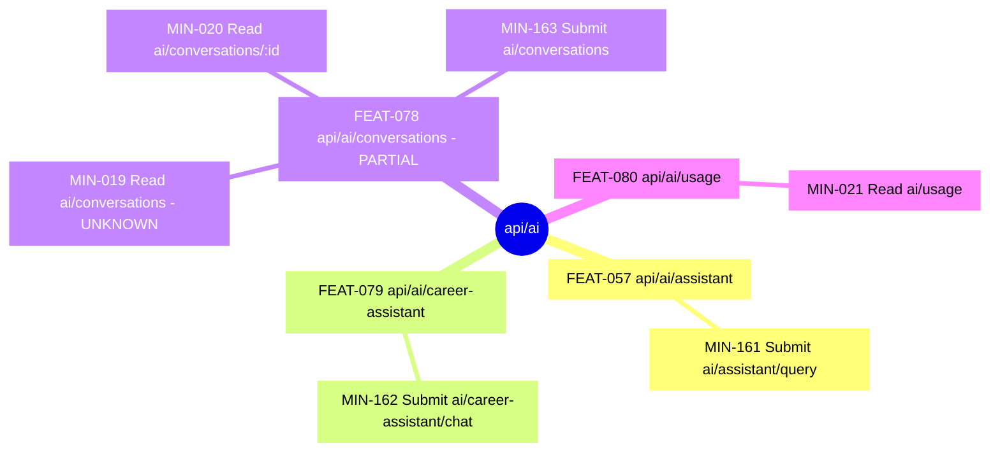
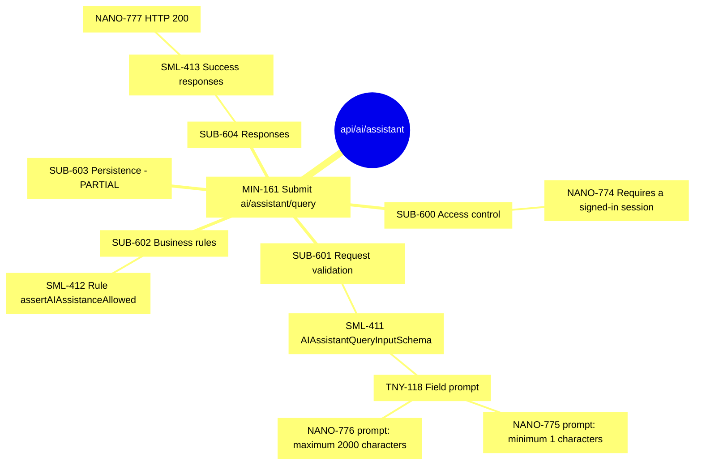
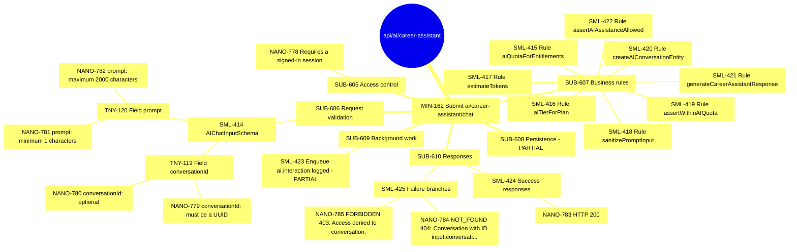
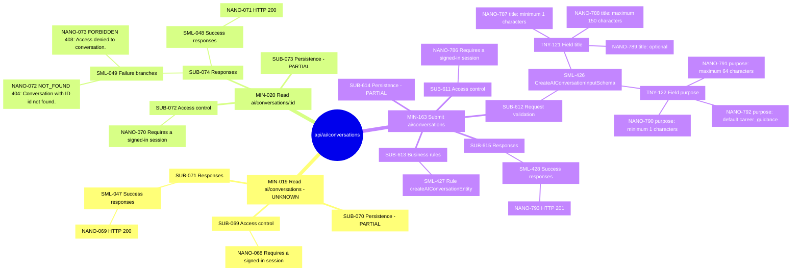
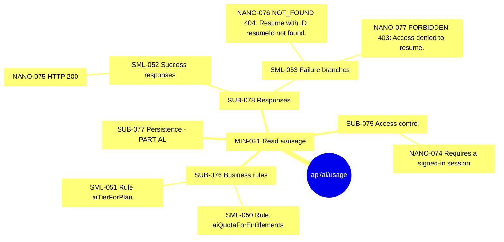

# api/ai (MOD-069)

Generated by `docs/mindmap/tools/catalog.py` from `master/MASTER_PROJECT_GRAPH.json` at commit `9b3032f`. Do not edit by hand. Back to the [feature catalog](../FEATURE_CATALOG.md).

**Application:** apps/api (MOD-001). **Purpose:** API module: routes under /api/v1/ai in apps/api/src/server.ts.

**Nodes by level:** MODULE 1, MAJOR 4, MINOR 6, SUB 26, SMALL 25, TINY 5, NANO 30. **Status:** IMPLEMENTED 87, PARTIALLY_IMPLEMENTED 9, UNKNOWN 1. **Verification:** PATH_LEVEL 72, UNKNOWN 1, VERIFIED 19.

**User roles that reach it:** authenticated.

**Known gaps:** MIN-161 ephemeral: state held in process memory, lost on restart; MIN-161 no first-party web caller found; MIN-162 ephemeral: state held in process memory, lost on restart; MIN-162 no first-party web caller found; MIN-019 ephemeral: state held in process memory, lost on restart; MIN-019 no first-party web caller found; MIN-020 ephemeral: state held in process memory, lost on restart; MIN-020 no first-party web caller found; MIN-163 ephemeral: state held in process memory, lost on restart; MIN-163 no first-party web caller found; MIN-021 ephemeral: state held in process memory, lost on restart.

## Module map (to minor features)

## FEAT-057 api/ai/assistant

api/ai/assistant

| ID       | Level | Parent   | Name                            | Description                                                                                                                                                                                                                                                                                                                                                        | Status                | Verification | Evidence                             | Related                               |
| -------- | ----- | -------- | ------------------------------- | ------------------------------------------------------------------------------------------------------------------------------------------------------------------------------------------------------------------------------------------------------------------------------------------------------------------------------------------------------------------ | --------------------- | ------------ | ------------------------------------ | ------------------------------------- |
| FEAT-057 | MAJOR | MOD-069  | api/ai/assistant                |                                                                                                                                                                                                                                                                                                                                                                    | IMPLEMENTED           |              | apps/api/src/server.ts:4913          |                                       |
| MIN-161  | MINOR | FEAT-057 | Submit ai/assistant/query       | AI Assistant & Gateway Entry Point (SSOT Section D: Strict AI_PROHIBITED Enforcement) POST /api/v1/ai/assistant/query for any signed-in session; validates AIAssistantQueryInputSchema; calls assertAIAssistanceAllowed; ephemeral (process memory); responds 200. Gaps: ephemeral: state held in process memory, lost on restart; no first-party web caller found | IMPLEMENTED           | VERIFIED     | apps/api/src/server.ts:4913          | API-096, TEST-095, TEST-170, TEST-176 |
| SUB-600  | SUB   | MIN-161  | Access control                  | Who may call POST /api/v1/ai/assistant/query: any signed-in session.                                                                                                                                                                                                                                                                                               | IMPLEMENTED           | PATH_LEVEL   | apps/api/src/server.ts:4913          |                                       |
| NANO-774 | NANO  | SUB-600  | Requires a signed-in session    | Requests without a valid session token are rejected with 401 UNAUTHENTICATED.                                                                                                                                                                                                                                                                                      | IMPLEMENTED           | PATH_LEVEL   | apps/api/src/server.ts:4913          | ROLE-001                              |
| SUB-601  | SUB   | MIN-161  | Request validation              | The request is parsed with AIAssistantQueryInputSchema; a failure returns 400 with field details before any business logic runs.                                                                                                                                                                                                                                   | IMPLEMENTED           | PATH_LEVEL   | apps/api/src/server.ts:4913          |                                       |
| SML-411  | SMALL | SUB-601  | AIAssistantQueryInputSchema     | AIAssistantQueryInputSchema: 1 field(s)                                                                                                                                                                                                                                                                                                                            | IMPLEMENTED           | PATH_LEVEL   | packages/contracts/src/index.ts:343  | SCH-022                               |
| TNY-118  | TINY  | SML-411  | Field prompt                    | prompt (string, required): minimum 1 characters; maximum 2000 characters                                                                                                                                                                                                                                                                                           | IMPLEMENTED           | PATH_LEVEL   | packages/contracts/src/index.ts:344  |                                       |
| NANO-775 | NANO  | TNY-118  | prompt: minimum 1 characters    | prompt minimum 1 characters.                                                                                                                                                                                                                                                                                                                                       | IMPLEMENTED           | PATH_LEVEL   | packages/contracts/src/index.ts:344  |                                       |
| NANO-776 | NANO  | TNY-118  | prompt: maximum 2000 characters | prompt maximum 2000 characters.                                                                                                                                                                                                                                                                                                                                    | IMPLEMENTED           | PATH_LEVEL   | packages/contracts/src/index.ts:344  |                                       |
| SUB-602  | SUB   | MIN-161  | Business rules                  | Domain functions from packages/domain called by the handler (1).                                                                                                                                                                                                                                                                                                   | IMPLEMENTED           | PATH_LEVEL   | apps/api/src/server.ts:4913          |                                       |
| SML-412  | SMALL | SUB-602  | Rule assertAIAssistanceAllowed  | Calls assertAIAssistanceAllowed (packages/domain/src/assessment.ts). Rule status IMPLEMENTED; its own tests: VERIFIED.                                                                                                                                                                                                                                             | IMPLEMENTED           | VERIFIED     | packages/domain/src/assessment.ts:33 | RULE-044                              |
| SUB-603  | SUB   | MIN-161  | Persistence                     | Ephemeral: state lives in API process memory and is lost on restart.                                                                                                                                                                                                                                                                                               | PARTIALLY_IMPLEMENTED | PATH_LEVEL   | apps/api/src/server.ts:4913          |                                       |
| SUB-604  | SUB   | MIN-161  | Responses                       | Success 200; 0 explicit failure branch(es) besides validation and access errors.                                                                                                                                                                                                                                                                                   | IMPLEMENTED           | PATH_LEVEL   | apps/api/src/server.ts:4913          |                                       |
| SML-413  | SMALL | SUB-604  | Success responses               | HTTP 200.                                                                                                                                                                                                                                                                                                                                                          | IMPLEMENTED           | PATH_LEVEL   | apps/api/src/server.ts:4913          |                                       |
| NANO-777 | NANO  | SML-413  | HTTP 200                        | Replies 200 when the operation succeeds.                                                                                                                                                                                                                                                                                                                           | IMPLEMENTED           | PATH_LEVEL   | apps/api/src/server.ts:4913          |                                       |

## FEAT-079 api/ai/career-assistant

api/ai/career-assistant

| ID       | Level | Parent   | Name                                                                     | Description                                                                                                                                                                                                                                                                                                                                         | Status                | Verification | Evidence                                   | Related                                         |
| -------- | ----- | -------- | ------------------------------------------------------------------------ | --------------------------------------------------------------------------------------------------------------------------------------------------------------------------------------------------------------------------------------------------------------------------------------------------------------------------------------------------- | --------------------- | ------------ | ------------------------------------------ | ----------------------------------------------- |
| FEAT-079 | MAJOR | MOD-069  | api/ai/career-assistant                                                  |                                                                                                                                                                                                                                                                                                                                                     | IMPLEMENTED           |              | apps/api/src/server.ts:6163                |                                                 |
| MIN-162  | MINOR | FEAT-079 | Submit ai/career-assistant/chat                                          | POST /api/v1/ai/career-assistant/chat for any signed-in session; validates AIChatInputSchema; calls aiQuotaForEntitlements, aiTierForPlan, estimateTokens, sanitizePromptInput ...; ephemeral (process memory); responds 200; 2 failure branch(es). Gaps: ephemeral: state held in process memory, lost on restart; no first-party web caller found | IMPLEMENTED           | VERIFIED     | apps/api/src/server.ts:6163                | API-125, TEST-084, TEST-118, TEST-143, TEST-191 |
| SUB-605  | SUB   | MIN-162  | Access control                                                           | Who may call POST /api/v1/ai/career-assistant/chat: any signed-in session.                                                                                                                                                                                                                                                                          | IMPLEMENTED           | PATH_LEVEL   | apps/api/src/server.ts:6163                |                                                 |
| NANO-778 | NANO  | SUB-605  | Requires a signed-in session                                             | Requests without a valid session token are rejected with 401 UNAUTHENTICATED.                                                                                                                                                                                                                                                                       | IMPLEMENTED           | PATH_LEVEL   | apps/api/src/server.ts:6163                | ROLE-001                                        |
| SUB-606  | SUB   | MIN-162  | Request validation                                                       | The request is parsed with AIChatInputSchema; a failure returns 400 with field details before any business logic runs.                                                                                                                                                                                                                              | IMPLEMENTED           | PATH_LEVEL   | apps/api/src/server.ts:6163                |                                                 |
| SML-414  | SMALL | SUB-606  | AIChatInputSchema                                                        | AIChatInputSchema: 2 field(s)                                                                                                                                                                                                                                                                                                                       | IMPLEMENTED           | PATH_LEVEL   | packages/contracts/src/index.ts:452        | SCH-032                                         |
| TNY-119  | TINY  | SML-414  | Field conversationId                                                     | conversationId (string, optional): must be a UUID; optional                                                                                                                                                                                                                                                                                         | IMPLEMENTED           | PATH_LEVEL   | packages/contracts/src/index.ts:453        |                                                 |
| NANO-779 | NANO  | TNY-119  | conversationId: must be a UUID                                           | conversationId must be a UUID.                                                                                                                                                                                                                                                                                                                      | IMPLEMENTED           | PATH_LEVEL   | packages/contracts/src/index.ts:453        |                                                 |
| NANO-780 | NANO  | TNY-119  | conversationId: optional                                                 | conversationId optional.                                                                                                                                                                                                                                                                                                                            | IMPLEMENTED           | PATH_LEVEL   | packages/contracts/src/index.ts:453        |                                                 |
| TNY-120  | TINY  | SML-414  | Field prompt                                                             | prompt (string, required): minimum 1 characters; maximum 2000 characters                                                                                                                                                                                                                                                                            | IMPLEMENTED           | PATH_LEVEL   | packages/contracts/src/index.ts:454        |                                                 |
| NANO-781 | NANO  | TNY-120  | prompt: minimum 1 characters                                             | prompt minimum 1 characters.                                                                                                                                                                                                                                                                                                                        | IMPLEMENTED           | PATH_LEVEL   | packages/contracts/src/index.ts:454        |                                                 |
| NANO-782 | NANO  | TNY-120  | prompt: maximum 2000 characters                                          | prompt maximum 2000 characters.                                                                                                                                                                                                                                                                                                                     | IMPLEMENTED           | PATH_LEVEL   | packages/contracts/src/index.ts:454        |                                                 |
| SUB-607  | SUB   | MIN-162  | Business rules                                                           | Domain functions from packages/domain called by the handler (8).                                                                                                                                                                                                                                                                                    | IMPLEMENTED           | PATH_LEVEL   | apps/api/src/server.ts:6163                |                                                 |
| SML-415  | SMALL | SUB-607  | Rule aiQuotaForEntitlements                                              | Calls aiQuotaForEntitlements (packages/domain/src/ai-gateway.ts). Rule status IMPLEMENTED; its own tests: VERIFIED.                                                                                                                                                                                                                                 | IMPLEMENTED           | VERIFIED     | packages/domain/src/ai-gateway.ts:73       | RULE-010                                        |
| SML-416  | SMALL | SUB-607  | Rule aiTierForPlan                                                       | Calls aiTierForPlan (packages/domain/src/ai-gateway.ts). Rule status IMPLEMENTED; its own tests: VERIFIED.                                                                                                                                                                                                                                          | IMPLEMENTED           | VERIFIED     | packages/domain/src/ai-gateway.ts:78       | RULE-011                                        |
| SML-417  | SMALL | SUB-607  | Rule estimateTokens                                                      | Calls estimateTokens (packages/domain/src/ai-gateway.ts). Rule status IMPLEMENTED; its own tests: VERIFIED.                                                                                                                                                                                                                                         | IMPLEMENTED           | VERIFIED     | packages/domain/src/ai-gateway.ts:88       | RULE-012                                        |
| SML-418  | SMALL | SUB-607  | Rule sanitizePromptInput                                                 | Calls sanitizePromptInput (packages/domain/src/ai-gateway.ts). Rule status IMPLEMENTED; its own tests: VERIFIED.                                                                                                                                                                                                                                    | IMPLEMENTED           | VERIFIED     | packages/domain/src/ai-gateway.ts:97       | RULE-013                                        |
| SML-419  | SMALL | SUB-607  | Rule assertWithinAIQuota                                                 | Calls assertWithinAIQuota (packages/domain/src/ai-gateway.ts). Rule status IMPLEMENTED; its own tests: VERIFIED.                                                                                                                                                                                                                                    | IMPLEMENTED           | VERIFIED     | packages/domain/src/ai-gateway.ts:160      | RULE-014                                        |
| SML-420  | SMALL | SUB-607  | Rule createAIConversationEntity                                          | Calls createAIConversationEntity (packages/domain/src/ai-gateway.ts). Rule status IMPLEMENTED; its own tests: VERIFIED.                                                                                                                                                                                                                             | IMPLEMENTED           | VERIFIED     | packages/domain/src/ai-gateway.ts:188      | RULE-015                                        |
| SML-421  | SMALL | SUB-607  | Rule generateCareerAssistantResponse                                     | Calls generateCareerAssistantResponse (packages/domain/src/ai-gateway.ts). Rule status IMPLEMENTED; its own tests: VERIFIED.                                                                                                                                                                                                                        | IMPLEMENTED           | VERIFIED     | packages/domain/src/ai-gateway.ts:210      | RULE-016                                        |
| SML-422  | SMALL | SUB-607  | Rule assertAIAssistanceAllowed                                           | Calls assertAIAssistanceAllowed (packages/domain/src/assessment.ts). Rule status IMPLEMENTED; its own tests: VERIFIED.                                                                                                                                                                                                                              | IMPLEMENTED           | VERIFIED     | packages/domain/src/assessment.ts:33       | RULE-044                                        |
| SUB-608  | SUB   | MIN-162  | Persistence                                                              | Ephemeral: state lives in API process memory and is lost on restart.                                                                                                                                                                                                                                                                                | PARTIALLY_IMPLEMENTED | PATH_LEVEL   | apps/api/src/server.ts:6163                |                                                 |
| SUB-609  | SUB   | MIN-162  | Background work                                                          | Enqueues 1 background job kind(s) in background_jobs for apps/worker.                                                                                                                                                                                                                                                                               | IMPLEMENTED           | PATH_LEVEL   | apps/api/src/server.ts:6163                |                                                 |
| SML-423  | SMALL | SUB-609  | Enqueue ai.interaction.logged                                            | Dispatches job:ai.interaction.logged; worker handler: recordEvent (no-op: marks the event recorded).                                                                                                                                                                                                                                                | PARTIALLY_IMPLEMENTED | UNKNOWN      | packages/domain/src/background-jobs.ts:171 | SVC-002                                         |
| SUB-610  | SUB   | MIN-162  | Responses                                                                | Success 200; 2 explicit failure branch(es) besides validation and access errors.                                                                                                                                                                                                                                                                    | IMPLEMENTED           | PATH_LEVEL   | apps/api/src/server.ts:6163                |                                                 |
| SML-424  | SMALL | SUB-610  | Success responses                                                        | HTTP 200.                                                                                                                                                                                                                                                                                                                                           | IMPLEMENTED           | PATH_LEVEL   | apps/api/src/server.ts:6163                |                                                 |
| NANO-783 | NANO  | SML-424  | HTTP 200                                                                 | Replies 200 when the operation succeeds.                                                                                                                                                                                                                                                                                                            | IMPLEMENTED           | PATH_LEVEL   | apps/api/src/server.ts:6163                |                                                 |
| SML-425  | SMALL | SUB-610  | Failure branches                                                         | 2 DomainError branch(es) in the handler, mapped to HTTP by the global error handler.                                                                                                                                                                                                                                                                | IMPLEMENTED           | PATH_LEVEL   | apps/api/src/server.ts:6163                |                                                 |
| NANO-784 | NANO  | SML-425  | NOT_FOUND 404: Conversation with ID "${input.conversationId}" not found. | Throws DomainError(NOT_FOUND) "Conversation with ID "${input.conversationId}" not found." -> HTTP 404.                                                                                                                                                                                                                                              | IMPLEMENTED           | PATH_LEVEL   | apps/api/src/server.ts:6193                | ERR-133                                         |
| NANO-785 | NANO  | SML-425  | FORBIDDEN 403: Access denied to conversation.                            | Throws DomainError(FORBIDDEN) "Access denied to conversation." -> HTTP 403.                                                                                                                                                                                                                                                                         | IMPLEMENTED           | PATH_LEVEL   | apps/api/src/server.ts:6199                | ERR-132                                         |

## FEAT-078 api/ai/conversations

api/ai/conversations

| ID       | Level | Parent   | Name                                                   | Description                                                                                                                                                                                                                                                                                                  | Status                | Verification | Evidence                              | Related                     |
| -------- | ----- | -------- | ------------------------------------------------------ | ------------------------------------------------------------------------------------------------------------------------------------------------------------------------------------------------------------------------------------------------------------------------------------------------------------ | --------------------- | ------------ | ------------------------------------- | --------------------------- |
| FEAT-078 | MAJOR | MOD-069  | api/ai/conversations                                   |                                                                                                                                                                                                                                                                                                              | PARTIALLY_IMPLEMENTED |              | apps/api/src/server.ts:6123           |                             |
| MIN-019  | MINOR | FEAT-078 | Read ai/conversations                                  | GET /api/v1/ai/conversations for any signed-in session; ephemeral (process memory); responds 200. Gaps: ephemeral: state held in process memory, lost on restart; no first-party web caller found                                                                                                            | UNKNOWN               | VERIFIED     | apps/api/src/server.ts:6137           | API-123, TEST-125           |
| SUB-069  | SUB   | MIN-019  | Access control                                         | Who may call GET /api/v1/ai/conversations: any signed-in session.                                                                                                                                                                                                                                            | IMPLEMENTED           | PATH_LEVEL   | apps/api/src/server.ts:6137           |                             |
| NANO-068 | NANO  | SUB-069  | Requires a signed-in session                           | Requests without a valid session token are rejected with 401 UNAUTHENTICATED.                                                                                                                                                                                                                                | IMPLEMENTED           | PATH_LEVEL   | apps/api/src/server.ts:6137           | ROLE-001                    |
| SUB-070  | SUB   | MIN-019  | Persistence                                            | Ephemeral: state lives in API process memory and is lost on restart.                                                                                                                                                                                                                                         | PARTIALLY_IMPLEMENTED | PATH_LEVEL   | apps/api/src/server.ts:6137           |                             |
| SUB-071  | SUB   | MIN-019  | Responses                                              | Success 200; 0 explicit failure branch(es) besides validation and access errors.                                                                                                                                                                                                                             | IMPLEMENTED           | PATH_LEVEL   | apps/api/src/server.ts:6137           |                             |
| SML-047  | SMALL | SUB-071  | Success responses                                      | HTTP 200.                                                                                                                                                                                                                                                                                                    | IMPLEMENTED           | PATH_LEVEL   | apps/api/src/server.ts:6137           |                             |
| NANO-069 | NANO  | SML-047  | HTTP 200                                               | Replies 200 when the operation succeeds.                                                                                                                                                                                                                                                                     | IMPLEMENTED           | PATH_LEVEL   | apps/api/src/server.ts:6137           |                             |
| MIN-020  | MINOR | FEAT-078 | Read ai/conversations/:id                              | GET /api/v1/ai/conversations/:id for any signed-in session; ephemeral (process memory); responds 200; 2 failure branch(es). Gaps: ephemeral: state held in process memory, lost on restart; no first-party web caller found                                                                                  | IMPLEMENTED           | VERIFIED     | apps/api/src/server.ts:6143           | API-124, TEST-084           |
| SUB-072  | SUB   | MIN-020  | Access control                                         | Who may call GET /api/v1/ai/conversations/:id: any signed-in session.                                                                                                                                                                                                                                        | IMPLEMENTED           | PATH_LEVEL   | apps/api/src/server.ts:6143           |                             |
| NANO-070 | NANO  | SUB-072  | Requires a signed-in session                           | Requests without a valid session token are rejected with 401 UNAUTHENTICATED.                                                                                                                                                                                                                                | IMPLEMENTED           | PATH_LEVEL   | apps/api/src/server.ts:6143           | ROLE-001                    |
| SUB-073  | SUB   | MIN-020  | Persistence                                            | Ephemeral: state lives in API process memory and is lost on restart.                                                                                                                                                                                                                                         | PARTIALLY_IMPLEMENTED | PATH_LEVEL   | apps/api/src/server.ts:6143           |                             |
| SUB-074  | SUB   | MIN-020  | Responses                                              | Success 200; 2 explicit failure branch(es) besides validation and access errors.                                                                                                                                                                                                                             | IMPLEMENTED           | PATH_LEVEL   | apps/api/src/server.ts:6143           |                             |
| SML-048  | SMALL | SUB-074  | Success responses                                      | HTTP 200.                                                                                                                                                                                                                                                                                                    | IMPLEMENTED           | PATH_LEVEL   | apps/api/src/server.ts:6143           |                             |
| NANO-071 | NANO  | SML-048  | HTTP 200                                               | Replies 200 when the operation succeeds.                                                                                                                                                                                                                                                                     | IMPLEMENTED           | PATH_LEVEL   | apps/api/src/server.ts:6143           |                             |
| SML-049  | SMALL | SUB-074  | Failure branches                                       | 2 DomainError branch(es) in the handler, mapped to HTTP by the global error handler.                                                                                                                                                                                                                         | IMPLEMENTED           | PATH_LEVEL   | apps/api/src/server.ts:6143           |                             |
| NANO-072 | NANO  | SML-049  | NOT_FOUND 404: Conversation with ID "${id}" not found. | Throws DomainError(NOT_FOUND) "Conversation with ID "${id}" not found." -> HTTP 404.                                                                                                                                                                                                                         | IMPLEMENTED           | PATH_LEVEL   | apps/api/src/server.ts:6151           | ERR-131                     |
| NANO-073 | NANO  | SML-049  | FORBIDDEN 403: Access denied to conversation.          | Throws DomainError(FORBIDDEN) "Access denied to conversation." -> HTTP 403.                                                                                                                                                                                                                                  | IMPLEMENTED           | PATH_LEVEL   | apps/api/src/server.ts:6155           | ERR-132                     |
| MIN-163  | MINOR | FEAT-078 | Submit ai/conversations                                | Central AI Gateway Endpoints POST /api/v1/ai/conversations for any signed-in session; validates CreateAIConversationInputSchema; calls createAIConversationEntity; ephemeral (process memory); responds 201. Gaps: ephemeral: state held in process memory, lost on restart; no first-party web caller found | IMPLEMENTED           | VERIFIED     | apps/api/src/server.ts:6123           | API-122, TEST-084, TEST-125 |
| SUB-611  | SUB   | MIN-163  | Access control                                         | Who may call POST /api/v1/ai/conversations: any signed-in session.                                                                                                                                                                                                                                           | IMPLEMENTED           | PATH_LEVEL   | apps/api/src/server.ts:6123           |                             |
| NANO-786 | NANO  | SUB-611  | Requires a signed-in session                           | Requests without a valid session token are rejected with 401 UNAUTHENTICATED.                                                                                                                                                                                                                                | IMPLEMENTED           | PATH_LEVEL   | apps/api/src/server.ts:6123           | ROLE-001                    |
| SUB-612  | SUB   | MIN-163  | Request validation                                     | The request is parsed with CreateAIConversationInputSchema; a failure returns 400 with field details before any business logic runs.                                                                                                                                                                         | IMPLEMENTED           | PATH_LEVEL   | apps/api/src/server.ts:6123           |                             |
| SML-426  | SMALL | SUB-612  | CreateAIConversationInputSchema                        | CreateAIConversationInputSchema: 2 field(s)                                                                                                                                                                                                                                                                  | IMPLEMENTED           | PATH_LEVEL   | packages/contracts/src/index.ts:445   | SCH-031                     |
| TNY-121  | TINY  | SML-426  | Field title                                            | title (string, optional): minimum 1 characters; maximum 150 characters; optional                                                                                                                                                                                                                             | IMPLEMENTED           | PATH_LEVEL   | packages/contracts/src/index.ts:446   |                             |
| NANO-787 | NANO  | TNY-121  | title: minimum 1 characters                            | title minimum 1 characters.                                                                                                                                                                                                                                                                                  | IMPLEMENTED           | PATH_LEVEL   | packages/contracts/src/index.ts:446   |                             |
| NANO-788 | NANO  | TNY-121  | title: maximum 150 characters                          | title maximum 150 characters.                                                                                                                                                                                                                                                                                | IMPLEMENTED           | PATH_LEVEL   | packages/contracts/src/index.ts:446   |                             |
| NANO-789 | NANO  | TNY-121  | title: optional                                        | title optional.                                                                                                                                                                                                                                                                                              | IMPLEMENTED           | PATH_LEVEL   | packages/contracts/src/index.ts:446   |                             |
| TNY-122  | TINY  | SML-426  | Field purpose                                          | purpose (string, optional): minimum 1 characters; maximum 64 characters; default 'career_guidance'                                                                                                                                                                                                           | IMPLEMENTED           | PATH_LEVEL   | packages/contracts/src/index.ts:447   |                             |
| NANO-790 | NANO  | TNY-122  | purpose: minimum 1 characters                          | purpose minimum 1 characters.                                                                                                                                                                                                                                                                                | IMPLEMENTED           | PATH_LEVEL   | packages/contracts/src/index.ts:447   |                             |
| NANO-791 | NANO  | TNY-122  | purpose: maximum 64 characters                         | purpose maximum 64 characters.                                                                                                                                                                                                                                                                               | IMPLEMENTED           | PATH_LEVEL   | packages/contracts/src/index.ts:447   |                             |
| NANO-792 | NANO  | TNY-122  | purpose: default 'career_guidance'                     | purpose default 'career_guidance'; message "career_guidance".                                                                                                                                                                                                                                                | IMPLEMENTED           | VERIFIED     | packages/contracts/src/index.ts:447   | TEST-004                    |
| SUB-613  | SUB   | MIN-163  | Business rules                                         | Domain functions from packages/domain called by the handler (1).                                                                                                                                                                                                                                             | IMPLEMENTED           | PATH_LEVEL   | apps/api/src/server.ts:6123           |                             |
| SML-427  | SMALL | SUB-613  | Rule createAIConversationEntity                        | Calls createAIConversationEntity (packages/domain/src/ai-gateway.ts). Rule status IMPLEMENTED; its own tests: VERIFIED.                                                                                                                                                                                      | IMPLEMENTED           | VERIFIED     | packages/domain/src/ai-gateway.ts:188 | RULE-015                    |
| SUB-614  | SUB   | MIN-163  | Persistence                                            | Ephemeral: state lives in API process memory and is lost on restart.                                                                                                                                                                                                                                         | PARTIALLY_IMPLEMENTED | PATH_LEVEL   | apps/api/src/server.ts:6123           |                             |
| SUB-615  | SUB   | MIN-163  | Responses                                              | Success 201; 0 explicit failure branch(es) besides validation and access errors.                                                                                                                                                                                                                             | IMPLEMENTED           | PATH_LEVEL   | apps/api/src/server.ts:6123           |                             |
| SML-428  | SMALL | SUB-615  | Success responses                                      | HTTP 201.                                                                                                                                                                                                                                                                                                    | IMPLEMENTED           | PATH_LEVEL   | apps/api/src/server.ts:6123           |                             |
| NANO-793 | NANO  | SML-428  | HTTP 201                                               | Replies 201 when the operation succeeds.                                                                                                                                                                                                                                                                     | IMPLEMENTED           | PATH_LEVEL   | apps/api/src/server.ts:6123           |                             |

## FEAT-080 api/ai/usage

api/ai/usage

| ID       | Level | Parent   | Name                                                   | Description                                                                                                                                                                                                                 | Status                | Verification | Evidence                             | Related                               |
| -------- | ----- | -------- | ------------------------------------------------------ | --------------------------------------------------------------------------------------------------------------------------------------------------------------------------------------------------------------------------- | --------------------- | ------------ | ------------------------------------ | ------------------------------------- |
| FEAT-080 | MAJOR | MOD-069  | api/ai/usage                                           |                                                                                                                                                                                                                             | IMPLEMENTED           |              | apps/api/src/server.ts:6266          |                                       |
| MIN-021  | MINOR | FEAT-080 | Read ai/usage                                          | GET /api/v1/ai/usage for any signed-in session; calls aiQuotaForEntitlements, aiTierForPlan; ephemeral (process memory); responds 200; 2 failure branch(es). Gaps: ephemeral: state held in process memory, lost on restart | IMPLEMENTED           | VERIFIED     | apps/api/src/server.ts:6266          | API-126, TEST-084, TEST-118, TEST-191 |
| SUB-075  | SUB   | MIN-021  | Access control                                         | Who may call GET /api/v1/ai/usage: any signed-in session.                                                                                                                                                                   | IMPLEMENTED           | PATH_LEVEL   | apps/api/src/server.ts:6266          |                                       |
| NANO-074 | NANO  | SUB-075  | Requires a signed-in session                           | Requests without a valid session token are rejected with 401 UNAUTHENTICATED.                                                                                                                                               | IMPLEMENTED           | PATH_LEVEL   | apps/api/src/server.ts:6266          | ROLE-001                              |
| SUB-076  | SUB   | MIN-021  | Business rules                                         | Domain functions from packages/domain called by the handler (2).                                                                                                                                                            | IMPLEMENTED           | PATH_LEVEL   | apps/api/src/server.ts:6266          |                                       |
| SML-050  | SMALL | SUB-076  | Rule aiQuotaForEntitlements                            | Calls aiQuotaForEntitlements (packages/domain/src/ai-gateway.ts). Rule status IMPLEMENTED; its own tests: VERIFIED.                                                                                                         | IMPLEMENTED           | VERIFIED     | packages/domain/src/ai-gateway.ts:73 | RULE-010                              |
| SML-051  | SMALL | SUB-076  | Rule aiTierForPlan                                     | Calls aiTierForPlan (packages/domain/src/ai-gateway.ts). Rule status IMPLEMENTED; its own tests: VERIFIED.                                                                                                                  | IMPLEMENTED           | VERIFIED     | packages/domain/src/ai-gateway.ts:78 | RULE-011                              |
| SUB-077  | SUB   | MIN-021  | Persistence                                            | Ephemeral: state lives in API process memory and is lost on restart.                                                                                                                                                        | PARTIALLY_IMPLEMENTED | PATH_LEVEL   | apps/api/src/server.ts:6266          |                                       |
| SUB-078  | SUB   | MIN-021  | Responses                                              | Success 200; 2 explicit failure branch(es) besides validation and access errors.                                                                                                                                            | IMPLEMENTED           | PATH_LEVEL   | apps/api/src/server.ts:6266          |                                       |
| SML-052  | SMALL | SUB-078  | Success responses                                      | HTTP 200.                                                                                                                                                                                                                   | IMPLEMENTED           | PATH_LEVEL   | apps/api/src/server.ts:6266          |                                       |
| NANO-075 | NANO  | SML-052  | HTTP 200                                               | Replies 200 when the operation succeeds.                                                                                                                                                                                    | IMPLEMENTED           | PATH_LEVEL   | apps/api/src/server.ts:6266          |                                       |
| SML-053  | SMALL | SUB-078  | Failure branches                                       | 2 DomainError branch(es) in the handler, mapped to HTTP by the global error handler.                                                                                                                                        | IMPLEMENTED           | PATH_LEVEL   | apps/api/src/server.ts:6266          |                                       |
| NANO-076 | NANO  | SML-053  | NOT_FOUND 404: Resume with ID "${resumeId}" not found. | Throws DomainError(NOT_FOUND) "Resume with ID "${resumeId}" not found." -> HTTP 404.                                                                                                                                        | IMPLEMENTED           | PATH_LEVEL   | apps/api/src/server.ts:6288          | ERR-134                               |
| NANO-077 | NANO  | SML-053  | FORBIDDEN 403: Access denied to resume.                | Throws DomainError(FORBIDDEN) "Access denied to resume." -> HTTP 403.                                                                                                                                                       | IMPLEMENTED           | PATH_LEVEL   | apps/api/src/server.ts:6291          | ERR-135                               |
