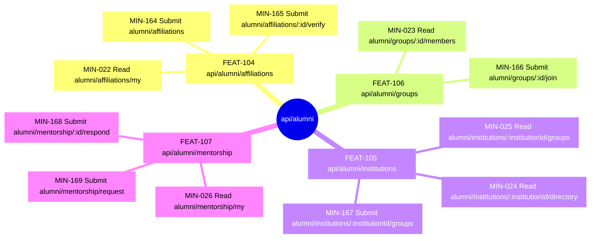
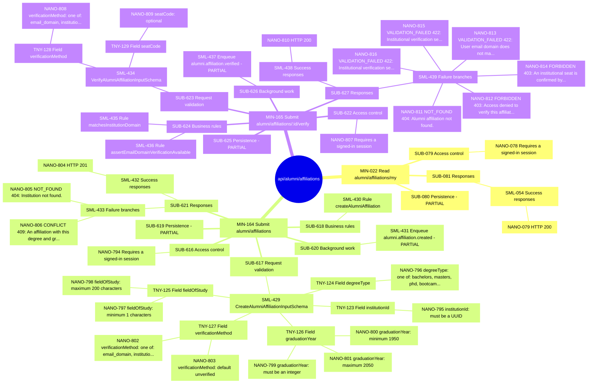
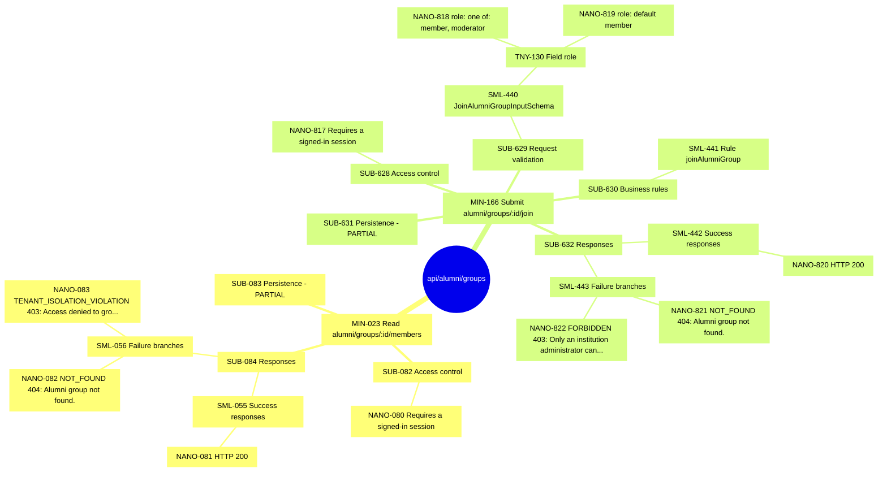
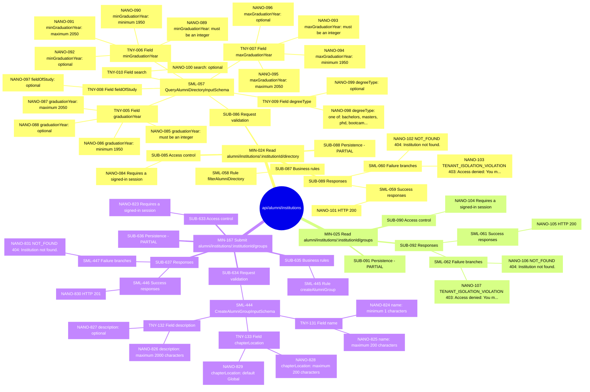
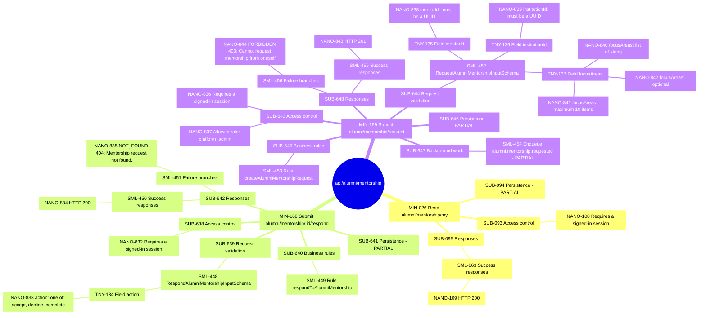

# api/alumni (MOD-085)

Generated by `docs/mindmap/tools/catalog.py` from `master/MASTER_PROJECT_GRAPH.json` at commit `9b3032f`. Do not edit by hand. Back to the [feature catalog](../FEATURE_CATALOG.md).

**Application:** apps/api (MOD-001). **Purpose:** API module: routes under /api/v1/alumni in apps/api/src/server.ts.

**Nodes by level:** MODULE 1, MAJOR 4, MINOR 11, SUB 50, SMALL 38, TINY 21, NANO 83. **Status:** IMPLEMENTED 194, PARTIALLY_IMPLEMENTED 14. **Verification:** PATH_LEVEL 181, UNKNOWN 3, VERIFIED 19.

**User roles that reach it:** authenticated, platform_admin.

**Known gaps:** MIN-022 ephemeral: state held in process memory, lost on restart; MIN-022 no first-party web caller found; MIN-164 ephemeral: state held in process memory, lost on restart; MIN-164 no first-party web caller found; MIN-165 ephemeral: state held in process memory, lost on restart; MIN-165 no first-party web caller found; MIN-023 ephemeral: state held in process memory, lost on restart; MIN-023 no first-party web caller found; MIN-166 ephemeral: state held in process memory, lost on restart; MIN-166 no first-party web caller found; MIN-024 ephemeral: state held in process memory, lost on restart; MIN-024 no first-party web caller found; MIN-025 ephemeral: state held in process memory, lost on restart; MIN-025 no first-party web caller found; MIN-167 ephemeral: state held in process memory, lost on restart; MIN-167 no first-party web caller found; MIN-026 ephemeral: state held in process memory, lost on restart; MIN-026 no first-party web caller found; MIN-168 ephemeral: state held in process memory, lost on restart; MIN-168 no first-party web caller found; MIN-169 ephemeral: state held in process memory, lost on restart; MIN-169 no first-party web caller found.

## Module map (to minor features)

## FEAT-104 api/alumni/affiliations

api/alumni/affiliations

| ID       | Level | Parent   | Name                                                                                    | Description                                                                                                                                                                                                                                                                                                                                                                                                                    | Status                | Verification | Evidence                                   | Related                                         |
| -------- | ----- | -------- | --------------------------------------------------------------------------------------- | ------------------------------------------------------------------------------------------------------------------------------------------------------------------------------------------------------------------------------------------------------------------------------------------------------------------------------------------------------------------------------------------------------------------------------ | --------------------- | ------------ | ------------------------------------------ | ----------------------------------------------- |
| FEAT-104 | MAJOR | MOD-085  | api/alumni/affiliations                                                                 |                                                                                                                                                                                                                                                                                                                                                                                                                                | IMPLEMENTED           |              | apps/api/src/server.ts:9084                |                                                 |
| MIN-022  | MINOR | FEAT-104 | Read alumni/affiliations/my                                                             | 3. Get Authenticated User's Alumni Affiliations GET /api/v1/alumni/affiliations/my for any signed-in session; ephemeral (process memory); responds 200. Gaps: ephemeral: state held in process memory, lost on restart; no first-party web caller found                                                                                                                                                                        | IMPLEMENTED           | VERIFIED     | apps/api/src/server.ts:9239                | API-187, TEST-085, TEST-125                     |
| SUB-079  | SUB   | MIN-022  | Access control                                                                          | Who may call GET /api/v1/alumni/affiliations/my: any signed-in session.                                                                                                                                                                                                                                                                                                                                                        | IMPLEMENTED           | PATH_LEVEL   | apps/api/src/server.ts:9239                |                                                 |
| NANO-078 | NANO  | SUB-079  | Requires a signed-in session                                                            | Requests without a valid session token are rejected with 401 UNAUTHENTICATED.                                                                                                                                                                                                                                                                                                                                                  | IMPLEMENTED           | PATH_LEVEL   | apps/api/src/server.ts:9239                | ROLE-001                                        |
| SUB-080  | SUB   | MIN-022  | Persistence                                                                             | Ephemeral: state lives in API process memory and is lost on restart.                                                                                                                                                                                                                                                                                                                                                           | PARTIALLY_IMPLEMENTED | PATH_LEVEL   | apps/api/src/server.ts:9239                |                                                 |
| SUB-081  | SUB   | MIN-022  | Responses                                                                               | Success 200; 0 explicit failure branch(es) besides validation and access errors.                                                                                                                                                                                                                                                                                                                                               | IMPLEMENTED           | PATH_LEVEL   | apps/api/src/server.ts:9239                |                                                 |
| SML-054  | SMALL | SUB-081  | Success responses                                                                       | HTTP 200.                                                                                                                                                                                                                                                                                                                                                                                                                      | IMPLEMENTED           | PATH_LEVEL   | apps/api/src/server.ts:9239                |                                                 |
| NANO-079 | NANO  | SML-054  | HTTP 200                                                                                | Replies 200 when the operation succeeds.                                                                                                                                                                                                                                                                                                                                                                                       | IMPLEMENTED           | PATH_LEVEL   | apps/api/src/server.ts:9239                |                                                 |
| MIN-164  | MINOR | FEAT-104 | Submit alumni/affiliations                                                              | POST /api/v1/alumni/affiliations for any signed-in session; validates CreateAlumniAffiliationInputSchema; calls createAlumniAffiliation; ephemeral (process memory); responds 201; 2 failure branch(es). Gaps: ephemeral: state held in process memory, lost on restart; no first-party web caller found                                                                                                                       | IMPLEMENTED           | VERIFIED     | apps/api/src/server.ts:9084                | API-185, TEST-085, TEST-101, TEST-125, TEST-166 |
| SUB-616  | SUB   | MIN-164  | Access control                                                                          | Who may call POST /api/v1/alumni/affiliations: any signed-in session.                                                                                                                                                                                                                                                                                                                                                          | IMPLEMENTED           | PATH_LEVEL   | apps/api/src/server.ts:9084                |                                                 |
| NANO-794 | NANO  | SUB-616  | Requires a signed-in session                                                            | Requests without a valid session token are rejected with 401 UNAUTHENTICATED.                                                                                                                                                                                                                                                                                                                                                  | IMPLEMENTED           | PATH_LEVEL   | apps/api/src/server.ts:9084                | ROLE-001                                        |
| SUB-617  | SUB   | MIN-164  | Request validation                                                                      | The request is parsed with CreateAlumniAffiliationInputSchema; a failure returns 400 with field details before any business logic runs.                                                                                                                                                                                                                                                                                        | IMPLEMENTED           | PATH_LEVEL   | apps/api/src/server.ts:9084                |                                                 |
| SML-429  | SMALL | SUB-617  | CreateAlumniAffiliationInputSchema                                                      | CreateAlumniAffiliationInputSchema: 5 field(s)                                                                                                                                                                                                                                                                                                                                                                                 | IMPLEMENTED           | PATH_LEVEL   | packages/contracts/src/index.ts:1375       | SCH-106                                         |
| TNY-123  | TINY  | SML-429  | Field institutionId                                                                     | institutionId (string, required): must be a UUID                                                                                                                                                                                                                                                                                                                                                                               | IMPLEMENTED           | PATH_LEVEL   | packages/contracts/src/index.ts:1376       |                                                 |
| NANO-795 | NANO  | TNY-123  | institutionId: must be a UUID                                                           | institutionId must be a UUID.                                                                                                                                                                                                                                                                                                                                                                                                  | IMPLEMENTED           | PATH_LEVEL   | packages/contracts/src/index.ts:1376       |                                                 |
| TNY-124  | TINY  | SML-429  | Field degreeType                                                                        | degreeType (enum, required): one of: bachelors, masters, phd, bootcamp, certification, other                                                                                                                                                                                                                                                                                                                                   | IMPLEMENTED           | PATH_LEVEL   | packages/contracts/src/index.ts:1377       |                                                 |
| NANO-796 | NANO  | TNY-124  | degreeType: one of: bachelors, masters, phd, bootcamp, certification, other             | degreeType one of: bachelors, masters, phd, bootcamp, certification, other.                                                                                                                                                                                                                                                                                                                                                    | IMPLEMENTED           | PATH_LEVEL   | packages/contracts/src/index.ts:1377       |                                                 |
| TNY-125  | TINY  | SML-429  | Field fieldOfStudy                                                                      | fieldOfStudy (string, required): minimum 1 characters; maximum 200 characters                                                                                                                                                                                                                                                                                                                                                  | IMPLEMENTED           | PATH_LEVEL   | packages/contracts/src/index.ts:1378       |                                                 |
| NANO-797 | NANO  | TNY-125  | fieldOfStudy: minimum 1 characters                                                      | fieldOfStudy minimum 1 characters.                                                                                                                                                                                                                                                                                                                                                                                             | IMPLEMENTED           | PATH_LEVEL   | packages/contracts/src/index.ts:1378       |                                                 |
| NANO-798 | NANO  | TNY-125  | fieldOfStudy: maximum 200 characters                                                    | fieldOfStudy maximum 200 characters.                                                                                                                                                                                                                                                                                                                                                                                           | IMPLEMENTED           | PATH_LEVEL   | packages/contracts/src/index.ts:1378       |                                                 |
| TNY-126  | TINY  | SML-429  | Field graduationYear                                                                    | graduationYear (number, required): must be an integer; minimum 1950; maximum 2050                                                                                                                                                                                                                                                                                                                                              | IMPLEMENTED           | PATH_LEVEL   | packages/contracts/src/index.ts:1379       |                                                 |
| NANO-799 | NANO  | TNY-126  | graduationYear: must be an integer                                                      | graduationYear must be an integer.                                                                                                                                                                                                                                                                                                                                                                                             | IMPLEMENTED           | PATH_LEVEL   | packages/contracts/src/index.ts:1379       |                                                 |
| NANO-800 | NANO  | TNY-126  | graduationYear: minimum 1950                                                            | graduationYear minimum 1950.                                                                                                                                                                                                                                                                                                                                                                                                   | IMPLEMENTED           | PATH_LEVEL   | packages/contracts/src/index.ts:1379       |                                                 |
| NANO-801 | NANO  | TNY-126  | graduationYear: maximum 2050                                                            | graduationYear maximum 2050.                                                                                                                                                                                                                                                                                                                                                                                                   | IMPLEMENTED           | PATH_LEVEL   | packages/contracts/src/index.ts:1379       |                                                 |
| TNY-127  | TINY  | SML-429  | Field verificationMethod                                                                | verificationMethod (enum, optional): one of: email_domain, institutional_seat, manual_review, unverified; default 'unverified'                                                                                                                                                                                                                                                                                                 | IMPLEMENTED           | PATH_LEVEL   | packages/contracts/src/index.ts:1380       |                                                 |
| NANO-802 | NANO  | TNY-127  | verificationMethod: one of: email_domain, institutional_seat, manual_review, unverified | verificationMethod one of: email_domain, institutional_seat, manual_review, unverified.                                                                                                                                                                                                                                                                                                                                        | IMPLEMENTED           | PATH_LEVEL   | packages/contracts/src/index.ts:1380       |                                                 |
| NANO-803 | NANO  | TNY-127  | verificationMethod: default 'unverified'                                                | verificationMethod default 'unverified'; message "unverified".                                                                                                                                                                                                                                                                                                                                                                 | IMPLEMENTED           | PATH_LEVEL   | packages/contracts/src/index.ts:1380       |                                                 |
| SUB-618  | SUB   | MIN-164  | Business rules                                                                          | Domain functions from packages/domain called by the handler (1).                                                                                                                                                                                                                                                                                                                                                               | IMPLEMENTED           | PATH_LEVEL   | apps/api/src/server.ts:9084                |                                                 |
| SML-430  | SMALL | SUB-618  | Rule createAlumniAffiliation                                                            | Calls createAlumniAffiliation (packages/domain/src/alumni-networks.ts). Rule status IMPLEMENTED; its own tests: VERIFIED.                                                                                                                                                                                                                                                                                                      | IMPLEMENTED           | VERIFIED     | packages/domain/src/alumni-networks.ts:156 | RULE-020                                        |
| SUB-619  | SUB   | MIN-164  | Persistence                                                                             | Ephemeral: state lives in API process memory and is lost on restart.                                                                                                                                                                                                                                                                                                                                                           | PARTIALLY_IMPLEMENTED | PATH_LEVEL   | apps/api/src/server.ts:9084                |                                                 |
| SUB-620  | SUB   | MIN-164  | Background work                                                                         | Enqueues 1 background job kind(s) in background_jobs for apps/worker.                                                                                                                                                                                                                                                                                                                                                          | IMPLEMENTED           | PATH_LEVEL   | apps/api/src/server.ts:9084                |                                                 |
| SML-431  | SMALL | SUB-620  | Enqueue alumni.affiliation.created                                                      | Dispatches job:alumni.affiliation.created; worker handler: recordEvent (no-op: marks the event recorded).                                                                                                                                                                                                                                                                                                                      | PARTIALLY_IMPLEMENTED | UNKNOWN      | packages/domain/src/background-jobs.ts:171 | SVC-003                                         |
| SUB-621  | SUB   | MIN-164  | Responses                                                                               | Success 201; 2 explicit failure branch(es) besides validation and access errors.                                                                                                                                                                                                                                                                                                                                               | IMPLEMENTED           | PATH_LEVEL   | apps/api/src/server.ts:9084                |                                                 |
| SML-432  | SMALL | SUB-621  | Success responses                                                                       | HTTP 201.                                                                                                                                                                                                                                                                                                                                                                                                                      | IMPLEMENTED           | PATH_LEVEL   | apps/api/src/server.ts:9084                |                                                 |
| NANO-804 | NANO  | SML-432  | HTTP 201                                                                                | Replies 201 when the operation succeeds.                                                                                                                                                                                                                                                                                                                                                                                       | IMPLEMENTED           | PATH_LEVEL   | apps/api/src/server.ts:9084                |                                                 |
| SML-433  | SMALL | SUB-621  | Failure branches                                                                        | 2 DomainError branch(es) in the handler, mapped to HTTP by the global error handler.                                                                                                                                                                                                                                                                                                                                           | IMPLEMENTED           | PATH_LEVEL   | apps/api/src/server.ts:9084                |                                                 |
| NANO-805 | NANO  | SML-433  | NOT_FOUND 404: Institution not found.                                                   | Throws DomainError(NOT_FOUND) "Institution not found." -> HTTP 404.                                                                                                                                                                                                                                                                                                                                                            | IMPLEMENTED           | PATH_LEVEL   | apps/api/src/server.ts:9090                | ERR-184                                         |
| NANO-806 | NANO  | SML-433  | CONFLICT 409: An affiliation with this degree and graduation year already exists for    | Throws DomainError(CONFLICT) "An affiliation with this degree and graduation year already exists for this institution." -> HTTP 409.                                                                                                                                                                                                                                                                                           | IMPLEMENTED           | PATH_LEVEL   | apps/api/src/server.ts:9101                | ERR-185                                         |
| MIN-165  | MINOR | FEAT-104 | Submit alumni/affiliations/:id/verify                                                   | 2. Verify Alumni Affiliation (by email domain match or seat code) POST /api/v1/alumni/affiliations/:id/verify for any signed-in session; validates VerifyAlumniAffiliationInputSchema; calls matchesInstitutionDomain, assertEmailDomainVerificationAvailable; ephemeral (process memory); responds 200; 6 failure branch(es). Gaps: ephemeral: state held in process memory, lost on restart; no first-party web caller found | IMPLEMENTED           | VERIFIED     | apps/api/src/server.ts:9158                | API-186, TEST-085, TEST-101, TEST-125, TEST-166 |
| SUB-622  | SUB   | MIN-165  | Access control                                                                          | Who may call POST /api/v1/alumni/affiliations/:id/verify: any signed-in session.                                                                                                                                                                                                                                                                                                                                               | IMPLEMENTED           | PATH_LEVEL   | apps/api/src/server.ts:9158                |                                                 |
| NANO-807 | NANO  | SUB-622  | Requires a signed-in session                                                            | Requests without a valid session token are rejected with 401 UNAUTHENTICATED.                                                                                                                                                                                                                                                                                                                                                  | IMPLEMENTED           | PATH_LEVEL   | apps/api/src/server.ts:9158                | ROLE-001                                        |
| SUB-623  | SUB   | MIN-165  | Request validation                                                                      | The request is parsed with VerifyAlumniAffiliationInputSchema; a failure returns 400 with field details before any business logic runs.                                                                                                                                                                                                                                                                                        | IMPLEMENTED           | PATH_LEVEL   | apps/api/src/server.ts:9158                |                                                 |
| SML-434  | SMALL | SUB-623  | VerifyAlumniAffiliationInputSchema                                                      | VerifyAlumniAffiliationInputSchema: 2 field(s)                                                                                                                                                                                                                                                                                                                                                                                 | IMPLEMENTED           | PATH_LEVEL   | packages/contracts/src/index.ts:1387       | SCH-107                                         |
| TNY-128  | TINY  | SML-434  | Field verificationMethod                                                                | verificationMethod (enum, required): one of: email_domain, institutional_seat                                                                                                                                                                                                                                                                                                                                                  | IMPLEMENTED           | PATH_LEVEL   | packages/contracts/src/index.ts:1388       |                                                 |
| NANO-808 | NANO  | TNY-128  | verificationMethod: one of: email_domain, institutional_seat                            | verificationMethod one of: email_domain, institutional_seat.                                                                                                                                                                                                                                                                                                                                                                   | IMPLEMENTED           | PATH_LEVEL   | packages/contracts/src/index.ts:1388       |                                                 |
| TNY-129  | TINY  | SML-434  | Field seatCode                                                                          | seatCode (string, optional): optional                                                                                                                                                                                                                                                                                                                                                                                          | IMPLEMENTED           | PATH_LEVEL   | packages/contracts/src/index.ts:1389       |                                                 |
| NANO-809 | NANO  | TNY-129  | seatCode: optional                                                                      | seatCode optional.                                                                                                                                                                                                                                                                                                                                                                                                             | IMPLEMENTED           | PATH_LEVEL   | packages/contracts/src/index.ts:1389       |                                                 |
| SUB-624  | SUB   | MIN-165  | Business rules                                                                          | Domain functions from packages/domain called by the handler (2).                                                                                                                                                                                                                                                                                                                                                               | IMPLEMENTED           | PATH_LEVEL   | apps/api/src/server.ts:9158                |                                                 |
| SML-435  | SMALL | SUB-624  | Rule matchesInstitutionDomain                                                           | Calls matchesInstitutionDomain (packages/domain/src/alumni-networks.ts). Rule status IMPLEMENTED; its own tests: VERIFIED.                                                                                                                                                                                                                                                                                                     | IMPLEMENTED           | VERIFIED     | packages/domain/src/alumni-networks.ts:123 | RULE-018                                        |
| SML-436  | SMALL | SUB-624  | Rule assertEmailDomainVerificationAvailable                                             | Calls assertEmailDomainVerificationAvailable (packages/domain/src/alumni-networks.ts). Rule status IMPLEMENTED; its own tests: VERIFIED.                                                                                                                                                                                                                                                                                       | IMPLEMENTED           | VERIFIED     | packages/domain/src/alumni-networks.ts:144 | RULE-019                                        |
| SUB-625  | SUB   | MIN-165  | Persistence                                                                             | Ephemeral: state lives in API process memory and is lost on restart.                                                                                                                                                                                                                                                                                                                                                           | PARTIALLY_IMPLEMENTED | PATH_LEVEL   | apps/api/src/server.ts:9158                |                                                 |
| SUB-626  | SUB   | MIN-165  | Background work                                                                         | Enqueues 1 background job kind(s) in background_jobs for apps/worker.                                                                                                                                                                                                                                                                                                                                                          | IMPLEMENTED           | PATH_LEVEL   | apps/api/src/server.ts:9158                |                                                 |
| SML-437  | SMALL | SUB-626  | Enqueue alumni.affiliation.verified                                                     | Dispatches job:alumni.affiliation.verified; worker handler: recordEvent (no-op: marks the event recorded).                                                                                                                                                                                                                                                                                                                     | PARTIALLY_IMPLEMENTED | UNKNOWN      | packages/domain/src/background-jobs.ts:171 | SVC-004                                         |
| SUB-627  | SUB   | MIN-165  | Responses                                                                               | Success 200; 6 explicit failure branch(es) besides validation and access errors.                                                                                                                                                                                                                                                                                                                                               | IMPLEMENTED           | PATH_LEVEL   | apps/api/src/server.ts:9158                |                                                 |
| SML-438  | SMALL | SUB-627  | Success responses                                                                       | HTTP 200.                                                                                                                                                                                                                                                                                                                                                                                                                      | IMPLEMENTED           | PATH_LEVEL   | apps/api/src/server.ts:9158                |                                                 |
| NANO-810 | NANO  | SML-438  | HTTP 200                                                                                | Replies 200 when the operation succeeds.                                                                                                                                                                                                                                                                                                                                                                                       | IMPLEMENTED           | PATH_LEVEL   | apps/api/src/server.ts:9158                |                                                 |
| SML-439  | SMALL | SUB-627  | Failure branches                                                                        | 6 DomainError branch(es) in the handler, mapped to HTTP by the global error handler.                                                                                                                                                                                                                                                                                                                                           | IMPLEMENTED           | PATH_LEVEL   | apps/api/src/server.ts:9158                |                                                 |
| NANO-811 | NANO  | SML-439  | NOT_FOUND 404: Alumni affiliation not found.                                            | Throws DomainError(NOT_FOUND) "Alumni affiliation not found." -> HTTP 404.                                                                                                                                                                                                                                                                                                                                                     | IMPLEMENTED           | PATH_LEVEL   | apps/api/src/server.ts:9167                | ERR-186                                         |
| NANO-812 | NANO  | SML-439  | FORBIDDEN 403: Access denied to verify this affiliation.                                | Throws DomainError(FORBIDDEN) "Access denied to verify this affiliation." -> HTTP 403.                                                                                                                                                                                                                                                                                                                                         | IMPLEMENTED           | PATH_LEVEL   | apps/api/src/server.ts:9173                | ERR-187                                         |
| NANO-813 | NANO  | SML-439  | VALIDATION_FAILED 422: User email domain does not match institution domain.             | Throws DomainError(VALIDATION_FAILED) "User email domain does not match institution domain." -> HTTP 422.                                                                                                                                                                                                                                                                                                                      | IMPLEMENTED           | PATH_LEVEL   | apps/api/src/server.ts:9183                | ERR-188                                         |
| NANO-814 | NANO  | SML-439  | FORBIDDEN 403: An institutional seat is confirmed by an administrator of that institu   | Throws DomainError(FORBIDDEN) "An institutional seat is confirmed by an administrator of that institution." -> HTTP 403.                                                                                                                                                                                                                                                                                                       | IMPLEMENTED           | PATH_LEVEL   | apps/api/src/server.ts:9196                | ERR-189                                         |
| NANO-815 | NANO  | SML-439  | VALIDATION_FAILED 422: Institutional verification seat code is required.                | Throws DomainError(VALIDATION_FAILED) "Institutional verification seat code is required." -> HTTP 422.                                                                                                                                                                                                                                                                                                                         | IMPLEMENTED           | PATH_LEVEL   | apps/api/src/server.ts:9202                | ERR-190                                         |
| NANO-816 | NANO  | SML-439  | VALIDATION_FAILED 422: Institutional verification seat code is invalid.                 | Throws DomainError(VALIDATION_FAILED) "Institutional verification seat code is invalid." -> HTTP 422.                                                                                                                                                                                                                                                                                                                          | IMPLEMENTED           | PATH_LEVEL   | apps/api/src/server.ts:9208                | ERR-191                                         |

## FEAT-106 api/alumni/groups

api/alumni/groups

| ID       | Level | Parent   | Name                                                                              | Description                                                                                                                                                                                                                                                                                                      | Status                | Verification | Evidence                                   | Related                               |
| -------- | ----- | -------- | --------------------------------------------------------------------------------- | ---------------------------------------------------------------------------------------------------------------------------------------------------------------------------------------------------------------------------------------------------------------------------------------------------------------- | --------------------- | ------------ | ------------------------------------------ | ------------------------------------- |
| FEAT-106 | MAJOR | MOD-085  | api/alumni/groups                                                                 |                                                                                                                                                                                                                                                                                                                  | IMPLEMENTED           |              | apps/api/src/server.ts:9388                |                                       |
| MIN-023  | MINOR | FEAT-106 | Read alumni/groups/:id/members                                                    | 8. List Members of Alumni Group GET /api/v1/alumni/groups/:id/members for any signed-in session; ephemeral (process memory); responds 200; 2 failure branch(es). Gaps: ephemeral: state held in process memory, lost on restart; no first-party web caller found                                                 | IMPLEMENTED           | VERIFIED     | apps/api/src/server.ts:9442                | API-192, TEST-085, TEST-101, TEST-166 |
| SUB-082  | SUB   | MIN-023  | Access control                                                                    | Who may call GET /api/v1/alumni/groups/:id/members: any signed-in session.                                                                                                                                                                                                                                       | IMPLEMENTED           | PATH_LEVEL   | apps/api/src/server.ts:9442                |                                       |
| NANO-080 | NANO  | SUB-082  | Requires a signed-in session                                                      | Requests without a valid session token are rejected with 401 UNAUTHENTICATED.                                                                                                                                                                                                                                    | IMPLEMENTED           | PATH_LEVEL   | apps/api/src/server.ts:9442                | ROLE-001                              |
| SUB-083  | SUB   | MIN-023  | Persistence                                                                       | Ephemeral: state lives in API process memory and is lost on restart.                                                                                                                                                                                                                                             | PARTIALLY_IMPLEMENTED | PATH_LEVEL   | apps/api/src/server.ts:9442                |                                       |
| SUB-084  | SUB   | MIN-023  | Responses                                                                         | Success 200; 2 explicit failure branch(es) besides validation and access errors.                                                                                                                                                                                                                                 | IMPLEMENTED           | PATH_LEVEL   | apps/api/src/server.ts:9442                |                                       |
| SML-055  | SMALL | SUB-084  | Success responses                                                                 | HTTP 200.                                                                                                                                                                                                                                                                                                        | IMPLEMENTED           | PATH_LEVEL   | apps/api/src/server.ts:9442                |                                       |
| NANO-081 | NANO  | SML-055  | HTTP 200                                                                          | Replies 200 when the operation succeeds.                                                                                                                                                                                                                                                                         | IMPLEMENTED           | PATH_LEVEL   | apps/api/src/server.ts:9442                |                                       |
| SML-056  | SMALL | SUB-084  | Failure branches                                                                  | 2 DomainError branch(es) in the handler, mapped to HTTP by the global error handler.                                                                                                                                                                                                                             | IMPLEMENTED           | PATH_LEVEL   | apps/api/src/server.ts:9442                |                                       |
| NANO-082 | NANO  | SML-056  | NOT_FOUND 404: Alumni group not found.                                            | Throws DomainError(NOT_FOUND) "Alumni group not found." -> HTTP 404.                                                                                                                                                                                                                                             | IMPLEMENTED           | PATH_LEVEL   | apps/api/src/server.ts:9450                | ERR-194                               |
| NANO-083 | NANO  | SML-056  | TENANT_ISOLATION_VIOLATION 403: Access denied to group members.                   | Throws DomainError(TENANT_ISOLATION_VIOLATION) "Access denied to group members." -> HTTP 403.                                                                                                                                                                                                                    | IMPLEMENTED           | PATH_LEVEL   | apps/api/src/server.ts:9456                | ERR-196                               |
| MIN-166  | MINOR | FEAT-106 | Submit alumni/groups/:id/join                                                     | 7. Join Alumni Group POST /api/v1/alumni/groups/:id/join for any signed-in session; validates JoinAlumniGroupInputSchema; calls joinAlumniGroup; ephemeral (process memory); responds 200; 2 failure branch(es). Gaps: ephemeral: state held in process memory, lost on restart; no first-party web caller found | IMPLEMENTED           | VERIFIED     | apps/api/src/server.ts:9388                | API-191, TEST-085, TEST-101, TEST-166 |
| SUB-628  | SUB   | MIN-166  | Access control                                                                    | Who may call POST /api/v1/alumni/groups/:id/join: any signed-in session.                                                                                                                                                                                                                                         | IMPLEMENTED           | PATH_LEVEL   | apps/api/src/server.ts:9388                |                                       |
| NANO-817 | NANO  | SUB-628  | Requires a signed-in session                                                      | Requests without a valid session token are rejected with 401 UNAUTHENTICATED.                                                                                                                                                                                                                                    | IMPLEMENTED           | PATH_LEVEL   | apps/api/src/server.ts:9388                | ROLE-001                              |
| SUB-629  | SUB   | MIN-166  | Request validation                                                                | The request is parsed with JoinAlumniGroupInputSchema; a failure returns 400 with field details before any business logic runs.                                                                                                                                                                                  | IMPLEMENTED           | PATH_LEVEL   | apps/api/src/server.ts:9388                |                                       |
| SML-440  | SMALL | SUB-629  | JoinAlumniGroupInputSchema                                                        | JoinAlumniGroupInputSchema: 1 field(s)                                                                                                                                                                                                                                                                           | IMPLEMENTED           | PATH_LEVEL   | packages/contracts/src/index.ts:1415       | SCH-110                               |
| TNY-130  | TINY  | SML-440  | Field role                                                                        | role (enum, optional): one of: member, moderator; default 'member'                                                                                                                                                                                                                                               | IMPLEMENTED           | PATH_LEVEL   | packages/contracts/src/index.ts:1416       |                                       |
| NANO-818 | NANO  | TNY-130  | role: one of: member, moderator                                                   | role one of: member, moderator.                                                                                                                                                                                                                                                                                  | IMPLEMENTED           | PATH_LEVEL   | packages/contracts/src/index.ts:1416       |                                       |
| NANO-819 | NANO  | TNY-130  | role: default 'member'                                                            | role default 'member'; message "member".                                                                                                                                                                                                                                                                         | IMPLEMENTED           | PATH_LEVEL   | packages/contracts/src/index.ts:1416       |                                       |
| SUB-630  | SUB   | MIN-166  | Business rules                                                                    | Domain functions from packages/domain called by the handler (1).                                                                                                                                                                                                                                                 | IMPLEMENTED           | PATH_LEVEL   | apps/api/src/server.ts:9388                |                                       |
| SML-441  | SMALL | SUB-630  | Rule joinAlumniGroup                                                              | Calls joinAlumniGroup (packages/domain/src/alumni-networks.ts). Rule status IMPLEMENTED; its own tests: VERIFIED.                                                                                                                                                                                                | IMPLEMENTED           | VERIFIED     | packages/domain/src/alumni-networks.ts:329 | RULE-024                              |
| SUB-631  | SUB   | MIN-166  | Persistence                                                                       | Ephemeral: state lives in API process memory and is lost on restart.                                                                                                                                                                                                                                             | PARTIALLY_IMPLEMENTED | PATH_LEVEL   | apps/api/src/server.ts:9388                |                                       |
| SUB-632  | SUB   | MIN-166  | Responses                                                                         | Success 200; 2 explicit failure branch(es) besides validation and access errors.                                                                                                                                                                                                                                 | IMPLEMENTED           | PATH_LEVEL   | apps/api/src/server.ts:9388                |                                       |
| SML-442  | SMALL | SUB-632  | Success responses                                                                 | HTTP 200.                                                                                                                                                                                                                                                                                                        | IMPLEMENTED           | PATH_LEVEL   | apps/api/src/server.ts:9388                |                                       |
| NANO-820 | NANO  | SML-442  | HTTP 200                                                                          | Replies 200 when the operation succeeds.                                                                                                                                                                                                                                                                         | IMPLEMENTED           | PATH_LEVEL   | apps/api/src/server.ts:9388                |                                       |
| SML-443  | SMALL | SUB-632  | Failure branches                                                                  | 2 DomainError branch(es) in the handler, mapped to HTTP by the global error handler.                                                                                                                                                                                                                             | IMPLEMENTED           | PATH_LEVEL   | apps/api/src/server.ts:9388                |                                       |
| NANO-821 | NANO  | SML-443  | NOT_FOUND 404: Alumni group not found.                                            | Throws DomainError(NOT_FOUND) "Alumni group not found." -> HTTP 404.                                                                                                                                                                                                                                             | IMPLEMENTED           | PATH_LEVEL   | apps/api/src/server.ts:9396                | ERR-194                               |
| NANO-822 | NANO  | SML-443  | FORBIDDEN 403: Only an institution administrator can join a group as a moderator. | Throws DomainError(FORBIDDEN) "Only an institution administrator can join a group as a moderator." -> HTTP 403.                                                                                                                                                                                                  | IMPLEMENTED           | PATH_LEVEL   | apps/api/src/server.ts:9404                | ERR-195                               |

## FEAT-105 api/alumni/institutions

api/alumni/institutions

| ID       | Level | Parent   | Name                                                                                                   | Description                                                                                                                                                                                                                                                                                                                                                                                                             | Status                | Verification | Evidence                                   | Related                                         |
| -------- | ----- | -------- | ------------------------------------------------------------------------------------------------------ | ----------------------------------------------------------------------------------------------------------------------------------------------------------------------------------------------------------------------------------------------------------------------------------------------------------------------------------------------------------------------------------------------------------------------- | --------------------- | ------------ | ------------------------------------------ | ----------------------------------------------- |
| FEAT-105 | MAJOR | MOD-085  | api/alumni/institutions                                                                                |                                                                                                                                                                                                                                                                                                                                                                                                                         | IMPLEMENTED           |              | apps/api/src/server.ts:9249                |                                                 |
| MIN-024  | MINOR | FEAT-105 | Read alumni/institutions/:institutionId/directory                                                      | 4. Institutional Alumni Directory Discovery (Strict Cross-Institution Isolation BR-F125-03) GET /api/v1/alumni/institutions/:institutionId/directory for any signed-in session; validates QueryAlumniDirectoryInputSchema; calls filterAlumniDirectory; ephemeral (process memory); responds 200; 2 failure branch(es). Gaps: ephemeral: state held in process memory, lost on restart; no first-party web caller found | IMPLEMENTED           | VERIFIED     | apps/api/src/server.ts:9249                | API-188, TEST-085, TEST-101, TEST-166           |
| SUB-085  | SUB   | MIN-024  | Access control                                                                                         | Who may call GET /api/v1/alumni/institutions/:institutionId/directory: any signed-in session.                                                                                                                                                                                                                                                                                                                           | IMPLEMENTED           | PATH_LEVEL   | apps/api/src/server.ts:9249                |                                                 |
| NANO-084 | NANO  | SUB-085  | Requires a signed-in session                                                                           | Requests without a valid session token are rejected with 401 UNAUTHENTICATED.                                                                                                                                                                                                                                                                                                                                           | IMPLEMENTED           | PATH_LEVEL   | apps/api/src/server.ts:9249                | ROLE-001                                        |
| SUB-086  | SUB   | MIN-024  | Request validation                                                                                     | The request is parsed with QueryAlumniDirectoryInputSchema; a failure returns 400 with field details before any business logic runs.                                                                                                                                                                                                                                                                                    | IMPLEMENTED           | PATH_LEVEL   | apps/api/src/server.ts:9249                |                                                 |
| SML-057  | SMALL | SUB-086  | QueryAlumniDirectoryInputSchema                                                                        | QueryAlumniDirectoryInputSchema: 6 field(s)                                                                                                                                                                                                                                                                                                                                                                             | IMPLEMENTED           | PATH_LEVEL   | packages/contracts/src/index.ts:1394       | SCH-108                                         |
| TNY-005  | TINY  | SML-057  | Field graduationYear                                                                                   | graduationYear (number, optional): must be an integer; minimum 1950; maximum 2050; optional                                                                                                                                                                                                                                                                                                                             | IMPLEMENTED           | PATH_LEVEL   | packages/contracts/src/index.ts:1395       |                                                 |
| NANO-085 | NANO  | TNY-005  | graduationYear: must be an integer                                                                     | graduationYear must be an integer.                                                                                                                                                                                                                                                                                                                                                                                      | IMPLEMENTED           | PATH_LEVEL   | packages/contracts/src/index.ts:1395       |                                                 |
| NANO-086 | NANO  | TNY-005  | graduationYear: minimum 1950                                                                           | graduationYear minimum 1950.                                                                                                                                                                                                                                                                                                                                                                                            | IMPLEMENTED           | PATH_LEVEL   | packages/contracts/src/index.ts:1395       |                                                 |
| NANO-087 | NANO  | TNY-005  | graduationYear: maximum 2050                                                                           | graduationYear maximum 2050.                                                                                                                                                                                                                                                                                                                                                                                            | IMPLEMENTED           | PATH_LEVEL   | packages/contracts/src/index.ts:1395       |                                                 |
| NANO-088 | NANO  | TNY-005  | graduationYear: optional                                                                               | graduationYear optional.                                                                                                                                                                                                                                                                                                                                                                                                | IMPLEMENTED           | PATH_LEVEL   | packages/contracts/src/index.ts:1395       |                                                 |
| TNY-006  | TINY  | SML-057  | Field minGraduationYear                                                                                | minGraduationYear (number, optional): must be an integer; minimum 1950; maximum 2050; optional                                                                                                                                                                                                                                                                                                                          | IMPLEMENTED           | PATH_LEVEL   | packages/contracts/src/index.ts:1396       |                                                 |
| NANO-089 | NANO  | TNY-006  | minGraduationYear: must be an integer                                                                  | minGraduationYear must be an integer.                                                                                                                                                                                                                                                                                                                                                                                   | IMPLEMENTED           | PATH_LEVEL   | packages/contracts/src/index.ts:1396       |                                                 |
| NANO-090 | NANO  | TNY-006  | minGraduationYear: minimum 1950                                                                        | minGraduationYear minimum 1950.                                                                                                                                                                                                                                                                                                                                                                                         | IMPLEMENTED           | PATH_LEVEL   | packages/contracts/src/index.ts:1396       |                                                 |
| NANO-091 | NANO  | TNY-006  | minGraduationYear: maximum 2050                                                                        | minGraduationYear maximum 2050.                                                                                                                                                                                                                                                                                                                                                                                         | IMPLEMENTED           | PATH_LEVEL   | packages/contracts/src/index.ts:1396       |                                                 |
| NANO-092 | NANO  | TNY-006  | minGraduationYear: optional                                                                            | minGraduationYear optional.                                                                                                                                                                                                                                                                                                                                                                                             | IMPLEMENTED           | PATH_LEVEL   | packages/contracts/src/index.ts:1396       |                                                 |
| TNY-007  | TINY  | SML-057  | Field maxGraduationYear                                                                                | maxGraduationYear (number, optional): must be an integer; minimum 1950; maximum 2050; optional                                                                                                                                                                                                                                                                                                                          | IMPLEMENTED           | PATH_LEVEL   | packages/contracts/src/index.ts:1397       |                                                 |
| NANO-093 | NANO  | TNY-007  | maxGraduationYear: must be an integer                                                                  | maxGraduationYear must be an integer.                                                                                                                                                                                                                                                                                                                                                                                   | IMPLEMENTED           | PATH_LEVEL   | packages/contracts/src/index.ts:1397       |                                                 |
| NANO-094 | NANO  | TNY-007  | maxGraduationYear: minimum 1950                                                                        | maxGraduationYear minimum 1950.                                                                                                                                                                                                                                                                                                                                                                                         | IMPLEMENTED           | PATH_LEVEL   | packages/contracts/src/index.ts:1397       |                                                 |
| NANO-095 | NANO  | TNY-007  | maxGraduationYear: maximum 2050                                                                        | maxGraduationYear maximum 2050.                                                                                                                                                                                                                                                                                                                                                                                         | IMPLEMENTED           | PATH_LEVEL   | packages/contracts/src/index.ts:1397       |                                                 |
| NANO-096 | NANO  | TNY-007  | maxGraduationYear: optional                                                                            | maxGraduationYear optional.                                                                                                                                                                                                                                                                                                                                                                                             | IMPLEMENTED           | PATH_LEVEL   | packages/contracts/src/index.ts:1397       |                                                 |
| TNY-008  | TINY  | SML-057  | Field fieldOfStudy                                                                                     | fieldOfStudy (string, optional): optional                                                                                                                                                                                                                                                                                                                                                                               | IMPLEMENTED           | PATH_LEVEL   | packages/contracts/src/index.ts:1398       |                                                 |
| NANO-097 | NANO  | TNY-008  | fieldOfStudy: optional                                                                                 | fieldOfStudy optional.                                                                                                                                                                                                                                                                                                                                                                                                  | IMPLEMENTED           | PATH_LEVEL   | packages/contracts/src/index.ts:1398       |                                                 |
| TNY-009  | TINY  | SML-057  | Field degreeType                                                                                       | degreeType (enum, optional): one of: bachelors, masters, phd, bootcamp, certification, other; optional                                                                                                                                                                                                                                                                                                                  | IMPLEMENTED           | PATH_LEVEL   | packages/contracts/src/index.ts:1399       |                                                 |
| NANO-098 | NANO  | TNY-009  | degreeType: one of: bachelors, masters, phd, bootcamp, certification, other                            | degreeType one of: bachelors, masters, phd, bootcamp, certification, other.                                                                                                                                                                                                                                                                                                                                             | IMPLEMENTED           | PATH_LEVEL   | packages/contracts/src/index.ts:1399       |                                                 |
| NANO-099 | NANO  | TNY-009  | degreeType: optional                                                                                   | degreeType optional.                                                                                                                                                                                                                                                                                                                                                                                                    | IMPLEMENTED           | PATH_LEVEL   | packages/contracts/src/index.ts:1399       |                                                 |
| TNY-010  | TINY  | SML-057  | Field search                                                                                           | search (string, optional): optional                                                                                                                                                                                                                                                                                                                                                                                     | IMPLEMENTED           | PATH_LEVEL   | packages/contracts/src/index.ts:1402       |                                                 |
| NANO-100 | NANO  | TNY-010  | search: optional                                                                                       | search optional.                                                                                                                                                                                                                                                                                                                                                                                                        | IMPLEMENTED           | PATH_LEVEL   | packages/contracts/src/index.ts:1402       |                                                 |
| SUB-087  | SUB   | MIN-024  | Business rules                                                                                         | Domain functions from packages/domain called by the handler (1).                                                                                                                                                                                                                                                                                                                                                        | IMPLEMENTED           | PATH_LEVEL   | apps/api/src/server.ts:9249                |                                                 |
| SML-058  | SMALL | SUB-087  | Rule filterAlumniDirectory                                                                             | Calls filterAlumniDirectory (packages/domain/src/alumni-networks.ts). Rule status IMPLEMENTED; its own tests: VERIFIED.                                                                                                                                                                                                                                                                                                 | IMPLEMENTED           | VERIFIED     | packages/domain/src/alumni-networks.ts:220 | RULE-022                                        |
| SUB-088  | SUB   | MIN-024  | Persistence                                                                                            | Ephemeral: state lives in API process memory and is lost on restart.                                                                                                                                                                                                                                                                                                                                                    | PARTIALLY_IMPLEMENTED | PATH_LEVEL   | apps/api/src/server.ts:9249                |                                                 |
| SUB-089  | SUB   | MIN-024  | Responses                                                                                              | Success 200; 2 explicit failure branch(es) besides validation and access errors.                                                                                                                                                                                                                                                                                                                                        | IMPLEMENTED           | PATH_LEVEL   | apps/api/src/server.ts:9249                |                                                 |
| SML-059  | SMALL | SUB-089  | Success responses                                                                                      | HTTP 200.                                                                                                                                                                                                                                                                                                                                                                                                               | IMPLEMENTED           | PATH_LEVEL   | apps/api/src/server.ts:9249                |                                                 |
| NANO-101 | NANO  | SML-059  | HTTP 200                                                                                               | Replies 200 when the operation succeeds.                                                                                                                                                                                                                                                                                                                                                                                | IMPLEMENTED           | PATH_LEVEL   | apps/api/src/server.ts:9249                |                                                 |
| SML-060  | SMALL | SUB-089  | Failure branches                                                                                       | 2 DomainError branch(es) in the handler, mapped to HTTP by the global error handler.                                                                                                                                                                                                                                                                                                                                    | IMPLEMENTED           | PATH_LEVEL   | apps/api/src/server.ts:9249                |                                                 |
| NANO-102 | NANO  | SML-060  | NOT_FOUND 404: Institution not found.                                                                  | Throws DomainError(NOT_FOUND) "Institution not found." -> HTTP 404.                                                                                                                                                                                                                                                                                                                                                     | IMPLEMENTED           | PATH_LEVEL   | apps/api/src/server.ts:9257                | ERR-184                                         |
| NANO-103 | NANO  | SML-060  | TENANT_ISOLATION_VIOLATION 403: Access denied: You must be a verified alumni or member of this institu | Throws DomainError(TENANT_ISOLATION_VIOLATION) "Access denied: You must be a verified alumni or member of this institution to browse its directory." -> HTTP 403.                                                                                                                                                                                                                                                       | IMPLEMENTED           | PATH_LEVEL   | apps/api/src/server.ts:9265                | ERR-192                                         |
| MIN-025  | MINOR | FEAT-105 | Read alumni/institutions/:institutionId/groups                                                         | 6. List Alumni Groups for Institution GET /api/v1/alumni/institutions/:institutionId/groups for any signed-in session; ephemeral (process memory); responds 200; 2 failure branch(es). Gaps: ephemeral: state held in process memory, lost on restart; no first-party web caller found                                                                                                                                  | IMPLEMENTED           | VERIFIED     | apps/api/src/server.ts:9357                | API-190, TEST-101, TEST-125                     |
| SUB-090  | SUB   | MIN-025  | Access control                                                                                         | Who may call GET /api/v1/alumni/institutions/:institutionId/groups: any signed-in session.                                                                                                                                                                                                                                                                                                                              | IMPLEMENTED           | PATH_LEVEL   | apps/api/src/server.ts:9357                |                                                 |
| NANO-104 | NANO  | SUB-090  | Requires a signed-in session                                                                           | Requests without a valid session token are rejected with 401 UNAUTHENTICATED.                                                                                                                                                                                                                                                                                                                                           | IMPLEMENTED           | PATH_LEVEL   | apps/api/src/server.ts:9357                | ROLE-001                                        |
| SUB-091  | SUB   | MIN-025  | Persistence                                                                                            | Ephemeral: state lives in API process memory and is lost on restart.                                                                                                                                                                                                                                                                                                                                                    | PARTIALLY_IMPLEMENTED | PATH_LEVEL   | apps/api/src/server.ts:9357                |                                                 |
| SUB-092  | SUB   | MIN-025  | Responses                                                                                              | Success 200; 2 explicit failure branch(es) besides validation and access errors.                                                                                                                                                                                                                                                                                                                                        | IMPLEMENTED           | PATH_LEVEL   | apps/api/src/server.ts:9357                |                                                 |
| SML-061  | SMALL | SUB-092  | Success responses                                                                                      | HTTP 200.                                                                                                                                                                                                                                                                                                                                                                                                               | IMPLEMENTED           | PATH_LEVEL   | apps/api/src/server.ts:9357                |                                                 |
| NANO-105 | NANO  | SML-061  | HTTP 200                                                                                               | Replies 200 when the operation succeeds.                                                                                                                                                                                                                                                                                                                                                                                | IMPLEMENTED           | PATH_LEVEL   | apps/api/src/server.ts:9357                |                                                 |
| SML-062  | SMALL | SUB-092  | Failure branches                                                                                       | 2 DomainError branch(es) in the handler, mapped to HTTP by the global error handler.                                                                                                                                                                                                                                                                                                                                    | IMPLEMENTED           | PATH_LEVEL   | apps/api/src/server.ts:9357                |                                                 |
| NANO-106 | NANO  | SML-062  | NOT_FOUND 404: Institution not found.                                                                  | Throws DomainError(NOT_FOUND) "Institution not found." -> HTTP 404.                                                                                                                                                                                                                                                                                                                                                     | IMPLEMENTED           | PATH_LEVEL   | apps/api/src/server.ts:9365                | ERR-184                                         |
| NANO-107 | NANO  | SML-062  | TENANT_ISOLATION_VIOLATION 403: Access denied: You must be a verified alumni or member of this institu | Throws DomainError(TENANT_ISOLATION_VIOLATION) "Access denied: You must be a verified alumni or member of this institution to view groups." -> HTTP 403.                                                                                                                                                                                                                                                                | IMPLEMENTED           | PATH_LEVEL   | apps/api/src/server.ts:9372                | ERR-193                                         |
| MIN-167  | MINOR | FEAT-105 | Submit alumni/institutions/:institutionId/groups                                                       | 5. Create Alumni Group POST /api/v1/alumni/institutions/:institutionId/groups for any signed-in session; validates CreateAlumniGroupInputSchema; calls createAlumniGroup; ephemeral (process memory); responds 201; 1 failure branch(es). Gaps: ephemeral: state held in process memory, lost on restart; no first-party web caller found                                                                               | IMPLEMENTED           | VERIFIED     | apps/api/src/server.ts:9312                | API-189, TEST-085, TEST-101, TEST-125, TEST-166 |
| SUB-633  | SUB   | MIN-167  | Access control                                                                                         | Who may call POST /api/v1/alumni/institutions/:institutionId/groups: any signed-in session.                                                                                                                                                                                                                                                                                                                             | IMPLEMENTED           | PATH_LEVEL   | apps/api/src/server.ts:9312                |                                                 |
| NANO-823 | NANO  | SUB-633  | Requires a signed-in session                                                                           | Requests without a valid session token are rejected with 401 UNAUTHENTICATED.                                                                                                                                                                                                                                                                                                                                           | IMPLEMENTED           | PATH_LEVEL   | apps/api/src/server.ts:9312                | ROLE-001                                        |
| SUB-634  | SUB   | MIN-167  | Request validation                                                                                     | The request is parsed with CreateAlumniGroupInputSchema; a failure returns 400 with field details before any business logic runs.                                                                                                                                                                                                                                                                                       | IMPLEMENTED           | PATH_LEVEL   | apps/api/src/server.ts:9312                |                                                 |
| SML-444  | SMALL | SUB-634  | CreateAlumniGroupInputSchema                                                                           | CreateAlumniGroupInputSchema: 3 field(s)                                                                                                                                                                                                                                                                                                                                                                                | IMPLEMENTED           | PATH_LEVEL   | packages/contracts/src/index.ts:1407       | SCH-109                                         |
| TNY-131  | TINY  | SML-444  | Field name                                                                                             | name (string, required): minimum 1 characters; maximum 200 characters                                                                                                                                                                                                                                                                                                                                                   | IMPLEMENTED           | PATH_LEVEL   | packages/contracts/src/index.ts:1408       |                                                 |
| NANO-824 | NANO  | TNY-131  | name: minimum 1 characters                                                                             | name minimum 1 characters.                                                                                                                                                                                                                                                                                                                                                                                              | IMPLEMENTED           | PATH_LEVEL   | packages/contracts/src/index.ts:1408       |                                                 |
| NANO-825 | NANO  | TNY-131  | name: maximum 200 characters                                                                           | name maximum 200 characters.                                                                                                                                                                                                                                                                                                                                                                                            | IMPLEMENTED           | PATH_LEVEL   | packages/contracts/src/index.ts:1408       |                                                 |
| TNY-132  | TINY  | SML-444  | Field description                                                                                      | description (string, optional): maximum 2000 characters; optional                                                                                                                                                                                                                                                                                                                                                       | IMPLEMENTED           | PATH_LEVEL   | packages/contracts/src/index.ts:1409       |                                                 |
| NANO-826 | NANO  | TNY-132  | description: maximum 2000 characters                                                                   | description maximum 2000 characters.                                                                                                                                                                                                                                                                                                                                                                                    | IMPLEMENTED           | PATH_LEVEL   | packages/contracts/src/index.ts:1409       |                                                 |
| NANO-827 | NANO  | TNY-132  | description: optional                                                                                  | description optional.                                                                                                                                                                                                                                                                                                                                                                                                   | IMPLEMENTED           | PATH_LEVEL   | packages/contracts/src/index.ts:1409       |                                                 |
| TNY-133  | TINY  | SML-444  | Field chapterLocation                                                                                  | chapterLocation (string, optional): maximum 200 characters; default 'Global'                                                                                                                                                                                                                                                                                                                                            | IMPLEMENTED           | PATH_LEVEL   | packages/contracts/src/index.ts:1410       |                                                 |
| NANO-828 | NANO  | TNY-133  | chapterLocation: maximum 200 characters                                                                | chapterLocation maximum 200 characters.                                                                                                                                                                                                                                                                                                                                                                                 | IMPLEMENTED           | PATH_LEVEL   | packages/contracts/src/index.ts:1410       |                                                 |
| NANO-829 | NANO  | TNY-133  | chapterLocation: default 'Global'                                                                      | chapterLocation default 'Global'; message "Global".                                                                                                                                                                                                                                                                                                                                                                     | IMPLEMENTED           | PATH_LEVEL   | packages/contracts/src/index.ts:1410       |                                                 |
| SUB-635  | SUB   | MIN-167  | Business rules                                                                                         | Domain functions from packages/domain called by the handler (1).                                                                                                                                                                                                                                                                                                                                                        | IMPLEMENTED           | PATH_LEVEL   | apps/api/src/server.ts:9312                |                                                 |
| SML-445  | SMALL | SUB-635  | Rule createAlumniGroup                                                                                 | Calls createAlumniGroup (packages/domain/src/alumni-networks.ts). Rule status IMPLEMENTED; its own tests: VERIFIED.                                                                                                                                                                                                                                                                                                     | IMPLEMENTED           | VERIFIED     | packages/domain/src/alumni-networks.ts:281 | RULE-023                                        |
| SUB-636  | SUB   | MIN-167  | Persistence                                                                                            | Ephemeral: state lives in API process memory and is lost on restart.                                                                                                                                                                                                                                                                                                                                                    | PARTIALLY_IMPLEMENTED | PATH_LEVEL   | apps/api/src/server.ts:9312                |                                                 |
| SUB-637  | SUB   | MIN-167  | Responses                                                                                              | Success 201; 1 explicit failure branch(es) besides validation and access errors.                                                                                                                                                                                                                                                                                                                                        | IMPLEMENTED           | PATH_LEVEL   | apps/api/src/server.ts:9312                |                                                 |
| SML-446  | SMALL | SUB-637  | Success responses                                                                                      | HTTP 201.                                                                                                                                                                                                                                                                                                                                                                                                               | IMPLEMENTED           | PATH_LEVEL   | apps/api/src/server.ts:9312                |                                                 |
| NANO-830 | NANO  | SML-446  | HTTP 201                                                                                               | Replies 201 when the operation succeeds.                                                                                                                                                                                                                                                                                                                                                                                | IMPLEMENTED           | PATH_LEVEL   | apps/api/src/server.ts:9312                |                                                 |
| SML-447  | SMALL | SUB-637  | Failure branches                                                                                       | 1 DomainError branch(es) in the handler, mapped to HTTP by the global error handler.                                                                                                                                                                                                                                                                                                                                    | IMPLEMENTED           | PATH_LEVEL   | apps/api/src/server.ts:9312                |                                                 |
| NANO-831 | NANO  | SML-447  | NOT_FOUND 404: Institution not found.                                                                  | Throws DomainError(NOT_FOUND) "Institution not found." -> HTTP 404.                                                                                                                                                                                                                                                                                                                                                     | IMPLEMENTED           | PATH_LEVEL   | apps/api/src/server.ts:9320                | ERR-184                                         |

## FEAT-107 api/alumni/mentorship

api/alumni/mentorship

| ID       | Level | Parent   | Name                                                  | Description                                                                                                                                                                                                                                                                                                                                                                       | Status                | Verification | Evidence                                   | Related                     |
| -------- | ----- | -------- | ----------------------------------------------------- | --------------------------------------------------------------------------------------------------------------------------------------------------------------------------------------------------------------------------------------------------------------------------------------------------------------------------------------------------------------------------------- | --------------------- | ------------ | ------------------------------------------ | --------------------------- |
| FEAT-107 | MAJOR | MOD-085  | api/alumni/mentorship                                 |                                                                                                                                                                                                                                                                                                                                                                                   | IMPLEMENTED           |              | apps/api/src/server.ts:9469                |                             |
| MIN-026  | MINOR | FEAT-107 | Read alumni/mentorship/my                             | 11. List Authenticated User's Mentorship Requests GET /api/v1/alumni/mentorship/my for any signed-in session; ephemeral (process memory); responds 200. Gaps: ephemeral: state held in process memory, lost on restart; no first-party web caller found                                                                                                                           | IMPLEMENTED           | VERIFIED     | apps/api/src/server.ts:9548                | API-195, TEST-085           |
| SUB-093  | SUB   | MIN-026  | Access control                                        | Who may call GET /api/v1/alumni/mentorship/my: any signed-in session.                                                                                                                                                                                                                                                                                                             | IMPLEMENTED           | PATH_LEVEL   | apps/api/src/server.ts:9548                |                             |
| NANO-108 | NANO  | SUB-093  | Requires a signed-in session                          | Requests without a valid session token are rejected with 401 UNAUTHENTICATED.                                                                                                                                                                                                                                                                                                     | IMPLEMENTED           | PATH_LEVEL   | apps/api/src/server.ts:9548                | ROLE-001                    |
| SUB-094  | SUB   | MIN-026  | Persistence                                           | Ephemeral: state lives in API process memory and is lost on restart.                                                                                                                                                                                                                                                                                                              | PARTIALLY_IMPLEMENTED | PATH_LEVEL   | apps/api/src/server.ts:9548                |                             |
| SUB-095  | SUB   | MIN-026  | Responses                                             | Success 200; 0 explicit failure branch(es) besides validation and access errors.                                                                                                                                                                                                                                                                                                  | IMPLEMENTED           | PATH_LEVEL   | apps/api/src/server.ts:9548                |                             |
| SML-063  | SMALL | SUB-095  | Success responses                                     | HTTP 200.                                                                                                                                                                                                                                                                                                                                                                         | IMPLEMENTED           | PATH_LEVEL   | apps/api/src/server.ts:9548                |                             |
| NANO-109 | NANO  | SML-063  | HTTP 200                                              | Replies 200 when the operation succeeds.                                                                                                                                                                                                                                                                                                                                          | IMPLEMENTED           | PATH_LEVEL   | apps/api/src/server.ts:9548                |                             |
| MIN-168  | MINOR | FEAT-107 | Submit alumni/mentorship/:id/respond                  | 10. Respond to Alumni Mentorship (Accept, Decline, Complete) POST /api/v1/alumni/mentorship/:id/respond for any signed-in session; validates RespondAlumniMentorshipInputSchema; calls respondToAlumniMentorship; ephemeral (process memory); responds 200; 1 failure branch(es). Gaps: ephemeral: state held in process memory, lost on restart; no first-party web caller found | IMPLEMENTED           | VERIFIED     | apps/api/src/server.ts:9520                | API-194, TEST-085, TEST-166 |
| SUB-638  | SUB   | MIN-168  | Access control                                        | Who may call POST /api/v1/alumni/mentorship/:id/respond: any signed-in session.                                                                                                                                                                                                                                                                                                   | IMPLEMENTED           | PATH_LEVEL   | apps/api/src/server.ts:9520                |                             |
| NANO-832 | NANO  | SUB-638  | Requires a signed-in session                          | Requests without a valid session token are rejected with 401 UNAUTHENTICATED.                                                                                                                                                                                                                                                                                                     | IMPLEMENTED           | PATH_LEVEL   | apps/api/src/server.ts:9520                | ROLE-001                    |
| SUB-639  | SUB   | MIN-168  | Request validation                                    | The request is parsed with RespondAlumniMentorshipInputSchema; a failure returns 400 with field details before any business logic runs.                                                                                                                                                                                                                                           | IMPLEMENTED           | PATH_LEVEL   | apps/api/src/server.ts:9520                |                             |
| SML-448  | SMALL | SUB-639  | RespondAlumniMentorshipInputSchema                    | RespondAlumniMentorshipInputSchema: 1 field(s)                                                                                                                                                                                                                                                                                                                                    | IMPLEMENTED           | PATH_LEVEL   | packages/contracts/src/index.ts:1429       | SCH-112                     |
| TNY-134  | TINY  | SML-448  | Field action                                          | action (enum, required): one of: accept, decline, complete                                                                                                                                                                                                                                                                                                                        | IMPLEMENTED           | PATH_LEVEL   | packages/contracts/src/index.ts:1430       |                             |
| NANO-833 | NANO  | TNY-134  | action: one of: accept, decline, complete             | action one of: accept, decline, complete.                                                                                                                                                                                                                                                                                                                                         | IMPLEMENTED           | PATH_LEVEL   | packages/contracts/src/index.ts:1430       |                             |
| SUB-640  | SUB   | MIN-168  | Business rules                                        | Domain functions from packages/domain called by the handler (1).                                                                                                                                                                                                                                                                                                                  | IMPLEMENTED           | PATH_LEVEL   | apps/api/src/server.ts:9520                |                             |
| SML-449  | SMALL | SUB-640  | Rule respondToAlumniMentorship                        | Calls respondToAlumniMentorship (packages/domain/src/alumni-networks.ts). Rule status IMPLEMENTED; its own tests: VERIFIED.                                                                                                                                                                                                                                                       | IMPLEMENTED           | VERIFIED     | packages/domain/src/alumni-networks.ts:389 | RULE-026                    |
| SUB-641  | SUB   | MIN-168  | Persistence                                           | Ephemeral: state lives in API process memory and is lost on restart.                                                                                                                                                                                                                                                                                                              | PARTIALLY_IMPLEMENTED | PATH_LEVEL   | apps/api/src/server.ts:9520                |                             |
| SUB-642  | SUB   | MIN-168  | Responses                                             | Success 200; 1 explicit failure branch(es) besides validation and access errors.                                                                                                                                                                                                                                                                                                  | IMPLEMENTED           | PATH_LEVEL   | apps/api/src/server.ts:9520                |                             |
| SML-450  | SMALL | SUB-642  | Success responses                                     | HTTP 200.                                                                                                                                                                                                                                                                                                                                                                         | IMPLEMENTED           | PATH_LEVEL   | apps/api/src/server.ts:9520                |                             |
| NANO-834 | NANO  | SML-450  | HTTP 200                                              | Replies 200 when the operation succeeds.                                                                                                                                                                                                                                                                                                                                          | IMPLEMENTED           | PATH_LEVEL   | apps/api/src/server.ts:9520                |                             |
| SML-451  | SMALL | SUB-642  | Failure branches                                      | 1 DomainError branch(es) in the handler, mapped to HTTP by the global error handler.                                                                                                                                                                                                                                                                                              | IMPLEMENTED           | PATH_LEVEL   | apps/api/src/server.ts:9520                |                             |
| NANO-835 | NANO  | SML-451  | NOT_FOUND 404: Mentorship request not found.          | Throws DomainError(NOT_FOUND) "Mentorship request not found." -> HTTP 404.                                                                                                                                                                                                                                                                                                        | IMPLEMENTED           | PATH_LEVEL   | apps/api/src/server.ts:9529                | ERR-198                     |
| MIN-169  | MINOR | FEAT-107 | Submit alumni/mentorship/request                      | 9. Request Alumni Mentorship POST /api/v1/alumni/mentorship/request for roles platform_admin; validates RequestAlumniMentorshipInputSchema; calls createAlumniMentorshipRequest; ephemeral (process memory); responds 201; 1 failure branch(es). Gaps: ephemeral: state held in process memory, lost on restart; no first-party web caller found                                  | IMPLEMENTED           | VERIFIED     | apps/api/src/server.ts:9469                | API-193, TEST-085, TEST-166 |
| SUB-643  | SUB   | MIN-169  | Access control                                        | Who may call POST /api/v1/alumni/mentorship/request: roles platform_admin.                                                                                                                                                                                                                                                                                                        | IMPLEMENTED           | PATH_LEVEL   | apps/api/src/server.ts:9469                |                             |
| NANO-836 | NANO  | SUB-643  | Requires a signed-in session                          | Requests without a valid session token are rejected with 401 UNAUTHENTICATED.                                                                                                                                                                                                                                                                                                     | IMPLEMENTED           | PATH_LEVEL   | apps/api/src/server.ts:9469                | ROLE-001                    |
| NANO-837 | NANO  | SUB-643  | Allowed role: platform_admin                          | platform_admin is one of the roles allowed here (platform_admin); a caller holding none of them is rejected with 403.                                                                                                                                                                                                                                                             | IMPLEMENTED           | PATH_LEVEL   | apps/api/src/server.ts:9469                | ROLE-008                    |
| SUB-644  | SUB   | MIN-169  | Request validation                                    | The request is parsed with RequestAlumniMentorshipInputSchema; a failure returns 400 with field details before any business logic runs.                                                                                                                                                                                                                                           | IMPLEMENTED           | PATH_LEVEL   | apps/api/src/server.ts:9469                |                             |
| SML-452  | SMALL | SUB-644  | RequestAlumniMentorshipInputSchema                    | RequestAlumniMentorshipInputSchema: 3 field(s)                                                                                                                                                                                                                                                                                                                                    | IMPLEMENTED           | PATH_LEVEL   | packages/contracts/src/index.ts:1421       | SCH-111                     |
| TNY-135  | TINY  | SML-452  | Field mentorId                                        | mentorId (string, required): must be a UUID                                                                                                                                                                                                                                                                                                                                       | IMPLEMENTED           | PATH_LEVEL   | packages/contracts/src/index.ts:1422       |                             |
| NANO-838 | NANO  | TNY-135  | mentorId: must be a UUID                              | mentorId must be a UUID.                                                                                                                                                                                                                                                                                                                                                          | IMPLEMENTED           | PATH_LEVEL   | packages/contracts/src/index.ts:1422       |                             |
| TNY-136  | TINY  | SML-452  | Field institutionId                                   | institutionId (string, required): must be a UUID                                                                                                                                                                                                                                                                                                                                  | IMPLEMENTED           | PATH_LEVEL   | packages/contracts/src/index.ts:1423       |                             |
| NANO-839 | NANO  | TNY-136  | institutionId: must be a UUID                         | institutionId must be a UUID.                                                                                                                                                                                                                                                                                                                                                     | IMPLEMENTED           | PATH_LEVEL   | packages/contracts/src/index.ts:1423       |                             |
| TNY-137  | TINY  | SML-452  | Field focusAreas                                      | focusAreas (array, optional): list of string; maximum 10 items; optional                                                                                                                                                                                                                                                                                                          | IMPLEMENTED           | PATH_LEVEL   | packages/contracts/src/index.ts:1424       |                             |
| NANO-840 | NANO  | TNY-137  | focusAreas: list of string                            | focusAreas list of string.                                                                                                                                                                                                                                                                                                                                                        | IMPLEMENTED           | PATH_LEVEL   | packages/contracts/src/index.ts:1424       |                             |
| NANO-841 | NANO  | TNY-137  | focusAreas: maximum 10 items                          | focusAreas maximum 10 items.                                                                                                                                                                                                                                                                                                                                                      | IMPLEMENTED           | PATH_LEVEL   | packages/contracts/src/index.ts:1424       |                             |
| NANO-842 | NANO  | TNY-137  | focusAreas: optional                                  | focusAreas optional.                                                                                                                                                                                                                                                                                                                                                              | IMPLEMENTED           | PATH_LEVEL   | packages/contracts/src/index.ts:1424       |                             |
| SUB-645  | SUB   | MIN-169  | Business rules                                        | Domain functions from packages/domain called by the handler (1).                                                                                                                                                                                                                                                                                                                  | IMPLEMENTED           | PATH_LEVEL   | apps/api/src/server.ts:9469                |                             |
| SML-453  | SMALL | SUB-645  | Rule createAlumniMentorshipRequest                    | Calls createAlumniMentorshipRequest (packages/domain/src/alumni-networks.ts). Rule status IMPLEMENTED; its own tests: VERIFIED.                                                                                                                                                                                                                                                   | IMPLEMENTED           | VERIFIED     | packages/domain/src/alumni-networks.ts:356 | RULE-025                    |
| SUB-646  | SUB   | MIN-169  | Persistence                                           | Ephemeral: state lives in API process memory and is lost on restart.                                                                                                                                                                                                                                                                                                              | PARTIALLY_IMPLEMENTED | PATH_LEVEL   | apps/api/src/server.ts:9469                |                             |
| SUB-647  | SUB   | MIN-169  | Background work                                       | Enqueues 1 background job kind(s) in background_jobs for apps/worker.                                                                                                                                                                                                                                                                                                             | IMPLEMENTED           | PATH_LEVEL   | apps/api/src/server.ts:9469                |                             |
| SML-454  | SMALL | SUB-647  | Enqueue alumni.mentorship.requested                   | Dispatches job:alumni.mentorship.requested; worker handler: recordEvent (no-op: marks the event recorded).                                                                                                                                                                                                                                                                        | PARTIALLY_IMPLEMENTED | UNKNOWN      | packages/domain/src/background-jobs.ts:171 | SVC-005                     |
| SUB-648  | SUB   | MIN-169  | Responses                                             | Success 201; 1 explicit failure branch(es) besides validation and access errors.                                                                                                                                                                                                                                                                                                  | IMPLEMENTED           | PATH_LEVEL   | apps/api/src/server.ts:9469                |                             |
| SML-455  | SMALL | SUB-648  | Success responses                                     | HTTP 201.                                                                                                                                                                                                                                                                                                                                                                         | IMPLEMENTED           | PATH_LEVEL   | apps/api/src/server.ts:9469                |                             |
| NANO-843 | NANO  | SML-455  | HTTP 201                                              | Replies 201 when the operation succeeds.                                                                                                                                                                                                                                                                                                                                          | IMPLEMENTED           | PATH_LEVEL   | apps/api/src/server.ts:9469                |                             |
| SML-456  | SMALL | SUB-648  | Failure branches                                      | 1 DomainError branch(es) in the handler, mapped to HTTP by the global error handler.                                                                                                                                                                                                                                                                                              | IMPLEMENTED           | PATH_LEVEL   | apps/api/src/server.ts:9469                |                             |
| NANO-844 | NANO  | SML-456  | FORBIDDEN 403: Cannot request mentorship from oneself | Throws DomainError(FORBIDDEN) "Cannot request mentorship from oneself" -> HTTP 403.                                                                                                                                                                                                                                                                                               | IMPLEMENTED           | PATH_LEVEL   | apps/api/src/server.ts:9476                | ERR-197                     |
