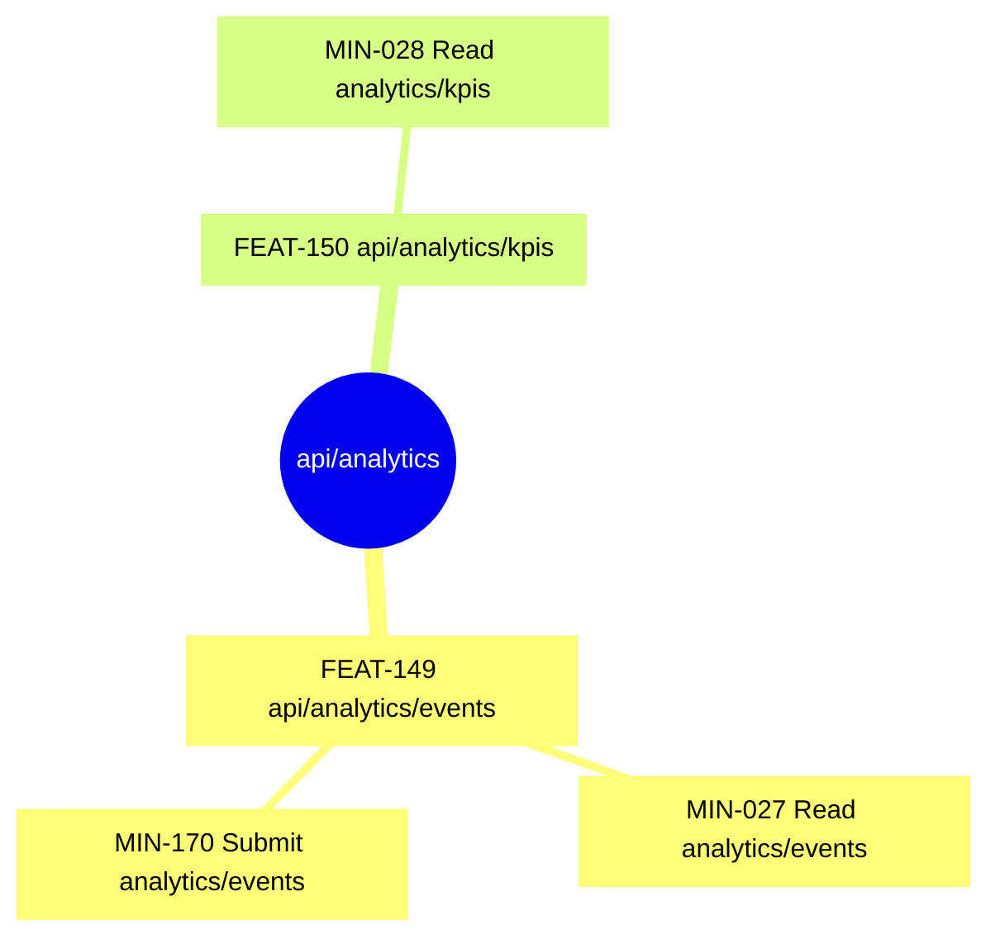
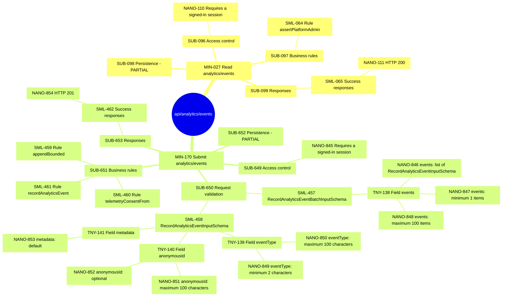
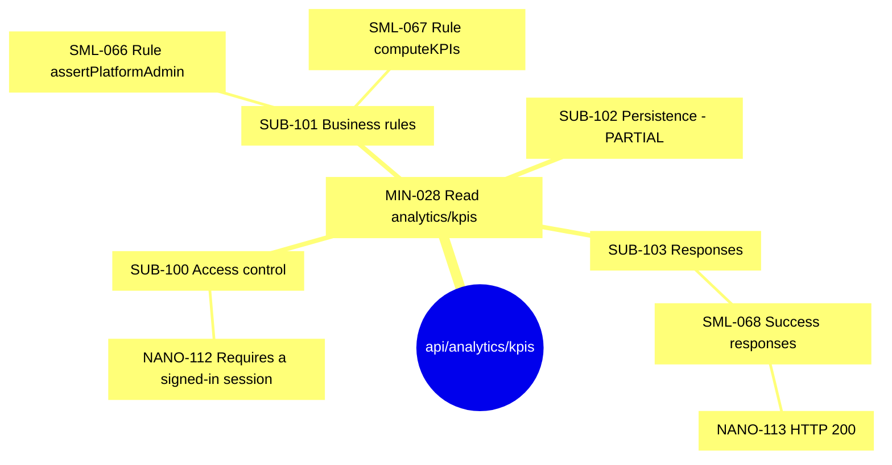

# api/analytics (MOD-094)

Generated by `docs/mindmap/tools/catalog.py` from `master/MASTER_PROJECT_GRAPH.json` at commit `9b3032f`. Do not edit by hand. Back to the [feature catalog](../FEATURE_CATALOG.md).

**Application:** apps/api (MOD-001). **Purpose:** API module: routes under /api/v1/analytics in apps/api/src/server.ts.

**Nodes by level:** MODULE 1, MAJOR 2, MINOR 3, SUB 13, SMALL 11, TINY 4, NANO 14. **Status:** IMPLEMENTED 45, PARTIALLY_IMPLEMENTED 3. **Verification:** PATH_LEVEL 36, VERIFIED 9.

**User roles that reach it:** authenticated.

**Known gaps:** MIN-027 ephemeral: state held in process memory, lost on restart; MIN-027 no first-party web caller found; MIN-170 ephemeral: state held in process memory, lost on restart; MIN-170 no first-party web caller found; MIN-028 ephemeral: state held in process memory, lost on restart; MIN-028 no first-party web caller found.

## Module map (to minor features)

## FEAT-149 api/analytics/events

api/analytics/events

| ID       | Level | Parent   | Name                                            | Description                                                                                                                                                                                                                                                                                                                                          | Status                | Verification | Evidence                             | Related                                                   |
| -------- | ----- | -------- | ----------------------------------------------- | ---------------------------------------------------------------------------------------------------------------------------------------------------------------------------------------------------------------------------------------------------------------------------------------------------------------------------------------------------- | --------------------- | ------------ | ------------------------------------ | --------------------------------------------------------- |
| FEAT-149 | MAJOR | MOD-094  | api/analytics/events                            |                                                                                                                                                                                                                                                                                                                                                      | IMPLEMENTED           |              | apps/api/src/server.ts:12604         |                                                           |
| MIN-027  | MINOR | FEAT-149 | Read analytics/events                           | GET /api/v1/analytics/events for any signed-in session; calls assertPlatformAdmin; ephemeral (process memory); responds 200. Gaps: ephemeral: state held in process memory, lost on restart; no first-party web caller found                                                                                                                         | IMPLEMENTED           | VERIFIED     | apps/api/src/server.ts:12669         | API-269, TEST-086, TEST-101, TEST-145, TEST-167           |
| SUB-096  | SUB   | MIN-027  | Access control                                  | Who may call GET /api/v1/analytics/events: any signed-in session.                                                                                                                                                                                                                                                                                    | IMPLEMENTED           | PATH_LEVEL   | apps/api/src/server.ts:12669         |                                                           |
| NANO-110 | NANO  | SUB-096  | Requires a signed-in session                    | Requests without a valid session token are rejected with 401 UNAUTHENTICATED.                                                                                                                                                                                                                                                                        | IMPLEMENTED           | PATH_LEVEL   | apps/api/src/server.ts:12669         | ROLE-001                                                  |
| SUB-097  | SUB   | MIN-027  | Business rules                                  | Domain functions from packages/domain called by the handler (1).                                                                                                                                                                                                                                                                                     | IMPLEMENTED           | PATH_LEVEL   | apps/api/src/server.ts:12669         |                                                           |
| SML-064  | SMALL | SUB-097  | Rule assertPlatformAdmin                        | Calls assertPlatformAdmin (packages/domain/src/admin.ts). Rule status IMPLEMENTED; its own tests: VERIFIED.                                                                                                                                                                                                                                          | IMPLEMENTED           | VERIFIED     | packages/domain/src/admin.ts:44      | RULE-005                                                  |
| SUB-098  | SUB   | MIN-027  | Persistence                                     | Ephemeral: state lives in API process memory and is lost on restart.                                                                                                                                                                                                                                                                                 | PARTIALLY_IMPLEMENTED | PATH_LEVEL   | apps/api/src/server.ts:12669         |                                                           |
| SUB-099  | SUB   | MIN-027  | Responses                                       | Success 200; 0 explicit failure branch(es) besides validation and access errors.                                                                                                                                                                                                                                                                     | IMPLEMENTED           | PATH_LEVEL   | apps/api/src/server.ts:12669         |                                                           |
| SML-065  | SMALL | SUB-099  | Success responses                               | HTTP 200.                                                                                                                                                                                                                                                                                                                                            | IMPLEMENTED           | PATH_LEVEL   | apps/api/src/server.ts:12669         |                                                           |
| NANO-111 | NANO  | SML-065  | HTTP 200                                        | Replies 200 when the operation succeeds.                                                                                                                                                                                                                                                                                                             | IMPLEMENTED           | PATH_LEVEL   | apps/api/src/server.ts:12669         |                                                           |
| MIN-170  | MINOR | FEAT-149 | Submit analytics/events                         | POST /api/v1/analytics/events for any signed-in session; validates RecordAnalyticsEventBatchInputSchema, RecordAnalyticsEventInputSchema; calls appendBounded, telemetryConsentFrom, recordAnalyticsEvent; ephemeral (process memory); responds 201. Gaps: ephemeral: state held in process memory, lost on restart; no first-party web caller found | IMPLEMENTED           | VERIFIED     | apps/api/src/server.ts:12604         | API-268, TEST-086, TEST-101, TEST-145, TEST-148, TEST-167 |
| SUB-649  | SUB   | MIN-170  | Access control                                  | Who may call POST /api/v1/analytics/events: any signed-in session.                                                                                                                                                                                                                                                                                   | IMPLEMENTED           | PATH_LEVEL   | apps/api/src/server.ts:12604         |                                                           |
| NANO-845 | NANO  | SUB-649  | Requires a signed-in session                    | Requests without a valid session token are rejected with 401 UNAUTHENTICATED.                                                                                                                                                                                                                                                                        | IMPLEMENTED           | PATH_LEVEL   | apps/api/src/server.ts:12604         | ROLE-001                                                  |
| SUB-650  | SUB   | MIN-170  | Request validation                              | The request is parsed with RecordAnalyticsEventBatchInputSchema, RecordAnalyticsEventInputSchema; a failure returns 400 with field details before any business logic runs.                                                                                                                                                                           | IMPLEMENTED           | PATH_LEVEL   | apps/api/src/server.ts:12604         |                                                           |
| SML-457  | SMALL | SUB-650  | RecordAnalyticsEventBatchInputSchema            | RecordAnalyticsEventBatchInputSchema: 1 field(s)                                                                                                                                                                                                                                                                                                     | IMPLEMENTED           | PATH_LEVEL   | packages/contracts/src/index.ts:941  | SCH-075                                                   |
| TNY-138  | TINY  | SML-457  | Field events                                    | events (array, required): list of RecordAnalyticsEventInputSchema; minimum 1 items; maximum 100 items                                                                                                                                                                                                                                                | IMPLEMENTED           | PATH_LEVEL   | packages/contracts/src/index.ts:942  |                                                           |
| NANO-846 | NANO  | TNY-138  | events: list of RecordAnalyticsEventInputSchema | events list of RecordAnalyticsEventInputSchema.                                                                                                                                                                                                                                                                                                      | IMPLEMENTED           | PATH_LEVEL   | packages/contracts/src/index.ts:942  |                                                           |
| NANO-847 | NANO  | TNY-138  | events: minimum 1 items                         | events minimum 1 items.                                                                                                                                                                                                                                                                                                                              | IMPLEMENTED           | PATH_LEVEL   | packages/contracts/src/index.ts:942  |                                                           |
| NANO-848 | NANO  | TNY-138  | events: maximum 100 items                       | events maximum 100 items.                                                                                                                                                                                                                                                                                                                            | IMPLEMENTED           | PATH_LEVEL   | packages/contracts/src/index.ts:942  |                                                           |
| SML-458  | SMALL | SUB-650  | RecordAnalyticsEventInputSchema                 | RecordAnalyticsEventInputSchema: 3 field(s)                                                                                                                                                                                                                                                                                                          | IMPLEMENTED           | PATH_LEVEL   | packages/contracts/src/index.ts:933  | SCH-074                                                   |
| TNY-139  | TINY  | SML-458  | Field eventType                                 | eventType (string, required): minimum 2 characters; maximum 100 characters                                                                                                                                                                                                                                                                           | IMPLEMENTED           | PATH_LEVEL   | packages/contracts/src/index.ts:934  |                                                           |
| NANO-849 | NANO  | TNY-139  | eventType: minimum 2 characters                 | eventType minimum 2 characters.                                                                                                                                                                                                                                                                                                                      | IMPLEMENTED           | PATH_LEVEL   | packages/contracts/src/index.ts:934  |                                                           |
| NANO-850 | NANO  | TNY-139  | eventType: maximum 100 characters               | eventType maximum 100 characters.                                                                                                                                                                                                                                                                                                                    | IMPLEMENTED           | PATH_LEVEL   | packages/contracts/src/index.ts:934  |                                                           |
| TNY-140  | TINY  | SML-458  | Field anonymousId                               | anonymousId (string, optional): maximum 100 characters; optional                                                                                                                                                                                                                                                                                     | IMPLEMENTED           | PATH_LEVEL   | packages/contracts/src/index.ts:935  |                                                           |
| NANO-851 | NANO  | TNY-140  | anonymousId: maximum 100 characters             | anonymousId maximum 100 characters.                                                                                                                                                                                                                                                                                                                  | IMPLEMENTED           | PATH_LEVEL   | packages/contracts/src/index.ts:935  |                                                           |
| NANO-852 | NANO  | TNY-140  | anonymousId: optional                           | anonymousId optional.                                                                                                                                                                                                                                                                                                                                | IMPLEMENTED           | PATH_LEVEL   | packages/contracts/src/index.ts:935  |                                                           |
| TNY-141  | TINY  | SML-458  | Field metadata                                  | metadata (record, optional): default {}                                                                                                                                                                                                                                                                                                              | IMPLEMENTED           | PATH_LEVEL   | packages/contracts/src/index.ts:936  |                                                           |
| NANO-853 | NANO  | TNY-141  | metadata: default {}                            | metadata default {}.                                                                                                                                                                                                                                                                                                                                 | IMPLEMENTED           | PATH_LEVEL   | packages/contracts/src/index.ts:936  |                                                           |
| SUB-651  | SUB   | MIN-170  | Business rules                                  | Domain functions from packages/domain called by the handler (3).                                                                                                                                                                                                                                                                                     | IMPLEMENTED           | PATH_LEVEL   | apps/api/src/server.ts:12604         |                                                           |
| SML-459  | SMALL | SUB-651  | Rule appendBounded                              | Calls appendBounded (packages/domain/src/analytics.ts). Rule status IMPLEMENTED; its own tests: VERIFIED.                                                                                                                                                                                                                                            | IMPLEMENTED           | VERIFIED     | packages/domain/src/analytics.ts:183 | RULE-029                                                  |
| SML-460  | SMALL | SUB-651  | Rule telemetryConsentFrom                       | Calls telemetryConsentFrom (packages/domain/src/analytics.ts). Rule status IMPLEMENTED; its own tests: VERIFIED.                                                                                                                                                                                                                                     | IMPLEMENTED           | VERIFIED     | packages/domain/src/analytics.ts:193 | RULE-030                                                  |
| SML-461  | SMALL | SUB-651  | Rule recordAnalyticsEvent                       | Calls recordAnalyticsEvent (packages/domain/src/analytics.ts). Rule status IMPLEMENTED; its own tests: VERIFIED.                                                                                                                                                                                                                                     | IMPLEMENTED           | VERIFIED     | packages/domain/src/analytics.ts:200 | RULE-031                                                  |
| SUB-652  | SUB   | MIN-170  | Persistence                                     | Ephemeral: state lives in API process memory and is lost on restart.                                                                                                                                                                                                                                                                                 | PARTIALLY_IMPLEMENTED | PATH_LEVEL   | apps/api/src/server.ts:12604         |                                                           |
| SUB-653  | SUB   | MIN-170  | Responses                                       | Success 201; 0 explicit failure branch(es) besides validation and access errors.                                                                                                                                                                                                                                                                     | IMPLEMENTED           | PATH_LEVEL   | apps/api/src/server.ts:12604         |                                                           |
| SML-462  | SMALL | SUB-653  | Success responses                               | HTTP 201.                                                                                                                                                                                                                                                                                                                                            | IMPLEMENTED           | PATH_LEVEL   | apps/api/src/server.ts:12604         |                                                           |
| NANO-854 | NANO  | SML-462  | HTTP 201                                        | Replies 201 when the operation succeeds.                                                                                                                                                                                                                                                                                                             | IMPLEMENTED           | PATH_LEVEL   | apps/api/src/server.ts:12604         |                                                           |

## FEAT-150 api/analytics/kpis

api/analytics/kpis

| ID       | Level | Parent   | Name                         | Description                                                                                                                                                                                                                             | Status                | Verification | Evidence                             | Related                     |
| -------- | ----- | -------- | ---------------------------- | --------------------------------------------------------------------------------------------------------------------------------------------------------------------------------------------------------------------------------------- | --------------------- | ------------ | ------------------------------------ | --------------------------- |
| FEAT-150 | MAJOR | MOD-094  | api/analytics/kpis           |                                                                                                                                                                                                                                         | IMPLEMENTED           |              | apps/api/src/server.ts:12688         |                             |
| MIN-028  | MINOR | FEAT-150 | Read analytics/kpis          | GET /api/v1/analytics/kpis for any signed-in session; calls assertPlatformAdmin, computeKPIs; ephemeral (process memory); responds 200. Gaps: ephemeral: state held in process memory, lost on restart; no first-party web caller found | IMPLEMENTED           | VERIFIED     | apps/api/src/server.ts:12688         | API-270, TEST-086, TEST-167 |
| SUB-100  | SUB   | MIN-028  | Access control               | Who may call GET /api/v1/analytics/kpis: any signed-in session.                                                                                                                                                                         | IMPLEMENTED           | PATH_LEVEL   | apps/api/src/server.ts:12688         |                             |
| NANO-112 | NANO  | SUB-100  | Requires a signed-in session | Requests without a valid session token are rejected with 401 UNAUTHENTICATED.                                                                                                                                                           | IMPLEMENTED           | PATH_LEVEL   | apps/api/src/server.ts:12688         | ROLE-001                    |
| SUB-101  | SUB   | MIN-028  | Business rules               | Domain functions from packages/domain called by the handler (2).                                                                                                                                                                        | IMPLEMENTED           | PATH_LEVEL   | apps/api/src/server.ts:12688         |                             |
| SML-066  | SMALL | SUB-101  | Rule assertPlatformAdmin     | Calls assertPlatformAdmin (packages/domain/src/admin.ts). Rule status IMPLEMENTED; its own tests: VERIFIED.                                                                                                                             | IMPLEMENTED           | VERIFIED     | packages/domain/src/admin.ts:44      | RULE-005                    |
| SML-067  | SMALL | SUB-101  | Rule computeKPIs             | Calls computeKPIs (packages/domain/src/analytics.ts). Rule status IMPLEMENTED; its own tests: VERIFIED.                                                                                                                                 | IMPLEMENTED           | VERIFIED     | packages/domain/src/analytics.ts:229 | RULE-032                    |
| SUB-102  | SUB   | MIN-028  | Persistence                  | Ephemeral: state lives in API process memory and is lost on restart.                                                                                                                                                                    | PARTIALLY_IMPLEMENTED | PATH_LEVEL   | apps/api/src/server.ts:12688         |                             |
| SUB-103  | SUB   | MIN-028  | Responses                    | Success 200; 0 explicit failure branch(es) besides validation and access errors.                                                                                                                                                        | IMPLEMENTED           | PATH_LEVEL   | apps/api/src/server.ts:12688         |                             |
| SML-068  | SMALL | SUB-103  | Success responses            | HTTP 200.                                                                                                                                                                                                                               | IMPLEMENTED           | PATH_LEVEL   | apps/api/src/server.ts:12688         |                             |
| NANO-113 | NANO  | SML-068  | HTTP 200                     | Replies 200 when the operation succeeds.                                                                                                                                                                                                | IMPLEMENTED           | PATH_LEVEL   | apps/api/src/server.ts:12688         |                             |
