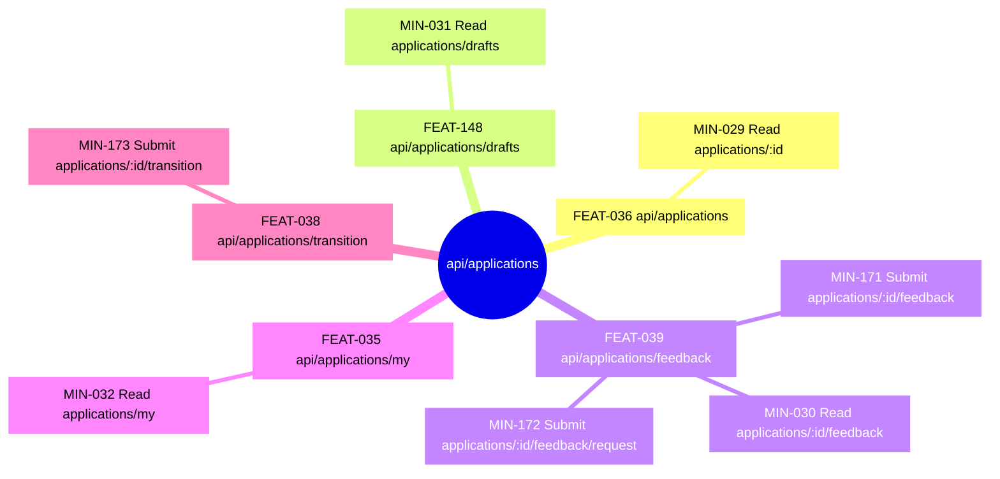
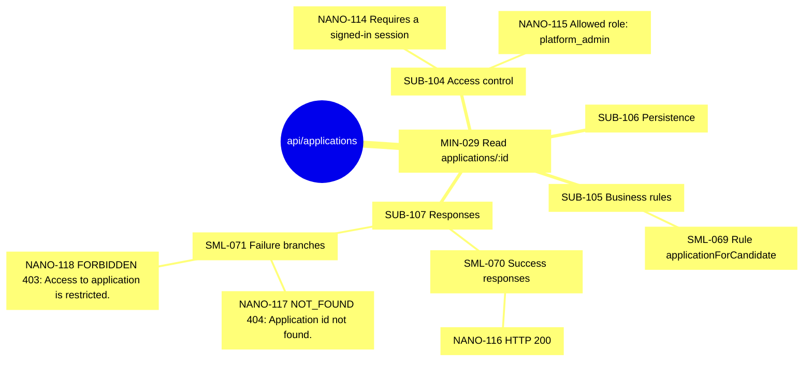
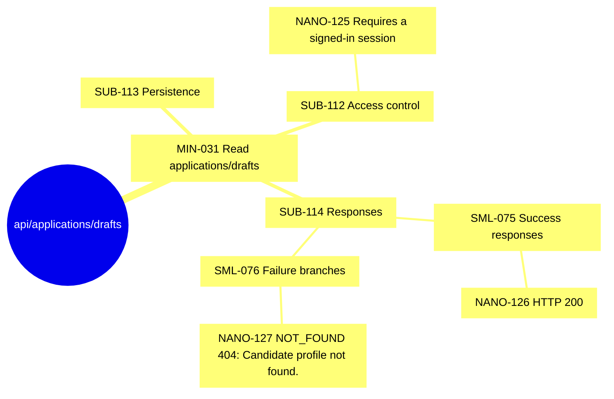
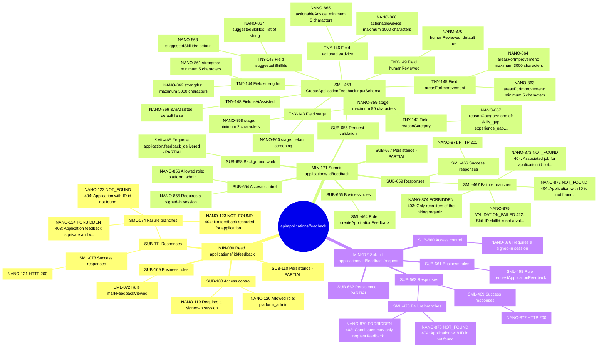
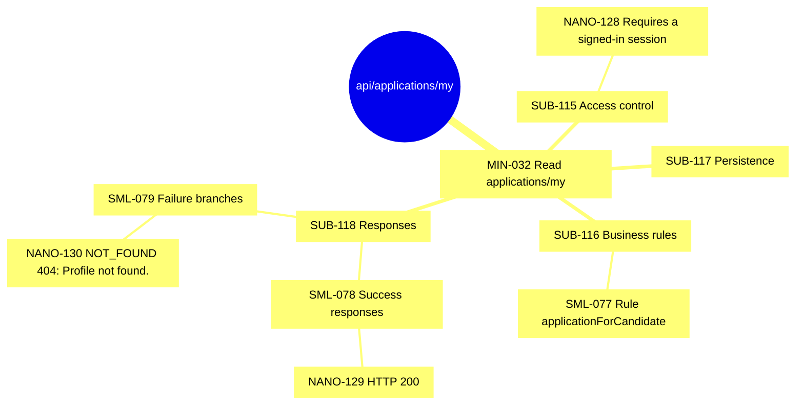
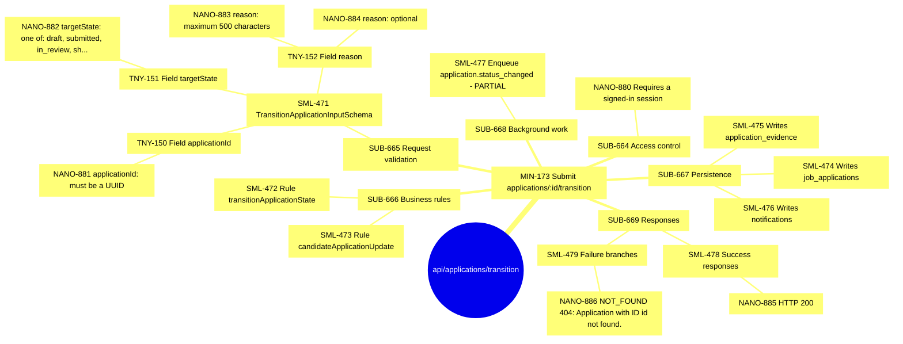

# api/applications (MOD-063)

Generated by `docs/mindmap/tools/catalog.py` from `master/MASTER_PROJECT_GRAPH.json` at commit `9b3032f`. Do not edit by hand. Back to the [feature catalog](../FEATURE_CATALOG.md).

**Application:** apps/api (MOD-001). **Purpose:** API module: routes under /api/v1/applications in apps/api/src/server.ts.

**Nodes by level:** MODULE 1, MAJOR 5, MINOR 7, SUB 31, SMALL 28, TINY 11, NANO 49. **Status:** IMPLEMENTED 127, PARTIALLY_IMPLEMENTED 5. **Verification:** PATH_LEVEL 110, UNKNOWN 2, VERIFIED 14.

**User roles that reach it:** authenticated, platform_admin.

**Known gaps:** MIN-029 no first-party web caller found; MIN-031 no first-party web caller found; MIN-030 ephemeral: state held in process memory, lost on restart; MIN-030 no first-party web caller found; MIN-171 ephemeral: state held in process memory, lost on restart; MIN-171 no first-party web caller found; MIN-172 ephemeral: state held in process memory, lost on restart; MIN-172 no first-party web caller found.

**Called from (web screens and components):** FEAT-158 Screen /applications, FEAT-162 Screen /dashboard, FEAT-165 Screen /hiring/jobs/:id, FEAT-166 Screen /jobs, FEAT-167 Screen /jobs/:id

## Module map (to minor features)

## FEAT-036 api/applications

api/applications

| ID       | Level | Parent   | Name                                                | Description                                                                                                                                                                           | Status      | Verification | Evidence                                | Related                                                       |
| -------- | ----- | -------- | --------------------------------------------------- | ------------------------------------------------------------------------------------------------------------------------------------------------------------------------------------- | ----------- | ------------ | --------------------------------------- | ------------------------------------------------------------- |
| FEAT-036 | MAJOR | MOD-063  | api/applications                                    |                                                                                                                                                                                       | IMPLEMENTED |              | apps/api/src/server.ts:2839             |                                                               |
| MIN-029  | MINOR | FEAT-036 | Read applications/:id                               | GET /api/v1/applications/:id for roles platform_admin; calls applicationForCandidate; durable (PostgreSQL); responds 200; 2 failure branch(es). Gaps: no first-party web caller found | IMPLEMENTED | VERIFIED     | apps/api/src/server.ts:2839             | API-049, TEST-088, TEST-097, TEST-120, TEST-137, TEST-142 ... |
| SUB-104  | SUB   | MIN-029  | Access control                                      | Who may call GET /api/v1/applications/:id: roles platform_admin.                                                                                                                      | IMPLEMENTED | PATH_LEVEL   | apps/api/src/server.ts:2839             |                                                               |
| NANO-114 | NANO  | SUB-104  | Requires a signed-in session                        | Requests without a valid session token are rejected with 401 UNAUTHENTICATED.                                                                                                         | IMPLEMENTED | PATH_LEVEL   | apps/api/src/server.ts:2839             | ROLE-001                                                      |
| NANO-115 | NANO  | SUB-104  | Allowed role: platform_admin                        | platform_admin is one of the roles allowed here (platform_admin); a caller holding none of them is rejected with 403.                                                                 | IMPLEMENTED | PATH_LEVEL   | apps/api/src/server.ts:2839             | ROLE-008                                                      |
| SUB-105  | SUB   | MIN-029  | Business rules                                      | Domain functions from packages/domain called by the handler (1).                                                                                                                      | IMPLEMENTED | PATH_LEVEL   | apps/api/src/server.ts:2839             |                                                               |
| SML-069  | SMALL | SUB-105  | Rule applicationForCandidate                        | Calls applicationForCandidate (packages/domain/src/applications.ts). Rule status IMPLEMENTED; its own tests: VERIFIED.                                                                | IMPLEMENTED | VERIFIED     | packages/domain/src/applications.ts:140 | RULE-043                                                      |
| SUB-106  | SUB   | MIN-029  | Persistence                                         | Durable: writes go through the PostgreSQL store.                                                                                                                                      | IMPLEMENTED | PATH_LEVEL   | apps/api/src/server.ts:2839             |                                                               |
| SUB-107  | SUB   | MIN-029  | Responses                                           | Success 200; 2 explicit failure branch(es) besides validation and access errors.                                                                                                      | IMPLEMENTED | PATH_LEVEL   | apps/api/src/server.ts:2839             |                                                               |
| SML-070  | SMALL | SUB-107  | Success responses                                   | HTTP 200.                                                                                                                                                                             | IMPLEMENTED | PATH_LEVEL   | apps/api/src/server.ts:2839             |                                                               |
| NANO-116 | NANO  | SML-070  | HTTP 200                                            | Replies 200 when the operation succeeds.                                                                                                                                              | IMPLEMENTED | PATH_LEVEL   | apps/api/src/server.ts:2839             |                                                               |
| SML-071  | SMALL | SUB-107  | Failure branches                                    | 2 DomainError branch(es) in the handler, mapped to HTTP by the global error handler.                                                                                                  | IMPLEMENTED | PATH_LEVEL   | apps/api/src/server.ts:2839             |                                                               |
| NANO-117 | NANO  | SML-071  | NOT_FOUND 404: Application ${id} not found.         | Throws DomainError(NOT_FOUND) "Application ${id} not found." -> HTTP 404.                                                                                                             | IMPLEMENTED | PATH_LEVEL   | apps/api/src/server.ts:2846             | ERR-051                                                       |
| NANO-118 | NANO  | SML-071  | FORBIDDEN 403: Access to application is restricted. | Throws DomainError(FORBIDDEN) "Access to application is restricted." -> HTTP 403.                                                                                                     | IMPLEMENTED | PATH_LEVEL   | apps/api/src/server.ts:2857             | ERR-052                                                       |

## FEAT-148 api/applications/drafts

api/applications/drafts

| ID       | Level | Parent   | Name                                        | Description                                                                                                                                                | Status      | Verification | Evidence                     | Related                               |
| -------- | ----- | -------- | ------------------------------------------- | ---------------------------------------------------------------------------------------------------------------------------------------------------------- | ----------- | ------------ | ---------------------------- | ------------------------------------- |
| FEAT-148 | MAJOR | MOD-063  | api/applications/drafts                     |                                                                                                                                                            | IMPLEMENTED |              | apps/api/src/server.ts:12571 |                                       |
| MIN-031  | MINOR | FEAT-148 | Read applications/drafts                    | GET /api/v1/applications/drafts for any signed-in session; durable (PostgreSQL); responds 200; 1 failure branch(es). Gaps: no first-party web caller found | IMPLEMENTED | VERIFIED     | apps/api/src/server.ts:12571 | API-267, TEST-088, TEST-168, TEST-224 |
| SUB-112  | SUB   | MIN-031  | Access control                              | Who may call GET /api/v1/applications/drafts: any signed-in session.                                                                                       | IMPLEMENTED | PATH_LEVEL   | apps/api/src/server.ts:12571 |                                       |
| NANO-125 | NANO  | SUB-112  | Requires a signed-in session                | Requests without a valid session token are rejected with 401 UNAUTHENTICATED.                                                                              | IMPLEMENTED | PATH_LEVEL   | apps/api/src/server.ts:12571 | ROLE-001                              |
| SUB-113  | SUB   | MIN-031  | Persistence                                 | Durable: writes go through the PostgreSQL store; store calls applicationDrafts.listActive.                                                                 | IMPLEMENTED | PATH_LEVEL   | apps/api/src/server.ts:12571 |                                       |
| SUB-114  | SUB   | MIN-031  | Responses                                   | Success 200; 1 explicit failure branch(es) besides validation and access errors.                                                                           | IMPLEMENTED | PATH_LEVEL   | apps/api/src/server.ts:12571 |                                       |
| SML-075  | SMALL | SUB-114  | Success responses                           | HTTP 200.                                                                                                                                                  | IMPLEMENTED | PATH_LEVEL   | apps/api/src/server.ts:12571 |                                       |
| NANO-126 | NANO  | SML-075  | HTTP 200                                    | Replies 200 when the operation succeeds.                                                                                                                   | IMPLEMENTED | PATH_LEVEL   | apps/api/src/server.ts:12571 |                                       |
| SML-076  | SMALL | SUB-114  | Failure branches                            | 1 DomainError branch(es) in the handler, mapped to HTTP by the global error handler.                                                                       | IMPLEMENTED | PATH_LEVEL   | apps/api/src/server.ts:12571 |                                       |
| NANO-127 | NANO  | SML-076  | NOT_FOUND 404: Candidate profile not found. | Throws DomainError(NOT_FOUND) "Candidate profile not found." -> HTTP 404.                                                                                  | IMPLEMENTED | PATH_LEVEL   | apps/api/src/server.ts:12575 | ERR-158                               |

## FEAT-039 api/applications/feedback

api/applications/feedback

| ID       | Level | Parent   | Name                                                                                                                          | Description                                                                                                                                                                                                                                                                                                                                                                         | Status                | Verification | Evidence                                        | Related                     |
| -------- | ----- | -------- | ----------------------------------------------------------------------------------------------------------------------------- | ----------------------------------------------------------------------------------------------------------------------------------------------------------------------------------------------------------------------------------------------------------------------------------------------------------------------------------------------------------------------------------- | --------------------- | ------------ | ----------------------------------------------- | --------------------------- |
| FEAT-039 | MAJOR | MOD-063  | api/applications/feedback                                                                                                     |                                                                                                                                                                                                                                                                                                                                                                                     | IMPLEMENTED           |              | apps/api/src/server.ts:3013                     |                             |
| MIN-030  | MINOR | FEAT-039 | Read applications/:id/feedback                                                                                                | GET /api/v1/applications/:id/feedback for roles platform_admin; calls markFeedbackViewed; ephemeral (process memory); responds 200; 3 failure branch(es). Gaps: ephemeral: state held in process memory, lost on restart; no first-party web caller found                                                                                                                           | IMPLEMENTED           | VERIFIED     | apps/api/src/server.ts:3098                     | API-053, TEST-089, TEST-169 |
| SUB-108  | SUB   | MIN-030  | Access control                                                                                                                | Who may call GET /api/v1/applications/:id/feedback: roles platform_admin.                                                                                                                                                                                                                                                                                                           | IMPLEMENTED           | PATH_LEVEL   | apps/api/src/server.ts:3098                     |                             |
| NANO-119 | NANO  | SUB-108  | Requires a signed-in session                                                                                                  | Requests without a valid session token are rejected with 401 UNAUTHENTICATED.                                                                                                                                                                                                                                                                                                       | IMPLEMENTED           | PATH_LEVEL   | apps/api/src/server.ts:3098                     | ROLE-001                    |
| NANO-120 | NANO  | SUB-108  | Allowed role: platform_admin                                                                                                  | platform_admin is one of the roles allowed here (platform_admin); a caller holding none of them is rejected with 403.                                                                                                                                                                                                                                                               | IMPLEMENTED           | PATH_LEVEL   | apps/api/src/server.ts:3098                     | ROLE-008                    |
| SUB-109  | SUB   | MIN-030  | Business rules                                                                                                                | Domain functions from packages/domain called by the handler (1).                                                                                                                                                                                                                                                                                                                    | IMPLEMENTED           | PATH_LEVEL   | apps/api/src/server.ts:3098                     |                             |
| SML-072  | SMALL | SUB-109  | Rule markFeedbackViewed                                                                                                       | Calls markFeedbackViewed (packages/domain/src/application-feedback.ts). Rule status IMPLEMENTED; its own tests: VERIFIED.                                                                                                                                                                                                                                                           | IMPLEMENTED           | VERIFIED     | packages/domain/src/application-feedback.ts:216 | RULE-038                    |
| SUB-110  | SUB   | MIN-030  | Persistence                                                                                                                   | Ephemeral: state lives in API process memory and is lost on restart.                                                                                                                                                                                                                                                                                                                | PARTIALLY_IMPLEMENTED | PATH_LEVEL   | apps/api/src/server.ts:3098                     |                             |
| SUB-111  | SUB   | MIN-030  | Responses                                                                                                                     | Success 200; 3 explicit failure branch(es) besides validation and access errors.                                                                                                                                                                                                                                                                                                    | IMPLEMENTED           | PATH_LEVEL   | apps/api/src/server.ts:3098                     |                             |
| SML-073  | SMALL | SUB-111  | Success responses                                                                                                             | HTTP 200.                                                                                                                                                                                                                                                                                                                                                                           | IMPLEMENTED           | PATH_LEVEL   | apps/api/src/server.ts:3098                     |                             |
| NANO-121 | NANO  | SML-073  | HTTP 200                                                                                                                      | Replies 200 when the operation succeeds.                                                                                                                                                                                                                                                                                                                                            | IMPLEMENTED           | PATH_LEVEL   | apps/api/src/server.ts:3098                     |                             |
| SML-074  | SMALL | SUB-111  | Failure branches                                                                                                              | 3 DomainError branch(es) in the handler, mapped to HTTP by the global error handler.                                                                                                                                                                                                                                                                                                | IMPLEMENTED           | PATH_LEVEL   | apps/api/src/server.ts:3098                     |                             |
| NANO-122 | NANO  | SML-074  | NOT_FOUND 404: Application with ID ${id} not found.                                                                           | Throws DomainError(NOT_FOUND) "Application with ID ${id} not found." -> HTTP 404.                                                                                                                                                                                                                                                                                                   | IMPLEMENTED           | PATH_LEVEL   | apps/api/src/server.ts:3106                     | ERR-054                     |
| NANO-123 | NANO  | SML-074  | NOT_FOUND 404: No feedback recorded for application ${id}.                                                                    | Throws DomainError(NOT_FOUND) "No feedback recorded for application ${id}." -> HTTP 404.                                                                                                                                                                                                                                                                                            | IMPLEMENTED           | PATH_LEVEL   | apps/api/src/server.ts:3111                     | ERR-057                     |
| NANO-124 | NANO  | SML-074  | FORBIDDEN 403: Application feedback is private and visible only to the candidate (BR-                                         | Throws DomainError(FORBIDDEN) "Application feedback is private and visible only to the candidate (BR-219)." -> HTTP 403.                                                                                                                                                                                                                                                            | IMPLEMENTED           | PATH_LEVEL   | apps/api/src/server.ts:3123                     | ERR-058                     |
| MIN-171  | MINOR | FEAT-039 | Submit applications/:id/feedback                                                                                              | Application Feedback Loop Endpoints (F-122, BR-217..BR-224, P-02) POST /api/v1/applications/:id/feedback for roles platform_admin; validates CreateApplicationFeedbackInputSchema; calls createApplicationFeedback; ephemeral (process memory); responds 201; 4 failure branch(es). Gaps: ephemeral: state held in process memory, lost on restart; no first-party web caller found | IMPLEMENTED           | VERIFIED     | apps/api/src/server.ts:3013                     | API-052, TEST-089, TEST-169 |
| SUB-654  | SUB   | MIN-171  | Access control                                                                                                                | Who may call POST /api/v1/applications/:id/feedback: roles platform_admin.                                                                                                                                                                                                                                                                                                          | IMPLEMENTED           | PATH_LEVEL   | apps/api/src/server.ts:3013                     |                             |
| NANO-855 | NANO  | SUB-654  | Requires a signed-in session                                                                                                  | Requests without a valid session token are rejected with 401 UNAUTHENTICATED.                                                                                                                                                                                                                                                                                                       | IMPLEMENTED           | PATH_LEVEL   | apps/api/src/server.ts:3013                     | ROLE-001                    |
| NANO-856 | NANO  | SUB-654  | Allowed role: platform_admin                                                                                                  | platform_admin is one of the roles allowed here (platform_admin); a caller holding none of them is rejected with 403.                                                                                                                                                                                                                                                               | IMPLEMENTED           | PATH_LEVEL   | apps/api/src/server.ts:3013                     | ROLE-008                    |
| SUB-655  | SUB   | MIN-171  | Request validation                                                                                                            | The request is parsed with CreateApplicationFeedbackInputSchema; a failure returns 400 with field details before any business logic runs.                                                                                                                                                                                                                                           | IMPLEMENTED           | PATH_LEVEL   | apps/api/src/server.ts:3013                     |                             |
| SML-463  | SMALL | SUB-655  | CreateApplicationFeedbackInputSchema                                                                                          | CreateApplicationFeedbackInputSchema: 8 field(s)                                                                                                                                                                                                                                                                                                                                    | IMPLEMENTED           | PATH_LEVEL   | packages/contracts/src/index.ts:1065            | SCH-084                     |
| TNY-142  | TINY  | SML-463  | Field reasonCategory                                                                                                          | reasonCategory (enum, required): one of: skills_gap, experience_gap, culture_fit, overqualified, position_filled, compensation_mismatch, other                                                                                                                                                                                                                                      | IMPLEMENTED           | PATH_LEVEL   | packages/contracts/src/index.ts:1066            |                             |
| NANO-857 | NANO  | TNY-142  | reasonCategory: one of: skills_gap, experience_gap, culture_fit, overqualified, position_filled, compensation_mismatch, other | reasonCategory one of: skills_gap, experience_gap, culture_fit, overqualified, position_filled, compensation_mismatch, other.                                                                                                                                                                                                                                                       | IMPLEMENTED           | PATH_LEVEL   | packages/contracts/src/index.ts:1066            |                             |
| TNY-143  | TINY  | SML-463  | Field stage                                                                                                                   | stage (string, optional): minimum 2 characters; maximum 50 characters; default 'screening'                                                                                                                                                                                                                                                                                          | IMPLEMENTED           | PATH_LEVEL   | packages/contracts/src/index.ts:1075            |                             |
| NANO-858 | NANO  | TNY-143  | stage: minimum 2 characters                                                                                                   | stage minimum 2 characters.                                                                                                                                                                                                                                                                                                                                                         | IMPLEMENTED           | PATH_LEVEL   | packages/contracts/src/index.ts:1075            |                             |
| NANO-859 | NANO  | TNY-143  | stage: maximum 50 characters                                                                                                  | stage maximum 50 characters.                                                                                                                                                                                                                                                                                                                                                        | IMPLEMENTED           | PATH_LEVEL   | packages/contracts/src/index.ts:1075            |                             |
| NANO-860 | NANO  | TNY-143  | stage: default 'screening'                                                                                                    | stage default 'screening'; message "screening".                                                                                                                                                                                                                                                                                                                                     | IMPLEMENTED           | PATH_LEVEL   | packages/contracts/src/index.ts:1075            |                             |
| TNY-144  | TINY  | SML-463  | Field strengths                                                                                                               | strengths (string, required): minimum 5 characters; maximum 3000 characters                                                                                                                                                                                                                                                                                                         | IMPLEMENTED           | PATH_LEVEL   | packages/contracts/src/index.ts:1076            |                             |
| NANO-861 | NANO  | TNY-144  | strengths: minimum 5 characters                                                                                               | strengths minimum 5 characters.                                                                                                                                                                                                                                                                                                                                                     | IMPLEMENTED           | PATH_LEVEL   | packages/contracts/src/index.ts:1076            |                             |
| NANO-862 | NANO  | TNY-144  | strengths: maximum 3000 characters                                                                                            | strengths maximum 3000 characters.                                                                                                                                                                                                                                                                                                                                                  | IMPLEMENTED           | PATH_LEVEL   | packages/contracts/src/index.ts:1076            |                             |
| TNY-145  | TINY  | SML-463  | Field areasForImprovement                                                                                                     | areasForImprovement (string, required): minimum 5 characters; maximum 3000 characters                                                                                                                                                                                                                                                                                               | IMPLEMENTED           | PATH_LEVEL   | packages/contracts/src/index.ts:1077            |                             |
| NANO-863 | NANO  | TNY-145  | areasForImprovement: minimum 5 characters                                                                                     | areasForImprovement minimum 5 characters.                                                                                                                                                                                                                                                                                                                                           | IMPLEMENTED           | PATH_LEVEL   | packages/contracts/src/index.ts:1077            |                             |
| NANO-864 | NANO  | TNY-145  | areasForImprovement: maximum 3000 characters                                                                                  | areasForImprovement maximum 3000 characters.                                                                                                                                                                                                                                                                                                                                        | IMPLEMENTED           | PATH_LEVEL   | packages/contracts/src/index.ts:1077            |                             |
| TNY-146  | TINY  | SML-463  | Field actionableAdvice                                                                                                        | actionableAdvice (string, required): minimum 5 characters; maximum 3000 characters                                                                                                                                                                                                                                                                                                  | IMPLEMENTED           | PATH_LEVEL   | packages/contracts/src/index.ts:1078            |                             |
| NANO-865 | NANO  | TNY-146  | actionableAdvice: minimum 5 characters                                                                                        | actionableAdvice minimum 5 characters.                                                                                                                                                                                                                                                                                                                                              | IMPLEMENTED           | PATH_LEVEL   | packages/contracts/src/index.ts:1078            |                             |
| NANO-866 | NANO  | TNY-146  | actionableAdvice: maximum 3000 characters                                                                                     | actionableAdvice maximum 3000 characters.                                                                                                                                                                                                                                                                                                                                           | IMPLEMENTED           | PATH_LEVEL   | packages/contracts/src/index.ts:1078            |                             |
| TNY-147  | TINY  | SML-463  | Field suggestedSkillIds                                                                                                       | suggestedSkillIds (array, optional): list of string; default []                                                                                                                                                                                                                                                                                                                     | IMPLEMENTED           | PATH_LEVEL   | packages/contracts/src/index.ts:1079            |                             |
| NANO-867 | NANO  | TNY-147  | suggestedSkillIds: list of string                                                                                             | suggestedSkillIds list of string.                                                                                                                                                                                                                                                                                                                                                   | IMPLEMENTED           | PATH_LEVEL   | packages/contracts/src/index.ts:1079            |                             |
| NANO-868 | NANO  | TNY-147  | suggestedSkillIds: default []                                                                                                 | suggestedSkillIds default [].                                                                                                                                                                                                                                                                                                                                                       | IMPLEMENTED           | PATH_LEVEL   | packages/contracts/src/index.ts:1079            |                             |
| TNY-148  | TINY  | SML-463  | Field isAiAssisted                                                                                                            | isAiAssisted (boolean, optional): default false                                                                                                                                                                                                                                                                                                                                     | IMPLEMENTED           | PATH_LEVEL   | packages/contracts/src/index.ts:1080            |                             |
| NANO-869 | NANO  | TNY-148  | isAiAssisted: default false                                                                                                   | isAiAssisted default false.                                                                                                                                                                                                                                                                                                                                                         | IMPLEMENTED           | PATH_LEVEL   | packages/contracts/src/index.ts:1080            |                             |
| TNY-149  | TINY  | SML-463  | Field humanReviewed                                                                                                           | humanReviewed (boolean, optional): default true                                                                                                                                                                                                                                                                                                                                     | IMPLEMENTED           | PATH_LEVEL   | packages/contracts/src/index.ts:1081            |                             |
| NANO-870 | NANO  | TNY-149  | humanReviewed: default true                                                                                                   | humanReviewed default true.                                                                                                                                                                                                                                                                                                                                                         | IMPLEMENTED           | PATH_LEVEL   | packages/contracts/src/index.ts:1081            |                             |
| SUB-656  | SUB   | MIN-171  | Business rules                                                                                                                | Domain functions from packages/domain called by the handler (1).                                                                                                                                                                                                                                                                                                                    | IMPLEMENTED           | PATH_LEVEL   | apps/api/src/server.ts:3013                     |                             |
| SML-464  | SMALL | SUB-656  | Rule createApplicationFeedback                                                                                                | Calls createApplicationFeedback (packages/domain/src/application-feedback.ts). Rule status IMPLEMENTED; its own tests: VERIFIED.                                                                                                                                                                                                                                                    | IMPLEMENTED           | VERIFIED     | packages/domain/src/application-feedback.ts:88  | RULE-036                    |
| SUB-657  | SUB   | MIN-171  | Persistence                                                                                                                   | Ephemeral: state lives in API process memory and is lost on restart.                                                                                                                                                                                                                                                                                                                | PARTIALLY_IMPLEMENTED | PATH_LEVEL   | apps/api/src/server.ts:3013                     |                             |
| SUB-658  | SUB   | MIN-171  | Background work                                                                                                               | Enqueues 1 background job kind(s) in background_jobs for apps/worker.                                                                                                                                                                                                                                                                                                               | IMPLEMENTED           | PATH_LEVEL   | apps/api/src/server.ts:3013                     |                             |
| SML-465  | SMALL | SUB-658  | Enqueue application.feedback_delivered                                                                                        | Dispatches job:application.feedback_delivered; worker handler: recordEvent (no-op: marks the event recorded).                                                                                                                                                                                                                                                                       | PARTIALLY_IMPLEMENTED | UNKNOWN      | packages/domain/src/background-jobs.ts:171      | SVC-006                     |
| SUB-659  | SUB   | MIN-171  | Responses                                                                                                                     | Success 201; 4 explicit failure branch(es) besides validation and access errors.                                                                                                                                                                                                                                                                                                    | IMPLEMENTED           | PATH_LEVEL   | apps/api/src/server.ts:3013                     |                             |
| SML-466  | SMALL | SUB-659  | Success responses                                                                                                             | HTTP 201.                                                                                                                                                                                                                                                                                                                                                                           | IMPLEMENTED           | PATH_LEVEL   | apps/api/src/server.ts:3013                     |                             |
| NANO-871 | NANO  | SML-466  | HTTP 201                                                                                                                      | Replies 201 when the operation succeeds.                                                                                                                                                                                                                                                                                                                                            | IMPLEMENTED           | PATH_LEVEL   | apps/api/src/server.ts:3013                     |                             |
| SML-467  | SMALL | SUB-659  | Failure branches                                                                                                              | 4 DomainError branch(es) in the handler, mapped to HTTP by the global error handler.                                                                                                                                                                                                                                                                                                | IMPLEMENTED           | PATH_LEVEL   | apps/api/src/server.ts:3013                     |                             |
| NANO-872 | NANO  | SML-467  | NOT_FOUND 404: Application with ID ${id} not found.                                                                           | Throws DomainError(NOT_FOUND) "Application with ID ${id} not found." -> HTTP 404.                                                                                                                                                                                                                                                                                                   | IMPLEMENTED           | PATH_LEVEL   | apps/api/src/server.ts:3022                     | ERR-054                     |
| NANO-873 | NANO  | SML-467  | NOT_FOUND 404: Associated job for application ${id} not found.                                                                | Throws DomainError(NOT_FOUND) "Associated job for application ${id} not found." -> HTTP 404.                                                                                                                                                                                                                                                                                        | IMPLEMENTED           | PATH_LEVEL   | apps/api/src/server.ts:3027                     | ERR-055                     |
| NANO-874 | NANO  | SML-467  | FORBIDDEN 403: Only recruiters of the hiring organization can provide feedback (BR-12                                         | Throws DomainError(FORBIDDEN) "Only recruiters of the hiring organization can provide feedback (BR-12)." -> HTTP 403.                                                                                                                                                                                                                                                               | IMPLEMENTED           | PATH_LEVEL   | apps/api/src/server.ts:3035                     | ERR-056                     |
| NANO-875 | NANO  | SML-467  | VALIDATION_FAILED 422: Skill ID ${skillId} is not a valid canonical skill (BR-144).                                           | Throws DomainError(VALIDATION_FAILED) "Skill ID ${skillId} is not a valid canonical skill (BR-144)." -> HTTP 422.                                                                                                                                                                                                                                                                   | IMPLEMENTED           | PATH_LEVEL   | apps/api/src/server.ts:3044                     | ERR-039                     |
| MIN-172  | MINOR | FEAT-039 | Submit applications/:id/feedback/request                                                                                      | POST /api/v1/applications/:id/feedback/request for any signed-in session; calls requestApplicationFeedback; ephemeral (process memory); responds 200; 2 failure branch(es). Gaps: ephemeral: state held in process memory, lost on restart; no first-party web caller found                                                                                                         | IMPLEMENTED           | VERIFIED     | apps/api/src/server.ts:3139                     | API-054, TEST-089, TEST-169 |
| SUB-660  | SUB   | MIN-172  | Access control                                                                                                                | Who may call POST /api/v1/applications/:id/feedback/request: any signed-in session.                                                                                                                                                                                                                                                                                                 | IMPLEMENTED           | PATH_LEVEL   | apps/api/src/server.ts:3139                     |                             |
| NANO-876 | NANO  | SUB-660  | Requires a signed-in session                                                                                                  | Requests without a valid session token are rejected with 401 UNAUTHENTICATED.                                                                                                                                                                                                                                                                                                       | IMPLEMENTED           | PATH_LEVEL   | apps/api/src/server.ts:3139                     | ROLE-001                    |
| SUB-661  | SUB   | MIN-172  | Business rules                                                                                                                | Domain functions from packages/domain called by the handler (1).                                                                                                                                                                                                                                                                                                                    | IMPLEMENTED           | PATH_LEVEL   | apps/api/src/server.ts:3139                     |                             |
| SML-468  | SMALL | SUB-661  | Rule requestApplicationFeedback                                                                                               | Calls requestApplicationFeedback (packages/domain/src/application-feedback.ts). Rule status IMPLEMENTED; its own tests: VERIFIED.                                                                                                                                                                                                                                                   | IMPLEMENTED           | VERIFIED     | packages/domain/src/application-feedback.ts:185 | RULE-037                    |
| SUB-662  | SUB   | MIN-172  | Persistence                                                                                                                   | Ephemeral: state lives in API process memory and is lost on restart.                                                                                                                                                                                                                                                                                                                | PARTIALLY_IMPLEMENTED | PATH_LEVEL   | apps/api/src/server.ts:3139                     |                             |
| SUB-663  | SUB   | MIN-172  | Responses                                                                                                                     | Success 200; 2 explicit failure branch(es) besides validation and access errors.                                                                                                                                                                                                                                                                                                    | IMPLEMENTED           | PATH_LEVEL   | apps/api/src/server.ts:3139                     |                             |
| SML-469  | SMALL | SUB-663  | Success responses                                                                                                             | HTTP 200.                                                                                                                                                                                                                                                                                                                                                                           | IMPLEMENTED           | PATH_LEVEL   | apps/api/src/server.ts:3139                     |                             |
| NANO-877 | NANO  | SML-469  | HTTP 200                                                                                                                      | Replies 200 when the operation succeeds.                                                                                                                                                                                                                                                                                                                                            | IMPLEMENTED           | PATH_LEVEL   | apps/api/src/server.ts:3139                     |                             |
| SML-470  | SMALL | SUB-663  | Failure branches                                                                                                              | 2 DomainError branch(es) in the handler, mapped to HTTP by the global error handler.                                                                                                                                                                                                                                                                                                | IMPLEMENTED           | PATH_LEVEL   | apps/api/src/server.ts:3139                     |                             |
| NANO-878 | NANO  | SML-470  | NOT_FOUND 404: Application with ID ${id} not found.                                                                           | Throws DomainError(NOT_FOUND) "Application with ID ${id} not found." -> HTTP 404.                                                                                                                                                                                                                                                                                                   | IMPLEMENTED           | PATH_LEVEL   | apps/api/src/server.ts:3147                     | ERR-054                     |
| NANO-879 | NANO  | SML-470  | FORBIDDEN 403: Candidates may only request feedback for their own applications.                                               | Throws DomainError(FORBIDDEN) "Candidates may only request feedback for their own applications." -> HTTP 403.                                                                                                                                                                                                                                                                       | IMPLEMENTED           | PATH_LEVEL   | apps/api/src/server.ts:3152                     | ERR-059                     |

## FEAT-035 api/applications/my

api/applications/my

| ID       | Level | Parent   | Name                              | Description                                                                                                                                     | Status      | Verification | Evidence                                | Related                                         |
| -------- | ----- | -------- | --------------------------------- | ----------------------------------------------------------------------------------------------------------------------------------------------- | ----------- | ------------ | --------------------------------------- | ----------------------------------------------- |
| FEAT-035 | MAJOR | MOD-063  | api/applications/my               |                                                                                                                                                 | IMPLEMENTED |              | apps/api/src/server.ts:2815             |                                                 |
| MIN-032  | MINOR | FEAT-035 | Read applications/my              | GET /api/v1/applications/my for any signed-in session; calls applicationForCandidate; durable (PostgreSQL); responds 200; 1 failure branch(es). | IMPLEMENTED | VERIFIED     | apps/api/src/server.ts:2815             | API-048, TEST-097, TEST-151, TEST-187, TEST-194 |
| SUB-115  | SUB   | MIN-032  | Access control                    | Who may call GET /api/v1/applications/my: any signed-in session.                                                                                | IMPLEMENTED | PATH_LEVEL   | apps/api/src/server.ts:2815             |                                                 |
| NANO-128 | NANO  | SUB-115  | Requires a signed-in session      | Requests without a valid session token are rejected with 401 UNAUTHENTICATED.                                                                   | IMPLEMENTED | PATH_LEVEL   | apps/api/src/server.ts:2815             | ROLE-001                                        |
| SUB-116  | SUB   | MIN-032  | Business rules                    | Domain functions from packages/domain called by the handler (1).                                                                                | IMPLEMENTED | PATH_LEVEL   | apps/api/src/server.ts:2815             |                                                 |
| SML-077  | SMALL | SUB-116  | Rule applicationForCandidate      | Calls applicationForCandidate (packages/domain/src/applications.ts). Rule status IMPLEMENTED; its own tests: VERIFIED.                          | IMPLEMENTED | VERIFIED     | packages/domain/src/applications.ts:140 | RULE-043                                        |
| SUB-117  | SUB   | MIN-032  | Persistence                       | Durable: writes go through the PostgreSQL store.                                                                                                | IMPLEMENTED | PATH_LEVEL   | apps/api/src/server.ts:2815             |                                                 |
| SUB-118  | SUB   | MIN-032  | Responses                         | Success 200; 1 explicit failure branch(es) besides validation and access errors.                                                                | IMPLEMENTED | PATH_LEVEL   | apps/api/src/server.ts:2815             |                                                 |
| SML-078  | SMALL | SUB-118  | Success responses                 | HTTP 200.                                                                                                                                       | IMPLEMENTED | PATH_LEVEL   | apps/api/src/server.ts:2815             |                                                 |
| NANO-129 | NANO  | SML-078  | HTTP 200                          | Replies 200 when the operation succeeds.                                                                                                        | IMPLEMENTED | PATH_LEVEL   | apps/api/src/server.ts:2815             |                                                 |
| SML-079  | SMALL | SUB-118  | Failure branches                  | 1 DomainError branch(es) in the handler, mapped to HTTP by the global error handler.                                                            | IMPLEMENTED | PATH_LEVEL   | apps/api/src/server.ts:2815             |                                                 |
| NANO-130 | NANO  | SML-079  | NOT_FOUND 404: Profile not found. | Throws DomainError(NOT_FOUND) "Profile not found." -> HTTP 404.                                                                                 | IMPLEMENTED | PATH_LEVEL   | apps/api/src/server.ts:2819             | ERR-015                                         |

## FEAT-038 api/applications/transition

api/applications/transition

| ID       | Level | Parent   | Name                                                                                                             | Description                                                                                                                                                                                                                                                                                           | Status                | Verification | Evidence                                                  | Related                                                       |
| -------- | ----- | -------- | ---------------------------------------------------------------------------------------------------------------- | ----------------------------------------------------------------------------------------------------------------------------------------------------------------------------------------------------------------------------------------------------------------------------------------------------- | --------------------- | ------------ | --------------------------------------------------------- | ------------------------------------------------------------- |
| FEAT-038 | MAJOR | MOD-063  | api/applications/transition                                                                                      |                                                                                                                                                                                                                                                                                                       | IMPLEMENTED           |              | apps/api/src/server.ts:2923                               |                                                               |
| MIN-173  | MINOR | FEAT-038 | Submit applications/:id/transition                                                                               | POST /api/v1/applications/:id/transition for any signed-in session; validates TransitionApplicationInputSchema; calls transitionApplicationState, candidateApplicationUpdate; durable (PostgreSQL); writes job_applications, application_evidence, notifications; responds 200; 1 failure branch(es). | IMPLEMENTED           | VERIFIED     | apps/api/src/server.ts:2923                               | API-051, TEST-097, TEST-109, TEST-137, TEST-142, TEST-150 ... |
| SUB-664  | SUB   | MIN-173  | Access control                                                                                                   | Who may call POST /api/v1/applications/:id/transition: any signed-in session.                                                                                                                                                                                                                         | IMPLEMENTED           | PATH_LEVEL   | apps/api/src/server.ts:2923                               |                                                               |
| NANO-880 | NANO  | SUB-664  | Requires a signed-in session                                                                                     | Requests without a valid session token are rejected with 401 UNAUTHENTICATED.                                                                                                                                                                                                                         | IMPLEMENTED           | PATH_LEVEL   | apps/api/src/server.ts:2923                               | ROLE-001                                                      |
| SUB-665  | SUB   | MIN-173  | Request validation                                                                                               | The request is parsed with TransitionApplicationInputSchema; a failure returns 400 with field details before any business logic runs.                                                                                                                                                                 | IMPLEMENTED           | PATH_LEVEL   | apps/api/src/server.ts:2923                               |                                                               |
| SML-471  | SMALL | SUB-665  | TransitionApplicationInputSchema                                                                                 | TransitionApplicationInputSchema: 3 field(s)                                                                                                                                                                                                                                                          | IMPLEMENTED           | PATH_LEVEL   | packages/contracts/src/index.ts:281                       | SCH-019                                                       |
| TNY-150  | TINY  | SML-471  | Field applicationId                                                                                              | applicationId (string, required): must be a UUID                                                                                                                                                                                                                                                      | IMPLEMENTED           | PATH_LEVEL   | packages/contracts/src/index.ts:282                       |                                                               |
| NANO-881 | NANO  | TNY-150  | applicationId: must be a UUID                                                                                    | applicationId must be a UUID.                                                                                                                                                                                                                                                                         | IMPLEMENTED           | PATH_LEVEL   | packages/contracts/src/index.ts:282                       |                                                               |
| TNY-151  | TINY  | SML-471  | Field targetState                                                                                                | targetState (enum, required): one of: draft, submitted, in_review, shortlisted, interviewing, offered, hired, rejected, withdrawn                                                                                                                                                                     | IMPLEMENTED           | PATH_LEVEL   | packages/contracts/src/index.ts:283                       |                                                               |
| NANO-882 | NANO  | TNY-151  | targetState: one of: draft, submitted, in_review, shortlisted, interviewing, offered, hired, rejected, withdrawn | targetState one of: draft, submitted, in_review, shortlisted, interviewing, offered, hired, rejected, withdrawn.                                                                                                                                                                                      | IMPLEMENTED           | PATH_LEVEL   | packages/contracts/src/index.ts:283                       |                                                               |
| TNY-152  | TINY  | SML-471  | Field reason                                                                                                     | reason (string, optional): maximum 500 characters; optional                                                                                                                                                                                                                                           | IMPLEMENTED           | PATH_LEVEL   | packages/contracts/src/index.ts:294                       |                                                               |
| NANO-883 | NANO  | TNY-152  | reason: maximum 500 characters                                                                                   | reason maximum 500 characters.                                                                                                                                                                                                                                                                        | IMPLEMENTED           | PATH_LEVEL   | packages/contracts/src/index.ts:294                       |                                                               |
| NANO-884 | NANO  | TNY-152  | reason: optional                                                                                                 | reason optional.                                                                                                                                                                                                                                                                                      | IMPLEMENTED           | PATH_LEVEL   | packages/contracts/src/index.ts:294                       |                                                               |
| SUB-666  | SUB   | MIN-173  | Business rules                                                                                                   | Domain functions from packages/domain called by the handler (2).                                                                                                                                                                                                                                      | IMPLEMENTED           | PATH_LEVEL   | apps/api/src/server.ts:2923                               |                                                               |
| SML-472  | SMALL | SUB-666  | Rule transitionApplicationState                                                                                  | Calls transitionApplicationState (packages/domain/src/applications.ts). Rule status IMPLEMENTED; its own tests: VERIFIED.                                                                                                                                                                             | IMPLEMENTED           | VERIFIED     | packages/domain/src/applications.ts:82                    | RULE-042                                                      |
| SML-473  | SMALL | SUB-666  | Rule candidateApplicationUpdate                                                                                  | Calls candidateApplicationUpdate (packages/domain/src/notifications.ts). Rule status IMPLEMENTED; its own tests: VERIFIED.                                                                                                                                                                            | IMPLEMENTED           | VERIFIED     | packages/domain/src/notifications.ts:195                  | RULE-165                                                      |
| SUB-667  | SUB   | MIN-173  | Persistence                                                                                                      | Durable: writes go through the PostgreSQL store.                                                                                                                                                                                                                                                      | IMPLEMENTED           | PATH_LEVEL   | apps/api/src/server.ts:2923                               |                                                               |
| SML-474  | SMALL | SUB-667  | Writes job_applications                                                                                          | Writes table job_applications (00001_core_schema.sql).                                                                                                                                                                                                                                                | IMPLEMENTED           | PATH_LEVEL   | supabase/migrations/00001_core_schema.sql:179             | DB-007                                                        |
| SML-475  | SMALL | SUB-667  | Writes application_evidence                                                                                      | Writes table application_evidence (00003_jobs_applications_schema.sql).                                                                                                                                                                                                                               | IMPLEMENTED           | PATH_LEVEL   | supabase/migrations/00003_jobs_applications_schema.sql:33 | DB-014                                                        |
| SML-476  | SMALL | SUB-667  | Writes notifications                                                                                             | Writes table notifications (00007_notifications_schema.sql).                                                                                                                                                                                                                                          | IMPLEMENTED           | PATH_LEVEL   | supabase/migrations/00007_notifications_schema.sql:6      | DB-029                                                        |
| SUB-668  | SUB   | MIN-173  | Background work                                                                                                  | Enqueues 1 background job kind(s) in background_jobs for apps/worker.                                                                                                                                                                                                                                 | IMPLEMENTED           | PATH_LEVEL   | apps/api/src/server.ts:2923                               |                                                               |
| SML-477  | SMALL | SUB-668  | Enqueue application.status_changed                                                                               | Dispatches job:application.status_changed; worker handler: recordEvent (no-op: marks the event recorded).                                                                                                                                                                                             | PARTIALLY_IMPLEMENTED | UNKNOWN      | packages/domain/src/background-jobs.ts:171                | SVC-007                                                       |
| SUB-669  | SUB   | MIN-173  | Responses                                                                                                        | Success 200; 1 explicit failure branch(es) besides validation and access errors.                                                                                                                                                                                                                      | IMPLEMENTED           | PATH_LEVEL   | apps/api/src/server.ts:2923                               |                                                               |
| SML-478  | SMALL | SUB-669  | Success responses                                                                                                | HTTP 200.                                                                                                                                                                                                                                                                                             | IMPLEMENTED           | PATH_LEVEL   | apps/api/src/server.ts:2923                               |                                                               |
| NANO-885 | NANO  | SML-478  | HTTP 200                                                                                                         | Replies 200 when the operation succeeds.                                                                                                                                                                                                                                                              | IMPLEMENTED           | PATH_LEVEL   | apps/api/src/server.ts:2923                               |                                                               |
| SML-479  | SMALL | SUB-669  | Failure branches                                                                                                 | 1 DomainError branch(es) in the handler, mapped to HTTP by the global error handler.                                                                                                                                                                                                                  | IMPLEMENTED           | PATH_LEVEL   | apps/api/src/server.ts:2923                               |                                                               |
| NANO-886 | NANO  | SML-479  | NOT_FOUND 404: Application with ID ${id} not found.                                                              | Throws DomainError(NOT_FOUND) "Application with ID ${id} not found." -> HTTP 404.                                                                                                                                                                                                                     | IMPLEMENTED           | PATH_LEVEL   | apps/api/src/server.ts:2932                               | ERR-054                                                       |
