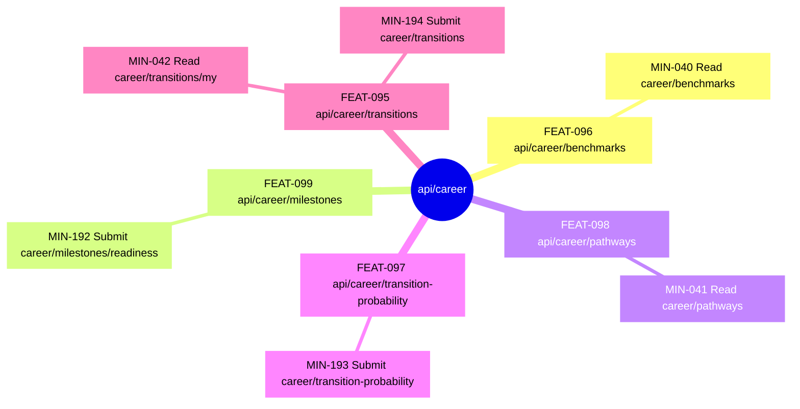
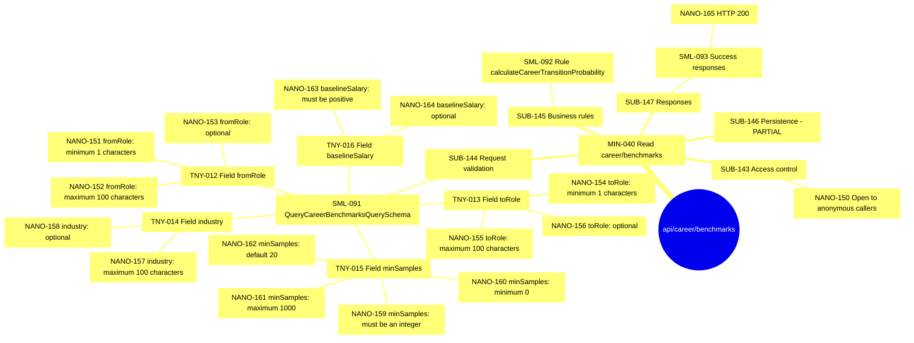
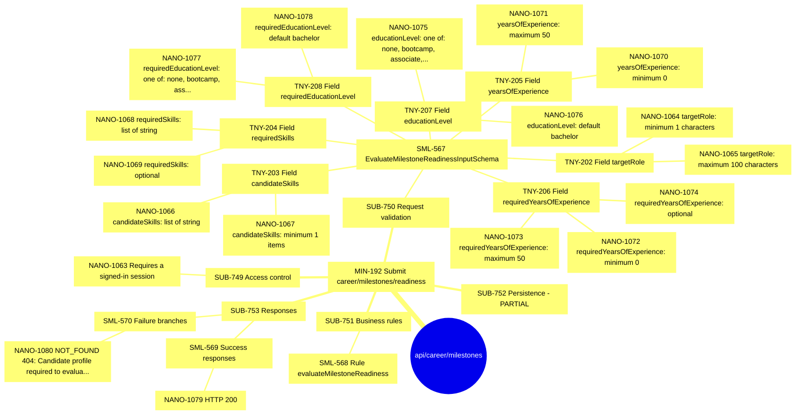
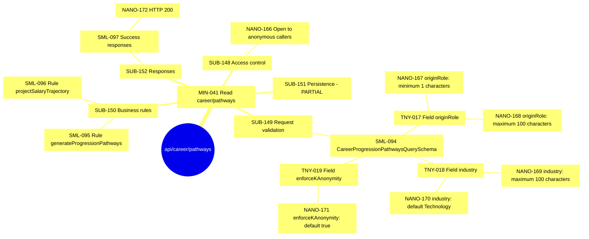
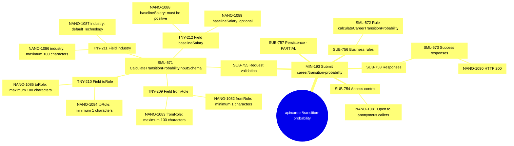
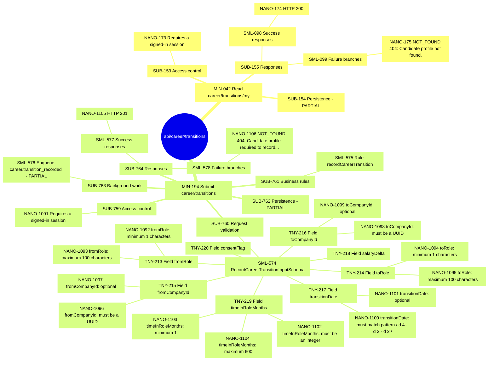

# api/career (MOD-082)

Generated by `docs/mindmap/tools/catalog.py` from `master/MASTER_PROJECT_GRAPH.json` at commit `9b3032f`. Do not edit by hand. Back to the [feature catalog](../FEATURE_CATALOG.md).

**Application:** apps/api (MOD-001). **Purpose:** API module: routes under /api/v1/career in apps/api/src/server.ts.

**Nodes by level:** MODULE 1, MAJOR 5, MINOR 6, SUB 29, SMALL 21, TINY 27, NANO 70. **Status:** IMPLEMENTED 152, PARTIALLY_IMPLEMENTED 7. **Verification:** PATH_LEVEL 140, UNKNOWN 1, VERIFIED 12.

**User roles that reach it:** anonymous, authenticated.

**Known gaps:** MIN-040 ephemeral: state held in process memory, lost on restart; MIN-192 ephemeral: state held in process memory, lost on restart; MIN-041 ephemeral: state held in process memory, lost on restart; MIN-193 ephemeral: state held in process memory, lost on restart; MIN-193 no first-party web caller found; MIN-042 ephemeral: state held in process memory, lost on restart; MIN-042 no first-party web caller found; MIN-194 ephemeral: state held in process memory, lost on restart; MIN-194 no first-party web caller found.

**Called from (web screens and components):** FEAT-160 Screen /career, FEAT-184 Component CareerPaths

## Module map (to minor features)

## FEAT-096 api/career/benchmarks

api/career/benchmarks

| ID       | Level | Parent   | Name                                      | Description                                                                                                                                                                                                                                         | Status                | Verification | Evidence                                     | Related                                         |
| -------- | ----- | -------- | ----------------------------------------- | --------------------------------------------------------------------------------------------------------------------------------------------------------------------------------------------------------------------------------------------------- | --------------------- | ------------ | -------------------------------------------- | ----------------------------------------------- |
| FEAT-096 | MAJOR | MOD-082  | api/career/benchmarks                     |                                                                                                                                                                                                                                                     | IMPLEMENTED           |              | apps/api/src/server.ts:7817                  |                                                 |
| MIN-040  | MINOR | FEAT-096 | Read career/benchmarks                    | GET /api/v1/career/benchmarks for anyone (public); validates QueryCareerBenchmarksQuerySchema; calls calculateCareerTransitionProbability; ephemeral (process memory); responds 200. Gaps: ephemeral: state held in process memory, lost on restart | IMPLEMENTED           | VERIFIED     | apps/api/src/server.ts:7817                  | API-164, TEST-093, TEST-101, TEST-145, TEST-174 |
| SUB-143  | SUB   | MIN-040  | Access control                            | Who may call GET /api/v1/career/benchmarks: anyone (public).                                                                                                                                                                                        | IMPLEMENTED           | PATH_LEVEL   | apps/api/src/server.ts:7817                  |                                                 |
| NANO-150 | NANO  | SUB-143  | Open to anonymous callers                 | auth: public.                                                                                                                                                                                                                                       | IMPLEMENTED           | PATH_LEVEL   | apps/api/src/server.ts:7817                  | ROLE-001                                        |
| SUB-144  | SUB   | MIN-040  | Request validation                        | The request is parsed with QueryCareerBenchmarksQuerySchema; a failure returns 400 with field details before any business logic runs.                                                                                                               | IMPLEMENTED           | PATH_LEVEL   | apps/api/src/server.ts:7817                  |                                                 |
| SML-091  | SMALL | SUB-144  | QueryCareerBenchmarksQuerySchema          | QueryCareerBenchmarksQuerySchema: 5 field(s)                                                                                                                                                                                                        | IMPLEMENTED           | PATH_LEVEL   | packages/contracts/src/index.ts:1514         | SCH-120                                         |
| TNY-012  | TINY  | SML-091  | Field fromRole                            | fromRole (string, optional): minimum 1 characters; maximum 100 characters; optional                                                                                                                                                                 | IMPLEMENTED           | PATH_LEVEL   | packages/contracts/src/index.ts:1515         |                                                 |
| NANO-151 | NANO  | TNY-012  | fromRole: minimum 1 characters            | fromRole minimum 1 characters.                                                                                                                                                                                                                      | IMPLEMENTED           | PATH_LEVEL   | packages/contracts/src/index.ts:1515         |                                                 |
| NANO-152 | NANO  | TNY-012  | fromRole: maximum 100 characters          | fromRole maximum 100 characters.                                                                                                                                                                                                                    | IMPLEMENTED           | PATH_LEVEL   | packages/contracts/src/index.ts:1515         |                                                 |
| NANO-153 | NANO  | TNY-012  | fromRole: optional                        | fromRole optional.                                                                                                                                                                                                                                  | IMPLEMENTED           | PATH_LEVEL   | packages/contracts/src/index.ts:1515         |                                                 |
| TNY-013  | TINY  | SML-091  | Field toRole                              | toRole (string, optional): minimum 1 characters; maximum 100 characters; optional                                                                                                                                                                   | IMPLEMENTED           | PATH_LEVEL   | packages/contracts/src/index.ts:1516         |                                                 |
| NANO-154 | NANO  | TNY-013  | toRole: minimum 1 characters              | toRole minimum 1 characters.                                                                                                                                                                                                                        | IMPLEMENTED           | PATH_LEVEL   | packages/contracts/src/index.ts:1516         |                                                 |
| NANO-155 | NANO  | TNY-013  | toRole: maximum 100 characters            | toRole maximum 100 characters.                                                                                                                                                                                                                      | IMPLEMENTED           | PATH_LEVEL   | packages/contracts/src/index.ts:1516         |                                                 |
| NANO-156 | NANO  | TNY-013  | toRole: optional                          | toRole optional.                                                                                                                                                                                                                                    | IMPLEMENTED           | PATH_LEVEL   | packages/contracts/src/index.ts:1516         |                                                 |
| TNY-014  | TINY  | SML-091  | Field industry                            | industry (string, optional): maximum 100 characters; optional                                                                                                                                                                                       | IMPLEMENTED           | PATH_LEVEL   | packages/contracts/src/index.ts:1517         |                                                 |
| NANO-157 | NANO  | TNY-014  | industry: maximum 100 characters          | industry maximum 100 characters.                                                                                                                                                                                                                    | IMPLEMENTED           | PATH_LEVEL   | packages/contracts/src/index.ts:1517         |                                                 |
| NANO-158 | NANO  | TNY-014  | industry: optional                        | industry optional.                                                                                                                                                                                                                                  | IMPLEMENTED           | PATH_LEVEL   | packages/contracts/src/index.ts:1517         |                                                 |
| TNY-015  | TINY  | SML-091  | Field minSamples                          | minSamples (number, optional): must be an integer; minimum 0; maximum 1000; default 20                                                                                                                                                              | IMPLEMENTED           | PATH_LEVEL   | packages/contracts/src/index.ts:1519         |                                                 |
| NANO-159 | NANO  | TNY-015  | minSamples: must be an integer            | minSamples must be an integer.                                                                                                                                                                                                                      | IMPLEMENTED           | PATH_LEVEL   | packages/contracts/src/index.ts:1519         |                                                 |
| NANO-160 | NANO  | TNY-015  | minSamples: minimum 0                     | minSamples minimum 0.                                                                                                                                                                                                                               | IMPLEMENTED           | PATH_LEVEL   | packages/contracts/src/index.ts:1519         |                                                 |
| NANO-161 | NANO  | TNY-015  | minSamples: maximum 1000                  | minSamples maximum 1000.                                                                                                                                                                                                                            | IMPLEMENTED           | PATH_LEVEL   | packages/contracts/src/index.ts:1519         |                                                 |
| NANO-162 | NANO  | TNY-015  | minSamples: default 20                    | minSamples default 20.                                                                                                                                                                                                                              | IMPLEMENTED           | PATH_LEVEL   | packages/contracts/src/index.ts:1519         |                                                 |
| TNY-016  | TINY  | SML-091  | Field baselineSalary                      | baselineSalary (number, optional): must be positive; optional                                                                                                                                                                                       | IMPLEMENTED           | PATH_LEVEL   | packages/contracts/src/index.ts:1528         |                                                 |
| NANO-163 | NANO  | TNY-016  | baselineSalary: must be positive          | baselineSalary must be positive.                                                                                                                                                                                                                    | IMPLEMENTED           | PATH_LEVEL   | packages/contracts/src/index.ts:1528         |                                                 |
| NANO-164 | NANO  | TNY-016  | baselineSalary: optional                  | baselineSalary optional.                                                                                                                                                                                                                            | IMPLEMENTED           | PATH_LEVEL   | packages/contracts/src/index.ts:1528         |                                                 |
| SUB-145  | SUB   | MIN-040  | Business rules                            | Domain functions from packages/domain called by the handler (1).                                                                                                                                                                                    | IMPLEMENTED           | PATH_LEVEL   | apps/api/src/server.ts:7817                  |                                                 |
| SML-092  | SMALL | SUB-145  | Rule calculateCareerTransitionProbability | Calls calculateCareerTransitionProbability (packages/domain/src/career-trajectory.ts). Rule status IMPLEMENTED; its own tests: VERIFIED.                                                                                                            | IMPLEMENTED           | VERIFIED     | packages/domain/src/career-trajectory.ts:293 | RULE-080                                        |
| SUB-146  | SUB   | MIN-040  | Persistence                               | Ephemeral: state lives in API process memory and is lost on restart.                                                                                                                                                                                | PARTIALLY_IMPLEMENTED | PATH_LEVEL   | apps/api/src/server.ts:7817                  |                                                 |
| SUB-147  | SUB   | MIN-040  | Responses                                 | Success 200; 0 explicit failure branch(es) besides validation and access errors.                                                                                                                                                                    | IMPLEMENTED           | PATH_LEVEL   | apps/api/src/server.ts:7817                  |                                                 |
| SML-093  | SMALL | SUB-147  | Success responses                         | HTTP 200.                                                                                                                                                                                                                                           | IMPLEMENTED           | PATH_LEVEL   | apps/api/src/server.ts:7817                  |                                                 |
| NANO-165 | NANO  | SML-093  | HTTP 200                                  | Replies 200 when the operation succeeds.                                                                                                                                                                                                            | IMPLEMENTED           | PATH_LEVEL   | apps/api/src/server.ts:7817                  |                                                 |

## FEAT-099 api/career/milestones

api/career/milestones

| ID        | Level | Parent   | Name                                                                                   | Description                                                                                                                                                                                                                                                                                                                                   | Status                | Verification | Evidence                                     | Related                               |
| --------- | ----- | -------- | -------------------------------------------------------------------------------------- | --------------------------------------------------------------------------------------------------------------------------------------------------------------------------------------------------------------------------------------------------------------------------------------------------------------------------------------------- | --------------------- | ------------ | -------------------------------------------- | ------------------------------------- |
| FEAT-099  | MAJOR | MOD-082  | api/career/milestones                                                                  |                                                                                                                                                                                                                                                                                                                                               | IMPLEMENTED           |              | apps/api/src/server.ts:7917                  |                                       |
| MIN-192   | MINOR | FEAT-099 | Submit career/milestones/readiness                                                     | 6. Evaluate Candidate Milestone Readiness (F-85, F-152) POST /api/v1/career/milestones/readiness for any signed-in session; validates EvaluateMilestoneReadinessInputSchema; calls evaluateMilestoneReadiness; ephemeral (process memory); responds 200; 1 failure branch(es). Gaps: ephemeral: state held in process memory, lost on restart | IMPLEMENTED           | VERIFIED     | apps/api/src/server.ts:7917                  | API-167, TEST-093, TEST-173, TEST-174 |
| SUB-749   | SUB   | MIN-192  | Access control                                                                         | Who may call POST /api/v1/career/milestones/readiness: any signed-in session.                                                                                                                                                                                                                                                                 | IMPLEMENTED           | PATH_LEVEL   | apps/api/src/server.ts:7917                  |                                       |
| NANO-1063 | NANO  | SUB-749  | Requires a signed-in session                                                           | Requests without a valid session token are rejected with 401 UNAUTHENTICATED.                                                                                                                                                                                                                                                                 | IMPLEMENTED           | PATH_LEVEL   | apps/api/src/server.ts:7917                  | ROLE-001                              |
| SUB-750   | SUB   | MIN-192  | Request validation                                                                     | The request is parsed with EvaluateMilestoneReadinessInputSchema; a failure returns 400 with field details before any business logic runs.                                                                                                                                                                                                    | IMPLEMENTED           | PATH_LEVEL   | apps/api/src/server.ts:7917                  |                                       |
| SML-567   | SMALL | SUB-750  | EvaluateMilestoneReadinessInputSchema                                                  | EvaluateMilestoneReadinessInputSchema: 7 field(s)                                                                                                                                                                                                                                                                                             | IMPLEMENTED           | PATH_LEVEL   | packages/contracts/src/index.ts:1552         | SCH-123                               |
| TNY-202   | TINY  | SML-567  | Field targetRole                                                                       | targetRole (string, required): minimum 1 characters; maximum 100 characters                                                                                                                                                                                                                                                                   | IMPLEMENTED           | PATH_LEVEL   | packages/contracts/src/index.ts:1553         |                                       |
| NANO-1064 | NANO  | TNY-202  | targetRole: minimum 1 characters                                                       | targetRole minimum 1 characters.                                                                                                                                                                                                                                                                                                              | IMPLEMENTED           | PATH_LEVEL   | packages/contracts/src/index.ts:1553         |                                       |
| NANO-1065 | NANO  | TNY-202  | targetRole: maximum 100 characters                                                     | targetRole maximum 100 characters.                                                                                                                                                                                                                                                                                                            | IMPLEMENTED           | PATH_LEVEL   | packages/contracts/src/index.ts:1553         |                                       |
| TNY-203   | TINY  | SML-567  | Field candidateSkills                                                                  | candidateSkills (array, required): list of string; minimum 1 items                                                                                                                                                                                                                                                                            | IMPLEMENTED           | PATH_LEVEL   | packages/contracts/src/index.ts:1554         |                                       |
| NANO-1066 | NANO  | TNY-203  | candidateSkills: list of string                                                        | candidateSkills list of string.                                                                                                                                                                                                                                                                                                               | IMPLEMENTED           | PATH_LEVEL   | packages/contracts/src/index.ts:1554         |                                       |
| NANO-1067 | NANO  | TNY-203  | candidateSkills: minimum 1 items                                                       | candidateSkills minimum 1 items.                                                                                                                                                                                                                                                                                                              | IMPLEMENTED           | PATH_LEVEL   | packages/contracts/src/index.ts:1554         |                                       |
| TNY-204   | TINY  | SML-567  | Field requiredSkills                                                                   | requiredSkills (array, optional): list of string; optional                                                                                                                                                                                                                                                                                    | IMPLEMENTED           | PATH_LEVEL   | packages/contracts/src/index.ts:1555         |                                       |
| NANO-1068 | NANO  | TNY-204  | requiredSkills: list of string                                                         | requiredSkills list of string.                                                                                                                                                                                                                                                                                                                | IMPLEMENTED           | PATH_LEVEL   | packages/contracts/src/index.ts:1555         |                                       |
| NANO-1069 | NANO  | TNY-204  | requiredSkills: optional                                                               | requiredSkills optional.                                                                                                                                                                                                                                                                                                                      | IMPLEMENTED           | PATH_LEVEL   | packages/contracts/src/index.ts:1555         |                                       |
| TNY-205   | TINY  | SML-567  | Field yearsOfExperience                                                                | yearsOfExperience (number, required): minimum 0; maximum 50                                                                                                                                                                                                                                                                                   | IMPLEMENTED           | PATH_LEVEL   | packages/contracts/src/index.ts:1556         |                                       |
| NANO-1070 | NANO  | TNY-205  | yearsOfExperience: minimum 0                                                           | yearsOfExperience minimum 0.                                                                                                                                                                                                                                                                                                                  | IMPLEMENTED           | PATH_LEVEL   | packages/contracts/src/index.ts:1556         |                                       |
| NANO-1071 | NANO  | TNY-205  | yearsOfExperience: maximum 50                                                          | yearsOfExperience maximum 50.                                                                                                                                                                                                                                                                                                                 | IMPLEMENTED           | PATH_LEVEL   | packages/contracts/src/index.ts:1556         |                                       |
| TNY-206   | TINY  | SML-567  | Field requiredYearsOfExperience                                                        | requiredYearsOfExperience (number, optional): minimum 0; maximum 50; optional                                                                                                                                                                                                                                                                 | IMPLEMENTED           | PATH_LEVEL   | packages/contracts/src/index.ts:1557         |                                       |
| NANO-1072 | NANO  | TNY-206  | requiredYearsOfExperience: minimum 0                                                   | requiredYearsOfExperience minimum 0.                                                                                                                                                                                                                                                                                                          | IMPLEMENTED           | PATH_LEVEL   | packages/contracts/src/index.ts:1557         |                                       |
| NANO-1073 | NANO  | TNY-206  | requiredYearsOfExperience: maximum 50                                                  | requiredYearsOfExperience maximum 50.                                                                                                                                                                                                                                                                                                         | IMPLEMENTED           | PATH_LEVEL   | packages/contracts/src/index.ts:1557         |                                       |
| NANO-1074 | NANO  | TNY-206  | requiredYearsOfExperience: optional                                                    | requiredYearsOfExperience optional.                                                                                                                                                                                                                                                                                                           | IMPLEMENTED           | PATH_LEVEL   | packages/contracts/src/index.ts:1557         |                                       |
| TNY-207   | TINY  | SML-567  | Field educationLevel                                                                   | educationLevel (enum, optional): one of: none, bootcamp, associate, bachelor, master, doctorate; default 'bachelor'                                                                                                                                                                                                                           | IMPLEMENTED           | PATH_LEVEL   | packages/contracts/src/index.ts:1558         |                                       |
| NANO-1075 | NANO  | TNY-207  | educationLevel: one of: none, bootcamp, associate, bachelor, master, doctorate         | educationLevel one of: none, bootcamp, associate, bachelor, master, doctorate.                                                                                                                                                                                                                                                                | IMPLEMENTED           | PATH_LEVEL   | packages/contracts/src/index.ts:1558         |                                       |
| NANO-1076 | NANO  | TNY-207  | educationLevel: default 'bachelor'                                                     | educationLevel default 'bachelor'; message "bachelor".                                                                                                                                                                                                                                                                                        | IMPLEMENTED           | PATH_LEVEL   | packages/contracts/src/index.ts:1558         |                                       |
| TNY-208   | TINY  | SML-567  | Field requiredEducationLevel                                                           | requiredEducationLevel (enum, optional): one of: none, bootcamp, associate, bachelor, master, doctorate; default 'bachelor'                                                                                                                                                                                                                   | IMPLEMENTED           | PATH_LEVEL   | packages/contracts/src/index.ts:1561         |                                       |
| NANO-1077 | NANO  | TNY-208  | requiredEducationLevel: one of: none, bootcamp, associate, bachelor, master, doctorate | requiredEducationLevel one of: none, bootcamp, associate, bachelor, master, doctorate.                                                                                                                                                                                                                                                        | IMPLEMENTED           | PATH_LEVEL   | packages/contracts/src/index.ts:1561         |                                       |
| NANO-1078 | NANO  | TNY-208  | requiredEducationLevel: default 'bachelor'                                             | requiredEducationLevel default 'bachelor'; message "bachelor".                                                                                                                                                                                                                                                                                | IMPLEMENTED           | PATH_LEVEL   | packages/contracts/src/index.ts:1561         |                                       |
| SUB-751   | SUB   | MIN-192  | Business rules                                                                         | Domain functions from packages/domain called by the handler (1).                                                                                                                                                                                                                                                                              | IMPLEMENTED           | PATH_LEVEL   | apps/api/src/server.ts:7917                  |                                       |
| SML-568   | SMALL | SUB-751  | Rule evaluateMilestoneReadiness                                                        | Calls evaluateMilestoneReadiness (packages/domain/src/career-trajectory.ts). Rule status IMPLEMENTED; its own tests: VERIFIED.                                                                                                                                                                                                                | IMPLEMENTED           | VERIFIED     | packages/domain/src/career-trajectory.ts:534 | RULE-083                              |
| SUB-752   | SUB   | MIN-192  | Persistence                                                                            | Ephemeral: state lives in API process memory and is lost on restart.                                                                                                                                                                                                                                                                          | PARTIALLY_IMPLEMENTED | PATH_LEVEL   | apps/api/src/server.ts:7917                  |                                       |
| SUB-753   | SUB   | MIN-192  | Responses                                                                              | Success 200; 1 explicit failure branch(es) besides validation and access errors.                                                                                                                                                                                                                                                              | IMPLEMENTED           | PATH_LEVEL   | apps/api/src/server.ts:7917                  |                                       |
| SML-569   | SMALL | SUB-753  | Success responses                                                                      | HTTP 200.                                                                                                                                                                                                                                                                                                                                     | IMPLEMENTED           | PATH_LEVEL   | apps/api/src/server.ts:7917                  |                                       |
| NANO-1079 | NANO  | SML-569  | HTTP 200                                                                               | Replies 200 when the operation succeeds.                                                                                                                                                                                                                                                                                                      | IMPLEMENTED           | PATH_LEVEL   | apps/api/src/server.ts:7917                  |                                       |
| SML-570   | SMALL | SUB-753  | Failure branches                                                                       | 1 DomainError branch(es) in the handler, mapped to HTTP by the global error handler.                                                                                                                                                                                                                                                          | IMPLEMENTED           | PATH_LEVEL   | apps/api/src/server.ts:7917                  |                                       |
| NANO-1080 | NANO  | SML-570  | NOT_FOUND 404: Candidate profile required to evaluate milestones.                      | Throws DomainError(NOT_FOUND) "Candidate profile required to evaluate milestones." -> HTTP 404.                                                                                                                                                                                                                                               | IMPLEMENTED           | PATH_LEVEL   | apps/api/src/server.ts:7923                  | ERR-159                               |

## FEAT-098 api/career/pathways

api/career/pathways

| ID       | Level | Parent   | Name                                 | Description                                                                                                                                                                                                                                                                                                                                               | Status                | Verification | Evidence                                     | Related                               |
| -------- | ----- | -------- | ------------------------------------ | --------------------------------------------------------------------------------------------------------------------------------------------------------------------------------------------------------------------------------------------------------------------------------------------------------------------------------------------------------- | --------------------- | ------------ | -------------------------------------------- | ------------------------------------- |
| FEAT-098 | MAJOR | MOD-082  | api/career/pathways                  |                                                                                                                                                                                                                                                                                                                                                           | IMPLEMENTED           |              | apps/api/src/server.ts:7893                  |                                       |
| MIN-041  | MINOR | FEAT-098 | Read career/pathways                 | 5. Discover Career Progression Pathways & Salary Trajectory (F-152, BR-160, BR-161) GET /api/v1/career/pathways for anyone (public); validates CareerProgressionPathwaysQuerySchema; calls generateProgressionPathways, projectSalaryTrajectory; ephemeral (process memory); responds 200. Gaps: ephemeral: state held in process memory, lost on restart | IMPLEMENTED           | VERIFIED     | apps/api/src/server.ts:7893                  | API-166, TEST-093, TEST-145, TEST-174 |
| SUB-148  | SUB   | MIN-041  | Access control                       | Who may call GET /api/v1/career/pathways: anyone (public).                                                                                                                                                                                                                                                                                                | IMPLEMENTED           | PATH_LEVEL   | apps/api/src/server.ts:7893                  |                                       |
| NANO-166 | NANO  | SUB-148  | Open to anonymous callers            | auth: public.                                                                                                                                                                                                                                                                                                                                             | IMPLEMENTED           | PATH_LEVEL   | apps/api/src/server.ts:7893                  | ROLE-001                              |
| SUB-149  | SUB   | MIN-041  | Request validation                   | The request is parsed with CareerProgressionPathwaysQuerySchema; a failure returns 400 with field details before any business logic runs.                                                                                                                                                                                                                 | IMPLEMENTED           | PATH_LEVEL   | apps/api/src/server.ts:7893                  |                                       |
| SML-094  | SMALL | SUB-149  | CareerProgressionPathwaysQuerySchema | CareerProgressionPathwaysQuerySchema: 3 field(s)                                                                                                                                                                                                                                                                                                          | IMPLEMENTED           | PATH_LEVEL   | packages/contracts/src/index.ts:1535         | SCH-122                               |
| TNY-017  | TINY  | SML-094  | Field originRole                     | originRole (string, required): minimum 1 characters; maximum 100 characters                                                                                                                                                                                                                                                                               | IMPLEMENTED           | PATH_LEVEL   | packages/contracts/src/index.ts:1536         |                                       |
| NANO-167 | NANO  | TNY-017  | originRole: minimum 1 characters     | originRole minimum 1 characters.                                                                                                                                                                                                                                                                                                                          | IMPLEMENTED           | PATH_LEVEL   | packages/contracts/src/index.ts:1536         |                                       |
| NANO-168 | NANO  | TNY-017  | originRole: maximum 100 characters   | originRole maximum 100 characters.                                                                                                                                                                                                                                                                                                                        | IMPLEMENTED           | PATH_LEVEL   | packages/contracts/src/index.ts:1536         |                                       |
| TNY-018  | TINY  | SML-094  | Field industry                       | industry (string, optional): maximum 100 characters; default 'Technology'                                                                                                                                                                                                                                                                                 | IMPLEMENTED           | PATH_LEVEL   | packages/contracts/src/index.ts:1537         |                                       |
| NANO-169 | NANO  | TNY-018  | industry: maximum 100 characters     | industry maximum 100 characters.                                                                                                                                                                                                                                                                                                                          | IMPLEMENTED           | PATH_LEVEL   | packages/contracts/src/index.ts:1537         |                                       |
| NANO-170 | NANO  | TNY-018  | industry: default 'Technology'       | industry default 'Technology'; message "Technology".                                                                                                                                                                                                                                                                                                      | IMPLEMENTED           | PATH_LEVEL   | packages/contracts/src/index.ts:1537         |                                       |
| TNY-019  | TINY  | SML-094  | Field enforceKAnonymity              | enforceKAnonymity (preprocess, optional): default true                                                                                                                                                                                                                                                                                                    | IMPLEMENTED           | PATH_LEVEL   | packages/contracts/src/index.ts:1540         |                                       |
| NANO-171 | NANO  | TNY-019  | enforceKAnonymity: default true      | enforceKAnonymity default true.                                                                                                                                                                                                                                                                                                                           | IMPLEMENTED           | PATH_LEVEL   | packages/contracts/src/index.ts:1540         |                                       |
| SUB-150  | SUB   | MIN-041  | Business rules                       | Domain functions from packages/domain called by the handler (2).                                                                                                                                                                                                                                                                                          | IMPLEMENTED           | PATH_LEVEL   | apps/api/src/server.ts:7893                  |                                       |
| SML-095  | SMALL | SUB-150  | Rule generateProgressionPathways     | Calls generateProgressionPathways (packages/domain/src/career-trajectory.ts). Rule status IMPLEMENTED; its own tests: VERIFIED.                                                                                                                                                                                                                           | IMPLEMENTED           | VERIFIED     | packages/domain/src/career-trajectory.ts:396 | RULE-081                              |
| SML-096  | SMALL | SUB-150  | Rule projectSalaryTrajectory         | Calls projectSalaryTrajectory (packages/domain/src/career-trajectory.ts). Rule status IMPLEMENTED; its own tests: VERIFIED.                                                                                                                                                                                                                               | IMPLEMENTED           | VERIFIED     | packages/domain/src/career-trajectory.ts:482 | RULE-082                              |
| SUB-151  | SUB   | MIN-041  | Persistence                          | Ephemeral: state lives in API process memory and is lost on restart.                                                                                                                                                                                                                                                                                      | PARTIALLY_IMPLEMENTED | PATH_LEVEL   | apps/api/src/server.ts:7893                  |                                       |
| SUB-152  | SUB   | MIN-041  | Responses                            | Success 200; 0 explicit failure branch(es) besides validation and access errors.                                                                                                                                                                                                                                                                          | IMPLEMENTED           | PATH_LEVEL   | apps/api/src/server.ts:7893                  |                                       |
| SML-097  | SMALL | SUB-152  | Success responses                    | HTTP 200.                                                                                                                                                                                                                                                                                                                                                 | IMPLEMENTED           | PATH_LEVEL   | apps/api/src/server.ts:7893                  |                                       |
| NANO-172 | NANO  | SML-097  | HTTP 200                             | Replies 200 when the operation succeeds.                                                                                                                                                                                                                                                                                                                  | IMPLEMENTED           | PATH_LEVEL   | apps/api/src/server.ts:7893                  |                                       |

## FEAT-097 api/career/transition-probability

api/career/transition-probability

| ID        | Level | Parent   | Name                                      | Description                                                                                                                                                                                                                                                                                                                                                                                             | Status                | Verification | Evidence                                     | Related                               |
| --------- | ----- | -------- | ----------------------------------------- | ------------------------------------------------------------------------------------------------------------------------------------------------------------------------------------------------------------------------------------------------------------------------------------------------------------------------------------------------------------------------------------------------------- | --------------------- | ------------ | -------------------------------------------- | ------------------------------------- |
| FEAT-097  | MAJOR | MOD-082  | api/career/transition-probability         |                                                                                                                                                                                                                                                                                                                                                                                                         | IMPLEMENTED           |              | apps/api/src/server.ts:7860                  |                                       |
| MIN-193   | MINOR | FEAT-097 | Submit career/transition-probability      | 4. Calculate Transition Probability (BR-163: disclose data sources and confidence intervals) POST /api/v1/career/transition-probability for anyone (public); validates CalculateTransitionProbabilityInputSchema; calls calculateCareerTransitionProbability; ephemeral (process memory); responds 200. Gaps: ephemeral: state held in process memory, lost on restart; no first-party web caller found | IMPLEMENTED           | VERIFIED     | apps/api/src/server.ts:7860                  | API-165, TEST-093, TEST-145, TEST-174 |
| SUB-754   | SUB   | MIN-193  | Access control                            | Who may call POST /api/v1/career/transition-probability: anyone (public).                                                                                                                                                                                                                                                                                                                               | IMPLEMENTED           | PATH_LEVEL   | apps/api/src/server.ts:7860                  |                                       |
| NANO-1081 | NANO  | SUB-754  | Open to anonymous callers                 | auth: public.                                                                                                                                                                                                                                                                                                                                                                                           | IMPLEMENTED           | PATH_LEVEL   | apps/api/src/server.ts:7860                  | ROLE-001                              |
| SUB-755   | SUB   | MIN-193  | Request validation                        | The request is parsed with CalculateTransitionProbabilityInputSchema; a failure returns 400 with field details before any business logic runs.                                                                                                                                                                                                                                                          | IMPLEMENTED           | PATH_LEVEL   | apps/api/src/server.ts:7860                  |                                       |
| SML-571   | SMALL | SUB-755  | CalculateTransitionProbabilityInputSchema | CalculateTransitionProbabilityInputSchema: 4 field(s)                                                                                                                                                                                                                                                                                                                                                   | IMPLEMENTED           | PATH_LEVEL   | packages/contracts/src/index.ts:1524         | SCH-121                               |
| TNY-209   | TINY  | SML-571  | Field fromRole                            | fromRole (string, required): minimum 1 characters; maximum 100 characters                                                                                                                                                                                                                                                                                                                               | IMPLEMENTED           | PATH_LEVEL   | packages/contracts/src/index.ts:1525         |                                       |
| NANO-1082 | NANO  | TNY-209  | fromRole: minimum 1 characters            | fromRole minimum 1 characters.                                                                                                                                                                                                                                                                                                                                                                          | IMPLEMENTED           | PATH_LEVEL   | packages/contracts/src/index.ts:1525         |                                       |
| NANO-1083 | NANO  | TNY-209  | fromRole: maximum 100 characters          | fromRole maximum 100 characters.                                                                                                                                                                                                                                                                                                                                                                        | IMPLEMENTED           | PATH_LEVEL   | packages/contracts/src/index.ts:1525         |                                       |
| TNY-210   | TINY  | SML-571  | Field toRole                              | toRole (string, required): minimum 1 characters; maximum 100 characters                                                                                                                                                                                                                                                                                                                                 | IMPLEMENTED           | PATH_LEVEL   | packages/contracts/src/index.ts:1526         |                                       |
| NANO-1084 | NANO  | TNY-210  | toRole: minimum 1 characters              | toRole minimum 1 characters.                                                                                                                                                                                                                                                                                                                                                                            | IMPLEMENTED           | PATH_LEVEL   | packages/contracts/src/index.ts:1526         |                                       |
| NANO-1085 | NANO  | TNY-210  | toRole: maximum 100 characters            | toRole maximum 100 characters.                                                                                                                                                                                                                                                                                                                                                                          | IMPLEMENTED           | PATH_LEVEL   | packages/contracts/src/index.ts:1526         |                                       |
| TNY-211   | TINY  | SML-571  | Field industry                            | industry (string, optional): maximum 100 characters; default 'Technology'                                                                                                                                                                                                                                                                                                                               | IMPLEMENTED           | PATH_LEVEL   | packages/contracts/src/index.ts:1527         |                                       |
| NANO-1086 | NANO  | TNY-211  | industry: maximum 100 characters          | industry maximum 100 characters.                                                                                                                                                                                                                                                                                                                                                                        | IMPLEMENTED           | PATH_LEVEL   | packages/contracts/src/index.ts:1527         |                                       |
| NANO-1087 | NANO  | TNY-211  | industry: default 'Technology'            | industry default 'Technology'; message "Technology".                                                                                                                                                                                                                                                                                                                                                    | IMPLEMENTED           | PATH_LEVEL   | packages/contracts/src/index.ts:1527         |                                       |
| TNY-212   | TINY  | SML-571  | Field baselineSalary                      | baselineSalary (number, optional): must be positive; optional                                                                                                                                                                                                                                                                                                                                           | IMPLEMENTED           | PATH_LEVEL   | packages/contracts/src/index.ts:1528         |                                       |
| NANO-1088 | NANO  | TNY-212  | baselineSalary: must be positive          | baselineSalary must be positive.                                                                                                                                                                                                                                                                                                                                                                        | IMPLEMENTED           | PATH_LEVEL   | packages/contracts/src/index.ts:1528         |                                       |
| NANO-1089 | NANO  | TNY-212  | baselineSalary: optional                  | baselineSalary optional.                                                                                                                                                                                                                                                                                                                                                                                | IMPLEMENTED           | PATH_LEVEL   | packages/contracts/src/index.ts:1528         |                                       |
| SUB-756   | SUB   | MIN-193  | Business rules                            | Domain functions from packages/domain called by the handler (1).                                                                                                                                                                                                                                                                                                                                        | IMPLEMENTED           | PATH_LEVEL   | apps/api/src/server.ts:7860                  |                                       |
| SML-572   | SMALL | SUB-756  | Rule calculateCareerTransitionProbability | Calls calculateCareerTransitionProbability (packages/domain/src/career-trajectory.ts). Rule status IMPLEMENTED; its own tests: VERIFIED.                                                                                                                                                                                                                                                                | IMPLEMENTED           | VERIFIED     | packages/domain/src/career-trajectory.ts:293 | RULE-080                              |
| SUB-757   | SUB   | MIN-193  | Persistence                               | Ephemeral: state lives in API process memory and is lost on restart.                                                                                                                                                                                                                                                                                                                                    | PARTIALLY_IMPLEMENTED | PATH_LEVEL   | apps/api/src/server.ts:7860                  |                                       |
| SUB-758   | SUB   | MIN-193  | Responses                                 | Success 200; 0 explicit failure branch(es) besides validation and access errors.                                                                                                                                                                                                                                                                                                                        | IMPLEMENTED           | PATH_LEVEL   | apps/api/src/server.ts:7860                  |                                       |
| SML-573   | SMALL | SUB-758  | Success responses                         | HTTP 200.                                                                                                                                                                                                                                                                                                                                                                                               | IMPLEMENTED           | PATH_LEVEL   | apps/api/src/server.ts:7860                  |                                       |
| NANO-1090 | NANO  | SML-573  | HTTP 200                                  | Replies 200 when the operation succeeds.                                                                                                                                                                                                                                                                                                                                                                | IMPLEMENTED           | PATH_LEVEL   | apps/api/src/server.ts:7860                  |                                       |

## FEAT-095 api/career/transitions

api/career/transitions

| ID        | Level | Parent   | Name                                                                   | Description                                                                                                                                                                                                                                                                                                                                                       | Status                | Verification | Evidence                                     | Related                               |
| --------- | ----- | -------- | ---------------------------------------------------------------------- | ----------------------------------------------------------------------------------------------------------------------------------------------------------------------------------------------------------------------------------------------------------------------------------------------------------------------------------------------------------------- | --------------------- | ------------ | -------------------------------------------- | ------------------------------------- |
| FEAT-095  | MAJOR | MOD-082  | api/career/transitions                                                 |                                                                                                                                                                                                                                                                                                                                                                   | IMPLEMENTED           |              | apps/api/src/server.ts:7740                  |                                       |
| MIN-042   | MINOR | FEAT-095 | Read career/transitions/my                                             | 2. Get My Career Transitions (BR-159: Individual career transitions visible only to the user) GET /api/v1/career/transitions/my for any signed-in session; ephemeral (process memory); responds 200; 1 failure branch(es). Gaps: ephemeral: state held in process memory, lost on restart; no first-party web caller found                                        | IMPLEMENTED           | VERIFIED     | apps/api/src/server.ts:7799                  | API-163, TEST-093, TEST-174           |
| SUB-153   | SUB   | MIN-042  | Access control                                                         | Who may call GET /api/v1/career/transitions/my: any signed-in session.                                                                                                                                                                                                                                                                                            | IMPLEMENTED           | PATH_LEVEL   | apps/api/src/server.ts:7799                  |                                       |
| NANO-173  | NANO  | SUB-153  | Requires a signed-in session                                           | Requests without a valid session token are rejected with 401 UNAUTHENTICATED.                                                                                                                                                                                                                                                                                     | IMPLEMENTED           | PATH_LEVEL   | apps/api/src/server.ts:7799                  | ROLE-001                              |
| SUB-154   | SUB   | MIN-042  | Persistence                                                            | Ephemeral: state lives in API process memory and is lost on restart.                                                                                                                                                                                                                                                                                              | PARTIALLY_IMPLEMENTED | PATH_LEVEL   | apps/api/src/server.ts:7799                  |                                       |
| SUB-155   | SUB   | MIN-042  | Responses                                                              | Success 200; 1 explicit failure branch(es) besides validation and access errors.                                                                                                                                                                                                                                                                                  | IMPLEMENTED           | PATH_LEVEL   | apps/api/src/server.ts:7799                  |                                       |
| SML-098   | SMALL | SUB-155  | Success responses                                                      | HTTP 200.                                                                                                                                                                                                                                                                                                                                                         | IMPLEMENTED           | PATH_LEVEL   | apps/api/src/server.ts:7799                  |                                       |
| NANO-174  | NANO  | SML-098  | HTTP 200                                                               | Replies 200 when the operation succeeds.                                                                                                                                                                                                                                                                                                                          | IMPLEMENTED           | PATH_LEVEL   | apps/api/src/server.ts:7799                  |                                       |
| SML-099   | SMALL | SUB-155  | Failure branches                                                       | 1 DomainError branch(es) in the handler, mapped to HTTP by the global error handler.                                                                                                                                                                                                                                                                              | IMPLEMENTED           | PATH_LEVEL   | apps/api/src/server.ts:7799                  |                                       |
| NANO-175  | NANO  | SML-099  | NOT_FOUND 404: Candidate profile not found.                            | Throws DomainError(NOT_FOUND) "Candidate profile not found." -> HTTP 404.                                                                                                                                                                                                                                                                                         | IMPLEMENTED           | PATH_LEVEL   | apps/api/src/server.ts:7803                  | ERR-158                               |
| MIN-194   | MINOR | FEAT-095 | Submit career/transitions                                              | 1. Record Opt-in Career Transition (BR-157, BR-159, BR-161) POST /api/v1/career/transitions for any signed-in session; validates RecordCareerTransitionInputSchema; calls recordCareerTransition; ephemeral (process memory); responds 201; 1 failure branch(es). Gaps: ephemeral: state held in process memory, lost on restart; no first-party web caller found | IMPLEMENTED           | VERIFIED     | apps/api/src/server.ts:7740                  | API-162, TEST-093, TEST-101, TEST-174 |
| SUB-759   | SUB   | MIN-194  | Access control                                                         | Who may call POST /api/v1/career/transitions: any signed-in session.                                                                                                                                                                                                                                                                                              | IMPLEMENTED           | PATH_LEVEL   | apps/api/src/server.ts:7740                  |                                       |
| NANO-1091 | NANO  | SUB-759  | Requires a signed-in session                                           | Requests without a valid session token are rejected with 401 UNAUTHENTICATED.                                                                                                                                                                                                                                                                                     | IMPLEMENTED           | PATH_LEVEL   | apps/api/src/server.ts:7740                  | ROLE-001                              |
| SUB-760   | SUB   | MIN-194  | Request validation                                                     | The request is parsed with RecordCareerTransitionInputSchema; a failure returns 400 with field details before any business logic runs.                                                                                                                                                                                                                            | IMPLEMENTED           | PATH_LEVEL   | apps/api/src/server.ts:7740                  |                                       |
| SML-574   | SMALL | SUB-760  | RecordCareerTransitionInputSchema                                      | RecordCareerTransitionInputSchema: 8 field(s)                                                                                                                                                                                                                                                                                                                     | IMPLEMENTED           | PATH_LEVEL   | packages/contracts/src/index.ts:1498         | SCH-119                               |
| TNY-213   | TINY  | SML-574  | Field fromRole                                                         | fromRole (string, required): minimum 1 characters; maximum 100 characters                                                                                                                                                                                                                                                                                         | IMPLEMENTED           | PATH_LEVEL   | packages/contracts/src/index.ts:1499         |                                       |
| NANO-1092 | NANO  | TNY-213  | fromRole: minimum 1 characters                                         | fromRole minimum 1 characters.                                                                                                                                                                                                                                                                                                                                    | IMPLEMENTED           | PATH_LEVEL   | packages/contracts/src/index.ts:1499         |                                       |
| NANO-1093 | NANO  | TNY-213  | fromRole: maximum 100 characters                                       | fromRole maximum 100 characters.                                                                                                                                                                                                                                                                                                                                  | IMPLEMENTED           | PATH_LEVEL   | packages/contracts/src/index.ts:1499         |                                       |
| TNY-214   | TINY  | SML-574  | Field toRole                                                           | toRole (string, required): minimum 1 characters; maximum 100 characters                                                                                                                                                                                                                                                                                           | IMPLEMENTED           | PATH_LEVEL   | packages/contracts/src/index.ts:1500         |                                       |
| NANO-1094 | NANO  | TNY-214  | toRole: minimum 1 characters                                           | toRole minimum 1 characters.                                                                                                                                                                                                                                                                                                                                      | IMPLEMENTED           | PATH_LEVEL   | packages/contracts/src/index.ts:1500         |                                       |
| NANO-1095 | NANO  | TNY-214  | toRole: maximum 100 characters                                         | toRole maximum 100 characters.                                                                                                                                                                                                                                                                                                                                    | IMPLEMENTED           | PATH_LEVEL   | packages/contracts/src/index.ts:1500         |                                       |
| TNY-215   | TINY  | SML-574  | Field fromCompanyId                                                    | fromCompanyId (string, optional): must be a UUID; optional                                                                                                                                                                                                                                                                                                        | IMPLEMENTED           | PATH_LEVEL   | packages/contracts/src/index.ts:1501         |                                       |
| NANO-1096 | NANO  | TNY-215  | fromCompanyId: must be a UUID                                          | fromCompanyId must be a UUID.                                                                                                                                                                                                                                                                                                                                     | IMPLEMENTED           | PATH_LEVEL   | packages/contracts/src/index.ts:1501         |                                       |
| NANO-1097 | NANO  | TNY-215  | fromCompanyId: optional                                                | fromCompanyId optional.                                                                                                                                                                                                                                                                                                                                           | IMPLEMENTED           | PATH_LEVEL   | packages/contracts/src/index.ts:1501         |                                       |
| TNY-216   | TINY  | SML-574  | Field toCompanyId                                                      | toCompanyId (string, optional): must be a UUID; optional                                                                                                                                                                                                                                                                                                          | IMPLEMENTED           | PATH_LEVEL   | packages/contracts/src/index.ts:1502         |                                       |
| NANO-1098 | NANO  | TNY-216  | toCompanyId: must be a UUID                                            | toCompanyId must be a UUID.                                                                                                                                                                                                                                                                                                                                       | IMPLEMENTED           | PATH_LEVEL   | packages/contracts/src/index.ts:1502         |                                       |
| NANO-1099 | NANO  | TNY-216  | toCompanyId: optional                                                  | toCompanyId optional.                                                                                                                                                                                                                                                                                                                                             | IMPLEMENTED           | PATH_LEVEL   | packages/contracts/src/index.ts:1502         |                                       |
| TNY-217   | TINY  | SML-574  | Field transitionDate                                                   | transitionDate (string, optional): must match pattern /^\d{4}-\d{2}-\d{2}$/; optional                                                                                                                                                                                                                                                                             | IMPLEMENTED           | PATH_LEVEL   | packages/contracts/src/index.ts:1503         |                                       |
| NANO-1100 | NANO  | TNY-217  | transitionDate: must match pattern /^\d{4}-\d{2}-\d{2}$/               | transitionDate must match pattern /^\d{4}-\d{2}-\d{2}$/.                                                                                                                                                                                                                                                                                                          | IMPLEMENTED           | PATH_LEVEL   | packages/contracts/src/index.ts:1503         |                                       |
| NANO-1101 | NANO  | TNY-217  | transitionDate: optional                                               | transitionDate optional.                                                                                                                                                                                                                                                                                                                                          | IMPLEMENTED           | PATH_LEVEL   | packages/contracts/src/index.ts:1503         |                                       |
| TNY-218   | TINY  | SML-574  | Field salaryDelta                                                      | salaryDelta (number, required)                                                                                                                                                                                                                                                                                                                                    | IMPLEMENTED           | PATH_LEVEL   | packages/contracts/src/index.ts:1507         |                                       |
| TNY-219   | TINY  | SML-574  | Field timeInRoleMonths                                                 | timeInRoleMonths (number, required): must be an integer; minimum 1; maximum 600                                                                                                                                                                                                                                                                                   | IMPLEMENTED           | PATH_LEVEL   | packages/contracts/src/index.ts:1508         |                                       |
| NANO-1102 | NANO  | TNY-219  | timeInRoleMonths: must be an integer                                   | timeInRoleMonths must be an integer.                                                                                                                                                                                                                                                                                                                              | IMPLEMENTED           | PATH_LEVEL   | packages/contracts/src/index.ts:1508         |                                       |
| NANO-1103 | NANO  | TNY-219  | timeInRoleMonths: minimum 1                                            | timeInRoleMonths minimum 1.                                                                                                                                                                                                                                                                                                                                       | IMPLEMENTED           | PATH_LEVEL   | packages/contracts/src/index.ts:1508         |                                       |
| NANO-1104 | NANO  | TNY-219  | timeInRoleMonths: maximum 600                                          | timeInRoleMonths maximum 600.                                                                                                                                                                                                                                                                                                                                     | IMPLEMENTED           | PATH_LEVEL   | packages/contracts/src/index.ts:1508         |                                       |
| TNY-220   | TINY  | SML-574  | Field consentFlag                                                      | consentFlag (boolean, required)                                                                                                                                                                                                                                                                                                                                   | IMPLEMENTED           | PATH_LEVEL   | packages/contracts/src/index.ts:1509         |                                       |
| SUB-761   | SUB   | MIN-194  | Business rules                                                         | Domain functions from packages/domain called by the handler (1).                                                                                                                                                                                                                                                                                                  | IMPLEMENTED           | PATH_LEVEL   | apps/api/src/server.ts:7740                  |                                       |
| SML-575   | SMALL | SUB-761  | Rule recordCareerTransition                                            | Calls recordCareerTransition (packages/domain/src/career-trajectory.ts). Rule status IMPLEMENTED; its own tests: VERIFIED.                                                                                                                                                                                                                                        | IMPLEMENTED           | VERIFIED     | packages/domain/src/career-trajectory.ts:203 | RULE-078                              |
| SUB-762   | SUB   | MIN-194  | Persistence                                                            | Ephemeral: state lives in API process memory and is lost on restart.                                                                                                                                                                                                                                                                                              | PARTIALLY_IMPLEMENTED | PATH_LEVEL   | apps/api/src/server.ts:7740                  |                                       |
| SUB-763   | SUB   | MIN-194  | Background work                                                        | Enqueues 1 background job kind(s) in background_jobs for apps/worker.                                                                                                                                                                                                                                                                                             | IMPLEMENTED           | PATH_LEVEL   | apps/api/src/server.ts:7740                  |                                       |
| SML-576   | SMALL | SUB-763  | Enqueue career.transition_recorded                                     | Dispatches job:career.transition_recorded; worker handler: recordEvent (no-op: marks the event recorded).                                                                                                                                                                                                                                                         | PARTIALLY_IMPLEMENTED | UNKNOWN      | packages/domain/src/background-jobs.ts:171   | SVC-013                               |
| SUB-764   | SUB   | MIN-194  | Responses                                                              | Success 201; 1 explicit failure branch(es) besides validation and access errors.                                                                                                                                                                                                                                                                                  | IMPLEMENTED           | PATH_LEVEL   | apps/api/src/server.ts:7740                  |                                       |
| SML-577   | SMALL | SUB-764  | Success responses                                                      | HTTP 201.                                                                                                                                                                                                                                                                                                                                                         | IMPLEMENTED           | PATH_LEVEL   | apps/api/src/server.ts:7740                  |                                       |
| NANO-1105 | NANO  | SML-577  | HTTP 201                                                               | Replies 201 when the operation succeeds.                                                                                                                                                                                                                                                                                                                          | IMPLEMENTED           | PATH_LEVEL   | apps/api/src/server.ts:7740                  |                                       |
| SML-578   | SMALL | SUB-764  | Failure branches                                                       | 1 DomainError branch(es) in the handler, mapped to HTTP by the global error handler.                                                                                                                                                                                                                                                                              | IMPLEMENTED           | PATH_LEVEL   | apps/api/src/server.ts:7740                  |                                       |
| NANO-1106 | NANO  | SML-578  | NOT_FOUND 404: Candidate profile required to record career transition. | Throws DomainError(NOT_FOUND) "Candidate profile required to record career transition." -> HTTP 404.                                                                                                                                                                                                                                                              | IMPLEMENTED           | PATH_LEVEL   | apps/api/src/server.ts:7744                  | ERR-157                               |
