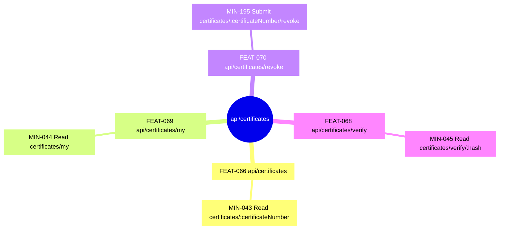
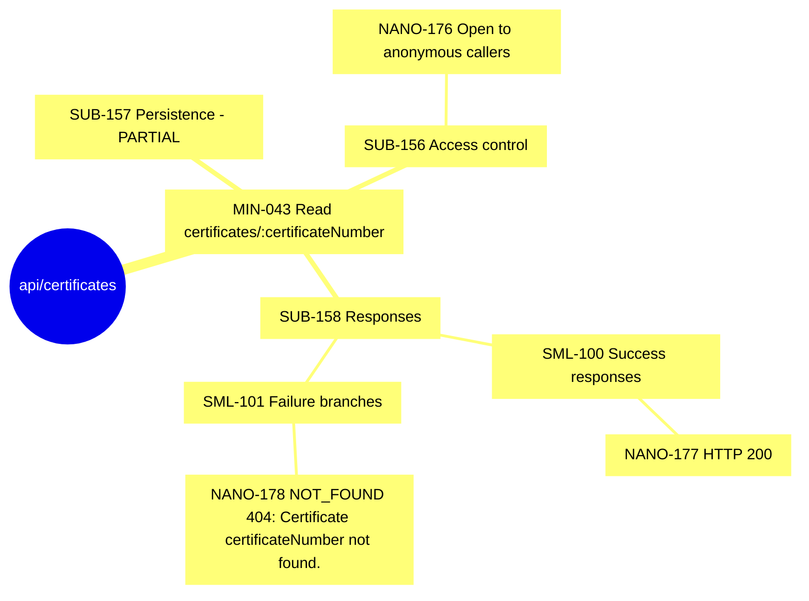
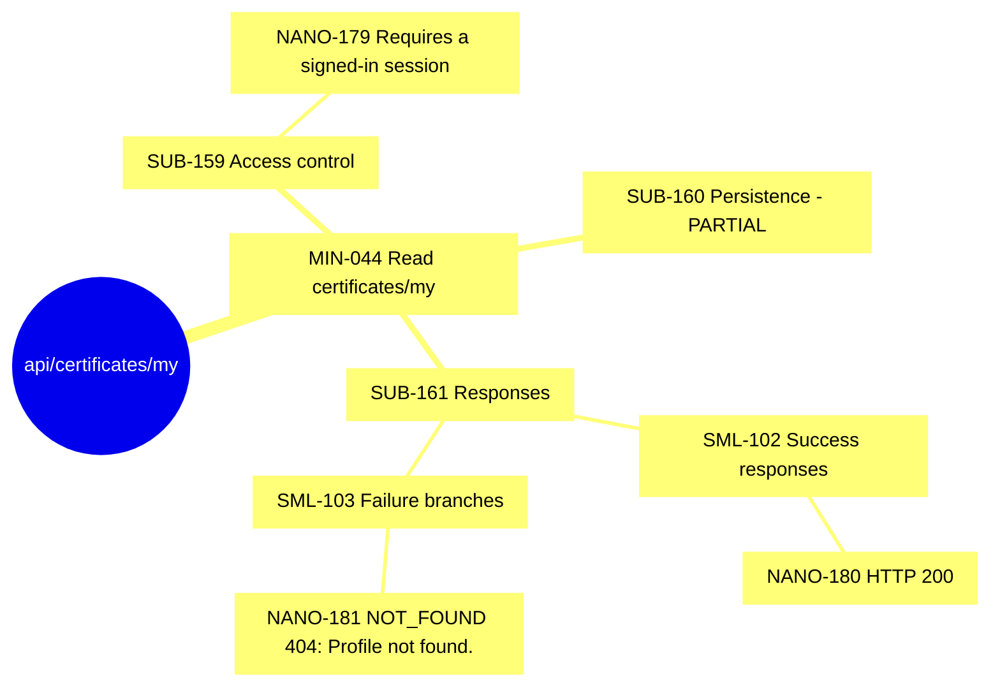
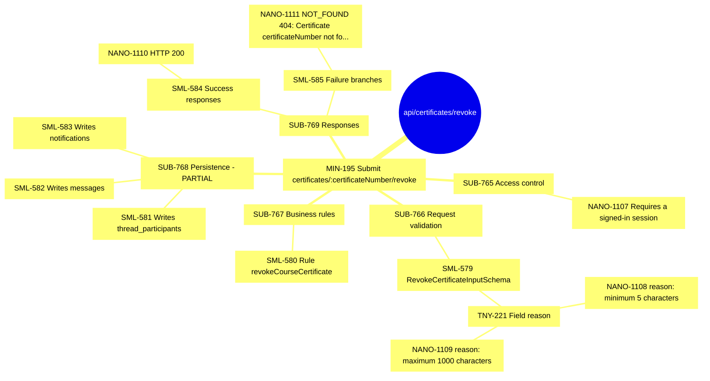
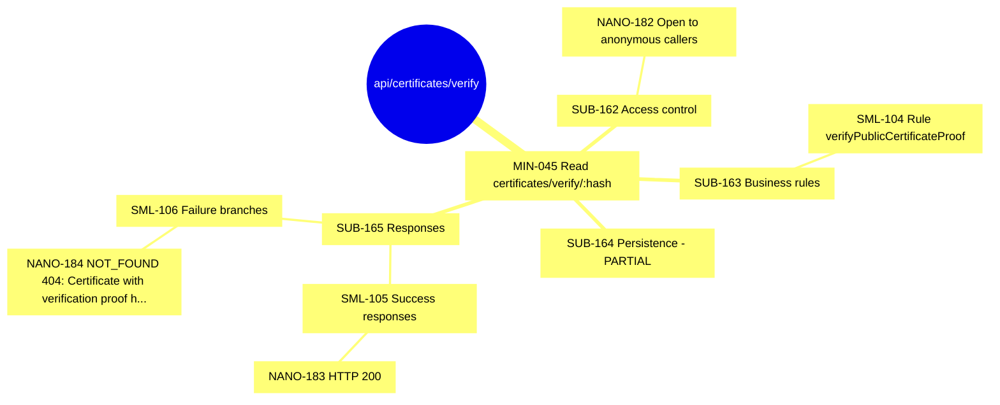

# api/certificates (MOD-074)

Generated by `docs/mindmap/tools/catalog.py` from `master/MASTER_PROJECT_GRAPH.json` at commit `9b3032f`. Do not edit by hand. Back to the [feature catalog](../FEATURE_CATALOG.md).

**Application:** apps/api (MOD-001). **Purpose:** API module: routes under /api/v1/certificates in apps/api/src/server.ts.

**Nodes by level:** MODULE 1, MAJOR 4, MINOR 4, SUB 15, SMALL 14, TINY 1, NANO 14. **Status:** IMPLEMENTED 49, PARTIALLY_IMPLEMENTED 4. **Verification:** PATH_LEVEL 42, VERIFIED 6.

**User roles that reach it:** anonymous, authenticated.

**Known gaps:** MIN-043 ephemeral: state held in process memory, lost on restart; MIN-043 no first-party web caller found; MIN-044 ephemeral: state held in process memory, lost on restart; MIN-195 ephemeral: state held in process memory, lost on restart; MIN-195 no first-party web caller found; MIN-045 ephemeral: state held in process memory, lost on restart; MIN-045 no first-party web caller found.

**Called from (web screens and components):** FEAT-187 Component CredentialsSection

## Module map (to minor features)

## FEAT-066 api/certificates

api/certificates

| ID       | Level | Parent   | Name                                                         | Description                                                                                                                                                                                                                                                                                                      | Status                | Verification | Evidence                    | Related                                                   |
| -------- | ----- | -------- | ------------------------------------------------------------ | ---------------------------------------------------------------------------------------------------------------------------------------------------------------------------------------------------------------------------------------------------------------------------------------------------------------- | --------------------- | ------------ | --------------------------- | --------------------------------------------------------- |
| FEAT-066 | MAJOR | MOD-074  | api/certificates                                             |                                                                                                                                                                                                                                                                                                                  | IMPLEMENTED           |              | apps/api/src/server.ts:5469 |                                                           |
| MIN-043  | MINOR | FEAT-066 | Read certificates/:certificateNumber                         | Public Certificate Verification Endpoint (Zero-PII verification BR-150, BR-155) GET /api/v1/certificates/:certificateNumber for anyone (public); ephemeral (process memory); responds 200; 1 failure branch(es). Gaps: ephemeral: state held in process memory, lost on restart; no first-party web caller found | IMPLEMENTED           | VERIFIED     | apps/api/src/server.ts:5469 | API-107, TEST-094, TEST-111, TEST-145, TEST-170, TEST-175 |
| SUB-156  | SUB   | MIN-043  | Access control                                               | Who may call GET /api/v1/certificates/:certificateNumber: anyone (public).                                                                                                                                                                                                                                       | IMPLEMENTED           | PATH_LEVEL   | apps/api/src/server.ts:5469 |                                                           |
| NANO-176 | NANO  | SUB-156  | Open to anonymous callers                                    | auth: public.                                                                                                                                                                                                                                                                                                    | IMPLEMENTED           | PATH_LEVEL   | apps/api/src/server.ts:5469 | ROLE-001                                                  |
| SUB-157  | SUB   | MIN-043  | Persistence                                                  | Ephemeral: state lives in API process memory and is lost on restart.                                                                                                                                                                                                                                             | PARTIALLY_IMPLEMENTED | PATH_LEVEL   | apps/api/src/server.ts:5469 |                                                           |
| SUB-158  | SUB   | MIN-043  | Responses                                                    | Success 200; 1 explicit failure branch(es) besides validation and access errors.                                                                                                                                                                                                                                 | IMPLEMENTED           | PATH_LEVEL   | apps/api/src/server.ts:5469 |                                                           |
| SML-100  | SMALL | SUB-158  | Success responses                                            | HTTP 200.                                                                                                                                                                                                                                                                                                        | IMPLEMENTED           | PATH_LEVEL   | apps/api/src/server.ts:5469 |                                                           |
| NANO-177 | NANO  | SML-100  | HTTP 200                                                     | Replies 200 when the operation succeeds.                                                                                                                                                                                                                                                                         | IMPLEMENTED           | PATH_LEVEL   | apps/api/src/server.ts:5469 |                                                           |
| SML-101  | SMALL | SUB-158  | Failure branches                                             | 1 DomainError branch(es) in the handler, mapped to HTTP by the global error handler.                                                                                                                                                                                                                             | IMPLEMENTED           | PATH_LEVEL   | apps/api/src/server.ts:5469 |                                                           |
| NANO-178 | NANO  | SML-101  | NOT_FOUND 404: Certificate "${certificateNumber}" not found. | Throws DomainError(NOT_FOUND) "Certificate "${certificateNumber}" not found." -> HTTP 404.                                                                                                                                                                                                                       | IMPLEMENTED           | PATH_LEVEL   | apps/api/src/server.ts:5475 | ERR-124                                                   |

## FEAT-069 api/certificates/my

api/certificates/my

| ID       | Level | Parent   | Name                              | Description                                                                                                                                                                                                                | Status                | Verification | Evidence                    | Related                     |
| -------- | ----- | -------- | --------------------------------- | -------------------------------------------------------------------------------------------------------------------------------------------------------------------------------------------------------------------------- | --------------------- | ------------ | --------------------------- | --------------------------- |
| FEAT-069 | MAJOR | MOD-074  | api/certificates/my               |                                                                                                                                                                                                                            | IMPLEMENTED           |              | apps/api/src/server.ts:5562 |                             |
| MIN-044  | MINOR | FEAT-069 | Read certificates/my              | Learner's Earned Certificates (F-52) GET /api/v1/certificates/my for any signed-in session; ephemeral (process memory); responds 200; 1 failure branch(es). Gaps: ephemeral: state held in process memory, lost on restart | IMPLEMENTED           | VERIFIED     | apps/api/src/server.ts:5562 | API-110, TEST-094, TEST-175 |
| SUB-159  | SUB   | MIN-044  | Access control                    | Who may call GET /api/v1/certificates/my: any signed-in session.                                                                                                                                                           | IMPLEMENTED           | PATH_LEVEL   | apps/api/src/server.ts:5562 |                             |
| NANO-179 | NANO  | SUB-159  | Requires a signed-in session      | Requests without a valid session token are rejected with 401 UNAUTHENTICATED.                                                                                                                                              | IMPLEMENTED           | PATH_LEVEL   | apps/api/src/server.ts:5562 | ROLE-001                    |
| SUB-160  | SUB   | MIN-044  | Persistence                       | Ephemeral: state lives in API process memory and is lost on restart.                                                                                                                                                       | PARTIALLY_IMPLEMENTED | PATH_LEVEL   | apps/api/src/server.ts:5562 |                             |
| SUB-161  | SUB   | MIN-044  | Responses                         | Success 200; 1 explicit failure branch(es) besides validation and access errors.                                                                                                                                           | IMPLEMENTED           | PATH_LEVEL   | apps/api/src/server.ts:5562 |                             |
| SML-102  | SMALL | SUB-161  | Success responses                 | HTTP 200.                                                                                                                                                                                                                  | IMPLEMENTED           | PATH_LEVEL   | apps/api/src/server.ts:5562 |                             |
| NANO-180 | NANO  | SML-102  | HTTP 200                          | Replies 200 when the operation succeeds.                                                                                                                                                                                   | IMPLEMENTED           | PATH_LEVEL   | apps/api/src/server.ts:5562 |                             |
| SML-103  | SMALL | SUB-161  | Failure branches                  | 1 DomainError branch(es) in the handler, mapped to HTTP by the global error handler.                                                                                                                                       | IMPLEMENTED           | PATH_LEVEL   | apps/api/src/server.ts:5562 |                             |
| NANO-181 | NANO  | SML-103  | NOT_FOUND 404: Profile not found. | Throws DomainError(NOT_FOUND) "Profile not found." -> HTTP 404.                                                                                                                                                            | IMPLEMENTED           | PATH_LEVEL   | apps/api/src/server.ts:5566 | ERR-015                     |

## FEAT-070 api/certificates/revoke

api/certificates/revoke

| ID        | Level | Parent   | Name                                                         | Description                                                                                                                                                                                                                                                                                                                                                                                                                                 | Status                | Verification | Evidence                                             | Related                               |
| --------- | ----- | -------- | ------------------------------------------------------------ | ------------------------------------------------------------------------------------------------------------------------------------------------------------------------------------------------------------------------------------------------------------------------------------------------------------------------------------------------------------------------------------------------------------------------------------------- | --------------------- | ------------ | ---------------------------------------------------- | ------------------------------------- |
| FEAT-070  | MAJOR | MOD-074  | api/certificates/revoke                                      |                                                                                                                                                                                                                                                                                                                                                                                                                                             | IMPLEMENTED           |              | apps/api/src/server.ts:5587                          |                                       |
| MIN-195   | MINOR | FEAT-070 | Submit certificates/:certificateNumber/revoke                | Revoke Certificate (Admin or Instructor authority, F-52, BR-154) POST /api/v1/certificates/:certificateNumber/revoke for any signed-in session; validates RevokeCertificateInputSchema; calls revokeCourseCertificate; ephemeral (process memory); writes thread_participants, messages, notifications; responds 200; 1 failure branch(es). Gaps: ephemeral: state held in process memory, lost on restart; no first-party web caller found | IMPLEMENTED           | VERIFIED     | apps/api/src/server.ts:5587                          | API-111, TEST-094, TEST-175, TEST-179 |
| SUB-765   | SUB   | MIN-195  | Access control                                               | Who may call POST /api/v1/certificates/:certificateNumber/revoke: any signed-in session.                                                                                                                                                                                                                                                                                                                                                    | IMPLEMENTED           | PATH_LEVEL   | apps/api/src/server.ts:5587                          |                                       |
| NANO-1107 | NANO  | SUB-765  | Requires a signed-in session                                 | Requests without a valid session token are rejected with 401 UNAUTHENTICATED.                                                                                                                                                                                                                                                                                                                                                               | IMPLEMENTED           | PATH_LEVEL   | apps/api/src/server.ts:5587                          | ROLE-001                              |
| SUB-766   | SUB   | MIN-195  | Request validation                                           | The request is parsed with RevokeCertificateInputSchema; a failure returns 400 with field details before any business logic runs.                                                                                                                                                                                                                                                                                                           | IMPLEMENTED           | PATH_LEVEL   | apps/api/src/server.ts:5587                          |                                       |
| SML-579   | SMALL | SUB-766  | RevokeCertificateInputSchema                                 | RevokeCertificateInputSchema: 1 field(s)                                                                                                                                                                                                                                                                                                                                                                                                    | IMPLEMENTED           | PATH_LEVEL   | packages/contracts/src/index.ts:950                  | SCH-076                               |
| TNY-221   | TINY  | SML-579  | Field reason                                                 | reason (string, required): minimum 5 characters; maximum 1000 characters                                                                                                                                                                                                                                                                                                                                                                    | IMPLEMENTED           | PATH_LEVEL   | packages/contracts/src/index.ts:951                  |                                       |
| NANO-1108 | NANO  | TNY-221  | reason: minimum 5 characters                                 | reason minimum 5 characters.                                                                                                                                                                                                                                                                                                                                                                                                                | IMPLEMENTED           | PATH_LEVEL   | packages/contracts/src/index.ts:951                  |                                       |
| NANO-1109 | NANO  | TNY-221  | reason: maximum 1000 characters                              | reason maximum 1000 characters.                                                                                                                                                                                                                                                                                                                                                                                                             | IMPLEMENTED           | PATH_LEVEL   | packages/contracts/src/index.ts:951                  |                                       |
| SUB-767   | SUB   | MIN-195  | Business rules                                               | Domain functions from packages/domain called by the handler (1).                                                                                                                                                                                                                                                                                                                                                                            | IMPLEMENTED           | PATH_LEVEL   | apps/api/src/server.ts:5587                          |                                       |
| SML-580   | SMALL | SUB-767  | Rule revokeCourseCertificate                                 | Calls revokeCourseCertificate (packages/domain/src/lms.ts). Rule status IMPLEMENTED; its own tests: VERIFIED.                                                                                                                                                                                                                                                                                                                               | IMPLEMENTED           | VERIFIED     | packages/domain/src/lms.ts:326                       | RULE-141                              |
| SUB-768   | SUB   | MIN-195  | Persistence                                                  | Ephemeral: state lives in API process memory and is lost on restart.                                                                                                                                                                                                                                                                                                                                                                        | PARTIALLY_IMPLEMENTED | PATH_LEVEL   | apps/api/src/server.ts:5587                          |                                       |
| SML-581   | SMALL | SUB-768  | Writes thread_participants                                   | Writes table thread_participants (00006_messaging_schema.sql).                                                                                                                                                                                                                                                                                                                                                                              | IMPLEMENTED           | PATH_LEVEL   | supabase/migrations/00006_messaging_schema.sql:17    | DB-027                                |
| SML-582   | SMALL | SUB-768  | Writes messages                                              | Writes table messages (00006_messaging_schema.sql).                                                                                                                                                                                                                                                                                                                                                                                         | IMPLEMENTED           | PATH_LEVEL   | supabase/migrations/00006_messaging_schema.sql:30    | DB-028                                |
| SML-583   | SMALL | SUB-768  | Writes notifications                                         | Writes table notifications (00007_notifications_schema.sql).                                                                                                                                                                                                                                                                                                                                                                                | IMPLEMENTED           | PATH_LEVEL   | supabase/migrations/00007_notifications_schema.sql:6 | DB-029                                |
| SUB-769   | SUB   | MIN-195  | Responses                                                    | Success 200; 1 explicit failure branch(es) besides validation and access errors.                                                                                                                                                                                                                                                                                                                                                            | IMPLEMENTED           | PATH_LEVEL   | apps/api/src/server.ts:5587                          |                                       |
| SML-584   | SMALL | SUB-769  | Success responses                                            | HTTP 200.                                                                                                                                                                                                                                                                                                                                                                                                                                   | IMPLEMENTED           | PATH_LEVEL   | apps/api/src/server.ts:5587                          |                                       |
| NANO-1110 | NANO  | SML-584  | HTTP 200                                                     | Replies 200 when the operation succeeds.                                                                                                                                                                                                                                                                                                                                                                                                    | IMPLEMENTED           | PATH_LEVEL   | apps/api/src/server.ts:5587                          |                                       |
| SML-585   | SMALL | SUB-769  | Failure branches                                             | 1 DomainError branch(es) in the handler, mapped to HTTP by the global error handler.                                                                                                                                                                                                                                                                                                                                                        | IMPLEMENTED           | PATH_LEVEL   | apps/api/src/server.ts:5587                          |                                       |
| NANO-1111 | NANO  | SML-585  | NOT_FOUND 404: Certificate "${certificateNumber}" not found. | Throws DomainError(NOT_FOUND) "Certificate "${certificateNumber}" not found." -> HTTP 404.                                                                                                                                                                                                                                                                                                                                                  | IMPLEMENTED           | PATH_LEVEL   | apps/api/src/server.ts:5594                          | ERR-124                               |

## FEAT-068 api/certificates/verify

api/certificates/verify

| ID       | Level | Parent   | Name                                                                         | Description                                                                                                                                                                                                                                                                                                 | Status                | Verification | Evidence                       | Related                               |
| -------- | ----- | -------- | ---------------------------------------------------------------------------- | ----------------------------------------------------------------------------------------------------------------------------------------------------------------------------------------------------------------------------------------------------------------------------------------------------------- | --------------------- | ------------ | ------------------------------ | ------------------------------------- |
| FEAT-068 | MAJOR | MOD-074  | api/certificates/verify                                                      |                                                                                                                                                                                                                                                                                                             | IMPLEMENTED           |              | apps/api/src/server.ts:5540    |                                       |
| MIN-045  | MINOR | FEAT-068 | Read certificates/verify/:hash                                               | Direct Certificate Verification Alias (F-52) GET /api/v1/certificates/verify/:hash for anyone (public); calls verifyPublicCertificateProof; ephemeral (process memory); responds 200; 1 failure branch(es). Gaps: ephemeral: state held in process memory, lost on restart; no first-party web caller found | IMPLEMENTED           | VERIFIED     | apps/api/src/server.ts:5540    | API-109, TEST-094, TEST-145, TEST-175 |
| SUB-162  | SUB   | MIN-045  | Access control                                                               | Who may call GET /api/v1/certificates/verify/:hash: anyone (public).                                                                                                                                                                                                                                        | IMPLEMENTED           | PATH_LEVEL   | apps/api/src/server.ts:5540    |                                       |
| NANO-182 | NANO  | SUB-162  | Open to anonymous callers                                                    | auth: public.                                                                                                                                                                                                                                                                                               | IMPLEMENTED           | PATH_LEVEL   | apps/api/src/server.ts:5540    | ROLE-001                              |
| SUB-163  | SUB   | MIN-045  | Business rules                                                               | Domain functions from packages/domain called by the handler (1).                                                                                                                                                                                                                                            | IMPLEMENTED           | PATH_LEVEL   | apps/api/src/server.ts:5540    |                                       |
| SML-104  | SMALL | SUB-163  | Rule verifyPublicCertificateProof                                            | Calls verifyPublicCertificateProof (packages/domain/src/lms.ts). Rule status IMPLEMENTED; its own tests: VERIFIED.                                                                                                                                                                                          | IMPLEMENTED           | VERIFIED     | packages/domain/src/lms.ts:371 | RULE-142                              |
| SUB-164  | SUB   | MIN-045  | Persistence                                                                  | Ephemeral: state lives in API process memory and is lost on restart.                                                                                                                                                                                                                                        | PARTIALLY_IMPLEMENTED | PATH_LEVEL   | apps/api/src/server.ts:5540    |                                       |
| SUB-165  | SUB   | MIN-045  | Responses                                                                    | Success 200; 1 explicit failure branch(es) besides validation and access errors.                                                                                                                                                                                                                            | IMPLEMENTED           | PATH_LEVEL   | apps/api/src/server.ts:5540    |                                       |
| SML-105  | SMALL | SUB-165  | Success responses                                                            | HTTP 200.                                                                                                                                                                                                                                                                                                   | IMPLEMENTED           | PATH_LEVEL   | apps/api/src/server.ts:5540    |                                       |
| NANO-183 | NANO  | SML-105  | HTTP 200                                                                     | Replies 200 when the operation succeeds.                                                                                                                                                                                                                                                                    | IMPLEMENTED           | PATH_LEVEL   | apps/api/src/server.ts:5540    |                                       |
| SML-106  | SMALL | SUB-165  | Failure branches                                                             | 1 DomainError branch(es) in the handler, mapped to HTTP by the global error handler.                                                                                                                                                                                                                        | IMPLEMENTED           | PATH_LEVEL   | apps/api/src/server.ts:5540    |                                       |
| NANO-184 | NANO  | SML-106  | NOT_FOUND 404: Certificate with verification proof hash "${hash}" not found. | Throws DomainError(NOT_FOUND) "Certificate with verification proof hash "${hash}" not found." -> HTTP 404.                                                                                                                                                                                                  | IMPLEMENTED           | PATH_LEVEL   | apps/api/src/server.ts:5546    | ERR-126                               |
