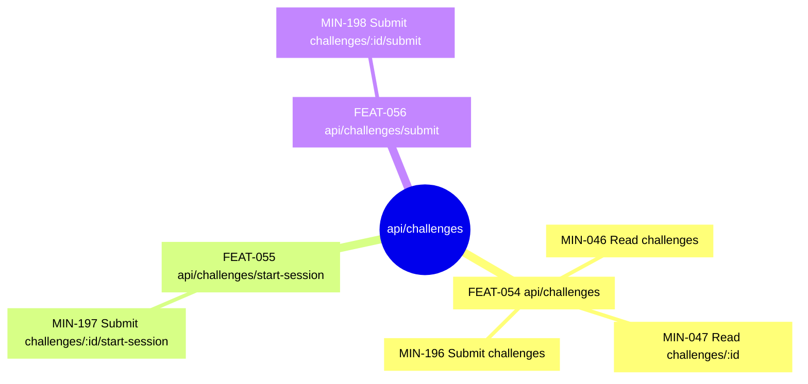
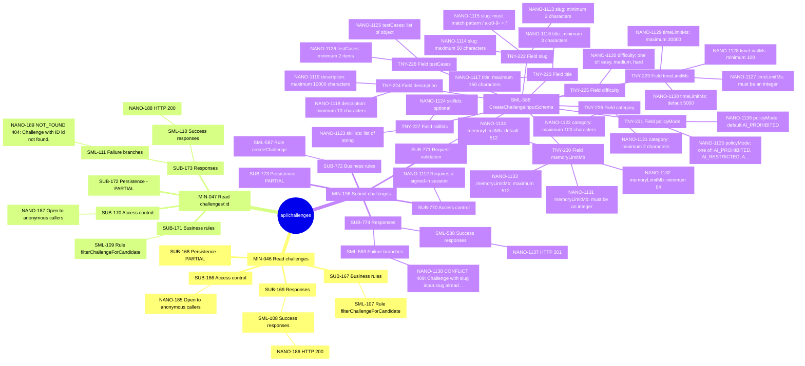
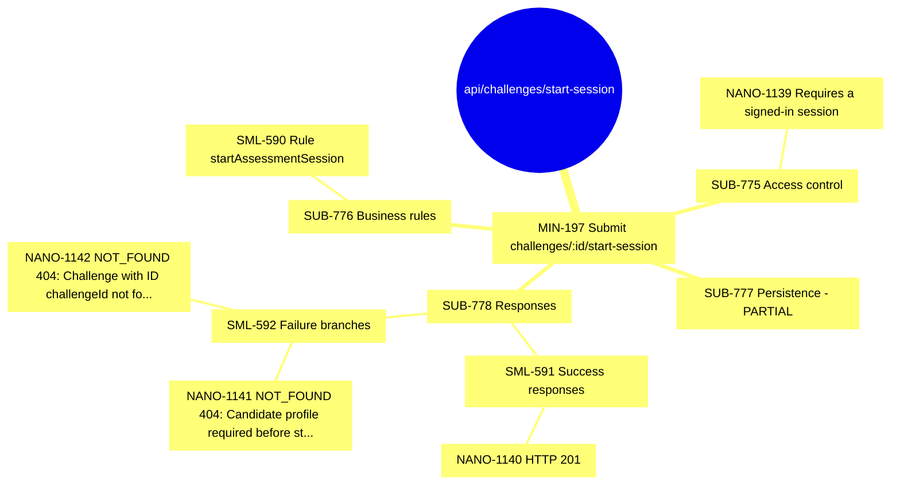
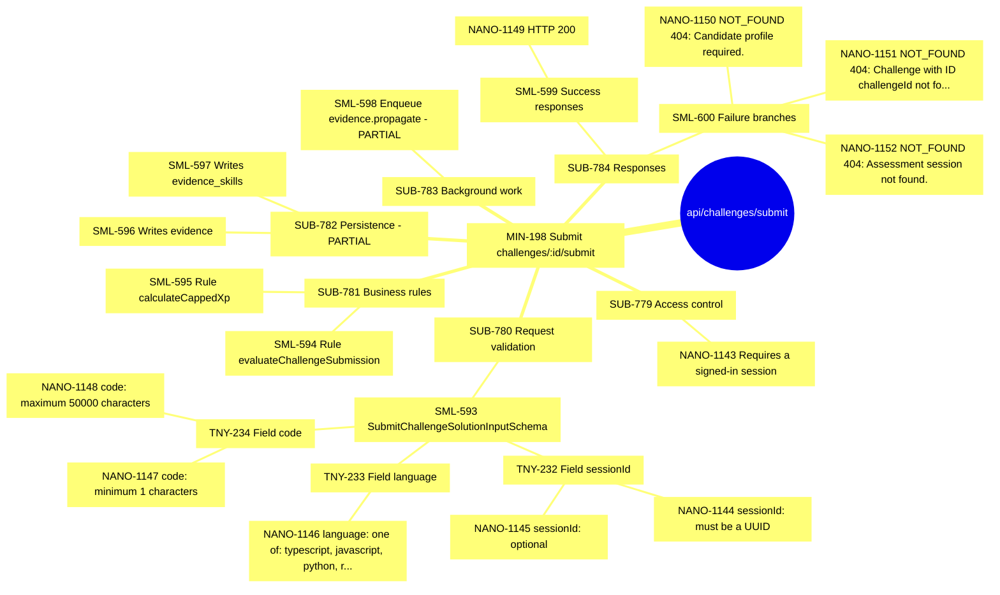

# api/challenges (MOD-068)

Generated by `docs/mindmap/tools/catalog.py` from `master/MASTER_PROJECT_GRAPH.json` at commit `9b3032f`. Do not edit by hand. Back to the [feature catalog](../FEATURE_CATALOG.md).

**Application:** apps/api (MOD-001). **Purpose:** API module: routes under /api/v1/challenges in apps/api/src/server.ts.

**Nodes by level:** MODULE 1, MAJOR 3, MINOR 5, SUB 23, SMALL 20, TINY 13, NANO 46. **Status:** IMPLEMENTED 105, PARTIALLY_IMPLEMENTED 6. **Verification:** PATH_LEVEL 94, UNKNOWN 1, VERIFIED 12.

**User roles that reach it:** anonymous, authenticated.

**Known gaps:** MIN-046 ephemeral: state held in process memory, lost on restart; MIN-047 ephemeral: state held in process memory, lost on restart; MIN-047 no first-party web caller found; MIN-196 ephemeral: state held in process memory, lost on restart; MIN-196 no first-party web caller found; MIN-197 ephemeral: state held in process memory, lost on restart; MIN-198 ephemeral: state held in process memory, lost on restart.

**Called from (web screens and components):** FEAT-159 Screen /assessments

## Module map (to minor features)

## FEAT-054 api/challenges

api/challenges

| ID        | Level | Parent   | Name                                                                               | Description                                                                                                                                                                                                                                                                     | Status                | Verification | Evidence                              | Related                                          |
| --------- | ----- | -------- | ---------------------------------------------------------------------------------- | ------------------------------------------------------------------------------------------------------------------------------------------------------------------------------------------------------------------------------------------------------------------------------- | --------------------- | ------------ | ------------------------------------- | ------------------------------------------------ |
| FEAT-054  | MAJOR | MOD-068  | api/challenges                                                                     |                                                                                                                                                                                                                                                                                 | IMPLEMENTED           |              | apps/api/src/server.ts:4724           |                                                  |
| MIN-046   | MINOR | FEAT-054 | Read challenges                                                                    | Challenges Endpoints GET /api/v1/challenges for anyone (public); calls filterChallengeForCandidate; ephemeral (process memory); responds 200. Gaps: ephemeral: state held in process memory, lost on restart                                                                    | IMPLEMENTED           | VERIFIED     | apps/api/src/server.ts:4724           | API-091, TEST-145, TEST-170, TEST-176            |
| SUB-166   | SUB   | MIN-046  | Access control                                                                     | Who may call GET /api/v1/challenges: anyone (public).                                                                                                                                                                                                                           | IMPLEMENTED           | PATH_LEVEL   | apps/api/src/server.ts:4724           |                                                  |
| NANO-185  | NANO  | SUB-166  | Open to anonymous callers                                                          | auth: public.                                                                                                                                                                                                                                                                   | IMPLEMENTED           | PATH_LEVEL   | apps/api/src/server.ts:4724           | ROLE-001                                         |
| SUB-167   | SUB   | MIN-046  | Business rules                                                                     | Domain functions from packages/domain called by the handler (1).                                                                                                                                                                                                                | IMPLEMENTED           | PATH_LEVEL   | apps/api/src/server.ts:4724           |                                                  |
| SML-107   | SMALL | SUB-167  | Rule filterChallengeForCandidate                                                   | Calls filterChallengeForCandidate (packages/domain/src/challenges.ts). Rule status IMPLEMENTED; its own tests: VERIFIED.                                                                                                                                                        | IMPLEMENTED           | VERIFIED     | packages/domain/src/challenges.ts:111 | RULE-085                                         |
| SUB-168   | SUB   | MIN-046  | Persistence                                                                        | Ephemeral: state lives in API process memory and is lost on restart.                                                                                                                                                                                                            | PARTIALLY_IMPLEMENTED | PATH_LEVEL   | apps/api/src/server.ts:4724           |                                                  |
| SUB-169   | SUB   | MIN-046  | Responses                                                                          | Success 200; 0 explicit failure branch(es) besides validation and access errors.                                                                                                                                                                                                | IMPLEMENTED           | PATH_LEVEL   | apps/api/src/server.ts:4724           |                                                  |
| SML-108   | SMALL | SUB-169  | Success responses                                                                  | HTTP 200 (implicit).                                                                                                                                                                                                                                                            | IMPLEMENTED           | PATH_LEVEL   | apps/api/src/server.ts:4724           |                                                  |
| NANO-186  | NANO  | SML-108  | HTTP 200                                                                           | Replies 200 when the operation succeeds (implicit default).                                                                                                                                                                                                                     | IMPLEMENTED           | PATH_LEVEL   | apps/api/src/server.ts:4724           |                                                  |
| MIN-047   | MINOR | FEAT-054 | Read challenges/:id                                                                | GET /api/v1/challenges/:id for anyone (public); calls filterChallengeForCandidate; ephemeral (process memory); responds 200; 1 failure branch(es). Gaps: ephemeral: state held in process memory, lost on restart; no first-party web caller found                              | IMPLEMENTED           | VERIFIED     | apps/api/src/server.ts:4729           | API-092, TEST-095, TEST-145                      |
| SUB-170   | SUB   | MIN-047  | Access control                                                                     | Who may call GET /api/v1/challenges/:id: anyone (public).                                                                                                                                                                                                                       | IMPLEMENTED           | PATH_LEVEL   | apps/api/src/server.ts:4729           |                                                  |
| NANO-187  | NANO  | SUB-170  | Open to anonymous callers                                                          | auth: public.                                                                                                                                                                                                                                                                   | IMPLEMENTED           | PATH_LEVEL   | apps/api/src/server.ts:4729           | ROLE-001                                         |
| SUB-171   | SUB   | MIN-047  | Business rules                                                                     | Domain functions from packages/domain called by the handler (1).                                                                                                                                                                                                                | IMPLEMENTED           | PATH_LEVEL   | apps/api/src/server.ts:4729           |                                                  |
| SML-109   | SMALL | SUB-171  | Rule filterChallengeForCandidate                                                   | Calls filterChallengeForCandidate (packages/domain/src/challenges.ts). Rule status IMPLEMENTED; its own tests: VERIFIED.                                                                                                                                                        | IMPLEMENTED           | VERIFIED     | packages/domain/src/challenges.ts:111 | RULE-085                                         |
| SUB-172   | SUB   | MIN-047  | Persistence                                                                        | Ephemeral: state lives in API process memory and is lost on restart.                                                                                                                                                                                                            | PARTIALLY_IMPLEMENTED | PATH_LEVEL   | apps/api/src/server.ts:4729           |                                                  |
| SUB-173   | SUB   | MIN-047  | Responses                                                                          | Success 200; 1 explicit failure branch(es) besides validation and access errors.                                                                                                                                                                                                | IMPLEMENTED           | PATH_LEVEL   | apps/api/src/server.ts:4729           |                                                  |
| SML-110   | SMALL | SUB-173  | Success responses                                                                  | HTTP 200.                                                                                                                                                                                                                                                                       | IMPLEMENTED           | PATH_LEVEL   | apps/api/src/server.ts:4729           |                                                  |
| NANO-188  | NANO  | SML-110  | HTTP 200                                                                           | Replies 200 when the operation succeeds.                                                                                                                                                                                                                                        | IMPLEMENTED           | PATH_LEVEL   | apps/api/src/server.ts:4729           |                                                  |
| SML-111   | SMALL | SUB-173  | Failure branches                                                                   | 1 DomainError branch(es) in the handler, mapped to HTTP by the global error handler.                                                                                                                                                                                            | IMPLEMENTED           | PATH_LEVEL   | apps/api/src/server.ts:4729           |                                                  |
| NANO-189  | NANO  | SML-111  | NOT_FOUND 404: Challenge with ID ${id} not found.                                  | Throws DomainError(NOT_FOUND) "Challenge with ID ${id} not found." -> HTTP 404.                                                                                                                                                                                                 | IMPLEMENTED           | PATH_LEVEL   | apps/api/src/server.ts:4735           | ERR-100                                          |
| MIN-196   | MINOR | FEAT-054 | Submit challenges                                                                  | POST /api/v1/challenges for any signed-in session; validates CreateChallengeInputSchema; calls createChallenge; ephemeral (process memory); responds 201; 1 failure branch(es). Gaps: ephemeral: state held in process memory, lost on restart; no first-party web caller found | IMPLEMENTED           | VERIFIED     | apps/api/src/server.ts:4741           | API-093, TEST-095                                |
| SUB-770   | SUB   | MIN-196  | Access control                                                                     | Who may call POST /api/v1/challenges: any signed-in session.                                                                                                                                                                                                                    | IMPLEMENTED           | PATH_LEVEL   | apps/api/src/server.ts:4741           |                                                  |
| NANO-1112 | NANO  | SUB-770  | Requires a signed-in session                                                       | Requests without a valid session token are rejected with 401 UNAUTHENTICATED.                                                                                                                                                                                                   | IMPLEMENTED           | PATH_LEVEL   | apps/api/src/server.ts:4741           | ROLE-001                                         |
| SUB-771   | SUB   | MIN-196  | Request validation                                                                 | The request is parsed with CreateChallengeInputSchema; a failure returns 400 with field details before any business logic runs.                                                                                                                                                 | IMPLEMENTED           | PATH_LEVEL   | apps/api/src/server.ts:4741           |                                                  |
| SML-586   | SMALL | SUB-771  | CreateChallengeInputSchema                                                         | CreateChallengeInputSchema: 10 field(s)                                                                                                                                                                                                                                         | IMPLEMENTED           | PATH_LEVEL   | packages/contracts/src/index.ts:302   | SCH-020                                          |
| TNY-222   | TINY  | SML-586  | Field slug                                                                         | slug (string, required): minimum 2 characters; maximum 50 characters; must match pattern /^[a-z0-9-]+$/                                                                                                                                                                         | IMPLEMENTED           | PATH_LEVEL   | packages/contracts/src/index.ts:303   |                                                  |
| NANO-1113 | NANO  | TNY-222  | slug: minimum 2 characters                                                         | slug minimum 2 characters.                                                                                                                                                                                                                                                      | IMPLEMENTED           | PATH_LEVEL   | packages/contracts/src/index.ts:303   |                                                  |
| NANO-1114 | NANO  | TNY-222  | slug: maximum 50 characters                                                        | slug maximum 50 characters.                                                                                                                                                                                                                                                     | IMPLEMENTED           | PATH_LEVEL   | packages/contracts/src/index.ts:303   |                                                  |
| NANO-1115 | NANO  | TNY-222  | slug: must match pattern /^[a-z0-9-]+$/                                            | slug must match pattern /^[a-z0-9-]+$/; message "Slug must be lowercase alphanumeric with hyphens".                                                                                                                                                                             | IMPLEMENTED           | PATH_LEVEL   | packages/contracts/src/index.ts:303   |                                                  |
| TNY-223   | TINY  | SML-586  | Field title                                                                        | title (string, required): minimum 3 characters; maximum 150 characters                                                                                                                                                                                                          | IMPLEMENTED           | PATH_LEVEL   | packages/contracts/src/index.ts:308   |                                                  |
| NANO-1116 | NANO  | TNY-223  | title: minimum 3 characters                                                        | title minimum 3 characters.                                                                                                                                                                                                                                                     | IMPLEMENTED           | PATH_LEVEL   | packages/contracts/src/index.ts:308   |                                                  |
| NANO-1117 | NANO  | TNY-223  | title: maximum 150 characters                                                      | title maximum 150 characters.                                                                                                                                                                                                                                                   | IMPLEMENTED           | PATH_LEVEL   | packages/contracts/src/index.ts:308   |                                                  |
| TNY-224   | TINY  | SML-586  | Field description                                                                  | description (string, required): minimum 10 characters; maximum 10000 characters                                                                                                                                                                                                 | IMPLEMENTED           | PATH_LEVEL   | packages/contracts/src/index.ts:309   |                                                  |
| NANO-1118 | NANO  | TNY-224  | description: minimum 10 characters                                                 | description minimum 10 characters.                                                                                                                                                                                                                                              | IMPLEMENTED           | PATH_LEVEL   | packages/contracts/src/index.ts:309   |                                                  |
| NANO-1119 | NANO  | TNY-224  | description: maximum 10000 characters                                              | description maximum 10000 characters.                                                                                                                                                                                                                                           | IMPLEMENTED           | PATH_LEVEL   | packages/contracts/src/index.ts:309   |                                                  |
| TNY-225   | TINY  | SML-586  | Field difficulty                                                                   | difficulty (enum, required): one of: easy, medium, hard                                                                                                                                                                                                                         | IMPLEMENTED           | PATH_LEVEL   | packages/contracts/src/index.ts:310   |                                                  |
| NANO-1120 | NANO  | TNY-225  | difficulty: one of: easy, medium, hard                                             | difficulty one of: easy, medium, hard.                                                                                                                                                                                                                                          | IMPLEMENTED           | PATH_LEVEL   | packages/contracts/src/index.ts:310   |                                                  |
| TNY-226   | TINY  | SML-586  | Field category                                                                     | category (string, required): minimum 2 characters; maximum 100 characters                                                                                                                                                                                                       | IMPLEMENTED           | PATH_LEVEL   | packages/contracts/src/index.ts:311   |                                                  |
| NANO-1121 | NANO  | TNY-226  | category: minimum 2 characters                                                     | category minimum 2 characters.                                                                                                                                                                                                                                                  | IMPLEMENTED           | PATH_LEVEL   | packages/contracts/src/index.ts:311   |                                                  |
| NANO-1122 | NANO  | TNY-226  | category: maximum 100 characters                                                   | category maximum 100 characters.                                                                                                                                                                                                                                                | IMPLEMENTED           | PATH_LEVEL   | packages/contracts/src/index.ts:311   |                                                  |
| TNY-227   | TINY  | SML-586  | Field skillIds                                                                     | skillIds (array, optional): list of string; optional                                                                                                                                                                                                                            | IMPLEMENTED           | PATH_LEVEL   | packages/contracts/src/index.ts:312   |                                                  |
| NANO-1123 | NANO  | TNY-227  | skillIds: list of string                                                           | skillIds list of string.                                                                                                                                                                                                                                                        | IMPLEMENTED           | PATH_LEVEL   | packages/contracts/src/index.ts:312   |                                                  |
| NANO-1124 | NANO  | TNY-227  | skillIds: optional                                                                 | skillIds optional.                                                                                                                                                                                                                                                              | IMPLEMENTED           | PATH_LEVEL   | packages/contracts/src/index.ts:312   |                                                  |
| TNY-228   | TINY  | SML-586  | Field testCases                                                                    | testCases (array, required): list of object; minimum 2 items                                                                                                                                                                                                                    | IMPLEMENTED           | PATH_LEVEL   | packages/contracts/src/index.ts:313   |                                                  |
| NANO-1125 | NANO  | TNY-228  | testCases: list of object                                                          | testCases list of object.                                                                                                                                                                                                                                                       | IMPLEMENTED           | PATH_LEVEL   | packages/contracts/src/index.ts:313   |                                                  |
| NANO-1126 | NANO  | TNY-228  | testCases: minimum 2 items                                                         | testCases minimum 2 items.                                                                                                                                                                                                                                                      | IMPLEMENTED           | PATH_LEVEL   | packages/contracts/src/index.ts:313   |                                                  |
| TNY-229   | TINY  | SML-586  | Field timeLimitMs                                                                  | timeLimitMs (number, optional): must be an integer; minimum 100; maximum 30000; default 5000                                                                                                                                                                                    | IMPLEMENTED           | PATH_LEVEL   | packages/contracts/src/index.ts:323   |                                                  |
| NANO-1127 | NANO  | TNY-229  | timeLimitMs: must be an integer                                                    | timeLimitMs must be an integer.                                                                                                                                                                                                                                                 | IMPLEMENTED           | PATH_LEVEL   | packages/contracts/src/index.ts:323   |                                                  |
| NANO-1128 | NANO  | TNY-229  | timeLimitMs: minimum 100                                                           | timeLimitMs minimum 100.                                                                                                                                                                                                                                                        | IMPLEMENTED           | PATH_LEVEL   | packages/contracts/src/index.ts:323   |                                                  |
| NANO-1129 | NANO  | TNY-229  | timeLimitMs: maximum 30000                                                         | timeLimitMs maximum 30000.                                                                                                                                                                                                                                                      | IMPLEMENTED           | PATH_LEVEL   | packages/contracts/src/index.ts:323   |                                                  |
| NANO-1130 | NANO  | TNY-229  | timeLimitMs: default 5000                                                          | timeLimitMs default 5000.                                                                                                                                                                                                                                                       | IMPLEMENTED           | PATH_LEVEL   | packages/contracts/src/index.ts:323   |                                                  |
| TNY-230   | TINY  | SML-586  | Field memoryLimitMb                                                                | memoryLimitMb (number, optional): must be an integer; minimum 64; maximum 512; default 512                                                                                                                                                                                      | IMPLEMENTED           | PATH_LEVEL   | packages/contracts/src/index.ts:324   |                                                  |
| NANO-1131 | NANO  | TNY-230  | memoryLimitMb: must be an integer                                                  | memoryLimitMb must be an integer.                                                                                                                                                                                                                                               | IMPLEMENTED           | PATH_LEVEL   | packages/contracts/src/index.ts:324   |                                                  |
| NANO-1132 | NANO  | TNY-230  | memoryLimitMb: minimum 64                                                          | memoryLimitMb minimum 64.                                                                                                                                                                                                                                                       | IMPLEMENTED           | PATH_LEVEL   | packages/contracts/src/index.ts:324   |                                                  |
| NANO-1133 | NANO  | TNY-230  | memoryLimitMb: maximum 512                                                         | memoryLimitMb maximum 512.                                                                                                                                                                                                                                                      | IMPLEMENTED           | PATH_LEVEL   | packages/contracts/src/index.ts:324   |                                                  |
| NANO-1134 | NANO  | TNY-230  | memoryLimitMb: default 512                                                         | memoryLimitMb default 512.                                                                                                                                                                                                                                                      | IMPLEMENTED           | PATH_LEVEL   | packages/contracts/src/index.ts:324   |                                                  |
| TNY-231   | TINY  | SML-586  | Field policyMode                                                                   | policyMode (enum, optional): one of: AI_PROHIBITED, AI_RESTRICTED, AI_ALLOWED, POST_ASSESSMENT_ONLY; default 'AI_PROHIBITED'                                                                                                                                                    | IMPLEMENTED           | PATH_LEVEL   | packages/contracts/src/index.ts:325   |                                                  |
| NANO-1135 | NANO  | TNY-231  | policyMode: one of: AI_PROHIBITED, AI_RESTRICTED, AI_ALLOWED, POST_ASSESSMENT_ONLY | policyMode one of: AI_PROHIBITED, AI_RESTRICTED, AI_ALLOWED, POST_ASSESSMENT_ONLY.                                                                                                                                                                                              | IMPLEMENTED           | PATH_LEVEL   | packages/contracts/src/index.ts:325   |                                                  |
| NANO-1136 | NANO  | TNY-231  | policyMode: default 'AI_PROHIBITED'                                                | policyMode default 'AI_PROHIBITED'; message "AI_PROHIBITED".                                                                                                                                                                                                                    | IMPLEMENTED           | VERIFIED     | packages/contracts/src/index.ts:325   | TEST-170, TEST-084, TEST-095, TEST-018, TEST-027 |
| SUB-772   | SUB   | MIN-196  | Business rules                                                                     | Domain functions from packages/domain called by the handler (1).                                                                                                                                                                                                                | IMPLEMENTED           | PATH_LEVEL   | apps/api/src/server.ts:4741           |                                                  |
| SML-587   | SMALL | SUB-772  | Rule createChallenge                                                               | Calls createChallenge (packages/domain/src/challenges.ts). Rule status IMPLEMENTED; its own tests: VERIFIED.                                                                                                                                                                    | IMPLEMENTED           | VERIFIED     | packages/domain/src/challenges.ts:53  | RULE-084                                         |
| SUB-773   | SUB   | MIN-196  | Persistence                                                                        | Ephemeral: state lives in API process memory and is lost on restart.                                                                                                                                                                                                            | PARTIALLY_IMPLEMENTED | PATH_LEVEL   | apps/api/src/server.ts:4741           |                                                  |
| SUB-774   | SUB   | MIN-196  | Responses                                                                          | Success 201; 1 explicit failure branch(es) besides validation and access errors.                                                                                                                                                                                                | IMPLEMENTED           | PATH_LEVEL   | apps/api/src/server.ts:4741           |                                                  |
| SML-588   | SMALL | SUB-774  | Success responses                                                                  | HTTP 201.                                                                                                                                                                                                                                                                       | IMPLEMENTED           | PATH_LEVEL   | apps/api/src/server.ts:4741           |                                                  |
| NANO-1137 | NANO  | SML-588  | HTTP 201                                                                           | Replies 201 when the operation succeeds.                                                                                                                                                                                                                                        | IMPLEMENTED           | PATH_LEVEL   | apps/api/src/server.ts:4741           |                                                  |
| SML-589   | SMALL | SUB-774  | Failure branches                                                                   | 1 DomainError branch(es) in the handler, mapped to HTTP by the global error handler.                                                                                                                                                                                            | IMPLEMENTED           | PATH_LEVEL   | apps/api/src/server.ts:4741           |                                                  |
| NANO-1138 | NANO  | SML-589  | CONFLICT 409: Challenge with slug "${input.slug}" already exists.                  | Throws DomainError(CONFLICT) "Challenge with slug "${input.slug}" already exists." -> HTTP 409.                                                                                                                                                                                 | IMPLEMENTED           | PATH_LEVEL   | apps/api/src/server.ts:4746           | ERR-101                                          |

## FEAT-055 api/challenges/start-session

api/challenges/start-session

| ID        | Level | Parent   | Name                                                                  | Description                                                                                                                                                                                                                                                                 | Status                | Verification | Evidence                             | Related                                         |
| --------- | ----- | -------- | --------------------------------------------------------------------- | --------------------------------------------------------------------------------------------------------------------------------------------------------------------------------------------------------------------------------------------------------------------------- | --------------------- | ------------ | ------------------------------------ | ----------------------------------------------- |
| FEAT-055  | MAJOR | MOD-068  | api/challenges/start-session                                          |                                                                                                                                                                                                                                                                             | IMPLEMENTED           |              | apps/api/src/server.ts:4773          |                                                 |
| MIN-197   | MINOR | FEAT-055 | Submit challenges/:id/start-session                                   | Assessment Session & Submission Endpoints POST /api/v1/challenges/:id/start-session for any signed-in session; calls startAssessmentSession; ephemeral (process memory); responds 201; 2 failure branch(es). Gaps: ephemeral: state held in process memory, lost on restart | IMPLEMENTED           | VERIFIED     | apps/api/src/server.ts:4773          | API-094, TEST-084, TEST-095, TEST-170, TEST-176 |
| SUB-775   | SUB   | MIN-197  | Access control                                                        | Who may call POST /api/v1/challenges/:id/start-session: any signed-in session.                                                                                                                                                                                              | IMPLEMENTED           | PATH_LEVEL   | apps/api/src/server.ts:4773          |                                                 |
| NANO-1139 | NANO  | SUB-775  | Requires a signed-in session                                          | Requests without a valid session token are rejected with 401 UNAUTHENTICATED.                                                                                                                                                                                               | IMPLEMENTED           | PATH_LEVEL   | apps/api/src/server.ts:4773          | ROLE-001                                        |
| SUB-776   | SUB   | MIN-197  | Business rules                                                        | Domain functions from packages/domain called by the handler (1).                                                                                                                                                                                                            | IMPLEMENTED           | PATH_LEVEL   | apps/api/src/server.ts:4773          |                                                 |
| SML-590   | SMALL | SUB-776  | Rule startAssessmentSession                                           | Calls startAssessmentSession (packages/domain/src/assessment.ts). Rule status IMPLEMENTED; its own tests: VERIFIED.                                                                                                                                                         | IMPLEMENTED           | VERIFIED     | packages/domain/src/assessment.ts:49 | RULE-045                                        |
| SUB-777   | SUB   | MIN-197  | Persistence                                                           | Ephemeral: state lives in API process memory and is lost on restart.                                                                                                                                                                                                        | PARTIALLY_IMPLEMENTED | PATH_LEVEL   | apps/api/src/server.ts:4773          |                                                 |
| SUB-778   | SUB   | MIN-197  | Responses                                                             | Success 201; 2 explicit failure branch(es) besides validation and access errors.                                                                                                                                                                                            | IMPLEMENTED           | PATH_LEVEL   | apps/api/src/server.ts:4773          |                                                 |
| SML-591   | SMALL | SUB-778  | Success responses                                                     | HTTP 201.                                                                                                                                                                                                                                                                   | IMPLEMENTED           | PATH_LEVEL   | apps/api/src/server.ts:4773          |                                                 |
| NANO-1140 | NANO  | SML-591  | HTTP 201                                                              | Replies 201 when the operation succeeds.                                                                                                                                                                                                                                    | IMPLEMENTED           | PATH_LEVEL   | apps/api/src/server.ts:4773          |                                                 |
| SML-592   | SMALL | SUB-778  | Failure branches                                                      | 2 DomainError branch(es) in the handler, mapped to HTTP by the global error handler.                                                                                                                                                                                        | IMPLEMENTED           | PATH_LEVEL   | apps/api/src/server.ts:4773          |                                                 |
| NANO-1141 | NANO  | SML-592  | NOT_FOUND 404: Candidate profile required before starting assessment. | Throws DomainError(NOT_FOUND) "Candidate profile required before starting assessment." -> HTTP 404.                                                                                                                                                                         | IMPLEMENTED           | PATH_LEVEL   | apps/api/src/server.ts:4781          | ERR-102                                         |
| NANO-1142 | NANO  | SML-592  | NOT_FOUND 404: Challenge with ID ${challengeId} not found.            | Throws DomainError(NOT_FOUND) "Challenge with ID ${challengeId} not found." -> HTTP 404.                                                                                                                                                                                    | IMPLEMENTED           | PATH_LEVEL   | apps/api/src/server.ts:4789          | ERR-103                                         |

## FEAT-056 api/challenges/submit

api/challenges/submit

| ID        | Level | Parent   | Name                                                       | Description                                                                                                                                                                                                                                                                                                                        | Status                | Verification | Evidence                                                | Related                                         |
| --------- | ----- | -------- | ---------------------------------------------------------- | ---------------------------------------------------------------------------------------------------------------------------------------------------------------------------------------------------------------------------------------------------------------------------------------------------------------------------------- | --------------------- | ------------ | ------------------------------------------------------- | ----------------------------------------------- |
| FEAT-056  | MAJOR | MOD-068  | api/challenges/submit                                      |                                                                                                                                                                                                                                                                                                                                    | IMPLEMENTED           |              | apps/api/src/server.ts:4806                             |                                                 |
| MIN-198   | MINOR | FEAT-056 | Submit challenges/:id/submit                               | POST /api/v1/challenges/:id/submit for any signed-in session; validates SubmitChallengeSolutionInputSchema; calls evaluateChallengeSubmission, calculateCappedXp; ephemeral (process memory); writes evidence, evidence_skills; responds 200; 3 failure branch(es). Gaps: ephemeral: state held in process memory, lost on restart | IMPLEMENTED           | VERIFIED     | apps/api/src/server.ts:4806                             | API-095, TEST-095, TEST-124, TEST-170, TEST-176 |
| SUB-779   | SUB   | MIN-198  | Access control                                             | Who may call POST /api/v1/challenges/:id/submit: any signed-in session.                                                                                                                                                                                                                                                            | IMPLEMENTED           | PATH_LEVEL   | apps/api/src/server.ts:4806                             |                                                 |
| NANO-1143 | NANO  | SUB-779  | Requires a signed-in session                               | Requests without a valid session token are rejected with 401 UNAUTHENTICATED.                                                                                                                                                                                                                                                      | IMPLEMENTED           | PATH_LEVEL   | apps/api/src/server.ts:4806                             | ROLE-001                                        |
| SUB-780   | SUB   | MIN-198  | Request validation                                         | The request is parsed with SubmitChallengeSolutionInputSchema; a failure returns 400 with field details before any business logic runs.                                                                                                                                                                                            | IMPLEMENTED           | PATH_LEVEL   | apps/api/src/server.ts:4806                             |                                                 |
| SML-593   | SMALL | SUB-780  | SubmitChallengeSolutionInputSchema                         | SubmitChallengeSolutionInputSchema: 3 field(s)                                                                                                                                                                                                                                                                                     | IMPLEMENTED           | PATH_LEVEL   | packages/contracts/src/index.ts:332                     | SCH-021                                         |
| TNY-232   | TINY  | SML-593  | Field sessionId                                            | sessionId (string, optional): must be a UUID; optional                                                                                                                                                                                                                                                                             | IMPLEMENTED           | PATH_LEVEL   | packages/contracts/src/index.ts:333                     |                                                 |
| NANO-1144 | NANO  | TNY-232  | sessionId: must be a UUID                                  | sessionId must be a UUID.                                                                                                                                                                                                                                                                                                          | IMPLEMENTED           | PATH_LEVEL   | packages/contracts/src/index.ts:333                     |                                                 |
| NANO-1145 | NANO  | TNY-232  | sessionId: optional                                        | sessionId optional.                                                                                                                                                                                                                                                                                                                | IMPLEMENTED           | PATH_LEVEL   | packages/contracts/src/index.ts:333                     |                                                 |
| TNY-233   | TINY  | SML-593  | Field language                                             | language (enum, required): one of: typescript, javascript, python, rust, go                                                                                                                                                                                                                                                        | IMPLEMENTED           | PATH_LEVEL   | packages/contracts/src/index.ts:334                     |                                                 |
| NANO-1146 | NANO  | TNY-233  | language: one of: typescript, javascript, python, rust, go | language one of: typescript, javascript, python, rust, go.                                                                                                                                                                                                                                                                         | IMPLEMENTED           | PATH_LEVEL   | packages/contracts/src/index.ts:334                     |                                                 |
| TNY-234   | TINY  | SML-593  | Field code                                                 | code (string, required): minimum 1 characters; maximum 50000 characters                                                                                                                                                                                                                                                            | IMPLEMENTED           | PATH_LEVEL   | packages/contracts/src/index.ts:335                     |                                                 |
| NANO-1147 | NANO  | TNY-234  | code: minimum 1 characters                                 | code minimum 1 characters.                                                                                                                                                                                                                                                                                                         | IMPLEMENTED           | PATH_LEVEL   | packages/contracts/src/index.ts:335                     |                                                 |
| NANO-1148 | NANO  | TNY-234  | code: maximum 50000 characters                             | code maximum 50000 characters.                                                                                                                                                                                                                                                                                                     | IMPLEMENTED           | PATH_LEVEL   | packages/contracts/src/index.ts:335                     |                                                 |
| SUB-781   | SUB   | MIN-198  | Business rules                                             | Domain functions from packages/domain called by the handler (2).                                                                                                                                                                                                                                                                   | IMPLEMENTED           | PATH_LEVEL   | apps/api/src/server.ts:4806                             |                                                 |
| SML-594   | SMALL | SUB-781  | Rule evaluateChallengeSubmission                           | Calls evaluateChallengeSubmission (packages/domain/src/assessment.ts). Rule status IMPLEMENTED; its own tests: VERIFIED.                                                                                                                                                                                                           | IMPLEMENTED           | VERIFIED     | packages/domain/src/assessment.ts:72                    | RULE-046                                        |
| SML-595   | SMALL | SUB-781  | Rule calculateCappedXp                                     | Calls calculateCappedXp (packages/domain/src/assessment.ts). Rule status IMPLEMENTED; its own tests: VERIFIED.                                                                                                                                                                                                                     | IMPLEMENTED           | VERIFIED     | packages/domain/src/assessment.ts:130                   | RULE-047                                        |
| SUB-782   | SUB   | MIN-198  | Persistence                                                | Ephemeral: state lives in API process memory and is lost on restart.                                                                                                                                                                                                                                                               | PARTIALLY_IMPLEMENTED | PATH_LEVEL   | apps/api/src/server.ts:4806                             |                                                 |
| SML-596   | SMALL | SUB-782  | Writes evidence                                            | Writes table evidence (00001_core_schema.sql).                                                                                                                                                                                                                                                                                     | IMPLEMENTED           | PATH_LEVEL   | supabase/migrations/00001_core_schema.sql:128           | DB-003                                          |
| SML-597   | SMALL | SUB-782  | Writes evidence_skills                                     | Writes table evidence_skills (00002_evidence_skills_schema.sql).                                                                                                                                                                                                                                                                   | IMPLEMENTED           | PATH_LEVEL   | supabase/migrations/00002_evidence_skills_schema.sql:39 | DB-012                                          |
| SUB-783   | SUB   | MIN-198  | Background work                                            | Enqueues 1 background job kind(s) in background_jobs for apps/worker.                                                                                                                                                                                                                                                              | IMPLEMENTED           | PATH_LEVEL   | apps/api/src/server.ts:4806                             |                                                 |
| SML-598   | SMALL | SUB-783  | Enqueue evidence.propagate                                 | Dispatches job:evidence.propagate; worker handler: recordEvent (no-op: marks the event recorded).                                                                                                                                                                                                                                  | PARTIALLY_IMPLEMENTED | UNKNOWN      | packages/domain/src/background-jobs.ts:171              | SVC-020                                         |
| SUB-784   | SUB   | MIN-198  | Responses                                                  | Success 200; 3 explicit failure branch(es) besides validation and access errors.                                                                                                                                                                                                                                                   | IMPLEMENTED           | PATH_LEVEL   | apps/api/src/server.ts:4806                             |                                                 |
| SML-599   | SMALL | SUB-784  | Success responses                                          | HTTP 200.                                                                                                                                                                                                                                                                                                                          | IMPLEMENTED           | PATH_LEVEL   | apps/api/src/server.ts:4806                             |                                                 |
| NANO-1149 | NANO  | SML-599  | HTTP 200                                                   | Replies 200 when the operation succeeds.                                                                                                                                                                                                                                                                                           | IMPLEMENTED           | PATH_LEVEL   | apps/api/src/server.ts:4806                             |                                                 |
| SML-600   | SMALL | SUB-784  | Failure branches                                           | 3 DomainError branch(es) in the handler, mapped to HTTP by the global error handler.                                                                                                                                                                                                                                               | IMPLEMENTED           | PATH_LEVEL   | apps/api/src/server.ts:4806                             |                                                 |
| NANO-1150 | NANO  | SML-600  | NOT_FOUND 404: Candidate profile required.                 | Throws DomainError(NOT_FOUND) "Candidate profile required." -> HTTP 404.                                                                                                                                                                                                                                                           | IMPLEMENTED           | PATH_LEVEL   | apps/api/src/server.ts:4815                             | ERR-104                                         |
| NANO-1151 | NANO  | SML-600  | NOT_FOUND 404: Challenge with ID ${challengeId} not found. | Throws DomainError(NOT_FOUND) "Challenge with ID ${challengeId} not found." -> HTTP 404.                                                                                                                                                                                                                                           | IMPLEMENTED           | PATH_LEVEL   | apps/api/src/server.ts:4820                             | ERR-103                                         |
| NANO-1152 | NANO  | SML-600  | NOT_FOUND 404: Assessment session not found.               | Throws DomainError(NOT_FOUND) "Assessment session not found." -> HTTP 404.                                                                                                                                                                                                                                                         | IMPLEMENTED           | PATH_LEVEL   | apps/api/src/server.ts:4832                             | ERR-105                                         |
