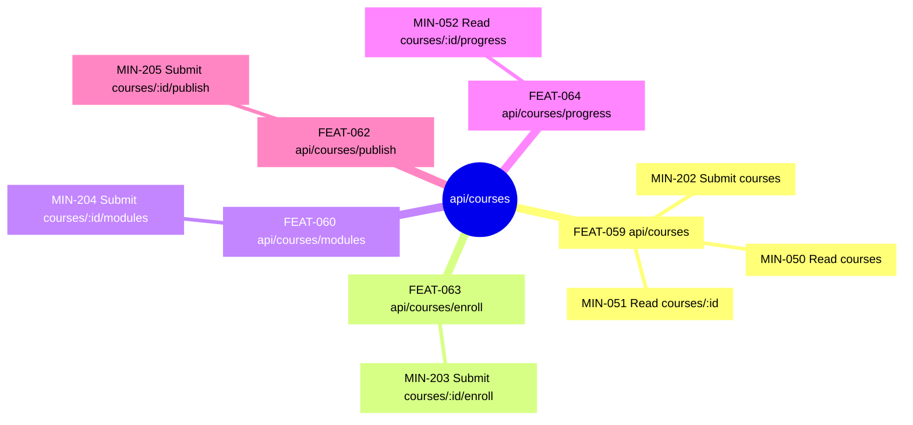
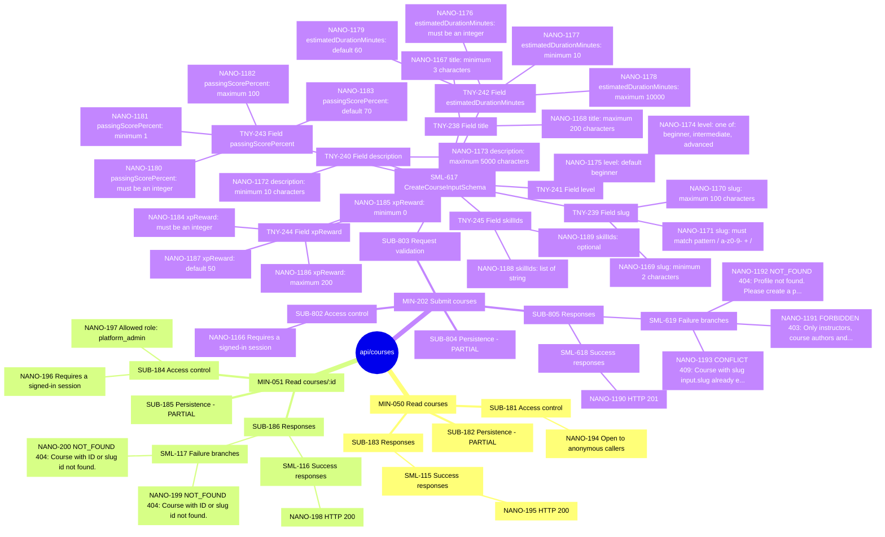
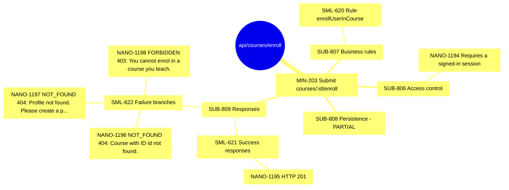
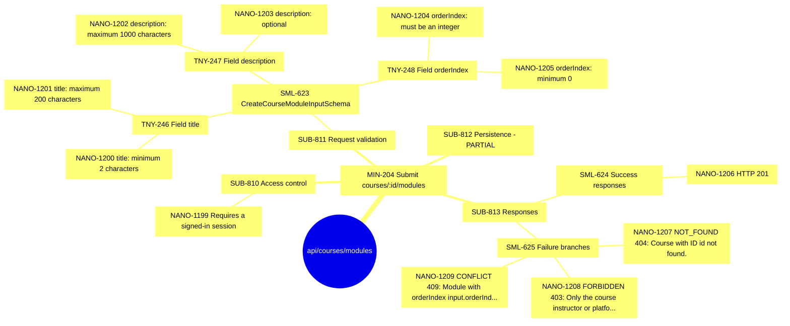
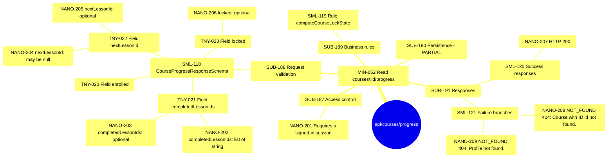
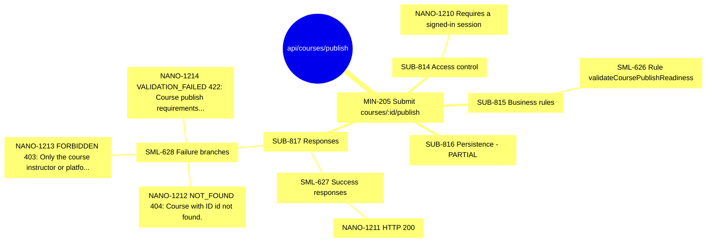

# api/courses (MOD-071)

Generated by `docs/mindmap/tools/catalog.py` from `master/MASTER_PROJECT_GRAPH.json` at commit `9b3032f`. Do not edit by hand. Back to the [feature catalog](../FEATURE_CATALOG.md).

**Application:** apps/api (MOD-001). **Purpose:** API module: routes under /api/v1/courses in apps/api/src/server.ts.

**Nodes by level:** MODULE 1, MAJOR 5, MINOR 7, SUB 27, SMALL 19, TINY 15, NANO 65. **Status:** IMPLEMENTED 132, PARTIALLY_IMPLEMENTED 7. **Verification:** PATH_LEVEL 123, VERIFIED 10.

**User roles that reach it:** anonymous, authenticated, platform_admin.

**Known gaps:** MIN-050 ephemeral: state held in process memory, lost on restart; MIN-051 ephemeral: state held in process memory, lost on restart; MIN-202 ephemeral: state held in process memory, lost on restart; MIN-202 no first-party web caller found; MIN-203 ephemeral: state held in process memory, lost on restart; MIN-204 ephemeral: state held in process memory, lost on restart; MIN-204 no first-party web caller found; MIN-052 ephemeral: state held in process memory, lost on restart; MIN-205 ephemeral: state held in process memory, lost on restart; MIN-205 no first-party web caller found.

**Called from (web screens and components):** FEAT-168 Screen /learning, FEAT-169 Screen /learning/:id

## Module map (to minor features)

## FEAT-059 api/courses

api/courses

| ID        | Level | Parent   | Name                                                                                  | Description                                                                                                                                                                                                                                        | Status                | Verification | Evidence                            | Related                                                       |
| --------- | ----- | -------- | ------------------------------------------------------------------------------------- | -------------------------------------------------------------------------------------------------------------------------------------------------------------------------------------------------------------------------------------------------- | --------------------- | ------------ | ----------------------------------- | ------------------------------------------------------------- |
| FEAT-059  | MAJOR | MOD-071  | api/courses                                                                           |                                                                                                                                                                                                                                                    | IMPLEMENTED           |              | apps/api/src/server.ts:4958         |                                                               |
| MIN-050   | MINOR | FEAT-059 | Read courses                                                                          | LMS Endpoints (F-07) GET /api/v1/courses for anyone (public); ephemeral (process memory); responds 200. Gaps: ephemeral: state held in process memory, lost on restart                                                                             | IMPLEMENTED           | VERIFIED     | apps/api/src/server.ts:4958         | API-098, TEST-111, TEST-145, TEST-170, TEST-175               |
| SUB-181   | SUB   | MIN-050  | Access control                                                                        | Who may call GET /api/v1/courses: anyone (public).                                                                                                                                                                                                 | IMPLEMENTED           | PATH_LEVEL   | apps/api/src/server.ts:4958         |                                                               |
| NANO-194  | NANO  | SUB-181  | Open to anonymous callers                                                             | auth: public.                                                                                                                                                                                                                                      | IMPLEMENTED           | PATH_LEVEL   | apps/api/src/server.ts:4958         | ROLE-001                                                      |
| SUB-182   | SUB   | MIN-050  | Persistence                                                                           | Ephemeral: state lives in API process memory and is lost on restart.                                                                                                                                                                               | PARTIALLY_IMPLEMENTED | PATH_LEVEL   | apps/api/src/server.ts:4958         |                                                               |
| SUB-183   | SUB   | MIN-050  | Responses                                                                             | Success 200; 0 explicit failure branch(es) besides validation and access errors.                                                                                                                                                                   | IMPLEMENTED           | PATH_LEVEL   | apps/api/src/server.ts:4958         |                                                               |
| SML-115   | SMALL | SUB-183  | Success responses                                                                     | HTTP 200 (implicit).                                                                                                                                                                                                                               | IMPLEMENTED           | PATH_LEVEL   | apps/api/src/server.ts:4958         |                                                               |
| NANO-195  | NANO  | SML-115  | HTTP 200                                                                              | Replies 200 when the operation succeeds (implicit default).                                                                                                                                                                                        | IMPLEMENTED           | PATH_LEVEL   | apps/api/src/server.ts:4958         |                                                               |
| MIN-051   | MINOR | FEAT-059 | Read courses/:id                                                                      | GET /api/v1/courses/:id for roles platform_admin; ephemeral (process memory); responds 200; 2 failure branch(es). Gaps: ephemeral: state held in process memory, lost on restart                                                                   | IMPLEMENTED           | VERIFIED     | apps/api/src/server.ts:5037         | API-100, TEST-055, TEST-094, TEST-110, TEST-111, TEST-145 ... |
| SUB-184   | SUB   | MIN-051  | Access control                                                                        | Who may call GET /api/v1/courses/:id: roles platform_admin.                                                                                                                                                                                        | IMPLEMENTED           | PATH_LEVEL   | apps/api/src/server.ts:5037         |                                                               |
| NANO-196  | NANO  | SUB-184  | Requires a signed-in session                                                          | Requests without a valid session token are rejected with 401 UNAUTHENTICATED.                                                                                                                                                                      | IMPLEMENTED           | PATH_LEVEL   | apps/api/src/server.ts:5037         | ROLE-001                                                      |
| NANO-197  | NANO  | SUB-184  | Allowed role: platform_admin                                                          | platform_admin is one of the roles allowed here (platform_admin); a caller holding none of them is rejected with 403.                                                                                                                              | IMPLEMENTED           | PATH_LEVEL   | apps/api/src/server.ts:5037         | ROLE-008                                                      |
| SUB-185   | SUB   | MIN-051  | Persistence                                                                           | Ephemeral: state lives in API process memory and is lost on restart.                                                                                                                                                                               | PARTIALLY_IMPLEMENTED | PATH_LEVEL   | apps/api/src/server.ts:5037         |                                                               |
| SUB-186   | SUB   | MIN-051  | Responses                                                                             | Success 200; 2 explicit failure branch(es) besides validation and access errors.                                                                                                                                                                   | IMPLEMENTED           | PATH_LEVEL   | apps/api/src/server.ts:5037         |                                                               |
| SML-116   | SMALL | SUB-186  | Success responses                                                                     | HTTP 200.                                                                                                                                                                                                                                          | IMPLEMENTED           | PATH_LEVEL   | apps/api/src/server.ts:5037         |                                                               |
| NANO-198  | NANO  | SML-116  | HTTP 200                                                                              | Replies 200 when the operation succeeds.                                                                                                                                                                                                           | IMPLEMENTED           | PATH_LEVEL   | apps/api/src/server.ts:5037         |                                                               |
| SML-117   | SMALL | SUB-186  | Failure branches                                                                      | 2 DomainError branch(es) in the handler, mapped to HTTP by the global error handler.                                                                                                                                                               | IMPLEMENTED           | PATH_LEVEL   | apps/api/src/server.ts:5037         |                                                               |
| NANO-199  | NANO  | SML-117  | NOT_FOUND 404: Course with ID or slug "${id}" not found.                              | Throws DomainError(NOT_FOUND) "Course with ID or slug "${id}" not found." -> HTTP 404.                                                                                                                                                             | IMPLEMENTED           | PATH_LEVEL   | apps/api/src/server.ts:5043         | ERR-109                                                       |
| NANO-200  | NANO  | SML-117  | NOT_FOUND 404: Course with ID or slug "${id}" not found.                              | Throws DomainError(NOT_FOUND) "Course with ID or slug "${id}" not found." -> HTTP 404.                                                                                                                                                             | IMPLEMENTED           | PATH_LEVEL   | apps/api/src/server.ts:5052         | ERR-109                                                       |
| MIN-202   | MINOR | FEAT-059 | Submit courses                                                                        | POST /api/v1/courses for any signed-in session; validates CreateCourseInputSchema; ephemeral (process memory); responds 201; 3 failure branch(es). Gaps: ephemeral: state held in process memory, lost on restart; no first-party web caller found | IMPLEMENTED           | VERIFIED     | apps/api/src/server.ts:4990         | API-099, TEST-111                                             |
| SUB-802   | SUB   | MIN-202  | Access control                                                                        | Who may call POST /api/v1/courses: any signed-in session.                                                                                                                                                                                          | IMPLEMENTED           | PATH_LEVEL   | apps/api/src/server.ts:4990         |                                                               |
| NANO-1166 | NANO  | SUB-802  | Requires a signed-in session                                                          | Requests without a valid session token are rejected with 401 UNAUTHENTICATED.                                                                                                                                                                      | IMPLEMENTED           | PATH_LEVEL   | apps/api/src/server.ts:4990         | ROLE-001                                                      |
| SUB-803   | SUB   | MIN-202  | Request validation                                                                    | The request is parsed with CreateCourseInputSchema; a failure returns 400 with field details before any business logic runs.                                                                                                                       | IMPLEMENTED           | PATH_LEVEL   | apps/api/src/server.ts:4990         |                                                               |
| SML-617   | SMALL | SUB-803  | CreateCourseInputSchema                                                               | CreateCourseInputSchema: 8 field(s)                                                                                                                                                                                                                | IMPLEMENTED           | PATH_LEVEL   | packages/contracts/src/index.ts:352 | SCH-023                                                       |
| TNY-238   | TINY  | SML-617  | Field title                                                                           | title (string, required): minimum 3 characters; maximum 200 characters                                                                                                                                                                             | IMPLEMENTED           | PATH_LEVEL   | packages/contracts/src/index.ts:353 |                                                               |
| NANO-1167 | NANO  | TNY-238  | title: minimum 3 characters                                                           | title minimum 3 characters.                                                                                                                                                                                                                        | IMPLEMENTED           | PATH_LEVEL   | packages/contracts/src/index.ts:353 |                                                               |
| NANO-1168 | NANO  | TNY-238  | title: maximum 200 characters                                                         | title maximum 200 characters.                                                                                                                                                                                                                      | IMPLEMENTED           | PATH_LEVEL   | packages/contracts/src/index.ts:353 |                                                               |
| TNY-239   | TINY  | SML-617  | Field slug                                                                            | slug (string, required): minimum 2 characters; maximum 100 characters; must match pattern /^[a-z0-9-]+$/                                                                                                                                           | IMPLEMENTED           | PATH_LEVEL   | packages/contracts/src/index.ts:354 |                                                               |
| NANO-1169 | NANO  | TNY-239  | slug: minimum 2 characters                                                            | slug minimum 2 characters.                                                                                                                                                                                                                         | IMPLEMENTED           | PATH_LEVEL   | packages/contracts/src/index.ts:354 |                                                               |
| NANO-1170 | NANO  | TNY-239  | slug: maximum 100 characters                                                          | slug maximum 100 characters.                                                                                                                                                                                                                       | IMPLEMENTED           | PATH_LEVEL   | packages/contracts/src/index.ts:354 |                                                               |
| NANO-1171 | NANO  | TNY-239  | slug: must match pattern /^[a-z0-9-]+$/                                               | slug must match pattern /^[a-z0-9-]+$/; message "Slug must be lowercase alphanumeric with hyphens".                                                                                                                                                | IMPLEMENTED           | PATH_LEVEL   | packages/contracts/src/index.ts:354 |                                                               |
| TNY-240   | TINY  | SML-617  | Field description                                                                     | description (string, required): minimum 10 characters; maximum 5000 characters                                                                                                                                                                     | IMPLEMENTED           | PATH_LEVEL   | packages/contracts/src/index.ts:359 |                                                               |
| NANO-1172 | NANO  | TNY-240  | description: minimum 10 characters                                                    | description minimum 10 characters.                                                                                                                                                                                                                 | IMPLEMENTED           | PATH_LEVEL   | packages/contracts/src/index.ts:359 |                                                               |
| NANO-1173 | NANO  | TNY-240  | description: maximum 5000 characters                                                  | description maximum 5000 characters.                                                                                                                                                                                                               | IMPLEMENTED           | PATH_LEVEL   | packages/contracts/src/index.ts:359 |                                                               |
| TNY-241   | TINY  | SML-617  | Field level                                                                           | level (enum, optional): one of: beginner, intermediate, advanced; default 'beginner'                                                                                                                                                               | IMPLEMENTED           | PATH_LEVEL   | packages/contracts/src/index.ts:360 |                                                               |
| NANO-1174 | NANO  | TNY-241  | level: one of: beginner, intermediate, advanced                                       | level one of: beginner, intermediate, advanced.                                                                                                                                                                                                    | IMPLEMENTED           | PATH_LEVEL   | packages/contracts/src/index.ts:360 |                                                               |
| NANO-1175 | NANO  | TNY-241  | level: default 'beginner'                                                             | level default 'beginner'; message "beginner".                                                                                                                                                                                                      | IMPLEMENTED           | PATH_LEVEL   | packages/contracts/src/index.ts:360 |                                                               |
| TNY-242   | TINY  | SML-617  | Field estimatedDurationMinutes                                                        | estimatedDurationMinutes (number, optional): must be an integer; minimum 10; maximum 10000; default 60                                                                                                                                             | IMPLEMENTED           | PATH_LEVEL   | packages/contracts/src/index.ts:361 |                                                               |
| NANO-1176 | NANO  | TNY-242  | estimatedDurationMinutes: must be an integer                                          | estimatedDurationMinutes must be an integer.                                                                                                                                                                                                       | IMPLEMENTED           | PATH_LEVEL   | packages/contracts/src/index.ts:361 |                                                               |
| NANO-1177 | NANO  | TNY-242  | estimatedDurationMinutes: minimum 10                                                  | estimatedDurationMinutes minimum 10.                                                                                                                                                                                                               | IMPLEMENTED           | PATH_LEVEL   | packages/contracts/src/index.ts:361 |                                                               |
| NANO-1178 | NANO  | TNY-242  | estimatedDurationMinutes: maximum 10000                                               | estimatedDurationMinutes maximum 10000.                                                                                                                                                                                                            | IMPLEMENTED           | PATH_LEVEL   | packages/contracts/src/index.ts:361 |                                                               |
| NANO-1179 | NANO  | TNY-242  | estimatedDurationMinutes: default 60                                                  | estimatedDurationMinutes default 60.                                                                                                                                                                                                               | IMPLEMENTED           | PATH_LEVEL   | packages/contracts/src/index.ts:361 |                                                               |
| TNY-243   | TINY  | SML-617  | Field passingScorePercent                                                             | passingScorePercent (number, optional): must be an integer; minimum 1; maximum 100; default 70                                                                                                                                                     | IMPLEMENTED           | PATH_LEVEL   | packages/contracts/src/index.ts:362 |                                                               |
| NANO-1180 | NANO  | TNY-243  | passingScorePercent: must be an integer                                               | passingScorePercent must be an integer.                                                                                                                                                                                                            | IMPLEMENTED           | PATH_LEVEL   | packages/contracts/src/index.ts:362 |                                                               |
| NANO-1181 | NANO  | TNY-243  | passingScorePercent: minimum 1                                                        | passingScorePercent minimum 1.                                                                                                                                                                                                                     | IMPLEMENTED           | PATH_LEVEL   | packages/contracts/src/index.ts:362 |                                                               |
| NANO-1182 | NANO  | TNY-243  | passingScorePercent: maximum 100                                                      | passingScorePercent maximum 100.                                                                                                                                                                                                                   | IMPLEMENTED           | PATH_LEVEL   | packages/contracts/src/index.ts:362 |                                                               |
| NANO-1183 | NANO  | TNY-243  | passingScorePercent: default 70                                                       | passingScorePercent default 70.                                                                                                                                                                                                                    | IMPLEMENTED           | PATH_LEVEL   | packages/contracts/src/index.ts:362 |                                                               |
| TNY-244   | TINY  | SML-617  | Field xpReward                                                                        | xpReward (number, optional): must be an integer; minimum 0; maximum 200; default 50                                                                                                                                                                | IMPLEMENTED           | PATH_LEVEL   | packages/contracts/src/index.ts:363 |                                                               |
| NANO-1184 | NANO  | TNY-244  | xpReward: must be an integer                                                          | xpReward must be an integer.                                                                                                                                                                                                                       | IMPLEMENTED           | PATH_LEVEL   | packages/contracts/src/index.ts:363 |                                                               |
| NANO-1185 | NANO  | TNY-244  | xpReward: minimum 0                                                                   | xpReward minimum 0.                                                                                                                                                                                                                                | IMPLEMENTED           | PATH_LEVEL   | packages/contracts/src/index.ts:363 |                                                               |
| NANO-1186 | NANO  | TNY-244  | xpReward: maximum 200                                                                 | xpReward maximum 200.                                                                                                                                                                                                                              | IMPLEMENTED           | PATH_LEVEL   | packages/contracts/src/index.ts:363 |                                                               |
| NANO-1187 | NANO  | TNY-244  | xpReward: default 50                                                                  | xpReward default 50.                                                                                                                                                                                                                               | IMPLEMENTED           | PATH_LEVEL   | packages/contracts/src/index.ts:363 |                                                               |
| TNY-245   | TINY  | SML-617  | Field skillIds                                                                        | skillIds (array, optional): list of string; optional                                                                                                                                                                                               | IMPLEMENTED           | PATH_LEVEL   | packages/contracts/src/index.ts:364 |                                                               |
| NANO-1188 | NANO  | TNY-245  | skillIds: list of string                                                              | skillIds list of string.                                                                                                                                                                                                                           | IMPLEMENTED           | PATH_LEVEL   | packages/contracts/src/index.ts:364 |                                                               |
| NANO-1189 | NANO  | TNY-245  | skillIds: optional                                                                    | skillIds optional.                                                                                                                                                                                                                                 | IMPLEMENTED           | PATH_LEVEL   | packages/contracts/src/index.ts:364 |                                                               |
| SUB-804   | SUB   | MIN-202  | Persistence                                                                           | Ephemeral: state lives in API process memory and is lost on restart.                                                                                                                                                                               | PARTIALLY_IMPLEMENTED | PATH_LEVEL   | apps/api/src/server.ts:4990         |                                                               |
| SUB-805   | SUB   | MIN-202  | Responses                                                                             | Success 201; 3 explicit failure branch(es) besides validation and access errors.                                                                                                                                                                   | IMPLEMENTED           | PATH_LEVEL   | apps/api/src/server.ts:4990         |                                                               |
| SML-618   | SMALL | SUB-805  | Success responses                                                                     | HTTP 201.                                                                                                                                                                                                                                          | IMPLEMENTED           | PATH_LEVEL   | apps/api/src/server.ts:4990         |                                                               |
| NANO-1190 | NANO  | SML-618  | HTTP 201                                                                              | Replies 201 when the operation succeeds.                                                                                                                                                                                                           | IMPLEMENTED           | PATH_LEVEL   | apps/api/src/server.ts:4990         |                                                               |
| SML-619   | SMALL | SUB-805  | Failure branches                                                                      | 3 DomainError branch(es) in the handler, mapped to HTTP by the global error handler.                                                                                                                                                               | IMPLEMENTED           | PATH_LEVEL   | apps/api/src/server.ts:4990         |                                                               |
| NANO-1191 | NANO  | SML-619  | FORBIDDEN 403: Only instructors, course authors and platform admins can create course | Throws DomainError(FORBIDDEN) "Only instructors, course authors and platform admins can create courses." -> HTTP 403.                                                                                                                              | IMPLEMENTED           | PATH_LEVEL   | apps/api/src/server.ts:4996         | ERR-106                                                       |
| NANO-1192 | NANO  | SML-619  | NOT_FOUND 404: Profile not found. Please create a profile first.                      | Throws DomainError(NOT_FOUND) "Profile not found. Please create a profile first." -> HTTP 404.                                                                                                                                                     | IMPLEMENTED           | PATH_LEVEL   | apps/api/src/server.ts:5003         | ERR-107                                                       |
| NANO-1193 | NANO  | SML-619  | CONFLICT 409: Course with slug "${input.slug}" already exists.                        | Throws DomainError(CONFLICT) "Course with slug "${input.slug}" already exists." -> HTTP 409.                                                                                                                                                       | IMPLEMENTED           | PATH_LEVEL   | apps/api/src/server.ts:5008         | ERR-108                                                       |

## FEAT-063 api/courses/enroll

api/courses/enroll

| ID        | Level | Parent   | Name                                                             | Description                                                                                                                                                                                                         | Status                | Verification | Evidence                       | Related                                                       |
| --------- | ----- | -------- | ---------------------------------------------------------------- | ------------------------------------------------------------------------------------------------------------------------------------------------------------------------------------------------------------------- | --------------------- | ------------ | ------------------------------ | ------------------------------------------------------------- |
| FEAT-063  | MAJOR | MOD-071  | api/courses/enroll                                               |                                                                                                                                                                                                                     | IMPLEMENTED           |              | apps/api/src/server.ts:5227    |                                                               |
| MIN-203   | MINOR | FEAT-063 | Submit courses/:id/enroll                                        | POST /api/v1/courses/:id/enroll for any signed-in session; calls enrollUserInCourse; ephemeral (process memory); responds 201; 3 failure branch(es). Gaps: ephemeral: state held in process memory, lost on restart | IMPLEMENTED           | VERIFIED     | apps/api/src/server.ts:5227    | API-104, TEST-094, TEST-110, TEST-111, TEST-126, TEST-170 ... |
| SUB-806   | SUB   | MIN-203  | Access control                                                   | Who may call POST /api/v1/courses/:id/enroll: any signed-in session.                                                                                                                                                | IMPLEMENTED           | PATH_LEVEL   | apps/api/src/server.ts:5227    |                                                               |
| NANO-1194 | NANO  | SUB-806  | Requires a signed-in session                                     | Requests without a valid session token are rejected with 401 UNAUTHENTICATED.                                                                                                                                       | IMPLEMENTED           | PATH_LEVEL   | apps/api/src/server.ts:5227    | ROLE-001                                                      |
| SUB-807   | SUB   | MIN-203  | Business rules                                                   | Domain functions from packages/domain called by the handler (1).                                                                                                                                                    | IMPLEMENTED           | PATH_LEVEL   | apps/api/src/server.ts:5227    |                                                               |
| SML-620   | SMALL | SUB-807  | Rule enrollUserInCourse                                          | Calls enrollUserInCourse (packages/domain/src/lms.ts). Rule status IMPLEMENTED; its own tests: VERIFIED.                                                                                                            | IMPLEMENTED           | VERIFIED     | packages/domain/src/lms.ts:138 | RULE-134                                                      |
| SUB-808   | SUB   | MIN-203  | Persistence                                                      | Ephemeral: state lives in API process memory and is lost on restart.                                                                                                                                                | PARTIALLY_IMPLEMENTED | PATH_LEVEL   | apps/api/src/server.ts:5227    |                                                               |
| SUB-809   | SUB   | MIN-203  | Responses                                                        | Success 201; 3 explicit failure branch(es) besides validation and access errors.                                                                                                                                    | IMPLEMENTED           | PATH_LEVEL   | apps/api/src/server.ts:5227    |                                                               |
| SML-621   | SMALL | SUB-809  | Success responses                                                | HTTP 201.                                                                                                                                                                                                           | IMPLEMENTED           | PATH_LEVEL   | apps/api/src/server.ts:5227    |                                                               |
| NANO-1195 | NANO  | SML-621  | HTTP 201                                                         | Replies 201 when the operation succeeds.                                                                                                                                                                            | IMPLEMENTED           | PATH_LEVEL   | apps/api/src/server.ts:5227    |                                                               |
| SML-622   | SMALL | SUB-809  | Failure branches                                                 | 3 DomainError branch(es) in the handler, mapped to HTTP by the global error handler.                                                                                                                                | IMPLEMENTED           | PATH_LEVEL   | apps/api/src/server.ts:5227    |                                                               |
| NANO-1196 | NANO  | SML-622  | NOT_FOUND 404: Course with ID "${id}" not found.                 | Throws DomainError(NOT_FOUND) "Course with ID "${id}" not found." -> HTTP 404.                                                                                                                                      | IMPLEMENTED           | PATH_LEVEL   | apps/api/src/server.ts:5234    | ERR-110                                                       |
| NANO-1197 | NANO  | SML-622  | NOT_FOUND 404: Profile not found. Please create a profile first. | Throws DomainError(NOT_FOUND) "Profile not found. Please create a profile first." -> HTTP 404.                                                                                                                      | IMPLEMENTED           | PATH_LEVEL   | apps/api/src/server.ts:5239    | ERR-107                                                       |
| NANO-1198 | NANO  | SML-622  | FORBIDDEN 403: You cannot enrol in a course you teach.           | Throws DomainError(FORBIDDEN) "You cannot enrol in a course you teach." -> HTTP 403.                                                                                                                                | IMPLEMENTED           | PATH_LEVEL   | apps/api/src/server.ts:5244    | ERR-119                                                       |

## FEAT-060 api/courses/modules

api/courses/modules

| ID        | Level | Parent   | Name                                                                                 | Description                                                                                                                                                                                                                                                          | Status                | Verification | Evidence                            | Related           |
| --------- | ----- | -------- | ------------------------------------------------------------------------------------ | -------------------------------------------------------------------------------------------------------------------------------------------------------------------------------------------------------------------------------------------------------------------- | --------------------- | ------------ | ----------------------------------- | ----------------- |
| FEAT-060  | MAJOR | MOD-071  | api/courses/modules                                                                  |                                                                                                                                                                                                                                                                      | IMPLEMENTED           |              | apps/api/src/server.ts:5080         |                   |
| MIN-204   | MINOR | FEAT-060 | Submit courses/:id/modules                                                           | POST /api/v1/courses/:id/modules for any signed-in session; validates CreateCourseModuleInputSchema; ephemeral (process memory); responds 201; 3 failure branch(es). Gaps: ephemeral: state held in process memory, lost on restart; no first-party web caller found | IMPLEMENTED           | VERIFIED     | apps/api/src/server.ts:5080         | API-101, TEST-111 |
| SUB-810   | SUB   | MIN-204  | Access control                                                                       | Who may call POST /api/v1/courses/:id/modules: any signed-in session.                                                                                                                                                                                                | IMPLEMENTED           | PATH_LEVEL   | apps/api/src/server.ts:5080         |                   |
| NANO-1199 | NANO  | SUB-810  | Requires a signed-in session                                                         | Requests without a valid session token are rejected with 401 UNAUTHENTICATED.                                                                                                                                                                                        | IMPLEMENTED           | PATH_LEVEL   | apps/api/src/server.ts:5080         | ROLE-001          |
| SUB-811   | SUB   | MIN-204  | Request validation                                                                   | The request is parsed with CreateCourseModuleInputSchema; a failure returns 400 with field details before any business logic runs.                                                                                                                                   | IMPLEMENTED           | PATH_LEVEL   | apps/api/src/server.ts:5080         |                   |
| SML-623   | SMALL | SUB-811  | CreateCourseModuleInputSchema                                                        | CreateCourseModuleInputSchema: 3 field(s)                                                                                                                                                                                                                            | IMPLEMENTED           | PATH_LEVEL   | packages/contracts/src/index.ts:369 | SCH-024           |
| TNY-246   | TINY  | SML-623  | Field title                                                                          | title (string, required): minimum 2 characters; maximum 200 characters                                                                                                                                                                                               | IMPLEMENTED           | PATH_LEVEL   | packages/contracts/src/index.ts:370 |                   |
| NANO-1200 | NANO  | TNY-246  | title: minimum 2 characters                                                          | title minimum 2 characters.                                                                                                                                                                                                                                          | IMPLEMENTED           | PATH_LEVEL   | packages/contracts/src/index.ts:370 |                   |
| NANO-1201 | NANO  | TNY-246  | title: maximum 200 characters                                                        | title maximum 200 characters.                                                                                                                                                                                                                                        | IMPLEMENTED           | PATH_LEVEL   | packages/contracts/src/index.ts:370 |                   |
| TNY-247   | TINY  | SML-623  | Field description                                                                    | description (string, optional): maximum 1000 characters; optional                                                                                                                                                                                                    | IMPLEMENTED           | PATH_LEVEL   | packages/contracts/src/index.ts:371 |                   |
| NANO-1202 | NANO  | TNY-247  | description: maximum 1000 characters                                                 | description maximum 1000 characters.                                                                                                                                                                                                                                 | IMPLEMENTED           | PATH_LEVEL   | packages/contracts/src/index.ts:371 |                   |
| NANO-1203 | NANO  | TNY-247  | description: optional                                                                | description optional.                                                                                                                                                                                                                                                | IMPLEMENTED           | PATH_LEVEL   | packages/contracts/src/index.ts:371 |                   |
| TNY-248   | TINY  | SML-623  | Field orderIndex                                                                     | orderIndex (number, required): must be an integer; minimum 0                                                                                                                                                                                                         | IMPLEMENTED           | PATH_LEVEL   | packages/contracts/src/index.ts:372 |                   |
| NANO-1204 | NANO  | TNY-248  | orderIndex: must be an integer                                                       | orderIndex must be an integer.                                                                                                                                                                                                                                       | IMPLEMENTED           | PATH_LEVEL   | packages/contracts/src/index.ts:372 |                   |
| NANO-1205 | NANO  | TNY-248  | orderIndex: minimum 0                                                                | orderIndex minimum 0.                                                                                                                                                                                                                                                | IMPLEMENTED           | PATH_LEVEL   | packages/contracts/src/index.ts:372 |                   |
| SUB-812   | SUB   | MIN-204  | Persistence                                                                          | Ephemeral: state lives in API process memory and is lost on restart.                                                                                                                                                                                                 | PARTIALLY_IMPLEMENTED | PATH_LEVEL   | apps/api/src/server.ts:5080         |                   |
| SUB-813   | SUB   | MIN-204  | Responses                                                                            | Success 201; 3 explicit failure branch(es) besides validation and access errors.                                                                                                                                                                                     | IMPLEMENTED           | PATH_LEVEL   | apps/api/src/server.ts:5080         |                   |
| SML-624   | SMALL | SUB-813  | Success responses                                                                    | HTTP 201.                                                                                                                                                                                                                                                            | IMPLEMENTED           | PATH_LEVEL   | apps/api/src/server.ts:5080         |                   |
| NANO-1206 | NANO  | SML-624  | HTTP 201                                                                             | Replies 201 when the operation succeeds.                                                                                                                                                                                                                             | IMPLEMENTED           | PATH_LEVEL   | apps/api/src/server.ts:5080         |                   |
| SML-625   | SMALL | SUB-813  | Failure branches                                                                     | 3 DomainError branch(es) in the handler, mapped to HTTP by the global error handler.                                                                                                                                                                                 | IMPLEMENTED           | PATH_LEVEL   | apps/api/src/server.ts:5080         |                   |
| NANO-1207 | NANO  | SML-625  | NOT_FOUND 404: Course with ID "${id}" not found.                                     | Throws DomainError(NOT_FOUND) "Course with ID "${id}" not found." -> HTTP 404.                                                                                                                                                                                       | IMPLEMENTED           | PATH_LEVEL   | apps/api/src/server.ts:5087         | ERR-110           |
| NANO-1208 | NANO  | SML-625  | FORBIDDEN 403: Only the course instructor or platform admin can add modules.         | Throws DomainError(FORBIDDEN) "Only the course instructor or platform admin can add modules." -> HTTP 403.                                                                                                                                                           | IMPLEMENTED           | PATH_LEVEL   | apps/api/src/server.ts:5092         | ERR-111           |
| NANO-1209 | NANO  | SML-625  | CONFLICT 409: Module with orderIndex ${input.orderIndex} already exists in this cour | Throws DomainError(CONFLICT) "Module with orderIndex ${input.orderIndex} already exists in this course." -> HTTP 409.                                                                                                                                                | IMPLEMENTED           | PATH_LEVEL   | apps/api/src/server.ts:5103         | ERR-112           |

## FEAT-064 api/courses/progress

api/courses/progress

| ID       | Level | Parent   | Name                                             | Description                                                                                                                                                                                                                                                      | Status                | Verification | Evidence                            | Related                     |
| -------- | ----- | -------- | ------------------------------------------------ | ---------------------------------------------------------------------------------------------------------------------------------------------------------------------------------------------------------------------------------------------------------------- | --------------------- | ------------ | ----------------------------------- | --------------------------- |
| FEAT-064 | MAJOR | MOD-071  | api/courses/progress                             |                                                                                                                                                                                                                                                                  | IMPLEMENTED           |              | apps/api/src/server.ts:5260         |                             |
| MIN-052  | MINOR | FEAT-064 | Read courses/:id/progress                        | GET /api/v1/courses/:id/progress for any signed-in session; validates CourseProgressResponseSchema; calls computeCourseLockState; ephemeral (process memory); responds 200; 2 failure branch(es). Gaps: ephemeral: state held in process memory, lost on restart | IMPLEMENTED           | VERIFIED     | apps/api/src/server.ts:5260         | API-105, TEST-111, TEST-170 |
| SUB-187  | SUB   | MIN-052  | Access control                                   | Who may call GET /api/v1/courses/:id/progress: any signed-in session.                                                                                                                                                                                            | IMPLEMENTED           | PATH_LEVEL   | apps/api/src/server.ts:5260         |                             |
| NANO-201 | NANO  | SUB-187  | Requires a signed-in session                     | Requests without a valid session token are rejected with 401 UNAUTHENTICATED.                                                                                                                                                                                    | IMPLEMENTED           | PATH_LEVEL   | apps/api/src/server.ts:5260         | ROLE-001                    |
| SUB-188  | SUB   | MIN-052  | Request validation                               | The request is parsed with CourseProgressResponseSchema; a failure returns 400 with field details before any business logic runs.                                                                                                                                | IMPLEMENTED           | PATH_LEVEL   | apps/api/src/server.ts:5260         |                             |
| SML-118  | SMALL | SUB-188  | CourseProgressResponseSchema                     | CourseProgressResponseSchema: 4 field(s)                                                                                                                                                                                                                         | IMPLEMENTED           | PATH_LEVEL   | packages/contracts/src/index.ts:390 | SCH-026                     |
| TNY-020  | TINY  | SML-118  | Field enrolled                                   | enrolled (boolean, required)                                                                                                                                                                                                                                     | IMPLEMENTED           | PATH_LEVEL   | packages/contracts/src/index.ts:392 |                             |
| TNY-021  | TINY  | SML-118  | Field completedLessonIds                         | completedLessonIds (array, optional): list of string; optional                                                                                                                                                                                                   | IMPLEMENTED           | PATH_LEVEL   | packages/contracts/src/index.ts:393 |                             |
| NANO-202 | NANO  | TNY-021  | completedLessonIds: list of string               | completedLessonIds list of string.                                                                                                                                                                                                                               | IMPLEMENTED           | PATH_LEVEL   | packages/contracts/src/index.ts:393 |                             |
| NANO-203 | NANO  | TNY-021  | completedLessonIds: optional                     | completedLessonIds optional.                                                                                                                                                                                                                                     | IMPLEMENTED           | PATH_LEVEL   | packages/contracts/src/index.ts:393 |                             |
| TNY-022  | TINY  | SML-118  | Field nextLessonId                               | nextLessonId (string, optional): may be null; optional                                                                                                                                                                                                           | IMPLEMENTED           | PATH_LEVEL   | packages/contracts/src/index.ts:394 |                             |
| NANO-204 | NANO  | TNY-022  | nextLessonId: may be null                        | nextLessonId may be null.                                                                                                                                                                                                                                        | IMPLEMENTED           | PATH_LEVEL   | packages/contracts/src/index.ts:394 |                             |
| NANO-205 | NANO  | TNY-022  | nextLessonId: optional                           | nextLessonId optional.                                                                                                                                                                                                                                           | IMPLEMENTED           | PATH_LEVEL   | packages/contracts/src/index.ts:394 |                             |
| TNY-023  | TINY  | SML-118  | Field locked                                     | locked (record, optional): optional                                                                                                                                                                                                                              | IMPLEMENTED           | PATH_LEVEL   | packages/contracts/src/index.ts:395 |                             |
| NANO-206 | NANO  | TNY-023  | locked: optional                                 | locked optional.                                                                                                                                                                                                                                                 | IMPLEMENTED           | PATH_LEVEL   | packages/contracts/src/index.ts:395 |                             |
| SUB-189  | SUB   | MIN-052  | Business rules                                   | Domain functions from packages/domain called by the handler (1).                                                                                                                                                                                                 | IMPLEMENTED           | PATH_LEVEL   | apps/api/src/server.ts:5260         |                             |
| SML-119  | SMALL | SUB-189  | Rule computeCourseLockState                      | Calls computeCourseLockState (packages/domain/src/lms.ts). Rule status IMPLEMENTED; its own tests: VERIFIED.                                                                                                                                                     | IMPLEMENTED           | VERIFIED     | packages/domain/src/lms.ts:236      | RULE-137                    |
| SUB-190  | SUB   | MIN-052  | Persistence                                      | Ephemeral: state lives in API process memory and is lost on restart.                                                                                                                                                                                             | PARTIALLY_IMPLEMENTED | PATH_LEVEL   | apps/api/src/server.ts:5260         |                             |
| SUB-191  | SUB   | MIN-052  | Responses                                        | Success 200; 2 explicit failure branch(es) besides validation and access errors.                                                                                                                                                                                 | IMPLEMENTED           | PATH_LEVEL   | apps/api/src/server.ts:5260         |                             |
| SML-120  | SMALL | SUB-191  | Success responses                                | HTTP 200.                                                                                                                                                                                                                                                        | IMPLEMENTED           | PATH_LEVEL   | apps/api/src/server.ts:5260         |                             |
| NANO-207 | NANO  | SML-120  | HTTP 200                                         | Replies 200 when the operation succeeds.                                                                                                                                                                                                                         | IMPLEMENTED           | PATH_LEVEL   | apps/api/src/server.ts:5260         |                             |
| SML-121  | SMALL | SUB-191  | Failure branches                                 | 2 DomainError branch(es) in the handler, mapped to HTTP by the global error handler.                                                                                                                                                                             | IMPLEMENTED           | PATH_LEVEL   | apps/api/src/server.ts:5260         |                             |
| NANO-208 | NANO  | SML-121  | NOT_FOUND 404: Course with ID "${id}" not found. | Throws DomainError(NOT_FOUND) "Course with ID "${id}" not found." -> HTTP 404.                                                                                                                                                                                   | IMPLEMENTED           | PATH_LEVEL   | apps/api/src/server.ts:5267         | ERR-110                     |
| NANO-209 | NANO  | SML-121  | NOT_FOUND 404: Profile not found.                | Throws DomainError(NOT_FOUND) "Profile not found." -> HTTP 404.                                                                                                                                                                                                  | IMPLEMENTED           | PATH_LEVEL   | apps/api/src/server.ts:5272         | ERR-015                     |

## FEAT-062 api/courses/publish

api/courses/publish

| ID        | Level | Parent   | Name                                                                                       | Description                                                                                                                                                                                                                                                       | Status                | Verification | Evidence                      | Related           |
| --------- | ----- | -------- | ------------------------------------------------------------------------------------------ | ----------------------------------------------------------------------------------------------------------------------------------------------------------------------------------------------------------------------------------------------------------------- | --------------------- | ------------ | ----------------------------- | ----------------- |
| FEAT-062  | MAJOR | MOD-071  | api/courses/publish                                                                        |                                                                                                                                                                                                                                                                   | IMPLEMENTED           |              | apps/api/src/server.ts:5185   |                   |
| MIN-205   | MINOR | FEAT-062 | Submit courses/:id/publish                                                                 | POST /api/v1/courses/:id/publish for any signed-in session; calls validateCoursePublishReadiness; ephemeral (process memory); responds 200; 3 failure branch(es). Gaps: ephemeral: state held in process memory, lost on restart; no first-party web caller found | IMPLEMENTED           | VERIFIED     | apps/api/src/server.ts:5185   | API-103, TEST-111 |
| SUB-814   | SUB   | MIN-205  | Access control                                                                             | Who may call POST /api/v1/courses/:id/publish: any signed-in session.                                                                                                                                                                                             | IMPLEMENTED           | PATH_LEVEL   | apps/api/src/server.ts:5185   |                   |
| NANO-1210 | NANO  | SUB-814  | Requires a signed-in session                                                               | Requests without a valid session token are rejected with 401 UNAUTHENTICATED.                                                                                                                                                                                     | IMPLEMENTED           | PATH_LEVEL   | apps/api/src/server.ts:5185   | ROLE-001          |
| SUB-815   | SUB   | MIN-205  | Business rules                                                                             | Domain functions from packages/domain called by the handler (1).                                                                                                                                                                                                  | IMPLEMENTED           | PATH_LEVEL   | apps/api/src/server.ts:5185   |                   |
| SML-626   | SMALL | SUB-815  | Rule validateCoursePublishReadiness                                                        | Calls validateCoursePublishReadiness (packages/domain/src/lms.ts). Rule status IMPLEMENTED; its own tests: VERIFIED.                                                                                                                                              | IMPLEMENTED           | VERIFIED     | packages/domain/src/lms.ts:92 | RULE-133          |
| SUB-816   | SUB   | MIN-205  | Persistence                                                                                | Ephemeral: state lives in API process memory and is lost on restart.                                                                                                                                                                                              | PARTIALLY_IMPLEMENTED | PATH_LEVEL   | apps/api/src/server.ts:5185   |                   |
| SUB-817   | SUB   | MIN-205  | Responses                                                                                  | Success 200; 3 explicit failure branch(es) besides validation and access errors.                                                                                                                                                                                  | IMPLEMENTED           | PATH_LEVEL   | apps/api/src/server.ts:5185   |                   |
| SML-627   | SMALL | SUB-817  | Success responses                                                                          | HTTP 200.                                                                                                                                                                                                                                                         | IMPLEMENTED           | PATH_LEVEL   | apps/api/src/server.ts:5185   |                   |
| NANO-1211 | NANO  | SML-627  | HTTP 200                                                                                   | Replies 200 when the operation succeeds.                                                                                                                                                                                                                          | IMPLEMENTED           | PATH_LEVEL   | apps/api/src/server.ts:5185   |                   |
| SML-628   | SMALL | SUB-817  | Failure branches                                                                           | 3 DomainError branch(es) in the handler, mapped to HTTP by the global error handler.                                                                                                                                                                              | IMPLEMENTED           | PATH_LEVEL   | apps/api/src/server.ts:5185   |                   |
| NANO-1212 | NANO  | SML-628  | NOT_FOUND 404: Course with ID "${id}" not found.                                           | Throws DomainError(NOT_FOUND) "Course with ID "${id}" not found." -> HTTP 404.                                                                                                                                                                                    | IMPLEMENTED           | PATH_LEVEL   | apps/api/src/server.ts:5192   | ERR-110           |
| NANO-1213 | NANO  | SML-628  | FORBIDDEN 403: Only the course instructor or platform admin can publish this course.       | Throws DomainError(FORBIDDEN) "Only the course instructor or platform admin can publish this course." -> HTTP 403.                                                                                                                                                | IMPLEMENTED           | PATH_LEVEL   | apps/api/src/server.ts:5197   | ERR-117           |
| NANO-1214 | NANO  | SML-628  | VALIDATION_FAILED 422: Course publish requirements not met: ${readiness.errors.join('; ')} | Throws DomainError(VALIDATION_FAILED) "Course publish requirements not met: ${readiness.errors.join('; ')}" -> HTTP 422.                                                                                                                                          | IMPLEMENTED           | PATH_LEVEL   | apps/api/src/server.ts:5211   | ERR-118           |
