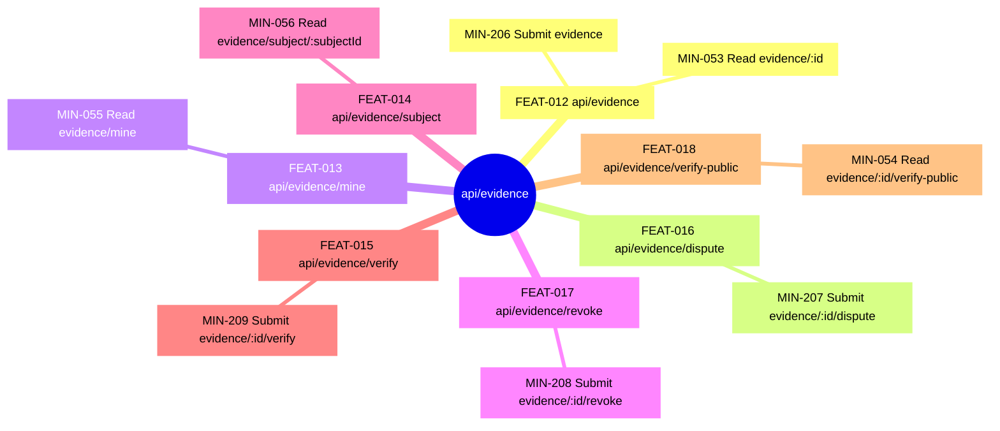
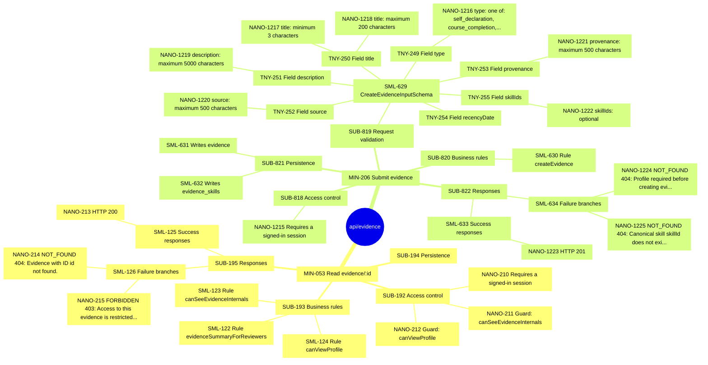
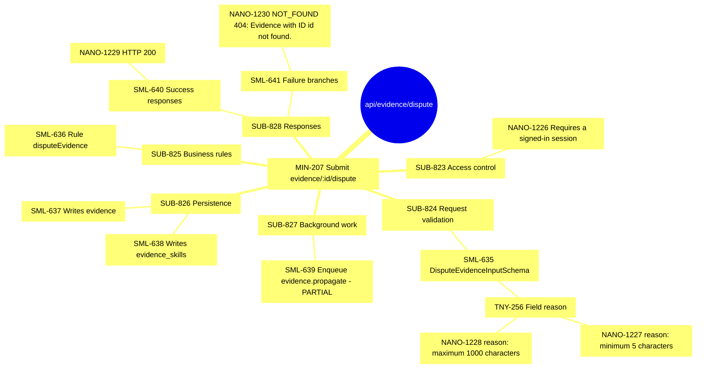
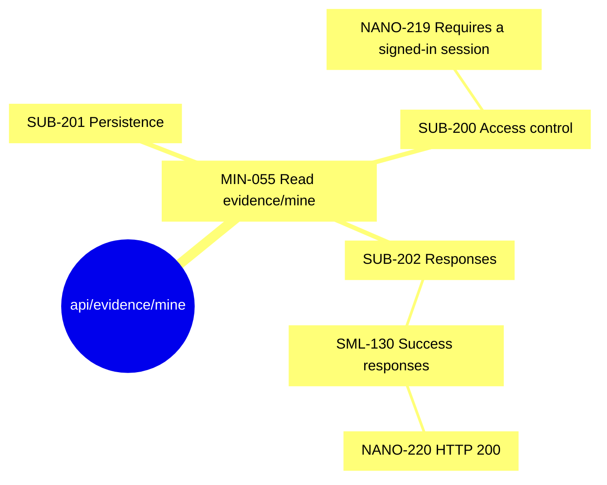
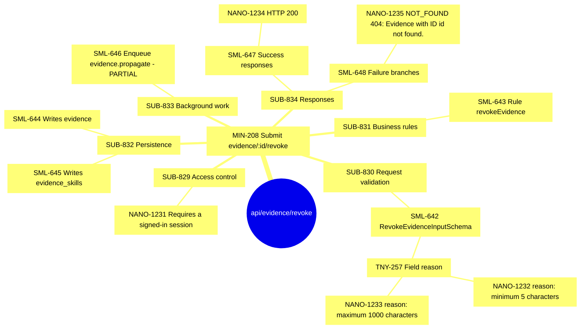
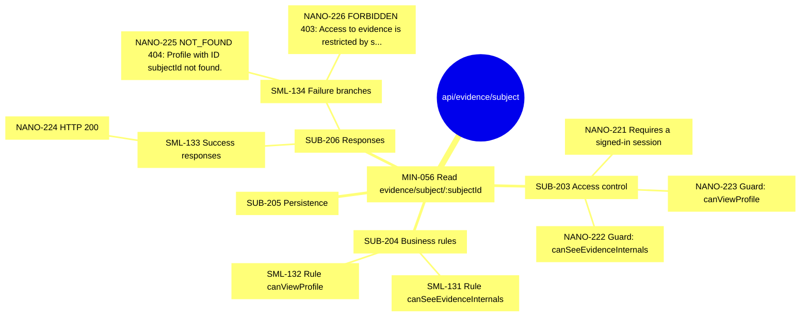
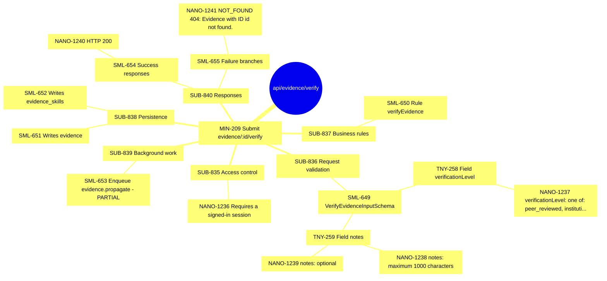
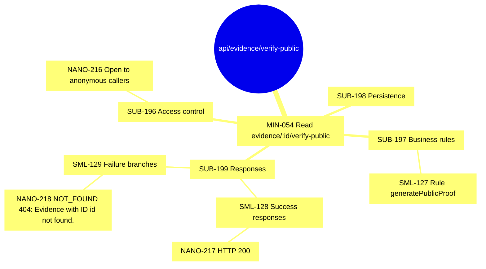

# api/evidence (MOD-057)

Generated by `docs/mindmap/tools/catalog.py` from `master/MASTER_PROJECT_GRAPH.json` at commit `9b3032f`. Do not edit by hand. Back to the [feature catalog](../FEATURE_CATALOG.md).

**Application:** apps/api (MOD-001). **Purpose:** API module: routes under /api/v1/evidence in apps/api/src/server.ts.

**Nodes by level:** MODULE 1, MAJOR 7, MINOR 8, SUB 38, SMALL 40, TINY 11, NANO 44. **Status:** IMPLEMENTED 146, PARTIALLY_IMPLEMENTED 3. **Verification:** PATH_LEVEL 120, UNKNOWN 5, VERIFIED 16.

**User roles that reach it:** anonymous, authenticated.

**Known gaps:** MIN-053 no first-party web caller found; MIN-206 no first-party web caller found; MIN-207 no first-party web caller found; MIN-208 no first-party web caller found; MIN-056 no first-party web caller found; MIN-209 no first-party web caller found.

**Called from (web screens and components):** FEAT-162 Screen /dashboard, FEAT-167 Screen /jobs/:id, FEAT-187 Component CredentialsSection

## Module map (to minor features)

## FEAT-012 api/evidence

api/evidence

| ID        | Level | Parent   | Name                                                                                                                                                                        | Description                                                                                                                                                                                                                                                                          | Status      | Verification | Evidence                                                | Related                                                       |
| --------- | ----- | -------- | --------------------------------------------------------------------------------------------------------------------------------------------------------------------------- | ------------------------------------------------------------------------------------------------------------------------------------------------------------------------------------------------------------------------------------------------------------------------------------ | ----------- | ------------ | ------------------------------------------------------- | ------------------------------------------------------------- |
| FEAT-012  | MAJOR | MOD-057  | api/evidence                                                                                                                                                                |                                                                                                                                                                                                                                                                                      | IMPLEMENTED |              | apps/api/src/server.ts:1487                             |                                                               |
| MIN-053   | MINOR | FEAT-012 | Read evidence/:id                                                                                                                                                           | GET /api/v1/evidence/:id for any signed-in session; calls evidenceSummaryForReviewers, canSeeEvidenceInternals, canViewProfile; durable (PostgreSQL); responds 200; 2 failure branch(es). Gaps: no first-party web caller found                                                      | IMPLEMENTED | VERIFIED     | apps/api/src/server.ts:1531                             | API-015, TEST-025, TEST-095, TEST-103, TEST-104, TEST-111 ... |
| SUB-192   | SUB   | MIN-053  | Access control                                                                                                                                                              | Who may call GET /api/v1/evidence/:id: any signed-in session.                                                                                                                                                                                                                        | IMPLEMENTED | PATH_LEVEL   | apps/api/src/server.ts:1531                             |                                                               |
| NANO-210  | NANO  | SUB-192  | Requires a signed-in session                                                                                                                                                | Requests without a valid session token are rejected with 401 UNAUTHENTICATED.                                                                                                                                                                                                        | IMPLEMENTED | PATH_LEVEL   | apps/api/src/server.ts:1531                             | ROLE-001                                                      |
| NANO-211  | NANO  | SUB-192  | Guard: canSeeEvidenceInternals                                                                                                                                              | Guard canSeeEvidenceInternals must pass before the handler runs.                                                                                                                                                                                                                     | IMPLEMENTED | PATH_LEVEL   | apps/api/src/server.ts:1531                             |                                                               |
| NANO-212  | NANO  | SUB-192  | Guard: canViewProfile                                                                                                                                                       | Guard canViewProfile must pass before the handler runs.                                                                                                                                                                                                                              | IMPLEMENTED | PATH_LEVEL   | apps/api/src/server.ts:1531                             |                                                               |
| SUB-193   | SUB   | MIN-053  | Business rules                                                                                                                                                              | Domain functions from packages/domain called by the handler (3).                                                                                                                                                                                                                     | IMPLEMENTED | PATH_LEVEL   | apps/api/src/server.ts:1531                             |                                                               |
| SML-122   | SMALL | SUB-193  | Rule evidenceSummaryForReviewers                                                                                                                                            | Calls evidenceSummaryForReviewers (packages/domain/src/evidence.ts). Rule status IMPLEMENTED; its own tests: VERIFIED.                                                                                                                                                               | IMPLEMENTED | VERIFIED     | packages/domain/src/evidence.ts:359                     | RULE-101                                                      |
| SML-123   | SMALL | SUB-193  | Rule canSeeEvidenceInternals                                                                                                                                                | Calls canSeeEvidenceInternals (packages/domain/src/evidence.ts). Rule status IMPLEMENTED; its own tests: UNKNOWN.                                                                                                                                                                    | IMPLEMENTED | UNKNOWN      | packages/domain/src/evidence.ts:381                     | RULE-102                                                      |
| SML-124   | SMALL | SUB-193  | Rule canViewProfile                                                                                                                                                         | Calls canViewProfile (packages/domain/src/profile.ts). Rule status IMPLEMENTED; its own tests: VERIFIED.                                                                                                                                                                             | IMPLEMENTED | VERIFIED     | packages/domain/src/profile.ts:36                       | RULE-178                                                      |
| SUB-194   | SUB   | MIN-053  | Persistence                                                                                                                                                                 | Durable: writes go through the PostgreSQL store.                                                                                                                                                                                                                                     | IMPLEMENTED | PATH_LEVEL   | apps/api/src/server.ts:1531                             |                                                               |
| SUB-195   | SUB   | MIN-053  | Responses                                                                                                                                                                   | Success 200; 2 explicit failure branch(es) besides validation and access errors.                                                                                                                                                                                                     | IMPLEMENTED | PATH_LEVEL   | apps/api/src/server.ts:1531                             |                                                               |
| SML-125   | SMALL | SUB-195  | Success responses                                                                                                                                                           | HTTP 200.                                                                                                                                                                                                                                                                            | IMPLEMENTED | PATH_LEVEL   | apps/api/src/server.ts:1531                             |                                                               |
| NANO-213  | NANO  | SML-125  | HTTP 200                                                                                                                                                                    | Replies 200 when the operation succeeds.                                                                                                                                                                                                                                             | IMPLEMENTED | PATH_LEVEL   | apps/api/src/server.ts:1531                             |                                                               |
| SML-126   | SMALL | SUB-195  | Failure branches                                                                                                                                                            | 2 DomainError branch(es) in the handler, mapped to HTTP by the global error handler.                                                                                                                                                                                                 | IMPLEMENTED | PATH_LEVEL   | apps/api/src/server.ts:1531                             |                                                               |
| NANO-214  | NANO  | SML-126  | NOT_FOUND 404: Evidence with ID ${id} not found.                                                                                                                            | Throws DomainError(NOT_FOUND) "Evidence with ID ${id} not found." -> HTTP 404.                                                                                                                                                                                                       | IMPLEMENTED | PATH_LEVEL   | apps/api/src/server.ts:1537                             | ERR-020                                                       |
| NANO-215  | NANO  | SML-126  | FORBIDDEN 403: Access to this evidence is restricted by profile privacy.                                                                                                    | Throws DomainError(FORBIDDEN) "Access to this evidence is restricted by profile privacy." -> HTTP 403.                                                                                                                                                                               | IMPLEMENTED | PATH_LEVEL   | apps/api/src/server.ts:1551                             | ERR-021                                                       |
| MIN-206   | MINOR | FEAT-012 | Submit evidence                                                                                                                                                             | Evidence Endpoints (F-96, BR-149..155) POST /api/v1/evidence for any signed-in session; validates CreateEvidenceInputSchema; calls createEvidence; durable (PostgreSQL); writes evidence, evidence_skills; responds 201; 2 failure branch(es). Gaps: no first-party web caller found | IMPLEMENTED | VERIFIED     | apps/api/src/server.ts:1487                             | API-014, TEST-096, TEST-103, TEST-104, TEST-109, TEST-135 ... |
| SUB-818   | SUB   | MIN-206  | Access control                                                                                                                                                              | Who may call POST /api/v1/evidence: any signed-in session.                                                                                                                                                                                                                           | IMPLEMENTED | PATH_LEVEL   | apps/api/src/server.ts:1487                             |                                                               |
| NANO-1215 | NANO  | SUB-818  | Requires a signed-in session                                                                                                                                                | Requests without a valid session token are rejected with 401 UNAUTHENTICATED.                                                                                                                                                                                                        | IMPLEMENTED | PATH_LEVEL   | apps/api/src/server.ts:1487                             | ROLE-001                                                      |
| SUB-819   | SUB   | MIN-206  | Request validation                                                                                                                                                          | The request is parsed with CreateEvidenceInputSchema; a failure returns 400 with field details before any business logic runs.                                                                                                                                                       | IMPLEMENTED | PATH_LEVEL   | apps/api/src/server.ts:1487                             |                                                               |
| SML-629   | SMALL | SUB-819  | CreateEvidenceInputSchema                                                                                                                                                   | CreateEvidenceInputSchema: 7 field(s)                                                                                                                                                                                                                                                | IMPLEMENTED | PATH_LEVEL   | packages/contracts/src/index.ts:146                     | SCH-008                                                       |
| TNY-249   | TINY  | SML-629  | Field type                                                                                                                                                                  | type (enum, required): one of: self_declaration, course_completion, assessment, project, work_experience, contribution, employer_verification, institution_credential, external_verification                                                                                         | IMPLEMENTED | PATH_LEVEL   | packages/contracts/src/index.ts:147                     |                                                               |
| NANO-1216 | NANO  | TNY-249  | type: one of: self_declaration, course_completion, assessment, project, work_experience, contribution, employer_verification, institution_credential, external_verification | type one of: self_declaration, course_completion, assessment, project, work_experience, contribution, employer_verification, institution_credential, external_verification.                                                                                                          | IMPLEMENTED | PATH_LEVEL   | packages/contracts/src/index.ts:147                     |                                                               |
| TNY-250   | TINY  | SML-629  | Field title                                                                                                                                                                 | title (string, required): minimum 3 characters; maximum 200 characters                                                                                                                                                                                                               | IMPLEMENTED | PATH_LEVEL   | packages/contracts/src/index.ts:158                     |                                                               |
| NANO-1217 | NANO  | TNY-250  | title: minimum 3 characters                                                                                                                                                 | title minimum 3 characters.                                                                                                                                                                                                                                                          | IMPLEMENTED | PATH_LEVEL   | packages/contracts/src/index.ts:158                     |                                                               |
| NANO-1218 | NANO  | TNY-250  | title: maximum 200 characters                                                                                                                                               | title maximum 200 characters.                                                                                                                                                                                                                                                        | IMPLEMENTED | PATH_LEVEL   | packages/contracts/src/index.ts:158                     |                                                               |
| TNY-251   | TINY  | SML-629  | Field description                                                                                                                                                           | description (string, required): maximum 5000 characters                                                                                                                                                                                                                              | IMPLEMENTED | PATH_LEVEL   | packages/contracts/src/index.ts:159                     |                                                               |
| NANO-1219 | NANO  | TNY-251  | description: maximum 5000 characters                                                                                                                                        | description maximum 5000 characters.                                                                                                                                                                                                                                                 | IMPLEMENTED | PATH_LEVEL   | packages/contracts/src/index.ts:159                     |                                                               |
| TNY-252   | TINY  | SML-629  | Field source                                                                                                                                                                | source (string, required): maximum 500 characters                                                                                                                                                                                                                                    | IMPLEMENTED | PATH_LEVEL   | packages/contracts/src/index.ts:160                     |                                                               |
| NANO-1220 | NANO  | TNY-252  | source: maximum 500 characters                                                                                                                                              | source maximum 500 characters.                                                                                                                                                                                                                                                       | IMPLEMENTED | PATH_LEVEL   | packages/contracts/src/index.ts:160                     |                                                               |
| TNY-253   | TINY  | SML-629  | Field provenance                                                                                                                                                            | provenance (string, required): maximum 500 characters                                                                                                                                                                                                                                | IMPLEMENTED | PATH_LEVEL   | packages/contracts/src/index.ts:161                     |                                                               |
| NANO-1221 | NANO  | TNY-253  | provenance: maximum 500 characters                                                                                                                                          | provenance maximum 500 characters.                                                                                                                                                                                                                                                   | IMPLEMENTED | PATH_LEVEL   | packages/contracts/src/index.ts:161                     |                                                               |
| TNY-254   | TINY  | SML-629  | Field recencyDate                                                                                                                                                           | recencyDate (calendarDate(), required)                                                                                                                                                                                                                                               | IMPLEMENTED | PATH_LEVEL   | packages/contracts/src/index.ts:162                     |                                                               |
| TNY-255   | TINY  | SML-629  | Field skillIds                                                                                                                                                              | skillIds (uniqueIdList(), optional): optional                                                                                                                                                                                                                                        | IMPLEMENTED | PATH_LEVEL   | packages/contracts/src/index.ts:163                     |                                                               |
| NANO-1222 | NANO  | TNY-255  | skillIds: optional                                                                                                                                                          | skillIds optional.                                                                                                                                                                                                                                                                   | IMPLEMENTED | PATH_LEVEL   | packages/contracts/src/index.ts:163                     |                                                               |
| SUB-820   | SUB   | MIN-206  | Business rules                                                                                                                                                              | Domain functions from packages/domain called by the handler (1).                                                                                                                                                                                                                     | IMPLEMENTED | PATH_LEVEL   | apps/api/src/server.ts:1487                             |                                                               |
| SML-630   | SMALL | SUB-820  | Rule createEvidence                                                                                                                                                         | Calls createEvidence (packages/domain/src/evidence.ts). Rule status IMPLEMENTED; its own tests: VERIFIED.                                                                                                                                                                            | IMPLEMENTED | VERIFIED     | packages/domain/src/evidence.ts:41                      | RULE-095                                                      |
| SUB-821   | SUB   | MIN-206  | Persistence                                                                                                                                                                 | Durable: writes go through the PostgreSQL store.                                                                                                                                                                                                                                     | IMPLEMENTED | PATH_LEVEL   | apps/api/src/server.ts:1487                             |                                                               |
| SML-631   | SMALL | SUB-821  | Writes evidence                                                                                                                                                             | Writes table evidence (00001_core_schema.sql).                                                                                                                                                                                                                                       | IMPLEMENTED | PATH_LEVEL   | supabase/migrations/00001_core_schema.sql:128           | DB-003                                                        |
| SML-632   | SMALL | SUB-821  | Writes evidence_skills                                                                                                                                                      | Writes table evidence_skills (00002_evidence_skills_schema.sql).                                                                                                                                                                                                                     | IMPLEMENTED | PATH_LEVEL   | supabase/migrations/00002_evidence_skills_schema.sql:39 | DB-012                                                        |
| SUB-822   | SUB   | MIN-206  | Responses                                                                                                                                                                   | Success 201; 2 explicit failure branch(es) besides validation and access errors.                                                                                                                                                                                                     | IMPLEMENTED | PATH_LEVEL   | apps/api/src/server.ts:1487                             |                                                               |
| SML-633   | SMALL | SUB-822  | Success responses                                                                                                                                                           | HTTP 201.                                                                                                                                                                                                                                                                            | IMPLEMENTED | PATH_LEVEL   | apps/api/src/server.ts:1487                             |                                                               |
| NANO-1223 | NANO  | SML-633  | HTTP 201                                                                                                                                                                    | Replies 201 when the operation succeeds.                                                                                                                                                                                                                                             | IMPLEMENTED | PATH_LEVEL   | apps/api/src/server.ts:1487                             |                                                               |
| SML-634   | SMALL | SUB-822  | Failure branches                                                                                                                                                            | 2 DomainError branch(es) in the handler, mapped to HTTP by the global error handler.                                                                                                                                                                                                 | IMPLEMENTED | PATH_LEVEL   | apps/api/src/server.ts:1487                             |                                                               |
| NANO-1224 | NANO  | SML-634  | NOT_FOUND 404: Profile required before creating evidence.                                                                                                                   | Throws DomainError(NOT_FOUND) "Profile required before creating evidence." -> HTTP 404.                                                                                                                                                                                              | IMPLEMENTED | PATH_LEVEL   | apps/api/src/server.ts:1493                             | ERR-018                                                       |
| NANO-1225 | NANO  | SML-634  | NOT_FOUND 404: Canonical skill ${skillId} does not exist (BR-144).                                                                                                          | Throws DomainError(NOT_FOUND) "Canonical skill ${skillId} does not exist (BR-144)." -> HTTP 404.                                                                                                                                                                                     | IMPLEMENTED | PATH_LEVEL   | apps/api/src/server.ts:1511                             | ERR-019                                                       |

## FEAT-016 api/evidence/dispute

api/evidence/dispute

| ID        | Level | Parent   | Name                                             | Description                                                                                                                                                                                                                                                 | Status                | Verification | Evidence                                                | Related                               |
| --------- | ----- | -------- | ------------------------------------------------ | ----------------------------------------------------------------------------------------------------------------------------------------------------------------------------------------------------------------------------------------------------------- | --------------------- | ------------ | ------------------------------------------------------- | ------------------------------------- |
| FEAT-016  | MAJOR | MOD-057  | api/evidence/dispute                             |                                                                                                                                                                                                                                                             | IMPLEMENTED           |              | apps/api/src/server.ts:1681                             |                                       |
| MIN-207   | MINOR | FEAT-016 | Submit evidence/:id/dispute                      | POST /api/v1/evidence/:id/dispute for any signed-in session; validates DisputeEvidenceInputSchema; calls disputeEvidence; durable (PostgreSQL); writes evidence, evidence_skills; responds 200; 1 failure branch(es). Gaps: no first-party web caller found | IMPLEMENTED           | VERIFIED     | apps/api/src/server.ts:1681                             | API-019, TEST-103, TEST-104, TEST-181 |
| SUB-823   | SUB   | MIN-207  | Access control                                   | Who may call POST /api/v1/evidence/:id/dispute: any signed-in session.                                                                                                                                                                                      | IMPLEMENTED           | PATH_LEVEL   | apps/api/src/server.ts:1681                             |                                       |
| NANO-1226 | NANO  | SUB-823  | Requires a signed-in session                     | Requests without a valid session token are rejected with 401 UNAUTHENTICATED.                                                                                                                                                                               | IMPLEMENTED           | PATH_LEVEL   | apps/api/src/server.ts:1681                             | ROLE-001                              |
| SUB-824   | SUB   | MIN-207  | Request validation                               | The request is parsed with DisputeEvidenceInputSchema; a failure returns 400 with field details before any business logic runs.                                                                                                                             | IMPLEMENTED           | PATH_LEVEL   | apps/api/src/server.ts:1681                             |                                       |
| SML-635   | SMALL | SUB-824  | DisputeEvidenceInputSchema                       | DisputeEvidenceInputSchema: 1 field(s)                                                                                                                                                                                                                      | IMPLEMENTED           | PATH_LEVEL   | packages/contracts/src/index.ts:175                     | SCH-010                               |
| TNY-256   | TINY  | SML-635  | Field reason                                     | reason (string, required): minimum 5 characters; maximum 1000 characters                                                                                                                                                                                    | IMPLEMENTED           | PATH_LEVEL   | packages/contracts/src/index.ts:176                     |                                       |
| NANO-1227 | NANO  | TNY-256  | reason: minimum 5 characters                     | reason minimum 5 characters.                                                                                                                                                                                                                                | IMPLEMENTED           | PATH_LEVEL   | packages/contracts/src/index.ts:176                     |                                       |
| NANO-1228 | NANO  | TNY-256  | reason: maximum 1000 characters                  | reason maximum 1000 characters.                                                                                                                                                                                                                             | IMPLEMENTED           | PATH_LEVEL   | packages/contracts/src/index.ts:176                     |                                       |
| SUB-825   | SUB   | MIN-207  | Business rules                                   | Domain functions from packages/domain called by the handler (1).                                                                                                                                                                                            | IMPLEMENTED           | PATH_LEVEL   | apps/api/src/server.ts:1681                             |                                       |
| SML-636   | SMALL | SUB-825  | Rule disputeEvidence                             | Calls disputeEvidence (packages/domain/src/evidence.ts). Rule status IMPLEMENTED; its own tests: VERIFIED.                                                                                                                                                  | IMPLEMENTED           | VERIFIED     | packages/domain/src/evidence.ts:245                     | RULE-098                              |
| SUB-826   | SUB   | MIN-207  | Persistence                                      | Durable: writes go through the PostgreSQL store.                                                                                                                                                                                                            | IMPLEMENTED           | PATH_LEVEL   | apps/api/src/server.ts:1681                             |                                       |
| SML-637   | SMALL | SUB-826  | Writes evidence                                  | Writes table evidence (00001_core_schema.sql).                                                                                                                                                                                                              | IMPLEMENTED           | PATH_LEVEL   | supabase/migrations/00001_core_schema.sql:128           | DB-003                                |
| SML-638   | SMALL | SUB-826  | Writes evidence_skills                           | Writes table evidence_skills (00002_evidence_skills_schema.sql).                                                                                                                                                                                            | IMPLEMENTED           | PATH_LEVEL   | supabase/migrations/00002_evidence_skills_schema.sql:39 | DB-012                                |
| SUB-827   | SUB   | MIN-207  | Background work                                  | Enqueues 1 background job kind(s) in background_jobs for apps/worker.                                                                                                                                                                                       | IMPLEMENTED           | PATH_LEVEL   | apps/api/src/server.ts:1681                             |                                       |
| SML-639   | SMALL | SUB-827  | Enqueue evidence.propagate                       | Dispatches job:evidence.propagate; worker handler: recordEvent (no-op: marks the event recorded).                                                                                                                                                           | PARTIALLY_IMPLEMENTED | UNKNOWN      | packages/domain/src/background-jobs.ts:171              | SVC-020                               |
| SUB-828   | SUB   | MIN-207  | Responses                                        | Success 200; 1 explicit failure branch(es) besides validation and access errors.                                                                                                                                                                            | IMPLEMENTED           | PATH_LEVEL   | apps/api/src/server.ts:1681                             |                                       |
| SML-640   | SMALL | SUB-828  | Success responses                                | HTTP 200.                                                                                                                                                                                                                                                   | IMPLEMENTED           | PATH_LEVEL   | apps/api/src/server.ts:1681                             |                                       |
| NANO-1229 | NANO  | SML-640  | HTTP 200                                         | Replies 200 when the operation succeeds.                                                                                                                                                                                                                    | IMPLEMENTED           | PATH_LEVEL   | apps/api/src/server.ts:1681                             |                                       |
| SML-641   | SMALL | SUB-828  | Failure branches                                 | 1 DomainError branch(es) in the handler, mapped to HTTP by the global error handler.                                                                                                                                                                        | IMPLEMENTED           | PATH_LEVEL   | apps/api/src/server.ts:1681                             |                                       |
| NANO-1230 | NANO  | SML-641  | NOT_FOUND 404: Evidence with ID ${id} not found. | Throws DomainError(NOT_FOUND) "Evidence with ID ${id} not found." -> HTTP 404.                                                                                                                                                                              | IMPLEMENTED           | PATH_LEVEL   | apps/api/src/server.ts:1690                             | ERR-020                               |

## FEAT-013 api/evidence/mine

api/evidence/mine

| ID       | Level | Parent   | Name                         | Description                                                                                                                                    | Status      | Verification | Evidence                    | Related                                                   |
| -------- | ----- | -------- | ---------------------------- | ---------------------------------------------------------------------------------------------------------------------------------------------- | ----------- | ------------ | --------------------------- | --------------------------------------------------------- |
| FEAT-013 | MAJOR | MOD-057  | api/evidence/mine            |                                                                                                                                                | IMPLEMENTED |              | apps/api/src/server.ts:1573 |                                                           |
| MIN-055  | MINOR | FEAT-013 | Read evidence/mine           | The signed-in candidate's own evidence, newest first. GET /api/v1/evidence/mine for any signed-in session; durable (PostgreSQL); responds 200. | IMPLEMENTED | VERIFIED     | apps/api/src/server.ts:1573 | API-016, TEST-103, TEST-104, TEST-111, TEST-142, TEST-176 |
| SUB-200  | SUB   | MIN-055  | Access control               | Who may call GET /api/v1/evidence/mine: any signed-in session.                                                                                 | IMPLEMENTED | PATH_LEVEL   | apps/api/src/server.ts:1573 |                                                           |
| NANO-219 | NANO  | SUB-200  | Requires a signed-in session | Requests without a valid session token are rejected with 401 UNAUTHENTICATED.                                                                  | IMPLEMENTED | PATH_LEVEL   | apps/api/src/server.ts:1573 | ROLE-001                                                  |
| SUB-201  | SUB   | MIN-055  | Persistence                  | Durable: writes go through the PostgreSQL store.                                                                                               | IMPLEMENTED | PATH_LEVEL   | apps/api/src/server.ts:1573 |                                                           |
| SUB-202  | SUB   | MIN-055  | Responses                    | Success 200; 0 explicit failure branch(es) besides validation and access errors.                                                               | IMPLEMENTED | PATH_LEVEL   | apps/api/src/server.ts:1573 |                                                           |
| SML-130  | SMALL | SUB-202  | Success responses            | HTTP 200.                                                                                                                                      | IMPLEMENTED | PATH_LEVEL   | apps/api/src/server.ts:1573 |                                                           |
| NANO-220 | NANO  | SML-130  | HTTP 200                     | Replies 200 when the operation succeeds.                                                                                                       | IMPLEMENTED | PATH_LEVEL   | apps/api/src/server.ts:1573 |                                                           |

## FEAT-017 api/evidence/revoke

api/evidence/revoke

| ID        | Level | Parent   | Name                                             | Description                                                                                                                                                                                                                                              | Status                | Verification | Evidence                                                | Related                               |
| --------- | ----- | -------- | ------------------------------------------------ | -------------------------------------------------------------------------------------------------------------------------------------------------------------------------------------------------------------------------------------------------------- | --------------------- | ------------ | ------------------------------------------------------- | ------------------------------------- |
| FEAT-017  | MAJOR | MOD-057  | api/evidence/revoke                              |                                                                                                                                                                                                                                                          | IMPLEMENTED           |              | apps/api/src/server.ts:1722                             |                                       |
| MIN-208   | MINOR | FEAT-017 | Submit evidence/:id/revoke                       | POST /api/v1/evidence/:id/revoke for any signed-in session; validates RevokeEvidenceInputSchema; calls revokeEvidence; durable (PostgreSQL); writes evidence, evidence_skills; responds 200; 1 failure branch(es). Gaps: no first-party web caller found | IMPLEMENTED           | VERIFIED     | apps/api/src/server.ts:1722                             | API-020, TEST-103, TEST-109, TEST-181 |
| SUB-829   | SUB   | MIN-208  | Access control                                   | Who may call POST /api/v1/evidence/:id/revoke: any signed-in session.                                                                                                                                                                                    | IMPLEMENTED           | PATH_LEVEL   | apps/api/src/server.ts:1722                             |                                       |
| NANO-1231 | NANO  | SUB-829  | Requires a signed-in session                     | Requests without a valid session token are rejected with 401 UNAUTHENTICATED.                                                                                                                                                                            | IMPLEMENTED           | PATH_LEVEL   | apps/api/src/server.ts:1722                             | ROLE-001                              |
| SUB-830   | SUB   | MIN-208  | Request validation                               | The request is parsed with RevokeEvidenceInputSchema; a failure returns 400 with field details before any business logic runs.                                                                                                                           | IMPLEMENTED           | PATH_LEVEL   | apps/api/src/server.ts:1722                             |                                       |
| SML-642   | SMALL | SUB-830  | RevokeEvidenceInputSchema                        | RevokeEvidenceInputSchema: 1 field(s)                                                                                                                                                                                                                    | IMPLEMENTED           | PATH_LEVEL   | packages/contracts/src/index.ts:181                     | SCH-011                               |
| TNY-257   | TINY  | SML-642  | Field reason                                     | reason (string, required): minimum 5 characters; maximum 1000 characters                                                                                                                                                                                 | IMPLEMENTED           | PATH_LEVEL   | packages/contracts/src/index.ts:182                     |                                       |
| NANO-1232 | NANO  | TNY-257  | reason: minimum 5 characters                     | reason minimum 5 characters.                                                                                                                                                                                                                             | IMPLEMENTED           | PATH_LEVEL   | packages/contracts/src/index.ts:182                     |                                       |
| NANO-1233 | NANO  | TNY-257  | reason: maximum 1000 characters                  | reason maximum 1000 characters.                                                                                                                                                                                                                          | IMPLEMENTED           | PATH_LEVEL   | packages/contracts/src/index.ts:182                     |                                       |
| SUB-831   | SUB   | MIN-208  | Business rules                                   | Domain functions from packages/domain called by the handler (1).                                                                                                                                                                                         | IMPLEMENTED           | PATH_LEVEL   | apps/api/src/server.ts:1722                             |                                       |
| SML-643   | SMALL | SUB-831  | Rule revokeEvidence                              | Calls revokeEvidence (packages/domain/src/evidence.ts). Rule status IMPLEMENTED; its own tests: VERIFIED.                                                                                                                                                | IMPLEMENTED           | VERIFIED     | packages/domain/src/evidence.ts:295                     | RULE-099                              |
| SUB-832   | SUB   | MIN-208  | Persistence                                      | Durable: writes go through the PostgreSQL store.                                                                                                                                                                                                         | IMPLEMENTED           | PATH_LEVEL   | apps/api/src/server.ts:1722                             |                                       |
| SML-644   | SMALL | SUB-832  | Writes evidence                                  | Writes table evidence (00001_core_schema.sql).                                                                                                                                                                                                           | IMPLEMENTED           | PATH_LEVEL   | supabase/migrations/00001_core_schema.sql:128           | DB-003                                |
| SML-645   | SMALL | SUB-832  | Writes evidence_skills                           | Writes table evidence_skills (00002_evidence_skills_schema.sql).                                                                                                                                                                                         | IMPLEMENTED           | PATH_LEVEL   | supabase/migrations/00002_evidence_skills_schema.sql:39 | DB-012                                |
| SUB-833   | SUB   | MIN-208  | Background work                                  | Enqueues 1 background job kind(s) in background_jobs for apps/worker.                                                                                                                                                                                    | IMPLEMENTED           | PATH_LEVEL   | apps/api/src/server.ts:1722                             |                                       |
| SML-646   | SMALL | SUB-833  | Enqueue evidence.propagate                       | Dispatches job:evidence.propagate; worker handler: recordEvent (no-op: marks the event recorded).                                                                                                                                                        | PARTIALLY_IMPLEMENTED | UNKNOWN      | packages/domain/src/background-jobs.ts:171              | SVC-020                               |
| SUB-834   | SUB   | MIN-208  | Responses                                        | Success 200; 1 explicit failure branch(es) besides validation and access errors.                                                                                                                                                                         | IMPLEMENTED           | PATH_LEVEL   | apps/api/src/server.ts:1722                             |                                       |
| SML-647   | SMALL | SUB-834  | Success responses                                | HTTP 200.                                                                                                                                                                                                                                                | IMPLEMENTED           | PATH_LEVEL   | apps/api/src/server.ts:1722                             |                                       |
| NANO-1234 | NANO  | SML-647  | HTTP 200                                         | Replies 200 when the operation succeeds.                                                                                                                                                                                                                 | IMPLEMENTED           | PATH_LEVEL   | apps/api/src/server.ts:1722                             |                                       |
| SML-648   | SMALL | SUB-834  | Failure branches                                 | 1 DomainError branch(es) in the handler, mapped to HTTP by the global error handler.                                                                                                                                                                     | IMPLEMENTED           | PATH_LEVEL   | apps/api/src/server.ts:1722                             |                                       |
| NANO-1235 | NANO  | SML-648  | NOT_FOUND 404: Evidence with ID ${id} not found. | Throws DomainError(NOT_FOUND) "Evidence with ID ${id} not found." -> HTTP 404.                                                                                                                                                                           | IMPLEMENTED           | PATH_LEVEL   | apps/api/src/server.ts:1731                             | ERR-020                               |

## FEAT-014 api/evidence/subject

api/evidence/subject

| ID       | Level | Parent   | Name                                                                         | Description                                                                                                                                                                                                       | Status      | Verification | Evidence                            | Related                               |
| -------- | ----- | -------- | ---------------------------------------------------------------------------- | ----------------------------------------------------------------------------------------------------------------------------------------------------------------------------------------------------------------- | ----------- | ------------ | ----------------------------------- | ------------------------------------- |
| FEAT-014 | MAJOR | MOD-057  | api/evidence/subject                                                         |                                                                                                                                                                                                                   | IMPLEMENTED |              | apps/api/src/server.ts:1581         |                                       |
| MIN-056  | MINOR | FEAT-014 | Read evidence/subject/:subjectId                                             | GET /api/v1/evidence/subject/:subjectId for any signed-in session; calls canSeeEvidenceInternals, canViewProfile; durable (PostgreSQL); responds 200; 2 failure branch(es). Gaps: no first-party web caller found | IMPLEMENTED | VERIFIED     | apps/api/src/server.ts:1581         | API-017, TEST-096, TEST-104, TEST-145 |
| SUB-203  | SUB   | MIN-056  | Access control                                                               | Who may call GET /api/v1/evidence/subject/:subjectId: any signed-in session.                                                                                                                                      | IMPLEMENTED | PATH_LEVEL   | apps/api/src/server.ts:1581         |                                       |
| NANO-221 | NANO  | SUB-203  | Requires a signed-in session                                                 | Requests without a valid session token are rejected with 401 UNAUTHENTICATED.                                                                                                                                     | IMPLEMENTED | PATH_LEVEL   | apps/api/src/server.ts:1581         | ROLE-001                              |
| NANO-222 | NANO  | SUB-203  | Guard: canSeeEvidenceInternals                                               | Guard canSeeEvidenceInternals must pass before the handler runs.                                                                                                                                                  | IMPLEMENTED | PATH_LEVEL   | apps/api/src/server.ts:1581         |                                       |
| NANO-223 | NANO  | SUB-203  | Guard: canViewProfile                                                        | Guard canViewProfile must pass before the handler runs.                                                                                                                                                           | IMPLEMENTED | PATH_LEVEL   | apps/api/src/server.ts:1581         |                                       |
| SUB-204  | SUB   | MIN-056  | Business rules                                                               | Domain functions from packages/domain called by the handler (2).                                                                                                                                                  | IMPLEMENTED | PATH_LEVEL   | apps/api/src/server.ts:1581         |                                       |
| SML-131  | SMALL | SUB-204  | Rule canSeeEvidenceInternals                                                 | Calls canSeeEvidenceInternals (packages/domain/src/evidence.ts). Rule status IMPLEMENTED; its own tests: UNKNOWN.                                                                                                 | IMPLEMENTED | UNKNOWN      | packages/domain/src/evidence.ts:381 | RULE-102                              |
| SML-132  | SMALL | SUB-204  | Rule canViewProfile                                                          | Calls canViewProfile (packages/domain/src/profile.ts). Rule status IMPLEMENTED; its own tests: VERIFIED.                                                                                                          | IMPLEMENTED | VERIFIED     | packages/domain/src/profile.ts:36   | RULE-178                              |
| SUB-205  | SUB   | MIN-056  | Persistence                                                                  | Durable: writes go through the PostgreSQL store.                                                                                                                                                                  | IMPLEMENTED | PATH_LEVEL   | apps/api/src/server.ts:1581         |                                       |
| SUB-206  | SUB   | MIN-056  | Responses                                                                    | Success 200; 2 explicit failure branch(es) besides validation and access errors.                                                                                                                                  | IMPLEMENTED | PATH_LEVEL   | apps/api/src/server.ts:1581         |                                       |
| SML-133  | SMALL | SUB-206  | Success responses                                                            | HTTP 200.                                                                                                                                                                                                         | IMPLEMENTED | PATH_LEVEL   | apps/api/src/server.ts:1581         |                                       |
| NANO-224 | NANO  | SML-133  | HTTP 200                                                                     | Replies 200 when the operation succeeds.                                                                                                                                                                          | IMPLEMENTED | PATH_LEVEL   | apps/api/src/server.ts:1581         |                                       |
| SML-134  | SMALL | SUB-206  | Failure branches                                                             | 2 DomainError branch(es) in the handler, mapped to HTTP by the global error handler.                                                                                                                              | IMPLEMENTED | PATH_LEVEL   | apps/api/src/server.ts:1581         |                                       |
| NANO-225 | NANO  | SML-134  | NOT_FOUND 404: Profile with ID ${subjectId} not found.                       | Throws DomainError(NOT_FOUND) "Profile with ID ${subjectId} not found." -> HTTP 404.                                                                                                                              | IMPLEMENTED | PATH_LEVEL   | apps/api/src/server.ts:1587         | ERR-022                               |
| NANO-226 | NANO  | SML-134  | FORBIDDEN 403: Access to evidence is restricted by subject privacy settings. | Throws DomainError(FORBIDDEN) "Access to evidence is restricted by subject privacy settings." -> HTTP 403.                                                                                                        | IMPLEMENTED | PATH_LEVEL   | apps/api/src/server.ts:1599         | ERR-023                               |

## FEAT-015 api/evidence/verify

api/evidence/verify

| ID        | Level | Parent   | Name                                                                               | Description                                                                                                                                                                                                                                              | Status                | Verification | Evidence                                                | Related                               |
| --------- | ----- | -------- | ---------------------------------------------------------------------------------- | -------------------------------------------------------------------------------------------------------------------------------------------------------------------------------------------------------------------------------------------------------- | --------------------- | ------------ | ------------------------------------------------------- | ------------------------------------- |
| FEAT-015  | MAJOR | MOD-057  | api/evidence/verify                                                                |                                                                                                                                                                                                                                                          | IMPLEMENTED           |              | apps/api/src/server.ts:1633                             |                                       |
| MIN-209   | MINOR | FEAT-015 | Submit evidence/:id/verify                                                         | POST /api/v1/evidence/:id/verify for any signed-in session; validates VerifyEvidenceInputSchema; calls verifyEvidence; durable (PostgreSQL); writes evidence, evidence_skills; responds 200; 1 failure branch(es). Gaps: no first-party web caller found | IMPLEMENTED           | VERIFIED     | apps/api/src/server.ts:1633                             | API-018, TEST-103, TEST-179, TEST-181 |
| SUB-835   | SUB   | MIN-209  | Access control                                                                     | Who may call POST /api/v1/evidence/:id/verify: any signed-in session.                                                                                                                                                                                    | IMPLEMENTED           | PATH_LEVEL   | apps/api/src/server.ts:1633                             |                                       |
| NANO-1236 | NANO  | SUB-835  | Requires a signed-in session                                                       | Requests without a valid session token are rejected with 401 UNAUTHENTICATED.                                                                                                                                                                            | IMPLEMENTED           | PATH_LEVEL   | apps/api/src/server.ts:1633                             | ROLE-001                              |
| SUB-836   | SUB   | MIN-209  | Request validation                                                                 | The request is parsed with VerifyEvidenceInputSchema; a failure returns 400 with field details before any business logic runs.                                                                                                                           | IMPLEMENTED           | PATH_LEVEL   | apps/api/src/server.ts:1633                             |                                       |
| SML-649   | SMALL | SUB-836  | VerifyEvidenceInputSchema                                                          | VerifyEvidenceInputSchema: 2 field(s)                                                                                                                                                                                                                    | IMPLEMENTED           | PATH_LEVEL   | packages/contracts/src/index.ts:168                     | SCH-009                               |
| TNY-258   | TINY  | SML-649  | Field verificationLevel                                                            | verificationLevel (enum, required): one of: peer_reviewed, institution_verified, authority_verified                                                                                                                                                      | IMPLEMENTED           | PATH_LEVEL   | packages/contracts/src/index.ts:169                     |                                       |
| NANO-1237 | NANO  | TNY-258  | verificationLevel: one of: peer_reviewed, institution_verified, authority_verified | verificationLevel one of: peer_reviewed, institution_verified, authority_verified.                                                                                                                                                                       | IMPLEMENTED           | PATH_LEVEL   | packages/contracts/src/index.ts:169                     |                                       |
| TNY-259   | TINY  | SML-649  | Field notes                                                                        | notes (string, optional): maximum 1000 characters; optional                                                                                                                                                                                              | IMPLEMENTED           | PATH_LEVEL   | packages/contracts/src/index.ts:170                     |                                       |
| NANO-1238 | NANO  | TNY-259  | notes: maximum 1000 characters                                                     | notes maximum 1000 characters.                                                                                                                                                                                                                           | IMPLEMENTED           | PATH_LEVEL   | packages/contracts/src/index.ts:170                     |                                       |
| NANO-1239 | NANO  | TNY-259  | notes: optional                                                                    | notes optional.                                                                                                                                                                                                                                          | IMPLEMENTED           | PATH_LEVEL   | packages/contracts/src/index.ts:170                     |                                       |
| SUB-837   | SUB   | MIN-209  | Business rules                                                                     | Domain functions from packages/domain called by the handler (1).                                                                                                                                                                                         | IMPLEMENTED           | PATH_LEVEL   | apps/api/src/server.ts:1633                             |                                       |
| SML-650   | SMALL | SUB-837  | Rule verifyEvidence                                                                | Calls verifyEvidence (packages/domain/src/evidence.ts). Rule status IMPLEMENTED; its own tests: VERIFIED.                                                                                                                                                | IMPLEMENTED           | VERIFIED     | packages/domain/src/evidence.ts:139                     | RULE-097                              |
| SUB-838   | SUB   | MIN-209  | Persistence                                                                        | Durable: writes go through the PostgreSQL store.                                                                                                                                                                                                         | IMPLEMENTED           | PATH_LEVEL   | apps/api/src/server.ts:1633                             |                                       |
| SML-651   | SMALL | SUB-838  | Writes evidence                                                                    | Writes table evidence (00001_core_schema.sql).                                                                                                                                                                                                           | IMPLEMENTED           | PATH_LEVEL   | supabase/migrations/00001_core_schema.sql:128           | DB-003                                |
| SML-652   | SMALL | SUB-838  | Writes evidence_skills                                                             | Writes table evidence_skills (00002_evidence_skills_schema.sql).                                                                                                                                                                                         | IMPLEMENTED           | PATH_LEVEL   | supabase/migrations/00002_evidence_skills_schema.sql:39 | DB-012                                |
| SUB-839   | SUB   | MIN-209  | Background work                                                                    | Enqueues 1 background job kind(s) in background_jobs for apps/worker.                                                                                                                                                                                    | IMPLEMENTED           | PATH_LEVEL   | apps/api/src/server.ts:1633                             |                                       |
| SML-653   | SMALL | SUB-839  | Enqueue evidence.propagate                                                         | Dispatches job:evidence.propagate; worker handler: recordEvent (no-op: marks the event recorded).                                                                                                                                                        | PARTIALLY_IMPLEMENTED | UNKNOWN      | packages/domain/src/background-jobs.ts:171              | SVC-020                               |
| SUB-840   | SUB   | MIN-209  | Responses                                                                          | Success 200; 1 explicit failure branch(es) besides validation and access errors.                                                                                                                                                                         | IMPLEMENTED           | PATH_LEVEL   | apps/api/src/server.ts:1633                             |                                       |
| SML-654   | SMALL | SUB-840  | Success responses                                                                  | HTTP 200.                                                                                                                                                                                                                                                | IMPLEMENTED           | PATH_LEVEL   | apps/api/src/server.ts:1633                             |                                       |
| NANO-1240 | NANO  | SML-654  | HTTP 200                                                                           | Replies 200 when the operation succeeds.                                                                                                                                                                                                                 | IMPLEMENTED           | PATH_LEVEL   | apps/api/src/server.ts:1633                             |                                       |
| SML-655   | SMALL | SUB-840  | Failure branches                                                                   | 1 DomainError branch(es) in the handler, mapped to HTTP by the global error handler.                                                                                                                                                                     | IMPLEMENTED           | PATH_LEVEL   | apps/api/src/server.ts:1633                             |                                       |
| NANO-1241 | NANO  | SML-655  | NOT_FOUND 404: Evidence with ID ${id} not found.                                   | Throws DomainError(NOT_FOUND) "Evidence with ID ${id} not found." -> HTTP 404.                                                                                                                                                                           | IMPLEMENTED           | PATH_LEVEL   | apps/api/src/server.ts:1642                             | ERR-020                               |

## FEAT-018 api/evidence/verify-public

api/evidence/verify-public

| ID       | Level | Parent   | Name                                             | Description                                                                                                                                      | Status      | Verification | Evidence                            | Related                               |
| -------- | ----- | -------- | ------------------------------------------------ | ------------------------------------------------------------------------------------------------------------------------------------------------ | ----------- | ------------ | ----------------------------------- | ------------------------------------- |
| FEAT-018 | MAJOR | MOD-057  | api/evidence/verify-public                       |                                                                                                                                                  | IMPLEMENTED |              | apps/api/src/server.ts:1763         |                                       |
| MIN-054  | MINOR | FEAT-018 | Read evidence/:id/verify-public                  | GET /api/v1/evidence/:id/verify-public for anyone (public); calls generatePublicProof; durable (PostgreSQL); responds 200; 1 failure branch(es). | IMPLEMENTED | VERIFIED     | apps/api/src/server.ts:1763         | API-021, TEST-103, TEST-145, TEST-181 |
| SUB-196  | SUB   | MIN-054  | Access control                                   | Who may call GET /api/v1/evidence/:id/verify-public: anyone (public).                                                                            | IMPLEMENTED | PATH_LEVEL   | apps/api/src/server.ts:1763         |                                       |
| NANO-216 | NANO  | SUB-196  | Open to anonymous callers                        | auth: public.                                                                                                                                    | IMPLEMENTED | PATH_LEVEL   | apps/api/src/server.ts:1763         | ROLE-001                              |
| SUB-197  | SUB   | MIN-054  | Business rules                                   | Domain functions from packages/domain called by the handler (1).                                                                                 | IMPLEMENTED | PATH_LEVEL   | apps/api/src/server.ts:1763         |                                       |
| SML-127  | SMALL | SUB-197  | Rule generatePublicProof                         | Calls generatePublicProof (packages/domain/src/evidence.ts). Rule status IMPLEMENTED; its own tests: VERIFIED.                                   | IMPLEMENTED | VERIFIED     | packages/domain/src/evidence.ts:397 | RULE-103                              |
| SUB-198  | SUB   | MIN-054  | Persistence                                      | Durable: writes go through the PostgreSQL store.                                                                                                 | IMPLEMENTED | PATH_LEVEL   | apps/api/src/server.ts:1763         |                                       |
| SUB-199  | SUB   | MIN-054  | Responses                                        | Success 200; 1 explicit failure branch(es) besides validation and access errors.                                                                 | IMPLEMENTED | PATH_LEVEL   | apps/api/src/server.ts:1763         |                                       |
| SML-128  | SMALL | SUB-199  | Success responses                                | HTTP 200.                                                                                                                                        | IMPLEMENTED | PATH_LEVEL   | apps/api/src/server.ts:1763         |                                       |
| NANO-217 | NANO  | SML-128  | HTTP 200                                         | Replies 200 when the operation succeeds.                                                                                                         | IMPLEMENTED | PATH_LEVEL   | apps/api/src/server.ts:1763         |                                       |
| SML-129  | SMALL | SUB-199  | Failure branches                                 | 1 DomainError branch(es) in the handler, mapped to HTTP by the global error handler.                                                             | IMPLEMENTED | PATH_LEVEL   | apps/api/src/server.ts:1763         |                                       |
| NANO-218 | NANO  | SML-129  | NOT_FOUND 404: Evidence with ID ${id} not found. | Throws DomainError(NOT_FOUND) "Evidence with ID ${id} not found." -> HTTP 404.                                                                   | IMPLEMENTED | PATH_LEVEL   | apps/api/src/server.ts:1769         | ERR-020                               |
