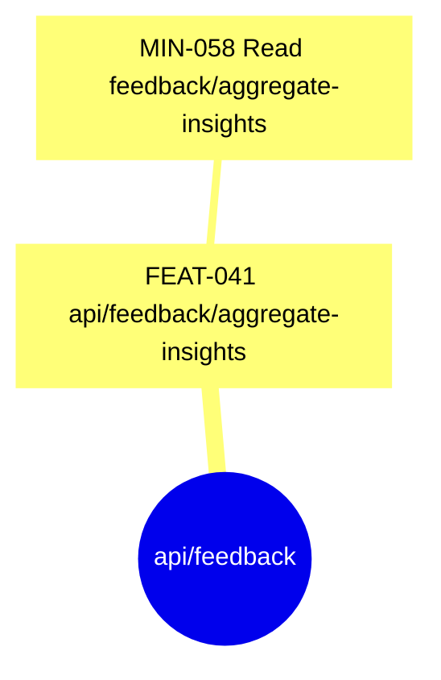
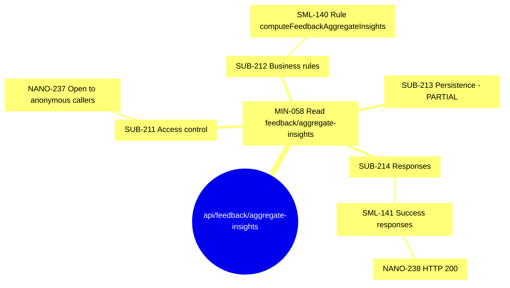

# api/feedback (MOD-064)

Generated by `docs/mindmap/tools/catalog.py` from `master/MASTER_PROJECT_GRAPH.json` at commit `9b3032f`. Do not edit by hand. Back to the [feature catalog](../FEATURE_CATALOG.md).

**Application:** apps/api (MOD-001). **Purpose:** API module: routes under /api/v1/feedback in apps/api/src/server.ts.

**Nodes by level:** MODULE 1, MAJOR 1, MINOR 1, SUB 4, SMALL 2, NANO 2. **Status:** IMPLEMENTED 10, PARTIALLY_IMPLEMENTED 1. **Verification:** PATH_LEVEL 7, VERIFIED 2.

**User roles that reach it:** anonymous.

**Known gaps:** MIN-058 ephemeral: state held in process memory, lost on restart; MIN-058 no first-party web caller found.

## Module map (to minor features)

## FEAT-041 api/feedback/aggregate-insights

api/feedback/aggregate-insights

| ID       | Level | Parent   | Name                                  | Description                                                                                                                                                                                                                                    | Status                | Verification | Evidence                                        | Related                     |
| -------- | ----- | -------- | ------------------------------------- | ---------------------------------------------------------------------------------------------------------------------------------------------------------------------------------------------------------------------------------------------- | --------------------- | ------------ | ----------------------------------------------- | --------------------------- |
| FEAT-041 | MAJOR | MOD-064  | api/feedback/aggregate-insights       |                                                                                                                                                                                                                                                | IMPLEMENTED           |              | apps/api/src/server.ts:3257                     |                             |
| MIN-058  | MINOR | FEAT-041 | Read feedback/aggregate-insights      | GET /api/v1/feedback/aggregate-insights for anyone (public); calls computeFeedbackAggregateInsights; ephemeral (process memory); responds 200. Gaps: ephemeral: state held in process memory, lost on restart; no first-party web caller found | IMPLEMENTED           | VERIFIED     | apps/api/src/server.ts:3257                     | API-057, TEST-089, TEST-145 |
| SUB-211  | SUB   | MIN-058  | Access control                        | Who may call GET /api/v1/feedback/aggregate-insights: anyone (public).                                                                                                                                                                         | IMPLEMENTED           | PATH_LEVEL   | apps/api/src/server.ts:3257                     |                             |
| NANO-237 | NANO  | SUB-211  | Open to anonymous callers             | auth: public.                                                                                                                                                                                                                                  | IMPLEMENTED           | PATH_LEVEL   | apps/api/src/server.ts:3257                     | ROLE-001                    |
| SUB-212  | SUB   | MIN-058  | Business rules                        | Domain functions from packages/domain called by the handler (1).                                                                                                                                                                               | IMPLEMENTED           | PATH_LEVEL   | apps/api/src/server.ts:3257                     |                             |
| SML-140  | SMALL | SUB-212  | Rule computeFeedbackAggregateInsights | Calls computeFeedbackAggregateInsights (packages/domain/src/application-feedback.ts). Rule status IMPLEMENTED; its own tests: VERIFIED.                                                                                                        | IMPLEMENTED           | VERIFIED     | packages/domain/src/application-feedback.ts:248 | RULE-039                    |
| SUB-213  | SUB   | MIN-058  | Persistence                           | Ephemeral: state lives in API process memory and is lost on restart.                                                                                                                                                                           | PARTIALLY_IMPLEMENTED | PATH_LEVEL   | apps/api/src/server.ts:3257                     |                             |
| SUB-214  | SUB   | MIN-058  | Responses                             | Success 200; 0 explicit failure branch(es) besides validation and access errors.                                                                                                                                                               | IMPLEMENTED           | PATH_LEVEL   | apps/api/src/server.ts:3257                     |                             |
| SML-141  | SMALL | SUB-214  | Success responses                     | HTTP 200.                                                                                                                                                                                                                                      | IMPLEMENTED           | PATH_LEVEL   | apps/api/src/server.ts:3257                     |                             |
| NANO-238 | NANO  | SML-141  | HTTP 200                              | Replies 200 when the operation succeeds.                                                                                                                                                                                                       | IMPLEMENTED           | PATH_LEVEL   | apps/api/src/server.ts:3257                     |                             |
