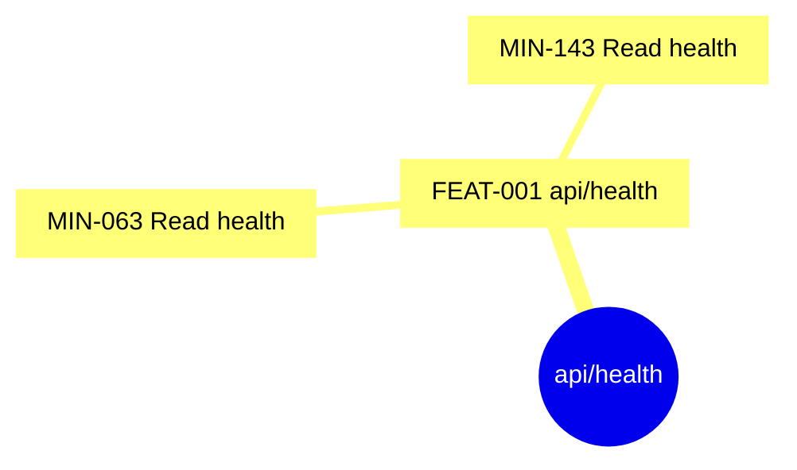
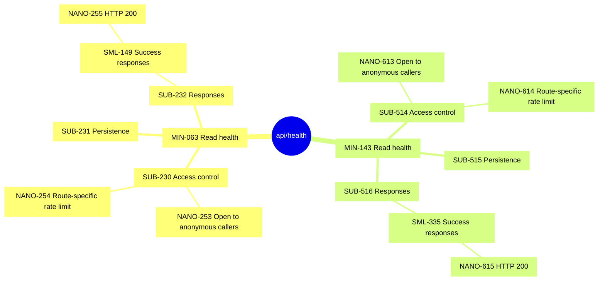

# api/health (MOD-052)

Generated by `docs/mindmap/tools/catalog.py` from `master/MASTER_PROJECT_GRAPH.json` at commit `9b3032f`. Do not edit by hand. Back to the [feature catalog](../FEATURE_CATALOG.md).

**Application:** apps/api (MOD-001). **Purpose:** API module: routes under /api/v1/health in apps/api/src/server.ts.

**Nodes by level:** MODULE 1, MAJOR 1, MINOR 2, SUB 6, SMALL 2, NANO 6. **Status:** IMPLEMENTED 18. **Verification:** PATH_LEVEL 14, VERIFIED 2.

**User roles that reach it:** anonymous.

**Known gaps:** MIN-063 no first-party web caller found; MIN-143 no first-party web caller found.

## Module map (to minor features)

## FEAT-001 api/health

api/health

| ID       | Level | Parent   | Name                      | Description                                                                                                                                                                                                                                                     | Status      | Verification | Evidence                   | Related                                                       |
| -------- | ----- | -------- | ------------------------- | --------------------------------------------------------------------------------------------------------------------------------------------------------------------------------------------------------------------------------------------------------------- | ----------- | ------------ | -------------------------- | ------------------------------------------------------------- |
| FEAT-001 | MAJOR | MOD-052  | api/health                |                                                                                                                                                                                                                                                                 | IMPLEMENTED |              | apps/api/src/server.ts:776 |                                                               |
| MIN-063  | MINOR | FEAT-001 | Read health               | GET /api/v1/health for anyone (public); durable (PostgreSQL); responds 200. Gaps: no first-party web caller found                                                                                                                                               | IMPLEMENTED | VERIFIED     | apps/api/src/server.ts:829 | API-003, TEST-087, TEST-141, TEST-143, TEST-145, TEST-151 ... |
| SUB-230  | SUB   | MIN-063  | Access control            | Who may call GET /api/v1/health: anyone (public).                                                                                                                                                                                                               | IMPLEMENTED | PATH_LEVEL   | apps/api/src/server.ts:829 |                                                               |
| NANO-253 | NANO  | SUB-230  | Open to anonymous callers | auth: public.                                                                                                                                                                                                                                                   | IMPLEMENTED | PATH_LEVEL   | apps/api/src/server.ts:829 | ROLE-001                                                      |
| NANO-254 | NANO  | SUB-230  | Route-specific rate limit | This route sets its own rate-limit configuration (429 when exceeded).                                                                                                                                                                                           | IMPLEMENTED | PATH_LEVEL   | apps/api/src/server.ts:829 |                                                               |
| SUB-231  | SUB   | MIN-063  | Persistence               | Durable: writes go through the PostgreSQL store.                                                                                                                                                                                                                | IMPLEMENTED | PATH_LEVEL   | apps/api/src/server.ts:829 |                                                               |
| SUB-232  | SUB   | MIN-063  | Responses                 | Success 200; 0 explicit failure branch(es) besides validation and access errors.                                                                                                                                                                                | IMPLEMENTED | PATH_LEVEL   | apps/api/src/server.ts:829 |                                                               |
| SML-149  | SMALL | SUB-232  | Success responses         | HTTP 200 (implicit).                                                                                                                                                                                                                                            | IMPLEMENTED | PATH_LEVEL   | apps/api/src/server.ts:829 |                                                               |
| NANO-255 | NANO  | SML-149  | HTTP 200                  | Replies 200 when the operation succeeds (implicit default).                                                                                                                                                                                                     | IMPLEMENTED | PATH_LEVEL   | apps/api/src/server.ts:829 |                                                               |
| MIN-143  | MINOR | FEAT-001 | Read health               | Base Health Checks Health checks are exempt from the limiter: a load balancer polling them must never be able to throttle the API into looking dead. GET /health for anyone (public); durable (PostgreSQL); responds 200. Gaps: no first-party web caller found | IMPLEMENTED | VERIFIED     | apps/api/src/server.ts:776 | API-001, TEST-087, TEST-141, TEST-143, TEST-145, TEST-151 ... |
| SUB-514  | SUB   | MIN-143  | Access control            | Who may call GET /health: anyone (public).                                                                                                                                                                                                                      | IMPLEMENTED | PATH_LEVEL   | apps/api/src/server.ts:776 |                                                               |
| NANO-613 | NANO  | SUB-514  | Open to anonymous callers | auth: public.                                                                                                                                                                                                                                                   | IMPLEMENTED | PATH_LEVEL   | apps/api/src/server.ts:776 | ROLE-001                                                      |
| NANO-614 | NANO  | SUB-514  | Route-specific rate limit | This route sets its own rate-limit configuration (429 when exceeded).                                                                                                                                                                                           | IMPLEMENTED | PATH_LEVEL   | apps/api/src/server.ts:776 |                                                               |
| SUB-515  | SUB   | MIN-143  | Persistence               | Durable: writes go through the PostgreSQL store.                                                                                                                                                                                                                | IMPLEMENTED | PATH_LEVEL   | apps/api/src/server.ts:776 |                                                               |
| SUB-516  | SUB   | MIN-143  | Responses                 | Success 200; 0 explicit failure branch(es) besides validation and access errors.                                                                                                                                                                                | IMPLEMENTED | PATH_LEVEL   | apps/api/src/server.ts:776 |                                                               |
| SML-335  | SMALL | SUB-516  | Success responses         | HTTP 200 (implicit).                                                                                                                                                                                                                                            | IMPLEMENTED | PATH_LEVEL   | apps/api/src/server.ts:776 |                                                               |
| NANO-615 | NANO  | SML-335  | HTTP 200                  | Replies 200 when the operation succeeds (implicit default).                                                                                                                                                                                                     | IMPLEMENTED | PATH_LEVEL   | apps/api/src/server.ts:776 |                                                               |
