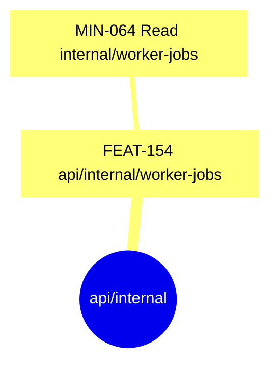
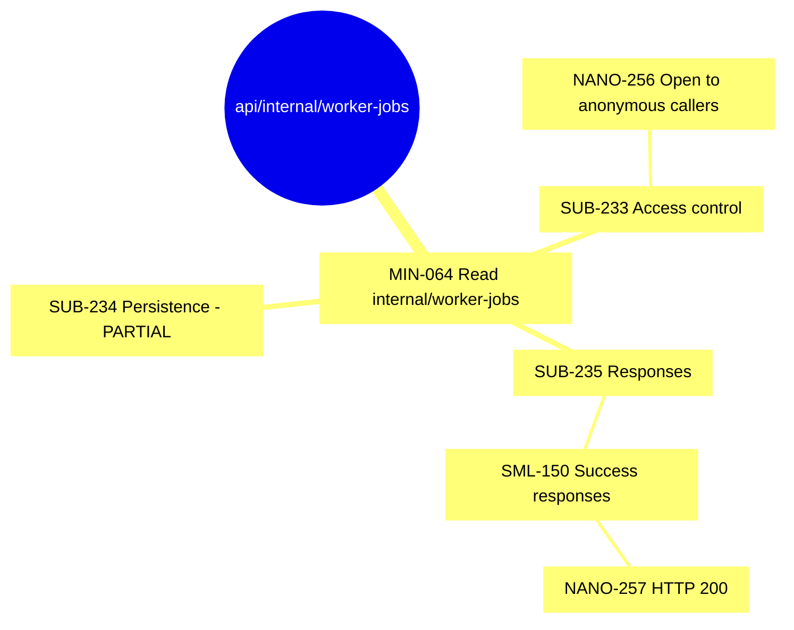

# api/internal (MOD-096)

Generated by `docs/mindmap/tools/catalog.py` from `master/MASTER_PROJECT_GRAPH.json` at commit `9b3032f`. Do not edit by hand. Back to the [feature catalog](../FEATURE_CATALOG.md).

**Application:** apps/api (MOD-001). **Purpose:** API module: routes under /api/v1/internal in apps/api/src/server.ts.

**Nodes by level:** MODULE 1, MAJOR 1, MINOR 1, SUB 3, SMALL 1, NANO 2. **Status:** IMPLEMENTED 8, PARTIALLY_IMPLEMENTED 1. **Verification:** PATH_LEVEL 6, VERIFIED 1.

**User roles that reach it:** anonymous.

**Known gaps:** MIN-064 ephemeral: state held in process memory, lost on restart; MIN-064 no first-party web caller found.

## Module map (to minor features)

## FEAT-154 api/internal/worker-jobs

api/internal/worker-jobs

| ID       | Level | Parent   | Name                      | Description                                                                                                                                                                                                                                                                                                                                                                                                                                                                                 | Status                | Verification | Evidence                     | Related                                                       |
| -------- | ----- | -------- | ------------------------- | ------------------------------------------------------------------------------------------------------------------------------------------------------------------------------------------------------------------------------------------------------------------------------------------------------------------------------------------------------------------------------------------------------------------------------------------------------------------------------------------- | --------------------- | ------------ | ---------------------------- | ------------------------------------------------------------- |
| FEAT-154 | MAJOR | MOD-096  | api/internal/worker-jobs  |                                                                                                                                                                                                                                                                                                                                                                                                                                                                                             | IMPLEMENTED           |              | apps/api/src/server.ts:13451 |                                                               |
| MIN-064  | MINOR | FEAT-154 | Read internal/worker-jobs | Internal helper for inspecting async job dispatch (tests + local dev). Unauthenticated, so it exists ONLY in development and test: payloads carry user ids and, for email jobs, one-time codes and reference links. Staging and production observe the queue through the admin diagnostics. GET /api/v1/internal/worker-jobs for anyone (public); ephemeral (process memory); responds 200. Gaps: ephemeral: state held in process memory, lost on restart; no first-party web caller found | IMPLEMENTED           | VERIFIED     | apps/api/src/server.ts:13451 | API-279, TEST-083, TEST-092, TEST-097, TEST-102, TEST-103 ... |
| SUB-233  | SUB   | MIN-064  | Access control            | Who may call GET /api/v1/internal/worker-jobs: anyone (public).                                                                                                                                                                                                                                                                                                                                                                                                                             | IMPLEMENTED           | PATH_LEVEL   | apps/api/src/server.ts:13451 |                                                               |
| NANO-256 | NANO  | SUB-233  | Open to anonymous callers | auth: public.                                                                                                                                                                                                                                                                                                                                                                                                                                                                               | IMPLEMENTED           | PATH_LEVEL   | apps/api/src/server.ts:13451 | ROLE-001                                                      |
| SUB-234  | SUB   | MIN-064  | Persistence               | Ephemeral: state lives in API process memory and is lost on restart; store calls jobs.list.                                                                                                                                                                                                                                                                                                                                                                                                 | PARTIALLY_IMPLEMENTED | PATH_LEVEL   | apps/api/src/server.ts:13451 |                                                               |
| SUB-235  | SUB   | MIN-064  | Responses                 | Success 200; 0 explicit failure branch(es) besides validation and access errors.                                                                                                                                                                                                                                                                                                                                                                                                            | IMPLEMENTED           | PATH_LEVEL   | apps/api/src/server.ts:13451 |                                                               |
| SML-150  | SMALL | SUB-235  | Success responses         | HTTP 200 (implicit).                                                                                                                                                                                                                                                                                                                                                                                                                                                                        | IMPLEMENTED           | PATH_LEVEL   | apps/api/src/server.ts:13451 |                                                               |
| NANO-257 | NANO  | SML-150  | HTTP 200                  | Replies 200 when the operation succeeds (implicit default).                                                                                                                                                                                                                                                                                                                                                                                                                                 | IMPLEMENTED           | PATH_LEVEL   | apps/api/src/server.ts:13451 |                                                               |
