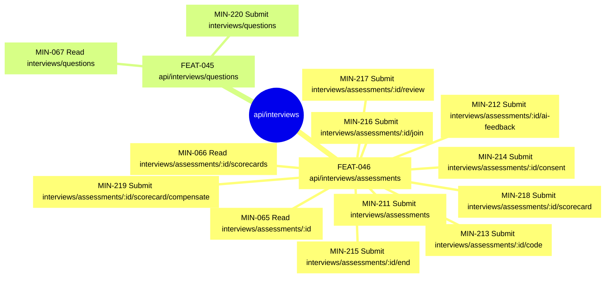
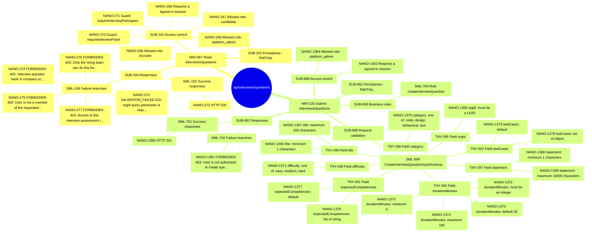

# api/interviews (MOD-066)

Generated by `docs/mindmap/tools/catalog.py` from `master/MASTER_PROJECT_GRAPH.json` at commit `9b3032f`. Do not edit by hand. Back to the [feature catalog](../FEATURE_CATALOG.md).

**Application:** apps/api (MOD-001). **Purpose:** API module: routes under /api/v1/interviews in apps/api/src/server.ts.

**Nodes by level:** MODULE 1, MAJOR 2, MINOR 13, SUB 55, SMALL 45, TINY 39, NANO 149. **Status:** IMPLEMENTED 291, PARTIALLY_IMPLEMENTED 13. **Verification:** PATH_LEVEL 277, VERIFIED 24.

**User roles that reach it:** authenticated, candidate, platform_admin, recruiter.

**Known gaps:** MIN-065 ephemeral: state held in process memory, lost on restart; MIN-065 no first-party web caller found; MIN-066 ephemeral: state held in process memory, lost on restart; MIN-066 no first-party web caller found; MIN-211 ephemeral: state held in process memory, lost on restart; MIN-211 no first-party web caller found; MIN-212 ephemeral: state held in process memory, lost on restart; MIN-212 no first-party web caller found; MIN-213 ephemeral: state held in process memory, lost on restart; MIN-213 no first-party web caller found; MIN-214 ephemeral: state held in process memory, lost on restart; MIN-214 no first-party web caller found; MIN-215 ephemeral: state held in process memory, lost on restart; MIN-215 no first-party web caller found; MIN-216 ephemeral: state held in process memory, lost on restart; MIN-216 no first-party web caller found; MIN-217 ephemeral: state held in process memory, lost on restart; MIN-217 no first-party web caller found; MIN-218 ephemeral: state held in process memory, lost on restart; MIN-218 no first-party web caller found; MIN-219 ephemeral: state held in process memory, lost on restart; MIN-219 no first-party web caller found; MIN-067 ephemeral: state held in process memory, lost on restart; MIN-067 no first-party web caller found; MIN-220 ephemeral: state held in process memory, lost on restart; MIN-220 no first-party web caller found.

## Module map (to minor features)

## FEAT-046 api/interviews/assessments

api/interviews/assessments

```mermaid
mindmap
  root((api/interviews/assessments))
    MIN_065[MIN-065 Read interviews/assessments/:id]
      SUB_236[SUB-236 Access control]
        NANO_258[NANO-258 Requires a signed-in session]
        NANO_259[NANO-259 Guard: requireInterviewParticipant]
      SUB_237[SUB-237 Persistence - PARTIAL]
      SUB_238[SUB-238 Responses]
        SML_151[SML-151 Success responses]
          NANO_260[NANO-260 HTTP 200]
        SML_152[SML-152 Failure branches]
          NANO_261[NANO-261 NOT_FOUND 404: Interview assessment id not found.]
    MIN_066[MIN-066 Read interviews/assessments/:id/scorecards]
      SUB_239[SUB-239 Access control]
        NANO_262[NANO-262 Requires a signed-in session]
        NANO_263[NANO-263 Guard: requireInterviewParticipant]
      SUB_240[SUB-240 Persistence - PARTIAL]
      SUB_241[SUB-241 Responses]
        SML_153[SML-153 Success responses]
          NANO_264[NANO-264 HTTP 200]
        SML_154[SML-154 Failure branches]
          NANO_265[NANO-265 NOT_FOUND 404: Interview assessment id not found.]
    MIN_211[MIN-211 Submit interviews/assessments]
      SUB_847[SUB-847 Access control]
        NANO_1253[NANO-1253 Requires a signed-in session]
        NANO_1254[NANO-1254 Allowed role: platform_admin]
      SUB_848[SUB-848 Request validation]
        SML_664[SML-664 ScheduleInterviewAssessmentInputSchema]
          TNY_264[TNY-264 Field orgId]
            NANO_1255[NANO-1255 orgId: must be a UUID]
          TNY_265[TNY-265 Field applicationId]
            NANO_1256[NANO-1256 applicationId: must be a UUID]
            NANO_1257[NANO-1257 applicationId: optional]
          TNY_266[TNY-266 Field candidateProfileId]
            NANO_1258[NANO-1258 candidateProfileId: must be a UUID]
          TNY_267[TNY-267 Field interviewerUserId]
            NANO_1259[NANO-1259 interviewerUserId: must be a UUID]
          TNY_268[TNY-268 Field title]
            NANO_1260[NANO-1260 title: minimum 1 characters]
            NANO_1261[NANO-1261 title: maximum 200 characters]
          TNY_269[TNY-269 Field scheduledAt]
            NANO_1262[NANO-1262 scheduledAt: must be an ISO date-time]
          TNY_270[TNY-270 Field durationMinutes]
            NANO_1263[NANO-1263 durationMinutes: must be an integer]
            NANO_1264[NANO-1264 durationMinutes: minimum 15]
            NANO_1265[NANO-1265 durationMinutes: maximum 240]
            NANO_1266[NANO-1266 durationMinutes: default 60]
          TNY_271[TNY-271 Field meetingUrl]
            NANO_1267[NANO-1267 meetingUrl: optional]
          TNY_272[TNY-272 Field questionIds]
            NANO_1268[NANO-1268 questionIds: list of string]
            NANO_1269[NANO-1269 questionIds: default]
      SUB_849[SUB-849 Business rules]
        SML_665[SML-665 Rule scheduleInterviewAssessment]
      SUB_850[SUB-850 Persistence - PARTIAL]
      SUB_851[SUB-851 Responses]
        SML_666[SML-666 Success responses]
          NANO_1270[NANO-1270 HTTP 201]
        SML_667[SML-667 Failure branches]
          NANO_1271[NANO-1271 FORBIDDEN 403: User is not authorized to schedule i...]
          NANO_1272[NANO-1272 NOT_FOUND 404: Candidate profile input.candidatePro...]
          NANO_1273[NANO-1273 VALIDATION_FAILED 422: The interviewer must be a me...]
          NANO_1274[NANO-1274 VALIDATION_FAILED 422: applicationId must be an app...]
          NANO_1275[NANO-1275 VALIDATION_FAILED 422: questionIds must be question...]
    MIN_212[MIN-212 Submit interviews/assessments/:id/ai-feedback]
      SUB_852[SUB-852 Access control]
        NANO_1276[NANO-1276 Requires a signed-in session]
        NANO_1277[NANO-1277 Guard: requireInterviewPanel]
      SUB_853[SUB-853 Business rules]
        SML_668[SML-668 Rule generateAdvisoryAiFeedback]
      SUB_854[SUB-854 Persistence - PARTIAL]
      SUB_855[SUB-855 Responses]
        SML_669[SML-669 Success responses]
          NANO_1278[NANO-1278 HTTP 200]
        SML_670[SML-670 Failure branches]
          NANO_1279[NANO-1279 NOT_FOUND 404: Interview assessment id not found.]
    MIN_213[MIN-213 Submit interviews/assessments/:id/code]
      SUB_856[SUB-856 Access control]
        NANO_1280[NANO-1280 Requires a signed-in session]
        NANO_1281[NANO-1281 Guard: requireInterviewParticipant]
      SUB_857[SUB-857 Request validation]
        SML_671[SML-671 ExecuteInterviewCodeInputSchema]
          TNY_273[TNY-273 Field code]
            NANO_1282[NANO-1282 code: minimum 1 characters]
            NANO_1283[NANO-1283 code: maximum 50000 characters]
          TNY_274[TNY-274 Field language]
            NANO_1284[NANO-1284 language: one of: javascript, typescript, python]
            NANO_1285[NANO-1285 language: default javascript]
          TNY_275[TNY-275 Field questionId]
            NANO_1286[NANO-1286 questionId: must be a UUID]
            NANO_1287[NANO-1287 questionId: optional]
          TNY_276[TNY-276 Field customTestCases]
            NANO_1288[NANO-1288 customTestCases: list of object]
            NANO_1289[NANO-1289 customTestCases: optional]
      SUB_858[SUB-858 Business rules]
        SML_672[SML-672 Rule executeInterviewCode]
      SUB_859[SUB-859 Persistence - PARTIAL]
      SUB_860[SUB-860 Responses]
        SML_673[SML-673 Success responses]
          NANO_1290[NANO-1290 HTTP 200]
        SML_674[SML-674 Failure branches]
          NANO_1291[NANO-1291 NOT_FOUND 404: Interview assessment id not found.]
          NANO_1292[NANO-1292 SERVICE_UNAVAILABLE 503: Automated code execution i...]
          NANO_1293[NANO-1293 NOT_FOUND 404: That question is not part of this in...]
    MIN_214[MIN-214 Submit interviews/assessments/:id/consent]
      SUB_861[SUB-861 Access control]
        NANO_1294[NANO-1294 Requires a signed-in session]
        NANO_1295[NANO-1295 Guard: requireInterviewParticipant]
      SUB_862[SUB-862 Request validation]
        SML_675[SML-675 SetRecordingConsentInputSchema]
          TNY_277[TNY-277 Field consent]
      SUB_863[SUB-863 Business rules]
        SML_676[SML-676 Rule updateRecordingConsent]
      SUB_864[SUB-864 Persistence - PARTIAL]
      SUB_865[SUB-865 Responses]
        SML_677[SML-677 Success responses]
          NANO_1296[NANO-1296 HTTP 200]
        SML_678[SML-678 Failure branches]
          NANO_1297[NANO-1297 NOT_FOUND 404: Interview assessment id not found.]
    MIN_215[MIN-215 Submit interviews/assessments/:id/end]
      SUB_866[SUB-866 Access control]
        NANO_1298[NANO-1298 Requires a signed-in session]
        NANO_1299[NANO-1299 Guard: requireInterviewPanel]
      SUB_867[SUB-867 Business rules]
        SML_679[SML-679 Rule endInterviewAssessment]
      SUB_868[SUB-868 Persistence - PARTIAL]
      SUB_869[SUB-869 Responses]
        SML_680[SML-680 Success responses]
          NANO_1300[NANO-1300 HTTP 200]
        SML_681[SML-681 Failure branches]
          NANO_1301[NANO-1301 NOT_FOUND 404: Interview assessment id not found.]
          NANO_1302[NANO-1302 VALIDATION_FAILED 422: Invalid resolution resolutio...]
    MIN_216[MIN-216 Submit interviews/assessments/:id/join]
      SUB_870[SUB-870 Access control]
        NANO_1303[NANO-1303 Requires a signed-in session]
        NANO_1304[NANO-1304 Guard: requireInterviewParticipant]
      SUB_871[SUB-871 Business rules]
        SML_682[SML-682 Rule joinInterviewAssessment]
      SUB_872[SUB-872 Persistence - PARTIAL]
      SUB_873[SUB-873 Responses]
        SML_683[SML-683 Success responses]
          NANO_1305[NANO-1305 HTTP 200]
        SML_684[SML-684 Failure branches]
          NANO_1306[NANO-1306 NOT_FOUND 404: Interview assessment id not found.]
    MIN_217[MIN-217 Submit interviews/assessments/:id/review]
      SUB_874[SUB-874 Access control]
        NANO_1307[NANO-1307 Requires a signed-in session]
        NANO_1308[NANO-1308 Guard: requireInterviewPanel]
      SUB_875[SUB-875 Business rules]
        SML_685[SML-685 Rule reviewInterviewAssessment]
      SUB_876[SUB-876 Persistence - PARTIAL]
      SUB_877[SUB-877 Responses]
        SML_686[SML-686 Success responses]
          NANO_1309[NANO-1309 HTTP 200]
        SML_687[SML-687 Failure branches]
          NANO_1310[NANO-1310 NOT_FOUND 404: Interview assessment id not found.]
    MIN_218[MIN-218 Submit interviews/assessments/:id/scorecard]
      SUB_878[SUB-878 Access control]
        NANO_1311[NANO-1311 Requires a signed-in session]
        NANO_1312[NANO-1312 Guard: canTransitionApplication]
        NANO_1313[NANO-1313 Guard: requireInterviewPanel]
      SUB_879[SUB-879 Request validation]
        SML_688[SML-688 SubmitInterviewScorecardInputSchema]
          TNY_278[TNY-278 Field technicalCorrectness]
            NANO_1314[NANO-1314 technicalCorrectness: must be an integer]
            NANO_1315[NANO-1315 technicalCorrectness: minimum 1]
            NANO_1316[NANO-1316 technicalCorrectness: maximum 5]
          TNY_279[TNY-279 Field communication]
            NANO_1317[NANO-1317 communication: must be an integer]
            NANO_1318[NANO-1318 communication: minimum 1]
            NANO_1319[NANO-1319 communication: maximum 5]
          TNY_280[TNY-280 Field problemSolving]
            NANO_1320[NANO-1320 problemSolving: must be an integer]
            NANO_1321[NANO-1321 problemSolving: minimum 1]
            NANO_1322[NANO-1322 problemSolving: maximum 5]
          TNY_281[TNY-281 Field codeQuality]
            NANO_1323[NANO-1323 codeQuality: must be an integer]
            NANO_1324[NANO-1324 codeQuality: minimum 1]
            NANO_1325[NANO-1325 codeQuality: maximum 5]
          TNY_282[TNY-282 Field recommendation]
            NANO_1326[NANO-1326 recommendation: one of: strong_yes, yes, neutral, n...]
          TNY_283[TNY-283 Field strengths]
            NANO_1327[NANO-1327 strengths: minimum 1 characters]
            NANO_1328[NANO-1328 strengths: maximum 5000 characters]
          TNY_284[TNY-284 Field areasForImprovement]
            NANO_1329[NANO-1329 areasForImprovement: minimum 1 characters]
            NANO_1330[NANO-1330 areasForImprovement: maximum 5000 characters]
          TNY_285[TNY-285 Field privateNotes]
            NANO_1331[NANO-1331 privateNotes: maximum 5000 characters]
            NANO_1332[NANO-1332 privateNotes: optional]
      SUB_880[SUB-880 Business rules]
        SML_689[SML-689 Rule canTransitionApplication]
        SML_690[SML-690 Rule submitInterviewScorecard]
      SUB_881[SUB-881 Persistence - PARTIAL]
        SML_691[SML-691 Writes job_applications]
        SML_692[SML-692 Writes application_evidence]
      SUB_882[SUB-882 Responses]
        SML_693[SML-693 Success responses]
          NANO_1333[NANO-1333 HTTP 201]
        SML_694[SML-694 Failure branches]
          NANO_1334[NANO-1334 NOT_FOUND 404: Interview assessment id not found.]
          NANO_1335[NANO-1335 FORBIDDEN 403: Candidates are not authorized to sub...]
    MIN_219[MIN-219 Submit interviews/assessments/:id/scorecard/compensate]
      SUB_883[SUB-883 Access control]
        NANO_1336[NANO-1336 Requires a signed-in session]
        NANO_1337[NANO-1337 Guard: requireInterviewPanel]
      SUB_884[SUB-884 Request validation]
        SML_695[SML-695 CompensateInterviewScorecardInputSchema]
          TNY_286[TNY-286 Field technicalCorrectness]
            NANO_1338[NANO-1338 technicalCorrectness: must be an integer]
            NANO_1339[NANO-1339 technicalCorrectness: minimum 1]
            NANO_1340[NANO-1340 technicalCorrectness: maximum 5]
          TNY_287[TNY-287 Field communication]
            NANO_1341[NANO-1341 communication: must be an integer]
            NANO_1342[NANO-1342 communication: minimum 1]
            NANO_1343[NANO-1343 communication: maximum 5]
          TNY_288[TNY-288 Field problemSolving]
            NANO_1344[NANO-1344 problemSolving: must be an integer]
            NANO_1345[NANO-1345 problemSolving: minimum 1]
            NANO_1346[NANO-1346 problemSolving: maximum 5]
          TNY_289[TNY-289 Field codeQuality]
            NANO_1347[NANO-1347 codeQuality: must be an integer]
            NANO_1348[NANO-1348 codeQuality: minimum 1]
            NANO_1349[NANO-1349 codeQuality: maximum 5]
          TNY_290[TNY-290 Field recommendation]
            NANO_1350[NANO-1350 recommendation: one of: strong_yes, yes, neutral, n...]
          TNY_291[TNY-291 Field strengths]
            NANO_1351[NANO-1351 strengths: minimum 1 characters]
            NANO_1352[NANO-1352 strengths: maximum 5000 characters]
          TNY_292[TNY-292 Field areasForImprovement]
            NANO_1353[NANO-1353 areasForImprovement: minimum 1 characters]
            NANO_1354[NANO-1354 areasForImprovement: maximum 5000 characters]
          TNY_293[TNY-293 Field compensationReason]
            NANO_1355[NANO-1355 compensationReason: minimum 1 characters]
            NANO_1356[NANO-1356 compensationReason: maximum 1000 characters]
          TNY_294[TNY-294 Field privateNotes]
            NANO_1357[NANO-1357 privateNotes: maximum 5000 characters]
            NANO_1358[NANO-1358 privateNotes: optional]
      SUB_885[SUB-885 Business rules]
        SML_696[SML-696 Rule compensateInterviewScorecard]
      SUB_886[SUB-886 Persistence - PARTIAL]
      SUB_887[SUB-887 Responses]
        SML_697[SML-697 Success responses]
          NANO_1359[NANO-1359 HTTP 201]
        SML_698[SML-698 Failure branches]
          NANO_1360[NANO-1360 NOT_FOUND 404: Interview assessment id not found.]
          NANO_1361[NANO-1361 FORBIDDEN 403: Candidates are not authorized to sub...]
          NANO_1362[NANO-1362 NOT_FOUND 404: No existing scorecard found to compe...]
```

| ID        | Level | Parent   | Name                                                                                           | Description                                                                                                                                                                                                                                                                                                                                                                                          | Status                | Verification | Evidence                                                  | Related                               |
| --------- | ----- | -------- | ---------------------------------------------------------------------------------------------- | ---------------------------------------------------------------------------------------------------------------------------------------------------------------------------------------------------------------------------------------------------------------------------------------------------------------------------------------------------------------------------------------------------- | --------------------- | ------------ | --------------------------------------------------------- | ------------------------------------- |
| FEAT-046  | MAJOR | MOD-066  | api/interviews/assessments                                                                     |                                                                                                                                                                                                                                                                                                                                                                                                      | IMPLEMENTED           |              | apps/api/src/server.ts:3562                               |                                       |
| MIN-065   | MINOR | FEAT-046 | Read interviews/assessments/:id                                                                | GET /api/v1/interviews/assessments/:id for any signed-in session; ephemeral (process memory); responds 200; 1 failure branch(es). Gaps: ephemeral: state held in process memory, lost on restart; no first-party web caller found                                                                                                                                                                    | IMPLEMENTED           | VERIFIED     | apps/api/src/server.ts:3658                               | API-066, TEST-137, TEST-142, TEST-216 |
| SUB-236   | SUB   | MIN-065  | Access control                                                                                 | Who may call GET /api/v1/interviews/assessments/:id: any signed-in session.                                                                                                                                                                                                                                                                                                                          | IMPLEMENTED           | PATH_LEVEL   | apps/api/src/server.ts:3658                               |                                       |
| NANO-258  | NANO  | SUB-236  | Requires a signed-in session                                                                   | Requests without a valid session token are rejected with 401 UNAUTHENTICATED.                                                                                                                                                                                                                                                                                                                        | IMPLEMENTED           | PATH_LEVEL   | apps/api/src/server.ts:3658                               | ROLE-001                              |
| NANO-259  | NANO  | SUB-236  | Guard: requireInterviewParticipant                                                             | Guard requireInterviewParticipant must pass before the handler runs.                                                                                                                                                                                                                                                                                                                                 | IMPLEMENTED           | PATH_LEVEL   | apps/api/src/server.ts:3658                               |                                       |
| SUB-237   | SUB   | MIN-065  | Persistence                                                                                    | Ephemeral: state lives in API process memory and is lost on restart.                                                                                                                                                                                                                                                                                                                                 | PARTIALLY_IMPLEMENTED | PATH_LEVEL   | apps/api/src/server.ts:3658                               |                                       |
| SUB-238   | SUB   | MIN-065  | Responses                                                                                      | Success 200; 1 explicit failure branch(es) besides validation and access errors.                                                                                                                                                                                                                                                                                                                     | IMPLEMENTED           | PATH_LEVEL   | apps/api/src/server.ts:3658                               |                                       |
| SML-151   | SMALL | SUB-238  | Success responses                                                                              | HTTP 200.                                                                                                                                                                                                                                                                                                                                                                                            | IMPLEMENTED           | PATH_LEVEL   | apps/api/src/server.ts:3658                               |                                       |
| NANO-260  | NANO  | SML-151  | HTTP 200                                                                                       | Replies 200 when the operation succeeds.                                                                                                                                                                                                                                                                                                                                                             | IMPLEMENTED           | PATH_LEVEL   | apps/api/src/server.ts:3658                               |                                       |
| SML-152   | SMALL | SUB-238  | Failure branches                                                                               | 1 DomainError branch(es) in the handler, mapped to HTTP by the global error handler.                                                                                                                                                                                                                                                                                                                 | IMPLEMENTED           | PATH_LEVEL   | apps/api/src/server.ts:3658                               |                                       |
| NANO-261  | NANO  | SML-152  | NOT_FOUND 404: Interview assessment ${id} not found.                                           | Throws DomainError(NOT_FOUND) "Interview assessment ${id} not found." -> HTTP 404.                                                                                                                                                                                                                                                                                                                   | IMPLEMENTED           | PATH_LEVEL   | apps/api/src/server.ts:3665                               | ERR-079                               |
| MIN-066   | MINOR | FEAT-046 | Read interviews/assessments/:id/scorecards                                                     | GET /api/v1/interviews/assessments/:id/scorecards for any signed-in session; ephemeral (process memory); responds 200; 1 failure branch(es). Gaps: ephemeral: state held in process memory, lost on restart; no first-party web caller found                                                                                                                                                         | IMPLEMENTED           | VERIFIED     | apps/api/src/server.ts:3961                               | API-073, TEST-137, TEST-216           |
| SUB-239   | SUB   | MIN-066  | Access control                                                                                 | Who may call GET /api/v1/interviews/assessments/:id/scorecards: any signed-in session.                                                                                                                                                                                                                                                                                                               | IMPLEMENTED           | PATH_LEVEL   | apps/api/src/server.ts:3961                               |                                       |
| NANO-262  | NANO  | SUB-239  | Requires a signed-in session                                                                   | Requests without a valid session token are rejected with 401 UNAUTHENTICATED.                                                                                                                                                                                                                                                                                                                        | IMPLEMENTED           | PATH_LEVEL   | apps/api/src/server.ts:3961                               | ROLE-001                              |
| NANO-263  | NANO  | SUB-239  | Guard: requireInterviewParticipant                                                             | Guard requireInterviewParticipant must pass before the handler runs.                                                                                                                                                                                                                                                                                                                                 | IMPLEMENTED           | PATH_LEVEL   | apps/api/src/server.ts:3961                               |                                       |
| SUB-240   | SUB   | MIN-066  | Persistence                                                                                    | Ephemeral: state lives in API process memory and is lost on restart.                                                                                                                                                                                                                                                                                                                                 | PARTIALLY_IMPLEMENTED | PATH_LEVEL   | apps/api/src/server.ts:3961                               |                                       |
| SUB-241   | SUB   | MIN-066  | Responses                                                                                      | Success 200; 1 explicit failure branch(es) besides validation and access errors.                                                                                                                                                                                                                                                                                                                     | IMPLEMENTED           | PATH_LEVEL   | apps/api/src/server.ts:3961                               |                                       |
| SML-153   | SMALL | SUB-241  | Success responses                                                                              | HTTP 200.                                                                                                                                                                                                                                                                                                                                                                                            | IMPLEMENTED           | PATH_LEVEL   | apps/api/src/server.ts:3961                               |                                       |
| NANO-264  | NANO  | SML-153  | HTTP 200                                                                                       | Replies 200 when the operation succeeds.                                                                                                                                                                                                                                                                                                                                                             | IMPLEMENTED           | PATH_LEVEL   | apps/api/src/server.ts:3961                               |                                       |
| SML-154   | SMALL | SUB-241  | Failure branches                                                                               | 1 DomainError branch(es) in the handler, mapped to HTTP by the global error handler.                                                                                                                                                                                                                                                                                                                 | IMPLEMENTED           | PATH_LEVEL   | apps/api/src/server.ts:3961                               |                                       |
| NANO-265  | NANO  | SML-154  | NOT_FOUND 404: Interview assessment ${id} not found.                                           | Throws DomainError(NOT_FOUND) "Interview assessment ${id} not found." -> HTTP 404.                                                                                                                                                                                                                                                                                                                   | IMPLEMENTED           | PATH_LEVEL   | apps/api/src/server.ts:3968                               | ERR-079                               |
| MIN-211   | MINOR | FEAT-046 | Submit interviews/assessments                                                                  | POST /api/v1/interviews/assessments for roles platform_admin; validates ScheduleInterviewAssessmentInputSchema; calls scheduleInterviewAssessment; ephemeral (process memory); responds 201; 5 failure branch(es). Gaps: ephemeral: state held in process memory, lost on restart; no first-party web caller found                                                                                   | IMPLEMENTED           | VERIFIED     | apps/api/src/server.ts:3562                               | API-065, TEST-137, TEST-142, TEST-216 |
| SUB-847   | SUB   | MIN-211  | Access control                                                                                 | Who may call POST /api/v1/interviews/assessments: roles platform_admin.                                                                                                                                                                                                                                                                                                                              | IMPLEMENTED           | PATH_LEVEL   | apps/api/src/server.ts:3562                               |                                       |
| NANO-1253 | NANO  | SUB-847  | Requires a signed-in session                                                                   | Requests without a valid session token are rejected with 401 UNAUTHENTICATED.                                                                                                                                                                                                                                                                                                                        | IMPLEMENTED           | PATH_LEVEL   | apps/api/src/server.ts:3562                               | ROLE-001                              |
| NANO-1254 | NANO  | SUB-847  | Allowed role: platform_admin                                                                   | platform_admin is one of the roles allowed here (platform_admin); a caller holding none of them is rejected with 403.                                                                                                                                                                                                                                                                                | IMPLEMENTED           | PATH_LEVEL   | apps/api/src/server.ts:3562                               | ROLE-008                              |
| SUB-848   | SUB   | MIN-211  | Request validation                                                                             | The request is parsed with ScheduleInterviewAssessmentInputSchema; a failure returns 400 with field details before any business logic runs.                                                                                                                                                                                                                                                          | IMPLEMENTED           | PATH_LEVEL   | apps/api/src/server.ts:3562                               |                                       |
| SML-664   | SMALL | SUB-848  | ScheduleInterviewAssessmentInputSchema                                                         | ScheduleInterviewAssessmentInputSchema: 9 field(s)                                                                                                                                                                                                                                                                                                                                                   | IMPLEMENTED           | PATH_LEVEL   | packages/contracts/src/index.ts:1151                      | SCH-089                               |
| TNY-264   | TINY  | SML-664  | Field orgId                                                                                    | orgId (string, required): must be a UUID                                                                                                                                                                                                                                                                                                                                                             | IMPLEMENTED           | PATH_LEVEL   | packages/contracts/src/index.ts:1152                      |                                       |
| NANO-1255 | NANO  | TNY-264  | orgId: must be a UUID                                                                          | orgId must be a UUID.                                                                                                                                                                                                                                                                                                                                                                                | IMPLEMENTED           | PATH_LEVEL   | packages/contracts/src/index.ts:1152                      |                                       |
| TNY-265   | TINY  | SML-664  | Field applicationId                                                                            | applicationId (string, optional): must be a UUID; optional                                                                                                                                                                                                                                                                                                                                           | IMPLEMENTED           | PATH_LEVEL   | packages/contracts/src/index.ts:1153                      |                                       |
| NANO-1256 | NANO  | TNY-265  | applicationId: must be a UUID                                                                  | applicationId must be a UUID.                                                                                                                                                                                                                                                                                                                                                                        | IMPLEMENTED           | PATH_LEVEL   | packages/contracts/src/index.ts:1153                      |                                       |
| NANO-1257 | NANO  | TNY-265  | applicationId: optional                                                                        | applicationId optional.                                                                                                                                                                                                                                                                                                                                                                              | IMPLEMENTED           | PATH_LEVEL   | packages/contracts/src/index.ts:1153                      |                                       |
| TNY-266   | TINY  | SML-664  | Field candidateProfileId                                                                       | candidateProfileId (string, required): must be a UUID                                                                                                                                                                                                                                                                                                                                                | IMPLEMENTED           | PATH_LEVEL   | packages/contracts/src/index.ts:1154                      |                                       |
| NANO-1258 | NANO  | TNY-266  | candidateProfileId: must be a UUID                                                             | candidateProfileId must be a UUID.                                                                                                                                                                                                                                                                                                                                                                   | IMPLEMENTED           | PATH_LEVEL   | packages/contracts/src/index.ts:1154                      |                                       |
| TNY-267   | TINY  | SML-664  | Field interviewerUserId                                                                        | interviewerUserId (string, required): must be a UUID                                                                                                                                                                                                                                                                                                                                                 | IMPLEMENTED           | PATH_LEVEL   | packages/contracts/src/index.ts:1155                      |                                       |
| NANO-1259 | NANO  | TNY-267  | interviewerUserId: must be a UUID                                                              | interviewerUserId must be a UUID.                                                                                                                                                                                                                                                                                                                                                                    | IMPLEMENTED           | PATH_LEVEL   | packages/contracts/src/index.ts:1155                      |                                       |
| TNY-268   | TINY  | SML-664  | Field title                                                                                    | title (string, required): minimum 1 characters; maximum 200 characters                                                                                                                                                                                                                                                                                                                               | IMPLEMENTED           | PATH_LEVEL   | packages/contracts/src/index.ts:1156                      |                                       |
| NANO-1260 | NANO  | TNY-268  | title: minimum 1 characters                                                                    | title minimum 1 characters.                                                                                                                                                                                                                                                                                                                                                                          | IMPLEMENTED           | PATH_LEVEL   | packages/contracts/src/index.ts:1156                      |                                       |
| NANO-1261 | NANO  | TNY-268  | title: maximum 200 characters                                                                  | title maximum 200 characters.                                                                                                                                                                                                                                                                                                                                                                        | IMPLEMENTED           | PATH_LEVEL   | packages/contracts/src/index.ts:1156                      |                                       |
| TNY-269   | TINY  | SML-664  | Field scheduledAt                                                                              | scheduledAt (string, required): must be an ISO date-time                                                                                                                                                                                                                                                                                                                                             | IMPLEMENTED           | PATH_LEVEL   | packages/contracts/src/index.ts:1157                      |                                       |
| NANO-1262 | NANO  | TNY-269  | scheduledAt: must be an ISO date-time                                                          | scheduledAt must be an ISO date-time.                                                                                                                                                                                                                                                                                                                                                                | IMPLEMENTED           | PATH_LEVEL   | packages/contracts/src/index.ts:1157                      |                                       |
| TNY-270   | TINY  | SML-664  | Field durationMinutes                                                                          | durationMinutes (number, optional): must be an integer; minimum 15; maximum 240; default 60                                                                                                                                                                                                                                                                                                          | IMPLEMENTED           | PATH_LEVEL   | packages/contracts/src/index.ts:1158                      |                                       |
| NANO-1263 | NANO  | TNY-270  | durationMinutes: must be an integer                                                            | durationMinutes must be an integer.                                                                                                                                                                                                                                                                                                                                                                  | IMPLEMENTED           | PATH_LEVEL   | packages/contracts/src/index.ts:1158                      |                                       |
| NANO-1264 | NANO  | TNY-270  | durationMinutes: minimum 15                                                                    | durationMinutes minimum 15.                                                                                                                                                                                                                                                                                                                                                                          | IMPLEMENTED           | PATH_LEVEL   | packages/contracts/src/index.ts:1158                      |                                       |
| NANO-1265 | NANO  | TNY-270  | durationMinutes: maximum 240                                                                   | durationMinutes maximum 240.                                                                                                                                                                                                                                                                                                                                                                         | IMPLEMENTED           | PATH_LEVEL   | packages/contracts/src/index.ts:1158                      |                                       |
| NANO-1266 | NANO  | TNY-270  | durationMinutes: default 60                                                                    | durationMinutes default 60.                                                                                                                                                                                                                                                                                                                                                                          | IMPLEMENTED           | PATH_LEVEL   | packages/contracts/src/index.ts:1158                      |                                       |
| TNY-271   | TINY  | SML-664  | Field meetingUrl                                                                               | meetingUrl (httpUrl(), optional): optional                                                                                                                                                                                                                                                                                                                                                           | IMPLEMENTED           | PATH_LEVEL   | packages/contracts/src/index.ts:1159                      |                                       |
| NANO-1267 | NANO  | TNY-271  | meetingUrl: optional                                                                           | meetingUrl optional.                                                                                                                                                                                                                                                                                                                                                                                 | IMPLEMENTED           | PATH_LEVEL   | packages/contracts/src/index.ts:1159                      |                                       |
| TNY-272   | TINY  | SML-664  | Field questionIds                                                                              | questionIds (array, optional): list of string; default []                                                                                                                                                                                                                                                                                                                                            | IMPLEMENTED           | PATH_LEVEL   | packages/contracts/src/index.ts:1160                      |                                       |
| NANO-1268 | NANO  | TNY-272  | questionIds: list of string                                                                    | questionIds list of string.                                                                                                                                                                                                                                                                                                                                                                          | IMPLEMENTED           | PATH_LEVEL   | packages/contracts/src/index.ts:1160                      |                                       |
| NANO-1269 | NANO  | TNY-272  | questionIds: default []                                                                        | questionIds default [].                                                                                                                                                                                                                                                                                                                                                                              | IMPLEMENTED           | PATH_LEVEL   | packages/contracts/src/index.ts:1160                      |                                       |
| SUB-849   | SUB   | MIN-211  | Business rules                                                                                 | Domain functions from packages/domain called by the handler (1).                                                                                                                                                                                                                                                                                                                                     | IMPLEMENTED           | PATH_LEVEL   | apps/api/src/server.ts:3562                               |                                       |
| SML-665   | SMALL | SUB-849  | Rule scheduleInterviewAssessment                                                               | Calls scheduleInterviewAssessment (packages/domain/src/technical-interview.ts). Rule status IMPLEMENTED; its own tests: VERIFIED.                                                                                                                                                                                                                                                                    | IMPLEMENTED           | VERIFIED     | packages/domain/src/technical-interview.ts:185            | RULE-253                              |
| SUB-850   | SUB   | MIN-211  | Persistence                                                                                    | Ephemeral: state lives in API process memory and is lost on restart.                                                                                                                                                                                                                                                                                                                                 | PARTIALLY_IMPLEMENTED | PATH_LEVEL   | apps/api/src/server.ts:3562                               |                                       |
| SUB-851   | SUB   | MIN-211  | Responses                                                                                      | Success 201; 5 explicit failure branch(es) besides validation and access errors.                                                                                                                                                                                                                                                                                                                     | IMPLEMENTED           | PATH_LEVEL   | apps/api/src/server.ts:3562                               |                                       |
| SML-666   | SMALL | SUB-851  | Success responses                                                                              | HTTP 201.                                                                                                                                                                                                                                                                                                                                                                                            | IMPLEMENTED           | PATH_LEVEL   | apps/api/src/server.ts:3562                               |                                       |
| NANO-1270 | NANO  | SML-666  | HTTP 201                                                                                       | Replies 201 when the operation succeeds.                                                                                                                                                                                                                                                                                                                                                             | IMPLEMENTED           | PATH_LEVEL   | apps/api/src/server.ts:3562                               |                                       |
| SML-667   | SMALL | SUB-851  | Failure branches                                                                               | 5 DomainError branch(es) in the handler, mapped to HTTP by the global error handler.                                                                                                                                                                                                                                                                                                                 | IMPLEMENTED           | PATH_LEVEL   | apps/api/src/server.ts:3562                               |                                       |
| NANO-1271 | NANO  | SML-667  | FORBIDDEN 403: User is not authorized to schedule interviews for this organization.            | Throws DomainError(FORBIDDEN) "User is not authorized to schedule interviews for this organization." -> HTTP 403.                                                                                                                                                                                                                                                                                    | IMPLEMENTED           | PATH_LEVEL   | apps/api/src/server.ts:3570                               | ERR-074                               |
| NANO-1272 | NANO  | SML-667  | NOT_FOUND 404: Candidate profile ${input.candidateProfileId} not found.                        | Throws DomainError(NOT_FOUND) "Candidate profile ${input.candidateProfileId} not found." -> HTTP 404.                                                                                                                                                                                                                                                                                                | IMPLEMENTED           | PATH_LEVEL   | apps/api/src/server.ts:3578                               | ERR-075                               |
| NANO-1273 | NANO  | SML-667  | VALIDATION_FAILED 422: The interviewer must be a member of the hiring organization.            | Throws DomainError(VALIDATION_FAILED) "The interviewer must be a member of the hiring organization." -> HTTP 422.                                                                                                                                                                                                                                                                                    | IMPLEMENTED           | PATH_LEVEL   | apps/api/src/server.ts:3590                               | ERR-076                               |
| NANO-1274 | NANO  | SML-667  | VALIDATION_FAILED 422: applicationId must be an application to one of this organization's job  | Throws DomainError(VALIDATION_FAILED) "applicationId must be an application to one of this organization's jobs from this candidate." -> HTTP 422.                                                                                                                                                                                                                                                    | IMPLEMENTED           | PATH_LEVEL   | apps/api/src/server.ts:3607                               | ERR-077                               |
| NANO-1275 | NANO  | SML-667  | VALIDATION_FAILED 422: questionIds must be questions from this organization's own question ba  | Throws DomainError(VALIDATION_FAILED) "questionIds must be questions from this organization's own question bank." -> HTTP 422.                                                                                                                                                                                                                                                                       | IMPLEMENTED           | PATH_LEVEL   | apps/api/src/server.ts:3619                               | ERR-078                               |
| MIN-212   | MINOR | FEAT-046 | Submit interviews/assessments/:id/ai-feedback                                                  | POST /api/v1/interviews/assessments/:id/ai-feedback for any signed-in session; calls generateAdvisoryAiFeedback; ephemeral (process memory); responds 200; 1 failure branch(es). Gaps: ephemeral: state held in process memory, lost on restart; no first-party web caller found                                                                                                                     | IMPLEMENTED           | VERIFIED     | apps/api/src/server.ts:3993                               | API-074, TEST-137, TEST-216           |
| SUB-852   | SUB   | MIN-212  | Access control                                                                                 | Who may call POST /api/v1/interviews/assessments/:id/ai-feedback: any signed-in session.                                                                                                                                                                                                                                                                                                             | IMPLEMENTED           | PATH_LEVEL   | apps/api/src/server.ts:3993                               |                                       |
| NANO-1276 | NANO  | SUB-852  | Requires a signed-in session                                                                   | Requests without a valid session token are rejected with 401 UNAUTHENTICATED.                                                                                                                                                                                                                                                                                                                        | IMPLEMENTED           | PATH_LEVEL   | apps/api/src/server.ts:3993                               | ROLE-001                              |
| NANO-1277 | NANO  | SUB-852  | Guard: requireInterviewPanel                                                                   | Guard requireInterviewPanel must pass before the handler runs.                                                                                                                                                                                                                                                                                                                                       | IMPLEMENTED           | PATH_LEVEL   | apps/api/src/server.ts:3993                               |                                       |
| SUB-853   | SUB   | MIN-212  | Business rules                                                                                 | Domain functions from packages/domain called by the handler (1).                                                                                                                                                                                                                                                                                                                                     | IMPLEMENTED           | PATH_LEVEL   | apps/api/src/server.ts:3993                               |                                       |
| SML-668   | SMALL | SUB-853  | Rule generateAdvisoryAiFeedback                                                                | Calls generateAdvisoryAiFeedback (packages/domain/src/technical-interview.ts). Rule status IMPLEMENTED; its own tests: VERIFIED.                                                                                                                                                                                                                                                                     | IMPLEMENTED           | VERIFIED     | packages/domain/src/technical-interview.ts:490            | RULE-260                              |
| SUB-854   | SUB   | MIN-212  | Persistence                                                                                    | Ephemeral: state lives in API process memory and is lost on restart.                                                                                                                                                                                                                                                                                                                                 | PARTIALLY_IMPLEMENTED | PATH_LEVEL   | apps/api/src/server.ts:3993                               |                                       |
| SUB-855   | SUB   | MIN-212  | Responses                                                                                      | Success 200; 1 explicit failure branch(es) besides validation and access errors.                                                                                                                                                                                                                                                                                                                     | IMPLEMENTED           | PATH_LEVEL   | apps/api/src/server.ts:3993                               |                                       |
| SML-669   | SMALL | SUB-855  | Success responses                                                                              | HTTP 200.                                                                                                                                                                                                                                                                                                                                                                                            | IMPLEMENTED           | PATH_LEVEL   | apps/api/src/server.ts:3993                               |                                       |
| NANO-1278 | NANO  | SML-669  | HTTP 200                                                                                       | Replies 200 when the operation succeeds.                                                                                                                                                                                                                                                                                                                                                             | IMPLEMENTED           | PATH_LEVEL   | apps/api/src/server.ts:3993                               |                                       |
| SML-670   | SMALL | SUB-855  | Failure branches                                                                               | 1 DomainError branch(es) in the handler, mapped to HTTP by the global error handler.                                                                                                                                                                                                                                                                                                                 | IMPLEMENTED           | PATH_LEVEL   | apps/api/src/server.ts:3993                               |                                       |
| NANO-1279 | NANO  | SML-670  | NOT_FOUND 404: Interview assessment ${id} not found.                                           | Throws DomainError(NOT_FOUND) "Interview assessment ${id} not found." -> HTTP 404.                                                                                                                                                                                                                                                                                                                   | IMPLEMENTED           | PATH_LEVEL   | apps/api/src/server.ts:4000                               | ERR-079                               |
| MIN-213   | MINOR | FEAT-046 | Submit interviews/assessments/:id/code                                                         | POST /api/v1/interviews/assessments/:id/code for any signed-in session; validates ExecuteInterviewCodeInputSchema; calls executeInterviewCode; ephemeral (process memory); responds 200; 3 failure branch(es). Gaps: ephemeral: state held in process memory, lost on restart; no first-party web caller found                                                                                       | IMPLEMENTED           | VERIFIED     | apps/api/src/server.ts:3775                               | API-070, TEST-137, TEST-142, TEST-216 |
| SUB-856   | SUB   | MIN-213  | Access control                                                                                 | Who may call POST /api/v1/interviews/assessments/:id/code: any signed-in session.                                                                                                                                                                                                                                                                                                                    | IMPLEMENTED           | PATH_LEVEL   | apps/api/src/server.ts:3775                               |                                       |
| NANO-1280 | NANO  | SUB-856  | Requires a signed-in session                                                                   | Requests without a valid session token are rejected with 401 UNAUTHENTICATED.                                                                                                                                                                                                                                                                                                                        | IMPLEMENTED           | PATH_LEVEL   | apps/api/src/server.ts:3775                               | ROLE-001                              |
| NANO-1281 | NANO  | SUB-856  | Guard: requireInterviewParticipant                                                             | Guard requireInterviewParticipant must pass before the handler runs.                                                                                                                                                                                                                                                                                                                                 | IMPLEMENTED           | PATH_LEVEL   | apps/api/src/server.ts:3775                               |                                       |
| SUB-857   | SUB   | MIN-213  | Request validation                                                                             | The request is parsed with ExecuteInterviewCodeInputSchema; a failure returns 400 with field details before any business logic runs.                                                                                                                                                                                                                                                                 | IMPLEMENTED           | PATH_LEVEL   | apps/api/src/server.ts:3775                               |                                       |
| SML-671   | SMALL | SUB-857  | ExecuteInterviewCodeInputSchema                                                                | ExecuteInterviewCodeInputSchema: 4 field(s)                                                                                                                                                                                                                                                                                                                                                          | IMPLEMENTED           | PATH_LEVEL   | packages/contracts/src/index.ts:1202                      | SCH-093                               |
| TNY-273   | TINY  | SML-671  | Field code                                                                                     | code (string, required): minimum 1 characters; maximum 50000 characters                                                                                                                                                                                                                                                                                                                              | IMPLEMENTED           | PATH_LEVEL   | packages/contracts/src/index.ts:1203                      |                                       |
| NANO-1282 | NANO  | TNY-273  | code: minimum 1 characters                                                                     | code minimum 1 characters.                                                                                                                                                                                                                                                                                                                                                                           | IMPLEMENTED           | PATH_LEVEL   | packages/contracts/src/index.ts:1203                      |                                       |
| NANO-1283 | NANO  | TNY-273  | code: maximum 50000 characters                                                                 | code maximum 50000 characters.                                                                                                                                                                                                                                                                                                                                                                       | IMPLEMENTED           | PATH_LEVEL   | packages/contracts/src/index.ts:1203                      |                                       |
| TNY-274   | TINY  | SML-671  | Field language                                                                                 | language (enum, optional): one of: javascript, typescript, python; default 'javascript'                                                                                                                                                                                                                                                                                                              | IMPLEMENTED           | PATH_LEVEL   | packages/contracts/src/index.ts:1204                      |                                       |
| NANO-1284 | NANO  | TNY-274  | language: one of: javascript, typescript, python                                               | language one of: javascript, typescript, python.                                                                                                                                                                                                                                                                                                                                                     | IMPLEMENTED           | PATH_LEVEL   | packages/contracts/src/index.ts:1204                      |                                       |
| NANO-1285 | NANO  | TNY-274  | language: default 'javascript'                                                                 | language default 'javascript'; message "javascript".                                                                                                                                                                                                                                                                                                                                                 | IMPLEMENTED           | PATH_LEVEL   | packages/contracts/src/index.ts:1204                      |                                       |
| TNY-275   | TINY  | SML-671  | Field questionId                                                                               | questionId (string, optional): must be a UUID; optional                                                                                                                                                                                                                                                                                                                                              | IMPLEMENTED           | PATH_LEVEL   | packages/contracts/src/index.ts:1205                      |                                       |
| NANO-1286 | NANO  | TNY-275  | questionId: must be a UUID                                                                     | questionId must be a UUID.                                                                                                                                                                                                                                                                                                                                                                           | IMPLEMENTED           | PATH_LEVEL   | packages/contracts/src/index.ts:1205                      |                                       |
| NANO-1287 | NANO  | TNY-275  | questionId: optional                                                                           | questionId optional.                                                                                                                                                                                                                                                                                                                                                                                 | IMPLEMENTED           | PATH_LEVEL   | packages/contracts/src/index.ts:1205                      |                                       |
| TNY-276   | TINY  | SML-671  | Field customTestCases                                                                          | customTestCases (array, optional): list of object; optional                                                                                                                                                                                                                                                                                                                                          | IMPLEMENTED           | PATH_LEVEL   | packages/contracts/src/index.ts:1206                      |                                       |
| NANO-1288 | NANO  | TNY-276  | customTestCases: list of object                                                                | customTestCases list of object.                                                                                                                                                                                                                                                                                                                                                                      | IMPLEMENTED           | PATH_LEVEL   | packages/contracts/src/index.ts:1206                      |                                       |
| NANO-1289 | NANO  | TNY-276  | customTestCases: optional                                                                      | customTestCases optional.                                                                                                                                                                                                                                                                                                                                                                            | IMPLEMENTED           | PATH_LEVEL   | packages/contracts/src/index.ts:1206                      |                                       |
| SUB-858   | SUB   | MIN-213  | Business rules                                                                                 | Domain functions from packages/domain called by the handler (1).                                                                                                                                                                                                                                                                                                                                     | IMPLEMENTED           | PATH_LEVEL   | apps/api/src/server.ts:3775                               |                                       |
| SML-672   | SMALL | SUB-858  | Rule executeInterviewCode                                                                      | Calls executeInterviewCode (packages/domain/src/technical-interview.ts). Rule status IMPLEMENTED; its own tests: VERIFIED.                                                                                                                                                                                                                                                                           | IMPLEMENTED           | VERIFIED     | packages/domain/src/technical-interview.ts:518            | RULE-261                              |
| SUB-859   | SUB   | MIN-213  | Persistence                                                                                    | Ephemeral: state lives in API process memory and is lost on restart.                                                                                                                                                                                                                                                                                                                                 | PARTIALLY_IMPLEMENTED | PATH_LEVEL   | apps/api/src/server.ts:3775                               |                                       |
| SUB-860   | SUB   | MIN-213  | Responses                                                                                      | Success 200; 3 explicit failure branch(es) besides validation and access errors.                                                                                                                                                                                                                                                                                                                     | IMPLEMENTED           | PATH_LEVEL   | apps/api/src/server.ts:3775                               |                                       |
| SML-673   | SMALL | SUB-860  | Success responses                                                                              | HTTP 200.                                                                                                                                                                                                                                                                                                                                                                                            | IMPLEMENTED           | PATH_LEVEL   | apps/api/src/server.ts:3775                               |                                       |
| NANO-1290 | NANO  | SML-673  | HTTP 200                                                                                       | Replies 200 when the operation succeeds.                                                                                                                                                                                                                                                                                                                                                             | IMPLEMENTED           | PATH_LEVEL   | apps/api/src/server.ts:3775                               |                                       |
| SML-674   | SMALL | SUB-860  | Failure branches                                                                               | 3 DomainError branch(es) in the handler, mapped to HTTP by the global error handler.                                                                                                                                                                                                                                                                                                                 | IMPLEMENTED           | PATH_LEVEL   | apps/api/src/server.ts:3775                               |                                       |
| NANO-1291 | NANO  | SML-674  | NOT_FOUND 404: Interview assessment ${id} not found.                                           | Throws DomainError(NOT_FOUND) "Interview assessment ${id} not found." -> HTTP 404.                                                                                                                                                                                                                                                                                                                   | IMPLEMENTED           | PATH_LEVEL   | apps/api/src/server.ts:3782                               | ERR-079                               |
| NANO-1292 | NANO  | SML-674  | SERVICE_UNAVAILABLE 503: Automated code execution is unavailable until a real isolated sandbox | Throws DomainError(SERVICE_UNAVAILABLE) "Automated code execution is unavailable until a real isolated sandbox is configured." -> HTTP 503.                                                                                                                                                                                                                                                          | IMPLEMENTED           | PATH_LEVEL   | apps/api/src/server.ts:3789                               | ERR-081                               |
| NANO-1293 | NANO  | SML-674  | NOT_FOUND 404: That question is not part of this interview.                                    | Throws DomainError(NOT_FOUND) "That question is not part of this interview." -> HTTP 404.                                                                                                                                                                                                                                                                                                            | IMPLEMENTED           | PATH_LEVEL   | apps/api/src/server.ts:3800                               | ERR-082                               |
| MIN-214   | MINOR | FEAT-046 | Submit interviews/assessments/:id/consent                                                      | POST /api/v1/interviews/assessments/:id/consent for any signed-in session; validates SetRecordingConsentInputSchema; calls updateRecordingConsent; ephemeral (process memory); responds 200; 1 failure branch(es). Gaps: ephemeral: state held in process memory, lost on restart; no first-party web caller found                                                                                   | IMPLEMENTED           | VERIFIED     | apps/api/src/server.ts:3718                               | API-068, TEST-137, TEST-216           |
| SUB-861   | SUB   | MIN-214  | Access control                                                                                 | Who may call POST /api/v1/interviews/assessments/:id/consent: any signed-in session.                                                                                                                                                                                                                                                                                                                 | IMPLEMENTED           | PATH_LEVEL   | apps/api/src/server.ts:3718                               |                                       |
| NANO-1294 | NANO  | SUB-861  | Requires a signed-in session                                                                   | Requests without a valid session token are rejected with 401 UNAUTHENTICATED.                                                                                                                                                                                                                                                                                                                        | IMPLEMENTED           | PATH_LEVEL   | apps/api/src/server.ts:3718                               | ROLE-001                              |
| NANO-1295 | NANO  | SUB-861  | Guard: requireInterviewParticipant                                                             | Guard requireInterviewParticipant must pass before the handler runs.                                                                                                                                                                                                                                                                                                                                 | IMPLEMENTED           | PATH_LEVEL   | apps/api/src/server.ts:3718                               |                                       |
| SUB-862   | SUB   | MIN-214  | Request validation                                                                             | The request is parsed with SetRecordingConsentInputSchema; a failure returns 400 with field details before any business logic runs.                                                                                                                                                                                                                                                                  | IMPLEMENTED           | PATH_LEVEL   | apps/api/src/server.ts:3718                               |                                       |
| SML-675   | SMALL | SUB-862  | SetRecordingConsentInputSchema                                                                 | SetRecordingConsentInputSchema: 1 field(s)                                                                                                                                                                                                                                                                                                                                                           | IMPLEMENTED           | PATH_LEVEL   | packages/contracts/src/index.ts:1167                      | SCH-090                               |
| TNY-277   | TINY  | SML-675  | Field consent                                                                                  | consent (boolean, required)                                                                                                                                                                                                                                                                                                                                                                          | IMPLEMENTED           | PATH_LEVEL   | packages/contracts/src/index.ts:1168                      |                                       |
| SUB-863   | SUB   | MIN-214  | Business rules                                                                                 | Domain functions from packages/domain called by the handler (1).                                                                                                                                                                                                                                                                                                                                     | IMPLEMENTED           | PATH_LEVEL   | apps/api/src/server.ts:3718                               |                                       |
| SML-676   | SMALL | SUB-863  | Rule updateRecordingConsent                                                                    | Calls updateRecordingConsent (packages/domain/src/technical-interview.ts). Rule status IMPLEMENTED; its own tests: VERIFIED.                                                                                                                                                                                                                                                                         | IMPLEMENTED           | VERIFIED     | packages/domain/src/technical-interview.ts:277            | RULE-255                              |
| SUB-864   | SUB   | MIN-214  | Persistence                                                                                    | Ephemeral: state lives in API process memory and is lost on restart.                                                                                                                                                                                                                                                                                                                                 | PARTIALLY_IMPLEMENTED | PATH_LEVEL   | apps/api/src/server.ts:3718                               |                                       |
| SUB-865   | SUB   | MIN-214  | Responses                                                                                      | Success 200; 1 explicit failure branch(es) besides validation and access errors.                                                                                                                                                                                                                                                                                                                     | IMPLEMENTED           | PATH_LEVEL   | apps/api/src/server.ts:3718                               |                                       |
| SML-677   | SMALL | SUB-865  | Success responses                                                                              | HTTP 200.                                                                                                                                                                                                                                                                                                                                                                                            | IMPLEMENTED           | PATH_LEVEL   | apps/api/src/server.ts:3718                               |                                       |
| NANO-1296 | NANO  | SML-677  | HTTP 200                                                                                       | Replies 200 when the operation succeeds.                                                                                                                                                                                                                                                                                                                                                             | IMPLEMENTED           | PATH_LEVEL   | apps/api/src/server.ts:3718                               |                                       |
| SML-678   | SMALL | SUB-865  | Failure branches                                                                               | 1 DomainError branch(es) in the handler, mapped to HTTP by the global error handler.                                                                                                                                                                                                                                                                                                                 | IMPLEMENTED           | PATH_LEVEL   | apps/api/src/server.ts:3718                               |                                       |
| NANO-1297 | NANO  | SML-678  | NOT_FOUND 404: Interview assessment ${id} not found.                                           | Throws DomainError(NOT_FOUND) "Interview assessment ${id} not found." -> HTTP 404.                                                                                                                                                                                                                                                                                                                   | IMPLEMENTED           | PATH_LEVEL   | apps/api/src/server.ts:3725                               | ERR-079                               |
| MIN-215   | MINOR | FEAT-046 | Submit interviews/assessments/:id/end                                                          | POST /api/v1/interviews/assessments/:id/end for any signed-in session; calls endInterviewAssessment; ephemeral (process memory); responds 200; 2 failure branch(es). Gaps: ephemeral: state held in process memory, lost on restart; no first-party web caller found                                                                                                                                 | IMPLEMENTED           | VERIFIED     | apps/api/src/server.ts:3739                               | API-069, TEST-137, TEST-216           |
| SUB-866   | SUB   | MIN-215  | Access control                                                                                 | Who may call POST /api/v1/interviews/assessments/:id/end: any signed-in session.                                                                                                                                                                                                                                                                                                                     | IMPLEMENTED           | PATH_LEVEL   | apps/api/src/server.ts:3739                               |                                       |
| NANO-1298 | NANO  | SUB-866  | Requires a signed-in session                                                                   | Requests without a valid session token are rejected with 401 UNAUTHENTICATED.                                                                                                                                                                                                                                                                                                                        | IMPLEMENTED           | PATH_LEVEL   | apps/api/src/server.ts:3739                               | ROLE-001                              |
| NANO-1299 | NANO  | SUB-866  | Guard: requireInterviewPanel                                                                   | Guard requireInterviewPanel must pass before the handler runs.                                                                                                                                                                                                                                                                                                                                       | IMPLEMENTED           | PATH_LEVEL   | apps/api/src/server.ts:3739                               |                                       |
| SUB-867   | SUB   | MIN-215  | Business rules                                                                                 | Domain functions from packages/domain called by the handler (1).                                                                                                                                                                                                                                                                                                                                     | IMPLEMENTED           | PATH_LEVEL   | apps/api/src/server.ts:3739                               |                                       |
| SML-679   | SMALL | SUB-867  | Rule endInterviewAssessment                                                                    | Calls endInterviewAssessment (packages/domain/src/technical-interview.ts). Rule status IMPLEMENTED; its own tests: VERIFIED.                                                                                                                                                                                                                                                                         | IMPLEMENTED           | VERIFIED     | packages/domain/src/technical-interview.ts:312            | RULE-256                              |
| SUB-868   | SUB   | MIN-215  | Persistence                                                                                    | Ephemeral: state lives in API process memory and is lost on restart.                                                                                                                                                                                                                                                                                                                                 | PARTIALLY_IMPLEMENTED | PATH_LEVEL   | apps/api/src/server.ts:3739                               |                                       |
| SUB-869   | SUB   | MIN-215  | Responses                                                                                      | Success 200; 2 explicit failure branch(es) besides validation and access errors.                                                                                                                                                                                                                                                                                                                     | IMPLEMENTED           | PATH_LEVEL   | apps/api/src/server.ts:3739                               |                                       |
| SML-680   | SMALL | SUB-869  | Success responses                                                                              | HTTP 200.                                                                                                                                                                                                                                                                                                                                                                                            | IMPLEMENTED           | PATH_LEVEL   | apps/api/src/server.ts:3739                               |                                       |
| NANO-1300 | NANO  | SML-680  | HTTP 200                                                                                       | Replies 200 when the operation succeeds.                                                                                                                                                                                                                                                                                                                                                             | IMPLEMENTED           | PATH_LEVEL   | apps/api/src/server.ts:3739                               |                                       |
| SML-681   | SMALL | SUB-869  | Failure branches                                                                               | 2 DomainError branch(es) in the handler, mapped to HTTP by the global error handler.                                                                                                                                                                                                                                                                                                                 | IMPLEMENTED           | PATH_LEVEL   | apps/api/src/server.ts:3739                               |                                       |
| NANO-1301 | NANO  | SML-681  | NOT_FOUND 404: Interview assessment ${id} not found.                                           | Throws DomainError(NOT_FOUND) "Interview assessment ${id} not found." -> HTTP 404.                                                                                                                                                                                                                                                                                                                   | IMPLEMENTED           | PATH_LEVEL   | apps/api/src/server.ts:3746                               | ERR-079                               |
| NANO-1302 | NANO  | SML-681  | VALIDATION_FAILED 422: Invalid resolution '${resolution}'. Must be completed, cancelled, or n  | Throws DomainError(VALIDATION_FAILED) "Invalid resolution '${resolution}'. Must be completed, cancelled, or no_show." -> HTTP 422.                                                                                                                                                                                                                                                                   | IMPLEMENTED           | PATH_LEVEL   | apps/api/src/server.ts:3754                               | ERR-080                               |
| MIN-216   | MINOR | FEAT-046 | Submit interviews/assessments/:id/join                                                         | POST /api/v1/interviews/assessments/:id/join for any signed-in session; calls joinInterviewAssessment; ephemeral (process memory); responds 200; 1 failure branch(es). Gaps: ephemeral: state held in process memory, lost on restart; no first-party web caller found                                                                                                                               | IMPLEMENTED           | VERIFIED     | apps/api/src/server.ts:3690                               | API-067, TEST-137, TEST-216           |
| SUB-870   | SUB   | MIN-216  | Access control                                                                                 | Who may call POST /api/v1/interviews/assessments/:id/join: any signed-in session.                                                                                                                                                                                                                                                                                                                    | IMPLEMENTED           | PATH_LEVEL   | apps/api/src/server.ts:3690                               |                                       |
| NANO-1303 | NANO  | SUB-870  | Requires a signed-in session                                                                   | Requests without a valid session token are rejected with 401 UNAUTHENTICATED.                                                                                                                                                                                                                                                                                                                        | IMPLEMENTED           | PATH_LEVEL   | apps/api/src/server.ts:3690                               | ROLE-001                              |
| NANO-1304 | NANO  | SUB-870  | Guard: requireInterviewParticipant                                                             | Guard requireInterviewParticipant must pass before the handler runs.                                                                                                                                                                                                                                                                                                                                 | IMPLEMENTED           | PATH_LEVEL   | apps/api/src/server.ts:3690                               |                                       |
| SUB-871   | SUB   | MIN-216  | Business rules                                                                                 | Domain functions from packages/domain called by the handler (1).                                                                                                                                                                                                                                                                                                                                     | IMPLEMENTED           | PATH_LEVEL   | apps/api/src/server.ts:3690                               |                                       |
| SML-682   | SMALL | SUB-871  | Rule joinInterviewAssessment                                                                   | Calls joinInterviewAssessment (packages/domain/src/technical-interview.ts). Rule status IMPLEMENTED; its own tests: VERIFIED.                                                                                                                                                                                                                                                                        | IMPLEMENTED           | VERIFIED     | packages/domain/src/technical-interview.ts:241            | RULE-254                              |
| SUB-872   | SUB   | MIN-216  | Persistence                                                                                    | Ephemeral: state lives in API process memory and is lost on restart.                                                                                                                                                                                                                                                                                                                                 | PARTIALLY_IMPLEMENTED | PATH_LEVEL   | apps/api/src/server.ts:3690                               |                                       |
| SUB-873   | SUB   | MIN-216  | Responses                                                                                      | Success 200; 1 explicit failure branch(es) besides validation and access errors.                                                                                                                                                                                                                                                                                                                     | IMPLEMENTED           | PATH_LEVEL   | apps/api/src/server.ts:3690                               |                                       |
| SML-683   | SMALL | SUB-873  | Success responses                                                                              | HTTP 200.                                                                                                                                                                                                                                                                                                                                                                                            | IMPLEMENTED           | PATH_LEVEL   | apps/api/src/server.ts:3690                               |                                       |
| NANO-1305 | NANO  | SML-683  | HTTP 200                                                                                       | Replies 200 when the operation succeeds.                                                                                                                                                                                                                                                                                                                                                             | IMPLEMENTED           | PATH_LEVEL   | apps/api/src/server.ts:3690                               |                                       |
| SML-684   | SMALL | SUB-873  | Failure branches                                                                               | 1 DomainError branch(es) in the handler, mapped to HTTP by the global error handler.                                                                                                                                                                                                                                                                                                                 | IMPLEMENTED           | PATH_LEVEL   | apps/api/src/server.ts:3690                               |                                       |
| NANO-1306 | NANO  | SML-684  | NOT_FOUND 404: Interview assessment ${id} not found.                                           | Throws DomainError(NOT_FOUND) "Interview assessment ${id} not found." -> HTTP 404.                                                                                                                                                                                                                                                                                                                   | IMPLEMENTED           | PATH_LEVEL   | apps/api/src/server.ts:3697                               | ERR-079                               |
| MIN-217   | MINOR | FEAT-046 | Submit interviews/assessments/:id/review                                                       | POST /api/v1/interviews/assessments/:id/review for any signed-in session; calls reviewInterviewAssessment; ephemeral (process memory); responds 200; 1 failure branch(es). Gaps: ephemeral: state held in process memory, lost on restart; no first-party web caller found                                                                                                                           | IMPLEMENTED           | VERIFIED     | apps/api/src/server.ts:4013                               | API-075, TEST-137, TEST-216           |
| SUB-874   | SUB   | MIN-217  | Access control                                                                                 | Who may call POST /api/v1/interviews/assessments/:id/review: any signed-in session.                                                                                                                                                                                                                                                                                                                  | IMPLEMENTED           | PATH_LEVEL   | apps/api/src/server.ts:4013                               |                                       |
| NANO-1307 | NANO  | SUB-874  | Requires a signed-in session                                                                   | Requests without a valid session token are rejected with 401 UNAUTHENTICATED.                                                                                                                                                                                                                                                                                                                        | IMPLEMENTED           | PATH_LEVEL   | apps/api/src/server.ts:4013                               | ROLE-001                              |
| NANO-1308 | NANO  | SUB-874  | Guard: requireInterviewPanel                                                                   | Guard requireInterviewPanel must pass before the handler runs.                                                                                                                                                                                                                                                                                                                                       | IMPLEMENTED           | PATH_LEVEL   | apps/api/src/server.ts:4013                               |                                       |
| SUB-875   | SUB   | MIN-217  | Business rules                                                                                 | Domain functions from packages/domain called by the handler (1).                                                                                                                                                                                                                                                                                                                                     | IMPLEMENTED           | PATH_LEVEL   | apps/api/src/server.ts:4013                               |                                       |
| SML-685   | SMALL | SUB-875  | Rule reviewInterviewAssessment                                                                 | Calls reviewInterviewAssessment (packages/domain/src/technical-interview.ts). Rule status IMPLEMENTED; its own tests: VERIFIED.                                                                                                                                                                                                                                                                      | IMPLEMENTED           | VERIFIED     | packages/domain/src/technical-interview.ts:472            | RULE-259                              |
| SUB-876   | SUB   | MIN-217  | Persistence                                                                                    | Ephemeral: state lives in API process memory and is lost on restart.                                                                                                                                                                                                                                                                                                                                 | PARTIALLY_IMPLEMENTED | PATH_LEVEL   | apps/api/src/server.ts:4013                               |                                       |
| SUB-877   | SUB   | MIN-217  | Responses                                                                                      | Success 200; 1 explicit failure branch(es) besides validation and access errors.                                                                                                                                                                                                                                                                                                                     | IMPLEMENTED           | PATH_LEVEL   | apps/api/src/server.ts:4013                               |                                       |
| SML-686   | SMALL | SUB-877  | Success responses                                                                              | HTTP 200.                                                                                                                                                                                                                                                                                                                                                                                            | IMPLEMENTED           | PATH_LEVEL   | apps/api/src/server.ts:4013                               |                                       |
| NANO-1309 | NANO  | SML-686  | HTTP 200                                                                                       | Replies 200 when the operation succeeds.                                                                                                                                                                                                                                                                                                                                                             | IMPLEMENTED           | PATH_LEVEL   | apps/api/src/server.ts:4013                               |                                       |
| SML-687   | SMALL | SUB-877  | Failure branches                                                                               | 1 DomainError branch(es) in the handler, mapped to HTTP by the global error handler.                                                                                                                                                                                                                                                                                                                 | IMPLEMENTED           | PATH_LEVEL   | apps/api/src/server.ts:4013                               |                                       |
| NANO-1310 | NANO  | SML-687  | NOT_FOUND 404: Interview assessment ${id} not found.                                           | Throws DomainError(NOT_FOUND) "Interview assessment ${id} not found." -> HTTP 404.                                                                                                                                                                                                                                                                                                                   | IMPLEMENTED           | PATH_LEVEL   | apps/api/src/server.ts:4020                               | ERR-079                               |
| MIN-218   | MINOR | FEAT-046 | Submit interviews/assessments/:id/scorecard                                                    | POST /api/v1/interviews/assessments/:id/scorecard for any signed-in session; validates SubmitInterviewScorecardInputSchema; calls canTransitionApplication, submitInterviewScorecard; ephemeral (process memory); writes job_applications, application_evidence; responds 201; 2 failure branch(es). Gaps: ephemeral: state held in process memory, lost on restart; no first-party web caller found | IMPLEMENTED           | VERIFIED     | apps/api/src/server.ts:3825                               | API-071, TEST-137, TEST-142, TEST-216 |
| SUB-878   | SUB   | MIN-218  | Access control                                                                                 | Who may call POST /api/v1/interviews/assessments/:id/scorecard: any signed-in session.                                                                                                                                                                                                                                                                                                               | IMPLEMENTED           | PATH_LEVEL   | apps/api/src/server.ts:3825                               |                                       |
| NANO-1311 | NANO  | SUB-878  | Requires a signed-in session                                                                   | Requests without a valid session token are rejected with 401 UNAUTHENTICATED.                                                                                                                                                                                                                                                                                                                        | IMPLEMENTED           | PATH_LEVEL   | apps/api/src/server.ts:3825                               | ROLE-001                              |
| NANO-1312 | NANO  | SUB-878  | Guard: canTransitionApplication                                                                | Guard canTransitionApplication must pass before the handler runs.                                                                                                                                                                                                                                                                                                                                    | IMPLEMENTED           | PATH_LEVEL   | apps/api/src/server.ts:3825                               |                                       |
| NANO-1313 | NANO  | SUB-878  | Guard: requireInterviewPanel                                                                   | Guard requireInterviewPanel must pass before the handler runs.                                                                                                                                                                                                                                                                                                                                       | IMPLEMENTED           | PATH_LEVEL   | apps/api/src/server.ts:3825                               |                                       |
| SUB-879   | SUB   | MIN-218  | Request validation                                                                             | The request is parsed with SubmitInterviewScorecardInputSchema; a failure returns 400 with field details before any business logic runs.                                                                                                                                                                                                                                                             | IMPLEMENTED           | PATH_LEVEL   | apps/api/src/server.ts:3825                               |                                       |
| SML-688   | SMALL | SUB-879  | SubmitInterviewScorecardInputSchema                                                            | SubmitInterviewScorecardInputSchema: 8 field(s)                                                                                                                                                                                                                                                                                                                                                      | IMPLEMENTED           | PATH_LEVEL   | packages/contracts/src/index.ts:1173                      | SCH-091                               |
| TNY-278   | TINY  | SML-688  | Field technicalCorrectness                                                                     | technicalCorrectness (number, required): must be an integer; minimum 1; maximum 5                                                                                                                                                                                                                                                                                                                    | IMPLEMENTED           | PATH_LEVEL   | packages/contracts/src/index.ts:1174                      |                                       |
| NANO-1314 | NANO  | TNY-278  | technicalCorrectness: must be an integer                                                       | technicalCorrectness must be an integer.                                                                                                                                                                                                                                                                                                                                                             | IMPLEMENTED           | PATH_LEVEL   | packages/contracts/src/index.ts:1174                      |                                       |
| NANO-1315 | NANO  | TNY-278  | technicalCorrectness: minimum 1                                                                | technicalCorrectness minimum 1.                                                                                                                                                                                                                                                                                                                                                                      | IMPLEMENTED           | PATH_LEVEL   | packages/contracts/src/index.ts:1174                      |                                       |
| NANO-1316 | NANO  | TNY-278  | technicalCorrectness: maximum 5                                                                | technicalCorrectness maximum 5.                                                                                                                                                                                                                                                                                                                                                                      | IMPLEMENTED           | PATH_LEVEL   | packages/contracts/src/index.ts:1174                      |                                       |
| TNY-279   | TINY  | SML-688  | Field communication                                                                            | communication (number, required): must be an integer; minimum 1; maximum 5                                                                                                                                                                                                                                                                                                                           | IMPLEMENTED           | PATH_LEVEL   | packages/contracts/src/index.ts:1175                      |                                       |
| NANO-1317 | NANO  | TNY-279  | communication: must be an integer                                                              | communication must be an integer.                                                                                                                                                                                                                                                                                                                                                                    | IMPLEMENTED           | PATH_LEVEL   | packages/contracts/src/index.ts:1175                      |                                       |
| NANO-1318 | NANO  | TNY-279  | communication: minimum 1                                                                       | communication minimum 1.                                                                                                                                                                                                                                                                                                                                                                             | IMPLEMENTED           | PATH_LEVEL   | packages/contracts/src/index.ts:1175                      |                                       |
| NANO-1319 | NANO  | TNY-279  | communication: maximum 5                                                                       | communication maximum 5.                                                                                                                                                                                                                                                                                                                                                                             | IMPLEMENTED           | PATH_LEVEL   | packages/contracts/src/index.ts:1175                      |                                       |
| TNY-280   | TINY  | SML-688  | Field problemSolving                                                                           | problemSolving (number, required): must be an integer; minimum 1; maximum 5                                                                                                                                                                                                                                                                                                                          | IMPLEMENTED           | PATH_LEVEL   | packages/contracts/src/index.ts:1176                      |                                       |
| NANO-1320 | NANO  | TNY-280  | problemSolving: must be an integer                                                             | problemSolving must be an integer.                                                                                                                                                                                                                                                                                                                                                                   | IMPLEMENTED           | PATH_LEVEL   | packages/contracts/src/index.ts:1176                      |                                       |
| NANO-1321 | NANO  | TNY-280  | problemSolving: minimum 1                                                                      | problemSolving minimum 1.                                                                                                                                                                                                                                                                                                                                                                            | IMPLEMENTED           | PATH_LEVEL   | packages/contracts/src/index.ts:1176                      |                                       |
| NANO-1322 | NANO  | TNY-280  | problemSolving: maximum 5                                                                      | problemSolving maximum 5.                                                                                                                                                                                                                                                                                                                                                                            | IMPLEMENTED           | PATH_LEVEL   | packages/contracts/src/index.ts:1176                      |                                       |
| TNY-281   | TINY  | SML-688  | Field codeQuality                                                                              | codeQuality (number, required): must be an integer; minimum 1; maximum 5                                                                                                                                                                                                                                                                                                                             | IMPLEMENTED           | PATH_LEVEL   | packages/contracts/src/index.ts:1177                      |                                       |
| NANO-1323 | NANO  | TNY-281  | codeQuality: must be an integer                                                                | codeQuality must be an integer.                                                                                                                                                                                                                                                                                                                                                                      | IMPLEMENTED           | PATH_LEVEL   | packages/contracts/src/index.ts:1177                      |                                       |
| NANO-1324 | NANO  | TNY-281  | codeQuality: minimum 1                                                                         | codeQuality minimum 1.                                                                                                                                                                                                                                                                                                                                                                               | IMPLEMENTED           | PATH_LEVEL   | packages/contracts/src/index.ts:1177                      |                                       |
| NANO-1325 | NANO  | TNY-281  | codeQuality: maximum 5                                                                         | codeQuality maximum 5.                                                                                                                                                                                                                                                                                                                                                                               | IMPLEMENTED           | PATH_LEVEL   | packages/contracts/src/index.ts:1177                      |                                       |
| TNY-282   | TINY  | SML-688  | Field recommendation                                                                           | recommendation (enum, required): one of: strong_yes, yes, neutral, no, strong_no                                                                                                                                                                                                                                                                                                                     | IMPLEMENTED           | PATH_LEVEL   | packages/contracts/src/index.ts:1178                      |                                       |
| NANO-1326 | NANO  | TNY-282  | recommendation: one of: strong_yes, yes, neutral, no, strong_no                                | recommendation one of: strong_yes, yes, neutral, no, strong_no.                                                                                                                                                                                                                                                                                                                                      | IMPLEMENTED           | PATH_LEVEL   | packages/contracts/src/index.ts:1178                      |                                       |
| TNY-283   | TINY  | SML-688  | Field strengths                                                                                | strengths (string, required): minimum 1 characters; maximum 5000 characters                                                                                                                                                                                                                                                                                                                          | IMPLEMENTED           | PATH_LEVEL   | packages/contracts/src/index.ts:1179                      |                                       |
| NANO-1327 | NANO  | TNY-283  | strengths: minimum 1 characters                                                                | strengths minimum 1 characters.                                                                                                                                                                                                                                                                                                                                                                      | IMPLEMENTED           | PATH_LEVEL   | packages/contracts/src/index.ts:1179                      |                                       |
| NANO-1328 | NANO  | TNY-283  | strengths: maximum 5000 characters                                                             | strengths maximum 5000 characters.                                                                                                                                                                                                                                                                                                                                                                   | IMPLEMENTED           | PATH_LEVEL   | packages/contracts/src/index.ts:1179                      |                                       |
| TNY-284   | TINY  | SML-688  | Field areasForImprovement                                                                      | areasForImprovement (string, required): minimum 1 characters; maximum 5000 characters                                                                                                                                                                                                                                                                                                                | IMPLEMENTED           | PATH_LEVEL   | packages/contracts/src/index.ts:1180                      |                                       |
| NANO-1329 | NANO  | TNY-284  | areasForImprovement: minimum 1 characters                                                      | areasForImprovement minimum 1 characters.                                                                                                                                                                                                                                                                                                                                                            | IMPLEMENTED           | PATH_LEVEL   | packages/contracts/src/index.ts:1180                      |                                       |
| NANO-1330 | NANO  | TNY-284  | areasForImprovement: maximum 5000 characters                                                   | areasForImprovement maximum 5000 characters.                                                                                                                                                                                                                                                                                                                                                         | IMPLEMENTED           | PATH_LEVEL   | packages/contracts/src/index.ts:1180                      |                                       |
| TNY-285   | TINY  | SML-688  | Field privateNotes                                                                             | privateNotes (string, optional): maximum 5000 characters; optional                                                                                                                                                                                                                                                                                                                                   | IMPLEMENTED           | PATH_LEVEL   | packages/contracts/src/index.ts:1181                      |                                       |
| NANO-1331 | NANO  | TNY-285  | privateNotes: maximum 5000 characters                                                          | privateNotes maximum 5000 characters.                                                                                                                                                                                                                                                                                                                                                                | IMPLEMENTED           | PATH_LEVEL   | packages/contracts/src/index.ts:1181                      |                                       |
| NANO-1332 | NANO  | TNY-285  | privateNotes: optional                                                                         | privateNotes optional.                                                                                                                                                                                                                                                                                                                                                                               | IMPLEMENTED           | PATH_LEVEL   | packages/contracts/src/index.ts:1181                      |                                       |
| SUB-880   | SUB   | MIN-218  | Business rules                                                                                 | Domain functions from packages/domain called by the handler (2).                                                                                                                                                                                                                                                                                                                                     | IMPLEMENTED           | PATH_LEVEL   | apps/api/src/server.ts:3825                               |                                       |
| SML-689   | SMALL | SUB-880  | Rule canTransitionApplication                                                                  | Calls canTransitionApplication (packages/domain/src/core.ts). Rule status IMPLEMENTED; its own tests: VERIFIED.                                                                                                                                                                                                                                                                                      | IMPLEMENTED           | VERIFIED     | packages/domain/src/core.ts:112                           | RULE-086                              |
| SML-690   | SMALL | SUB-880  | Rule submitInterviewScorecard                                                                  | Calls submitInterviewScorecard (packages/domain/src/technical-interview.ts). Rule status IMPLEMENTED; its own tests: VERIFIED.                                                                                                                                                                                                                                                                       | IMPLEMENTED           | VERIFIED     | packages/domain/src/technical-interview.ts:340            | RULE-257                              |
| SUB-881   | SUB   | MIN-218  | Persistence                                                                                    | Ephemeral: state lives in API process memory and is lost on restart.                                                                                                                                                                                                                                                                                                                                 | PARTIALLY_IMPLEMENTED | PATH_LEVEL   | apps/api/src/server.ts:3825                               |                                       |
| SML-691   | SMALL | SUB-881  | Writes job_applications                                                                        | Writes table job_applications (00001_core_schema.sql).                                                                                                                                                                                                                                                                                                                                               | IMPLEMENTED           | PATH_LEVEL   | supabase/migrations/00001_core_schema.sql:179             | DB-007                                |
| SML-692   | SMALL | SUB-881  | Writes application_evidence                                                                    | Writes table application_evidence (00003_jobs_applications_schema.sql).                                                                                                                                                                                                                                                                                                                              | IMPLEMENTED           | PATH_LEVEL   | supabase/migrations/00003_jobs_applications_schema.sql:33 | DB-014                                |
| SUB-882   | SUB   | MIN-218  | Responses                                                                                      | Success 201; 2 explicit failure branch(es) besides validation and access errors.                                                                                                                                                                                                                                                                                                                     | IMPLEMENTED           | PATH_LEVEL   | apps/api/src/server.ts:3825                               |                                       |
| SML-693   | SMALL | SUB-882  | Success responses                                                                              | HTTP 201.                                                                                                                                                                                                                                                                                                                                                                                            | IMPLEMENTED           | PATH_LEVEL   | apps/api/src/server.ts:3825                               |                                       |
| NANO-1333 | NANO  | SML-693  | HTTP 201                                                                                       | Replies 201 when the operation succeeds.                                                                                                                                                                                                                                                                                                                                                             | IMPLEMENTED           | PATH_LEVEL   | apps/api/src/server.ts:3825                               |                                       |
| SML-694   | SMALL | SUB-882  | Failure branches                                                                               | 2 DomainError branch(es) in the handler, mapped to HTTP by the global error handler.                                                                                                                                                                                                                                                                                                                 | IMPLEMENTED           | PATH_LEVEL   | apps/api/src/server.ts:3825                               |                                       |
| NANO-1334 | NANO  | SML-694  | NOT_FOUND 404: Interview assessment ${id} not found.                                           | Throws DomainError(NOT_FOUND) "Interview assessment ${id} not found." -> HTTP 404.                                                                                                                                                                                                                                                                                                                   | IMPLEMENTED           | PATH_LEVEL   | apps/api/src/server.ts:3832                               | ERR-079                               |
| NANO-1335 | NANO  | SML-694  | FORBIDDEN 403: Candidates are not authorized to submit interview scorecards.                   | Throws DomainError(FORBIDDEN) "Candidates are not authorized to submit interview scorecards." -> HTTP 403.                                                                                                                                                                                                                                                                                           | IMPLEMENTED           | PATH_LEVEL   | apps/api/src/server.ts:3838                               | ERR-083                               |
| MIN-219   | MINOR | FEAT-046 | Submit interviews/assessments/:id/scorecard/compensate                                         | POST /api/v1/interviews/assessments/:id/scorecard/compensate for any signed-in session; validates CompensateInterviewScorecardInputSchema; calls compensateInterviewScorecard; ephemeral (process memory); responds 201; 3 failure branch(es). Gaps: ephemeral: state held in process memory, lost on restart; no first-party web caller found                                                       | IMPLEMENTED           | VERIFIED     | apps/api/src/server.ts:3901                               | API-072, TEST-137, TEST-216           |
| SUB-883   | SUB   | MIN-219  | Access control                                                                                 | Who may call POST /api/v1/interviews/assessments/:id/scorecard/compensate: any signed-in session.                                                                                                                                                                                                                                                                                                    | IMPLEMENTED           | PATH_LEVEL   | apps/api/src/server.ts:3901                               |                                       |
| NANO-1336 | NANO  | SUB-883  | Requires a signed-in session                                                                   | Requests without a valid session token are rejected with 401 UNAUTHENTICATED.                                                                                                                                                                                                                                                                                                                        | IMPLEMENTED           | PATH_LEVEL   | apps/api/src/server.ts:3901                               | ROLE-001                              |
| NANO-1337 | NANO  | SUB-883  | Guard: requireInterviewPanel                                                                   | Guard requireInterviewPanel must pass before the handler runs.                                                                                                                                                                                                                                                                                                                                       | IMPLEMENTED           | PATH_LEVEL   | apps/api/src/server.ts:3901                               |                                       |
| SUB-884   | SUB   | MIN-219  | Request validation                                                                             | The request is parsed with CompensateInterviewScorecardInputSchema; a failure returns 400 with field details before any business logic runs.                                                                                                                                                                                                                                                         | IMPLEMENTED           | PATH_LEVEL   | apps/api/src/server.ts:3901                               |                                       |
| SML-695   | SMALL | SUB-884  | CompensateInterviewScorecardInputSchema                                                        | CompensateInterviewScorecardInputSchema: 9 field(s)                                                                                                                                                                                                                                                                                                                                                  | IMPLEMENTED           | PATH_LEVEL   | packages/contracts/src/index.ts:1186                      | SCH-092                               |
| TNY-286   | TINY  | SML-695  | Field technicalCorrectness                                                                     | technicalCorrectness (number, required): must be an integer; minimum 1; maximum 5                                                                                                                                                                                                                                                                                                                    | IMPLEMENTED           | PATH_LEVEL   | packages/contracts/src/index.ts:1187                      |                                       |
| NANO-1338 | NANO  | TNY-286  | technicalCorrectness: must be an integer                                                       | technicalCorrectness must be an integer.                                                                                                                                                                                                                                                                                                                                                             | IMPLEMENTED           | PATH_LEVEL   | packages/contracts/src/index.ts:1187                      |                                       |
| NANO-1339 | NANO  | TNY-286  | technicalCorrectness: minimum 1                                                                | technicalCorrectness minimum 1.                                                                                                                                                                                                                                                                                                                                                                      | IMPLEMENTED           | PATH_LEVEL   | packages/contracts/src/index.ts:1187                      |                                       |
| NANO-1340 | NANO  | TNY-286  | technicalCorrectness: maximum 5                                                                | technicalCorrectness maximum 5.                                                                                                                                                                                                                                                                                                                                                                      | IMPLEMENTED           | PATH_LEVEL   | packages/contracts/src/index.ts:1187                      |                                       |
| TNY-287   | TINY  | SML-695  | Field communication                                                                            | communication (number, required): must be an integer; minimum 1; maximum 5                                                                                                                                                                                                                                                                                                                           | IMPLEMENTED           | PATH_LEVEL   | packages/contracts/src/index.ts:1188                      |                                       |
| NANO-1341 | NANO  | TNY-287  | communication: must be an integer                                                              | communication must be an integer.                                                                                                                                                                                                                                                                                                                                                                    | IMPLEMENTED           | PATH_LEVEL   | packages/contracts/src/index.ts:1188                      |                                       |
| NANO-1342 | NANO  | TNY-287  | communication: minimum 1                                                                       | communication minimum 1.                                                                                                                                                                                                                                                                                                                                                                             | IMPLEMENTED           | PATH_LEVEL   | packages/contracts/src/index.ts:1188                      |                                       |
| NANO-1343 | NANO  | TNY-287  | communication: maximum 5                                                                       | communication maximum 5.                                                                                                                                                                                                                                                                                                                                                                             | IMPLEMENTED           | PATH_LEVEL   | packages/contracts/src/index.ts:1188                      |                                       |
| TNY-288   | TINY  | SML-695  | Field problemSolving                                                                           | problemSolving (number, required): must be an integer; minimum 1; maximum 5                                                                                                                                                                                                                                                                                                                          | IMPLEMENTED           | PATH_LEVEL   | packages/contracts/src/index.ts:1189                      |                                       |
| NANO-1344 | NANO  | TNY-288  | problemSolving: must be an integer                                                             | problemSolving must be an integer.                                                                                                                                                                                                                                                                                                                                                                   | IMPLEMENTED           | PATH_LEVEL   | packages/contracts/src/index.ts:1189                      |                                       |
| NANO-1345 | NANO  | TNY-288  | problemSolving: minimum 1                                                                      | problemSolving minimum 1.                                                                                                                                                                                                                                                                                                                                                                            | IMPLEMENTED           | PATH_LEVEL   | packages/contracts/src/index.ts:1189                      |                                       |
| NANO-1346 | NANO  | TNY-288  | problemSolving: maximum 5                                                                      | problemSolving maximum 5.                                                                                                                                                                                                                                                                                                                                                                            | IMPLEMENTED           | PATH_LEVEL   | packages/contracts/src/index.ts:1189                      |                                       |
| TNY-289   | TINY  | SML-695  | Field codeQuality                                                                              | codeQuality (number, required): must be an integer; minimum 1; maximum 5                                                                                                                                                                                                                                                                                                                             | IMPLEMENTED           | PATH_LEVEL   | packages/contracts/src/index.ts:1190                      |                                       |
| NANO-1347 | NANO  | TNY-289  | codeQuality: must be an integer                                                                | codeQuality must be an integer.                                                                                                                                                                                                                                                                                                                                                                      | IMPLEMENTED           | PATH_LEVEL   | packages/contracts/src/index.ts:1190                      |                                       |
| NANO-1348 | NANO  | TNY-289  | codeQuality: minimum 1                                                                         | codeQuality minimum 1.                                                                                                                                                                                                                                                                                                                                                                               | IMPLEMENTED           | PATH_LEVEL   | packages/contracts/src/index.ts:1190                      |                                       |
| NANO-1349 | NANO  | TNY-289  | codeQuality: maximum 5                                                                         | codeQuality maximum 5.                                                                                                                                                                                                                                                                                                                                                                               | IMPLEMENTED           | PATH_LEVEL   | packages/contracts/src/index.ts:1190                      |                                       |
| TNY-290   | TINY  | SML-695  | Field recommendation                                                                           | recommendation (enum, required): one of: strong_yes, yes, neutral, no, strong_no                                                                                                                                                                                                                                                                                                                     | IMPLEMENTED           | PATH_LEVEL   | packages/contracts/src/index.ts:1191                      |                                       |
| NANO-1350 | NANO  | TNY-290  | recommendation: one of: strong_yes, yes, neutral, no, strong_no                                | recommendation one of: strong_yes, yes, neutral, no, strong_no.                                                                                                                                                                                                                                                                                                                                      | IMPLEMENTED           | PATH_LEVEL   | packages/contracts/src/index.ts:1191                      |                                       |
| TNY-291   | TINY  | SML-695  | Field strengths                                                                                | strengths (string, required): minimum 1 characters; maximum 5000 characters                                                                                                                                                                                                                                                                                                                          | IMPLEMENTED           | PATH_LEVEL   | packages/contracts/src/index.ts:1192                      |                                       |
| NANO-1351 | NANO  | TNY-291  | strengths: minimum 1 characters                                                                | strengths minimum 1 characters.                                                                                                                                                                                                                                                                                                                                                                      | IMPLEMENTED           | PATH_LEVEL   | packages/contracts/src/index.ts:1192                      |                                       |
| NANO-1352 | NANO  | TNY-291  | strengths: maximum 5000 characters                                                             | strengths maximum 5000 characters.                                                                                                                                                                                                                                                                                                                                                                   | IMPLEMENTED           | PATH_LEVEL   | packages/contracts/src/index.ts:1192                      |                                       |
| TNY-292   | TINY  | SML-695  | Field areasForImprovement                                                                      | areasForImprovement (string, required): minimum 1 characters; maximum 5000 characters                                                                                                                                                                                                                                                                                                                | IMPLEMENTED           | PATH_LEVEL   | packages/contracts/src/index.ts:1193                      |                                       |
| NANO-1353 | NANO  | TNY-292  | areasForImprovement: minimum 1 characters                                                      | areasForImprovement minimum 1 characters.                                                                                                                                                                                                                                                                                                                                                            | IMPLEMENTED           | PATH_LEVEL   | packages/contracts/src/index.ts:1193                      |                                       |
| NANO-1354 | NANO  | TNY-292  | areasForImprovement: maximum 5000 characters                                                   | areasForImprovement maximum 5000 characters.                                                                                                                                                                                                                                                                                                                                                         | IMPLEMENTED           | PATH_LEVEL   | packages/contracts/src/index.ts:1193                      |                                       |
| TNY-293   | TINY  | SML-695  | Field compensationReason                                                                       | compensationReason (string, required): minimum 1 characters; maximum 1000 characters                                                                                                                                                                                                                                                                                                                 | IMPLEMENTED           | PATH_LEVEL   | packages/contracts/src/index.ts:1194                      |                                       |
| NANO-1355 | NANO  | TNY-293  | compensationReason: minimum 1 characters                                                       | compensationReason minimum 1 characters.                                                                                                                                                                                                                                                                                                                                                             | IMPLEMENTED           | PATH_LEVEL   | packages/contracts/src/index.ts:1194                      |                                       |
| NANO-1356 | NANO  | TNY-293  | compensationReason: maximum 1000 characters                                                    | compensationReason maximum 1000 characters.                                                                                                                                                                                                                                                                                                                                                          | IMPLEMENTED           | PATH_LEVEL   | packages/contracts/src/index.ts:1194                      |                                       |
| TNY-294   | TINY  | SML-695  | Field privateNotes                                                                             | privateNotes (string, optional): maximum 5000 characters; optional                                                                                                                                                                                                                                                                                                                                   | IMPLEMENTED           | PATH_LEVEL   | packages/contracts/src/index.ts:1195                      |                                       |
| NANO-1357 | NANO  | TNY-294  | privateNotes: maximum 5000 characters                                                          | privateNotes maximum 5000 characters.                                                                                                                                                                                                                                                                                                                                                                | IMPLEMENTED           | PATH_LEVEL   | packages/contracts/src/index.ts:1195                      |                                       |
| NANO-1358 | NANO  | TNY-294  | privateNotes: optional                                                                         | privateNotes optional.                                                                                                                                                                                                                                                                                                                                                                               | IMPLEMENTED           | PATH_LEVEL   | packages/contracts/src/index.ts:1195                      |                                       |
| SUB-885   | SUB   | MIN-219  | Business rules                                                                                 | Domain functions from packages/domain called by the handler (1).                                                                                                                                                                                                                                                                                                                                     | IMPLEMENTED           | PATH_LEVEL   | apps/api/src/server.ts:3901                               |                                       |
| SML-696   | SMALL | SUB-885  | Rule compensateInterviewScorecard                                                              | Calls compensateInterviewScorecard (packages/domain/src/technical-interview.ts). Rule status IMPLEMENTED; its own tests: VERIFIED.                                                                                                                                                                                                                                                                   | IMPLEMENTED           | VERIFIED     | packages/domain/src/technical-interview.ts:409            | RULE-258                              |
| SUB-886   | SUB   | MIN-219  | Persistence                                                                                    | Ephemeral: state lives in API process memory and is lost on restart.                                                                                                                                                                                                                                                                                                                                 | PARTIALLY_IMPLEMENTED | PATH_LEVEL   | apps/api/src/server.ts:3901                               |                                       |
| SUB-887   | SUB   | MIN-219  | Responses                                                                                      | Success 201; 3 explicit failure branch(es) besides validation and access errors.                                                                                                                                                                                                                                                                                                                     | IMPLEMENTED           | PATH_LEVEL   | apps/api/src/server.ts:3901                               |                                       |
| SML-697   | SMALL | SUB-887  | Success responses                                                                              | HTTP 201.                                                                                                                                                                                                                                                                                                                                                                                            | IMPLEMENTED           | PATH_LEVEL   | apps/api/src/server.ts:3901                               |                                       |
| NANO-1359 | NANO  | SML-697  | HTTP 201                                                                                       | Replies 201 when the operation succeeds.                                                                                                                                                                                                                                                                                                                                                             | IMPLEMENTED           | PATH_LEVEL   | apps/api/src/server.ts:3901                               |                                       |
| SML-698   | SMALL | SUB-887  | Failure branches                                                                               | 3 DomainError branch(es) in the handler, mapped to HTTP by the global error handler.                                                                                                                                                                                                                                                                                                                 | IMPLEMENTED           | PATH_LEVEL   | apps/api/src/server.ts:3901                               |                                       |
| NANO-1360 | NANO  | SML-698  | NOT_FOUND 404: Interview assessment ${id} not found.                                           | Throws DomainError(NOT_FOUND) "Interview assessment ${id} not found." -> HTTP 404.                                                                                                                                                                                                                                                                                                                   | IMPLEMENTED           | PATH_LEVEL   | apps/api/src/server.ts:3908                               | ERR-079                               |
| NANO-1361 | NANO  | SML-698  | FORBIDDEN 403: Candidates are not authorized to submit scorecard compensations.                | Throws DomainError(FORBIDDEN) "Candidates are not authorized to submit scorecard compensations." -> HTTP 403.                                                                                                                                                                                                                                                                                        | IMPLEMENTED           | PATH_LEVEL   | apps/api/src/server.ts:3913                               | ERR-084                               |
| NANO-1362 | NANO  | SML-698  | NOT_FOUND 404: No existing scorecard found to compensate.                                      | Throws DomainError(NOT_FOUND) "No existing scorecard found to compensate." -> HTTP 404.                                                                                                                                                                                                                                                                                                              | IMPLEMENTED           | PATH_LEVEL   | apps/api/src/server.ts:3922                               | ERR-085                               |

## FEAT-045 api/interviews/questions

api/interviews/questions

| ID        | Level | Parent   | Name                                                                                  | Description                                                                                                                                                                                                                                                                                                                                                                             | Status                | Verification | Evidence                                       | Related                               |
| --------- | ----- | -------- | ------------------------------------------------------------------------------------- | --------------------------------------------------------------------------------------------------------------------------------------------------------------------------------------------------------------------------------------------------------------------------------------------------------------------------------------------------------------------------------------- | --------------------- | ------------ | ---------------------------------------------- | ------------------------------------- |
| FEAT-045  | MAJOR | MOD-066  | api/interviews/questions                                                              |                                                                                                                                                                                                                                                                                                                                                                                         | IMPLEMENTED           |              | apps/api/src/server.ts:3447                    |                                       |
| MIN-067   | MINOR | FEAT-045 | Read interviews/questions                                                             | GET /api/v1/interviews/questions for roles candidate, platform_admin, recruiter; ephemeral (process memory); responds 200; 5 failure branch(es). Gaps: ephemeral: state held in process memory, lost on restart; no first-party web caller found                                                                                                                                        | IMPLEMENTED           | VERIFIED     | apps/api/src/server.ts:3489                    | API-064, TEST-137, TEST-142, TEST-216 |
| SUB-242   | SUB   | MIN-067  | Access control                                                                        | Who may call GET /api/v1/interviews/questions: roles candidate, platform_admin, recruiter.                                                                                                                                                                                                                                                                                              | IMPLEMENTED           | PATH_LEVEL   | apps/api/src/server.ts:3489                    |                                       |
| NANO-266  | NANO  | SUB-242  | Requires a signed-in session                                                          | Requests without a valid session token are rejected with 401 UNAUTHENTICATED.                                                                                                                                                                                                                                                                                                           | IMPLEMENTED           | PATH_LEVEL   | apps/api/src/server.ts:3489                    | ROLE-001                              |
| NANO-267  | NANO  | SUB-242  | Allowed role: candidate                                                               | candidate is one of the roles allowed here (candidate, platform_admin, recruiter); a caller holding none of them is rejected with 403.                                                                                                                                                                                                                                                  | IMPLEMENTED           | PATH_LEVEL   | apps/api/src/server.ts:3489                    | ROLE-002                              |
| NANO-268  | NANO  | SUB-242  | Allowed role: platform_admin                                                          | platform_admin is one of the roles allowed here (candidate, platform_admin, recruiter); a caller holding none of them is rejected with 403.                                                                                                                                                                                                                                             | IMPLEMENTED           | PATH_LEVEL   | apps/api/src/server.ts:3489                    | ROLE-008                              |
| NANO-269  | NANO  | SUB-242  | Allowed role: recruiter                                                               | recruiter is one of the roles allowed here (candidate, platform_admin, recruiter); a caller holding none of them is rejected with 403.                                                                                                                                                                                                                                                  | IMPLEMENTED           | PATH_LEVEL   | apps/api/src/server.ts:3489                    | ROLE-003                              |
| NANO-270  | NANO  | SUB-242  | Guard: requireInterviewPanel                                                          | Guard requireInterviewPanel must pass before the handler runs.                                                                                                                                                                                                                                                                                                                          | IMPLEMENTED           | PATH_LEVEL   | apps/api/src/server.ts:3489                    |                                       |
| NANO-271  | NANO  | SUB-242  | Guard: requireInterviewParticipant                                                    | Guard requireInterviewParticipant must pass before the handler runs.                                                                                                                                                                                                                                                                                                                    | IMPLEMENTED           | PATH_LEVEL   | apps/api/src/server.ts:3489                    |                                       |
| SUB-243   | SUB   | MIN-067  | Persistence                                                                           | Ephemeral: state lives in API process memory and is lost on restart.                                                                                                                                                                                                                                                                                                                    | PARTIALLY_IMPLEMENTED | PATH_LEVEL   | apps/api/src/server.ts:3489                    |                                       |
| SUB-244   | SUB   | MIN-067  | Responses                                                                             | Success 200; 5 explicit failure branch(es) besides validation and access errors.                                                                                                                                                                                                                                                                                                        | IMPLEMENTED           | PATH_LEVEL   | apps/api/src/server.ts:3489                    |                                       |
| SML-155   | SMALL | SUB-244  | Success responses                                                                     | HTTP 200.                                                                                                                                                                                                                                                                                                                                                                               | IMPLEMENTED           | PATH_LEVEL   | apps/api/src/server.ts:3489                    |                                       |
| NANO-272  | NANO  | SML-155  | HTTP 200                                                                              | Replies 200 when the operation succeeds.                                                                                                                                                                                                                                                                                                                                                | IMPLEMENTED           | PATH_LEVEL   | apps/api/src/server.ts:3489                    |                                       |
| SML-156   | SMALL | SUB-244  | Failure branches                                                                      | 5 DomainError branch(es) in the handler, mapped to HTTP by the global error handler.                                                                                                                                                                                                                                                                                                    | IMPLEMENTED           | PATH_LEVEL   | apps/api/src/server.ts:3489                    |                                       |
| NANO-273  | NANO  | SML-156  | VALIDATION_FAILED 422: orgId query parameter is required.                             | Throws DomainError(VALIDATION_FAILED) "orgId query parameter is required." -> HTTP 422.                                                                                                                                                                                                                                                                                                 | IMPLEMENTED           | PATH_LEVEL   | apps/api/src/server.ts:3495                    | ERR-069                               |
| NANO-274  | NANO  | SML-156  | FORBIDDEN 403: Interview question bank is company-scoped and not accessible to candid | Throws DomainError(FORBIDDEN) "Interview question bank is company-scoped and not accessible to candidates (BR-173)." -> HTTP 403.                                                                                                                                                                                                                                                       | IMPLEMENTED           | PATH_LEVEL   | apps/api/src/server.ts:3504                    | ERR-070                               |
| NANO-275  | NANO  | SML-156  | FORBIDDEN 403: User is not a member of the requested organization.                    | Throws DomainError(FORBIDDEN) "User is not a member of the requested organization." -> HTTP 403.                                                                                                                                                                                                                                                                                        | IMPLEMENTED           | PATH_LEVEL   | apps/api/src/server.ts:3514                    | ERR-071                               |
| NANO-276  | NANO  | SML-156  | FORBIDDEN 403: Only the hiring team can do this for this interview.                   | Throws DomainError(FORBIDDEN) "Only the hiring team can do this for this interview." -> HTTP 403.                                                                                                                                                                                                                                                                                       | IMPLEMENTED           | PATH_LEVEL   | apps/api/src/server.ts:3547                    | ERR-072                               |
| NANO-277  | NANO  | SML-156  | FORBIDDEN 403: Access to this interview assessment is restricted.                     | Throws DomainError(FORBIDDEN) "Access to this interview assessment is restricted." -> HTTP 403.                                                                                                                                                                                                                                                                                         | IMPLEMENTED           | PATH_LEVEL   | apps/api/src/server.ts:3557                    | ERR-073                               |
| MIN-220   | MINOR | FEAT-045 | Submit interviews/questions                                                           | Technical Interview Assessment Platform Endpoints (F-88, S-06, BR-169..BR-176) POST /api/v1/interviews/questions for roles platform_admin; validates CreateInterviewQuestionInputSchema; calls createInterviewQuestion; ephemeral (process memory); responds 201; 1 failure branch(es). Gaps: ephemeral: state held in process memory, lost on restart; no first-party web caller found | IMPLEMENTED           | VERIFIED     | apps/api/src/server.ts:3447                    | API-063, TEST-137, TEST-142, TEST-216 |
| SUB-888   | SUB   | MIN-220  | Access control                                                                        | Who may call POST /api/v1/interviews/questions: roles platform_admin.                                                                                                                                                                                                                                                                                                                   | IMPLEMENTED           | PATH_LEVEL   | apps/api/src/server.ts:3447                    |                                       |
| NANO-1363 | NANO  | SUB-888  | Requires a signed-in session                                                          | Requests without a valid session token are rejected with 401 UNAUTHENTICATED.                                                                                                                                                                                                                                                                                                           | IMPLEMENTED           | PATH_LEVEL   | apps/api/src/server.ts:3447                    | ROLE-001                              |
| NANO-1364 | NANO  | SUB-888  | Allowed role: platform_admin                                                          | platform_admin is one of the roles allowed here (platform_admin); a caller holding none of them is rejected with 403.                                                                                                                                                                                                                                                                   | IMPLEMENTED           | PATH_LEVEL   | apps/api/src/server.ts:3447                    | ROLE-008                              |
| SUB-889   | SUB   | MIN-220  | Request validation                                                                    | The request is parsed with CreateInterviewQuestionInputSchema; a failure returns 400 with field details before any business logic runs.                                                                                                                                                                                                                                                 | IMPLEMENTED           | PATH_LEVEL   | apps/api/src/server.ts:3447                    |                                       |
| SML-699   | SMALL | SUB-889  | CreateInterviewQuestionInputSchema                                                    | CreateInterviewQuestionInputSchema: 8 field(s)                                                                                                                                                                                                                                                                                                                                          | IMPLEMENTED           | PATH_LEVEL   | packages/contracts/src/index.ts:1130           | SCH-088                               |
| TNY-295   | TINY  | SML-699  | Field orgId                                                                           | orgId (string, required): must be a UUID                                                                                                                                                                                                                                                                                                                                                | IMPLEMENTED           | PATH_LEVEL   | packages/contracts/src/index.ts:1131           |                                       |
| NANO-1365 | NANO  | TNY-295  | orgId: must be a UUID                                                                 | orgId must be a UUID.                                                                                                                                                                                                                                                                                                                                                                   | IMPLEMENTED           | PATH_LEVEL   | packages/contracts/src/index.ts:1131           |                                       |
| TNY-296   | TINY  | SML-699  | Field title                                                                           | title (string, required): minimum 1 characters; maximum 200 characters                                                                                                                                                                                                                                                                                                                  | IMPLEMENTED           | PATH_LEVEL   | packages/contracts/src/index.ts:1132           |                                       |
| NANO-1366 | NANO  | TNY-296  | title: minimum 1 characters                                                           | title minimum 1 characters.                                                                                                                                                                                                                                                                                                                                                             | IMPLEMENTED           | PATH_LEVEL   | packages/contracts/src/index.ts:1132           |                                       |
| NANO-1367 | NANO  | TNY-296  | title: maximum 200 characters                                                         | title maximum 200 characters.                                                                                                                                                                                                                                                                                                                                                           | IMPLEMENTED           | PATH_LEVEL   | packages/contracts/src/index.ts:1132           |                                       |
| TNY-297   | TINY  | SML-699  | Field statement                                                                       | statement (string, required): minimum 1 characters; maximum 10000 characters                                                                                                                                                                                                                                                                                                            | IMPLEMENTED           | PATH_LEVEL   | packages/contracts/src/index.ts:1133           |                                       |
| NANO-1368 | NANO  | TNY-297  | statement: minimum 1 characters                                                       | statement minimum 1 characters.                                                                                                                                                                                                                                                                                                                                                         | IMPLEMENTED           | PATH_LEVEL   | packages/contracts/src/index.ts:1133           |                                       |
| NANO-1369 | NANO  | TNY-297  | statement: maximum 10000 characters                                                   | statement maximum 10000 characters.                                                                                                                                                                                                                                                                                                                                                     | IMPLEMENTED           | PATH_LEVEL   | packages/contracts/src/index.ts:1133           |                                       |
| TNY-298   | TINY  | SML-699  | Field category                                                                        | category (enum, required): one of: code, design, behavioral, text                                                                                                                                                                                                                                                                                                                       | IMPLEMENTED           | PATH_LEVEL   | packages/contracts/src/index.ts:1134           |                                       |
| NANO-1370 | NANO  | TNY-298  | category: one of: code, design, behavioral, text                                      | category one of: code, design, behavioral, text.                                                                                                                                                                                                                                                                                                                                        | IMPLEMENTED           | PATH_LEVEL   | packages/contracts/src/index.ts:1134           |                                       |
| TNY-299   | TINY  | SML-699  | Field difficulty                                                                      | difficulty (enum, required): one of: easy, medium, hard                                                                                                                                                                                                                                                                                                                                 | IMPLEMENTED           | PATH_LEVEL   | packages/contracts/src/index.ts:1135           |                                       |
| NANO-1371 | NANO  | TNY-299  | difficulty: one of: easy, medium, hard                                                | difficulty one of: easy, medium, hard.                                                                                                                                                                                                                                                                                                                                                  | IMPLEMENTED           | PATH_LEVEL   | packages/contracts/src/index.ts:1135           |                                       |
| TNY-300   | TINY  | SML-699  | Field durationMinutes                                                                 | durationMinutes (number, optional): must be an integer; minimum 5; maximum 180; default 30                                                                                                                                                                                                                                                                                              | IMPLEMENTED           | PATH_LEVEL   | packages/contracts/src/index.ts:1136           |                                       |
| NANO-1372 | NANO  | TNY-300  | durationMinutes: must be an integer                                                   | durationMinutes must be an integer.                                                                                                                                                                                                                                                                                                                                                     | IMPLEMENTED           | PATH_LEVEL   | packages/contracts/src/index.ts:1136           |                                       |
| NANO-1373 | NANO  | TNY-300  | durationMinutes: minimum 5                                                            | durationMinutes minimum 5.                                                                                                                                                                                                                                                                                                                                                              | IMPLEMENTED           | PATH_LEVEL   | packages/contracts/src/index.ts:1136           |                                       |
| NANO-1374 | NANO  | TNY-300  | durationMinutes: maximum 180                                                          | durationMinutes maximum 180.                                                                                                                                                                                                                                                                                                                                                            | IMPLEMENTED           | PATH_LEVEL   | packages/contracts/src/index.ts:1136           |                                       |
| NANO-1375 | NANO  | TNY-300  | durationMinutes: default 30                                                           | durationMinutes default 30.                                                                                                                                                                                                                                                                                                                                                             | IMPLEMENTED           | PATH_LEVEL   | packages/contracts/src/index.ts:1136           |                                       |
| TNY-301   | TINY  | SML-699  | Field expectedCompetencies                                                            | expectedCompetencies (array, optional): list of string; default []                                                                                                                                                                                                                                                                                                                      | IMPLEMENTED           | PATH_LEVEL   | packages/contracts/src/index.ts:1137           |                                       |
| NANO-1376 | NANO  | TNY-301  | expectedCompetencies: list of string                                                  | expectedCompetencies list of string.                                                                                                                                                                                                                                                                                                                                                    | IMPLEMENTED           | PATH_LEVEL   | packages/contracts/src/index.ts:1137           |                                       |
| NANO-1377 | NANO  | TNY-301  | expectedCompetencies: default []                                                      | expectedCompetencies default [].                                                                                                                                                                                                                                                                                                                                                        | IMPLEMENTED           | PATH_LEVEL   | packages/contracts/src/index.ts:1137           |                                       |
| TNY-302   | TINY  | SML-699  | Field testCases                                                                       | testCases (array, optional): list of object; default []                                                                                                                                                                                                                                                                                                                                 | IMPLEMENTED           | PATH_LEVEL   | packages/contracts/src/index.ts:1138           |                                       |
| NANO-1378 | NANO  | TNY-302  | testCases: list of object                                                             | testCases list of object.                                                                                                                                                                                                                                                                                                                                                               | IMPLEMENTED           | PATH_LEVEL   | packages/contracts/src/index.ts:1138           |                                       |
| NANO-1379 | NANO  | TNY-302  | testCases: default []                                                                 | testCases default [].                                                                                                                                                                                                                                                                                                                                                                   | IMPLEMENTED           | PATH_LEVEL   | packages/contracts/src/index.ts:1138           |                                       |
| SUB-890   | SUB   | MIN-220  | Business rules                                                                        | Domain functions from packages/domain called by the handler (1).                                                                                                                                                                                                                                                                                                                        | IMPLEMENTED           | PATH_LEVEL   | apps/api/src/server.ts:3447                    |                                       |
| SML-700   | SMALL | SUB-890  | Rule createInterviewQuestion                                                          | Calls createInterviewQuestion (packages/domain/src/technical-interview.ts). Rule status IMPLEMENTED; its own tests: VERIFIED.                                                                                                                                                                                                                                                           | IMPLEMENTED           | VERIFIED     | packages/domain/src/technical-interview.ts:143 | RULE-252                              |
| SUB-891   | SUB   | MIN-220  | Persistence                                                                           | Ephemeral: state lives in API process memory and is lost on restart.                                                                                                                                                                                                                                                                                                                    | PARTIALLY_IMPLEMENTED | PATH_LEVEL   | apps/api/src/server.ts:3447                    |                                       |
| SUB-892   | SUB   | MIN-220  | Responses                                                                             | Success 201; 1 explicit failure branch(es) besides validation and access errors.                                                                                                                                                                                                                                                                                                        | IMPLEMENTED           | PATH_LEVEL   | apps/api/src/server.ts:3447                    |                                       |
| SML-701   | SMALL | SUB-892  | Success responses                                                                     | HTTP 201.                                                                                                                                                                                                                                                                                                                                                                               | IMPLEMENTED           | PATH_LEVEL   | apps/api/src/server.ts:3447                    |                                       |
| NANO-1380 | NANO  | SML-701  | HTTP 201                                                                              | Replies 201 when the operation succeeds.                                                                                                                                                                                                                                                                                                                                                | IMPLEMENTED           | PATH_LEVEL   | apps/api/src/server.ts:3447                    |                                       |
| SML-702   | SMALL | SUB-892  | Failure branches                                                                      | 1 DomainError branch(es) in the handler, mapped to HTTP by the global error handler.                                                                                                                                                                                                                                                                                                    | IMPLEMENTED           | PATH_LEVEL   | apps/api/src/server.ts:3447                    |                                       |
| NANO-1381 | NANO  | SML-702  | FORBIDDEN 403: User is not authorized to create questions for this organization.      | Throws DomainError(FORBIDDEN) "User is not authorized to create questions for this organization." -> HTTP 403.                                                                                                                                                                                                                                                                          | IMPLEMENTED           | PATH_LEVEL   | apps/api/src/server.ts:3455                    | ERR-068                               |
