# api/jobs (MOD-060)

Generated by `docs/mindmap/tools/catalog.py` from `master/MASTER_PROJECT_GRAPH.json` at commit `9b3032f`. Do not edit by hand. Back to the [feature catalog](../FEATURE_CATALOG.md).

**Application:** apps/api (MOD-001). **Purpose:** API module: routes under /api/v1/jobs in apps/api/src/server.ts.

**Nodes by level:** MODULE 1, MAJOR 10, MINOR 22, SUB 84, SMALL 66, TINY 29, NANO 132. **Status:** IMPLEMENTED 342, PARTIALLY_IMPLEMENTED 2. **Verification:** PATH_LEVEL 297, UNKNOWN 1, VERIFIED 35.

**User roles that reach it:** anonymous, authenticated, platform_admin.

**Known gaps:** MIN-074 no first-party web caller found; MIN-149 no first-party web caller found; MIN-005 no first-party web caller found; MIN-073 no first-party web caller found; MIN-227 no first-party web caller found; MIN-282 no first-party web caller found; MIN-004 no first-party web caller found; MIN-225 no first-party web caller found; MIN-226 ephemeral: state held in process memory, lost on restart; MIN-226 no first-party web caller found; MIN-075 no first-party web caller found; MIN-006 no first-party web caller found; MIN-076 no first-party web caller found; MIN-077 no first-party web caller found; MIN-150 no first-party web caller found; MIN-228 no first-party web caller found; MIN-229 no first-party web caller found.

**Called from (web screens and components):** FEAT-162 Screen /dashboard, FEAT-164 Screen /hiring, FEAT-165 Screen /hiring/jobs/:id, FEAT-166 Screen /jobs, FEAT-167 Screen /jobs/:id

## Module map (to minor features)

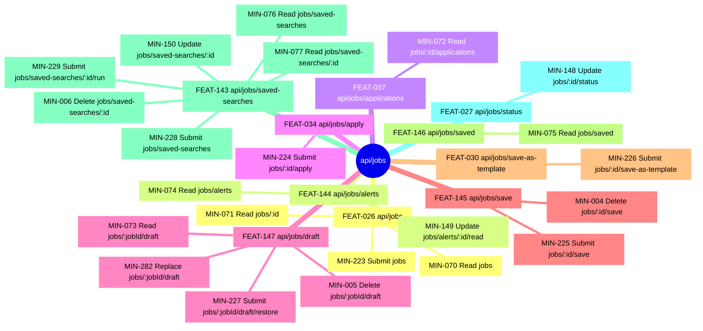

## FEAT-026 api/jobs

api/jobs

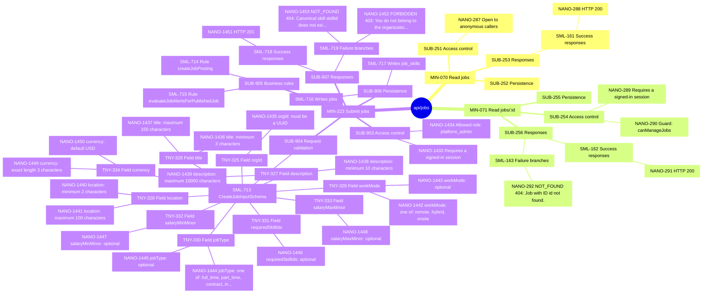

| ID        | Level | Parent   | Name                                                                               | Description                                                                                                                                                                                                              | Status      | Verification | Evidence                                                  | Related                                                       |
| --------- | ----- | -------- | ---------------------------------------------------------------------------------- | ------------------------------------------------------------------------------------------------------------------------------------------------------------------------------------------------------------------------ | ----------- | ------------ | --------------------------------------------------------- | ------------------------------------------------------------- |
| FEAT-026  | MAJOR | MOD-060  | api/jobs                                                                           |                                                                                                                                                                                                                          | IMPLEMENTED |              | apps/api/src/server.ts:2041                               |                                                               |
| MIN-070   | MINOR | FEAT-026 | Read jobs                                                                          | GET /api/v1/jobs for anyone (public); durable (PostgreSQL); responds 200.                                                                                                                                                | IMPLEMENTED | VERIFIED     | apps/api/src/server.ts:2105                               | API-032, TEST-056, TEST-097, TEST-101, TEST-109, TEST-112 ... |
| SUB-251   | SUB   | MIN-070  | Access control                                                                     | Who may call GET /api/v1/jobs: anyone (public).                                                                                                                                                                          | IMPLEMENTED | PATH_LEVEL   | apps/api/src/server.ts:2105                               |                                                               |
| NANO-287  | NANO  | SUB-251  | Open to anonymous callers                                                          | auth: public.                                                                                                                                                                                                            | IMPLEMENTED | PATH_LEVEL   | apps/api/src/server.ts:2105                               | ROLE-001                                                      |
| SUB-252   | SUB   | MIN-070  | Persistence                                                                        | Durable: writes go through the PostgreSQL store.                                                                                                                                                                         | IMPLEMENTED | PATH_LEVEL   | apps/api/src/server.ts:2105                               |                                                               |
| SUB-253   | SUB   | MIN-070  | Responses                                                                          | Success 200; 0 explicit failure branch(es) besides validation and access errors.                                                                                                                                         | IMPLEMENTED | PATH_LEVEL   | apps/api/src/server.ts:2105                               |                                                               |
| SML-161   | SMALL | SUB-253  | Success responses                                                                  | HTTP 200 (implicit).                                                                                                                                                                                                     | IMPLEMENTED | PATH_LEVEL   | apps/api/src/server.ts:2105                               |                                                               |
| NANO-288  | NANO  | SML-161  | HTTP 200                                                                           | Replies 200 when the operation succeeds (implicit default).                                                                                                                                                              | IMPLEMENTED | PATH_LEVEL   | apps/api/src/server.ts:2105                               |                                                               |
| MIN-071   | MINOR | FEAT-026 | Read jobs/:id                                                                      | GET /api/v1/jobs/:id for any signed-in session; durable (PostgreSQL); responds 200; 1 failure branch(es).                                                                                                                | IMPLEMENTED | VERIFIED     | apps/api/src/server.ts:2119                               | API-033, TEST-055, TEST-108, TEST-128, TEST-142, TEST-145 ... |
| SUB-254   | SUB   | MIN-071  | Access control                                                                     | Who may call GET /api/v1/jobs/:id: any signed-in session.                                                                                                                                                                | IMPLEMENTED | PATH_LEVEL   | apps/api/src/server.ts:2119                               |                                                               |
| NANO-289  | NANO  | SUB-254  | Requires a signed-in session                                                       | Requests without a valid session token are rejected with 401 UNAUTHENTICATED.                                                                                                                                            | IMPLEMENTED | PATH_LEVEL   | apps/api/src/server.ts:2119                               | ROLE-001                                                      |
| NANO-290  | NANO  | SUB-254  | Guard: canManageJobs                                                               | Guard canManageJobs must pass before the handler runs.                                                                                                                                                                   | IMPLEMENTED | PATH_LEVEL   | apps/api/src/server.ts:2119                               |                                                               |
| SUB-255   | SUB   | MIN-071  | Persistence                                                                        | Durable: writes go through the PostgreSQL store.                                                                                                                                                                         | IMPLEMENTED | PATH_LEVEL   | apps/api/src/server.ts:2119                               |                                                               |
| SUB-256   | SUB   | MIN-071  | Responses                                                                          | Success 200; 1 explicit failure branch(es) besides validation and access errors.                                                                                                                                         | IMPLEMENTED | PATH_LEVEL   | apps/api/src/server.ts:2119                               |                                                               |
| SML-162   | SMALL | SUB-256  | Success responses                                                                  | HTTP 200.                                                                                                                                                                                                                | IMPLEMENTED | PATH_LEVEL   | apps/api/src/server.ts:2119                               |                                                               |
| NANO-291  | NANO  | SML-162  | HTTP 200                                                                           | Replies 200 when the operation succeeds.                                                                                                                                                                                 | IMPLEMENTED | PATH_LEVEL   | apps/api/src/server.ts:2119                               |                                                               |
| SML-163   | SMALL | SUB-256  | Failure branches                                                                   | 1 DomainError branch(es) in the handler, mapped to HTTP by the global error handler.                                                                                                                                     | IMPLEMENTED | PATH_LEVEL   | apps/api/src/server.ts:2119                               |                                                               |
| NANO-292  | NANO  | SML-163  | NOT_FOUND 404: Job with ID ${id} not found.                                        | Throws DomainError(NOT_FOUND) "Job with ID ${id} not found." -> HTTP 404.                                                                                                                                                | IMPLEMENTED | PATH_LEVEL   | apps/api/src/server.ts:2129                               | ERR-037                                                       |
| MIN-223   | MINOR | FEAT-026 | Submit jobs                                                                        | POST /api/v1/jobs for roles platform_admin; validates CreateJobInputSchema; calls createJobPosting, evaluateJobAlertsForPublishedJob; durable (PostgreSQL); writes jobs, job_skills; responds 201; 2 failure branch(es). | IMPLEMENTED | VERIFIED     | apps/api/src/server.ts:2041                               | API-031, TEST-088, TEST-089, TEST-097, TEST-101, TEST-109 ... |
| SUB-903   | SUB   | MIN-223  | Access control                                                                     | Who may call POST /api/v1/jobs: roles platform_admin.                                                                                                                                                                    | IMPLEMENTED | PATH_LEVEL   | apps/api/src/server.ts:2041                               |                                                               |
| NANO-1433 | NANO  | SUB-903  | Requires a signed-in session                                                       | Requests without a valid session token are rejected with 401 UNAUTHENTICATED.                                                                                                                                            | IMPLEMENTED | PATH_LEVEL   | apps/api/src/server.ts:2041                               | ROLE-001                                                      |
| NANO-1434 | NANO  | SUB-903  | Allowed role: platform_admin                                                       | platform_admin is one of the roles allowed here (platform_admin); a caller holding none of them is rejected with 403.                                                                                                    | IMPLEMENTED | PATH_LEVEL   | apps/api/src/server.ts:2041                               | ROLE-008                                                      |
| SUB-904   | SUB   | MIN-223  | Request validation                                                                 | The request is parsed with CreateJobInputSchema; a failure returns 400 with field details before any business logic runs.                                                                                                | IMPLEMENTED | PATH_LEVEL   | apps/api/src/server.ts:2041                               |                                                               |
| SML-713   | SMALL | SUB-904  | CreateJobInputSchema                                                               | CreateJobInputSchema: 10 field(s)                                                                                                                                                                                        | IMPLEMENTED | PATH_LEVEL   | packages/contracts/src/index.ts:242                       | SCH-016                                                       |
| TNY-325   | TINY  | SML-713  | Field orgId                                                                        | orgId (string, required): must be a UUID                                                                                                                                                                                 | IMPLEMENTED | PATH_LEVEL   | packages/contracts/src/index.ts:243                       |                                                               |
| NANO-1435 | NANO  | TNY-325  | orgId: must be a UUID                                                              | orgId must be a UUID.                                                                                                                                                                                                    | IMPLEMENTED | PATH_LEVEL   | packages/contracts/src/index.ts:243                       |                                                               |
| TNY-326   | TINY  | SML-713  | Field title                                                                        | title (string, required): minimum 3 characters; maximum 150 characters                                                                                                                                                   | IMPLEMENTED | PATH_LEVEL   | packages/contracts/src/index.ts:244                       |                                                               |
| NANO-1436 | NANO  | TNY-326  | title: minimum 3 characters                                                        | title minimum 3 characters.                                                                                                                                                                                              | IMPLEMENTED | PATH_LEVEL   | packages/contracts/src/index.ts:244                       |                                                               |
| NANO-1437 | NANO  | TNY-326  | title: maximum 150 characters                                                      | title maximum 150 characters.                                                                                                                                                                                            | IMPLEMENTED | PATH_LEVEL   | packages/contracts/src/index.ts:244                       |                                                               |
| TNY-327   | TINY  | SML-713  | Field description                                                                  | description (string, required): minimum 10 characters; maximum 10000 characters                                                                                                                                          | IMPLEMENTED | PATH_LEVEL   | packages/contracts/src/index.ts:245                       |                                                               |
| NANO-1438 | NANO  | TNY-327  | description: minimum 10 characters                                                 | description minimum 10 characters.                                                                                                                                                                                       | IMPLEMENTED | PATH_LEVEL   | packages/contracts/src/index.ts:245                       |                                                               |
| NANO-1439 | NANO  | TNY-327  | description: maximum 10000 characters                                              | description maximum 10000 characters.                                                                                                                                                                                    | IMPLEMENTED | PATH_LEVEL   | packages/contracts/src/index.ts:245                       |                                                               |
| TNY-328   | TINY  | SML-713  | Field location                                                                     | location (string, required): minimum 2 characters; maximum 100 characters                                                                                                                                                | IMPLEMENTED | PATH_LEVEL   | packages/contracts/src/index.ts:246                       |                                                               |
| NANO-1440 | NANO  | TNY-328  | location: minimum 2 characters                                                     | location minimum 2 characters.                                                                                                                                                                                           | IMPLEMENTED | PATH_LEVEL   | packages/contracts/src/index.ts:246                       |                                                               |
| NANO-1441 | NANO  | TNY-328  | location: maximum 100 characters                                                   | location maximum 100 characters.                                                                                                                                                                                         | IMPLEMENTED | PATH_LEVEL   | packages/contracts/src/index.ts:246                       |                                                               |
| TNY-329   | TINY  | SML-713  | Field workMode                                                                     | workMode (enum, optional): one of: remote, hybrid, onsite; optional                                                                                                                                                      | IMPLEMENTED | PATH_LEVEL   | packages/contracts/src/index.ts:247                       |                                                               |
| NANO-1442 | NANO  | TNY-329  | workMode: one of: remote, hybrid, onsite                                           | workMode one of: remote, hybrid, onsite.                                                                                                                                                                                 | IMPLEMENTED | PATH_LEVEL   | packages/contracts/src/index.ts:247                       |                                                               |
| NANO-1443 | NANO  | TNY-329  | workMode: optional                                                                 | workMode optional.                                                                                                                                                                                                       | IMPLEMENTED | PATH_LEVEL   | packages/contracts/src/index.ts:247                       |                                                               |
| TNY-330   | TINY  | SML-713  | Field jobType                                                                      | jobType (enum, optional): one of: full_time, part_time, contract, internship; optional                                                                                                                                   | IMPLEMENTED | PATH_LEVEL   | packages/contracts/src/index.ts:248                       |                                                               |
| NANO-1444 | NANO  | TNY-330  | jobType: one of: full_time, part_time, contract, internship                        | jobType one of: full_time, part_time, contract, internship.                                                                                                                                                              | IMPLEMENTED | PATH_LEVEL   | packages/contracts/src/index.ts:248                       |                                                               |
| NANO-1445 | NANO  | TNY-330  | jobType: optional                                                                  | jobType optional.                                                                                                                                                                                                        | IMPLEMENTED | PATH_LEVEL   | packages/contracts/src/index.ts:248                       |                                                               |
| TNY-331   | TINY  | SML-713  | Field requiredSkillIds                                                             | requiredSkillIds (uniqueIdList(), optional): optional                                                                                                                                                                    | IMPLEMENTED | PATH_LEVEL   | packages/contracts/src/index.ts:249                       |                                                               |
| NANO-1446 | NANO  | TNY-331  | requiredSkillIds: optional                                                         | requiredSkillIds optional.                                                                                                                                                                                               | IMPLEMENTED | PATH_LEVEL   | packages/contracts/src/index.ts:249                       |                                                               |
| TNY-332   | TINY  | SML-713  | Field salaryMinMinor                                                               | salaryMinMinor (salaryMinor(), optional): optional                                                                                                                                                                       | IMPLEMENTED | PATH_LEVEL   | packages/contracts/src/index.ts:250                       |                                                               |
| NANO-1447 | NANO  | TNY-332  | salaryMinMinor: optional                                                           | salaryMinMinor optional.                                                                                                                                                                                                 | IMPLEMENTED | PATH_LEVEL   | packages/contracts/src/index.ts:250                       |                                                               |
| TNY-333   | TINY  | SML-713  | Field salaryMaxMinor                                                               | salaryMaxMinor (salaryMinor(), optional): optional                                                                                                                                                                       | IMPLEMENTED | PATH_LEVEL   | packages/contracts/src/index.ts:251                       |                                                               |
| NANO-1448 | NANO  | TNY-333  | salaryMaxMinor: optional                                                           | salaryMaxMinor optional.                                                                                                                                                                                                 | IMPLEMENTED | PATH_LEVEL   | packages/contracts/src/index.ts:251                       |                                                               |
| TNY-334   | TINY  | SML-713  | Field currency                                                                     | currency (string, optional): exact length 3 characters; default 'USD'                                                                                                                                                    | IMPLEMENTED | PATH_LEVEL   | packages/contracts/src/index.ts:252                       |                                                               |
| NANO-1449 | NANO  | TNY-334  | currency: exact length 3 characters                                                | currency exact length 3 characters.                                                                                                                                                                                      | IMPLEMENTED | PATH_LEVEL   | packages/contracts/src/index.ts:252                       |                                                               |
| NANO-1450 | NANO  | TNY-334  | currency: default 'USD'                                                            | currency default 'USD'; message "USD".                                                                                                                                                                                   | IMPLEMENTED | PATH_LEVEL   | packages/contracts/src/index.ts:252                       |                                                               |
| SUB-905   | SUB   | MIN-223  | Business rules                                                                     | Domain functions from packages/domain called by the handler (2).                                                                                                                                                         | IMPLEMENTED | PATH_LEVEL   | apps/api/src/server.ts:2041                               |                                                               |
| SML-714   | SMALL | SUB-905  | Rule createJobPosting                                                              | Calls createJobPosting (packages/domain/src/jobs.ts). Rule status IMPLEMENTED; its own tests: VERIFIED.                                                                                                                  | IMPLEMENTED | VERIFIED     | packages/domain/src/jobs.ts:64                            | RULE-128                                                      |
| SML-715   | SMALL | SUB-905  | Rule evaluateJobAlertsForPublishedJob                                              | Calls evaluateJobAlertsForPublishedJob (packages/domain/src/saved-searches.ts). Rule status IMPLEMENTED; its own tests: VERIFIED.                                                                                        | IMPLEMENTED | VERIFIED     | packages/domain/src/saved-searches.ts:197                 | RULE-202                                                      |
| SUB-906   | SUB   | MIN-223  | Persistence                                                                        | Durable: writes go through the PostgreSQL store; store calls jobAlerts.createMany, savedSearches.listAll.                                                                                                                | IMPLEMENTED | PATH_LEVEL   | apps/api/src/server.ts:2041                               |                                                               |
| SML-716   | SMALL | SUB-906  | Writes jobs                                                                        | Writes table jobs (00001_core_schema.sql).                                                                                                                                                                               | IMPLEMENTED | PATH_LEVEL   | supabase/migrations/00001_core_schema.sql:167             | DB-006                                                        |
| SML-717   | SMALL | SUB-906  | Writes job_skills                                                                  | Writes table job_skills (00003_jobs_applications_schema.sql).                                                                                                                                                            | IMPLEMENTED | PATH_LEVEL   | supabase/migrations/00003_jobs_applications_schema.sql:24 | DB-013                                                        |
| SUB-907   | SUB   | MIN-223  | Responses                                                                          | Success 201; 2 explicit failure branch(es) besides validation and access errors.                                                                                                                                         | IMPLEMENTED | PATH_LEVEL   | apps/api/src/server.ts:2041                               |                                                               |
| SML-718   | SMALL | SUB-907  | Success responses                                                                  | HTTP 201.                                                                                                                                                                                                                | IMPLEMENTED | PATH_LEVEL   | apps/api/src/server.ts:2041                               |                                                               |
| NANO-1451 | NANO  | SML-718  | HTTP 201                                                                           | Replies 201 when the operation succeeds.                                                                                                                                                                                 | IMPLEMENTED | PATH_LEVEL   | apps/api/src/server.ts:2041                               |                                                               |
| SML-719   | SMALL | SUB-907  | Failure branches                                                                   | 2 DomainError branch(es) in the handler, mapped to HTTP by the global error handler.                                                                                                                                     | IMPLEMENTED | PATH_LEVEL   | apps/api/src/server.ts:2041                               |                                                               |
| NANO-1452 | NANO  | SML-719  | FORBIDDEN 403: You do not belong to the organization for this job posting (BR-12). | Throws DomainError(FORBIDDEN) "You do not belong to the organization for this job posting (BR-12)." -> HTTP 403.                                                                                                         | IMPLEMENTED | PATH_LEVEL   | apps/api/src/server.ts:2050                               | ERR-036                                                       |
| NANO-1453 | NANO  | SML-719  | NOT_FOUND 404: Canonical skill ${skillId} does not exist (BR-144).                 | Throws DomainError(NOT_FOUND) "Canonical skill ${skillId} does not exist (BR-144)." -> HTTP 404.                                                                                                                         | IMPLEMENTED | PATH_LEVEL   | apps/api/src/server.ts:2059                               | ERR-019                                                       |

## FEAT-144 api/jobs/alerts

api/jobs/alerts

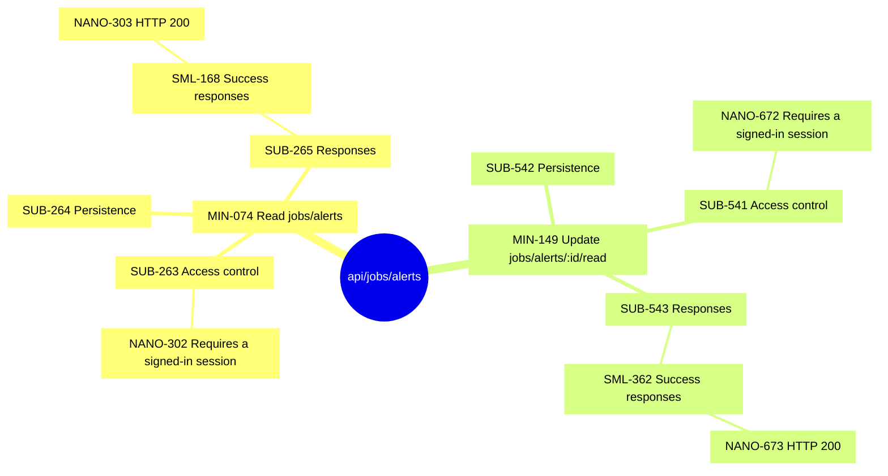

| ID       | Level | Parent   | Name                         | Description                                                                                                                                                       | Status      | Verification | Evidence                     | Related                               |
| -------- | ----- | -------- | ---------------------------- | ----------------------------------------------------------------------------------------------------------------------------------------------------------------- | ----------- | ------------ | ---------------------------- | ------------------------------------- |
| FEAT-144 | MAJOR | MOD-060  | api/jobs/alerts              |                                                                                                                                                                   | IMPLEMENTED |              | apps/api/src/server.ts:12375 |                                       |
| MIN-074  | MINOR | FEAT-144 | Read jobs/alerts             | 7. List job alerts for candidate GET /api/v1/jobs/alerts for any signed-in session; durable (PostgreSQL); responds 200. Gaps: no first-party web caller found     | IMPLEMENTED | VERIFIED     | apps/api/src/server.ts:12375 | API-258, TEST-128, TEST-208, TEST-226 |
| SUB-263  | SUB   | MIN-074  | Access control               | Who may call GET /api/v1/jobs/alerts: any signed-in session.                                                                                                      | IMPLEMENTED | PATH_LEVEL   | apps/api/src/server.ts:12375 |                                       |
| NANO-302 | NANO  | SUB-263  | Requires a signed-in session | Requests without a valid session token are rejected with 401 UNAUTHENTICATED.                                                                                     | IMPLEMENTED | PATH_LEVEL   | apps/api/src/server.ts:12375 | ROLE-001                              |
| SUB-264  | SUB   | MIN-074  | Persistence                  | Durable: writes go through the PostgreSQL store; store calls jobAlerts.listByUser.                                                                                | IMPLEMENTED | PATH_LEVEL   | apps/api/src/server.ts:12375 |                                       |
| SUB-265  | SUB   | MIN-074  | Responses                    | Success 200; 0 explicit failure branch(es) besides validation and access errors.                                                                                  | IMPLEMENTED | PATH_LEVEL   | apps/api/src/server.ts:12375 |                                       |
| SML-168  | SMALL | SUB-265  | Success responses            | HTTP 200.                                                                                                                                                         | IMPLEMENTED | PATH_LEVEL   | apps/api/src/server.ts:12375 |                                       |
| NANO-303 | NANO  | SML-168  | HTTP 200                     | Replies 200 when the operation succeeds.                                                                                                                          | IMPLEMENTED | PATH_LEVEL   | apps/api/src/server.ts:12375 |                                       |
| MIN-149  | MINOR | FEAT-144 | Update jobs/alerts/:id/read  | 8. Mark job alert as read PATCH /api/v1/jobs/alerts/:id/read for any signed-in session; durable (PostgreSQL); responds 200. Gaps: no first-party web caller found | IMPLEMENTED | VERIFIED     | apps/api/src/server.ts:12382 | API-259, TEST-128, TEST-208, TEST-226 |
| SUB-541  | SUB   | MIN-149  | Access control               | Who may call PATCH /api/v1/jobs/alerts/:id/read: any signed-in session.                                                                                           | IMPLEMENTED | PATH_LEVEL   | apps/api/src/server.ts:12382 |                                       |
| NANO-672 | NANO  | SUB-541  | Requires a signed-in session | Requests without a valid session token are rejected with 401 UNAUTHENTICATED.                                                                                     | IMPLEMENTED | PATH_LEVEL   | apps/api/src/server.ts:12382 | ROLE-001                              |
| SUB-542  | SUB   | MIN-149  | Persistence                  | Durable: writes go through the PostgreSQL store; store calls jobAlerts.markRead.                                                                                  | IMPLEMENTED | PATH_LEVEL   | apps/api/src/server.ts:12382 |                                       |
| SUB-543  | SUB   | MIN-149  | Responses                    | Success 200; 0 explicit failure branch(es) besides validation and access errors.                                                                                  | IMPLEMENTED | PATH_LEVEL   | apps/api/src/server.ts:12382 |                                       |
| SML-362  | SMALL | SUB-543  | Success responses            | HTTP 200.                                                                                                                                                         | IMPLEMENTED | PATH_LEVEL   | apps/api/src/server.ts:12382 |                                       |
| NANO-673 | NANO  | SML-362  | HTTP 200                     | Replies 200 when the operation succeeds.                                                                                                                          | IMPLEMENTED | PATH_LEVEL   | apps/api/src/server.ts:12382 |                                       |

## FEAT-037 api/jobs/applications

api/jobs/applications

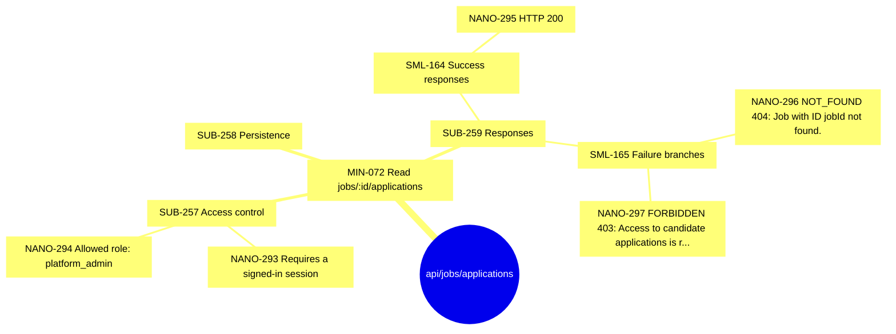

| ID       | Level | Parent   | Name                                                                                  | Description                                                                                                                                         | Status      | Verification | Evidence                    | Related                                         |
| -------- | ----- | -------- | ------------------------------------------------------------------------------------- | --------------------------------------------------------------------------------------------------------------------------------------------------- | ----------- | ------------ | --------------------------- | ----------------------------------------------- |
| FEAT-037 | MAJOR | MOD-060  | api/jobs/applications                                                                 |                                                                                                                                                     | IMPLEMENTED |              | apps/api/src/server.ts:2869 |                                                 |
| MIN-072  | MINOR | FEAT-037 | Read jobs/:id/applications                                                            | GET /api/v1/jobs/:id/applications for roles platform_admin; durable (PostgreSQL); responds 200; 2 failure branch(es).                               | IMPLEMENTED | VERIFIED     | apps/api/src/server.ts:2869 | API-050, TEST-097, TEST-109, TEST-151, TEST-187 |
| SUB-257  | SUB   | MIN-072  | Access control                                                                        | Who may call GET /api/v1/jobs/:id/applications: roles platform_admin.                                                                               | IMPLEMENTED | PATH_LEVEL   | apps/api/src/server.ts:2869 |                                                 |
| NANO-293 | NANO  | SUB-257  | Requires a signed-in session                                                          | Requests without a valid session token are rejected with 401 UNAUTHENTICATED.                                                                       | IMPLEMENTED | PATH_LEVEL   | apps/api/src/server.ts:2869 | ROLE-001                                        |
| NANO-294 | NANO  | SUB-257  | Allowed role: platform_admin                                                          | platform_admin is one of the roles allowed here (platform_admin); a caller holding none of them is rejected with 403.                               | IMPLEMENTED | PATH_LEVEL   | apps/api/src/server.ts:2869 | ROLE-008                                        |
| SUB-258  | SUB   | MIN-072  | Persistence                                                                           | Durable: writes go through the PostgreSQL store.                                                                                                    | IMPLEMENTED | PATH_LEVEL   | apps/api/src/server.ts:2869 |                                                 |
| SUB-259  | SUB   | MIN-072  | Responses                                                                             | Success 200; 2 explicit failure branch(es) besides validation and access errors.                                                                    | IMPLEMENTED | PATH_LEVEL   | apps/api/src/server.ts:2869 |                                                 |
| SML-164  | SMALL | SUB-259  | Success responses                                                                     | HTTP 200.                                                                                                                                           | IMPLEMENTED | PATH_LEVEL   | apps/api/src/server.ts:2869 |                                                 |
| NANO-295 | NANO  | SML-164  | HTTP 200                                                                              | Replies 200 when the operation succeeds.                                                                                                            | IMPLEMENTED | PATH_LEVEL   | apps/api/src/server.ts:2869 |                                                 |
| SML-165  | SMALL | SUB-259  | Failure branches                                                                      | 2 DomainError branch(es) in the handler, mapped to HTTP by the global error handler.                                                                | IMPLEMENTED | PATH_LEVEL   | apps/api/src/server.ts:2869 |                                                 |
| NANO-296 | NANO  | SML-165  | NOT_FOUND 404: Job with ID ${jobId} not found.                                        | Throws DomainError(NOT_FOUND) "Job with ID ${jobId} not found." -> HTTP 404.                                                                        | IMPLEMENTED | PATH_LEVEL   | apps/api/src/server.ts:2877 | ERR-048                                         |
| NANO-297 | NANO  | SML-165  | FORBIDDEN 403: Access to candidate applications is restricted to authorized recruiter | Throws DomainError(FORBIDDEN) "Access to candidate applications is restricted to authorized recruiters for this organization (BR-40)." -> HTTP 403. | IMPLEMENTED | PATH_LEVEL   | apps/api/src/server.ts:2885 | ERR-053                                         |

## FEAT-034 api/jobs/apply

api/jobs/apply

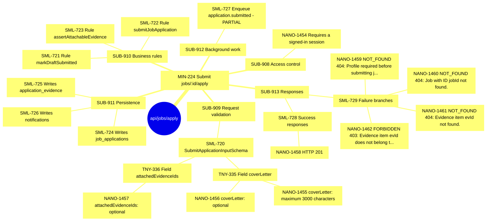

| ID        | Level | Parent   | Name                                                                  | Description                                                                                                                                                                                                                                                                                                                                        | Status                | Verification | Evidence                                                  | Related                                                       |
| --------- | ----- | -------- | --------------------------------------------------------------------- | -------------------------------------------------------------------------------------------------------------------------------------------------------------------------------------------------------------------------------------------------------------------------------------------------------------------------------------------------- | --------------------- | ------------ | --------------------------------------------------------- | ------------------------------------------------------------- |
| FEAT-034  | MAJOR | MOD-060  | api/jobs/apply                                                        |                                                                                                                                                                                                                                                                                                                                                    | IMPLEMENTED           |              | apps/api/src/server.ts:2722                               |                                                               |
| MIN-224   | MINOR | FEAT-034 | Submit jobs/:id/apply                                                 | Application Endpoints (F-06, BR-02, BR-15..BR-41) POST /api/v1/jobs/:id/apply for any signed-in session; validates SubmitApplicationInputSchema; calls markDraftSubmitted, submitJobApplication, assertAttachableEvidence; durable (PostgreSQL); writes job_applications, application_evidence, notifications; responds 201; 4 failure branch(es). | IMPLEMENTED           | VERIFIED     | apps/api/src/server.ts:2722                               | API-047, TEST-088, TEST-089, TEST-097, TEST-101, TEST-109 ... |
| SUB-908   | SUB   | MIN-224  | Access control                                                        | Who may call POST /api/v1/jobs/:id/apply: any signed-in session.                                                                                                                                                                                                                                                                                   | IMPLEMENTED           | PATH_LEVEL   | apps/api/src/server.ts:2722                               |                                                               |
| NANO-1454 | NANO  | SUB-908  | Requires a signed-in session                                          | Requests without a valid session token are rejected with 401 UNAUTHENTICATED.                                                                                                                                                                                                                                                                      | IMPLEMENTED           | PATH_LEVEL   | apps/api/src/server.ts:2722                               | ROLE-001                                                      |
| SUB-909   | SUB   | MIN-224  | Request validation                                                    | The request is parsed with SubmitApplicationInputSchema; a failure returns 400 with field details before any business logic runs.                                                                                                                                                                                                                  | IMPLEMENTED           | PATH_LEVEL   | apps/api/src/server.ts:2722                               |                                                               |
| SML-720   | SMALL | SUB-909  | SubmitApplicationInputSchema                                          | SubmitApplicationInputSchema: 2 field(s)                                                                                                                                                                                                                                                                                                           | IMPLEMENTED           | PATH_LEVEL   | packages/contracts/src/index.ts:274                       | SCH-018                                                       |
| TNY-335   | TINY  | SML-720  | Field coverLetter                                                     | coverLetter (string, optional): maximum 3000 characters; optional                                                                                                                                                                                                                                                                                  | IMPLEMENTED           | PATH_LEVEL   | packages/contracts/src/index.ts:275                       |                                                               |
| NANO-1455 | NANO  | TNY-335  | coverLetter: maximum 3000 characters                                  | coverLetter maximum 3000 characters.                                                                                                                                                                                                                                                                                                               | IMPLEMENTED           | PATH_LEVEL   | packages/contracts/src/index.ts:275                       |                                                               |
| NANO-1456 | NANO  | TNY-335  | coverLetter: optional                                                 | coverLetter optional.                                                                                                                                                                                                                                                                                                                              | IMPLEMENTED           | PATH_LEVEL   | packages/contracts/src/index.ts:275                       |                                                               |
| TNY-336   | TINY  | SML-720  | Field attachedEvidenceIds                                             | attachedEvidenceIds (uniqueIdList(), optional): optional                                                                                                                                                                                                                                                                                           | IMPLEMENTED           | PATH_LEVEL   | packages/contracts/src/index.ts:276                       |                                                               |
| NANO-1457 | NANO  | TNY-336  | attachedEvidenceIds: optional                                         | attachedEvidenceIds optional.                                                                                                                                                                                                                                                                                                                      | IMPLEMENTED           | PATH_LEVEL   | packages/contracts/src/index.ts:276                       |                                                               |
| SUB-910   | SUB   | MIN-224  | Business rules                                                        | Domain functions from packages/domain called by the handler (3).                                                                                                                                                                                                                                                                                   | IMPLEMENTED           | PATH_LEVEL   | apps/api/src/server.ts:2722                               |                                                               |
| SML-721   | SMALL | SUB-910  | Rule markDraftSubmitted                                               | Calls markDraftSubmitted (packages/domain/src/application-drafts.ts). Rule status IMPLEMENTED; its own tests: VERIFIED.                                                                                                                                                                                                                            | IMPLEMENTED           | VERIFIED     | packages/domain/src/application-drafts.ts:179             | RULE-035                                                      |
| SML-722   | SMALL | SUB-910  | Rule submitJobApplication                                             | Calls submitJobApplication (packages/domain/src/applications.ts). Rule status IMPLEMENTED; its own tests: VERIFIED.                                                                                                                                                                                                                                | IMPLEMENTED           | VERIFIED     | packages/domain/src/applications.ts:39                    | RULE-041                                                      |
| SML-723   | SMALL | SUB-910  | Rule assertAttachableEvidence                                         | Calls assertAttachableEvidence (packages/domain/src/evidence.ts). Rule status IMPLEMENTED; its own tests: VERIFIED.                                                                                                                                                                                                                                | IMPLEMENTED           | VERIFIED     | packages/domain/src/evidence.ts:345                       | RULE-100                                                      |
| SUB-911   | SUB   | MIN-224  | Persistence                                                           | Durable: writes go through the PostgreSQL store; store calls applicationDrafts.get, applicationDrafts.markSubmitted.                                                                                                                                                                                                                               | IMPLEMENTED           | PATH_LEVEL   | apps/api/src/server.ts:2722                               |                                                               |
| SML-724   | SMALL | SUB-911  | Writes job_applications                                               | Writes table job_applications (00001_core_schema.sql).                                                                                                                                                                                                                                                                                             | IMPLEMENTED           | PATH_LEVEL   | supabase/migrations/00001_core_schema.sql:179             | DB-007                                                        |
| SML-725   | SMALL | SUB-911  | Writes application_evidence                                           | Writes table application_evidence (00003_jobs_applications_schema.sql).                                                                                                                                                                                                                                                                            | IMPLEMENTED           | PATH_LEVEL   | supabase/migrations/00003_jobs_applications_schema.sql:33 | DB-014                                                        |
| SML-726   | SMALL | SUB-911  | Writes notifications                                                  | Writes table notifications (00007_notifications_schema.sql).                                                                                                                                                                                                                                                                                       | IMPLEMENTED           | PATH_LEVEL   | supabase/migrations/00007_notifications_schema.sql:6      | DB-029                                                        |
| SUB-912   | SUB   | MIN-224  | Background work                                                       | Enqueues 1 background job kind(s) in background_jobs for apps/worker.                                                                                                                                                                                                                                                                              | IMPLEMENTED           | PATH_LEVEL   | apps/api/src/server.ts:2722                               |                                                               |
| SML-727   | SMALL | SUB-912  | Enqueue application.submitted                                         | Dispatches job:application.submitted; worker handler: recordEvent (no-op: marks the event recorded).                                                                                                                                                                                                                                               | PARTIALLY_IMPLEMENTED | UNKNOWN      | packages/domain/src/background-jobs.ts:171                | SVC-008                                                       |
| SUB-913   | SUB   | MIN-224  | Responses                                                             | Success 201; 4 explicit failure branch(es) besides validation and access errors.                                                                                                                                                                                                                                                                   | IMPLEMENTED           | PATH_LEVEL   | apps/api/src/server.ts:2722                               |                                                               |
| SML-728   | SMALL | SUB-913  | Success responses                                                     | HTTP 201.                                                                                                                                                                                                                                                                                                                                          | IMPLEMENTED           | PATH_LEVEL   | apps/api/src/server.ts:2722                               |                                                               |
| NANO-1458 | NANO  | SML-728  | HTTP 201                                                              | Replies 201 when the operation succeeds.                                                                                                                                                                                                                                                                                                           | IMPLEMENTED           | PATH_LEVEL   | apps/api/src/server.ts:2722                               |                                                               |
| SML-729   | SMALL | SUB-913  | Failure branches                                                      | 4 DomainError branch(es) in the handler, mapped to HTTP by the global error handler.                                                                                                                                                                                                                                                               | IMPLEMENTED           | PATH_LEVEL   | apps/api/src/server.ts:2722                               |                                                               |
| NANO-1459 | NANO  | SML-729  | NOT_FOUND 404: Profile required before submitting job applications.   | Throws DomainError(NOT_FOUND) "Profile required before submitting job applications." -> HTTP 404.                                                                                                                                                                                                                                                  | IMPLEMENTED           | PATH_LEVEL   | apps/api/src/server.ts:2731                               | ERR-047                                                       |
| NANO-1460 | NANO  | SML-729  | NOT_FOUND 404: Job with ID ${jobId} not found.                        | Throws DomainError(NOT_FOUND) "Job with ID ${jobId} not found." -> HTTP 404.                                                                                                                                                                                                                                                                       | IMPLEMENTED           | PATH_LEVEL   | apps/api/src/server.ts:2736                               | ERR-048                                                       |
| NANO-1461 | NANO  | SML-729  | NOT_FOUND 404: Evidence item ${evId} not found.                       | Throws DomainError(NOT_FOUND) "Evidence item ${evId} not found." -> HTTP 404.                                                                                                                                                                                                                                                                      | IMPLEMENTED           | PATH_LEVEL   | apps/api/src/server.ts:2743                               | ERR-049                                                       |
| NANO-1462 | NANO  | SML-729  | FORBIDDEN 403: Evidence item ${evId} does not belong to your profile. | Throws DomainError(FORBIDDEN) "Evidence item ${evId} does not belong to your profile." -> HTTP 403.                                                                                                                                                                                                                                                | IMPLEMENTED           | PATH_LEVEL   | apps/api/src/server.ts:2746                               | ERR-050                                                       |

## FEAT-147 api/jobs/draft

api/jobs/draft

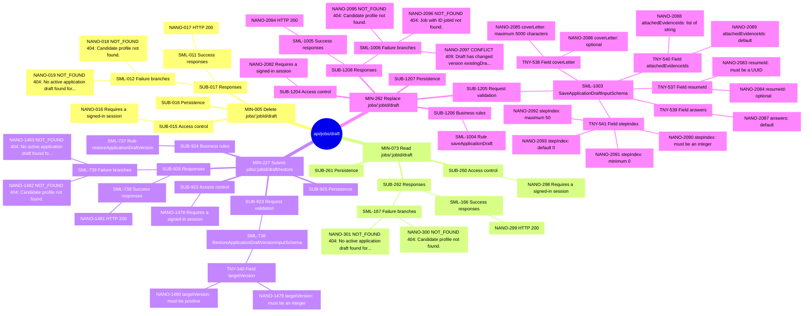

| ID        | Level | Parent   | Name                                                                                 | Description                                                                                                                                                                                                                                                                                            | Status      | Verification | Evidence                                      | Related                                         |
| --------- | ----- | -------- | ------------------------------------------------------------------------------------ | ------------------------------------------------------------------------------------------------------------------------------------------------------------------------------------------------------------------------------------------------------------------------------------------------------ | ----------- | ------------ | --------------------------------------------- | ----------------------------------------------- |
| FEAT-147  | MAJOR | MOD-060  | api/jobs/draft                                                                       |                                                                                                                                                                                                                                                                                                        | IMPLEMENTED |              | apps/api/src/server.ts:12434                  |                                                 |
| MIN-005   | MINOR | FEAT-147 | Delete jobs/:jobId/draft                                                             | DELETE /api/v1/jobs/:jobId/draft for any signed-in session; durable (PostgreSQL); responds 200; 2 failure branch(es). Gaps: no first-party web caller found                                                                                                                                            | IMPLEMENTED | VERIFIED     | apps/api/src/server.ts:12518                  | API-265, TEST-088, TEST-168, TEST-224           |
| SUB-015   | SUB   | MIN-005  | Access control                                                                       | Who may call DELETE /api/v1/jobs/:jobId/draft: any signed-in session.                                                                                                                                                                                                                                  | IMPLEMENTED | PATH_LEVEL   | apps/api/src/server.ts:12518                  |                                                 |
| NANO-016  | NANO  | SUB-015  | Requires a signed-in session                                                         | Requests without a valid session token are rejected with 401 UNAUTHENTICATED.                                                                                                                                                                                                                          | IMPLEMENTED | PATH_LEVEL   | apps/api/src/server.ts:12518                  | ROLE-001                                        |
| SUB-016   | SUB   | MIN-005  | Persistence                                                                          | Durable: writes go through the PostgreSQL store; store calls applicationDrafts.remove.                                                                                                                                                                                                                 | IMPLEMENTED | PATH_LEVEL   | apps/api/src/server.ts:12518                  |                                                 |
| SUB-017   | SUB   | MIN-005  | Responses                                                                            | Success 200; 2 explicit failure branch(es) besides validation and access errors.                                                                                                                                                                                                                       | IMPLEMENTED | PATH_LEVEL   | apps/api/src/server.ts:12518                  |                                                 |
| SML-011   | SMALL | SUB-017  | Success responses                                                                    | HTTP 200.                                                                                                                                                                                                                                                                                              | IMPLEMENTED | PATH_LEVEL   | apps/api/src/server.ts:12518                  |                                                 |
| NANO-017  | NANO  | SML-011  | HTTP 200                                                                             | Replies 200 when the operation succeeds.                                                                                                                                                                                                                                                               | IMPLEMENTED | PATH_LEVEL   | apps/api/src/server.ts:12518                  |                                                 |
| SML-012   | SMALL | SUB-017  | Failure branches                                                                     | 2 DomainError branch(es) in the handler, mapped to HTTP by the global error handler.                                                                                                                                                                                                                   | IMPLEMENTED | PATH_LEVEL   | apps/api/src/server.ts:12518                  |                                                 |
| NANO-018  | NANO  | SML-012  | NOT_FOUND 404: Candidate profile not found.                                          | Throws DomainError(NOT_FOUND) "Candidate profile not found." -> HTTP 404.                                                                                                                                                                                                                              | IMPLEMENTED | PATH_LEVEL   | apps/api/src/server.ts:12524                  | ERR-158                                         |
| NANO-019  | NANO  | SML-012  | NOT_FOUND 404: No active application draft found for this job.                       | Throws DomainError(NOT_FOUND) "No active application draft found for this job." -> HTTP 404.                                                                                                                                                                                                           | IMPLEMENTED | PATH_LEVEL   | apps/api/src/server.ts:12529                  | ERR-233                                         |
| MIN-073   | MINOR | FEAT-147 | Read jobs/:jobId/draft                                                               | GET /api/v1/jobs/:jobId/draft for any signed-in session; durable (PostgreSQL); responds 200; 2 failure branch(es). Gaps: no first-party web caller found                                                                                                                                               | IMPLEMENTED | VERIFIED     | apps/api/src/server.ts:12494                  | API-264, TEST-088, TEST-168, TEST-224           |
| SUB-260   | SUB   | MIN-073  | Access control                                                                       | Who may call GET /api/v1/jobs/:jobId/draft: any signed-in session.                                                                                                                                                                                                                                     | IMPLEMENTED | PATH_LEVEL   | apps/api/src/server.ts:12494                  |                                                 |
| NANO-298  | NANO  | SUB-260  | Requires a signed-in session                                                         | Requests without a valid session token are rejected with 401 UNAUTHENTICATED.                                                                                                                                                                                                                          | IMPLEMENTED | PATH_LEVEL   | apps/api/src/server.ts:12494                  | ROLE-001                                        |
| SUB-261   | SUB   | MIN-073  | Persistence                                                                          | Durable: writes go through the PostgreSQL store; store calls applicationDrafts.get, applicationDrafts.listVersions.                                                                                                                                                                                    | IMPLEMENTED | PATH_LEVEL   | apps/api/src/server.ts:12494                  |                                                 |
| SUB-262   | SUB   | MIN-073  | Responses                                                                            | Success 200; 2 explicit failure branch(es) besides validation and access errors.                                                                                                                                                                                                                       | IMPLEMENTED | PATH_LEVEL   | apps/api/src/server.ts:12494                  |                                                 |
| SML-166   | SMALL | SUB-262  | Success responses                                                                    | HTTP 200.                                                                                                                                                                                                                                                                                              | IMPLEMENTED | PATH_LEVEL   | apps/api/src/server.ts:12494                  |                                                 |
| NANO-299  | NANO  | SML-166  | HTTP 200                                                                             | Replies 200 when the operation succeeds.                                                                                                                                                                                                                                                               | IMPLEMENTED | PATH_LEVEL   | apps/api/src/server.ts:12494                  |                                                 |
| SML-167   | SMALL | SUB-262  | Failure branches                                                                     | 2 DomainError branch(es) in the handler, mapped to HTTP by the global error handler.                                                                                                                                                                                                                   | IMPLEMENTED | PATH_LEVEL   | apps/api/src/server.ts:12494                  |                                                 |
| NANO-300  | NANO  | SML-167  | NOT_FOUND 404: Candidate profile not found.                                          | Throws DomainError(NOT_FOUND) "Candidate profile not found." -> HTTP 404.                                                                                                                                                                                                                              | IMPLEMENTED | PATH_LEVEL   | apps/api/src/server.ts:12500                  | ERR-158                                         |
| NANO-301  | NANO  | SML-167  | NOT_FOUND 404: No active application draft found for this job.                       | Throws DomainError(NOT_FOUND) "No active application draft found for this job." -> HTTP 404.                                                                                                                                                                                                           | IMPLEMENTED | PATH_LEVEL   | apps/api/src/server.ts:12506                  | ERR-233                                         |
| MIN-227   | MINOR | FEAT-147 | Submit jobs/:jobId/draft/restore                                                     | POST /api/v1/jobs/:jobId/draft/restore for any signed-in session; validates RestoreApplicationDraftVersionInputSchema; calls restoreApplicationDraftVersion; durable (PostgreSQL); responds 200; 2 failure branch(es). Gaps: no first-party web caller found                                           | IMPLEMENTED | VERIFIED     | apps/api/src/server.ts:12538                  | API-266, TEST-088, TEST-168, TEST-224           |
| SUB-922   | SUB   | MIN-227  | Access control                                                                       | Who may call POST /api/v1/jobs/:jobId/draft/restore: any signed-in session.                                                                                                                                                                                                                            | IMPLEMENTED | PATH_LEVEL   | apps/api/src/server.ts:12538                  |                                                 |
| NANO-1478 | NANO  | SUB-922  | Requires a signed-in session                                                         | Requests without a valid session token are rejected with 401 UNAUTHENTICATED.                                                                                                                                                                                                                          | IMPLEMENTED | PATH_LEVEL   | apps/api/src/server.ts:12538                  | ROLE-001                                        |
| SUB-923   | SUB   | MIN-227  | Request validation                                                                   | The request is parsed with RestoreApplicationDraftVersionInputSchema; a failure returns 400 with field details before any business logic runs.                                                                                                                                                         | IMPLEMENTED | PATH_LEVEL   | apps/api/src/server.ts:12538                  |                                                 |
| SML-736   | SMALL | SUB-923  | RestoreApplicationDraftVersionInputSchema                                            | RestoreApplicationDraftVersionInputSchema: 1 field(s)                                                                                                                                                                                                                                                  | IMPLEMENTED | PATH_LEVEL   | packages/contracts/src/index.ts:922           | SCH-073                                         |
| TNY-340   | TINY  | SML-736  | Field targetVersion                                                                  | targetVersion (number, required): must be an integer; must be positive                                                                                                                                                                                                                                 | IMPLEMENTED | PATH_LEVEL   | packages/contracts/src/index.ts:923           |                                                 |
| NANO-1479 | NANO  | TNY-340  | targetVersion: must be an integer                                                    | targetVersion must be an integer.                                                                                                                                                                                                                                                                      | IMPLEMENTED | PATH_LEVEL   | packages/contracts/src/index.ts:923           |                                                 |
| NANO-1480 | NANO  | TNY-340  | targetVersion: must be positive                                                      | targetVersion must be positive.                                                                                                                                                                                                                                                                        | IMPLEMENTED | PATH_LEVEL   | packages/contracts/src/index.ts:923           |                                                 |
| SUB-924   | SUB   | MIN-227  | Business rules                                                                       | Domain functions from packages/domain called by the handler (1).                                                                                                                                                                                                                                       | IMPLEMENTED | PATH_LEVEL   | apps/api/src/server.ts:12538                  |                                                 |
| SML-737   | SMALL | SUB-924  | Rule restoreApplicationDraftVersion                                                  | Calls restoreApplicationDraftVersion (packages/domain/src/application-drafts.ts). Rule status IMPLEMENTED; its own tests: VERIFIED.                                                                                                                                                                    | IMPLEMENTED | VERIFIED     | packages/domain/src/application-drafts.ts:115 | RULE-034                                        |
| SUB-925   | SUB   | MIN-227  | Persistence                                                                          | Durable: writes go through the PostgreSQL store; store calls applicationDrafts.get, applicationDrafts.listVersions, applicationDrafts.save.                                                                                                                                                            | IMPLEMENTED | PATH_LEVEL   | apps/api/src/server.ts:12538                  |                                                 |
| SUB-926   | SUB   | MIN-227  | Responses                                                                            | Success 200; 2 explicit failure branch(es) besides validation and access errors.                                                                                                                                                                                                                       | IMPLEMENTED | PATH_LEVEL   | apps/api/src/server.ts:12538                  |                                                 |
| SML-738   | SMALL | SUB-926  | Success responses                                                                    | HTTP 200.                                                                                                                                                                                                                                                                                              | IMPLEMENTED | PATH_LEVEL   | apps/api/src/server.ts:12538                  |                                                 |
| NANO-1481 | NANO  | SML-738  | HTTP 200                                                                             | Replies 200 when the operation succeeds.                                                                                                                                                                                                                                                               | IMPLEMENTED | PATH_LEVEL   | apps/api/src/server.ts:12538                  |                                                 |
| SML-739   | SMALL | SUB-926  | Failure branches                                                                     | 2 DomainError branch(es) in the handler, mapped to HTTP by the global error handler.                                                                                                                                                                                                                   | IMPLEMENTED | PATH_LEVEL   | apps/api/src/server.ts:12538                  |                                                 |
| NANO-1482 | NANO  | SML-739  | NOT_FOUND 404: Candidate profile not found.                                          | Throws DomainError(NOT_FOUND) "Candidate profile not found." -> HTTP 404.                                                                                                                                                                                                                              | IMPLEMENTED | PATH_LEVEL   | apps/api/src/server.ts:12544                  | ERR-158                                         |
| NANO-1483 | NANO  | SML-739  | NOT_FOUND 404: No active application draft found for this job.                       | Throws DomainError(NOT_FOUND) "No active application draft found for this job." -> HTTP 404.                                                                                                                                                                                                           | IMPLEMENTED | PATH_LEVEL   | apps/api/src/server.ts:12550                  | ERR-233                                         |
| MIN-282   | MINOR | FEAT-147 | Replace jobs/:jobId/draft                                                            | Application Draft Autosave & Version Recovery (F-36, BR-18, SSOT 1015) PUT /api/v1/jobs/:jobId/draft for any signed-in session; validates SaveApplicationDraftInputSchema; calls saveApplicationDraft; durable (PostgreSQL); responds 200; 3 failure branch(es). Gaps: no first-party web caller found | IMPLEMENTED | VERIFIED     | apps/api/src/server.ts:12434                  | API-263, TEST-088, TEST-126, TEST-168, TEST-224 |
| SUB-1204  | SUB   | MIN-282  | Access control                                                                       | Who may call PUT /api/v1/jobs/:jobId/draft: any signed-in session.                                                                                                                                                                                                                                     | IMPLEMENTED | PATH_LEVEL   | apps/api/src/server.ts:12434                  |                                                 |
| NANO-2082 | NANO  | SUB-1204 | Requires a signed-in session                                                         | Requests without a valid session token are rejected with 401 UNAUTHENTICATED.                                                                                                                                                                                                                          | IMPLEMENTED | PATH_LEVEL   | apps/api/src/server.ts:12434                  | ROLE-001                                        |
| SUB-1205  | SUB   | MIN-282  | Request validation                                                                   | The request is parsed with SaveApplicationDraftInputSchema; a failure returns 400 with field details before any business logic runs.                                                                                                                                                                   | IMPLEMENTED | PATH_LEVEL   | apps/api/src/server.ts:12434                  |                                                 |
| SML-1003  | SMALL | SUB-1205 | SaveApplicationDraftInputSchema                                                      | SaveApplicationDraftInputSchema: 5 field(s)                                                                                                                                                                                                                                                            | IMPLEMENTED | PATH_LEVEL   | packages/contracts/src/index.ts:908           | SCH-072                                         |
| TNY-537   | TINY  | SML-1003 | Field resumeId                                                                       | resumeId (string, optional): must be a UUID; optional                                                                                                                                                                                                                                                  | IMPLEMENTED | PATH_LEVEL   | packages/contracts/src/index.ts:909           |                                                 |
| NANO-2083 | NANO  | TNY-537  | resumeId: must be a UUID                                                             | resumeId must be a UUID.                                                                                                                                                                                                                                                                               | IMPLEMENTED | PATH_LEVEL   | packages/contracts/src/index.ts:909           |                                                 |
| NANO-2084 | NANO  | TNY-537  | resumeId: optional                                                                   | resumeId optional.                                                                                                                                                                                                                                                                                     | IMPLEMENTED | PATH_LEVEL   | packages/contracts/src/index.ts:909           |                                                 |
| TNY-538   | TINY  | SML-1003 | Field coverLetter                                                                    | coverLetter (string, optional): maximum 5000 characters; optional                                                                                                                                                                                                                                      | IMPLEMENTED | PATH_LEVEL   | packages/contracts/src/index.ts:910           |                                                 |
| NANO-2085 | NANO  | TNY-538  | coverLetter: maximum 5000 characters                                                 | coverLetter maximum 5000 characters.                                                                                                                                                                                                                                                                   | IMPLEMENTED | PATH_LEVEL   | packages/contracts/src/index.ts:910           |                                                 |
| NANO-2086 | NANO  | TNY-538  | coverLetter: optional                                                                | coverLetter optional.                                                                                                                                                                                                                                                                                  | IMPLEMENTED | PATH_LEVEL   | packages/contracts/src/index.ts:910           |                                                 |
| TNY-539   | TINY  | SML-1003 | Field answers                                                                        | answers (record, optional): default {}                                                                                                                                                                                                                                                                 | IMPLEMENTED | PATH_LEVEL   | packages/contracts/src/index.ts:911           |                                                 |
| NANO-2087 | NANO  | TNY-539  | answers: default {}                                                                  | answers default {}.                                                                                                                                                                                                                                                                                    | IMPLEMENTED | PATH_LEVEL   | packages/contracts/src/index.ts:911           |                                                 |
| TNY-540   | TINY  | SML-1003 | Field attachedEvidenceIds                                                            | attachedEvidenceIds (array, optional): list of string; default []                                                                                                                                                                                                                                      | IMPLEMENTED | PATH_LEVEL   | packages/contracts/src/index.ts:912           |                                                 |
| NANO-2088 | NANO  | TNY-540  | attachedEvidenceIds: list of string                                                  | attachedEvidenceIds list of string.                                                                                                                                                                                                                                                                    | IMPLEMENTED | PATH_LEVEL   | packages/contracts/src/index.ts:912           |                                                 |
| NANO-2089 | NANO  | TNY-540  | attachedEvidenceIds: default []                                                      | attachedEvidenceIds default [].                                                                                                                                                                                                                                                                        | IMPLEMENTED | PATH_LEVEL   | packages/contracts/src/index.ts:912           |                                                 |
| TNY-541   | TINY  | SML-1003 | Field stepIndex                                                                      | stepIndex (number, optional): must be an integer; minimum 0; maximum 50; default 0                                                                                                                                                                                                                     | IMPLEMENTED | PATH_LEVEL   | packages/contracts/src/index.ts:913           |                                                 |
| NANO-2090 | NANO  | TNY-541  | stepIndex: must be an integer                                                        | stepIndex must be an integer.                                                                                                                                                                                                                                                                          | IMPLEMENTED | PATH_LEVEL   | packages/contracts/src/index.ts:913           |                                                 |
| NANO-2091 | NANO  | TNY-541  | stepIndex: minimum 0                                                                 | stepIndex minimum 0.                                                                                                                                                                                                                                                                                   | IMPLEMENTED | PATH_LEVEL   | packages/contracts/src/index.ts:913           |                                                 |
| NANO-2092 | NANO  | TNY-541  | stepIndex: maximum 50                                                                | stepIndex maximum 50.                                                                                                                                                                                                                                                                                  | IMPLEMENTED | PATH_LEVEL   | packages/contracts/src/index.ts:913           |                                                 |
| NANO-2093 | NANO  | TNY-541  | stepIndex: default 0                                                                 | stepIndex default 0.                                                                                                                                                                                                                                                                                   | IMPLEMENTED | PATH_LEVEL   | packages/contracts/src/index.ts:913           |                                                 |
| SUB-1206  | SUB   | MIN-282  | Business rules                                                                       | Domain functions from packages/domain called by the handler (1).                                                                                                                                                                                                                                       | IMPLEMENTED | PATH_LEVEL   | apps/api/src/server.ts:12434                  |                                                 |
| SML-1004  | SMALL | SUB-1206 | Rule saveApplicationDraft                                                            | Calls saveApplicationDraft (packages/domain/src/application-drafts.ts). Rule status IMPLEMENTED; its own tests: VERIFIED.                                                                                                                                                                              | IMPLEMENTED | VERIFIED     | packages/domain/src/application-drafts.ts:52  | RULE-033                                        |
| SUB-1207  | SUB   | MIN-282  | Persistence                                                                          | Durable: writes go through the PostgreSQL store; store calls applicationDrafts.get, applicationDrafts.save.                                                                                                                                                                                            | IMPLEMENTED | PATH_LEVEL   | apps/api/src/server.ts:12434                  |                                                 |
| SUB-1208  | SUB   | MIN-282  | Responses                                                                            | Success 200; 3 explicit failure branch(es) besides validation and access errors.                                                                                                                                                                                                                       | IMPLEMENTED | PATH_LEVEL   | apps/api/src/server.ts:12434                  |                                                 |
| SML-1005  | SMALL | SUB-1208 | Success responses                                                                    | HTTP 200.                                                                                                                                                                                                                                                                                              | IMPLEMENTED | PATH_LEVEL   | apps/api/src/server.ts:12434                  |                                                 |
| NANO-2094 | NANO  | SML-1005 | HTTP 200                                                                             | Replies 200 when the operation succeeds.                                                                                                                                                                                                                                                               | IMPLEMENTED | PATH_LEVEL   | apps/api/src/server.ts:12434                  |                                                 |
| SML-1006  | SMALL | SUB-1208 | Failure branches                                                                     | 3 DomainError branch(es) in the handler, mapped to HTTP by the global error handler.                                                                                                                                                                                                                   | IMPLEMENTED | PATH_LEVEL   | apps/api/src/server.ts:12434                  |                                                 |
| NANO-2095 | NANO  | SML-1006 | NOT_FOUND 404: Candidate profile not found.                                          | Throws DomainError(NOT_FOUND) "Candidate profile not found." -> HTTP 404.                                                                                                                                                                                                                              | IMPLEMENTED | PATH_LEVEL   | apps/api/src/server.ts:12440                  | ERR-158                                         |
| NANO-2096 | NANO  | SML-1006 | NOT_FOUND 404: Job with ID "${jobId}" not found.                                     | Throws DomainError(NOT_FOUND) "Job with ID "${jobId}" not found." -> HTTP 404.                                                                                                                                                                                                                         | IMPLEMENTED | PATH_LEVEL   | apps/api/src/server.ts:12446                  | ERR-231                                         |
| NANO-2097 | NANO  | SML-1006 | CONFLICT 409: Draft has changed (version ${existingDraft.version}, expected ${input. | Throws DomainError(CONFLICT) "Draft has changed (version ${existingDraft.version}, expected ${input.expectedVersion}). Reload before saving." -> HTTP 409.                                                                                                                                             | IMPLEMENTED | PATH_LEVEL   | apps/api/src/server.ts:12461                  | ERR-232                                         |

## FEAT-145 api/jobs/save

api/jobs/save

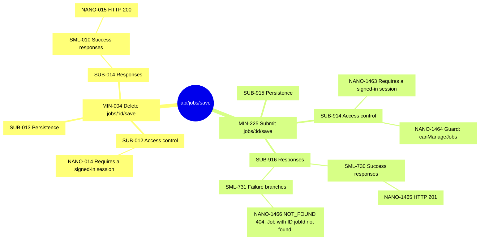

| ID        | Level | Parent   | Name                                             | Description                                                                                                                                                                  | Status      | Verification | Evidence                     | Related                     |
| --------- | ----- | -------- | ------------------------------------------------ | ---------------------------------------------------------------------------------------------------------------------------------------------------------------------------- | ----------- | ------------ | ---------------------------- | --------------------------- |
| FEAT-145  | MAJOR | MOD-060  | api/jobs/save                                    |                                                                                                                                                                              | IMPLEMENTED |              | apps/api/src/server.ts:12393 |                             |
| MIN-004   | MINOR | FEAT-145 | Delete jobs/:id/save                             | 10. Remove saved job bookmark DELETE /api/v1/jobs/:id/save for any signed-in session; durable (PostgreSQL); responds 200. Gaps: no first-party web caller found              | IMPLEMENTED | VERIFIED     | apps/api/src/server.ts:12410 | API-261, TEST-128, TEST-208 |
| SUB-012   | SUB   | MIN-004  | Access control                                   | Who may call DELETE /api/v1/jobs/:id/save: any signed-in session.                                                                                                            | IMPLEMENTED | PATH_LEVEL   | apps/api/src/server.ts:12410 |                             |
| NANO-014  | NANO  | SUB-012  | Requires a signed-in session                     | Requests without a valid session token are rejected with 401 UNAUTHENTICATED.                                                                                                | IMPLEMENTED | PATH_LEVEL   | apps/api/src/server.ts:12410 | ROLE-001                    |
| SUB-013   | SUB   | MIN-004  | Persistence                                      | Durable: writes go through the PostgreSQL store; store calls savedJobs.remove.                                                                                               | IMPLEMENTED | PATH_LEVEL   | apps/api/src/server.ts:12410 |                             |
| SUB-014   | SUB   | MIN-004  | Responses                                        | Success 200; 0 explicit failure branch(es) besides validation and access errors.                                                                                             | IMPLEMENTED | PATH_LEVEL   | apps/api/src/server.ts:12410 |                             |
| SML-010   | SMALL | SUB-014  | Success responses                                | HTTP 200.                                                                                                                                                                    | IMPLEMENTED | PATH_LEVEL   | apps/api/src/server.ts:12410 |                             |
| NANO-015  | NANO  | SML-010  | HTTP 200                                         | Replies 200 when the operation succeeds.                                                                                                                                     | IMPLEMENTED | PATH_LEVEL   | apps/api/src/server.ts:12410 |                             |
| MIN-225   | MINOR | FEAT-145 | Submit jobs/:id/save                             | 9. Bookmark / save job POST /api/v1/jobs/:id/save for any signed-in session; durable (PostgreSQL); responds 201; 1 failure branch(es). Gaps: no first-party web caller found | IMPLEMENTED | VERIFIED     | apps/api/src/server.ts:12393 | API-260, TEST-128, TEST-208 |
| SUB-914   | SUB   | MIN-225  | Access control                                   | Who may call POST /api/v1/jobs/:id/save: any signed-in session.                                                                                                              | IMPLEMENTED | PATH_LEVEL   | apps/api/src/server.ts:12393 |                             |
| NANO-1463 | NANO  | SUB-914  | Requires a signed-in session                     | Requests without a valid session token are rejected with 401 UNAUTHENTICATED.                                                                                                | IMPLEMENTED | PATH_LEVEL   | apps/api/src/server.ts:12393 | ROLE-001                    |
| NANO-1464 | NANO  | SUB-914  | Guard: canManageJobs                             | Guard canManageJobs must pass before the handler runs.                                                                                                                       | IMPLEMENTED | PATH_LEVEL   | apps/api/src/server.ts:12393 |                             |
| SUB-915   | SUB   | MIN-225  | Persistence                                      | Durable: writes go through the PostgreSQL store; store calls savedJobs.add.                                                                                                  | IMPLEMENTED | PATH_LEVEL   | apps/api/src/server.ts:12393 |                             |
| SUB-916   | SUB   | MIN-225  | Responses                                        | Success 201; 1 explicit failure branch(es) besides validation and access errors.                                                                                             | IMPLEMENTED | PATH_LEVEL   | apps/api/src/server.ts:12393 |                             |
| SML-730   | SMALL | SUB-916  | Success responses                                | HTTP 201.                                                                                                                                                                    | IMPLEMENTED | PATH_LEVEL   | apps/api/src/server.ts:12393 |                             |
| NANO-1465 | NANO  | SML-730  | HTTP 201                                         | Replies 201 when the operation succeeds.                                                                                                                                     | IMPLEMENTED | PATH_LEVEL   | apps/api/src/server.ts:12393 |                             |
| SML-731   | SMALL | SUB-916  | Failure branches                                 | 1 DomainError branch(es) in the handler, mapped to HTTP by the global error handler.                                                                                         | IMPLEMENTED | PATH_LEVEL   | apps/api/src/server.ts:12393 |                             |
| NANO-1466 | NANO  | SML-731  | NOT_FOUND 404: Job with ID "${jobId}" not found. | Throws DomainError(NOT_FOUND) "Job with ID "${jobId}" not found." -> HTTP 404.                                                                                               | IMPLEMENTED | PATH_LEVEL   | apps/api/src/server.ts:12402 | ERR-231                     |

## FEAT-030 api/jobs/save-as-template

api/jobs/save-as-template

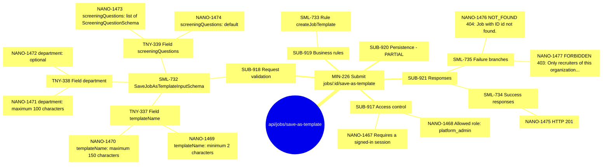

| ID        | Level | Parent   | Name                                                                                  | Description                                                                                                                                                                                                                                                                                       | Status                | Verification | Evidence                                | Related                     |
| --------- | ----- | -------- | ------------------------------------------------------------------------------------- | ------------------------------------------------------------------------------------------------------------------------------------------------------------------------------------------------------------------------------------------------------------------------------------------------- | --------------------- | ------------ | --------------------------------------- | --------------------------- |
| FEAT-030  | MAJOR | MOD-060  | api/jobs/save-as-template                                                             |                                                                                                                                                                                                                                                                                                   | IMPLEMENTED           |              | apps/api/src/server.ts:2529             |                             |
| MIN-226   | MINOR | FEAT-030 | Submit jobs/:id/save-as-template                                                      | POST /api/v1/jobs/:id/save-as-template for roles platform_admin; validates SaveJobAsTemplateInputSchema; calls createJobTemplate; ephemeral (process memory); responds 201; 2 failure branch(es). Gaps: ephemeral: state held in process memory, lost on restart; no first-party web caller found | IMPLEMENTED           | VERIFIED     | apps/api/src/server.ts:2529             | API-041, TEST-108, TEST-186 |
| SUB-917   | SUB   | MIN-226  | Access control                                                                        | Who may call POST /api/v1/jobs/:id/save-as-template: roles platform_admin.                                                                                                                                                                                                                        | IMPLEMENTED           | PATH_LEVEL   | apps/api/src/server.ts:2529             |                             |
| NANO-1467 | NANO  | SUB-917  | Requires a signed-in session                                                          | Requests without a valid session token are rejected with 401 UNAUTHENTICATED.                                                                                                                                                                                                                     | IMPLEMENTED           | PATH_LEVEL   | apps/api/src/server.ts:2529             | ROLE-001                    |
| NANO-1468 | NANO  | SUB-917  | Allowed role: platform_admin                                                          | platform_admin is one of the roles allowed here (platform_admin); a caller holding none of them is rejected with 403.                                                                                                                                                                             | IMPLEMENTED           | PATH_LEVEL   | apps/api/src/server.ts:2529             | ROLE-008                    |
| SUB-918   | SUB   | MIN-226  | Request validation                                                                    | The request is parsed with SaveJobAsTemplateInputSchema; a failure returns 400 with field details before any business logic runs.                                                                                                                                                                 | IMPLEMENTED           | PATH_LEVEL   | apps/api/src/server.ts:2529             |                             |
| SML-732   | SMALL | SUB-918  | SaveJobAsTemplateInputSchema                                                          | SaveJobAsTemplateInputSchema: 3 field(s)                                                                                                                                                                                                                                                          | IMPLEMENTED           | PATH_LEVEL   | packages/contracts/src/index.ts:1018    | SCH-081                     |
| TNY-337   | TINY  | SML-732  | Field templateName                                                                    | templateName (string, required): minimum 2 characters; maximum 150 characters                                                                                                                                                                                                                     | IMPLEMENTED           | PATH_LEVEL   | packages/contracts/src/index.ts:1019    |                             |
| NANO-1469 | NANO  | TNY-337  | templateName: minimum 2 characters                                                    | templateName minimum 2 characters.                                                                                                                                                                                                                                                                | IMPLEMENTED           | PATH_LEVEL   | packages/contracts/src/index.ts:1019    |                             |
| NANO-1470 | NANO  | TNY-337  | templateName: maximum 150 characters                                                  | templateName maximum 150 characters.                                                                                                                                                                                                                                                              | IMPLEMENTED           | PATH_LEVEL   | packages/contracts/src/index.ts:1019    |                             |
| TNY-338   | TINY  | SML-732  | Field department                                                                      | department (string, optional): maximum 100 characters; optional                                                                                                                                                                                                                                   | IMPLEMENTED           | PATH_LEVEL   | packages/contracts/src/index.ts:1020    |                             |
| NANO-1471 | NANO  | TNY-338  | department: maximum 100 characters                                                    | department maximum 100 characters.                                                                                                                                                                                                                                                                | IMPLEMENTED           | PATH_LEVEL   | packages/contracts/src/index.ts:1020    |                             |
| NANO-1472 | NANO  | TNY-338  | department: optional                                                                  | department optional.                                                                                                                                                                                                                                                                              | IMPLEMENTED           | PATH_LEVEL   | packages/contracts/src/index.ts:1020    |                             |
| TNY-339   | TINY  | SML-732  | Field screeningQuestions                                                              | screeningQuestions (array, optional): list of ScreeningQuestionSchema; default []                                                                                                                                                                                                                 | IMPLEMENTED           | PATH_LEVEL   | packages/contracts/src/index.ts:1021    |                             |
| NANO-1473 | NANO  | TNY-339  | screeningQuestions: list of ScreeningQuestionSchema                                   | screeningQuestions list of ScreeningQuestionSchema.                                                                                                                                                                                                                                               | IMPLEMENTED           | PATH_LEVEL   | packages/contracts/src/index.ts:1021    |                             |
| NANO-1474 | NANO  | TNY-339  | screeningQuestions: default []                                                        | screeningQuestions default [].                                                                                                                                                                                                                                                                    | IMPLEMENTED           | PATH_LEVEL   | packages/contracts/src/index.ts:1021    |                             |
| SUB-919   | SUB   | MIN-226  | Business rules                                                                        | Domain functions from packages/domain called by the handler (1).                                                                                                                                                                                                                                  | IMPLEMENTED           | PATH_LEVEL   | apps/api/src/server.ts:2529             |                             |
| SML-733   | SMALL | SUB-919  | Rule createJobTemplate                                                                | Calls createJobTemplate (packages/domain/src/job-templates.ts). Rule status IMPLEMENTED; its own tests: VERIFIED.                                                                                                                                                                                 | IMPLEMENTED           | VERIFIED     | packages/domain/src/job-templates.ts:96 | RULE-123                    |
| SUB-920   | SUB   | MIN-226  | Persistence                                                                           | Ephemeral: state lives in API process memory and is lost on restart.                                                                                                                                                                                                                              | PARTIALLY_IMPLEMENTED | PATH_LEVEL   | apps/api/src/server.ts:2529             |                             |
| SUB-921   | SUB   | MIN-226  | Responses                                                                             | Success 201; 2 explicit failure branch(es) besides validation and access errors.                                                                                                                                                                                                                  | IMPLEMENTED           | PATH_LEVEL   | apps/api/src/server.ts:2529             |                             |
| SML-734   | SMALL | SUB-921  | Success responses                                                                     | HTTP 201.                                                                                                                                                                                                                                                                                         | IMPLEMENTED           | PATH_LEVEL   | apps/api/src/server.ts:2529             |                             |
| NANO-1475 | NANO  | SML-734  | HTTP 201                                                                              | Replies 201 when the operation succeeds.                                                                                                                                                                                                                                                          | IMPLEMENTED           | PATH_LEVEL   | apps/api/src/server.ts:2529             |                             |
| SML-735   | SMALL | SUB-921  | Failure branches                                                                      | 2 DomainError branch(es) in the handler, mapped to HTTP by the global error handler.                                                                                                                                                                                                              | IMPLEMENTED           | PATH_LEVEL   | apps/api/src/server.ts:2529             |                             |
| NANO-1476 | NANO  | SML-735  | NOT_FOUND 404: Job with ID ${id} not found.                                           | Throws DomainError(NOT_FOUND) "Job with ID ${id} not found." -> HTTP 404.                                                                                                                                                                                                                         | IMPLEMENTED           | PATH_LEVEL   | apps/api/src/server.ts:2538             | ERR-037                     |
| NANO-1477 | NANO  | SML-735  | FORBIDDEN 403: Only recruiters of this organization can save its jobs as templates (B | Throws DomainError(FORBIDDEN) "Only recruiters of this organization can save its jobs as templates (BR-12)." -> HTTP 403.                                                                                                                                                                         | IMPLEMENTED           | PATH_LEVEL   | apps/api/src/server.ts:2546             | ERR-044                     |

## FEAT-146 api/jobs/saved

api/jobs/saved

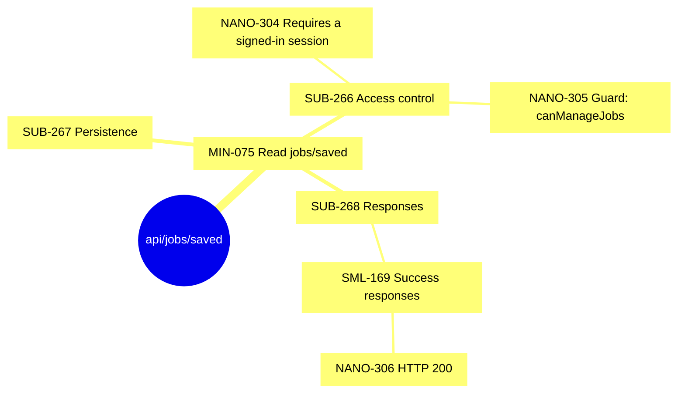

| ID       | Level | Parent   | Name                         | Description                                                                                                                                                 | Status      | Verification | Evidence                     | Related                               |
| -------- | ----- | -------- | ---------------------------- | ----------------------------------------------------------------------------------------------------------------------------------------------------------- | ----------- | ------------ | ---------------------------- | ------------------------------------- |
| FEAT-146 | MAJOR | MOD-060  | api/jobs/saved               |                                                                                                                                                             | IMPLEMENTED |              | apps/api/src/server.ts:12421 |                                       |
| MIN-075  | MINOR | FEAT-146 | Read jobs/saved              | 11. List candidate's saved jobs GET /api/v1/jobs/saved for any signed-in session; durable (PostgreSQL); responds 200. Gaps: no first-party web caller found | IMPLEMENTED | VERIFIED     | apps/api/src/server.ts:12421 | API-262, TEST-128, TEST-158, TEST-208 |
| SUB-266  | SUB   | MIN-075  | Access control               | Who may call GET /api/v1/jobs/saved: any signed-in session.                                                                                                 | IMPLEMENTED | PATH_LEVEL   | apps/api/src/server.ts:12421 |                                       |
| NANO-304 | NANO  | SUB-266  | Requires a signed-in session | Requests without a valid session token are rejected with 401 UNAUTHENTICATED.                                                                               | IMPLEMENTED | PATH_LEVEL   | apps/api/src/server.ts:12421 | ROLE-001                              |
| NANO-305 | NANO  | SUB-266  | Guard: canManageJobs         | Guard canManageJobs must pass before the handler runs.                                                                                                      | IMPLEMENTED | PATH_LEVEL   | apps/api/src/server.ts:12421 |                                       |
| SUB-267  | SUB   | MIN-075  | Persistence                  | Durable: writes go through the PostgreSQL store; store calls savedJobs.list.                                                                                | IMPLEMENTED | PATH_LEVEL   | apps/api/src/server.ts:12421 |                                       |
| SUB-268  | SUB   | MIN-075  | Responses                    | Success 200; 0 explicit failure branch(es) besides validation and access errors.                                                                            | IMPLEMENTED | PATH_LEVEL   | apps/api/src/server.ts:12421 |                                       |
| SML-169  | SMALL | SUB-268  | Success responses            | HTTP 200.                                                                                                                                                   | IMPLEMENTED | PATH_LEVEL   | apps/api/src/server.ts:12421 |                                       |
| NANO-306 | NANO  | SML-169  | HTTP 200                     | Replies 200 when the operation succeeds.                                                                                                                    | IMPLEMENTED | PATH_LEVEL   | apps/api/src/server.ts:12421 |                                       |

## FEAT-143 api/jobs/saved-searches

api/jobs/saved-searches

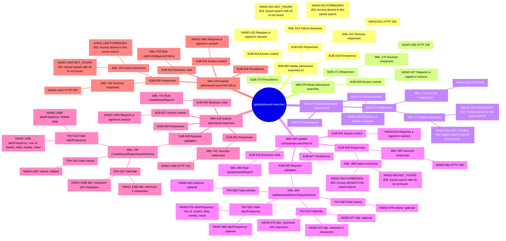

| ID        | Level | Parent   | Name                                                   | Description                                                                                                                                                                                                                                              | Status      | Verification | Evidence                                  | Related                                         |
| --------- | ----- | -------- | ------------------------------------------------------ | -------------------------------------------------------------------------------------------------------------------------------------------------------------------------------------------------------------------------------------------------------- | ----------- | ------------ | ----------------------------------------- | ----------------------------------------------- |
| FEAT-143  | MAJOR | MOD-060  | api/jobs/saved-searches                                |                                                                                                                                                                                                                                                          | IMPLEMENTED |              | apps/api/src/server.ts:12276              |                                                 |
| MIN-006   | MINOR | FEAT-143 | Delete jobs/saved-searches/:id                         | 5. Delete saved search DELETE /api/v1/jobs/saved-searches/:id for any signed-in session; durable (PostgreSQL); responds 200; 2 failure branch(es). Gaps: no first-party web caller found                                                                 | IMPLEMENTED | VERIFIED     | apps/api/src/server.ts:12338              | API-256, TEST-128, TEST-159, TEST-208           |
| SUB-018   | SUB   | MIN-006  | Access control                                         | Who may call DELETE /api/v1/jobs/saved-searches/:id: any signed-in session.                                                                                                                                                                              | IMPLEMENTED | PATH_LEVEL   | apps/api/src/server.ts:12338              |                                                 |
| NANO-020  | NANO  | SUB-018  | Requires a signed-in session                           | Requests without a valid session token are rejected with 401 UNAUTHENTICATED.                                                                                                                                                                            | IMPLEMENTED | PATH_LEVEL   | apps/api/src/server.ts:12338              | ROLE-001                                        |
| SUB-019   | SUB   | MIN-006  | Persistence                                            | Durable: writes go through the PostgreSQL store; store calls savedSearches.get, savedSearches.remove.                                                                                                                                                    | IMPLEMENTED | PATH_LEVEL   | apps/api/src/server.ts:12338              |                                                 |
| SUB-020   | SUB   | MIN-006  | Responses                                              | Success 200; 2 explicit failure branch(es) besides validation and access errors.                                                                                                                                                                         | IMPLEMENTED | PATH_LEVEL   | apps/api/src/server.ts:12338              |                                                 |
| SML-013   | SMALL | SUB-020  | Success responses                                      | HTTP 200.                                                                                                                                                                                                                                                | IMPLEMENTED | PATH_LEVEL   | apps/api/src/server.ts:12338              |                                                 |
| NANO-021  | NANO  | SML-013  | HTTP 200                                               | Replies 200 when the operation succeeds.                                                                                                                                                                                                                 | IMPLEMENTED | PATH_LEVEL   | apps/api/src/server.ts:12338              |                                                 |
| SML-014   | SMALL | SUB-020  | Failure branches                                       | 2 DomainError branch(es) in the handler, mapped to HTTP by the global error handler.                                                                                                                                                                     | IMPLEMENTED | PATH_LEVEL   | apps/api/src/server.ts:12338              |                                                 |
| NANO-022  | NANO  | SML-014  | NOT_FOUND 404: Saved search with ID "${id}" not found. | Throws DomainError(NOT_FOUND) "Saved search with ID "${id}" not found." -> HTTP 404.                                                                                                                                                                     | IMPLEMENTED | PATH_LEVEL   | apps/api/src/server.ts:12345              | ERR-227                                         |
| NANO-023  | NANO  | SML-014  | FORBIDDEN 403: Access denied to this saved search.     | Throws DomainError(FORBIDDEN) "Access denied to this saved search." -> HTTP 403.                                                                                                                                                                         | IMPLEMENTED | PATH_LEVEL   | apps/api/src/server.ts:12348              | ERR-228                                         |
| MIN-076   | MINOR | FEAT-143 | Read jobs/saved-searches                               | 2. List candidate's saved searches GET /api/v1/jobs/saved-searches for any signed-in session; durable (PostgreSQL); responds 200. Gaps: no first-party web caller found                                                                                  | IMPLEMENTED | VERIFIED     | apps/api/src/server.ts:12294              | API-253, TEST-128, TEST-159, TEST-208, TEST-226 |
| SUB-269   | SUB   | MIN-076  | Access control                                         | Who may call GET /api/v1/jobs/saved-searches: any signed-in session.                                                                                                                                                                                     | IMPLEMENTED | PATH_LEVEL   | apps/api/src/server.ts:12294              |                                                 |
| NANO-307  | NANO  | SUB-269  | Requires a signed-in session                           | Requests without a valid session token are rejected with 401 UNAUTHENTICATED.                                                                                                                                                                            | IMPLEMENTED | PATH_LEVEL   | apps/api/src/server.ts:12294              | ROLE-001                                        |
| SUB-270   | SUB   | MIN-076  | Persistence                                            | Durable: writes go through the PostgreSQL store; store calls savedSearches.listByUser.                                                                                                                                                                   | IMPLEMENTED | PATH_LEVEL   | apps/api/src/server.ts:12294              |                                                 |
| SUB-271   | SUB   | MIN-076  | Responses                                              | Success 200; 0 explicit failure branch(es) besides validation and access errors.                                                                                                                                                                         | IMPLEMENTED | PATH_LEVEL   | apps/api/src/server.ts:12294              |                                                 |
| SML-170   | SMALL | SUB-271  | Success responses                                      | HTTP 200.                                                                                                                                                                                                                                                | IMPLEMENTED | PATH_LEVEL   | apps/api/src/server.ts:12294              |                                                 |
| NANO-308  | NANO  | SML-170  | HTTP 200                                               | Replies 200 when the operation succeeds.                                                                                                                                                                                                                 | IMPLEMENTED | PATH_LEVEL   | apps/api/src/server.ts:12294              |                                                 |
| MIN-077   | MINOR | FEAT-143 | Read jobs/saved-searches/:id                           | 3. Get single saved search by ID GET /api/v1/jobs/saved-searches/:id for any signed-in session; durable (PostgreSQL); responds 200; 2 failure branch(es). Gaps: no first-party web caller found                                                          | IMPLEMENTED | VERIFIED     | apps/api/src/server.ts:12301              | API-254, TEST-128, TEST-159                     |
| SUB-272   | SUB   | MIN-077  | Access control                                         | Who may call GET /api/v1/jobs/saved-searches/:id: any signed-in session.                                                                                                                                                                                 | IMPLEMENTED | PATH_LEVEL   | apps/api/src/server.ts:12301              |                                                 |
| NANO-309  | NANO  | SUB-272  | Requires a signed-in session                           | Requests without a valid session token are rejected with 401 UNAUTHENTICATED.                                                                                                                                                                            | IMPLEMENTED | PATH_LEVEL   | apps/api/src/server.ts:12301              | ROLE-001                                        |
| SUB-273   | SUB   | MIN-077  | Persistence                                            | Durable: writes go through the PostgreSQL store; store calls savedSearches.get.                                                                                                                                                                          | IMPLEMENTED | PATH_LEVEL   | apps/api/src/server.ts:12301              |                                                 |
| SUB-274   | SUB   | MIN-077  | Responses                                              | Success 200; 2 explicit failure branch(es) besides validation and access errors.                                                                                                                                                                         | IMPLEMENTED | PATH_LEVEL   | apps/api/src/server.ts:12301              |                                                 |
| SML-171   | SMALL | SUB-274  | Success responses                                      | HTTP 200.                                                                                                                                                                                                                                                | IMPLEMENTED | PATH_LEVEL   | apps/api/src/server.ts:12301              |                                                 |
| NANO-310  | NANO  | SML-171  | HTTP 200                                               | Replies 200 when the operation succeeds.                                                                                                                                                                                                                 | IMPLEMENTED | PATH_LEVEL   | apps/api/src/server.ts:12301              |                                                 |
| SML-172   | SMALL | SUB-274  | Failure branches                                       | 2 DomainError branch(es) in the handler, mapped to HTTP by the global error handler.                                                                                                                                                                     | IMPLEMENTED | PATH_LEVEL   | apps/api/src/server.ts:12301              |                                                 |
| NANO-311  | NANO  | SML-172  | NOT_FOUND 404: Saved search with ID "${id}" not found. | Throws DomainError(NOT_FOUND) "Saved search with ID "${id}" not found." -> HTTP 404.                                                                                                                                                                     | IMPLEMENTED | PATH_LEVEL   | apps/api/src/server.ts:12308              | ERR-227                                         |
| NANO-312  | NANO  | SML-172  | FORBIDDEN 403: Access denied to this saved search.     | Throws DomainError(FORBIDDEN) "Access denied to this saved search." -> HTTP 403.                                                                                                                                                                         | IMPLEMENTED | PATH_LEVEL   | apps/api/src/server.ts:12311              | ERR-228                                         |
| MIN-150   | MINOR | FEAT-143 | Update jobs/saved-searches/:id                         | 4. Update saved search PATCH /api/v1/jobs/saved-searches/:id for any signed-in session; validates UpdateSavedSearchInputSchema; calls updateSavedSearch; durable (PostgreSQL); responds 200; 2 failure branch(es). Gaps: no first-party web caller found | IMPLEMENTED | VERIFIED     | apps/api/src/server.ts:12318              | API-255, TEST-128, TEST-159, TEST-208           |
| SUB-544   | SUB   | MIN-150  | Access control                                         | Who may call PATCH /api/v1/jobs/saved-searches/:id: any signed-in session.                                                                                                                                                                               | IMPLEMENTED | PATH_LEVEL   | apps/api/src/server.ts:12318              |                                                 |
| NANO-674  | NANO  | SUB-544  | Requires a signed-in session                           | Requests without a valid session token are rejected with 401 UNAUTHENTICATED.                                                                                                                                                                            | IMPLEMENTED | PATH_LEVEL   | apps/api/src/server.ts:12318              | ROLE-001                                        |
| SUB-545   | SUB   | MIN-150  | Request validation                                     | The request is parsed with UpdateSavedSearchInputSchema; a failure returns 400 with field details before any business logic runs.                                                                                                                        | IMPLEMENTED | PATH_LEVEL   | apps/api/src/server.ts:12318              |                                                 |
| SML-363   | SMALL | SUB-545  | UpdateSavedSearchInputSchema                           | UpdateSavedSearchInputSchema: 4 field(s)                                                                                                                                                                                                                 | IMPLEMENTED | PATH_LEVEL   | packages/contracts/src/index.ts:896       | SCH-071                                         |
| TNY-079   | TINY  | SML-363  | Field title                                            | title (string, optional): minimum 2 characters; maximum 100 characters; optional                                                                                                                                                                         | IMPLEMENTED | PATH_LEVEL   | packages/contracts/src/index.ts:897       |                                                 |
| NANO-675  | NANO  | TNY-079  | title: minimum 2 characters                            | title minimum 2 characters.                                                                                                                                                                                                                              | IMPLEMENTED | PATH_LEVEL   | packages/contracts/src/index.ts:897       |                                                 |
| NANO-676  | NANO  | TNY-079  | title: maximum 100 characters                          | title maximum 100 characters.                                                                                                                                                                                                                            | IMPLEMENTED | PATH_LEVEL   | packages/contracts/src/index.ts:897       |                                                 |
| NANO-677  | NANO  | TNY-079  | title: optional                                        | title optional.                                                                                                                                                                                                                                          | IMPLEMENTED | PATH_LEVEL   | packages/contracts/src/index.ts:897       |                                                 |
| TNY-080   | TINY  | SML-363  | Field criteria                                         | criteria (SearchCriteriaSchema, optional): optional                                                                                                                                                                                                      | IMPLEMENTED | PATH_LEVEL   | packages/contracts/src/index.ts:898       |                                                 |
| NANO-678  | NANO  | TNY-080  | criteria: optional                                     | criteria optional.                                                                                                                                                                                                                                       | IMPLEMENTED | PATH_LEVEL   | packages/contracts/src/index.ts:898       |                                                 |
| TNY-081   | TINY  | SML-363  | Field alertFrequency                                   | alertFrequency (enum, optional): one of: instant, daily, weekly, never; optional                                                                                                                                                                         | IMPLEMENTED | PATH_LEVEL   | packages/contracts/src/index.ts:899       |                                                 |
| NANO-679  | NANO  | TNY-081  | alertFrequency: one of: instant, daily, weekly, never  | alertFrequency one of: instant, daily, weekly, never.                                                                                                                                                                                                    | IMPLEMENTED | PATH_LEVEL   | packages/contracts/src/index.ts:899       |                                                 |
| NANO-680  | NANO  | TNY-081  | alertFrequency: optional                               | alertFrequency optional.                                                                                                                                                                                                                                 | IMPLEMENTED | PATH_LEVEL   | packages/contracts/src/index.ts:899       |                                                 |
| TNY-082   | TINY  | SML-363  | Field isActive                                         | isActive (boolean, optional): optional                                                                                                                                                                                                                   | IMPLEMENTED | PATH_LEVEL   | packages/contracts/src/index.ts:900       |                                                 |
| NANO-681  | NANO  | TNY-082  | isActive: optional                                     | isActive optional.                                                                                                                                                                                                                                       | IMPLEMENTED | PATH_LEVEL   | packages/contracts/src/index.ts:900       |                                                 |
| SUB-546   | SUB   | MIN-150  | Business rules                                         | Domain functions from packages/domain called by the handler (1).                                                                                                                                                                                         | IMPLEMENTED | PATH_LEVEL   | apps/api/src/server.ts:12318              |                                                 |
| SML-364   | SMALL | SUB-546  | Rule updateSavedSearch                                 | Calls updateSavedSearch (packages/domain/src/saved-searches.ts). Rule status IMPLEMENTED; its own tests: VERIFIED.                                                                                                                                       | IMPLEMENTED | VERIFIED     | packages/domain/src/saved-searches.ts:109 | RULE-200                                        |
| SUB-547   | SUB   | MIN-150  | Persistence                                            | Durable: writes go through the PostgreSQL store; store calls savedSearches.get, savedSearches.update.                                                                                                                                                    | IMPLEMENTED | PATH_LEVEL   | apps/api/src/server.ts:12318              |                                                 |
| SUB-548   | SUB   | MIN-150  | Responses                                              | Success 200; 2 explicit failure branch(es) besides validation and access errors.                                                                                                                                                                         | IMPLEMENTED | PATH_LEVEL   | apps/api/src/server.ts:12318              |                                                 |
| SML-365   | SMALL | SUB-548  | Success responses                                      | HTTP 200.                                                                                                                                                                                                                                                | IMPLEMENTED | PATH_LEVEL   | apps/api/src/server.ts:12318              |                                                 |
| NANO-682  | NANO  | SML-365  | HTTP 200                                               | Replies 200 when the operation succeeds.                                                                                                                                                                                                                 | IMPLEMENTED | PATH_LEVEL   | apps/api/src/server.ts:12318              |                                                 |
| SML-366   | SMALL | SUB-548  | Failure branches                                       | 2 DomainError branch(es) in the handler, mapped to HTTP by the global error handler.                                                                                                                                                                     | IMPLEMENTED | PATH_LEVEL   | apps/api/src/server.ts:12318              |                                                 |
| NANO-683  | NANO  | SML-366  | NOT_FOUND 404: Saved search with ID "${id}" not found. | Throws DomainError(NOT_FOUND) "Saved search with ID "${id}" not found." -> HTTP 404.                                                                                                                                                                     | IMPLEMENTED | PATH_LEVEL   | apps/api/src/server.ts:12325              | ERR-227                                         |
| NANO-684  | NANO  | SML-366  | FORBIDDEN 403: Access denied to this saved search.     | Throws DomainError(FORBIDDEN) "Access denied to this saved search." -> HTTP 403.                                                                                                                                                                         | IMPLEMENTED | PATH_LEVEL   | apps/api/src/server.ts:12328              | ERR-228                                         |
| MIN-228   | MINOR | FEAT-143 | Submit jobs/saved-searches                             | 1. Create a new saved search POST /api/v1/jobs/saved-searches for any signed-in session; validates CreateSavedSearchInputSchema; calls createSavedSearch; durable (PostgreSQL); responds 201. Gaps: no first-party web caller found                      | IMPLEMENTED | VERIFIED     | apps/api/src/server.ts:12276              | API-252, TEST-128, TEST-159, TEST-208, TEST-226 |
| SUB-927   | SUB   | MIN-228  | Access control                                         | Who may call POST /api/v1/jobs/saved-searches: any signed-in session.                                                                                                                                                                                    | IMPLEMENTED | PATH_LEVEL   | apps/api/src/server.ts:12276              |                                                 |
| NANO-1484 | NANO  | SUB-927  | Requires a signed-in session                           | Requests without a valid session token are rejected with 401 UNAUTHENTICATED.                                                                                                                                                                            | IMPLEMENTED | PATH_LEVEL   | apps/api/src/server.ts:12276              | ROLE-001                                        |
| SUB-928   | SUB   | MIN-228  | Request validation                                     | The request is parsed with CreateSavedSearchInputSchema; a failure returns 400 with field details before any business logic runs.                                                                                                                        | IMPLEMENTED | PATH_LEVEL   | apps/api/src/server.ts:12276              |                                                 |
| SML-740   | SMALL | SUB-928  | CreateSavedSearchInputSchema                           | CreateSavedSearchInputSchema: 3 field(s)                                                                                                                                                                                                                 | IMPLEMENTED | PATH_LEVEL   | packages/contracts/src/index.ts:888       | SCH-070                                         |
| TNY-341   | TINY  | SML-740  | Field title                                            | title (string, required): minimum 2 characters; maximum 100 characters                                                                                                                                                                                   | IMPLEMENTED | PATH_LEVEL   | packages/contracts/src/index.ts:889       |                                                 |
| NANO-1485 | NANO  | TNY-341  | title: minimum 2 characters                            | title minimum 2 characters.                                                                                                                                                                                                                              | IMPLEMENTED | PATH_LEVEL   | packages/contracts/src/index.ts:889       |                                                 |
| NANO-1486 | NANO  | TNY-341  | title: maximum 100 characters                          | title maximum 100 characters.                                                                                                                                                                                                                            | IMPLEMENTED | PATH_LEVEL   | packages/contracts/src/index.ts:889       |                                                 |
| TNY-342   | TINY  | SML-740  | Field criteria                                         | criteria (SearchCriteriaSchema, optional): default {}                                                                                                                                                                                                    | IMPLEMENTED | PATH_LEVEL   | packages/contracts/src/index.ts:890       |                                                 |
| NANO-1487 | NANO  | TNY-342  | criteria: default {}                                   | criteria default {}.                                                                                                                                                                                                                                     | IMPLEMENTED | PATH_LEVEL   | packages/contracts/src/index.ts:890       |                                                 |
| TNY-343   | TINY  | SML-740  | Field alertFrequency                                   | alertFrequency (enum, optional): one of: instant, daily, weekly, never; default 'daily'                                                                                                                                                                  | IMPLEMENTED | PATH_LEVEL   | packages/contracts/src/index.ts:891       |                                                 |
| NANO-1488 | NANO  | TNY-343  | alertFrequency: one of: instant, daily, weekly, never  | alertFrequency one of: instant, daily, weekly, never.                                                                                                                                                                                                    | IMPLEMENTED | PATH_LEVEL   | packages/contracts/src/index.ts:891       |                                                 |
| NANO-1489 | NANO  | TNY-343  | alertFrequency: default 'daily'                        | alertFrequency default 'daily'; message "daily".                                                                                                                                                                                                         | IMPLEMENTED | PATH_LEVEL   | packages/contracts/src/index.ts:891       |                                                 |
| SUB-929   | SUB   | MIN-228  | Business rules                                         | Domain functions from packages/domain called by the handler (1).                                                                                                                                                                                         | IMPLEMENTED | PATH_LEVEL   | apps/api/src/server.ts:12276              |                                                 |
| SML-741   | SMALL | SUB-929  | Rule createSavedSearch                                 | Calls createSavedSearch (packages/domain/src/saved-searches.ts). Rule status IMPLEMENTED; its own tests: VERIFIED.                                                                                                                                       | IMPLEMENTED | VERIFIED     | packages/domain/src/saved-searches.ts:58  | RULE-199                                        |
| SUB-930   | SUB   | MIN-228  | Persistence                                            | Durable: writes go through the PostgreSQL store; store calls savedSearches.create, savedSearches.listByUser.                                                                                                                                             | IMPLEMENTED | PATH_LEVEL   | apps/api/src/server.ts:12276              |                                                 |
| SUB-931   | SUB   | MIN-228  | Responses                                              | Success 201; 0 explicit failure branch(es) besides validation and access errors.                                                                                                                                                                         | IMPLEMENTED | PATH_LEVEL   | apps/api/src/server.ts:12276              |                                                 |
| SML-742   | SMALL | SUB-931  | Success responses                                      | HTTP 201.                                                                                                                                                                                                                                                | IMPLEMENTED | PATH_LEVEL   | apps/api/src/server.ts:12276              |                                                 |
| NANO-1490 | NANO  | SML-742  | HTTP 201                                               | Replies 201 when the operation succeeds.                                                                                                                                                                                                                 | IMPLEMENTED | PATH_LEVEL   | apps/api/src/server.ts:12276              |                                                 |
| MIN-229   | MINOR | FEAT-143 | Submit jobs/saved-searches/:id/run                     | 6. Run saved search on live published inventory POST /api/v1/jobs/saved-searches/:id/run for any signed-in session; calls matchJobAgainstCriteria; durable (PostgreSQL); responds 200; 2 failure branch(es). Gaps: no first-party web caller found       | IMPLEMENTED | VERIFIED     | apps/api/src/server.ts:12356              | API-257, TEST-128, TEST-208                     |
| SUB-932   | SUB   | MIN-229  | Access control                                         | Who may call POST /api/v1/jobs/saved-searches/:id/run: any signed-in session.                                                                                                                                                                            | IMPLEMENTED | PATH_LEVEL   | apps/api/src/server.ts:12356              |                                                 |
| NANO-1491 | NANO  | SUB-932  | Requires a signed-in session                           | Requests without a valid session token are rejected with 401 UNAUTHENTICATED.                                                                                                                                                                            | IMPLEMENTED | PATH_LEVEL   | apps/api/src/server.ts:12356              | ROLE-001                                        |
| SUB-933   | SUB   | MIN-229  | Business rules                                         | Domain functions from packages/domain called by the handler (1).                                                                                                                                                                                         | IMPLEMENTED | PATH_LEVEL   | apps/api/src/server.ts:12356              |                                                 |
| SML-743   | SMALL | SUB-933  | Rule matchJobAgainstCriteria                           | Calls matchJobAgainstCriteria (packages/domain/src/saved-searches.ts). Rule status IMPLEMENTED; its own tests: VERIFIED.                                                                                                                                 | IMPLEMENTED | VERIFIED     | packages/domain/src/saved-searches.ts:137 | RULE-201                                        |
| SUB-934   | SUB   | MIN-229  | Persistence                                            | Durable: writes go through the PostgreSQL store; store calls savedSearches.get.                                                                                                                                                                          | IMPLEMENTED | PATH_LEVEL   | apps/api/src/server.ts:12356              |                                                 |
| SUB-935   | SUB   | MIN-229  | Responses                                              | Success 200; 2 explicit failure branch(es) besides validation and access errors.                                                                                                                                                                         | IMPLEMENTED | PATH_LEVEL   | apps/api/src/server.ts:12356              |                                                 |
| SML-744   | SMALL | SUB-935  | Success responses                                      | HTTP 200.                                                                                                                                                                                                                                                | IMPLEMENTED | PATH_LEVEL   | apps/api/src/server.ts:12356              |                                                 |
| NANO-1492 | NANO  | SML-744  | HTTP 200                                               | Replies 200 when the operation succeeds.                                                                                                                                                                                                                 | IMPLEMENTED | PATH_LEVEL   | apps/api/src/server.ts:12356              |                                                 |
| SML-745   | SMALL | SUB-935  | Failure branches                                       | 2 DomainError branch(es) in the handler, mapped to HTTP by the global error handler.                                                                                                                                                                     | IMPLEMENTED | PATH_LEVEL   | apps/api/src/server.ts:12356              |                                                 |
| NANO-1493 | NANO  | SML-745  | NOT_FOUND 404: Saved search with ID "${id}" not found. | Throws DomainError(NOT_FOUND) "Saved search with ID "${id}" not found." -> HTTP 404.                                                                                                                                                                     | IMPLEMENTED | PATH_LEVEL   | apps/api/src/server.ts:12363              | ERR-227                                         |
| NANO-1494 | NANO  | SML-745  | FORBIDDEN 403: Access denied to this saved search.     | Throws DomainError(FORBIDDEN) "Access denied to this saved search." -> HTTP 403.                                                                                                                                                                         | IMPLEMENTED | PATH_LEVEL   | apps/api/src/server.ts:12366              | ERR-228                                         |

## FEAT-027 api/jobs/status

api/jobs/status

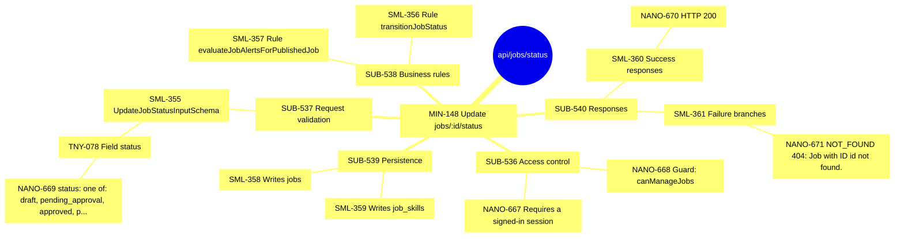

| ID       | Level | Parent   | Name                                                                                   | Description                                                                                                                                                                                                                                    | Status      | Verification | Evidence                                                  | Related                                                       |
| -------- | ----- | -------- | -------------------------------------------------------------------------------------- | ---------------------------------------------------------------------------------------------------------------------------------------------------------------------------------------------------------------------------------------------- | ----------- | ------------ | --------------------------------------------------------- | ------------------------------------------------------------- |
| FEAT-027 | MAJOR | MOD-060  | api/jobs/status                                                                        |                                                                                                                                                                                                                                                | IMPLEMENTED |              | apps/api/src/server.ts:2139                               |                                                               |
| MIN-148  | MINOR | FEAT-027 | Update jobs/:id/status                                                                 | PATCH /api/v1/jobs/:id/status for any signed-in session; validates UpdateJobStatusInputSchema; calls transitionJobStatus, evaluateJobAlertsForPublishedJob; durable (PostgreSQL); writes jobs, job_skills; responds 200; 1 failure branch(es). | IMPLEMENTED | VERIFIED     | apps/api/src/server.ts:2139                               | API-034, TEST-088, TEST-089, TEST-097, TEST-101, TEST-109 ... |
| SUB-536  | SUB   | MIN-148  | Access control                                                                         | Who may call PATCH /api/v1/jobs/:id/status: any signed-in session.                                                                                                                                                                             | IMPLEMENTED | PATH_LEVEL   | apps/api/src/server.ts:2139                               |                                                               |
| NANO-667 | NANO  | SUB-536  | Requires a signed-in session                                                           | Requests without a valid session token are rejected with 401 UNAUTHENTICATED.                                                                                                                                                                  | IMPLEMENTED | PATH_LEVEL   | apps/api/src/server.ts:2139                               | ROLE-001                                                      |
| NANO-668 | NANO  | SUB-536  | Guard: canManageJobs                                                                   | Guard canManageJobs must pass before the handler runs.                                                                                                                                                                                         | IMPLEMENTED | PATH_LEVEL   | apps/api/src/server.ts:2139                               |                                                               |
| SUB-537  | SUB   | MIN-148  | Request validation                                                                     | The request is parsed with UpdateJobStatusInputSchema; a failure returns 400 with field details before any business logic runs.                                                                                                                | IMPLEMENTED | PATH_LEVEL   | apps/api/src/server.ts:2139                               |                                                               |
| SML-355  | SMALL | SUB-537  | UpdateJobStatusInputSchema                                                             | UpdateJobStatusInputSchema: 1 field(s)                                                                                                                                                                                                         | IMPLEMENTED | PATH_LEVEL   | packages/contracts/src/index.ts:257                       | SCH-017                                                       |
| TNY-078  | TINY  | SML-355  | Field status                                                                           | status (enum, required): one of: draft, pending_approval, approved, published, paused, closed, archived                                                                                                                                        | IMPLEMENTED | PATH_LEVEL   | packages/contracts/src/index.ts:258                       |                                                               |
| NANO-669 | NANO  | TNY-078  | status: one of: draft, pending_approval, approved, published, paused, closed, archived | status one of: draft, pending_approval, approved, published, paused, closed, archived.                                                                                                                                                         | IMPLEMENTED | PATH_LEVEL   | packages/contracts/src/index.ts:258                       |                                                               |
| SUB-538  | SUB   | MIN-148  | Business rules                                                                         | Domain functions from packages/domain called by the handler (2).                                                                                                                                                                               | IMPLEMENTED | PATH_LEVEL   | apps/api/src/server.ts:2139                               |                                                               |
| SML-356  | SMALL | SUB-538  | Rule transitionJobStatus                                                               | Calls transitionJobStatus (packages/domain/src/jobs.ts). Rule status IMPLEMENTED; its own tests: VERIFIED.                                                                                                                                     | IMPLEMENTED | VERIFIED     | packages/domain/src/jobs.ts:127                           | RULE-129                                                      |
| SML-357  | SMALL | SUB-538  | Rule evaluateJobAlertsForPublishedJob                                                  | Calls evaluateJobAlertsForPublishedJob (packages/domain/src/saved-searches.ts). Rule status IMPLEMENTED; its own tests: VERIFIED.                                                                                                              | IMPLEMENTED | VERIFIED     | packages/domain/src/saved-searches.ts:197                 | RULE-202                                                      |
| SUB-539  | SUB   | MIN-148  | Persistence                                                                            | Durable: writes go through the PostgreSQL store; store calls jobAlerts.createMany, savedSearches.listAll.                                                                                                                                      | IMPLEMENTED | PATH_LEVEL   | apps/api/src/server.ts:2139                               |                                                               |
| SML-358  | SMALL | SUB-539  | Writes jobs                                                                            | Writes table jobs (00001_core_schema.sql).                                                                                                                                                                                                     | IMPLEMENTED | PATH_LEVEL   | supabase/migrations/00001_core_schema.sql:167             | DB-006                                                        |
| SML-359  | SMALL | SUB-539  | Writes job_skills                                                                      | Writes table job_skills (00003_jobs_applications_schema.sql).                                                                                                                                                                                  | IMPLEMENTED | PATH_LEVEL   | supabase/migrations/00003_jobs_applications_schema.sql:24 | DB-013                                                        |
| SUB-540  | SUB   | MIN-148  | Responses                                                                              | Success 200; 1 explicit failure branch(es) besides validation and access errors.                                                                                                                                                               | IMPLEMENTED | PATH_LEVEL   | apps/api/src/server.ts:2139                               |                                                               |
| SML-360  | SMALL | SUB-540  | Success responses                                                                      | HTTP 200.                                                                                                                                                                                                                                      | IMPLEMENTED | PATH_LEVEL   | apps/api/src/server.ts:2139                               |                                                               |
| NANO-670 | NANO  | SML-360  | HTTP 200                                                                               | Replies 200 when the operation succeeds.                                                                                                                                                                                                       | IMPLEMENTED | PATH_LEVEL   | apps/api/src/server.ts:2139                               |                                                               |
| SML-361  | SMALL | SUB-540  | Failure branches                                                                       | 1 DomainError branch(es) in the handler, mapped to HTTP by the global error handler.                                                                                                                                                           | IMPLEMENTED | PATH_LEVEL   | apps/api/src/server.ts:2139                               |                                                               |
| NANO-671 | NANO  | SML-361  | NOT_FOUND 404: Job with ID ${id} not found.                                            | Throws DomainError(NOT_FOUND) "Job with ID ${id} not found." -> HTTP 404.                                                                                                                                                                      | IMPLEMENTED | PATH_LEVEL   | apps/api/src/server.ts:2148                               | ERR-037                                                       |
