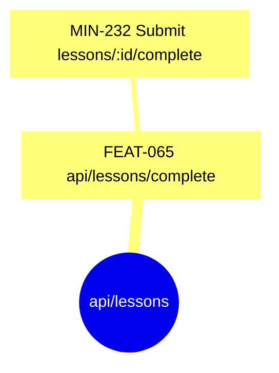
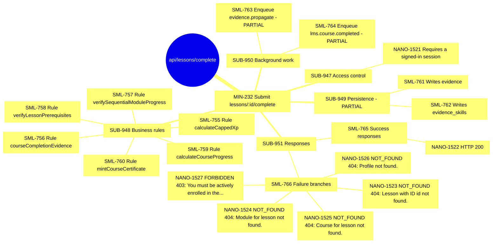

# api/lessons (MOD-073)

Generated by `docs/mindmap/tools/catalog.py` from `master/MASTER_PROJECT_GRAPH.json` at commit `9b3032f`. Do not edit by hand. Back to the [feature catalog](../FEATURE_CATALOG.md).

**Application:** apps/api (MOD-001). **Purpose:** API module: routes under /api/v1/lessons in apps/api/src/server.ts.

**Nodes by level:** MODULE 1, MAJOR 1, MINOR 1, SUB 5, SMALL 12, NANO 7. **Status:** IMPLEMENTED 24, PARTIALLY_IMPLEMENTED 3. **Verification:** PATH_LEVEL 16, UNKNOWN 2, VERIFIED 7.

**User roles that reach it:** authenticated.

**Known gaps:** MIN-232 ephemeral: state held in process memory, lost on restart.

**Called from (web screens and components):** FEAT-169 Screen /learning/:id

## Module map (to minor features)

## FEAT-065 api/lessons/complete

api/lessons/complete

| ID        | Level | Parent   | Name                                                                            | Description                                                                                                                                                                                                                                                                                                                                     | Status                | Verification | Evidence                                                | Related                                                       |
| --------- | ----- | -------- | ------------------------------------------------------------------------------- | ----------------------------------------------------------------------------------------------------------------------------------------------------------------------------------------------------------------------------------------------------------------------------------------------------------------------------------------------- | --------------------- | ------------ | ------------------------------------------------------- | ------------------------------------------------------------- |
| FEAT-065  | MAJOR | MOD-073  | api/lessons/complete                                                            |                                                                                                                                                                                                                                                                                                                                                 | IMPLEMENTED           |              | apps/api/src/server.ts:5312                             |                                                               |
| MIN-232   | MINOR | FEAT-065 | Submit lessons/:id/complete                                                     | POST /api/v1/lessons/:id/complete for any signed-in session; calls calculateCappedXp, courseCompletionEvidence, verifySequentialModuleProgress, verifyLessonPrerequisites ...; ephemeral (process memory); writes evidence, evidence_skills; responds 200; 5 failure branch(es). Gaps: ephemeral: state held in process memory, lost on restart | IMPLEMENTED           | VERIFIED     | apps/api/src/server.ts:5312                             | API-106, TEST-094, TEST-111, TEST-170, TEST-175, TEST-179 ... |
| SUB-947   | SUB   | MIN-232  | Access control                                                                  | Who may call POST /api/v1/lessons/:id/complete: any signed-in session.                                                                                                                                                                                                                                                                          | IMPLEMENTED           | PATH_LEVEL   | apps/api/src/server.ts:5312                             |                                                               |
| NANO-1521 | NANO  | SUB-947  | Requires a signed-in session                                                    | Requests without a valid session token are rejected with 401 UNAUTHENTICATED.                                                                                                                                                                                                                                                                   | IMPLEMENTED           | PATH_LEVEL   | apps/api/src/server.ts:5312                             | ROLE-001                                                      |
| SUB-948   | SUB   | MIN-232  | Business rules                                                                  | Domain functions from packages/domain called by the handler (6).                                                                                                                                                                                                                                                                                | IMPLEMENTED           | PATH_LEVEL   | apps/api/src/server.ts:5312                             |                                                               |
| SML-755   | SMALL | SUB-948  | Rule calculateCappedXp                                                          | Calls calculateCappedXp (packages/domain/src/assessment.ts). Rule status IMPLEMENTED; its own tests: VERIFIED.                                                                                                                                                                                                                                  | IMPLEMENTED           | VERIFIED     | packages/domain/src/assessment.ts:130                   | RULE-047                                                      |
| SML-756   | SMALL | SUB-948  | Rule courseCompletionEvidence                                                   | Calls courseCompletionEvidence (packages/domain/src/evidence.ts). Rule status IMPLEMENTED; its own tests: VERIFIED.                                                                                                                                                                                                                             | IMPLEMENTED           | VERIFIED     | packages/domain/src/evidence.ts:77                      | RULE-096                                                      |
| SML-757   | SMALL | SUB-948  | Rule verifySequentialModuleProgress                                             | Calls verifySequentialModuleProgress (packages/domain/src/lms.ts). Rule status IMPLEMENTED; its own tests: VERIFIED.                                                                                                                                                                                                                            | IMPLEMENTED           | VERIFIED     | packages/domain/src/lms.ts:181                          | RULE-135                                                      |
| SML-758   | SMALL | SUB-948  | Rule verifyLessonPrerequisites                                                  | Calls verifyLessonPrerequisites (packages/domain/src/lms.ts). Rule status IMPLEMENTED; its own tests: VERIFIED.                                                                                                                                                                                                                                 | IMPLEMENTED           | VERIFIED     | packages/domain/src/lms.ts:211                          | RULE-136                                                      |
| SML-759   | SMALL | SUB-948  | Rule calculateCourseProgress                                                    | Calls calculateCourseProgress (packages/domain/src/lms.ts). Rule status IMPLEMENTED; its own tests: VERIFIED.                                                                                                                                                                                                                                   | IMPLEMENTED           | VERIFIED     | packages/domain/src/lms.ts:271                          | RULE-138                                                      |
| SML-760   | SMALL | SUB-948  | Rule mintCourseCertificate                                                      | Calls mintCourseCertificate (packages/domain/src/lms.ts). Rule status IMPLEMENTED; its own tests: VERIFIED.                                                                                                                                                                                                                                     | IMPLEMENTED           | VERIFIED     | packages/domain/src/lms.ts:294                          | RULE-140                                                      |
| SUB-949   | SUB   | MIN-232  | Persistence                                                                     | Ephemeral: state lives in API process memory and is lost on restart.                                                                                                                                                                                                                                                                            | PARTIALLY_IMPLEMENTED | PATH_LEVEL   | apps/api/src/server.ts:5312                             |                                                               |
| SML-761   | SMALL | SUB-949  | Writes evidence                                                                 | Writes table evidence (00001_core_schema.sql).                                                                                                                                                                                                                                                                                                  | IMPLEMENTED           | PATH_LEVEL   | supabase/migrations/00001_core_schema.sql:128           | DB-003                                                        |
| SML-762   | SMALL | SUB-949  | Writes evidence_skills                                                          | Writes table evidence_skills (00002_evidence_skills_schema.sql).                                                                                                                                                                                                                                                                                | IMPLEMENTED           | PATH_LEVEL   | supabase/migrations/00002_evidence_skills_schema.sql:39 | DB-012                                                        |
| SUB-950   | SUB   | MIN-232  | Background work                                                                 | Enqueues 2 background job kind(s) in background_jobs for apps/worker.                                                                                                                                                                                                                                                                           | IMPLEMENTED           | PATH_LEVEL   | apps/api/src/server.ts:5312                             |                                                               |
| SML-763   | SMALL | SUB-950  | Enqueue evidence.propagate                                                      | Dispatches job:evidence.propagate; worker handler: recordEvent (no-op: marks the event recorded).                                                                                                                                                                                                                                               | PARTIALLY_IMPLEMENTED | UNKNOWN      | packages/domain/src/background-jobs.ts:171              | SVC-020                                                       |
| SML-764   | SMALL | SUB-950  | Enqueue lms.course.completed                                                    | Dispatches job:lms.course.completed; worker handler: recordEvent (no-op: marks the event recorded).                                                                                                                                                                                                                                             | PARTIALLY_IMPLEMENTED | UNKNOWN      | packages/domain/src/background-jobs.ts:171              | SVC-029                                                       |
| SUB-951   | SUB   | MIN-232  | Responses                                                                       | Success 200; 5 explicit failure branch(es) besides validation and access errors.                                                                                                                                                                                                                                                                | IMPLEMENTED           | PATH_LEVEL   | apps/api/src/server.ts:5312                             |                                                               |
| SML-765   | SMALL | SUB-951  | Success responses                                                               | HTTP 200.                                                                                                                                                                                                                                                                                                                                       | IMPLEMENTED           | PATH_LEVEL   | apps/api/src/server.ts:5312                             |                                                               |
| NANO-1522 | NANO  | SML-765  | HTTP 200                                                                        | Replies 200 when the operation succeeds.                                                                                                                                                                                                                                                                                                        | IMPLEMENTED           | PATH_LEVEL   | apps/api/src/server.ts:5312                             |                                                               |
| SML-766   | SMALL | SUB-951  | Failure branches                                                                | 5 DomainError branch(es) in the handler, mapped to HTTP by the global error handler.                                                                                                                                                                                                                                                            | IMPLEMENTED           | PATH_LEVEL   | apps/api/src/server.ts:5312                             |                                                               |
| NANO-1523 | NANO  | SML-766  | NOT_FOUND 404: Lesson with ID "${id}" not found.                                | Throws DomainError(NOT_FOUND) "Lesson with ID "${id}" not found." -> HTTP 404.                                                                                                                                                                                                                                                                  | IMPLEMENTED           | PATH_LEVEL   | apps/api/src/server.ts:5319                             | ERR-120                                                       |
| NANO-1524 | NANO  | SML-766  | NOT_FOUND 404: Module for lesson not found.                                     | Throws DomainError(NOT_FOUND) "Module for lesson not found." -> HTTP 404.                                                                                                                                                                                                                                                                       | IMPLEMENTED           | PATH_LEVEL   | apps/api/src/server.ts:5324                             | ERR-121                                                       |
| NANO-1525 | NANO  | SML-766  | NOT_FOUND 404: Course for lesson not found.                                     | Throws DomainError(NOT_FOUND) "Course for lesson not found." -> HTTP 404.                                                                                                                                                                                                                                                                       | IMPLEMENTED           | PATH_LEVEL   | apps/api/src/server.ts:5329                             | ERR-122                                                       |
| NANO-1526 | NANO  | SML-766  | NOT_FOUND 404: Profile not found.                                               | Throws DomainError(NOT_FOUND) "Profile not found." -> HTTP 404.                                                                                                                                                                                                                                                                                 | IMPLEMENTED           | PATH_LEVEL   | apps/api/src/server.ts:5334                             | ERR-015                                                       |
| NANO-1527 | NANO  | SML-766  | FORBIDDEN 403: You must be actively enrolled in the course to complete lessons. | Throws DomainError(FORBIDDEN) "You must be actively enrolled in the course to complete lessons." -> HTTP 403.                                                                                                                                                                                                                                   | IMPLEMENTED           | PATH_LEVEL   | apps/api/src/server.ts:5339                             | ERR-123                                                       |
