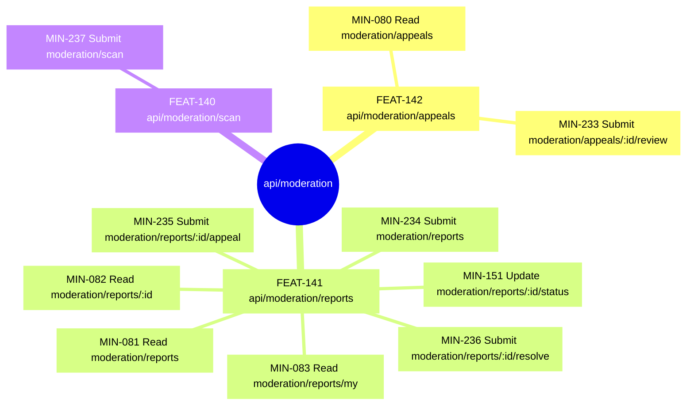
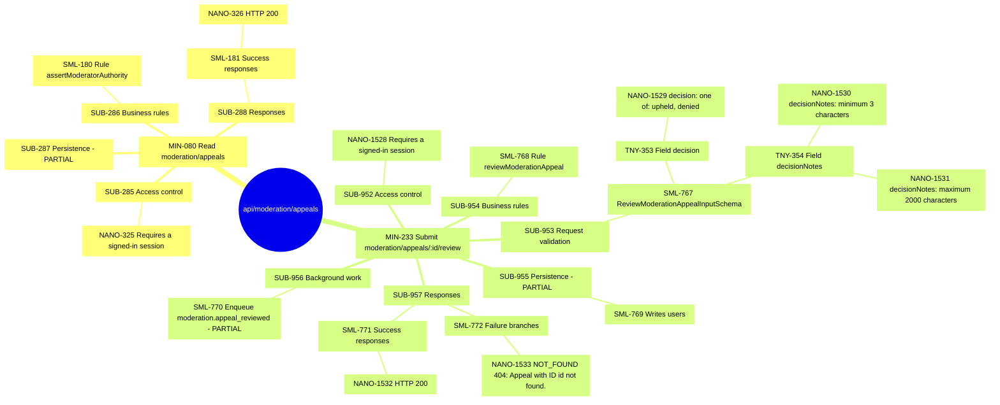
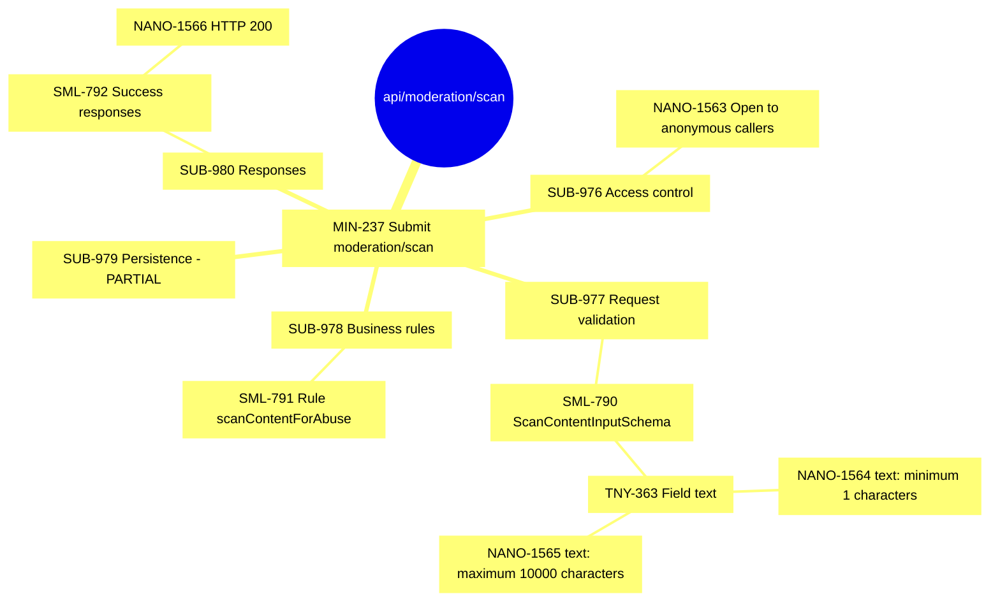

# api/moderation (MOD-093)

Generated by `docs/mindmap/tools/catalog.py` from `master/MASTER_PROJECT_GRAPH.json` at commit `9b3032f`. Do not edit by hand. Back to the [feature catalog](../FEATURE_CATALOG.md).

**Application:** apps/api (MOD-001). **Purpose:** API module: routes under /api/v1/moderation in apps/api/src/server.ts.

**Nodes by level:** MODULE 1, MAJOR 3, MINOR 10, SUB 48, SMALL 37, TINY 12, NANO 55. **Status:** IMPLEMENTED 152, PARTIALLY_IMPLEMENTED 14. **Verification:** PATH_LEVEL 139, UNKNOWN 4, VERIFIED 19.

**User roles that reach it:** anonymous, authenticated, moderator, platform_admin.

**Known gaps:** MIN-080 ephemeral: state held in process memory, lost on restart; MIN-080 no first-party web caller found; MIN-233 ephemeral: state held in process memory, lost on restart; MIN-233 no first-party web caller found; MIN-081 ephemeral: state held in process memory, lost on restart; MIN-081 no first-party web caller found; MIN-082 ephemeral: state held in process memory, lost on restart; MIN-082 no first-party web caller found; MIN-083 ephemeral: state held in process memory, lost on restart; MIN-083 no first-party web caller found; MIN-151 ephemeral: state held in process memory, lost on restart; MIN-151 no first-party web caller found; MIN-234 ephemeral: state held in process memory, lost on restart; MIN-234 no first-party web caller found; MIN-235 ephemeral: state held in process memory, lost on restart; MIN-235 no first-party web caller found; MIN-236 ephemeral: state held in process memory, lost on restart; MIN-236 no first-party web caller found; MIN-237 ephemeral: state held in process memory, lost on restart; MIN-237 no first-party web caller found.

## Module map (to minor features)

## FEAT-142 api/moderation/appeals

api/moderation/appeals

| ID        | Level | Parent   | Name                                             | Description                                                                                                                                                                                                                                                                                                                                                       | Status                | Verification | Evidence                                     | Related                               |
| --------- | ----- | -------- | ------------------------------------------------ | ----------------------------------------------------------------------------------------------------------------------------------------------------------------------------------------------------------------------------------------------------------------------------------------------------------------------------------------------------------------- | --------------------- | ------------ | -------------------------------------------- | ------------------------------------- |
| FEAT-142  | MAJOR | MOD-093  | api/moderation/appeals                           |                                                                                                                                                                                                                                                                                                                                                                   | IMPLEMENTED           |              | apps/api/src/server.ts:12218                 |                                       |
| MIN-080   | MINOR | FEAT-142 | Read moderation/appeals                          | 9. List appeals (Moderator Queue) GET /api/v1/moderation/appeals for any signed-in session; calls assertModeratorAuthority; ephemeral (process memory); responds 200. Gaps: ephemeral: state held in process memory, lost on restart; no first-party web caller found                                                                                             | IMPLEMENTED           | VERIFIED     | apps/api/src/server.ts:12218                 | API-250, TEST-114, TEST-145, TEST-193 |
| SUB-285   | SUB   | MIN-080  | Access control                                   | Who may call GET /api/v1/moderation/appeals: any signed-in session.                                                                                                                                                                                                                                                                                               | IMPLEMENTED           | PATH_LEVEL   | apps/api/src/server.ts:12218                 |                                       |
| NANO-325  | NANO  | SUB-285  | Requires a signed-in session                     | Requests without a valid session token are rejected with 401 UNAUTHENTICATED.                                                                                                                                                                                                                                                                                     | IMPLEMENTED           | PATH_LEVEL   | apps/api/src/server.ts:12218                 | ROLE-001                              |
| SUB-286   | SUB   | MIN-080  | Business rules                                   | Domain functions from packages/domain called by the handler (1).                                                                                                                                                                                                                                                                                                  | IMPLEMENTED           | PATH_LEVEL   | apps/api/src/server.ts:12218                 |                                       |
| SML-180   | SMALL | SUB-286  | Rule assertModeratorAuthority                    | Calls assertModeratorAuthority (packages/domain/src/moderation.ts). Rule status IMPLEMENTED; its own tests: VERIFIED.                                                                                                                                                                                                                                             | IMPLEMENTED           | VERIFIED     | packages/domain/src/moderation.ts:209        | RULE-149                              |
| SUB-287   | SUB   | MIN-080  | Persistence                                      | Ephemeral: state lives in API process memory and is lost on restart.                                                                                                                                                                                                                                                                                              | PARTIALLY_IMPLEMENTED | PATH_LEVEL   | apps/api/src/server.ts:12218                 |                                       |
| SUB-288   | SUB   | MIN-080  | Responses                                        | Success 200; 0 explicit failure branch(es) besides validation and access errors.                                                                                                                                                                                                                                                                                  | IMPLEMENTED           | PATH_LEVEL   | apps/api/src/server.ts:12218                 |                                       |
| SML-181   | SMALL | SUB-288  | Success responses                                | HTTP 200.                                                                                                                                                                                                                                                                                                                                                         | IMPLEMENTED           | PATH_LEVEL   | apps/api/src/server.ts:12218                 |                                       |
| NANO-326  | NANO  | SML-181  | HTTP 200                                         | Replies 200 when the operation succeeds.                                                                                                                                                                                                                                                                                                                          | IMPLEMENTED           | PATH_LEVEL   | apps/api/src/server.ts:12218                 |                                       |
| MIN-233   | MINOR | FEAT-142 | Submit moderation/appeals/:id/review             | 10. Review and decide on an appeal POST /api/v1/moderation/appeals/:id/review for any signed-in session; validates ReviewModerationAppealInputSchema; calls reviewModerationAppeal; ephemeral (process memory); writes users; responds 200; 1 failure branch(es). Gaps: ephemeral: state held in process memory, lost on restart; no first-party web caller found | IMPLEMENTED           | VERIFIED     | apps/api/src/server.ts:12227                 | API-251, TEST-114, TEST-145, TEST-193 |
| SUB-952   | SUB   | MIN-233  | Access control                                   | Who may call POST /api/v1/moderation/appeals/:id/review: any signed-in session.                                                                                                                                                                                                                                                                                   | IMPLEMENTED           | PATH_LEVEL   | apps/api/src/server.ts:12227                 |                                       |
| NANO-1528 | NANO  | SUB-952  | Requires a signed-in session                     | Requests without a valid session token are rejected with 401 UNAUTHENTICATED.                                                                                                                                                                                                                                                                                     | IMPLEMENTED           | PATH_LEVEL   | apps/api/src/server.ts:12227                 | ROLE-001                              |
| SUB-953   | SUB   | MIN-233  | Request validation                               | The request is parsed with ReviewModerationAppealInputSchema; a failure returns 400 with field details before any business logic runs.                                                                                                                                                                                                                            | IMPLEMENTED           | PATH_LEVEL   | apps/api/src/server.ts:12227                 |                                       |
| SML-767   | SMALL | SUB-953  | ReviewModerationAppealInputSchema                | ReviewModerationAppealInputSchema: 2 field(s)                                                                                                                                                                                                                                                                                                                     | IMPLEMENTED           | PATH_LEVEL   | packages/contracts/src/index.ts:867          | SCH-068                               |
| TNY-353   | TINY  | SML-767  | Field decision                                   | decision (enum, required): one of: upheld, denied                                                                                                                                                                                                                                                                                                                 | IMPLEMENTED           | PATH_LEVEL   | packages/contracts/src/index.ts:868          |                                       |
| NANO-1529 | NANO  | TNY-353  | decision: one of: upheld, denied                 | decision one of: upheld, denied.                                                                                                                                                                                                                                                                                                                                  | IMPLEMENTED           | PATH_LEVEL   | packages/contracts/src/index.ts:868          |                                       |
| TNY-354   | TINY  | SML-767  | Field decisionNotes                              | decisionNotes (string, required): minimum 3 characters; maximum 2000 characters                                                                                                                                                                                                                                                                                   | IMPLEMENTED           | PATH_LEVEL   | packages/contracts/src/index.ts:869          |                                       |
| NANO-1530 | NANO  | TNY-354  | decisionNotes: minimum 3 characters              | decisionNotes minimum 3 characters.                                                                                                                                                                                                                                                                                                                               | IMPLEMENTED           | PATH_LEVEL   | packages/contracts/src/index.ts:869          |                                       |
| NANO-1531 | NANO  | TNY-354  | decisionNotes: maximum 2000 characters           | decisionNotes maximum 2000 characters.                                                                                                                                                                                                                                                                                                                            | IMPLEMENTED           | PATH_LEVEL   | packages/contracts/src/index.ts:869          |                                       |
| SUB-954   | SUB   | MIN-233  | Business rules                                   | Domain functions from packages/domain called by the handler (1).                                                                                                                                                                                                                                                                                                  | IMPLEMENTED           | PATH_LEVEL   | apps/api/src/server.ts:12227                 |                                       |
| SML-768   | SMALL | SUB-954  | Rule reviewModerationAppeal                      | Calls reviewModerationAppeal (packages/domain/src/moderation.ts). Rule status IMPLEMENTED; its own tests: VERIFIED.                                                                                                                                                                                                                                               | IMPLEMENTED           | VERIFIED     | packages/domain/src/moderation.ts:387        | RULE-153                              |
| SUB-955   | SUB   | MIN-233  | Persistence                                      | Ephemeral: state lives in API process memory and is lost on restart.                                                                                                                                                                                                                                                                                              | PARTIALLY_IMPLEMENTED | PATH_LEVEL   | apps/api/src/server.ts:12227                 |                                       |
| SML-769   | SMALL | SUB-955  | Writes users                                     | Writes table users (00001_core_schema.sql).                                                                                                                                                                                                                                                                                                                       | IMPLEMENTED           | PATH_LEVEL   | supabase/migrations/00001_core_schema.sql:96 | DB-001                                |
| SUB-956   | SUB   | MIN-233  | Background work                                  | Enqueues 1 background job kind(s) in background_jobs for apps/worker.                                                                                                                                                                                                                                                                                             | IMPLEMENTED           | PATH_LEVEL   | apps/api/src/server.ts:12227                 |                                       |
| SML-770   | SMALL | SUB-956  | Enqueue moderation.appeal_reviewed               | Dispatches job:moderation.appeal_reviewed; worker handler: recordEvent (no-op: marks the event recorded).                                                                                                                                                                                                                                                         | PARTIALLY_IMPLEMENTED | UNKNOWN      | packages/domain/src/background-jobs.ts:171   | SVC-031                               |
| SUB-957   | SUB   | MIN-233  | Responses                                        | Success 200; 1 explicit failure branch(es) besides validation and access errors.                                                                                                                                                                                                                                                                                  | IMPLEMENTED           | PATH_LEVEL   | apps/api/src/server.ts:12227                 |                                       |
| SML-771   | SMALL | SUB-957  | Success responses                                | HTTP 200.                                                                                                                                                                                                                                                                                                                                                         | IMPLEMENTED           | PATH_LEVEL   | apps/api/src/server.ts:12227                 |                                       |
| NANO-1532 | NANO  | SML-771  | HTTP 200                                         | Replies 200 when the operation succeeds.                                                                                                                                                                                                                                                                                                                          | IMPLEMENTED           | PATH_LEVEL   | apps/api/src/server.ts:12227                 |                                       |
| SML-772   | SMALL | SUB-957  | Failure branches                                 | 1 DomainError branch(es) in the handler, mapped to HTTP by the global error handler.                                                                                                                                                                                                                                                                              | IMPLEMENTED           | PATH_LEVEL   | apps/api/src/server.ts:12227                 |                                       |
| NANO-1533 | NANO  | SML-772  | NOT_FOUND 404: Appeal with ID "${id}" not found. | Throws DomainError(NOT_FOUND) "Appeal with ID "${id}" not found." -> HTTP 404.                                                                                                                                                                                                                                                                                    | IMPLEMENTED           | PATH_LEVEL   | apps/api/src/server.ts:12236                 | ERR-226                               |

## FEAT-141 api/moderation/reports

api/moderation/reports

```mermaid
mindmap
  root((api/moderation/reports))
    MIN_081[MIN-081 Read moderation/reports]
      SUB_289[SUB-289 Access control]
        NANO_327[NANO-327 Requires a signed-in session]
      SUB_290[SUB-290 Business rules]
        SML_182[SML-182 Rule assertModeratorAuthority]
      SUB_291[SUB-291 Persistence - PARTIAL]
      SUB_292[SUB-292 Responses]
        SML_183[SML-183 Success responses]
          NANO_328[NANO-328 HTTP 200]
    MIN_082[MIN-082 Read moderation/reports/:id]
      SUB_293[SUB-293 Access control]
        NANO_329[NANO-329 Requires a signed-in session]
        NANO_330[NANO-330 Allowed role: moderator]
        NANO_331[NANO-331 Allowed role: platform_admin]
      SUB_294[SUB-294 Persistence - PARTIAL]
      SUB_295[SUB-295 Responses]
        SML_184[SML-184 Success responses]
          NANO_332[NANO-332 HTTP 200]
        SML_185[SML-185 Failure branches]
          NANO_333[NANO-333 NOT_FOUND 404: Moderation report with ID id not found.]
          NANO_334[NANO-334 FORBIDDEN 403: Access denied to this moderation report.]
    MIN_083[MIN-083 Read moderation/reports/my]
      SUB_296[SUB-296 Access control]
        NANO_335[NANO-335 Requires a signed-in session]
      SUB_297[SUB-297 Persistence - PARTIAL]
      SUB_298[SUB-298 Responses]
        SML_186[SML-186 Success responses]
          NANO_336[NANO-336 HTTP 200]
    MIN_151[MIN-151 Update moderation/reports/:id/status]
      SUB_549[SUB-549 Access control]
        NANO_685[NANO-685 Requires a signed-in session]
      SUB_550[SUB-550 Request validation]
        SML_367[SML-367 UpdateModerationReportStatusInputSchema]
          TNY_083[TNY-083 Field status]
            NANO_686[NANO-686 status: one of: pending, under_review, resolved, dis...]
      SUB_551[SUB-551 Business rules]
        SML_368[SML-368 Rule transitionReportStatus]
      SUB_552[SUB-552 Persistence - PARTIAL]
      SUB_553[SUB-553 Responses]
        SML_369[SML-369 Success responses]
          NANO_687[NANO-687 HTTP 200]
        SML_370[SML-370 Failure branches]
          NANO_688[NANO-688 NOT_FOUND 404: Moderation report with ID id not found.]
    MIN_234[MIN-234 Submit moderation/reports]
      SUB_958[SUB-958 Access control]
        NANO_1534[NANO-1534 Requires a signed-in session]
        NANO_1535[NANO-1535 Guard: canManageJobs]
      SUB_959[SUB-959 Request validation]
        SML_773[SML-773 CreateModerationReportInputSchema]
          TNY_355[TNY-355 Field targetType]
            NANO_1536[NANO-1536 targetType: one of: user, job, message, evidence, r...]
          TNY_356[TNY-356 Field targetId]
            NANO_1537[NANO-1537 targetId: minimum 1 characters]
            NANO_1538[NANO-1538 targetId: maximum 128 characters]
          TNY_357[TNY-357 Field reason]
            NANO_1539[NANO-1539 reason: one of: spam, harassment, fraud, inappropri...]
          TNY_358[TNY-358 Field details]
            NANO_1540[NANO-1540 details: maximum 2000 characters]
            NANO_1541[NANO-1541 details: optional]
      SUB_960[SUB-960 Business rules]
        SML_774[SML-774 Rule createModerationReport]
      SUB_961[SUB-961 Persistence - PARTIAL]
      SUB_962[SUB-962 Background work]
        SML_775[SML-775 Enqueue moderation.report_created - PARTIAL]
      SUB_963[SUB-963 Responses]
        SML_776[SML-776 Success responses]
          NANO_1542[NANO-1542 HTTP 201]
    MIN_235[MIN-235 Submit moderation/reports/:id/appeal]
      SUB_964[SUB-964 Access control]
        NANO_1543[NANO-1543 Requires a signed-in session]
      SUB_965[SUB-965 Request validation]
        SML_777[SML-777 CreateModerationAppealInputSchema]
          TNY_359[TNY-359 Field reason]
            NANO_1544[NANO-1544 reason: minimum 10 characters]
            NANO_1545[NANO-1545 reason: maximum 2000 characters]
      SUB_966[SUB-966 Business rules]
        SML_778[SML-778 Rule createModerationAppeal]
      SUB_967[SUB-967 Persistence - PARTIAL]
      SUB_968[SUB-968 Background work]
        SML_779[SML-779 Enqueue moderation.appeal_submitted - PARTIAL]
      SUB_969[SUB-969 Responses]
        SML_780[SML-780 Success responses]
          NANO_1546[NANO-1546 HTTP 201]
        SML_781[SML-781 Failure branches]
          NANO_1547[NANO-1547 NOT_FOUND 404: Moderation report with ID id not found.]
          NANO_1548[NANO-1548 FORBIDDEN 403: Only the person or team this decisio...]
    MIN_236[MIN-236 Submit moderation/reports/:id/resolve]
      SUB_970[SUB-970 Access control]
        NANO_1549[NANO-1549 Requires a signed-in session]
        NANO_1550[NANO-1550 Allowed role: platform_admin]
      SUB_971[SUB-971 Request validation]
        SML_782[SML-782 ResolveModerationReportInputSchema]
          TNY_360[TNY-360 Field action]
            NANO_1551[NANO-1551 action: one of: none, warning, content_removed, use...]
          TNY_361[TNY-361 Field resolutionNotes]
            NANO_1552[NANO-1552 resolutionNotes: minimum 3 characters]
            NANO_1553[NANO-1553 resolutionNotes: maximum 2000 characters]
          TNY_362[TNY-362 Field secondApproverId]
            NANO_1554[NANO-1554 secondApproverId: must be a UUID]
            NANO_1555[NANO-1555 secondApproverId: optional]
      SUB_972[SUB-972 Business rules]
        SML_783[SML-783 Rule resolveModerationReport]
      SUB_973[SUB-973 Persistence - PARTIAL]
        SML_784[SML-784 Writes users]
        SML_785[SML-785 Writes jobs]
        SML_786[SML-786 Writes job_skills]
      SUB_974[SUB-974 Background work]
        SML_787[SML-787 Enqueue moderation.report_resolved - PARTIAL]
      SUB_975[SUB-975 Responses]
        SML_788[SML-788 Success responses]
          NANO_1556[NANO-1556 HTTP 200]
          NANO_1557[NANO-1557 HTTP 202]
        SML_789[SML-789 Failure branches]
          NANO_1558[NANO-1558 NOT_FOUND 404: Moderation report with ID id not found.]
          NANO_1559[NANO-1559 FORBIDDEN 403: You cannot resolve a report you filed.]
          NANO_1560[NANO-1560 FORBIDDEN 403: Only a platform admin can suspend or...]
          NANO_1561[NANO-1561 INVALID_STATE_TRANSITION 422: Report with ID report...]
          NANO_1562[NANO-1562 FORBIDDEN 403: Permanent account termination requir...]
```

| ID        | Level | Parent   | Name                                                                                                     | Description                                                                                                                                                                                                                                                                                                                                                                                                                             | Status                | Verification | Evidence                                                  | Related                                         |
| --------- | ----- | -------- | -------------------------------------------------------------------------------------------------------- | --------------------------------------------------------------------------------------------------------------------------------------------------------------------------------------------------------------------------------------------------------------------------------------------------------------------------------------------------------------------------------------------------------------------------------------- | --------------------- | ------------ | --------------------------------------------------------- | ----------------------------------------------- |
| FEAT-141  | MAJOR | MOD-093  | api/moderation/reports                                                                                   |                                                                                                                                                                                                                                                                                                                                                                                                                                         | IMPLEMENTED           |              | apps/api/src/server.ts:11885                              |                                                 |
| MIN-081   | MINOR | FEAT-141 | Read moderation/reports                                                                                  | 4. Moderator Queue: List reports with optional filters GET /api/v1/moderation/reports for any signed-in session; calls assertModeratorAuthority; ephemeral (process memory); responds 200. Gaps: ephemeral: state held in process memory, lost on restart; no first-party web caller found                                                                                                                                              | IMPLEMENTED           | VERIFIED     | apps/api/src/server.ts:11978                              | API-245, TEST-114, TEST-145, TEST-193           |
| SUB-289   | SUB   | MIN-081  | Access control                                                                                           | Who may call GET /api/v1/moderation/reports: any signed-in session.                                                                                                                                                                                                                                                                                                                                                                     | IMPLEMENTED           | PATH_LEVEL   | apps/api/src/server.ts:11978                              |                                                 |
| NANO-327  | NANO  | SUB-289  | Requires a signed-in session                                                                             | Requests without a valid session token are rejected with 401 UNAUTHENTICATED.                                                                                                                                                                                                                                                                                                                                                           | IMPLEMENTED           | PATH_LEVEL   | apps/api/src/server.ts:11978                              | ROLE-001                                        |
| SUB-290   | SUB   | MIN-081  | Business rules                                                                                           | Domain functions from packages/domain called by the handler (1).                                                                                                                                                                                                                                                                                                                                                                        | IMPLEMENTED           | PATH_LEVEL   | apps/api/src/server.ts:11978                              |                                                 |
| SML-182   | SMALL | SUB-290  | Rule assertModeratorAuthority                                                                            | Calls assertModeratorAuthority (packages/domain/src/moderation.ts). Rule status IMPLEMENTED; its own tests: VERIFIED.                                                                                                                                                                                                                                                                                                                   | IMPLEMENTED           | VERIFIED     | packages/domain/src/moderation.ts:209                     | RULE-149                                        |
| SUB-291   | SUB   | MIN-081  | Persistence                                                                                              | Ephemeral: state lives in API process memory and is lost on restart.                                                                                                                                                                                                                                                                                                                                                                    | PARTIALLY_IMPLEMENTED | PATH_LEVEL   | apps/api/src/server.ts:11978                              |                                                 |
| SUB-292   | SUB   | MIN-081  | Responses                                                                                                | Success 200; 0 explicit failure branch(es) besides validation and access errors.                                                                                                                                                                                                                                                                                                                                                        | IMPLEMENTED           | PATH_LEVEL   | apps/api/src/server.ts:11978                              |                                                 |
| SML-183   | SMALL | SUB-292  | Success responses                                                                                        | HTTP 200.                                                                                                                                                                                                                                                                                                                                                                                                                               | IMPLEMENTED           | PATH_LEVEL   | apps/api/src/server.ts:11978                              |                                                 |
| NANO-328  | NANO  | SML-183  | HTTP 200                                                                                                 | Replies 200 when the operation succeeds.                                                                                                                                                                                                                                                                                                                                                                                                | IMPLEMENTED           | PATH_LEVEL   | apps/api/src/server.ts:11978                              |                                                 |
| MIN-082   | MINOR | FEAT-141 | Read moderation/reports/:id                                                                              | 5. Get report details GET /api/v1/moderation/reports/:id for roles moderator, platform_admin; ephemeral (process memory); responds 200; 2 failure branch(es). Gaps: ephemeral: state held in process memory, lost on restart; no first-party web caller found                                                                                                                                                                           | IMPLEMENTED           | VERIFIED     | apps/api/src/server.ts:12000                              | API-246, TEST-114, TEST-124, TEST-142, TEST-193 |
| SUB-293   | SUB   | MIN-082  | Access control                                                                                           | Who may call GET /api/v1/moderation/reports/:id: roles moderator, platform_admin.                                                                                                                                                                                                                                                                                                                                                       | IMPLEMENTED           | PATH_LEVEL   | apps/api/src/server.ts:12000                              |                                                 |
| NANO-329  | NANO  | SUB-293  | Requires a signed-in session                                                                             | Requests without a valid session token are rejected with 401 UNAUTHENTICATED.                                                                                                                                                                                                                                                                                                                                                           | IMPLEMENTED           | PATH_LEVEL   | apps/api/src/server.ts:12000                              | ROLE-001                                        |
| NANO-330  | NANO  | SUB-293  | Allowed role: moderator                                                                                  | moderator is one of the roles allowed here (moderator, platform_admin); a caller holding none of them is rejected with 403.                                                                                                                                                                                                                                                                                                             | IMPLEMENTED           | PATH_LEVEL   | apps/api/src/server.ts:12000                              | ROLE-009                                        |
| NANO-331  | NANO  | SUB-293  | Allowed role: platform_admin                                                                             | platform_admin is one of the roles allowed here (moderator, platform_admin); a caller holding none of them is rejected with 403.                                                                                                                                                                                                                                                                                                        | IMPLEMENTED           | PATH_LEVEL   | apps/api/src/server.ts:12000                              | ROLE-008                                        |
| SUB-294   | SUB   | MIN-082  | Persistence                                                                                              | Ephemeral: state lives in API process memory and is lost on restart.                                                                                                                                                                                                                                                                                                                                                                    | PARTIALLY_IMPLEMENTED | PATH_LEVEL   | apps/api/src/server.ts:12000                              |                                                 |
| SUB-295   | SUB   | MIN-082  | Responses                                                                                                | Success 200; 2 explicit failure branch(es) besides validation and access errors.                                                                                                                                                                                                                                                                                                                                                        | IMPLEMENTED           | PATH_LEVEL   | apps/api/src/server.ts:12000                              |                                                 |
| SML-184   | SMALL | SUB-295  | Success responses                                                                                        | HTTP 200.                                                                                                                                                                                                                                                                                                                                                                                                                               | IMPLEMENTED           | PATH_LEVEL   | apps/api/src/server.ts:12000                              |                                                 |
| NANO-332  | NANO  | SML-184  | HTTP 200                                                                                                 | Replies 200 when the operation succeeds.                                                                                                                                                                                                                                                                                                                                                                                                | IMPLEMENTED           | PATH_LEVEL   | apps/api/src/server.ts:12000                              |                                                 |
| SML-185   | SMALL | SUB-295  | Failure branches                                                                                         | 2 DomainError branch(es) in the handler, mapped to HTTP by the global error handler.                                                                                                                                                                                                                                                                                                                                                    | IMPLEMENTED           | PATH_LEVEL   | apps/api/src/server.ts:12000                              |                                                 |
| NANO-333  | NANO  | SML-185  | NOT_FOUND 404: Moderation report with ID "${id}" not found.                                              | Throws DomainError(NOT_FOUND) "Moderation report with ID "${id}" not found." -> HTTP 404.                                                                                                                                                                                                                                                                                                                                               | IMPLEMENTED           | PATH_LEVEL   | apps/api/src/server.ts:12007                              | ERR-219                                         |
| NANO-334  | NANO  | SML-185  | FORBIDDEN 403: Access denied to this moderation report.                                                  | Throws DomainError(FORBIDDEN) "Access denied to this moderation report." -> HTTP 403.                                                                                                                                                                                                                                                                                                                                                   | IMPLEMENTED           | PATH_LEVEL   | apps/api/src/server.ts:12013                              | ERR-220                                         |
| MIN-083   | MINOR | FEAT-141 | Read moderation/reports/my                                                                               | GET /api/v1/moderation/reports/my for any signed-in session; ephemeral (process memory); responds 200. Gaps: ephemeral: state held in process memory, lost on restart; no first-party web caller found                                                                                                                                                                                                                                  | IMPLEMENTED           | VERIFIED     | apps/api/src/server.ts:11953                              | API-244, TEST-114, TEST-124, TEST-142, TEST-193 |
| SUB-296   | SUB   | MIN-083  | Access control                                                                                           | Who may call GET /api/v1/moderation/reports/my: any signed-in session.                                                                                                                                                                                                                                                                                                                                                                  | IMPLEMENTED           | PATH_LEVEL   | apps/api/src/server.ts:11953                              |                                                 |
| NANO-335  | NANO  | SUB-296  | Requires a signed-in session                                                                             | Requests without a valid session token are rejected with 401 UNAUTHENTICATED.                                                                                                                                                                                                                                                                                                                                                           | IMPLEMENTED           | PATH_LEVEL   | apps/api/src/server.ts:11953                              | ROLE-001                                        |
| SUB-297   | SUB   | MIN-083  | Persistence                                                                                              | Ephemeral: state lives in API process memory and is lost on restart.                                                                                                                                                                                                                                                                                                                                                                    | PARTIALLY_IMPLEMENTED | PATH_LEVEL   | apps/api/src/server.ts:11953                              |                                                 |
| SUB-298   | SUB   | MIN-083  | Responses                                                                                                | Success 200; 0 explicit failure branch(es) besides validation and access errors.                                                                                                                                                                                                                                                                                                                                                        | IMPLEMENTED           | PATH_LEVEL   | apps/api/src/server.ts:11953                              |                                                 |
| SML-186   | SMALL | SUB-298  | Success responses                                                                                        | HTTP 200.                                                                                                                                                                                                                                                                                                                                                                                                                               | IMPLEMENTED           | PATH_LEVEL   | apps/api/src/server.ts:11953                              |                                                 |
| NANO-336  | NANO  | SML-186  | HTTP 200                                                                                                 | Replies 200 when the operation succeeds.                                                                                                                                                                                                                                                                                                                                                                                                | IMPLEMENTED           | PATH_LEVEL   | apps/api/src/server.ts:11953                              |                                                 |
| MIN-151   | MINOR | FEAT-141 | Update moderation/reports/:id/status                                                                     | 6. Transition report status (BR-34) PATCH /api/v1/moderation/reports/:id/status for any signed-in session; validates UpdateModerationReportStatusInputSchema; calls transitionReportStatus; ephemeral (process memory); responds 200; 1 failure branch(es). Gaps: ephemeral: state held in process memory, lost on restart; no first-party web caller found                                                                             | IMPLEMENTED           | VERIFIED     | apps/api/src/server.ts:12021                              | API-247, TEST-114, TEST-124, TEST-145, TEST-193 |
| SUB-549   | SUB   | MIN-151  | Access control                                                                                           | Who may call PATCH /api/v1/moderation/reports/:id/status: any signed-in session.                                                                                                                                                                                                                                                                                                                                                        | IMPLEMENTED           | PATH_LEVEL   | apps/api/src/server.ts:12021                              |                                                 |
| NANO-685  | NANO  | SUB-549  | Requires a signed-in session                                                                             | Requests without a valid session token are rejected with 401 UNAUTHENTICATED.                                                                                                                                                                                                                                                                                                                                                           | IMPLEMENTED           | PATH_LEVEL   | apps/api/src/server.ts:12021                              | ROLE-001                                        |
| SUB-550   | SUB   | MIN-151  | Request validation                                                                                       | The request is parsed with UpdateModerationReportStatusInputSchema; a failure returns 400 with field details before any business logic runs.                                                                                                                                                                                                                                                                                            | IMPLEMENTED           | PATH_LEVEL   | apps/api/src/server.ts:12021                              |                                                 |
| SML-367   | SMALL | SUB-550  | UpdateModerationReportStatusInputSchema                                                                  | UpdateModerationReportStatusInputSchema: 1 field(s)                                                                                                                                                                                                                                                                                                                                                                                     | IMPLEMENTED           | PATH_LEVEL   | packages/contracts/src/index.ts:838                       | SCH-065                                         |
| TNY-083   | TINY  | SML-367  | Field status                                                                                             | status (enum, required): one of: pending, under_review, resolved, dismissed                                                                                                                                                                                                                                                                                                                                                             | IMPLEMENTED           | PATH_LEVEL   | packages/contracts/src/index.ts:839                       |                                                 |
| NANO-686  | NANO  | TNY-083  | status: one of: pending, under_review, resolved, dismissed                                               | status one of: pending, under_review, resolved, dismissed.                                                                                                                                                                                                                                                                                                                                                                              | IMPLEMENTED           | PATH_LEVEL   | packages/contracts/src/index.ts:839                       |                                                 |
| SUB-551   | SUB   | MIN-151  | Business rules                                                                                           | Domain functions from packages/domain called by the handler (1).                                                                                                                                                                                                                                                                                                                                                                        | IMPLEMENTED           | PATH_LEVEL   | apps/api/src/server.ts:12021                              |                                                 |
| SML-368   | SMALL | SUB-551  | Rule transitionReportStatus                                                                              | Calls transitionReportStatus (packages/domain/src/moderation.ts). Rule status IMPLEMENTED; its own tests: VERIFIED.                                                                                                                                                                                                                                                                                                                     | IMPLEMENTED           | VERIFIED     | packages/domain/src/moderation.ts:222                     | RULE-150                                        |
| SUB-552   | SUB   | MIN-151  | Persistence                                                                                              | Ephemeral: state lives in API process memory and is lost on restart.                                                                                                                                                                                                                                                                                                                                                                    | PARTIALLY_IMPLEMENTED | PATH_LEVEL   | apps/api/src/server.ts:12021                              |                                                 |
| SUB-553   | SUB   | MIN-151  | Responses                                                                                                | Success 200; 1 explicit failure branch(es) besides validation and access errors.                                                                                                                                                                                                                                                                                                                                                        | IMPLEMENTED           | PATH_LEVEL   | apps/api/src/server.ts:12021                              |                                                 |
| SML-369   | SMALL | SUB-553  | Success responses                                                                                        | HTTP 200.                                                                                                                                                                                                                                                                                                                                                                                                                               | IMPLEMENTED           | PATH_LEVEL   | apps/api/src/server.ts:12021                              |                                                 |
| NANO-687  | NANO  | SML-369  | HTTP 200                                                                                                 | Replies 200 when the operation succeeds.                                                                                                                                                                                                                                                                                                                                                                                                | IMPLEMENTED           | PATH_LEVEL   | apps/api/src/server.ts:12021                              |                                                 |
| SML-370   | SMALL | SUB-553  | Failure branches                                                                                         | 1 DomainError branch(es) in the handler, mapped to HTTP by the global error handler.                                                                                                                                                                                                                                                                                                                                                    | IMPLEMENTED           | PATH_LEVEL   | apps/api/src/server.ts:12021                              |                                                 |
| NANO-688  | NANO  | SML-370  | NOT_FOUND 404: Moderation report with ID "${id}" not found.                                              | Throws DomainError(NOT_FOUND) "Moderation report with ID "${id}" not found." -> HTTP 404.                                                                                                                                                                                                                                                                                                                                               | IMPLEMENTED           | PATH_LEVEL   | apps/api/src/server.ts:12030                              | ERR-219                                         |
| MIN-234   | MINOR | FEAT-141 | Submit moderation/reports                                                                                | 2. Submit a moderation report POST /api/v1/moderation/reports for any signed-in session; validates CreateModerationReportInputSchema; calls createModerationReport; ephemeral (process memory); responds 201. Gaps: ephemeral: state held in process memory, lost on restart; no first-party web caller found                                                                                                                           | IMPLEMENTED           | VERIFIED     | apps/api/src/server.ts:11885                              | API-243, TEST-114, TEST-124, TEST-145, TEST-193 |
| SUB-958   | SUB   | MIN-234  | Access control                                                                                           | Who may call POST /api/v1/moderation/reports: any signed-in session.                                                                                                                                                                                                                                                                                                                                                                    | IMPLEMENTED           | PATH_LEVEL   | apps/api/src/server.ts:11885                              |                                                 |
| NANO-1534 | NANO  | SUB-958  | Requires a signed-in session                                                                             | Requests without a valid session token are rejected with 401 UNAUTHENTICATED.                                                                                                                                                                                                                                                                                                                                                           | IMPLEMENTED           | PATH_LEVEL   | apps/api/src/server.ts:11885                              | ROLE-001                                        |
| NANO-1535 | NANO  | SUB-958  | Guard: canManageJobs                                                                                     | Guard canManageJobs must pass before the handler runs.                                                                                                                                                                                                                                                                                                                                                                                  | IMPLEMENTED           | PATH_LEVEL   | apps/api/src/server.ts:11885                              |                                                 |
| SUB-959   | SUB   | MIN-234  | Request validation                                                                                       | The request is parsed with CreateModerationReportInputSchema; a failure returns 400 with field details before any business logic runs.                                                                                                                                                                                                                                                                                                  | IMPLEMENTED           | PATH_LEVEL   | apps/api/src/server.ts:11885                              |                                                 |
| SML-773   | SMALL | SUB-959  | CreateModerationReportInputSchema                                                                        | CreateModerationReportInputSchema: 4 field(s)                                                                                                                                                                                                                                                                                                                                                                                           | IMPLEMENTED           | PATH_LEVEL   | packages/contracts/src/index.ts:821                       | SCH-064                                         |
| TNY-355   | TINY  | SML-773  | Field targetType                                                                                         | targetType (enum, required): one of: user, job, message, evidence, review, portfolio_project                                                                                                                                                                                                                                                                                                                                            | IMPLEMENTED           | PATH_LEVEL   | packages/contracts/src/index.ts:822                       |                                                 |
| NANO-1536 | NANO  | TNY-355  | targetType: one of: user, job, message, evidence, review, portfolio_project                              | targetType one of: user, job, message, evidence, review, portfolio_project.                                                                                                                                                                                                                                                                                                                                                             | IMPLEMENTED           | PATH_LEVEL   | packages/contracts/src/index.ts:822                       |                                                 |
| TNY-356   | TINY  | SML-773  | Field targetId                                                                                           | targetId (string, required): minimum 1 characters; maximum 128 characters                                                                                                                                                                                                                                                                                                                                                               | IMPLEMENTED           | PATH_LEVEL   | packages/contracts/src/index.ts:823                       |                                                 |
| NANO-1537 | NANO  | TNY-356  | targetId: minimum 1 characters                                                                           | targetId minimum 1 characters.                                                                                                                                                                                                                                                                                                                                                                                                          | IMPLEMENTED           | PATH_LEVEL   | packages/contracts/src/index.ts:823                       |                                                 |
| NANO-1538 | NANO  | TNY-356  | targetId: maximum 128 characters                                                                         | targetId maximum 128 characters.                                                                                                                                                                                                                                                                                                                                                                                                        | IMPLEMENTED           | PATH_LEVEL   | packages/contracts/src/index.ts:823                       |                                                 |
| TNY-357   | TINY  | SML-773  | Field reason                                                                                             | reason (enum, required): one of: spam, harassment, fraud, inappropriate, intellectual_property, security_violation, other                                                                                                                                                                                                                                                                                                               | IMPLEMENTED           | PATH_LEVEL   | packages/contracts/src/index.ts:824                       |                                                 |
| NANO-1539 | NANO  | TNY-357  | reason: one of: spam, harassment, fraud, inappropriate, intellectual_property, security_violation, other | reason one of: spam, harassment, fraud, inappropriate, intellectual_property, security_violation, other.                                                                                                                                                                                                                                                                                                                                | IMPLEMENTED           | PATH_LEVEL   | packages/contracts/src/index.ts:824                       |                                                 |
| TNY-358   | TINY  | SML-773  | Field details                                                                                            | details (string, optional): maximum 2000 characters; optional                                                                                                                                                                                                                                                                                                                                                                           | IMPLEMENTED           | PATH_LEVEL   | packages/contracts/src/index.ts:833                       |                                                 |
| NANO-1540 | NANO  | TNY-358  | details: maximum 2000 characters                                                                         | details maximum 2000 characters.                                                                                                                                                                                                                                                                                                                                                                                                        | IMPLEMENTED           | PATH_LEVEL   | packages/contracts/src/index.ts:833                       |                                                 |
| NANO-1541 | NANO  | TNY-358  | details: optional                                                                                        | details optional.                                                                                                                                                                                                                                                                                                                                                                                                                       | IMPLEMENTED           | PATH_LEVEL   | packages/contracts/src/index.ts:833                       |                                                 |
| SUB-960   | SUB   | MIN-234  | Business rules                                                                                           | Domain functions from packages/domain called by the handler (1).                                                                                                                                                                                                                                                                                                                                                                        | IMPLEMENTED           | PATH_LEVEL   | apps/api/src/server.ts:11885                              |                                                 |
| SML-774   | SMALL | SUB-960  | Rule createModerationReport                                                                              | Calls createModerationReport (packages/domain/src/moderation.ts). Rule status IMPLEMENTED; its own tests: VERIFIED.                                                                                                                                                                                                                                                                                                                     | IMPLEMENTED           | VERIFIED     | packages/domain/src/moderation.ts:158                     | RULE-148                                        |
| SUB-961   | SUB   | MIN-234  | Persistence                                                                                              | Ephemeral: state lives in API process memory and is lost on restart.                                                                                                                                                                                                                                                                                                                                                                    | PARTIALLY_IMPLEMENTED | PATH_LEVEL   | apps/api/src/server.ts:11885                              |                                                 |
| SUB-962   | SUB   | MIN-234  | Background work                                                                                          | Enqueues 1 background job kind(s) in background_jobs for apps/worker.                                                                                                                                                                                                                                                                                                                                                                   | IMPLEMENTED           | PATH_LEVEL   | apps/api/src/server.ts:11885                              |                                                 |
| SML-775   | SMALL | SUB-962  | Enqueue moderation.report_created                                                                        | Dispatches job:moderation.report_created; worker handler: recordEvent (no-op: marks the event recorded).                                                                                                                                                                                                                                                                                                                                | PARTIALLY_IMPLEMENTED | UNKNOWN      | packages/domain/src/background-jobs.ts:171                | SVC-033                                         |
| SUB-963   | SUB   | MIN-234  | Responses                                                                                                | Success 201; 0 explicit failure branch(es) besides validation and access errors.                                                                                                                                                                                                                                                                                                                                                        | IMPLEMENTED           | PATH_LEVEL   | apps/api/src/server.ts:11885                              |                                                 |
| SML-776   | SMALL | SUB-963  | Success responses                                                                                        | HTTP 201.                                                                                                                                                                                                                                                                                                                                                                                                                               | IMPLEMENTED           | PATH_LEVEL   | apps/api/src/server.ts:11885                              |                                                 |
| NANO-1542 | NANO  | SML-776  | HTTP 201                                                                                                 | Replies 201 when the operation succeeds.                                                                                                                                                                                                                                                                                                                                                                                                | IMPLEMENTED           | PATH_LEVEL   | apps/api/src/server.ts:11885                              |                                                 |
| MIN-235   | MINOR | FEAT-141 | Submit moderation/reports/:id/appeal                                                                     | 8. Submit an appeal against an adverse moderation action (WIT-013, BR-154) POST /api/v1/moderation/reports/:id/appeal for any signed-in session; validates CreateModerationAppealInputSchema; calls createModerationAppeal; ephemeral (process memory); responds 201; 2 failure branch(es). Gaps: ephemeral: state held in process memory, lost on restart; no first-party web caller found                                             | IMPLEMENTED           | VERIFIED     | apps/api/src/server.ts:12181                              | API-249, TEST-114, TEST-145, TEST-193           |
| SUB-964   | SUB   | MIN-235  | Access control                                                                                           | Who may call POST /api/v1/moderation/reports/:id/appeal: any signed-in session.                                                                                                                                                                                                                                                                                                                                                         | IMPLEMENTED           | PATH_LEVEL   | apps/api/src/server.ts:12181                              |                                                 |
| NANO-1543 | NANO  | SUB-964  | Requires a signed-in session                                                                             | Requests without a valid session token are rejected with 401 UNAUTHENTICATED.                                                                                                                                                                                                                                                                                                                                                           | IMPLEMENTED           | PATH_LEVEL   | apps/api/src/server.ts:12181                              | ROLE-001                                        |
| SUB-965   | SUB   | MIN-235  | Request validation                                                                                       | The request is parsed with CreateModerationAppealInputSchema; a failure returns 400 with field details before any business logic runs.                                                                                                                                                                                                                                                                                                  | IMPLEMENTED           | PATH_LEVEL   | apps/api/src/server.ts:12181                              |                                                 |
| SML-777   | SMALL | SUB-965  | CreateModerationAppealInputSchema                                                                        | CreateModerationAppealInputSchema: 1 field(s)                                                                                                                                                                                                                                                                                                                                                                                           | IMPLEMENTED           | PATH_LEVEL   | packages/contracts/src/index.ts:861                       | SCH-067                                         |
| TNY-359   | TINY  | SML-777  | Field reason                                                                                             | reason (string, required): minimum 10 characters; maximum 2000 characters                                                                                                                                                                                                                                                                                                                                                               | IMPLEMENTED           | PATH_LEVEL   | packages/contracts/src/index.ts:862                       |                                                 |
| NANO-1544 | NANO  | TNY-359  | reason: minimum 10 characters                                                                            | reason minimum 10 characters.                                                                                                                                                                                                                                                                                                                                                                                                           | IMPLEMENTED           | PATH_LEVEL   | packages/contracts/src/index.ts:862                       |                                                 |
| NANO-1545 | NANO  | TNY-359  | reason: maximum 2000 characters                                                                          | reason maximum 2000 characters.                                                                                                                                                                                                                                                                                                                                                                                                         | IMPLEMENTED           | PATH_LEVEL   | packages/contracts/src/index.ts:862                       |                                                 |
| SUB-966   | SUB   | MIN-235  | Business rules                                                                                           | Domain functions from packages/domain called by the handler (1).                                                                                                                                                                                                                                                                                                                                                                        | IMPLEMENTED           | PATH_LEVEL   | apps/api/src/server.ts:12181                              |                                                 |
| SML-778   | SMALL | SUB-966  | Rule createModerationAppeal                                                                              | Calls createModerationAppeal (packages/domain/src/moderation.ts). Rule status IMPLEMENTED; its own tests: VERIFIED.                                                                                                                                                                                                                                                                                                                     | IMPLEMENTED           | VERIFIED     | packages/domain/src/moderation.ts:331                     | RULE-152                                        |
| SUB-967   | SUB   | MIN-235  | Persistence                                                                                              | Ephemeral: state lives in API process memory and is lost on restart.                                                                                                                                                                                                                                                                                                                                                                    | PARTIALLY_IMPLEMENTED | PATH_LEVEL   | apps/api/src/server.ts:12181                              |                                                 |
| SUB-968   | SUB   | MIN-235  | Background work                                                                                          | Enqueues 1 background job kind(s) in background_jobs for apps/worker.                                                                                                                                                                                                                                                                                                                                                                   | IMPLEMENTED           | PATH_LEVEL   | apps/api/src/server.ts:12181                              |                                                 |
| SML-779   | SMALL | SUB-968  | Enqueue moderation.appeal_submitted                                                                      | Dispatches job:moderation.appeal_submitted; worker handler: recordEvent (no-op: marks the event recorded).                                                                                                                                                                                                                                                                                                                              | PARTIALLY_IMPLEMENTED | UNKNOWN      | packages/domain/src/background-jobs.ts:171                | SVC-032                                         |
| SUB-969   | SUB   | MIN-235  | Responses                                                                                                | Success 201; 2 explicit failure branch(es) besides validation and access errors.                                                                                                                                                                                                                                                                                                                                                        | IMPLEMENTED           | PATH_LEVEL   | apps/api/src/server.ts:12181                              |                                                 |
| SML-780   | SMALL | SUB-969  | Success responses                                                                                        | HTTP 201.                                                                                                                                                                                                                                                                                                                                                                                                                               | IMPLEMENTED           | PATH_LEVEL   | apps/api/src/server.ts:12181                              |                                                 |
| NANO-1546 | NANO  | SML-780  | HTTP 201                                                                                                 | Replies 201 when the operation succeeds.                                                                                                                                                                                                                                                                                                                                                                                                | IMPLEMENTED           | PATH_LEVEL   | apps/api/src/server.ts:12181                              |                                                 |
| SML-781   | SMALL | SUB-969  | Failure branches                                                                                         | 2 DomainError branch(es) in the handler, mapped to HTTP by the global error handler.                                                                                                                                                                                                                                                                                                                                                    | IMPLEMENTED           | PATH_LEVEL   | apps/api/src/server.ts:12181                              |                                                 |
| NANO-1547 | NANO  | SML-781  | NOT_FOUND 404: Moderation report with ID "${id}" not found.                                              | Throws DomainError(NOT_FOUND) "Moderation report with ID "${id}" not found." -> HTTP 404.                                                                                                                                                                                                                                                                                                                                               | IMPLEMENTED           | PATH_LEVEL   | apps/api/src/server.ts:12190                              | ERR-219                                         |
| NANO-1548 | NANO  | SML-781  | FORBIDDEN 403: Only the person or team this decision was about can appeal it.                            | Throws DomainError(FORBIDDEN) "Only the person or team this decision was about can appeal it." -> HTTP 403.                                                                                                                                                                                                                                                                                                                             | IMPLEMENTED           | PATH_LEVEL   | apps/api/src/server.ts:12197                              | ERR-225                                         |
| MIN-236   | MINOR | FEAT-141 | Submit moderation/reports/:id/resolve                                                                    | 7. Resolve moderation report with enforcement action (BR-068, WIT-008, WIT-013) POST /api/v1/moderation/reports/:id/resolve for roles platform_admin; validates ResolveModerationReportInputSchema; calls resolveModerationReport; ephemeral (process memory); writes users, jobs, job_skills; responds 200, 202; 5 failure branch(es). Gaps: ephemeral: state held in process memory, lost on restart; no first-party web caller found | IMPLEMENTED           | VERIFIED     | apps/api/src/server.ts:12044                              | API-248, TEST-114, TEST-124, TEST-145, TEST-193 |
| SUB-970   | SUB   | MIN-236  | Access control                                                                                           | Who may call POST /api/v1/moderation/reports/:id/resolve: roles platform_admin.                                                                                                                                                                                                                                                                                                                                                         | IMPLEMENTED           | PATH_LEVEL   | apps/api/src/server.ts:12044                              |                                                 |
| NANO-1549 | NANO  | SUB-970  | Requires a signed-in session                                                                             | Requests without a valid session token are rejected with 401 UNAUTHENTICATED.                                                                                                                                                                                                                                                                                                                                                           | IMPLEMENTED           | PATH_LEVEL   | apps/api/src/server.ts:12044                              | ROLE-001                                        |
| NANO-1550 | NANO  | SUB-970  | Allowed role: platform_admin                                                                             | platform_admin is one of the roles allowed here (platform_admin); a caller holding none of them is rejected with 403.                                                                                                                                                                                                                                                                                                                   | IMPLEMENTED           | PATH_LEVEL   | apps/api/src/server.ts:12044                              | ROLE-008                                        |
| SUB-971   | SUB   | MIN-236  | Request validation                                                                                       | The request is parsed with ResolveModerationReportInputSchema; a failure returns 400 with field details before any business logic runs.                                                                                                                                                                                                                                                                                                 | IMPLEMENTED           | PATH_LEVEL   | apps/api/src/server.ts:12044                              |                                                 |
| SML-782   | SMALL | SUB-971  | ResolveModerationReportInputSchema                                                                       | ResolveModerationReportInputSchema: 3 field(s)                                                                                                                                                                                                                                                                                                                                                                                          | IMPLEMENTED           | PATH_LEVEL   | packages/contracts/src/index.ts:846                       | SCH-066                                         |
| TNY-360   | TINY  | SML-782  | Field action                                                                                             | action (enum, required): one of: none, warning, content_removed, user_suspended, user_banned, dismissed                                                                                                                                                                                                                                                                                                                                 | IMPLEMENTED           | PATH_LEVEL   | packages/contracts/src/index.ts:847                       |                                                 |
| NANO-1551 | NANO  | TNY-360  | action: one of: none, warning, content_removed, user_suspended, user_banned, dismissed                   | action one of: none, warning, content_removed, user_suspended, user_banned, dismissed.                                                                                                                                                                                                                                                                                                                                                  | IMPLEMENTED           | PATH_LEVEL   | packages/contracts/src/index.ts:847                       |                                                 |
| TNY-361   | TINY  | SML-782  | Field resolutionNotes                                                                                    | resolutionNotes (string, required): minimum 3 characters; maximum 2000 characters                                                                                                                                                                                                                                                                                                                                                       | IMPLEMENTED           | PATH_LEVEL   | packages/contracts/src/index.ts:855                       |                                                 |
| NANO-1552 | NANO  | TNY-361  | resolutionNotes: minimum 3 characters                                                                    | resolutionNotes minimum 3 characters.                                                                                                                                                                                                                                                                                                                                                                                                   | IMPLEMENTED           | PATH_LEVEL   | packages/contracts/src/index.ts:855                       |                                                 |
| NANO-1553 | NANO  | TNY-361  | resolutionNotes: maximum 2000 characters                                                                 | resolutionNotes maximum 2000 characters.                                                                                                                                                                                                                                                                                                                                                                                                | IMPLEMENTED           | PATH_LEVEL   | packages/contracts/src/index.ts:855                       |                                                 |
| TNY-362   | TINY  | SML-782  | Field secondApproverId                                                                                   | secondApproverId (string, optional): must be a UUID; optional                                                                                                                                                                                                                                                                                                                                                                           | IMPLEMENTED           | PATH_LEVEL   | packages/contracts/src/index.ts:856                       |                                                 |
| NANO-1554 | NANO  | TNY-362  | secondApproverId: must be a UUID                                                                         | secondApproverId must be a UUID.                                                                                                                                                                                                                                                                                                                                                                                                        | IMPLEMENTED           | PATH_LEVEL   | packages/contracts/src/index.ts:856                       |                                                 |
| NANO-1555 | NANO  | TNY-362  | secondApproverId: optional                                                                               | secondApproverId optional.                                                                                                                                                                                                                                                                                                                                                                                                              | IMPLEMENTED           | PATH_LEVEL   | packages/contracts/src/index.ts:856                       |                                                 |
| SUB-972   | SUB   | MIN-236  | Business rules                                                                                           | Domain functions from packages/domain called by the handler (1).                                                                                                                                                                                                                                                                                                                                                                        | IMPLEMENTED           | PATH_LEVEL   | apps/api/src/server.ts:12044                              |                                                 |
| SML-783   | SMALL | SUB-972  | Rule resolveModerationReport                                                                             | Calls resolveModerationReport (packages/domain/src/moderation.ts). Rule status IMPLEMENTED; its own tests: VERIFIED.                                                                                                                                                                                                                                                                                                                    | IMPLEMENTED           | VERIFIED     | packages/domain/src/moderation.ts:265                     | RULE-151                                        |
| SUB-973   | SUB   | MIN-236  | Persistence                                                                                              | Ephemeral: state lives in API process memory and is lost on restart.                                                                                                                                                                                                                                                                                                                                                                    | PARTIALLY_IMPLEMENTED | PATH_LEVEL   | apps/api/src/server.ts:12044                              |                                                 |
| SML-784   | SMALL | SUB-973  | Writes users                                                                                             | Writes table users (00001_core_schema.sql).                                                                                                                                                                                                                                                                                                                                                                                             | IMPLEMENTED           | PATH_LEVEL   | supabase/migrations/00001_core_schema.sql:96              | DB-001                                          |
| SML-785   | SMALL | SUB-973  | Writes jobs                                                                                              | Writes table jobs (00001_core_schema.sql).                                                                                                                                                                                                                                                                                                                                                                                              | IMPLEMENTED           | PATH_LEVEL   | supabase/migrations/00001_core_schema.sql:167             | DB-006                                          |
| SML-786   | SMALL | SUB-973  | Writes job_skills                                                                                        | Writes table job_skills (00003_jobs_applications_schema.sql).                                                                                                                                                                                                                                                                                                                                                                           | IMPLEMENTED           | PATH_LEVEL   | supabase/migrations/00003_jobs_applications_schema.sql:24 | DB-013                                          |
| SUB-974   | SUB   | MIN-236  | Background work                                                                                          | Enqueues 1 background job kind(s) in background_jobs for apps/worker.                                                                                                                                                                                                                                                                                                                                                                   | IMPLEMENTED           | PATH_LEVEL   | apps/api/src/server.ts:12044                              |                                                 |
| SML-787   | SMALL | SUB-974  | Enqueue moderation.report_resolved                                                                       | Dispatches job:moderation.report_resolved; worker handler: recordEvent (no-op: marks the event recorded).                                                                                                                                                                                                                                                                                                                               | PARTIALLY_IMPLEMENTED | UNKNOWN      | packages/domain/src/background-jobs.ts:171                | SVC-034                                         |
| SUB-975   | SUB   | MIN-236  | Responses                                                                                                | Success 200, 202; 5 explicit failure branch(es) besides validation and access errors.                                                                                                                                                                                                                                                                                                                                                   | IMPLEMENTED           | PATH_LEVEL   | apps/api/src/server.ts:12044                              |                                                 |
| SML-788   | SMALL | SUB-975  | Success responses                                                                                        | HTTP 200, 202.                                                                                                                                                                                                                                                                                                                                                                                                                          | IMPLEMENTED           | PATH_LEVEL   | apps/api/src/server.ts:12044                              |                                                 |
| NANO-1556 | NANO  | SML-788  | HTTP 200                                                                                                 | Replies 200 when the operation succeeds.                                                                                                                                                                                                                                                                                                                                                                                                | IMPLEMENTED           | PATH_LEVEL   | apps/api/src/server.ts:12044                              |                                                 |
| NANO-1557 | NANO  | SML-788  | HTTP 202                                                                                                 | Replies 202 when the operation succeeds.                                                                                                                                                                                                                                                                                                                                                                                                | IMPLEMENTED           | PATH_LEVEL   | apps/api/src/server.ts:12044                              |                                                 |
| SML-789   | SMALL | SUB-975  | Failure branches                                                                                         | 5 DomainError branch(es) in the handler, mapped to HTTP by the global error handler.                                                                                                                                                                                                                                                                                                                                                    | IMPLEMENTED           | PATH_LEVEL   | apps/api/src/server.ts:12044                              |                                                 |
| NANO-1558 | NANO  | SML-789  | NOT_FOUND 404: Moderation report with ID "${id}" not found.                                              | Throws DomainError(NOT_FOUND) "Moderation report with ID "${id}" not found." -> HTTP 404.                                                                                                                                                                                                                                                                                                                                               | IMPLEMENTED           | PATH_LEVEL   | apps/api/src/server.ts:12053                              | ERR-219                                         |
| NANO-1559 | NANO  | SML-789  | FORBIDDEN 403: You cannot resolve a report you filed.                                                    | Throws DomainError(FORBIDDEN) "You cannot resolve a report you filed." -> HTTP 403.                                                                                                                                                                                                                                                                                                                                                     | IMPLEMENTED           | PATH_LEVEL   | apps/api/src/server.ts:12058                              | ERR-221                                         |
| NANO-1560 | NANO  | SML-789  | FORBIDDEN 403: Only a platform admin can suspend or ban a platform admin.                                | Throws DomainError(FORBIDDEN) "Only a platform admin can suspend or ban a platform admin." -> HTTP 403.                                                                                                                                                                                                                                                                                                                                 | IMPLEMENTED           | PATH_LEVEL   | apps/api/src/server.ts:12068                              | ERR-222                                         |
| NANO-1561 | NANO  | SML-789  | INVALID_STATE_TRANSITION 422: Report with ID "${report.id}" has already reached terminal status "${r     | Throws DomainError(INVALID_STATE_TRANSITION) "Report with ID "${report.id}" has already reached terminal status "${report.status}"." -> HTTP 422.                                                                                                                                                                                                                                                                                       | IMPLEMENTED           | PATH_LEVEL   | apps/api/src/server.ts:12083                              | ERR-223                                         |
| NANO-1562 | NANO  | SML-789  | FORBIDDEN 403: Permanent account termination requires Platform Admin authority (BR-06                    | Throws DomainError(FORBIDDEN) "Permanent account termination requires Platform Admin authority (BR-068)." -> HTTP 403.                                                                                                                                                                                                                                                                                                                  | IMPLEMENTED           | VERIFIED     | apps/api/src/server.ts:12106                              | ERR-224, TEST-037                               |

## FEAT-140 api/moderation/scan

api/moderation/scan

| ID        | Level | Parent   | Name                           | Description                                                                                                                                                                                                                                                                                                      | Status                | Verification | Evidence                             | Related                               |
| --------- | ----- | -------- | ------------------------------ | ---------------------------------------------------------------------------------------------------------------------------------------------------------------------------------------------------------------------------------------------------------------------------------------------------------------- | --------------------- | ------------ | ------------------------------------ | ------------------------------------- |
| FEAT-140  | MAJOR | MOD-093  | api/moderation/scan            |                                                                                                                                                                                                                                                                                                                  | IMPLEMENTED           |              | apps/api/src/server.ts:11878         |                                       |
| MIN-237   | MINOR | FEAT-140 | Submit moderation/scan         | 1. Scan content for abuse prior to publication (BR-125) POST /api/v1/moderation/scan for anyone (public); validates ScanContentInputSchema; calls scanContentForAbuse; ephemeral (process memory); responds 200. Gaps: ephemeral: state held in process memory, lost on restart; no first-party web caller found | IMPLEMENTED           | VERIFIED     | apps/api/src/server.ts:11878         | API-242, TEST-114, TEST-145, TEST-193 |
| SUB-976   | SUB   | MIN-237  | Access control                 | Who may call POST /api/v1/moderation/scan: anyone (public).                                                                                                                                                                                                                                                      | IMPLEMENTED           | PATH_LEVEL   | apps/api/src/server.ts:11878         |                                       |
| NANO-1563 | NANO  | SUB-976  | Open to anonymous callers      | auth: public.                                                                                                                                                                                                                                                                                                    | IMPLEMENTED           | PATH_LEVEL   | apps/api/src/server.ts:11878         | ROLE-001                              |
| SUB-977   | SUB   | MIN-237  | Request validation             | The request is parsed with ScanContentInputSchema; a failure returns 400 with field details before any business logic runs.                                                                                                                                                                                      | IMPLEMENTED           | PATH_LEVEL   | apps/api/src/server.ts:11878         |                                       |
| SML-790   | SMALL | SUB-977  | ScanContentInputSchema         | ScanContentInputSchema: 1 field(s)                                                                                                                                                                                                                                                                               | IMPLEMENTED           | PATH_LEVEL   | packages/contracts/src/index.ts:815  | SCH-063                               |
| TNY-363   | TINY  | SML-790  | Field text                     | text (string, required): minimum 1 characters; maximum 10000 characters                                                                                                                                                                                                                                          | IMPLEMENTED           | PATH_LEVEL   | packages/contracts/src/index.ts:816  |                                       |
| NANO-1564 | NANO  | TNY-363  | text: minimum 1 characters     | text minimum 1 characters.                                                                                                                                                                                                                                                                                       | IMPLEMENTED           | PATH_LEVEL   | packages/contracts/src/index.ts:816  |                                       |
| NANO-1565 | NANO  | TNY-363  | text: maximum 10000 characters | text maximum 10000 characters.                                                                                                                                                                                                                                                                                   | IMPLEMENTED           | PATH_LEVEL   | packages/contracts/src/index.ts:816  |                                       |
| SUB-978   | SUB   | MIN-237  | Business rules                 | Domain functions from packages/domain called by the handler (1).                                                                                                                                                                                                                                                 | IMPLEMENTED           | PATH_LEVEL   | apps/api/src/server.ts:11878         |                                       |
| SML-791   | SMALL | SUB-978  | Rule scanContentForAbuse       | Calls scanContentForAbuse (packages/domain/src/moderation.ts). Rule status IMPLEMENTED; its own tests: VERIFIED.                                                                                                                                                                                                 | IMPLEMENTED           | VERIFIED     | packages/domain/src/moderation.ts:90 | RULE-147                              |
| SUB-979   | SUB   | MIN-237  | Persistence                    | Ephemeral: state lives in API process memory and is lost on restart.                                                                                                                                                                                                                                             | PARTIALLY_IMPLEMENTED | PATH_LEVEL   | apps/api/src/server.ts:11878         |                                       |
| SUB-980   | SUB   | MIN-237  | Responses                      | Success 200; 0 explicit failure branch(es) besides validation and access errors.                                                                                                                                                                                                                                 | IMPLEMENTED           | PATH_LEVEL   | apps/api/src/server.ts:11878         |                                       |
| SML-792   | SMALL | SUB-980  | Success responses              | HTTP 200.                                                                                                                                                                                                                                                                                                        | IMPLEMENTED           | PATH_LEVEL   | apps/api/src/server.ts:11878         |                                       |
| NANO-1566 | NANO  | SML-792  | HTTP 200                       | Replies 200 when the operation succeeds.                                                                                                                                                                                                                                                                         | IMPLEMENTED           | PATH_LEVEL   | apps/api/src/server.ts:11878         |                                       |
