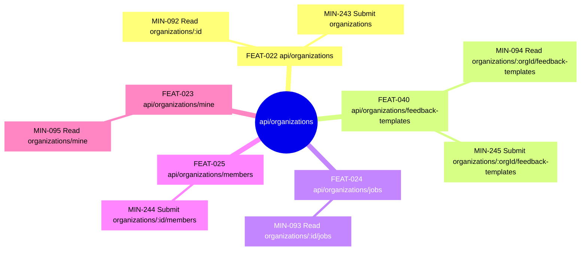
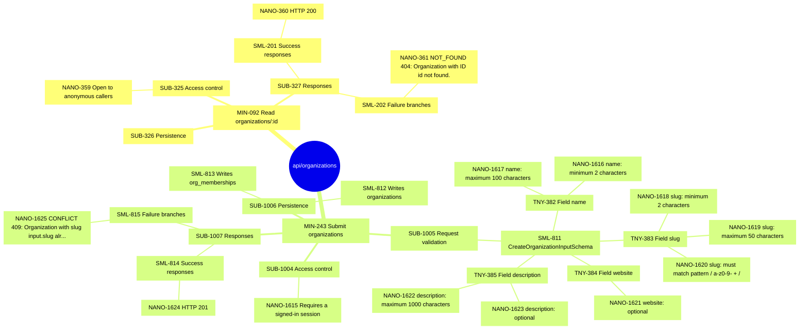
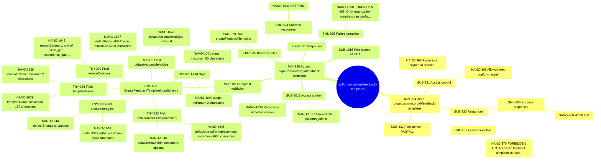
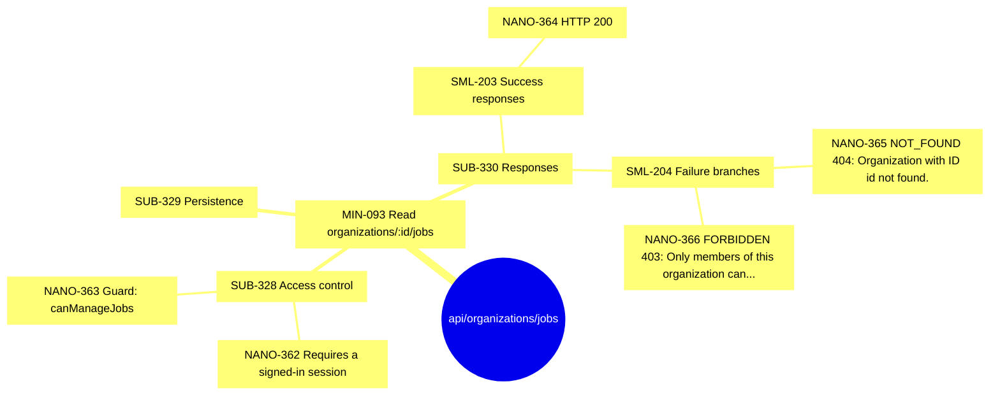
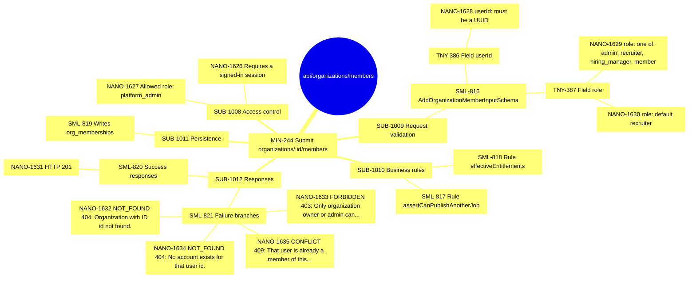
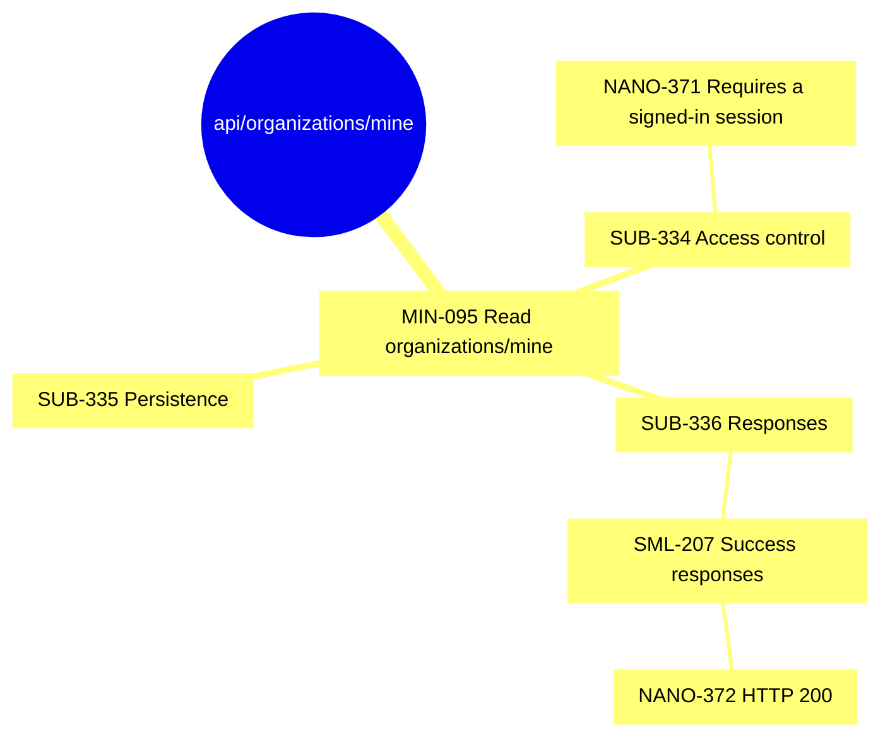

# api/organizations (MOD-059)

Generated by `docs/mindmap/tools/catalog.py` from `master/MASTER_PROJECT_GRAPH.json` at commit `9b3032f`. Do not edit by hand. Back to the [feature catalog](../FEATURE_CATALOG.md).

**Application:** apps/api (MOD-001). **Purpose:** API module: routes under /api/v1/organizations in apps/api/src/server.ts.

**Nodes by level:** MODULE 1, MAJOR 5, MINOR 7, SUB 26, SMALL 22, TINY 12, NANO 50. **Status:** IMPLEMENTED 121, PARTIALLY_IMPLEMENTED 2. **Verification:** PATH_LEVEL 101, UNKNOWN 7, VERIFIED 9.

**User roles that reach it:** anonymous, authenticated, platform_admin.

**Known gaps:** MIN-092 no first-party web caller found; MIN-094 ephemeral: state held in process memory, lost on restart; MIN-094 no first-party web caller found; MIN-245 ephemeral: state held in process memory, lost on restart; MIN-245 no first-party web caller found; MIN-244 no first-party web caller found; MIN-095 no linked test.

**Called from (web screens and components):** FEAT-162 Screen /dashboard, FEAT-164 Screen /hiring

## Module map (to minor features)

## FEAT-022 api/organizations

api/organizations

| ID        | Level | Parent   | Name                                                                 | Description                                                                                                                                                                                                            | Status      | Verification | Evidence                                      | Related                                                       |
| --------- | ----- | -------- | -------------------------------------------------------------------- | ---------------------------------------------------------------------------------------------------------------------------------------------------------------------------------------------------------------------- | ----------- | ------------ | --------------------------------------------- | ------------------------------------------------------------- |
| FEAT-022  | MAJOR | MOD-059  | api/organizations                                                    |                                                                                                                                                                                                                        | IMPLEMENTED |              | apps/api/src/server.ts:1884                   |                                                               |
| MIN-092   | MINOR | FEAT-022 | Read organizations/:id                                               | GET /api/v1/organizations/:id for anyone (public); durable (PostgreSQL); responds 200; 1 failure branch(es). Gaps: no first-party web caller found                                                                     | IMPLEMENTED | VERIFIED     | apps/api/src/server.ts:1955                   | API-029, TEST-100, TEST-125, TEST-145, TEST-180               |
| SUB-325   | SUB   | MIN-092  | Access control                                                       | Who may call GET /api/v1/organizations/:id: anyone (public).                                                                                                                                                           | IMPLEMENTED | PATH_LEVEL   | apps/api/src/server.ts:1955                   |                                                               |
| NANO-359  | NANO  | SUB-325  | Open to anonymous callers                                            | auth: public.                                                                                                                                                                                                          | IMPLEMENTED | PATH_LEVEL   | apps/api/src/server.ts:1955                   | ROLE-001                                                      |
| SUB-326   | SUB   | MIN-092  | Persistence                                                          | Durable: writes go through the PostgreSQL store.                                                                                                                                                                       | IMPLEMENTED | PATH_LEVEL   | apps/api/src/server.ts:1955                   |                                                               |
| SUB-327   | SUB   | MIN-092  | Responses                                                            | Success 200; 1 explicit failure branch(es) besides validation and access errors.                                                                                                                                       | IMPLEMENTED | PATH_LEVEL   | apps/api/src/server.ts:1955                   |                                                               |
| SML-201   | SMALL | SUB-327  | Success responses                                                    | HTTP 200.                                                                                                                                                                                                              | IMPLEMENTED | PATH_LEVEL   | apps/api/src/server.ts:1955                   |                                                               |
| NANO-360  | NANO  | SML-201  | HTTP 200                                                             | Replies 200 when the operation succeeds.                                                                                                                                                                               | IMPLEMENTED | PATH_LEVEL   | apps/api/src/server.ts:1955                   |                                                               |
| SML-202   | SMALL | SUB-327  | Failure branches                                                     | 1 DomainError branch(es) in the handler, mapped to HTTP by the global error handler.                                                                                                                                   | IMPLEMENTED | PATH_LEVEL   | apps/api/src/server.ts:1955                   |                                                               |
| NANO-361  | NANO  | SML-202  | NOT_FOUND 404: Organization with ID ${id} not found.                 | Throws DomainError(NOT_FOUND) "Organization with ID ${id} not found." -> HTTP 404.                                                                                                                                     | IMPLEMENTED | PATH_LEVEL   | apps/api/src/server.ts:1961                   | ERR-031                                                       |
| MIN-243   | MINOR | FEAT-022 | Submit organizations                                                 | Organization Endpoints POST /api/v1/organizations for any signed-in session; validates CreateOrganizationInputSchema; durable (PostgreSQL); writes organizations, org_memberships; responds 201; 1 failure branch(es). | IMPLEMENTED | VERIFIED     | apps/api/src/server.ts:1884                   | API-026, TEST-085, TEST-088, TEST-089, TEST-097, TEST-100 ... |
| SUB-1004  | SUB   | MIN-243  | Access control                                                       | Who may call POST /api/v1/organizations: any signed-in session.                                                                                                                                                        | IMPLEMENTED | PATH_LEVEL   | apps/api/src/server.ts:1884                   |                                                               |
| NANO-1615 | NANO  | SUB-1004 | Requires a signed-in session                                         | Requests without a valid session token are rejected with 401 UNAUTHENTICATED.                                                                                                                                          | IMPLEMENTED | PATH_LEVEL   | apps/api/src/server.ts:1884                   | ROLE-001                                                      |
| SUB-1005  | SUB   | MIN-243  | Request validation                                                   | The request is parsed with CreateOrganizationInputSchema; a failure returns 400 with field details before any business logic runs.                                                                                     | IMPLEMENTED | PATH_LEVEL   | apps/api/src/server.ts:1884                   |                                                               |
| SML-811   | SMALL | SUB-1005 | CreateOrganizationInputSchema                                        | CreateOrganizationInputSchema: 4 field(s)                                                                                                                                                                              | IMPLEMENTED | PATH_LEVEL   | packages/contracts/src/index.ts:215           | SCH-014                                                       |
| TNY-382   | TINY  | SML-811  | Field name                                                           | name (string, required): minimum 2 characters; maximum 100 characters                                                                                                                                                  | IMPLEMENTED | PATH_LEVEL   | packages/contracts/src/index.ts:216           |                                                               |
| NANO-1616 | NANO  | TNY-382  | name: minimum 2 characters                                           | name minimum 2 characters.                                                                                                                                                                                             | IMPLEMENTED | PATH_LEVEL   | packages/contracts/src/index.ts:216           |                                                               |
| NANO-1617 | NANO  | TNY-382  | name: maximum 100 characters                                         | name maximum 100 characters.                                                                                                                                                                                           | IMPLEMENTED | PATH_LEVEL   | packages/contracts/src/index.ts:216           |                                                               |
| TNY-383   | TINY  | SML-811  | Field slug                                                           | slug (string, required): minimum 2 characters; maximum 50 characters; must match pattern /^[a-z0-9-]+$/                                                                                                                | IMPLEMENTED | PATH_LEVEL   | packages/contracts/src/index.ts:217           |                                                               |
| NANO-1618 | NANO  | TNY-383  | slug: minimum 2 characters                                           | slug minimum 2 characters.                                                                                                                                                                                             | IMPLEMENTED | PATH_LEVEL   | packages/contracts/src/index.ts:217           |                                                               |
| NANO-1619 | NANO  | TNY-383  | slug: maximum 50 characters                                          | slug maximum 50 characters.                                                                                                                                                                                            | IMPLEMENTED | PATH_LEVEL   | packages/contracts/src/index.ts:217           |                                                               |
| NANO-1620 | NANO  | TNY-383  | slug: must match pattern /^[a-z0-9-]+$/                              | slug must match pattern /^[a-z0-9-]+$/; message "Slug must be lowercase alphanumeric with hyphens".                                                                                                                    | IMPLEMENTED | PATH_LEVEL   | packages/contracts/src/index.ts:217           |                                                               |
| TNY-384   | TINY  | SML-811  | Field website                                                        | website (httpUrl(), optional): optional                                                                                                                                                                                | IMPLEMENTED | PATH_LEVEL   | packages/contracts/src/index.ts:222           |                                                               |
| NANO-1621 | NANO  | TNY-384  | website: optional                                                    | website optional.                                                                                                                                                                                                      | IMPLEMENTED | PATH_LEVEL   | packages/contracts/src/index.ts:222           |                                                               |
| TNY-385   | TINY  | SML-811  | Field description                                                    | description (string, optional): maximum 1000 characters; optional                                                                                                                                                      | IMPLEMENTED | PATH_LEVEL   | packages/contracts/src/index.ts:223           |                                                               |
| NANO-1622 | NANO  | TNY-385  | description: maximum 1000 characters                                 | description maximum 1000 characters.                                                                                                                                                                                   | IMPLEMENTED | PATH_LEVEL   | packages/contracts/src/index.ts:223           |                                                               |
| NANO-1623 | NANO  | TNY-385  | description: optional                                                | description optional.                                                                                                                                                                                                  | IMPLEMENTED | PATH_LEVEL   | packages/contracts/src/index.ts:223           |                                                               |
| SUB-1006  | SUB   | MIN-243  | Persistence                                                          | Durable: writes go through the PostgreSQL store.                                                                                                                                                                       | IMPLEMENTED | PATH_LEVEL   | apps/api/src/server.ts:1884                   |                                                               |
| SML-812   | SMALL | SUB-1006 | Writes organizations                                                 | Writes table organizations (00001_core_schema.sql).                                                                                                                                                                    | IMPLEMENTED | PATH_LEVEL   | supabase/migrations/00001_core_schema.sql:146 | DB-004                                                        |
| SML-813   | SMALL | SUB-1006 | Writes org_memberships                                               | Writes table org_memberships (00001_core_schema.sql).                                                                                                                                                                  | IMPLEMENTED | PATH_LEVEL   | supabase/migrations/00001_core_schema.sql:157 | DB-005                                                        |
| SUB-1007  | SUB   | MIN-243  | Responses                                                            | Success 201; 1 explicit failure branch(es) besides validation and access errors.                                                                                                                                       | IMPLEMENTED | PATH_LEVEL   | apps/api/src/server.ts:1884                   |                                                               |
| SML-814   | SMALL | SUB-1007 | Success responses                                                    | HTTP 201.                                                                                                                                                                                                              | IMPLEMENTED | PATH_LEVEL   | apps/api/src/server.ts:1884                   |                                                               |
| NANO-1624 | NANO  | SML-814  | HTTP 201                                                             | Replies 201 when the operation succeeds.                                                                                                                                                                               | IMPLEMENTED | PATH_LEVEL   | apps/api/src/server.ts:1884                   |                                                               |
| SML-815   | SMALL | SUB-1007 | Failure branches                                                     | 1 DomainError branch(es) in the handler, mapped to HTTP by the global error handler.                                                                                                                                   | IMPLEMENTED | PATH_LEVEL   | apps/api/src/server.ts:1884                   |                                                               |
| NANO-1625 | NANO  | SML-815  | CONFLICT 409: Organization with slug "${input.slug}" already exists. | Throws DomainError(CONFLICT) "Organization with slug "${input.slug}" already exists." -> HTTP 409.                                                                                                                     | IMPLEMENTED | PATH_LEVEL   | apps/api/src/server.ts:1889                   | ERR-030                                                       |

## FEAT-040 api/organizations/feedback-templates

api/organizations/feedback-templates

| ID        | Level | Parent   | Name                                                                                                                          | Description                                                                                                                                                                                                                                                                                                               | Status                | Verification | Evidence                                        | Related                     |
| --------- | ----- | -------- | ----------------------------------------------------------------------------------------------------------------------------- | ------------------------------------------------------------------------------------------------------------------------------------------------------------------------------------------------------------------------------------------------------------------------------------------------------------------------- | --------------------- | ------------ | ----------------------------------------------- | --------------------------- |
| FEAT-040  | MAJOR | MOD-059  | api/organizations/feedback-templates                                                                                          |                                                                                                                                                                                                                                                                                                                           | IMPLEMENTED           |              | apps/api/src/server.ts:3191                     |                             |
| MIN-094   | MINOR | FEAT-040 | Read organizations/:orgId/feedback-templates                                                                                  | GET /api/v1/organizations/:orgId/feedback-templates for roles platform_admin; ephemeral (process memory); responds 200; 1 failure branch(es). Gaps: ephemeral: state held in process memory, lost on restart; no first-party web caller found                                                                             | IMPLEMENTED           | VERIFIED     | apps/api/src/server.ts:3235                     | API-056, TEST-089, TEST-169 |
| SUB-331   | SUB   | MIN-094  | Access control                                                                                                                | Who may call GET /api/v1/organizations/:orgId/feedback-templates: roles platform_admin.                                                                                                                                                                                                                                   | IMPLEMENTED           | PATH_LEVEL   | apps/api/src/server.ts:3235                     |                             |
| NANO-367  | NANO  | SUB-331  | Requires a signed-in session                                                                                                  | Requests without a valid session token are rejected with 401 UNAUTHENTICATED.                                                                                                                                                                                                                                             | IMPLEMENTED           | PATH_LEVEL   | apps/api/src/server.ts:3235                     | ROLE-001                    |
| NANO-368  | NANO  | SUB-331  | Allowed role: platform_admin                                                                                                  | platform_admin is one of the roles allowed here (platform_admin); a caller holding none of them is rejected with 403.                                                                                                                                                                                                     | IMPLEMENTED           | PATH_LEVEL   | apps/api/src/server.ts:3235                     | ROLE-008                    |
| SUB-332   | SUB   | MIN-094  | Persistence                                                                                                                   | Ephemeral: state lives in API process memory and is lost on restart.                                                                                                                                                                                                                                                      | PARTIALLY_IMPLEMENTED | PATH_LEVEL   | apps/api/src/server.ts:3235                     |                             |
| SUB-333   | SUB   | MIN-094  | Responses                                                                                                                     | Success 200; 1 explicit failure branch(es) besides validation and access errors.                                                                                                                                                                                                                                          | IMPLEMENTED           | PATH_LEVEL   | apps/api/src/server.ts:3235                     |                             |
| SML-205   | SMALL | SUB-333  | Success responses                                                                                                             | HTTP 200.                                                                                                                                                                                                                                                                                                                 | IMPLEMENTED           | PATH_LEVEL   | apps/api/src/server.ts:3235                     |                             |
| NANO-369  | NANO  | SML-205  | HTTP 200                                                                                                                      | Replies 200 when the operation succeeds.                                                                                                                                                                                                                                                                                  | IMPLEMENTED           | PATH_LEVEL   | apps/api/src/server.ts:3235                     |                             |
| SML-206   | SMALL | SUB-333  | Failure branches                                                                                                              | 1 DomainError branch(es) in the handler, mapped to HTTP by the global error handler.                                                                                                                                                                                                                                      | IMPLEMENTED           | PATH_LEVEL   | apps/api/src/server.ts:3235                     |                             |
| NANO-370  | NANO  | SML-206  | FORBIDDEN 403: Access to feedback templates is restricted to organization members.                                            | Throws DomainError(FORBIDDEN) "Access to feedback templates is restricted to organization members." -> HTTP 403.                                                                                                                                                                                                          | IMPLEMENTED           | PATH_LEVEL   | apps/api/src/server.ts:3246                     | ERR-061                     |
| MIN-245   | MINOR | FEAT-040 | Submit organizations/:orgId/feedback-templates                                                                                | POST /api/v1/organizations/:orgId/feedback-templates for roles platform_admin; validates CreateFeedbackTemplateInputSchema; calls createFeedbackTemplate; ephemeral (process memory); responds 201; 1 failure branch(es). Gaps: ephemeral: state held in process memory, lost on restart; no first-party web caller found | IMPLEMENTED           | VERIFIED     | apps/api/src/server.ts:3191                     | API-055, TEST-089, TEST-169 |
| SUB-1013  | SUB   | MIN-245  | Access control                                                                                                                | Who may call POST /api/v1/organizations/:orgId/feedback-templates: roles platform_admin.                                                                                                                                                                                                                                  | IMPLEMENTED           | PATH_LEVEL   | apps/api/src/server.ts:3191                     |                             |
| NANO-1636 | NANO  | SUB-1013 | Requires a signed-in session                                                                                                  | Requests without a valid session token are rejected with 401 UNAUTHENTICATED.                                                                                                                                                                                                                                             | IMPLEMENTED           | PATH_LEVEL   | apps/api/src/server.ts:3191                     | ROLE-001                    |
| NANO-1637 | NANO  | SUB-1013 | Allowed role: platform_admin                                                                                                  | platform_admin is one of the roles allowed here (platform_admin); a caller holding none of them is rejected with 403.                                                                                                                                                                                                     | IMPLEMENTED           | PATH_LEVEL   | apps/api/src/server.ts:3191                     | ROLE-008                    |
| SUB-1014  | SUB   | MIN-245  | Request validation                                                                                                            | The request is parsed with CreateFeedbackTemplateInputSchema; a failure returns 400 with field details before any business logic runs.                                                                                                                                                                                    | IMPLEMENTED           | PATH_LEVEL   | apps/api/src/server.ts:3191                     |                             |
| SML-822   | SMALL | SUB-1014 | CreateFeedbackTemplateInputSchema                                                                                             | CreateFeedbackTemplateInputSchema: 6 field(s)                                                                                                                                                                                                                                                                             | IMPLEMENTED           | PATH_LEVEL   | packages/contracts/src/index.ts:1086            | SCH-085                     |
| TNY-388   | TINY  | SML-822  | Field templateName                                                                                                            | templateName (string, required): minimum 2 characters; maximum 150 characters                                                                                                                                                                                                                                             | IMPLEMENTED           | PATH_LEVEL   | packages/contracts/src/index.ts:1087            |                             |
| NANO-1638 | NANO  | TNY-388  | templateName: minimum 2 characters                                                                                            | templateName minimum 2 characters.                                                                                                                                                                                                                                                                                        | IMPLEMENTED           | PATH_LEVEL   | packages/contracts/src/index.ts:1087            |                             |
| NANO-1639 | NANO  | TNY-388  | templateName: maximum 150 characters                                                                                          | templateName maximum 150 characters.                                                                                                                                                                                                                                                                                      | IMPLEMENTED           | PATH_LEVEL   | packages/contracts/src/index.ts:1087            |                             |
| TNY-389   | TINY  | SML-822  | Field stage                                                                                                                   | stage (string, required): minimum 2 characters; maximum 50 characters                                                                                                                                                                                                                                                     | IMPLEMENTED           | PATH_LEVEL   | packages/contracts/src/index.ts:1088            |                             |
| NANO-1640 | NANO  | TNY-389  | stage: minimum 2 characters                                                                                                   | stage minimum 2 characters.                                                                                                                                                                                                                                                                                               | IMPLEMENTED           | PATH_LEVEL   | packages/contracts/src/index.ts:1088            |                             |
| NANO-1641 | NANO  | TNY-389  | stage: maximum 50 characters                                                                                                  | stage maximum 50 characters.                                                                                                                                                                                                                                                                                              | IMPLEMENTED           | PATH_LEVEL   | packages/contracts/src/index.ts:1088            |                             |
| TNY-390   | TINY  | SML-822  | Field reasonCategory                                                                                                          | reasonCategory (enum, required): one of: skills_gap, experience_gap, culture_fit, overqualified, position_filled, compensation_mismatch, other                                                                                                                                                                            | IMPLEMENTED           | PATH_LEVEL   | packages/contracts/src/index.ts:1089            |                             |
| NANO-1642 | NANO  | TNY-390  | reasonCategory: one of: skills_gap, experience_gap, culture_fit, overqualified, position_filled, compensation_mismatch, other | reasonCategory one of: skills_gap, experience_gap, culture_fit, overqualified, position_filled, compensation_mismatch, other.                                                                                                                                                                                             | IMPLEMENTED           | PATH_LEVEL   | packages/contracts/src/index.ts:1089            |                             |
| TNY-391   | TINY  | SML-822  | Field defaultStrengths                                                                                                        | defaultStrengths (string, optional): maximum 3000 characters; optional                                                                                                                                                                                                                                                    | IMPLEMENTED           | PATH_LEVEL   | packages/contracts/src/index.ts:1098            |                             |
| NANO-1643 | NANO  | TNY-391  | defaultStrengths: maximum 3000 characters                                                                                     | defaultStrengths maximum 3000 characters.                                                                                                                                                                                                                                                                                 | IMPLEMENTED           | PATH_LEVEL   | packages/contracts/src/index.ts:1098            |                             |
| NANO-1644 | NANO  | TNY-391  | defaultStrengths: optional                                                                                                    | defaultStrengths optional.                                                                                                                                                                                                                                                                                                | IMPLEMENTED           | PATH_LEVEL   | packages/contracts/src/index.ts:1098            |                             |
| TNY-392   | TINY  | SML-822  | Field defaultAreasForImprovement                                                                                              | defaultAreasForImprovement (string, optional): maximum 3000 characters; optional                                                                                                                                                                                                                                          | IMPLEMENTED           | PATH_LEVEL   | packages/contracts/src/index.ts:1099            |                             |
| NANO-1645 | NANO  | TNY-392  | defaultAreasForImprovement: maximum 3000 characters                                                                           | defaultAreasForImprovement maximum 3000 characters.                                                                                                                                                                                                                                                                       | IMPLEMENTED           | PATH_LEVEL   | packages/contracts/src/index.ts:1099            |                             |
| NANO-1646 | NANO  | TNY-392  | defaultAreasForImprovement: optional                                                                                          | defaultAreasForImprovement optional.                                                                                                                                                                                                                                                                                      | IMPLEMENTED           | PATH_LEVEL   | packages/contracts/src/index.ts:1099            |                             |
| TNY-393   | TINY  | SML-822  | Field defaultActionableAdvice                                                                                                 | defaultActionableAdvice (string, optional): maximum 3000 characters; optional                                                                                                                                                                                                                                             | IMPLEMENTED           | PATH_LEVEL   | packages/contracts/src/index.ts:1100            |                             |
| NANO-1647 | NANO  | TNY-393  | defaultActionableAdvice: maximum 3000 characters                                                                              | defaultActionableAdvice maximum 3000 characters.                                                                                                                                                                                                                                                                          | IMPLEMENTED           | PATH_LEVEL   | packages/contracts/src/index.ts:1100            |                             |
| NANO-1648 | NANO  | TNY-393  | defaultActionableAdvice: optional                                                                                             | defaultActionableAdvice optional.                                                                                                                                                                                                                                                                                         | IMPLEMENTED           | PATH_LEVEL   | packages/contracts/src/index.ts:1100            |                             |
| SUB-1015  | SUB   | MIN-245  | Business rules                                                                                                                | Domain functions from packages/domain called by the handler (1).                                                                                                                                                                                                                                                          | IMPLEMENTED           | PATH_LEVEL   | apps/api/src/server.ts:3191                     |                             |
| SML-823   | SMALL | SUB-1015 | Rule createFeedbackTemplate                                                                                                   | Calls createFeedbackTemplate (packages/domain/src/application-feedback.ts). Rule status IMPLEMENTED; its own tests: VERIFIED.                                                                                                                                                                                             | IMPLEMENTED           | VERIFIED     | packages/domain/src/application-feedback.ts:296 | RULE-040                    |
| SUB-1016  | SUB   | MIN-245  | Persistence                                                                                                                   | Ephemeral: state lives in API process memory and is lost on restart.                                                                                                                                                                                                                                                      | PARTIALLY_IMPLEMENTED | PATH_LEVEL   | apps/api/src/server.ts:3191                     |                             |
| SUB-1017  | SUB   | MIN-245  | Responses                                                                                                                     | Success 201; 1 explicit failure branch(es) besides validation and access errors.                                                                                                                                                                                                                                          | IMPLEMENTED           | PATH_LEVEL   | apps/api/src/server.ts:3191                     |                             |
| SML-824   | SMALL | SUB-1017 | Success responses                                                                                                             | HTTP 201.                                                                                                                                                                                                                                                                                                                 | IMPLEMENTED           | PATH_LEVEL   | apps/api/src/server.ts:3191                     |                             |
| NANO-1649 | NANO  | SML-824  | HTTP 201                                                                                                                      | Replies 201 when the operation succeeds.                                                                                                                                                                                                                                                                                  | IMPLEMENTED           | PATH_LEVEL   | apps/api/src/server.ts:3191                     |                             |
| SML-825   | SMALL | SUB-1017 | Failure branches                                                                                                              | 1 DomainError branch(es) in the handler, mapped to HTTP by the global error handler.                                                                                                                                                                                                                                      | IMPLEMENTED           | PATH_LEVEL   | apps/api/src/server.ts:3191                     |                             |
| NANO-1650 | NANO  | SML-825  | FORBIDDEN 403: Only organization members can configure feedback templates (BR-224).                                           | Throws DomainError(FORBIDDEN) "Only organization members can configure feedback templates (BR-224)." -> HTTP 403.                                                                                                                                                                                                         | IMPLEMENTED           | PATH_LEVEL   | apps/api/src/server.ts:3203                     | ERR-060                     |

## FEAT-024 api/organizations/jobs

api/organizations/jobs

| ID       | Level | Parent   | Name                                                               | Description                                                                                                                                                                                                                                                                | Status      | Verification | Evidence                    | Related           |
| -------- | ----- | -------- | ------------------------------------------------------------------ | -------------------------------------------------------------------------------------------------------------------------------------------------------------------------------------------------------------------------------------------------------------------------- | ----------- | ------------ | --------------------------- | ----------------- |
| FEAT-024 | MAJOR | MOD-059  | api/organizations/jobs                                             |                                                                                                                                                                                                                                                                            | IMPLEMENTED |              | apps/api/src/server.ts:1931 |                   |
| MIN-093  | MINOR | FEAT-024 | Read organizations/:id/jobs                                        | Every posting of an organization, in any status — the hiring team's view. Includes per-job application counts by status for the pipeline overview. GET /api/v1/organizations/:id/jobs for any signed-in session; durable (PostgreSQL); responds 200; 2 failure branch(es). | IMPLEMENTED | VERIFIED     | apps/api/src/server.ts:1931 | API-028, TEST-142 |
| SUB-328  | SUB   | MIN-093  | Access control                                                     | Who may call GET /api/v1/organizations/:id/jobs: any signed-in session.                                                                                                                                                                                                    | IMPLEMENTED | PATH_LEVEL   | apps/api/src/server.ts:1931 |                   |
| NANO-362 | NANO  | SUB-328  | Requires a signed-in session                                       | Requests without a valid session token are rejected with 401 UNAUTHENTICATED.                                                                                                                                                                                              | IMPLEMENTED | PATH_LEVEL   | apps/api/src/server.ts:1931 | ROLE-001          |
| NANO-363 | NANO  | SUB-328  | Guard: canManageJobs                                               | Guard canManageJobs must pass before the handler runs.                                                                                                                                                                                                                     | IMPLEMENTED | PATH_LEVEL   | apps/api/src/server.ts:1931 |                   |
| SUB-329  | SUB   | MIN-093  | Persistence                                                        | Durable: writes go through the PostgreSQL store.                                                                                                                                                                                                                           | IMPLEMENTED | PATH_LEVEL   | apps/api/src/server.ts:1931 |                   |
| SUB-330  | SUB   | MIN-093  | Responses                                                          | Success 200; 2 explicit failure branch(es) besides validation and access errors.                                                                                                                                                                                           | IMPLEMENTED | PATH_LEVEL   | apps/api/src/server.ts:1931 |                   |
| SML-203  | SMALL | SUB-330  | Success responses                                                  | HTTP 200.                                                                                                                                                                                                                                                                  | IMPLEMENTED | PATH_LEVEL   | apps/api/src/server.ts:1931 |                   |
| NANO-364 | NANO  | SML-203  | HTTP 200                                                           | Replies 200 when the operation succeeds.                                                                                                                                                                                                                                   | IMPLEMENTED | PATH_LEVEL   | apps/api/src/server.ts:1931 |                   |
| SML-204  | SMALL | SUB-330  | Failure branches                                                   | 2 DomainError branch(es) in the handler, mapped to HTTP by the global error handler.                                                                                                                                                                                       | IMPLEMENTED | PATH_LEVEL   | apps/api/src/server.ts:1931 |                   |
| NANO-365 | NANO  | SML-204  | NOT_FOUND 404: Organization with ID ${id} not found.               | Throws DomainError(NOT_FOUND) "Organization with ID ${id} not found." -> HTTP 404.                                                                                                                                                                                         | IMPLEMENTED | PATH_LEVEL   | apps/api/src/server.ts:1937 | ERR-031           |
| NANO-366 | NANO  | SML-204  | FORBIDDEN 403: Only members of this organization can see its jobs. | Throws DomainError(FORBIDDEN) "Only members of this organization can see its jobs." -> HTTP 403.                                                                                                                                                                           | IMPLEMENTED | PATH_LEVEL   | apps/api/src/server.ts:1940 | ERR-032           |

## FEAT-025 api/organizations/members

api/organizations/members

| ID        | Level | Parent   | Name                                                              | Description                                                                                                                                                                                                                                                                                   | Status      | Verification | Evidence                                      | Related                                                       |
| --------- | ----- | -------- | ----------------------------------------------------------------- | --------------------------------------------------------------------------------------------------------------------------------------------------------------------------------------------------------------------------------------------------------------------------------------------- | ----------- | ------------ | --------------------------------------------- | ------------------------------------------------------------- |
| FEAT-025  | MAJOR | MOD-059  | api/organizations/members                                         |                                                                                                                                                                                                                                                                                               | IMPLEMENTED |              | apps/api/src/server.ts:1967                   |                                                               |
| MIN-244   | MINOR | FEAT-025 | Submit organizations/:id/members                                  | POST /api/v1/organizations/:id/members for roles platform_admin; validates AddOrganizationMemberInputSchema; calls assertCanPublishAnotherJob, effectiveEntitlements; durable (PostgreSQL); writes org_memberships; responds 201; 4 failure branch(es). Gaps: no first-party web caller found | IMPLEMENTED | VERIFIED     | apps/api/src/server.ts:1967                   | API-030, TEST-097, TEST-101, TEST-112, TEST-120, TEST-126 ... |
| SUB-1008  | SUB   | MIN-244  | Access control                                                    | Who may call POST /api/v1/organizations/:id/members: roles platform_admin.                                                                                                                                                                                                                    | IMPLEMENTED | PATH_LEVEL   | apps/api/src/server.ts:1967                   |                                                               |
| NANO-1626 | NANO  | SUB-1008 | Requires a signed-in session                                      | Requests without a valid session token are rejected with 401 UNAUTHENTICATED.                                                                                                                                                                                                                 | IMPLEMENTED | PATH_LEVEL   | apps/api/src/server.ts:1967                   | ROLE-001                                                      |
| NANO-1627 | NANO  | SUB-1008 | Allowed role: platform_admin                                      | platform_admin is one of the roles allowed here (platform_admin); a caller holding none of them is rejected with 403.                                                                                                                                                                         | IMPLEMENTED | PATH_LEVEL   | apps/api/src/server.ts:1967                   | ROLE-008                                                      |
| SUB-1009  | SUB   | MIN-244  | Request validation                                                | The request is parsed with AddOrganizationMemberInputSchema; a failure returns 400 with field details before any business logic runs.                                                                                                                                                         | IMPLEMENTED | PATH_LEVEL   | apps/api/src/server.ts:1967                   |                                                               |
| SML-816   | SMALL | SUB-1009 | AddOrganizationMemberInputSchema                                  | AddOrganizationMemberInputSchema: 2 field(s)                                                                                                                                                                                                                                                  | IMPLEMENTED | PATH_LEVEL   | packages/contracts/src/index.ts:232           | SCH-015                                                       |
| TNY-386   | TINY  | SML-816  | Field userId                                                      | userId (string, required): must be a UUID                                                                                                                                                                                                                                                     | IMPLEMENTED | PATH_LEVEL   | packages/contracts/src/index.ts:233           |                                                               |
| NANO-1628 | NANO  | TNY-386  | userId: must be a UUID                                            | userId must be a UUID.                                                                                                                                                                                                                                                                        | IMPLEMENTED | PATH_LEVEL   | packages/contracts/src/index.ts:233           |                                                               |
| TNY-387   | TINY  | SML-816  | Field role                                                        | role (enum, optional): one of: admin, recruiter, hiring_manager, member; default 'recruiter'                                                                                                                                                                                                  | IMPLEMENTED | PATH_LEVEL   | packages/contracts/src/index.ts:234           |                                                               |
| NANO-1629 | NANO  | TNY-387  | role: one of: admin, recruiter, hiring_manager, member            | role one of: admin, recruiter, hiring_manager, member.                                                                                                                                                                                                                                        | IMPLEMENTED | PATH_LEVEL   | packages/contracts/src/index.ts:234           |                                                               |
| NANO-1630 | NANO  | TNY-387  | role: default 'recruiter'                                         | role default 'recruiter'; message "recruiter".                                                                                                                                                                                                                                                | IMPLEMENTED | PATH_LEVEL   | packages/contracts/src/index.ts:234           |                                                               |
| SUB-1010  | SUB   | MIN-244  | Business rules                                                    | Domain functions from packages/domain called by the handler (2).                                                                                                                                                                                                                              | IMPLEMENTED | PATH_LEVEL   | apps/api/src/server.ts:1967                   |                                                               |
| SML-817   | SMALL | SUB-1010 | Rule assertCanPublishAnotherJob                                   | Calls assertCanPublishAnotherJob (packages/domain/src/billing.ts). Rule status IMPLEMENTED; its own tests: VERIFIED.                                                                                                                                                                          | IMPLEMENTED | VERIFIED     | packages/domain/src/billing.ts:217            | RULE-072                                                      |
| SML-818   | SMALL | SUB-1010 | Rule effectiveEntitlements                                        | Calls effectiveEntitlements (packages/domain/src/stripe-billing.ts). Rule status IMPLEMENTED; its own tests: VERIFIED.                                                                                                                                                                        | IMPLEMENTED | VERIFIED     | packages/domain/src/stripe-billing.ts:125     | RULE-232                                                      |
| SUB-1011  | SUB   | MIN-244  | Persistence                                                       | Durable: writes go through the PostgreSQL store.                                                                                                                                                                                                                                              | IMPLEMENTED | PATH_LEVEL   | apps/api/src/server.ts:1967                   |                                                               |
| SML-819   | SMALL | SUB-1011 | Writes org_memberships                                            | Writes table org_memberships (00001_core_schema.sql).                                                                                                                                                                                                                                         | IMPLEMENTED | PATH_LEVEL   | supabase/migrations/00001_core_schema.sql:157 | DB-005                                                        |
| SUB-1012  | SUB   | MIN-244  | Responses                                                         | Success 201; 4 explicit failure branch(es) besides validation and access errors.                                                                                                                                                                                                              | IMPLEMENTED | PATH_LEVEL   | apps/api/src/server.ts:1967                   |                                                               |
| SML-820   | SMALL | SUB-1012 | Success responses                                                 | HTTP 201.                                                                                                                                                                                                                                                                                     | IMPLEMENTED | PATH_LEVEL   | apps/api/src/server.ts:1967                   |                                                               |
| NANO-1631 | NANO  | SML-820  | HTTP 201                                                          | Replies 201 when the operation succeeds.                                                                                                                                                                                                                                                      | IMPLEMENTED | PATH_LEVEL   | apps/api/src/server.ts:1967                   |                                                               |
| SML-821   | SMALL | SUB-1012 | Failure branches                                                  | 4 DomainError branch(es) in the handler, mapped to HTTP by the global error handler.                                                                                                                                                                                                          | IMPLEMENTED | PATH_LEVEL   | apps/api/src/server.ts:1967                   |                                                               |
| NANO-1632 | NANO  | SML-821  | NOT_FOUND 404: Organization with ID ${id} not found.              | Throws DomainError(NOT_FOUND) "Organization with ID ${id} not found." -> HTTP 404.                                                                                                                                                                                                            | IMPLEMENTED | PATH_LEVEL   | apps/api/src/server.ts:1974                   | ERR-031                                                       |
| NANO-1633 | NANO  | SML-821  | FORBIDDEN 403: Only organization owner or admin can add members.  | Throws DomainError(FORBIDDEN) "Only organization owner or admin can add members." -> HTTP 403.                                                                                                                                                                                                | IMPLEMENTED | PATH_LEVEL   | apps/api/src/server.ts:1983                   | ERR-033                                                       |
| NANO-1634 | NANO  | SML-821  | NOT_FOUND 404: No account exists for that user id.                | Throws DomainError(NOT_FOUND) "No account exists for that user id." -> HTTP 404.                                                                                                                                                                                                              | IMPLEMENTED | PATH_LEVEL   | apps/api/src/server.ts:1989                   | ERR-034                                                       |
| NANO-1635 | NANO  | SML-821  | CONFLICT 409: That user is already a member of this organization. | Throws DomainError(CONFLICT) "That user is already a member of this organization." -> HTTP 409.                                                                                                                                                                                               | IMPLEMENTED | PATH_LEVEL   | apps/api/src/server.ts:1996                   | ERR-035                                                       |

## FEAT-023 api/organizations/mine

api/organizations/mine

| ID       | Level | Parent   | Name                         | Description                                                                                                                                                                              | Status      | Verification | Evidence                    | Related  |
| -------- | ----- | -------- | ---------------------------- | ---------------------------------------------------------------------------------------------------------------------------------------------------------------------------------------- | ----------- | ------------ | --------------------------- | -------- |
| FEAT-023 | MAJOR | MOD-059  | api/organizations/mine       |                                                                                                                                                                                          | IMPLEMENTED |              | apps/api/src/server.ts:1918 |          |
| MIN-095  | MINOR | FEAT-023 | Read organizations/mine      | Organizations the signed-in user belongs to, with their role in each. GET /api/v1/organizations/mine for any signed-in session; durable (PostgreSQL); responds 200. Gaps: no linked test | IMPLEMENTED | UNKNOWN      | apps/api/src/server.ts:1918 | API-027  |
| SUB-334  | SUB   | MIN-095  | Access control               | Who may call GET /api/v1/organizations/mine: any signed-in session.                                                                                                                      | IMPLEMENTED | UNKNOWN      | apps/api/src/server.ts:1918 |          |
| NANO-371 | NANO  | SUB-334  | Requires a signed-in session | Requests without a valid session token are rejected with 401 UNAUTHENTICATED.                                                                                                            | IMPLEMENTED | UNKNOWN      | apps/api/src/server.ts:1918 | ROLE-001 |
| SUB-335  | SUB   | MIN-095  | Persistence                  | Durable: writes go through the PostgreSQL store.                                                                                                                                         | IMPLEMENTED | UNKNOWN      | apps/api/src/server.ts:1918 |          |
| SUB-336  | SUB   | MIN-095  | Responses                    | Success 200; 0 explicit failure branch(es) besides validation and access errors.                                                                                                         | IMPLEMENTED | UNKNOWN      | apps/api/src/server.ts:1918 |          |
| SML-207  | SMALL | SUB-336  | Success responses            | HTTP 200.                                                                                                                                                                                | IMPLEMENTED | UNKNOWN      | apps/api/src/server.ts:1918 |          |
| NANO-372 | NANO  | SML-207  | HTTP 200                     | Replies 200 when the operation succeeds.                                                                                                                                                 | IMPLEMENTED | UNKNOWN      | apps/api/src/server.ts:1918 |          |
