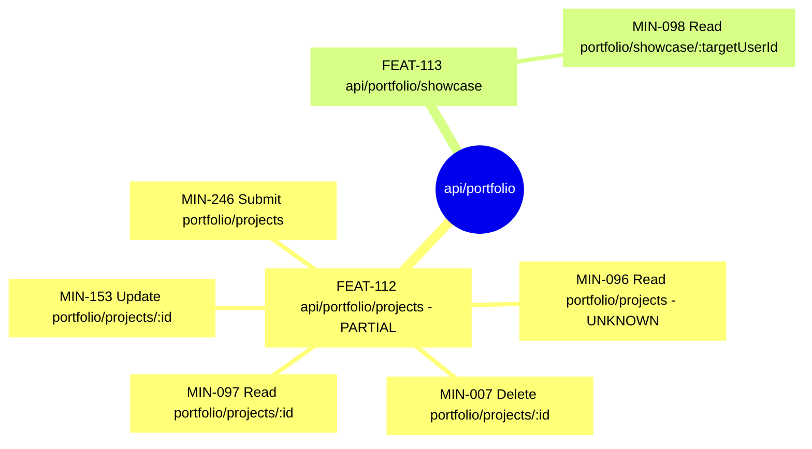
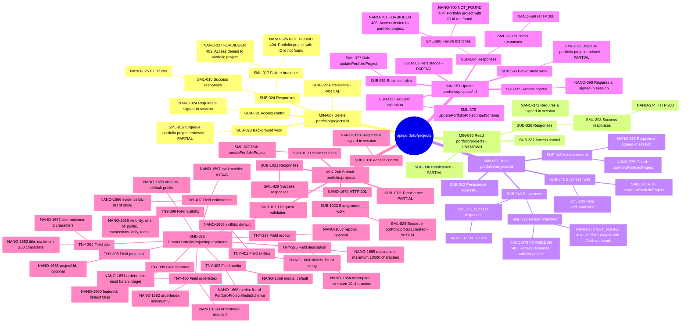
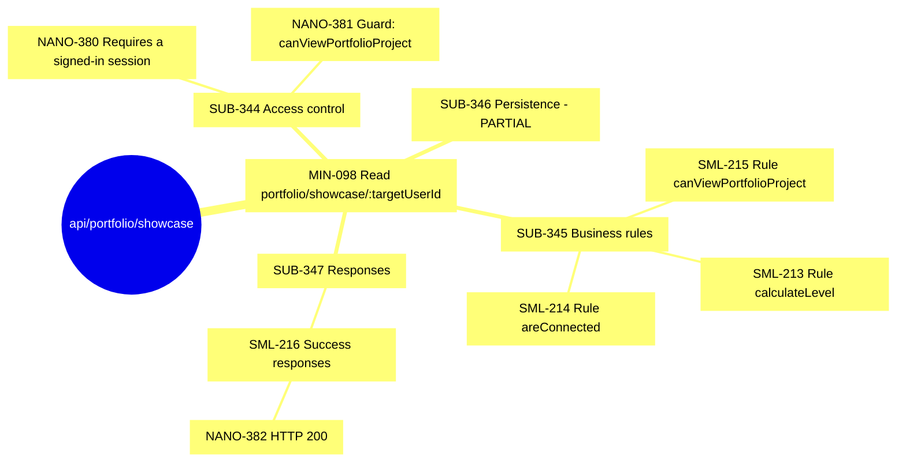

# api/portfolio (MOD-087)

Generated by `docs/mindmap/tools/catalog.py` from `master/MASTER_PROJECT_GRAPH.json` at commit `9b3032f`. Do not edit by hand. Back to the [feature catalog](../FEATURE_CATALOG.md).

**Application:** apps/api (MOD-001). **Purpose:** API module: routes under /api/v1/portfolio in apps/api/src/server.ts.

**Nodes by level:** MODULE 1, MAJOR 2, MINOR 6, SUB 27, SMALL 21, TINY 10, NANO 38. **Status:** IMPLEMENTED 93, PARTIALLY_IMPLEMENTED 11, UNKNOWN 1. **Verification:** PATH_LEVEL 86, UNKNOWN 3, VERIFIED 13.

**User roles that reach it:** authenticated.

**Known gaps:** MIN-007 ephemeral: state held in process memory, lost on restart; MIN-007 no first-party web caller found; MIN-096 ephemeral: state held in process memory, lost on restart; MIN-097 ephemeral: state held in process memory, lost on restart; MIN-097 no first-party web caller found; MIN-153 ephemeral: state held in process memory, lost on restart; MIN-153 no first-party web caller found; MIN-246 ephemeral: state held in process memory, lost on restart; MIN-098 ephemeral: state held in process memory, lost on restart; MIN-098 no first-party web caller found.

**Called from (web screens and components):** FEAT-175 Screen /portfolio

## Module map (to minor features)

## FEAT-112 api/portfolio/projects

api/portfolio/projects

| ID        | Level | Parent   | Name                                                                   | Description                                                                                                                                                                                                                                                                                                | Status                | Verification | Evidence                                   | Related                                         |
| --------- | ----- | -------- | ---------------------------------------------------------------------- | ---------------------------------------------------------------------------------------------------------------------------------------------------------------------------------------------------------------------------------------------------------------------------------------------------------- | --------------------- | ------------ | ------------------------------------------ | ----------------------------------------------- |
| FEAT-112  | MAJOR | MOD-087  | api/portfolio/projects                                                 |                                                                                                                                                                                                                                                                                                            | PARTIALLY_IMPLEMENTED |              | apps/api/src/server.ts:9701                |                                                 |
| MIN-007   | MINOR | FEAT-112 | Delete portfolio/projects/:id                                          | DELETE /api/v1/portfolio/projects/:id for any signed-in session; ephemeral (process memory); responds 200; 2 failure branch(es). Gaps: ephemeral: state held in process memory, lost on restart; no first-party web caller found                                                                           | IMPLEMENTED           | VERIFIED     | apps/api/src/server.ts:9799                | API-205, TEST-119                               |
| SUB-021   | SUB   | MIN-007  | Access control                                                         | Who may call DELETE /api/v1/portfolio/projects/:id: any signed-in session.                                                                                                                                                                                                                                 | IMPLEMENTED           | PATH_LEVEL   | apps/api/src/server.ts:9799                |                                                 |
| NANO-024  | NANO  | SUB-021  | Requires a signed-in session                                           | Requests without a valid session token are rejected with 401 UNAUTHENTICATED.                                                                                                                                                                                                                              | IMPLEMENTED           | PATH_LEVEL   | apps/api/src/server.ts:9799                | ROLE-001                                        |
| SUB-022   | SUB   | MIN-007  | Persistence                                                            | Ephemeral: state lives in API process memory and is lost on restart.                                                                                                                                                                                                                                       | PARTIALLY_IMPLEMENTED | PATH_LEVEL   | apps/api/src/server.ts:9799                |                                                 |
| SUB-023   | SUB   | MIN-007  | Background work                                                        | Enqueues 1 background job kind(s) in background_jobs for apps/worker.                                                                                                                                                                                                                                      | IMPLEMENTED           | PATH_LEVEL   | apps/api/src/server.ts:9799                |                                                 |
| SML-015   | SMALL | SUB-023  | Enqueue portfolio.project.removed                                      | Dispatches job:portfolio.project.removed; worker handler: recordEvent (no-op: marks the event recorded).                                                                                                                                                                                                   | PARTIALLY_IMPLEMENTED | UNKNOWN      | packages/domain/src/background-jobs.ts:171 | SVC-036                                         |
| SUB-024   | SUB   | MIN-007  | Responses                                                              | Success 200; 2 explicit failure branch(es) besides validation and access errors.                                                                                                                                                                                                                           | IMPLEMENTED           | PATH_LEVEL   | apps/api/src/server.ts:9799                |                                                 |
| SML-016   | SMALL | SUB-024  | Success responses                                                      | HTTP 200.                                                                                                                                                                                                                                                                                                  | IMPLEMENTED           | PATH_LEVEL   | apps/api/src/server.ts:9799                |                                                 |
| NANO-025  | NANO  | SML-016  | HTTP 200                                                               | Replies 200 when the operation succeeds.                                                                                                                                                                                                                                                                   | IMPLEMENTED           | PATH_LEVEL   | apps/api/src/server.ts:9799                |                                                 |
| SML-017   | SMALL | SUB-024  | Failure branches                                                       | 2 DomainError branch(es) in the handler, mapped to HTTP by the global error handler.                                                                                                                                                                                                                       | IMPLEMENTED           | PATH_LEVEL   | apps/api/src/server.ts:9799                |                                                 |
| NANO-026  | NANO  | SML-017  | NOT_FOUND 404: Portfolio project with ID "${id}" not found.            | Throws DomainError(NOT_FOUND) "Portfolio project with ID "${id}" not found." -> HTTP 404.                                                                                                                                                                                                                  | IMPLEMENTED           | PATH_LEVEL   | apps/api/src/server.ts:9807                | ERR-200                                         |
| NANO-027  | NANO  | SML-017  | FORBIDDEN 403: Access denied to portfolio project.                     | Throws DomainError(FORBIDDEN) "Access denied to portfolio project." -> HTTP 403.                                                                                                                                                                                                                           | IMPLEMENTED           | PATH_LEVEL   | apps/api/src/server.ts:9811                | ERR-201                                         |
| MIN-096   | MINOR | FEAT-112 | Read portfolio/projects                                                | GET /api/v1/portfolio/projects for any signed-in session; ephemeral (process memory); responds 200. Gaps: ephemeral: state held in process memory, lost on restart                                                                                                                                         | UNKNOWN               | VERIFIED     | apps/api/src/server.ts:9726                | API-202, TEST-119                               |
| SUB-337   | SUB   | MIN-096  | Access control                                                         | Who may call GET /api/v1/portfolio/projects: any signed-in session.                                                                                                                                                                                                                                        | IMPLEMENTED           | PATH_LEVEL   | apps/api/src/server.ts:9726                |                                                 |
| NANO-373  | NANO  | SUB-337  | Requires a signed-in session                                           | Requests without a valid session token are rejected with 401 UNAUTHENTICATED.                                                                                                                                                                                                                              | IMPLEMENTED           | PATH_LEVEL   | apps/api/src/server.ts:9726                | ROLE-001                                        |
| SUB-338   | SUB   | MIN-096  | Persistence                                                            | Ephemeral: state lives in API process memory and is lost on restart.                                                                                                                                                                                                                                       | PARTIALLY_IMPLEMENTED | PATH_LEVEL   | apps/api/src/server.ts:9726                |                                                 |
| SUB-339   | SUB   | MIN-096  | Responses                                                              | Success 200; 0 explicit failure branch(es) besides validation and access errors.                                                                                                                                                                                                                           | IMPLEMENTED           | PATH_LEVEL   | apps/api/src/server.ts:9726                |                                                 |
| SML-208   | SMALL | SUB-339  | Success responses                                                      | HTTP 200.                                                                                                                                                                                                                                                                                                  | IMPLEMENTED           | PATH_LEVEL   | apps/api/src/server.ts:9726                |                                                 |
| NANO-374  | NANO  | SML-208  | HTTP 200                                                               | Replies 200 when the operation succeeds.                                                                                                                                                                                                                                                                   | IMPLEMENTED           | PATH_LEVEL   | apps/api/src/server.ts:9726                |                                                 |
| MIN-097   | MINOR | FEAT-112 | Read portfolio/projects/:id                                            | GET /api/v1/portfolio/projects/:id for any signed-in session; calls areConnected, canViewPortfolioProject; ephemeral (process memory); responds 200; 2 failure branch(es). Gaps: ephemeral: state held in process memory, lost on restart; no first-party web caller found                                 | IMPLEMENTED           | VERIFIED     | apps/api/src/server.ts:9732                | API-203, TEST-119, TEST-145, TEST-206           |
| SUB-340   | SUB   | MIN-097  | Access control                                                         | Who may call GET /api/v1/portfolio/projects/:id: any signed-in session.                                                                                                                                                                                                                                    | IMPLEMENTED           | PATH_LEVEL   | apps/api/src/server.ts:9732                |                                                 |
| NANO-375  | NANO  | SUB-340  | Requires a signed-in session                                           | Requests without a valid session token are rejected with 401 UNAUTHENTICATED.                                                                                                                                                                                                                              | IMPLEMENTED           | PATH_LEVEL   | apps/api/src/server.ts:9732                | ROLE-001                                        |
| NANO-376  | NANO  | SUB-340  | Guard: canViewPortfolioProject                                         | Guard canViewPortfolioProject must pass before the handler runs.                                                                                                                                                                                                                                           | IMPLEMENTED           | PATH_LEVEL   | apps/api/src/server.ts:9732                |                                                 |
| SUB-341   | SUB   | MIN-097  | Business rules                                                         | Domain functions from packages/domain called by the handler (2).                                                                                                                                                                                                                                           | IMPLEMENTED           | PATH_LEVEL   | apps/api/src/server.ts:9732                |                                                 |
| SML-209   | SMALL | SUB-341  | Rule areConnected                                                      | Calls areConnected (packages/domain/src/networking.ts). Rule status IMPLEMENTED; its own tests: VERIFIED.                                                                                                                                                                                                  | IMPLEMENTED           | VERIFIED     | packages/domain/src/networking.ts:156      | RULE-158                                        |
| SML-210   | SMALL | SUB-341  | Rule canViewPortfolioProject                                           | Calls canViewPortfolioProject (packages/domain/src/portfolio.ts). Rule status IMPLEMENTED; its own tests: VERIFIED.                                                                                                                                                                                        | IMPLEMENTED           | VERIFIED     | packages/domain/src/portfolio.ts:183       | RULE-175                                        |
| SUB-342   | SUB   | MIN-097  | Persistence                                                            | Ephemeral: state lives in API process memory and is lost on restart.                                                                                                                                                                                                                                       | PARTIALLY_IMPLEMENTED | PATH_LEVEL   | apps/api/src/server.ts:9732                |                                                 |
| SUB-343   | SUB   | MIN-097  | Responses                                                              | Success 200; 2 explicit failure branch(es) besides validation and access errors.                                                                                                                                                                                                                           | IMPLEMENTED           | PATH_LEVEL   | apps/api/src/server.ts:9732                |                                                 |
| SML-211   | SMALL | SUB-343  | Success responses                                                      | HTTP 200.                                                                                                                                                                                                                                                                                                  | IMPLEMENTED           | PATH_LEVEL   | apps/api/src/server.ts:9732                |                                                 |
| NANO-377  | NANO  | SML-211  | HTTP 200                                                               | Replies 200 when the operation succeeds.                                                                                                                                                                                                                                                                   | IMPLEMENTED           | PATH_LEVEL   | apps/api/src/server.ts:9732                |                                                 |
| SML-212   | SMALL | SUB-343  | Failure branches                                                       | 2 DomainError branch(es) in the handler, mapped to HTTP by the global error handler.                                                                                                                                                                                                                       | IMPLEMENTED           | PATH_LEVEL   | apps/api/src/server.ts:9732                |                                                 |
| NANO-378  | NANO  | SML-212  | NOT_FOUND 404: Portfolio project with ID "${id}" not found.            | Throws DomainError(NOT_FOUND) "Portfolio project with ID "${id}" not found." -> HTTP 404.                                                                                                                                                                                                                  | IMPLEMENTED           | PATH_LEVEL   | apps/api/src/server.ts:9738                | ERR-200                                         |
| NANO-379  | NANO  | SML-212  | FORBIDDEN 403: Access denied to portfolio project.                     | Throws DomainError(FORBIDDEN) "Access denied to portfolio project." -> HTTP 403.                                                                                                                                                                                                                           | IMPLEMENTED           | PATH_LEVEL   | apps/api/src/server.ts:9753                | ERR-201                                         |
| MIN-153   | MINOR | FEAT-112 | Update portfolio/projects/:id                                          | PATCH /api/v1/portfolio/projects/:id for any signed-in session; validates UpdatePortfolioProjectInputSchema; calls updatePortfolioProject; ephemeral (process memory); responds 200; 2 failure branch(es). Gaps: ephemeral: state held in process memory, lost on restart; no first-party web caller found | IMPLEMENTED           | VERIFIED     | apps/api/src/server.ts:9760                | API-204, TEST-119                               |
| SUB-559   | SUB   | MIN-153  | Access control                                                         | Who may call PATCH /api/v1/portfolio/projects/:id: any signed-in session.                                                                                                                                                                                                                                  | IMPLEMENTED           | PATH_LEVEL   | apps/api/src/server.ts:9760                |                                                 |
| NANO-698  | NANO  | SUB-559  | Requires a signed-in session                                           | Requests without a valid session token are rejected with 401 UNAUTHENTICATED.                                                                                                                                                                                                                              | IMPLEMENTED           | PATH_LEVEL   | apps/api/src/server.ts:9760                | ROLE-001                                        |
| SUB-560   | SUB   | MIN-153  | Request validation                                                     | The request is parsed with UpdatePortfolioProjectInputSchema; a failure returns 400 with field details before any business logic runs.                                                                                                                                                                     | IMPLEMENTED           | PATH_LEVEL   | apps/api/src/server.ts:9760                |                                                 |
| SML-376   | SMALL | SUB-560  | UpdatePortfolioProjectInputSchema                                      | UpdatePortfolioProjectInputSchema = CreatePortfolioProjectInputSchema.partial() (not a plain object; fields not decomposed)                                                                                                                                                                                | IMPLEMENTED           | PATH_LEVEL   | packages/contracts/src/index.ts:564        | SCH-043                                         |
| SUB-561   | SUB   | MIN-153  | Business rules                                                         | Domain functions from packages/domain called by the handler (1).                                                                                                                                                                                                                                           | IMPLEMENTED           | PATH_LEVEL   | apps/api/src/server.ts:9760                |                                                 |
| SML-377   | SMALL | SUB-561  | Rule updatePortfolioProject                                            | Calls updatePortfolioProject (packages/domain/src/portfolio.ts). Rule status IMPLEMENTED; its own tests: VERIFIED.                                                                                                                                                                                         | IMPLEMENTED           | VERIFIED     | packages/domain/src/portfolio.ts:115       | RULE-174                                        |
| SUB-562   | SUB   | MIN-153  | Persistence                                                            | Ephemeral: state lives in API process memory and is lost on restart.                                                                                                                                                                                                                                       | PARTIALLY_IMPLEMENTED | PATH_LEVEL   | apps/api/src/server.ts:9760                |                                                 |
| SUB-563   | SUB   | MIN-153  | Background work                                                        | Enqueues 1 background job kind(s) in background_jobs for apps/worker.                                                                                                                                                                                                                                      | IMPLEMENTED           | PATH_LEVEL   | apps/api/src/server.ts:9760                |                                                 |
| SML-378   | SMALL | SUB-563  | Enqueue portfolio.project.updated                                      | Dispatches job:portfolio.project.updated; worker handler: recordEvent (no-op: marks the event recorded).                                                                                                                                                                                                   | PARTIALLY_IMPLEMENTED | UNKNOWN      | packages/domain/src/background-jobs.ts:171 | SVC-037                                         |
| SUB-564   | SUB   | MIN-153  | Responses                                                              | Success 200; 2 explicit failure branch(es) besides validation and access errors.                                                                                                                                                                                                                           | IMPLEMENTED           | PATH_LEVEL   | apps/api/src/server.ts:9760                |                                                 |
| SML-379   | SMALL | SUB-564  | Success responses                                                      | HTTP 200.                                                                                                                                                                                                                                                                                                  | IMPLEMENTED           | PATH_LEVEL   | apps/api/src/server.ts:9760                |                                                 |
| NANO-699  | NANO  | SML-379  | HTTP 200                                                               | Replies 200 when the operation succeeds.                                                                                                                                                                                                                                                                   | IMPLEMENTED           | PATH_LEVEL   | apps/api/src/server.ts:9760                |                                                 |
| SML-380   | SMALL | SUB-564  | Failure branches                                                       | 2 DomainError branch(es) in the handler, mapped to HTTP by the global error handler.                                                                                                                                                                                                                       | IMPLEMENTED           | PATH_LEVEL   | apps/api/src/server.ts:9760                |                                                 |
| NANO-700  | NANO  | SML-380  | NOT_FOUND 404: Portfolio project with ID "${id}" not found.            | Throws DomainError(NOT_FOUND) "Portfolio project with ID "${id}" not found." -> HTTP 404.                                                                                                                                                                                                                  | IMPLEMENTED           | PATH_LEVEL   | apps/api/src/server.ts:9768                | ERR-200                                         |
| NANO-701  | NANO  | SML-380  | FORBIDDEN 403: Access denied to portfolio project.                     | Throws DomainError(FORBIDDEN) "Access denied to portfolio project." -> HTTP 403.                                                                                                                                                                                                                           | IMPLEMENTED           | PATH_LEVEL   | apps/api/src/server.ts:9772                | ERR-201                                         |
| MIN-246   | MINOR | FEAT-112 | Submit portfolio/projects                                              | POST /api/v1/portfolio/projects for any signed-in session; validates CreatePortfolioProjectInputSchema; calls createPortfolioProject; ephemeral (process memory); responds 201. Gaps: ephemeral: state held in process memory, lost on restart                                                             | IMPLEMENTED           | VERIFIED     | apps/api/src/server.ts:9701                | API-201, TEST-119, TEST-129, TEST-206, TEST-218 |
| SUB-1018  | SUB   | MIN-246  | Access control                                                         | Who may call POST /api/v1/portfolio/projects: any signed-in session.                                                                                                                                                                                                                                       | IMPLEMENTED           | PATH_LEVEL   | apps/api/src/server.ts:9701                |                                                 |
| NANO-1651 | NANO  | SUB-1018 | Requires a signed-in session                                           | Requests without a valid session token are rejected with 401 UNAUTHENTICATED.                                                                                                                                                                                                                              | IMPLEMENTED           | PATH_LEVEL   | apps/api/src/server.ts:9701                | ROLE-001                                        |
| SUB-1019  | SUB   | MIN-246  | Request validation                                                     | The request is parsed with CreatePortfolioProjectInputSchema; a failure returns 400 with field details before any business logic runs.                                                                                                                                                                     | IMPLEMENTED           | PATH_LEVEL   | apps/api/src/server.ts:9701                |                                                 |
| SML-826   | SMALL | SUB-1019 | CreatePortfolioProjectInputSchema                                      | CreatePortfolioProjectInputSchema: 10 field(s)                                                                                                                                                                                                                                                             | IMPLEMENTED           | PATH_LEVEL   | packages/contracts/src/index.ts:547        | SCH-042                                         |
| TNY-394   | TINY  | SML-826  | Field title                                                            | title (string, required): minimum 2 characters; maximum 200 characters                                                                                                                                                                                                                                     | IMPLEMENTED           | PATH_LEVEL   | packages/contracts/src/index.ts:548        |                                                 |
| NANO-1652 | NANO  | TNY-394  | title: minimum 2 characters                                            | title minimum 2 characters.                                                                                                                                                                                                                                                                                | IMPLEMENTED           | PATH_LEVEL   | packages/contracts/src/index.ts:548        |                                                 |
| NANO-1653 | NANO  | TNY-394  | title: maximum 200 characters                                          | title maximum 200 characters.                                                                                                                                                                                                                                                                              | IMPLEMENTED           | PATH_LEVEL   | packages/contracts/src/index.ts:548        |                                                 |
| TNY-395   | TINY  | SML-826  | Field description                                                      | description (string, required): minimum 10 characters; maximum 10000 characters                                                                                                                                                                                                                            | IMPLEMENTED           | PATH_LEVEL   | packages/contracts/src/index.ts:549        |                                                 |
| NANO-1654 | NANO  | TNY-395  | description: minimum 10 characters                                     | description minimum 10 characters.                                                                                                                                                                                                                                                                         | IMPLEMENTED           | PATH_LEVEL   | packages/contracts/src/index.ts:549        |                                                 |
| NANO-1655 | NANO  | TNY-395  | description: maximum 10000 characters                                  | description maximum 10000 characters.                                                                                                                                                                                                                                                                      | IMPLEMENTED           | PATH_LEVEL   | packages/contracts/src/index.ts:549        |                                                 |
| TNY-396   | TINY  | SML-826  | Field projectUrl                                                       | projectUrl (httpUrl(), optional): optional                                                                                                                                                                                                                                                                 | IMPLEMENTED           | PATH_LEVEL   | packages/contracts/src/index.ts:550        |                                                 |
| NANO-1656 | NANO  | TNY-396  | projectUrl: optional                                                   | projectUrl optional.                                                                                                                                                                                                                                                                                       | IMPLEMENTED           | PATH_LEVEL   | packages/contracts/src/index.ts:550        |                                                 |
| TNY-397   | TINY  | SML-826  | Field repoUrl                                                          | repoUrl (httpUrl(), optional): optional                                                                                                                                                                                                                                                                    | IMPLEMENTED           | PATH_LEVEL   | packages/contracts/src/index.ts:551        |                                                 |
| NANO-1657 | NANO  | TNY-397  | repoUrl: optional                                                      | repoUrl optional.                                                                                                                                                                                                                                                                                          | IMPLEMENTED           | PATH_LEVEL   | packages/contracts/src/index.ts:551        |                                                 |
| TNY-398   | TINY  | SML-826  | Field visibility                                                       | visibility (enum, optional): one of: public, connections_only, recruiters_only, private; default 'public'                                                                                                                                                                                                  | IMPLEMENTED           | PATH_LEVEL   | packages/contracts/src/index.ts:552        |                                                 |
| NANO-1658 | NANO  | TNY-398  | visibility: one of: public, connections_only, recruiters_only, private | visibility one of: public, connections_only, recruiters_only, private.                                                                                                                                                                                                                                     | IMPLEMENTED           | PATH_LEVEL   | packages/contracts/src/index.ts:552        |                                                 |
| NANO-1659 | NANO  | TNY-398  | visibility: default 'public'                                           | visibility default 'public'; message "public".                                                                                                                                                                                                                                                             | IMPLEMENTED           | PATH_LEVEL   | packages/contracts/src/index.ts:552        |                                                 |
| TNY-399   | TINY  | SML-826  | Field featured                                                         | featured (boolean, optional): default false                                                                                                                                                                                                                                                                | IMPLEMENTED           | PATH_LEVEL   | packages/contracts/src/index.ts:555        |                                                 |
| NANO-1660 | NANO  | TNY-399  | featured: default false                                                | featured default false.                                                                                                                                                                                                                                                                                    | IMPLEMENTED           | PATH_LEVEL   | packages/contracts/src/index.ts:555        |                                                 |
| TNY-400   | TINY  | SML-826  | Field orderIndex                                                       | orderIndex (number, optional): must be an integer; minimum 0; default 0                                                                                                                                                                                                                                    | IMPLEMENTED           | PATH_LEVEL   | packages/contracts/src/index.ts:556        |                                                 |
| NANO-1661 | NANO  | TNY-400  | orderIndex: must be an integer                                         | orderIndex must be an integer.                                                                                                                                                                                                                                                                             | IMPLEMENTED           | PATH_LEVEL   | packages/contracts/src/index.ts:556        |                                                 |
| NANO-1662 | NANO  | TNY-400  | orderIndex: minimum 0                                                  | orderIndex minimum 0.                                                                                                                                                                                                                                                                                      | IMPLEMENTED           | PATH_LEVEL   | packages/contracts/src/index.ts:556        |                                                 |
| NANO-1663 | NANO  | TNY-400  | orderIndex: default 0                                                  | orderIndex default 0.                                                                                                                                                                                                                                                                                      | IMPLEMENTED           | PATH_LEVEL   | packages/contracts/src/index.ts:556        |                                                 |
| TNY-401   | TINY  | SML-826  | Field skillIds                                                         | skillIds (array, optional): list of string; default []                                                                                                                                                                                                                                                     | IMPLEMENTED           | PATH_LEVEL   | packages/contracts/src/index.ts:557        |                                                 |
| NANO-1664 | NANO  | TNY-401  | skillIds: list of string                                               | skillIds list of string.                                                                                                                                                                                                                                                                                   | IMPLEMENTED           | PATH_LEVEL   | packages/contracts/src/index.ts:557        |                                                 |
| NANO-1665 | NANO  | TNY-401  | skillIds: default []                                                   | skillIds default [].                                                                                                                                                                                                                                                                                       | IMPLEMENTED           | PATH_LEVEL   | packages/contracts/src/index.ts:557        |                                                 |
| TNY-402   | TINY  | SML-826  | Field evidenceIds                                                      | evidenceIds (array, optional): list of string; default []                                                                                                                                                                                                                                                  | IMPLEMENTED           | PATH_LEVEL   | packages/contracts/src/index.ts:558        |                                                 |
| NANO-1666 | NANO  | TNY-402  | evidenceIds: list of string                                            | evidenceIds list of string.                                                                                                                                                                                                                                                                                | IMPLEMENTED           | PATH_LEVEL   | packages/contracts/src/index.ts:558        |                                                 |
| NANO-1667 | NANO  | TNY-402  | evidenceIds: default []                                                | evidenceIds default [].                                                                                                                                                                                                                                                                                    | IMPLEMENTED           | PATH_LEVEL   | packages/contracts/src/index.ts:558        |                                                 |
| TNY-403   | TINY  | SML-826  | Field media                                                            | media (array, optional): list of PortfolioProjectMediaSchema; default []                                                                                                                                                                                                                                   | IMPLEMENTED           | PATH_LEVEL   | packages/contracts/src/index.ts:559        |                                                 |
| NANO-1668 | NANO  | TNY-403  | media: list of PortfolioProjectMediaSchema                             | media list of PortfolioProjectMediaSchema.                                                                                                                                                                                                                                                                 | IMPLEMENTED           | PATH_LEVEL   | packages/contracts/src/index.ts:559        |                                                 |
| NANO-1669 | NANO  | TNY-403  | media: default []                                                      | media default [].                                                                                                                                                                                                                                                                                          | IMPLEMENTED           | PATH_LEVEL   | packages/contracts/src/index.ts:559        |                                                 |
| SUB-1020  | SUB   | MIN-246  | Business rules                                                         | Domain functions from packages/domain called by the handler (1).                                                                                                                                                                                                                                           | IMPLEMENTED           | PATH_LEVEL   | apps/api/src/server.ts:9701                |                                                 |
| SML-827   | SMALL | SUB-1020 | Rule createPortfolioProject                                            | Calls createPortfolioProject (packages/domain/src/portfolio.ts). Rule status IMPLEMENTED; its own tests: VERIFIED.                                                                                                                                                                                         | IMPLEMENTED           | VERIFIED     | packages/domain/src/portfolio.ts:61        | RULE-173                                        |
| SUB-1021  | SUB   | MIN-246  | Persistence                                                            | Ephemeral: state lives in API process memory and is lost on restart.                                                                                                                                                                                                                                       | PARTIALLY_IMPLEMENTED | PATH_LEVEL   | apps/api/src/server.ts:9701                |                                                 |
| SUB-1022  | SUB   | MIN-246  | Background work                                                        | Enqueues 1 background job kind(s) in background_jobs for apps/worker.                                                                                                                                                                                                                                      | IMPLEMENTED           | PATH_LEVEL   | apps/api/src/server.ts:9701                |                                                 |
| SML-828   | SMALL | SUB-1022 | Enqueue portfolio.project.created                                      | Dispatches job:portfolio.project.created; worker handler: recordEvent (no-op: marks the event recorded).                                                                                                                                                                                                   | PARTIALLY_IMPLEMENTED | UNKNOWN      | packages/domain/src/background-jobs.ts:171 | SVC-035                                         |
| SUB-1023  | SUB   | MIN-246  | Responses                                                              | Success 201; 0 explicit failure branch(es) besides validation and access errors.                                                                                                                                                                                                                           | IMPLEMENTED           | PATH_LEVEL   | apps/api/src/server.ts:9701                |                                                 |
| SML-829   | SMALL | SUB-1023 | Success responses                                                      | HTTP 201.                                                                                                                                                                                                                                                                                                  | IMPLEMENTED           | PATH_LEVEL   | apps/api/src/server.ts:9701                |                                                 |
| NANO-1670 | NANO  | SML-829  | HTTP 201                                                               | Replies 201 when the operation succeeds.                                                                                                                                                                                                                                                                   | IMPLEMENTED           | PATH_LEVEL   | apps/api/src/server.ts:9701                |                                                 |

## FEAT-113 api/portfolio/showcase

api/portfolio/showcase

| ID       | Level | Parent   | Name                                  | Description                                                                                                                                                                                                                                                                    | Status                | Verification | Evidence                                | Related                     |
| -------- | ----- | -------- | ------------------------------------- | ------------------------------------------------------------------------------------------------------------------------------------------------------------------------------------------------------------------------------------------------------------------------------ | --------------------- | ------------ | --------------------------------------- | --------------------------- |
| FEAT-113 | MAJOR | MOD-087  | api/portfolio/showcase                |                                                                                                                                                                                                                                                                                | IMPLEMENTED           |              | apps/api/src/server.ts:9838             |                             |
| MIN-098  | MINOR | FEAT-113 | Read portfolio/showcase/:targetUserId | GET /api/v1/portfolio/showcase/:targetUserId for any signed-in session; calls calculateLevel, areConnected, canViewPortfolioProject; ephemeral (process memory); responds 200. Gaps: ephemeral: state held in process memory, lost on restart; no first-party web caller found | IMPLEMENTED           | VERIFIED     | apps/api/src/server.ts:9838             | API-206, TEST-119, TEST-145 |
| SUB-344  | SUB   | MIN-098  | Access control                        | Who may call GET /api/v1/portfolio/showcase/:targetUserId: any signed-in session.                                                                                                                                                                                              | IMPLEMENTED           | PATH_LEVEL   | apps/api/src/server.ts:9838             |                             |
| NANO-380 | NANO  | SUB-344  | Requires a signed-in session          | Requests without a valid session token are rejected with 401 UNAUTHENTICATED.                                                                                                                                                                                                  | IMPLEMENTED           | PATH_LEVEL   | apps/api/src/server.ts:9838             | ROLE-001                    |
| NANO-381 | NANO  | SUB-344  | Guard: canViewPortfolioProject        | Guard canViewPortfolioProject must pass before the handler runs.                                                                                                                                                                                                               | IMPLEMENTED           | PATH_LEVEL   | apps/api/src/server.ts:9838             |                             |
| SUB-345  | SUB   | MIN-098  | Business rules                        | Domain functions from packages/domain called by the handler (3).                                                                                                                                                                                                               | IMPLEMENTED           | PATH_LEVEL   | apps/api/src/server.ts:9838             |                             |
| SML-213  | SMALL | SUB-345  | Rule calculateLevel                   | Calls calculateLevel (packages/domain/src/gamification.ts). Rule status IMPLEMENTED; its own tests: VERIFIED.                                                                                                                                                                  | IMPLEMENTED           | VERIFIED     | packages/domain/src/gamification.ts:112 | RULE-104                    |
| SML-214  | SMALL | SUB-345  | Rule areConnected                     | Calls areConnected (packages/domain/src/networking.ts). Rule status IMPLEMENTED; its own tests: VERIFIED.                                                                                                                                                                      | IMPLEMENTED           | VERIFIED     | packages/domain/src/networking.ts:156   | RULE-158                    |
| SML-215  | SMALL | SUB-345  | Rule canViewPortfolioProject          | Calls canViewPortfolioProject (packages/domain/src/portfolio.ts). Rule status IMPLEMENTED; its own tests: VERIFIED.                                                                                                                                                            | IMPLEMENTED           | VERIFIED     | packages/domain/src/portfolio.ts:183    | RULE-175                    |
| SUB-346  | SUB   | MIN-098  | Persistence                           | Ephemeral: state lives in API process memory and is lost on restart.                                                                                                                                                                                                           | PARTIALLY_IMPLEMENTED | PATH_LEVEL   | apps/api/src/server.ts:9838             |                             |
| SUB-347  | SUB   | MIN-098  | Responses                             | Success 200; 0 explicit failure branch(es) besides validation and access errors.                                                                                                                                                                                               | IMPLEMENTED           | PATH_LEVEL   | apps/api/src/server.ts:9838             |                             |
| SML-216  | SMALL | SUB-347  | Success responses                     | HTTP 200.                                                                                                                                                                                                                                                                      | IMPLEMENTED           | PATH_LEVEL   | apps/api/src/server.ts:9838             |                             |
| NANO-382 | NANO  | SML-216  | HTTP 200                              | Replies 200 when the operation succeeds.                                                                                                                                                                                                                                       | IMPLEMENTED           | PATH_LEVEL   | apps/api/src/server.ts:9838             |                             |
