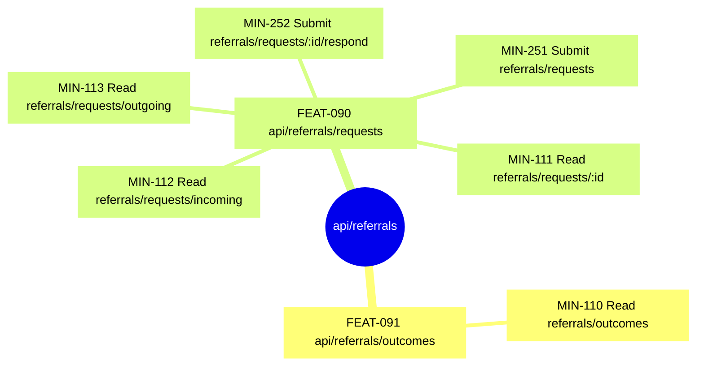
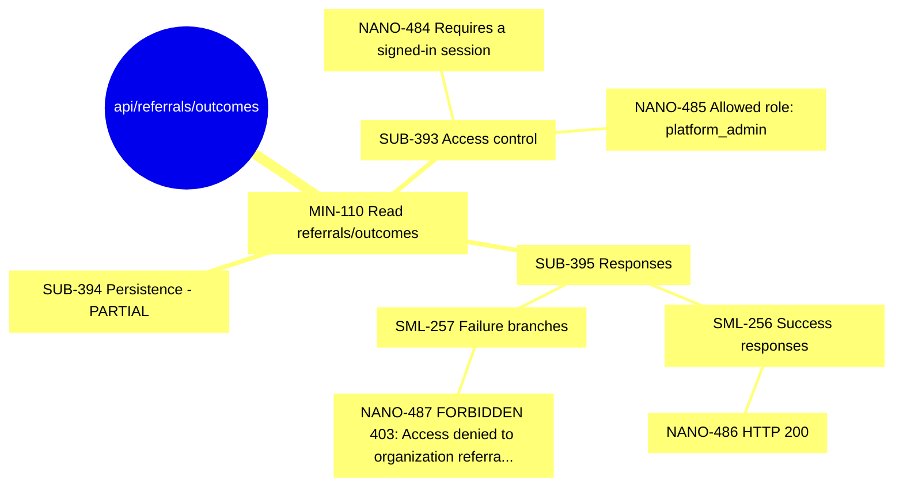
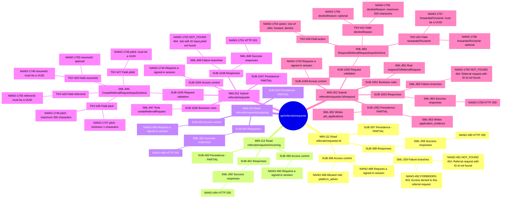

# api/referrals (MOD-081)

Generated by `docs/mindmap/tools/catalog.py` from `master/MASTER_PROJECT_GRAPH.json` at commit `9b3032f`. Do not edit by hand. Back to the [feature catalog](../FEATURE_CATALOG.md).

**Application:** apps/api (MOD-001). **Purpose:** API module: routes under /api/v1/referrals in apps/api/src/server.ts.

**Nodes by level:** MODULE 1, MAJOR 2, MINOR 6, SUB 22, SMALL 16, TINY 7, NANO 30. **Status:** IMPLEMENTED 78, PARTIALLY_IMPLEMENTED 6. **Verification:** PATH_LEVEL 73, VERIFIED 8.

**User roles that reach it:** authenticated, platform_admin.

**Known gaps:** MIN-110 ephemeral: state held in process memory, lost on restart; MIN-110 no first-party web caller found; MIN-111 ephemeral: state held in process memory, lost on restart; MIN-111 no first-party web caller found; MIN-112 ephemeral: state held in process memory, lost on restart; MIN-112 no first-party web caller found; MIN-113 ephemeral: state held in process memory, lost on restart; MIN-113 no first-party web caller found; MIN-251 ephemeral: state held in process memory, lost on restart; MIN-251 no first-party web caller found; MIN-252 ephemeral: state held in process memory, lost on restart; MIN-252 no first-party web caller found.

## Module map (to minor features)

## FEAT-091 api/referrals/outcomes

api/referrals/outcomes

| ID       | Level | Parent   | Name                                                            | Description                                                                                                                                                                                                              | Status                | Verification | Evidence                    | Related                     |
| -------- | ----- | -------- | --------------------------------------------------------------- | ------------------------------------------------------------------------------------------------------------------------------------------------------------------------------------------------------------------------ | --------------------- | ------------ | --------------------------- | --------------------------- |
| FEAT-091 | MAJOR | MOD-081  | api/referrals/outcomes                                          |                                                                                                                                                                                                                          | IMPLEMENTED           |              | apps/api/src/server.ts:7302 |                             |
| MIN-110  | MINOR | FEAT-091 | Read referrals/outcomes                                         | GET /api/v1/referrals/outcomes for roles platform_admin; ephemeral (process memory); responds 200; 1 failure branch(es). Gaps: ephemeral: state held in process memory, lost on restart; no first-party web caller found | IMPLEMENTED           | VERIFIED     | apps/api/src/server.ts:7302 | API-153, TEST-120, TEST-202 |
| SUB-393  | SUB   | MIN-110  | Access control                                                  | Who may call GET /api/v1/referrals/outcomes: roles platform_admin.                                                                                                                                                       | IMPLEMENTED           | PATH_LEVEL   | apps/api/src/server.ts:7302 |                             |
| NANO-484 | NANO  | SUB-393  | Requires a signed-in session                                    | Requests without a valid session token are rejected with 401 UNAUTHENTICATED.                                                                                                                                            | IMPLEMENTED           | PATH_LEVEL   | apps/api/src/server.ts:7302 | ROLE-001                    |
| NANO-485 | NANO  | SUB-393  | Allowed role: platform_admin                                    | platform_admin is one of the roles allowed here (platform_admin); a caller holding none of them is rejected with 403.                                                                                                    | IMPLEMENTED           | PATH_LEVEL   | apps/api/src/server.ts:7302 | ROLE-008                    |
| SUB-394  | SUB   | MIN-110  | Persistence                                                     | Ephemeral: state lives in API process memory and is lost on restart.                                                                                                                                                     | PARTIALLY_IMPLEMENTED | PATH_LEVEL   | apps/api/src/server.ts:7302 |                             |
| SUB-395  | SUB   | MIN-110  | Responses                                                       | Success 200; 1 explicit failure branch(es) besides validation and access errors.                                                                                                                                         | IMPLEMENTED           | PATH_LEVEL   | apps/api/src/server.ts:7302 |                             |
| SML-256  | SMALL | SUB-395  | Success responses                                               | HTTP 200.                                                                                                                                                                                                                | IMPLEMENTED           | PATH_LEVEL   | apps/api/src/server.ts:7302 |                             |
| NANO-486 | NANO  | SML-256  | HTTP 200                                                        | Replies 200 when the operation succeeds.                                                                                                                                                                                 | IMPLEMENTED           | PATH_LEVEL   | apps/api/src/server.ts:7302 |                             |
| SML-257  | SMALL | SUB-395  | Failure branches                                                | 1 DomainError branch(es) in the handler, mapped to HTTP by the global error handler.                                                                                                                                     | IMPLEMENTED           | PATH_LEVEL   | apps/api/src/server.ts:7302 |                             |
| NANO-487 | NANO  | SML-257  | FORBIDDEN 403: Access denied to organization referral outcomes. | Throws DomainError(FORBIDDEN) "Access denied to organization referral outcomes." -> HTTP 403.                                                                                                                            | IMPLEMENTED           | PATH_LEVEL   | apps/api/src/server.ts:7315 | ERR-149                     |

## FEAT-090 api/referrals/requests

api/referrals/requests

| ID        | Level | Parent   | Name                                                     | Description                                                                                                                                                                                                                                                                                                                                                        | Status                | Verification | Evidence                                                  | Related                                         |
| --------- | ----- | -------- | -------------------------------------------------------- | ------------------------------------------------------------------------------------------------------------------------------------------------------------------------------------------------------------------------------------------------------------------------------------------------------------------------------------------------------------------ | --------------------- | ------------ | --------------------------------------------------------- | ----------------------------------------------- |
| FEAT-090  | MAJOR | MOD-081  | api/referrals/requests                                   |                                                                                                                                                                                                                                                                                                                                                                    | IMPLEMENTED           |              | apps/api/src/server.ts:7063                               |                                                 |
| MIN-111   | MINOR | FEAT-090 | Read referrals/requests/:id                              | GET /api/v1/referrals/requests/:id for roles platform_admin; ephemeral (process memory); responds 200; 2 failure branch(es). Gaps: ephemeral: state held in process memory, lost on restart; no first-party web caller found                                                                                                                                       | IMPLEMENTED           | VERIFIED     | apps/api/src/server.ts:7163                               | API-151, TEST-101, TEST-120, TEST-202           |
| SUB-396   | SUB   | MIN-111  | Access control                                           | Who may call GET /api/v1/referrals/requests/:id: roles platform_admin.                                                                                                                                                                                                                                                                                             | IMPLEMENTED           | PATH_LEVEL   | apps/api/src/server.ts:7163                               |                                                 |
| NANO-488  | NANO  | SUB-396  | Requires a signed-in session                             | Requests without a valid session token are rejected with 401 UNAUTHENTICATED.                                                                                                                                                                                                                                                                                      | IMPLEMENTED           | PATH_LEVEL   | apps/api/src/server.ts:7163                               | ROLE-001                                        |
| NANO-489  | NANO  | SUB-396  | Allowed role: platform_admin                             | platform_admin is one of the roles allowed here (platform_admin); a caller holding none of them is rejected with 403.                                                                                                                                                                                                                                              | IMPLEMENTED           | PATH_LEVEL   | apps/api/src/server.ts:7163                               | ROLE-008                                        |
| SUB-397   | SUB   | MIN-111  | Persistence                                              | Ephemeral: state lives in API process memory and is lost on restart.                                                                                                                                                                                                                                                                                               | PARTIALLY_IMPLEMENTED | PATH_LEVEL   | apps/api/src/server.ts:7163                               |                                                 |
| SUB-398   | SUB   | MIN-111  | Responses                                                | Success 200; 2 explicit failure branch(es) besides validation and access errors.                                                                                                                                                                                                                                                                                   | IMPLEMENTED           | PATH_LEVEL   | apps/api/src/server.ts:7163                               |                                                 |
| SML-258   | SMALL | SUB-398  | Success responses                                        | HTTP 200.                                                                                                                                                                                                                                                                                                                                                          | IMPLEMENTED           | PATH_LEVEL   | apps/api/src/server.ts:7163                               |                                                 |
| NANO-490  | NANO  | SML-258  | HTTP 200                                                 | Replies 200 when the operation succeeds.                                                                                                                                                                                                                                                                                                                           | IMPLEMENTED           | PATH_LEVEL   | apps/api/src/server.ts:7163                               |                                                 |
| SML-259   | SMALL | SUB-398  | Failure branches                                         | 2 DomainError branch(es) in the handler, mapped to HTTP by the global error handler.                                                                                                                                                                                                                                                                               | IMPLEMENTED           | PATH_LEVEL   | apps/api/src/server.ts:7163                               |                                                 |
| NANO-491  | NANO  | SML-259  | NOT_FOUND 404: Referral request with ID ${id} not found. | Throws DomainError(NOT_FOUND) "Referral request with ID ${id} not found." -> HTTP 404.                                                                                                                                                                                                                                                                             | IMPLEMENTED           | PATH_LEVEL   | apps/api/src/server.ts:7171                               | ERR-147                                         |
| NANO-492  | NANO  | SML-259  | FORBIDDEN 403: Access denied to this referral request.   | Throws DomainError(FORBIDDEN) "Access denied to this referral request." -> HTTP 403.                                                                                                                                                                                                                                                                               | IMPLEMENTED           | PATH_LEVEL   | apps/api/src/server.ts:7181                               | ERR-148                                         |
| MIN-112   | MINOR | FEAT-090 | Read referrals/requests/incoming                         | GET /api/v1/referrals/requests/incoming for any signed-in session; ephemeral (process memory); responds 200. Gaps: ephemeral: state held in process memory, lost on restart; no first-party web caller found                                                                                                                                                       | IMPLEMENTED           | VERIFIED     | apps/api/src/server.ts:7145                               | API-149, TEST-101, TEST-120, TEST-202           |
| SUB-399   | SUB   | MIN-112  | Access control                                           | Who may call GET /api/v1/referrals/requests/incoming: any signed-in session.                                                                                                                                                                                                                                                                                       | IMPLEMENTED           | PATH_LEVEL   | apps/api/src/server.ts:7145                               |                                                 |
| NANO-493  | NANO  | SUB-399  | Requires a signed-in session                             | Requests without a valid session token are rejected with 401 UNAUTHENTICATED.                                                                                                                                                                                                                                                                                      | IMPLEMENTED           | PATH_LEVEL   | apps/api/src/server.ts:7145                               | ROLE-001                                        |
| SUB-400   | SUB   | MIN-112  | Persistence                                              | Ephemeral: state lives in API process memory and is lost on restart.                                                                                                                                                                                                                                                                                               | PARTIALLY_IMPLEMENTED | PATH_LEVEL   | apps/api/src/server.ts:7145                               |                                                 |
| SUB-401   | SUB   | MIN-112  | Responses                                                | Success 200; 0 explicit failure branch(es) besides validation and access errors.                                                                                                                                                                                                                                                                                   | IMPLEMENTED           | PATH_LEVEL   | apps/api/src/server.ts:7145                               |                                                 |
| SML-260   | SMALL | SUB-401  | Success responses                                        | HTTP 200.                                                                                                                                                                                                                                                                                                                                                          | IMPLEMENTED           | PATH_LEVEL   | apps/api/src/server.ts:7145                               |                                                 |
| NANO-494  | NANO  | SML-260  | HTTP 200                                                 | Replies 200 when the operation succeeds.                                                                                                                                                                                                                                                                                                                           | IMPLEMENTED           | PATH_LEVEL   | apps/api/src/server.ts:7145                               |                                                 |
| MIN-113   | MINOR | FEAT-090 | Read referrals/requests/outgoing                         | GET /api/v1/referrals/requests/outgoing for any signed-in session; ephemeral (process memory); responds 200. Gaps: ephemeral: state held in process memory, lost on restart; no first-party web caller found                                                                                                                                                       | IMPLEMENTED           | VERIFIED     | apps/api/src/server.ts:7154                               | API-150, TEST-120, TEST-202                     |
| SUB-402   | SUB   | MIN-113  | Access control                                           | Who may call GET /api/v1/referrals/requests/outgoing: any signed-in session.                                                                                                                                                                                                                                                                                       | IMPLEMENTED           | PATH_LEVEL   | apps/api/src/server.ts:7154                               |                                                 |
| NANO-495  | NANO  | SUB-402  | Requires a signed-in session                             | Requests without a valid session token are rejected with 401 UNAUTHENTICATED.                                                                                                                                                                                                                                                                                      | IMPLEMENTED           | PATH_LEVEL   | apps/api/src/server.ts:7154                               | ROLE-001                                        |
| SUB-403   | SUB   | MIN-113  | Persistence                                              | Ephemeral: state lives in API process memory and is lost on restart.                                                                                                                                                                                                                                                                                               | PARTIALLY_IMPLEMENTED | PATH_LEVEL   | apps/api/src/server.ts:7154                               |                                                 |
| SUB-404   | SUB   | MIN-113  | Responses                                                | Success 200; 0 explicit failure branch(es) besides validation and access errors.                                                                                                                                                                                                                                                                                   | IMPLEMENTED           | PATH_LEVEL   | apps/api/src/server.ts:7154                               |                                                 |
| SML-261   | SMALL | SUB-404  | Success responses                                        | HTTP 200.                                                                                                                                                                                                                                                                                                                                                          | IMPLEMENTED           | PATH_LEVEL   | apps/api/src/server.ts:7154                               |                                                 |
| NANO-496  | NANO  | SML-261  | HTTP 200                                                 | Replies 200 when the operation succeeds.                                                                                                                                                                                                                                                                                                                           | IMPLEMENTED           | PATH_LEVEL   | apps/api/src/server.ts:7154                               |                                                 |
| MIN-251   | MINOR | FEAT-090 | Submit referrals/requests                                | POST /api/v1/referrals/requests for any signed-in session; validates CreateReferralRequestInputSchema; calls createReferralRequest; ephemeral (process memory); responds 201; 1 failure branch(es). Gaps: ephemeral: state held in process memory, lost on restart; no first-party web caller found                                                                | IMPLEMENTED           | VERIFIED     | apps/api/src/server.ts:7063                               | API-148, TEST-101, TEST-120, TEST-126, TEST-202 |
| SUB-1044  | SUB   | MIN-251  | Access control                                           | Who may call POST /api/v1/referrals/requests: any signed-in session.                                                                                                                                                                                                                                                                                               | IMPLEMENTED           | PATH_LEVEL   | apps/api/src/server.ts:7063                               |                                                 |
| NANO-1744 | NANO  | SUB-1044 | Requires a signed-in session                             | Requests without a valid session token are rejected with 401 UNAUTHENTICATED.                                                                                                                                                                                                                                                                                      | IMPLEMENTED           | PATH_LEVEL   | apps/api/src/server.ts:7063                               | ROLE-001                                        |
| SUB-1045  | SUB   | MIN-251  | Request validation                                       | The request is parsed with CreateReferralRequestInputSchema; a failure returns 400 with field details before any business logic runs.                                                                                                                                                                                                                              | IMPLEMENTED           | PATH_LEVEL   | apps/api/src/server.ts:7063                               |                                                 |
| SML-846   | SMALL | SUB-1045 | CreateReferralRequestInputSchema                         | CreateReferralRequestInputSchema: 4 field(s)                                                                                                                                                                                                                                                                                                                       | IMPLEMENTED           | PATH_LEVEL   | packages/contracts/src/index.ts:1290                      | SCH-099                                         |
| TNY-426   | TINY  | SML-846  | Field referrerId                                         | referrerId (string, required): must be a UUID                                                                                                                                                                                                                                                                                                                      | IMPLEMENTED           | PATH_LEVEL   | packages/contracts/src/index.ts:1291                      |                                                 |
| NANO-1745 | NANO  | TNY-426  | referrerId: must be a UUID                               | referrerId must be a UUID.                                                                                                                                                                                                                                                                                                                                         | IMPLEMENTED           | PATH_LEVEL   | packages/contracts/src/index.ts:1291                      |                                                 |
| TNY-427   | TINY  | SML-846  | Field jobId                                              | jobId (string, required): must be a UUID                                                                                                                                                                                                                                                                                                                           | IMPLEMENTED           | PATH_LEVEL   | packages/contracts/src/index.ts:1292                      |                                                 |
| NANO-1746 | NANO  | TNY-427  | jobId: must be a UUID                                    | jobId must be a UUID.                                                                                                                                                                                                                                                                                                                                              | IMPLEMENTED           | PATH_LEVEL   | packages/contracts/src/index.ts:1292                      |                                                 |
| TNY-428   | TINY  | SML-846  | Field pitch                                              | pitch (string, required): minimum 1 characters; maximum 300 characters                                                                                                                                                                                                                                                                                             | IMPLEMENTED           | PATH_LEVEL   | packages/contracts/src/index.ts:1293                      |                                                 |
| NANO-1747 | NANO  | TNY-428  | pitch: minimum 1 characters                              | pitch minimum 1 characters.                                                                                                                                                                                                                                                                                                                                        | IMPLEMENTED           | PATH_LEVEL   | packages/contracts/src/index.ts:1293                      |                                                 |
| NANO-1748 | NANO  | TNY-428  | pitch: maximum 300 characters                            | pitch maximum 300 characters.                                                                                                                                                                                                                                                                                                                                      | IMPLEMENTED           | PATH_LEVEL   | packages/contracts/src/index.ts:1293                      |                                                 |
| TNY-429   | TINY  | SML-846  | Field resumeId                                           | resumeId (string, optional): must be a UUID; optional                                                                                                                                                                                                                                                                                                              | IMPLEMENTED           | PATH_LEVEL   | packages/contracts/src/index.ts:1294                      |                                                 |
| NANO-1749 | NANO  | TNY-429  | resumeId: must be a UUID                                 | resumeId must be a UUID.                                                                                                                                                                                                                                                                                                                                           | IMPLEMENTED           | PATH_LEVEL   | packages/contracts/src/index.ts:1294                      |                                                 |
| NANO-1750 | NANO  | TNY-429  | resumeId: optional                                       | resumeId optional.                                                                                                                                                                                                                                                                                                                                                 | IMPLEMENTED           | PATH_LEVEL   | packages/contracts/src/index.ts:1294                      |                                                 |
| SUB-1046  | SUB   | MIN-251  | Business rules                                           | Domain functions from packages/domain called by the handler (1).                                                                                                                                                                                                                                                                                                   | IMPLEMENTED           | PATH_LEVEL   | apps/api/src/server.ts:7063                               |                                                 |
| SML-847   | SMALL | SUB-1046 | Rule createReferralRequest                               | Calls createReferralRequest (packages/domain/src/referral-requests.ts). Rule status IMPLEMENTED; its own tests: VERIFIED.                                                                                                                                                                                                                                          | IMPLEMENTED           | VERIFIED     | packages/domain/src/referral-requests.ts:54               | RULE-180                                        |
| SUB-1047  | SUB   | MIN-251  | Persistence                                              | Ephemeral: state lives in API process memory and is lost on restart.                                                                                                                                                                                                                                                                                               | PARTIALLY_IMPLEMENTED | PATH_LEVEL   | apps/api/src/server.ts:7063                               |                                                 |
| SUB-1048  | SUB   | MIN-251  | Responses                                                | Success 201; 1 explicit failure branch(es) besides validation and access errors.                                                                                                                                                                                                                                                                                   | IMPLEMENTED           | PATH_LEVEL   | apps/api/src/server.ts:7063                               |                                                 |
| SML-848   | SMALL | SUB-1048 | Success responses                                        | HTTP 201.                                                                                                                                                                                                                                                                                                                                                          | IMPLEMENTED           | PATH_LEVEL   | apps/api/src/server.ts:7063                               |                                                 |
| NANO-1751 | NANO  | SML-848  | HTTP 201                                                 | Replies 201 when the operation succeeds.                                                                                                                                                                                                                                                                                                                           | IMPLEMENTED           | PATH_LEVEL   | apps/api/src/server.ts:7063                               |                                                 |
| SML-849   | SMALL | SUB-1048 | Failure branches                                         | 1 DomainError branch(es) in the handler, mapped to HTTP by the global error handler.                                                                                                                                                                                                                                                                               | IMPLEMENTED           | PATH_LEVEL   | apps/api/src/server.ts:7063                               |                                                 |
| NANO-1752 | NANO  | SML-849  | NOT_FOUND 404: Job with ID ${input.jobId} not found.     | Throws DomainError(NOT_FOUND) "Job with ID ${input.jobId} not found." -> HTTP 404.                                                                                                                                                                                                                                                                                 | IMPLEMENTED           | PATH_LEVEL   | apps/api/src/server.ts:7069                               | ERR-146                                         |
| MIN-252   | MINOR | FEAT-090 | Submit referrals/requests/:id/respond                    | POST /api/v1/referrals/requests/:id/respond for any signed-in session; validates RespondReferralRequestInputSchema; calls respondToReferralRequest; ephemeral (process memory); writes job_applications, application_evidence; responds 200; 1 failure branch(es). Gaps: ephemeral: state held in process memory, lost on restart; no first-party web caller found | IMPLEMENTED           | VERIFIED     | apps/api/src/server.ts:7188                               | API-152, TEST-120, TEST-202                     |
| SUB-1049  | SUB   | MIN-252  | Access control                                           | Who may call POST /api/v1/referrals/requests/:id/respond: any signed-in session.                                                                                                                                                                                                                                                                                   | IMPLEMENTED           | PATH_LEVEL   | apps/api/src/server.ts:7188                               |                                                 |
| NANO-1753 | NANO  | SUB-1049 | Requires a signed-in session                             | Requests without a valid session token are rejected with 401 UNAUTHENTICATED.                                                                                                                                                                                                                                                                                      | IMPLEMENTED           | PATH_LEVEL   | apps/api/src/server.ts:7188                               | ROLE-001                                        |
| SUB-1050  | SUB   | MIN-252  | Request validation                                       | The request is parsed with RespondReferralRequestInputSchema; a failure returns 400 with field details before any business logic runs.                                                                                                                                                                                                                             | IMPLEMENTED           | PATH_LEVEL   | apps/api/src/server.ts:7188                               |                                                 |
| SML-850   | SMALL | SUB-1050 | RespondReferralRequestInputSchema                        | RespondReferralRequestInputSchema: 3 field(s)                                                                                                                                                                                                                                                                                                                      | IMPLEMENTED           | PATH_LEVEL   | packages/contracts/src/index.ts:1299                      | SCH-100                                         |
| TNY-430   | TINY  | SML-850  | Field action                                             | action (enum, required): one of: refer, forward, decline                                                                                                                                                                                                                                                                                                           | IMPLEMENTED           | PATH_LEVEL   | packages/contracts/src/index.ts:1300                      |                                                 |
| NANO-1754 | NANO  | TNY-430  | action: one of: refer, forward, decline                  | action one of: refer, forward, decline.                                                                                                                                                                                                                                                                                                                            | IMPLEMENTED           | PATH_LEVEL   | packages/contracts/src/index.ts:1300                      |                                                 |
| TNY-431   | TINY  | SML-850  | Field declineReason                                      | declineReason (string, optional): maximum 500 characters; optional                                                                                                                                                                                                                                                                                                 | IMPLEMENTED           | PATH_LEVEL   | packages/contracts/src/index.ts:1301                      |                                                 |
| NANO-1755 | NANO  | TNY-431  | declineReason: maximum 500 characters                    | declineReason maximum 500 characters.                                                                                                                                                                                                                                                                                                                              | IMPLEMENTED           | PATH_LEVEL   | packages/contracts/src/index.ts:1301                      |                                                 |
| NANO-1756 | NANO  | TNY-431  | declineReason: optional                                  | declineReason optional.                                                                                                                                                                                                                                                                                                                                            | IMPLEMENTED           | PATH_LEVEL   | packages/contracts/src/index.ts:1301                      |                                                 |
| TNY-432   | TINY  | SML-850  | Field forwardedToUserId                                  | forwardedToUserId (string, optional): must be a UUID; optional                                                                                                                                                                                                                                                                                                     | IMPLEMENTED           | PATH_LEVEL   | packages/contracts/src/index.ts:1302                      |                                                 |
| NANO-1757 | NANO  | TNY-432  | forwardedToUserId: must be a UUID                        | forwardedToUserId must be a UUID.                                                                                                                                                                                                                                                                                                                                  | IMPLEMENTED           | PATH_LEVEL   | packages/contracts/src/index.ts:1302                      |                                                 |
| NANO-1758 | NANO  | TNY-432  | forwardedToUserId: optional                              | forwardedToUserId optional.                                                                                                                                                                                                                                                                                                                                        | IMPLEMENTED           | PATH_LEVEL   | packages/contracts/src/index.ts:1302                      |                                                 |
| SUB-1051  | SUB   | MIN-252  | Business rules                                           | Domain functions from packages/domain called by the handler (1).                                                                                                                                                                                                                                                                                                   | IMPLEMENTED           | PATH_LEVEL   | apps/api/src/server.ts:7188                               |                                                 |
| SML-851   | SMALL | SUB-1051 | Rule respondToReferralRequest                            | Calls respondToReferralRequest (packages/domain/src/referral-requests.ts). Rule status IMPLEMENTED; its own tests: VERIFIED.                                                                                                                                                                                                                                       | IMPLEMENTED           | VERIFIED     | packages/domain/src/referral-requests.ts:112              | RULE-181                                        |
| SUB-1052  | SUB   | MIN-252  | Persistence                                              | Ephemeral: state lives in API process memory and is lost on restart.                                                                                                                                                                                                                                                                                               | PARTIALLY_IMPLEMENTED | PATH_LEVEL   | apps/api/src/server.ts:7188                               |                                                 |
| SML-852   | SMALL | SUB-1052 | Writes job_applications                                  | Writes table job_applications (00001_core_schema.sql).                                                                                                                                                                                                                                                                                                             | IMPLEMENTED           | PATH_LEVEL   | supabase/migrations/00001_core_schema.sql:179             | DB-007                                          |
| SML-853   | SMALL | SUB-1052 | Writes application_evidence                              | Writes table application_evidence (00003_jobs_applications_schema.sql).                                                                                                                                                                                                                                                                                            | IMPLEMENTED           | PATH_LEVEL   | supabase/migrations/00003_jobs_applications_schema.sql:33 | DB-014                                          |
| SUB-1053  | SUB   | MIN-252  | Responses                                                | Success 200; 1 explicit failure branch(es) besides validation and access errors.                                                                                                                                                                                                                                                                                   | IMPLEMENTED           | PATH_LEVEL   | apps/api/src/server.ts:7188                               |                                                 |
| SML-854   | SMALL | SUB-1053 | Success responses                                        | HTTP 200.                                                                                                                                                                                                                                                                                                                                                          | IMPLEMENTED           | PATH_LEVEL   | apps/api/src/server.ts:7188                               |                                                 |
| NANO-1759 | NANO  | SML-854  | HTTP 200                                                 | Replies 200 when the operation succeeds.                                                                                                                                                                                                                                                                                                                           | IMPLEMENTED           | PATH_LEVEL   | apps/api/src/server.ts:7188                               |                                                 |
| SML-855   | SMALL | SUB-1053 | Failure branches                                         | 1 DomainError branch(es) in the handler, mapped to HTTP by the global error handler.                                                                                                                                                                                                                                                                               | IMPLEMENTED           | PATH_LEVEL   | apps/api/src/server.ts:7188                               |                                                 |
| NANO-1760 | NANO  | SML-855  | NOT_FOUND 404: Referral request with ID ${id} not found. | Throws DomainError(NOT_FOUND) "Referral request with ID ${id} not found." -> HTTP 404.                                                                                                                                                                                                                                                                             | IMPLEMENTED           | PATH_LEVEL   | apps/api/src/server.ts:7197                               | ERR-147                                         |
