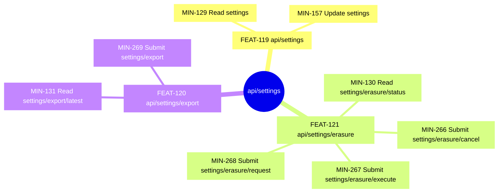
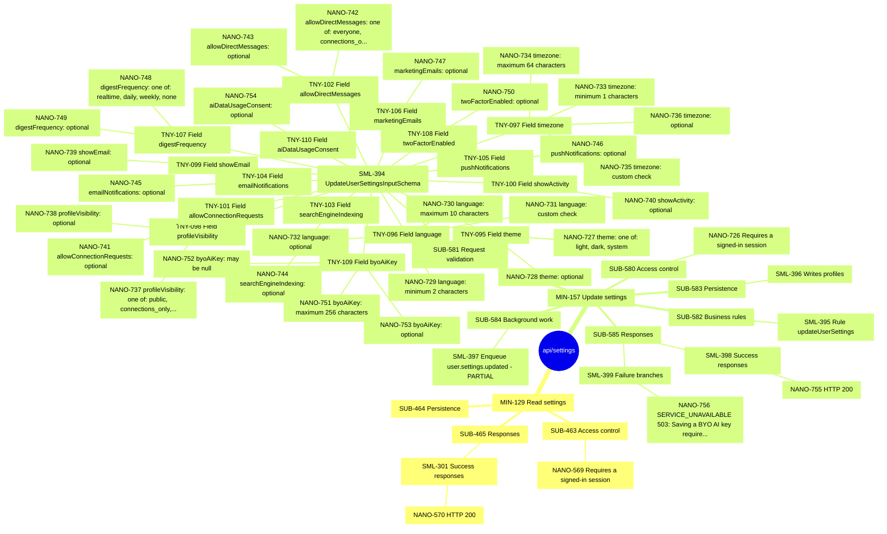
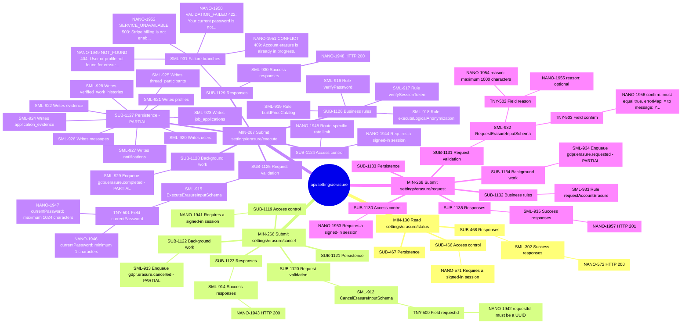
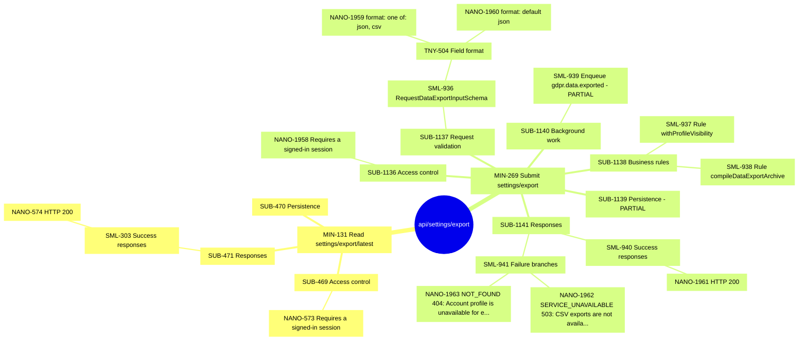

# api/settings (MOD-089)

Generated by `docs/mindmap/tools/catalog.py` from `master/MASTER_PROJECT_GRAPH.json` at commit `9b3032f`. Do not edit by hand. Back to the [feature catalog](../FEATURE_CATALOG.md).

**Application:** apps/api (MOD-001). **Purpose:** API module: routes under /api/v1/settings in apps/api/src/server.ts.

**Nodes by level:** MODULE 1, MAJOR 3, MINOR 8, SUB 38, SMALL 39, TINY 21, NANO 60. **Status:** IMPLEMENTED 163, PARTIALLY_IMPLEMENTED 7. **Verification:** PATH_LEVEL 144, UNKNOWN 6, VERIFIED 16.

**User roles that reach it:** authenticated.

**Known gaps:** MIN-130 no first-party web caller found; MIN-266 no first-party web caller found; MIN-267 ephemeral: state held in process memory, lost on restart; MIN-268 no first-party web caller found; MIN-131 no first-party web caller found; MIN-269 ephemeral: state held in process memory, lost on restart.

**Called from (web screens and components):** FEAT-177 Screen /profile, FEAT-180 Screen /settings

## Module map (to minor features)

## FEAT-119 api/settings

api/settings

| ID       | Level | Parent   | Name                                                                                          | Description                                                                                                                                                                                                             | Status                | Verification | Evidence                                      | Related                                                       |
| -------- | ----- | -------- | --------------------------------------------------------------------------------------------- | ----------------------------------------------------------------------------------------------------------------------------------------------------------------------------------------------------------------------- | --------------------- | ------------ | --------------------------------------------- | ------------------------------------------------------------- |
| FEAT-119 | MAJOR | MOD-089  | api/settings                                                                                  |                                                                                                                                                                                                                         | IMPLEMENTED           |              | apps/api/src/server.ts:10152                  |                                                               |
| MIN-129  | MINOR | FEAT-119 | Read settings                                                                                 | 1. Get current user settings (creates defaults if not yet initialized) GET /api/v1/settings for any signed-in session; durable (PostgreSQL); responds 200.                                                              | IMPLEMENTED           | VERIFIED     | apps/api/src/server.ts:10152                  | API-212, TEST-082, TEST-096, TEST-130, TEST-143, TEST-150 ... |
| SUB-463  | SUB   | MIN-129  | Access control                                                                                | Who may call GET /api/v1/settings: any signed-in session.                                                                                                                                                               | IMPLEMENTED           | PATH_LEVEL   | apps/api/src/server.ts:10152                  |                                                               |
| NANO-569 | NANO  | SUB-463  | Requires a signed-in session                                                                  | Requests without a valid session token are rejected with 401 UNAUTHENTICATED.                                                                                                                                           | IMPLEMENTED           | PATH_LEVEL   | apps/api/src/server.ts:10152                  | ROLE-001                                                      |
| SUB-464  | SUB   | MIN-129  | Persistence                                                                                   | Durable: writes go through the PostgreSQL store.                                                                                                                                                                        | IMPLEMENTED           | PATH_LEVEL   | apps/api/src/server.ts:10152                  |                                                               |
| SUB-465  | SUB   | MIN-129  | Responses                                                                                     | Success 200; 0 explicit failure branch(es) besides validation and access errors.                                                                                                                                        | IMPLEMENTED           | PATH_LEVEL   | apps/api/src/server.ts:10152                  |                                                               |
| SML-301  | SMALL | SUB-465  | Success responses                                                                             | HTTP 200.                                                                                                                                                                                                               | IMPLEMENTED           | PATH_LEVEL   | apps/api/src/server.ts:10152                  |                                                               |
| NANO-570 | NANO  | SML-301  | HTTP 200                                                                                      | Replies 200 when the operation succeeds.                                                                                                                                                                                | IMPLEMENTED           | PATH_LEVEL   | apps/api/src/server.ts:10152                  |                                                               |
| MIN-157  | MINOR | FEAT-119 | Update settings                                                                               | 2. Update user settings PATCH /api/v1/settings for any signed-in session; validates UpdateUserSettingsInputSchema; calls updateUserSettings; durable (PostgreSQL); writes profiles; responds 200; 1 failure branch(es). | IMPLEMENTED           | VERIFIED     | apps/api/src/server.ts:10162                  | API-213, TEST-082, TEST-086, TEST-096, TEST-130, TEST-148 ... |
| SUB-580  | SUB   | MIN-157  | Access control                                                                                | Who may call PATCH /api/v1/settings: any signed-in session.                                                                                                                                                             | IMPLEMENTED           | PATH_LEVEL   | apps/api/src/server.ts:10162                  |                                                               |
| NANO-726 | NANO  | SUB-580  | Requires a signed-in session                                                                  | Requests without a valid session token are rejected with 401 UNAUTHENTICATED.                                                                                                                                           | IMPLEMENTED           | PATH_LEVEL   | apps/api/src/server.ts:10162                  | ROLE-001                                                      |
| SUB-581  | SUB   | MIN-157  | Request validation                                                                            | The request is parsed with UpdateUserSettingsInputSchema; a failure returns 400 with field details before any business logic runs.                                                                                      | IMPLEMENTED           | PATH_LEVEL   | apps/api/src/server.ts:10162                  |                                                               |
| SML-394  | SMALL | SUB-581  | UpdateUserSettingsInputSchema                                                                 | UpdateUserSettingsInputSchema: 16 field(s)                                                                                                                                                                              | IMPLEMENTED           | PATH_LEVEL   | packages/contracts/src/index.ts:606           | SCH-046                                                       |
| TNY-095  | TINY  | SML-394  | Field theme                                                                                   | theme (enum, optional): one of: light, dark, system; optional                                                                                                                                                           | IMPLEMENTED           | PATH_LEVEL   | packages/contracts/src/index.ts:607           |                                                               |
| NANO-727 | NANO  | TNY-095  | theme: one of: light, dark, system                                                            | theme one of: light, dark, system.                                                                                                                                                                                      | IMPLEMENTED           | PATH_LEVEL   | packages/contracts/src/index.ts:607           |                                                               |
| NANO-728 | NANO  | TNY-095  | theme: optional                                                                               | theme optional.                                                                                                                                                                                                         | IMPLEMENTED           | PATH_LEVEL   | packages/contracts/src/index.ts:607           |                                                               |
| TNY-096  | TINY  | SML-394  | Field language                                                                                | language (string, optional): minimum 2 characters; maximum 10 characters; custom check; optional                                                                                                                        | IMPLEMENTED           | PATH_LEVEL   | packages/contracts/src/index.ts:608           |                                                               |
| NANO-729 | NANO  | TNY-096  | language: minimum 2 characters                                                                | language minimum 2 characters.                                                                                                                                                                                          | IMPLEMENTED           | PATH_LEVEL   | packages/contracts/src/index.ts:608           |                                                               |
| NANO-730 | NANO  | TNY-096  | language: maximum 10 characters                                                               | language maximum 10 characters.                                                                                                                                                                                         | IMPLEMENTED           | PATH_LEVEL   | packages/contracts/src/index.ts:608           |                                                               |
| NANO-731 | NANO  | TNY-096  | language: custom check                                                                        | language custom check; message "Use a language tag such as en or en-GB.".                                                                                                                                               | IMPLEMENTED           | PATH_LEVEL   | packages/contracts/src/index.ts:608           |                                                               |
| NANO-732 | NANO  | TNY-096  | language: optional                                                                            | language optional.                                                                                                                                                                                                      | IMPLEMENTED           | PATH_LEVEL   | packages/contracts/src/index.ts:608           |                                                               |
| TNY-097  | TINY  | SML-394  | Field timezone                                                                                | timezone (string, optional): minimum 1 characters; maximum 64 characters; custom check; optional                                                                                                                        | IMPLEMENTED           | PATH_LEVEL   | packages/contracts/src/index.ts:614           |                                                               |
| NANO-733 | NANO  | TNY-097  | timezone: minimum 1 characters                                                                | timezone minimum 1 characters.                                                                                                                                                                                          | IMPLEMENTED           | PATH_LEVEL   | packages/contracts/src/index.ts:614           |                                                               |
| NANO-734 | NANO  | TNY-097  | timezone: maximum 64 characters                                                               | timezone maximum 64 characters.                                                                                                                                                                                         | IMPLEMENTED           | PATH_LEVEL   | packages/contracts/src/index.ts:614           |                                                               |
| NANO-735 | NANO  | TNY-097  | timezone: custom check                                                                        | timezone custom check; message "Use a time zone such as UTC or Europe/London.".                                                                                                                                         | IMPLEMENTED           | PATH_LEVEL   | packages/contracts/src/index.ts:614           |                                                               |
| NANO-736 | NANO  | TNY-097  | timezone: optional                                                                            | timezone optional.                                                                                                                                                                                                      | IMPLEMENTED           | PATH_LEVEL   | packages/contracts/src/index.ts:614           |                                                               |
| TNY-098  | TINY  | SML-394  | Field profileVisibility                                                                       | profileVisibility (enum, optional): one of: public, connections_only, recruiters_only, private; optional                                                                                                                | IMPLEMENTED           | PATH_LEVEL   | packages/contracts/src/index.ts:620           |                                                               |
| NANO-737 | NANO  | TNY-098  | profileVisibility: one of: public, connections_only, recruiters_only, private                 | profileVisibility one of: public, connections_only, recruiters_only, private.                                                                                                                                           | IMPLEMENTED           | PATH_LEVEL   | packages/contracts/src/index.ts:620           |                                                               |
| NANO-738 | NANO  | TNY-098  | profileVisibility: optional                                                                   | profileVisibility optional.                                                                                                                                                                                             | IMPLEMENTED           | PATH_LEVEL   | packages/contracts/src/index.ts:620           |                                                               |
| TNY-099  | TINY  | SML-394  | Field showEmail                                                                               | showEmail (boolean, optional): optional                                                                                                                                                                                 | IMPLEMENTED           | PATH_LEVEL   | packages/contracts/src/index.ts:623           |                                                               |
| NANO-739 | NANO  | TNY-099  | showEmail: optional                                                                           | showEmail optional.                                                                                                                                                                                                     | IMPLEMENTED           | PATH_LEVEL   | packages/contracts/src/index.ts:623           |                                                               |
| TNY-100  | TINY  | SML-394  | Field showActivity                                                                            | showActivity (boolean, optional): optional                                                                                                                                                                              | IMPLEMENTED           | PATH_LEVEL   | packages/contracts/src/index.ts:624           |                                                               |
| NANO-740 | NANO  | TNY-100  | showActivity: optional                                                                        | showActivity optional.                                                                                                                                                                                                  | IMPLEMENTED           | PATH_LEVEL   | packages/contracts/src/index.ts:624           |                                                               |
| TNY-101  | TINY  | SML-394  | Field allowConnectionRequests                                                                 | allowConnectionRequests (boolean, optional): optional                                                                                                                                                                   | IMPLEMENTED           | PATH_LEVEL   | packages/contracts/src/index.ts:625           |                                                               |
| NANO-741 | NANO  | TNY-101  | allowConnectionRequests: optional                                                             | allowConnectionRequests optional.                                                                                                                                                                                       | IMPLEMENTED           | PATH_LEVEL   | packages/contracts/src/index.ts:625           |                                                               |
| TNY-102  | TINY  | SML-394  | Field allowDirectMessages                                                                     | allowDirectMessages (enum, optional): one of: everyone, connections_only, none; optional                                                                                                                                | IMPLEMENTED           | PATH_LEVEL   | packages/contracts/src/index.ts:626           |                                                               |
| NANO-742 | NANO  | TNY-102  | allowDirectMessages: one of: everyone, connections_only, none                                 | allowDirectMessages one of: everyone, connections_only, none.                                                                                                                                                           | IMPLEMENTED           | PATH_LEVEL   | packages/contracts/src/index.ts:626           |                                                               |
| NANO-743 | NANO  | TNY-102  | allowDirectMessages: optional                                                                 | allowDirectMessages optional.                                                                                                                                                                                           | IMPLEMENTED           | PATH_LEVEL   | packages/contracts/src/index.ts:626           |                                                               |
| TNY-103  | TINY  | SML-394  | Field searchEngineIndexing                                                                    | searchEngineIndexing (boolean, optional): optional                                                                                                                                                                      | IMPLEMENTED           | PATH_LEVEL   | packages/contracts/src/index.ts:627           |                                                               |
| NANO-744 | NANO  | TNY-103  | searchEngineIndexing: optional                                                                | searchEngineIndexing optional.                                                                                                                                                                                          | IMPLEMENTED           | PATH_LEVEL   | packages/contracts/src/index.ts:627           |                                                               |
| TNY-104  | TINY  | SML-394  | Field emailNotifications                                                                      | emailNotifications (boolean, optional): optional                                                                                                                                                                        | IMPLEMENTED           | PATH_LEVEL   | packages/contracts/src/index.ts:628           |                                                               |
| NANO-745 | NANO  | TNY-104  | emailNotifications: optional                                                                  | emailNotifications optional.                                                                                                                                                                                            | IMPLEMENTED           | PATH_LEVEL   | packages/contracts/src/index.ts:628           |                                                               |
| TNY-105  | TINY  | SML-394  | Field pushNotifications                                                                       | pushNotifications (boolean, optional): optional                                                                                                                                                                         | IMPLEMENTED           | PATH_LEVEL   | packages/contracts/src/index.ts:629           |                                                               |
| NANO-746 | NANO  | TNY-105  | pushNotifications: optional                                                                   | pushNotifications optional.                                                                                                                                                                                             | IMPLEMENTED           | PATH_LEVEL   | packages/contracts/src/index.ts:629           |                                                               |
| TNY-106  | TINY  | SML-394  | Field marketingEmails                                                                         | marketingEmails (boolean, optional): optional                                                                                                                                                                           | IMPLEMENTED           | PATH_LEVEL   | packages/contracts/src/index.ts:630           |                                                               |
| NANO-747 | NANO  | TNY-106  | marketingEmails: optional                                                                     | marketingEmails optional.                                                                                                                                                                                               | IMPLEMENTED           | PATH_LEVEL   | packages/contracts/src/index.ts:630           |                                                               |
| TNY-107  | TINY  | SML-394  | Field digestFrequency                                                                         | digestFrequency (enum, optional): one of: realtime, daily, weekly, none; optional                                                                                                                                       | IMPLEMENTED           | PATH_LEVEL   | packages/contracts/src/index.ts:631           |                                                               |
| NANO-748 | NANO  | TNY-107  | digestFrequency: one of: realtime, daily, weekly, none                                        | digestFrequency one of: realtime, daily, weekly, none.                                                                                                                                                                  | IMPLEMENTED           | PATH_LEVEL   | packages/contracts/src/index.ts:631           |                                                               |
| NANO-749 | NANO  | TNY-107  | digestFrequency: optional                                                                     | digestFrequency optional.                                                                                                                                                                                               | IMPLEMENTED           | PATH_LEVEL   | packages/contracts/src/index.ts:631           |                                                               |
| TNY-108  | TINY  | SML-394  | Field twoFactorEnabled                                                                        | twoFactorEnabled (boolean, optional): optional                                                                                                                                                                          | IMPLEMENTED           | PATH_LEVEL   | packages/contracts/src/index.ts:632           |                                                               |
| NANO-750 | NANO  | TNY-108  | twoFactorEnabled: optional                                                                    | twoFactorEnabled optional.                                                                                                                                                                                              | IMPLEMENTED           | PATH_LEVEL   | packages/contracts/src/index.ts:632           |                                                               |
| TNY-109  | TINY  | SML-394  | Field byoAiKey                                                                                | byoAiKey (string, optional): maximum 256 characters; may be null; optional                                                                                                                                              | IMPLEMENTED           | PATH_LEVEL   | packages/contracts/src/index.ts:633           |                                                               |
| NANO-751 | NANO  | TNY-109  | byoAiKey: maximum 256 characters                                                              | byoAiKey maximum 256 characters.                                                                                                                                                                                        | IMPLEMENTED           | PATH_LEVEL   | packages/contracts/src/index.ts:633           |                                                               |
| NANO-752 | NANO  | TNY-109  | byoAiKey: may be null                                                                         | byoAiKey may be null.                                                                                                                                                                                                   | IMPLEMENTED           | PATH_LEVEL   | packages/contracts/src/index.ts:633           |                                                               |
| NANO-753 | NANO  | TNY-109  | byoAiKey: optional                                                                            | byoAiKey optional.                                                                                                                                                                                                      | IMPLEMENTED           | PATH_LEVEL   | packages/contracts/src/index.ts:633           |                                                               |
| TNY-110  | TINY  | SML-394  | Field aiDataUsageConsent                                                                      | aiDataUsageConsent (boolean, optional): optional                                                                                                                                                                        | IMPLEMENTED           | PATH_LEVEL   | packages/contracts/src/index.ts:634           |                                                               |
| NANO-754 | NANO  | TNY-110  | aiDataUsageConsent: optional                                                                  | aiDataUsageConsent optional.                                                                                                                                                                                            | IMPLEMENTED           | PATH_LEVEL   | packages/contracts/src/index.ts:634           |                                                               |
| SUB-582  | SUB   | MIN-157  | Business rules                                                                                | Domain functions from packages/domain called by the handler (1).                                                                                                                                                        | IMPLEMENTED           | PATH_LEVEL   | apps/api/src/server.ts:10162                  |                                                               |
| SML-395  | SMALL | SUB-582  | Rule updateUserSettings                                                                       | Calls updateUserSettings (packages/domain/src/settings.ts). Rule status IMPLEMENTED; its own tests: VERIFIED.                                                                                                           | IMPLEMENTED           | VERIFIED     | packages/domain/src/settings.ts:144           | RULE-214                                                      |
| SUB-583  | SUB   | MIN-157  | Persistence                                                                                   | Durable: writes go through the PostgreSQL store; store calls accountMetadata.saveSettings.                                                                                                                              | IMPLEMENTED           | PATH_LEVEL   | apps/api/src/server.ts:10162                  |                                                               |
| SML-396  | SMALL | SUB-583  | Writes profiles                                                                               | Writes table profiles (00001_core_schema.sql).                                                                                                                                                                          | IMPLEMENTED           | PATH_LEVEL   | supabase/migrations/00001_core_schema.sql:114 | DB-002                                                        |
| SUB-584  | SUB   | MIN-157  | Background work                                                                               | Enqueues 1 background job kind(s) in background_jobs for apps/worker.                                                                                                                                                   | IMPLEMENTED           | PATH_LEVEL   | apps/api/src/server.ts:10162                  |                                                               |
| SML-397  | SMALL | SUB-584  | Enqueue user.settings.updated                                                                 | Dispatches job:user.settings.updated; worker handler: recordEvent (no-op: marks the event recorded).                                                                                                                    | PARTIALLY_IMPLEMENTED | UNKNOWN      | packages/domain/src/background-jobs.ts:171    | SVC-044                                                       |
| SUB-585  | SUB   | MIN-157  | Responses                                                                                     | Success 200; 1 explicit failure branch(es) besides validation and access errors.                                                                                                                                        | IMPLEMENTED           | PATH_LEVEL   | apps/api/src/server.ts:10162                  |                                                               |
| SML-398  | SMALL | SUB-585  | Success responses                                                                             | HTTP 200.                                                                                                                                                                                                               | IMPLEMENTED           | PATH_LEVEL   | apps/api/src/server.ts:10162                  |                                                               |
| NANO-755 | NANO  | SML-398  | HTTP 200                                                                                      | Replies 200 when the operation succeeds.                                                                                                                                                                                | IMPLEMENTED           | PATH_LEVEL   | apps/api/src/server.ts:10162                  |                                                               |
| SML-399  | SMALL | SUB-585  | Failure branches                                                                              | 1 DomainError branch(es) in the handler, mapped to HTTP by the global error handler.                                                                                                                                    | IMPLEMENTED           | PATH_LEVEL   | apps/api/src/server.ts:10162                  |                                                               |
| NANO-756 | NANO  | SML-399  | SERVICE_UNAVAILABLE 503: Saving a BYO AI key requires encrypted secret storage configuration. | Throws DomainError(SERVICE_UNAVAILABLE) "Saving a BYO AI key requires encrypted secret storage configuration." -> HTTP 503.                                                                                             | IMPLEMENTED           | PATH_LEVEL   | apps/api/src/server.ts:10169                  | ERR-202                                                       |

## FEAT-121 api/settings/erasure

api/settings/erasure

| ID        | Level | Parent   | Name                                                                                                                                               | Description                                                                                                                                                                                                                                                                                                                                                                                                                                                                     | Status                | Verification | Evidence                                                     | Related                                                       |
| --------- | ----- | -------- | -------------------------------------------------------------------------------------------------------------------------------------------------- | ------------------------------------------------------------------------------------------------------------------------------------------------------------------------------------------------------------------------------------------------------------------------------------------------------------------------------------------------------------------------------------------------------------------------------------------------------------------------------- | --------------------- | ------------ | ------------------------------------------------------------ | ------------------------------------------------------------- |
| FEAT-121  | MAJOR | MOD-089  | api/settings/erasure                                                                                                                               |                                                                                                                                                                                                                                                                                                                                                                                                                                                                                 | IMPLEMENTED           |              | apps/api/src/server.ts:10321                                 |                                                               |
| MIN-130   | MINOR | FEAT-121 | Read settings/erasure/status                                                                                                                       | 6. Get Account Erasure Request Status GET /api/v1/settings/erasure/status for any signed-in session; durable (PostgreSQL); responds 200. Gaps: no first-party web caller found                                                                                                                                                                                                                                                                                                  | IMPLEMENTED           | VERIFIED     | apps/api/src/server.ts:10346                                 | API-217, TEST-130, TEST-151                                   |
| SUB-466   | SUB   | MIN-130  | Access control                                                                                                                                     | Who may call GET /api/v1/settings/erasure/status: any signed-in session.                                                                                                                                                                                                                                                                                                                                                                                                        | IMPLEMENTED           | PATH_LEVEL   | apps/api/src/server.ts:10346                                 |                                                               |
| NANO-571  | NANO  | SUB-466  | Requires a signed-in session                                                                                                                       | Requests without a valid session token are rejected with 401 UNAUTHENTICATED.                                                                                                                                                                                                                                                                                                                                                                                                   | IMPLEMENTED           | PATH_LEVEL   | apps/api/src/server.ts:10346                                 | ROLE-001                                                      |
| SUB-467   | SUB   | MIN-130  | Persistence                                                                                                                                        | Durable: writes go through the PostgreSQL store; store calls erasureRequests.list.                                                                                                                                                                                                                                                                                                                                                                                              | IMPLEMENTED           | PATH_LEVEL   | apps/api/src/server.ts:10346                                 |                                                               |
| SUB-468   | SUB   | MIN-130  | Responses                                                                                                                                          | Success 200; 0 explicit failure branch(es) besides validation and access errors.                                                                                                                                                                                                                                                                                                                                                                                                | IMPLEMENTED           | PATH_LEVEL   | apps/api/src/server.ts:10346                                 |                                                               |
| SML-302   | SMALL | SUB-468  | Success responses                                                                                                                                  | HTTP 200.                                                                                                                                                                                                                                                                                                                                                                                                                                                                       | IMPLEMENTED           | PATH_LEVEL   | apps/api/src/server.ts:10346                                 |                                                               |
| NANO-572  | NANO  | SML-302  | HTTP 200                                                                                                                                           | Replies 200 when the operation succeeds.                                                                                                                                                                                                                                                                                                                                                                                                                                        | IMPLEMENTED           | PATH_LEVEL   | apps/api/src/server.ts:10346                                 |                                                               |
| MIN-266   | MINOR | FEAT-121 | Submit settings/erasure/cancel                                                                                                                     | 7. Cancel Account Erasure within 30-Day Grace Period POST /api/v1/settings/erasure/cancel for any signed-in session; validates CancelErasureInputSchema; durable (PostgreSQL); responds 200. Gaps: no first-party web caller found                                                                                                                                                                                                                                              | IMPLEMENTED           | VERIFIED     | apps/api/src/server.ts:10361                                 | API-218, TEST-130, TEST-151, TEST-171                         |
| SUB-1119  | SUB   | MIN-266  | Access control                                                                                                                                     | Who may call POST /api/v1/settings/erasure/cancel: any signed-in session.                                                                                                                                                                                                                                                                                                                                                                                                       | IMPLEMENTED           | PATH_LEVEL   | apps/api/src/server.ts:10361                                 |                                                               |
| NANO-1941 | NANO  | SUB-1119 | Requires a signed-in session                                                                                                                       | Requests without a valid session token are rejected with 401 UNAUTHENTICATED.                                                                                                                                                                                                                                                                                                                                                                                                   | IMPLEMENTED           | PATH_LEVEL   | apps/api/src/server.ts:10361                                 | ROLE-001                                                      |
| SUB-1120  | SUB   | MIN-266  | Request validation                                                                                                                                 | The request is parsed with CancelErasureInputSchema; a failure returns 400 with field details before any business logic runs.                                                                                                                                                                                                                                                                                                                                                   | IMPLEMENTED           | PATH_LEVEL   | apps/api/src/server.ts:10361                                 |                                                               |
| SML-912   | SMALL | SUB-1120 | CancelErasureInputSchema                                                                                                                           | CancelErasureInputSchema: 1 field(s)                                                                                                                                                                                                                                                                                                                                                                                                                                            | IMPLEMENTED           | PATH_LEVEL   | packages/contracts/src/index.ts:650                          | SCH-048                                                       |
| TNY-500   | TINY  | SML-912  | Field requestId                                                                                                                                    | requestId (string, required): must be a UUID                                                                                                                                                                                                                                                                                                                                                                                                                                    | IMPLEMENTED           | PATH_LEVEL   | packages/contracts/src/index.ts:651                          |                                                               |
| NANO-1942 | NANO  | TNY-500  | requestId: must be a UUID                                                                                                                          | requestId must be a UUID.                                                                                                                                                                                                                                                                                                                                                                                                                                                       | IMPLEMENTED           | PATH_LEVEL   | packages/contracts/src/index.ts:651                          |                                                               |
| SUB-1121  | SUB   | MIN-266  | Persistence                                                                                                                                        | Durable: writes go through the PostgreSQL store; store calls erasureRequests.cancel.                                                                                                                                                                                                                                                                                                                                                                                            | IMPLEMENTED           | PATH_LEVEL   | apps/api/src/server.ts:10361                                 |                                                               |
| SUB-1122  | SUB   | MIN-266  | Background work                                                                                                                                    | Enqueues 1 background job kind(s) in background_jobs for apps/worker.                                                                                                                                                                                                                                                                                                                                                                                                           | IMPLEMENTED           | PATH_LEVEL   | apps/api/src/server.ts:10361                                 |                                                               |
| SML-913   | SMALL | SUB-1122 | Enqueue gdpr.erasure.cancelled                                                                                                                     | Dispatches job:gdpr.erasure.cancelled; worker handler: recordEvent (no-op: marks the event recorded).                                                                                                                                                                                                                                                                                                                                                                           | PARTIALLY_IMPLEMENTED | UNKNOWN      | packages/domain/src/background-jobs.ts:171                   | SVC-024                                                       |
| SUB-1123  | SUB   | MIN-266  | Responses                                                                                                                                          | Success 200; 0 explicit failure branch(es) besides validation and access errors.                                                                                                                                                                                                                                                                                                                                                                                                | IMPLEMENTED           | PATH_LEVEL   | apps/api/src/server.ts:10361                                 |                                                               |
| SML-914   | SMALL | SUB-1123 | Success responses                                                                                                                                  | HTTP 200.                                                                                                                                                                                                                                                                                                                                                                                                                                                                       | IMPLEMENTED           | PATH_LEVEL   | apps/api/src/server.ts:10361                                 |                                                               |
| NANO-1943 | NANO  | SML-914  | HTTP 200                                                                                                                                           | Replies 200 when the operation succeeds.                                                                                                                                                                                                                                                                                                                                                                                                                                        | IMPLEMENTED           | PATH_LEVEL   | apps/api/src/server.ts:10361                                 |                                                               |
| MIN-267   | MINOR | FEAT-121 | Submit settings/erasure/execute                                                                                                                    | 8. Execute Immediate Account Erasure / Logical Anonymization (§31.4) POST /api/v1/settings/erasure/execute for any signed-in session; validates ExecuteErasureInputSchema; calls verifyPassword, verifySessionToken, executeLogicalAnonymization, buildPriceCatalog; ephemeral (process memory); writes users, profiles, evidence, job_applications, application_evidence, thread_participants, messages, notifi Gaps: ephemeral: state held in process memory, lost on restart | IMPLEMENTED           | VERIFIED     | apps/api/src/server.ts:10383                                 | API-219, TEST-097, TEST-101, TEST-102, TEST-112, TEST-130 ... |
| SUB-1124  | SUB   | MIN-267  | Access control                                                                                                                                     | Who may call POST /api/v1/settings/erasure/execute: any signed-in session.                                                                                                                                                                                                                                                                                                                                                                                                      | IMPLEMENTED           | PATH_LEVEL   | apps/api/src/server.ts:10383                                 |                                                               |
| NANO-1944 | NANO  | SUB-1124 | Requires a signed-in session                                                                                                                       | Requests without a valid session token are rejected with 401 UNAUTHENTICATED.                                                                                                                                                                                                                                                                                                                                                                                                   | IMPLEMENTED           | PATH_LEVEL   | apps/api/src/server.ts:10383                                 | ROLE-001                                                      |
| NANO-1945 | NANO  | SUB-1124 | Route-specific rate limit                                                                                                                          | This route sets its own rate-limit configuration (429 when exceeded).                                                                                                                                                                                                                                                                                                                                                                                                           | IMPLEMENTED           | PATH_LEVEL   | apps/api/src/server.ts:10383                                 |                                                               |
| SUB-1125  | SUB   | MIN-267  | Request validation                                                                                                                                 | The request is parsed with ExecuteErasureInputSchema; a failure returns 400 with field details before any business logic runs.                                                                                                                                                                                                                                                                                                                                                  | IMPLEMENTED           | PATH_LEVEL   | apps/api/src/server.ts:10383                                 |                                                               |
| SML-915   | SMALL | SUB-1125 | ExecuteErasureInputSchema                                                                                                                          | ExecuteErasureInputSchema: 1 field(s)                                                                                                                                                                                                                                                                                                                                                                                                                                           | IMPLEMENTED           | PATH_LEVEL   | packages/contracts/src/index.ts:659                          | SCH-049                                                       |
| TNY-501   | TINY  | SML-915  | Field currentPassword                                                                                                                              | currentPassword (string, required): minimum 1 characters; maximum 1024 characters                                                                                                                                                                                                                                                                                                                                                                                               | IMPLEMENTED           | PATH_LEVEL   | packages/contracts/src/index.ts:660                          |                                                               |
| NANO-1946 | NANO  | TNY-501  | currentPassword: minimum 1 characters                                                                                                              | currentPassword minimum 1 characters; message "Enter your current password to delete your account.".                                                                                                                                                                                                                                                                                                                                                                            | IMPLEMENTED           | PATH_LEVEL   | packages/contracts/src/index.ts:660                          |                                                               |
| NANO-1947 | NANO  | TNY-501  | currentPassword: maximum 1024 characters                                                                                                           | currentPassword maximum 1024 characters.                                                                                                                                                                                                                                                                                                                                                                                                                                        | IMPLEMENTED           | PATH_LEVEL   | packages/contracts/src/index.ts:660                          |                                                               |
| SUB-1126  | SUB   | MIN-267  | Business rules                                                                                                                                     | Domain functions from packages/domain called by the handler (4).                                                                                                                                                                                                                                                                                                                                                                                                                | IMPLEMENTED           | PATH_LEVEL   | apps/api/src/server.ts:10383                                 |                                                               |
| SML-916   | SMALL | SUB-1126 | Rule verifyPassword                                                                                                                                | Calls verifyPassword (packages/domain/src/auth.ts). Rule status IMPLEMENTED; its own tests: VERIFIED.                                                                                                                                                                                                                                                                                                                                                                           | IMPLEMENTED           | VERIFIED     | packages/domain/src/auth.ts:69                               | RULE-050                                                      |
| SML-917   | SMALL | SUB-1126 | Rule verifySessionToken                                                                                                                            | Calls verifySessionToken (packages/domain/src/auth.ts). Rule status IMPLEMENTED; its own tests: UNKNOWN.                                                                                                                                                                                                                                                                                                                                                                        | IMPLEMENTED           | UNKNOWN      | packages/domain/src/auth.ts:168                              | RULE-055                                                      |
| SML-918   | SMALL | SUB-1126 | Rule executeLogicalAnonymization                                                                                                                   | Calls executeLogicalAnonymization (packages/domain/src/settings.ts). Rule status IMPLEMENTED; its own tests: VERIFIED.                                                                                                                                                                                                                                                                                                                                                          | IMPLEMENTED           | VERIFIED     | packages/domain/src/settings.ts:279                          | RULE-217                                                      |
| SML-919   | SMALL | SUB-1126 | Rule buildPriceCatalog                                                                                                                             | Calls buildPriceCatalog (packages/domain/src/stripe-billing.ts). Rule status IMPLEMENTED; its own tests: VERIFIED.                                                                                                                                                                                                                                                                                                                                                              | IMPLEMENTED           | VERIFIED     | packages/domain/src/stripe-billing.ts:74                     | RULE-229                                                      |
| SUB-1127  | SUB   | MIN-267  | Persistence                                                                                                                                        | Ephemeral: state lives in API process memory and is lost on restart; store calls accountMetadata.erase, applicationDrafts.eraseCandidate, connections.eraseUser, erasureRequests.beginExecution, erasureRequests.completeActive, erasureRequests.list.                                                                                                                                                                                                                          | PARTIALLY_IMPLEMENTED | PATH_LEVEL   | apps/api/src/server.ts:10383                                 |                                                               |
| SML-920   | SMALL | SUB-1127 | Writes users                                                                                                                                       | Writes table users (00001_core_schema.sql).                                                                                                                                                                                                                                                                                                                                                                                                                                     | IMPLEMENTED           | PATH_LEVEL   | supabase/migrations/00001_core_schema.sql:96                 | DB-001                                                        |
| SML-921   | SMALL | SUB-1127 | Writes profiles                                                                                                                                    | Writes table profiles (00001_core_schema.sql).                                                                                                                                                                                                                                                                                                                                                                                                                                  | IMPLEMENTED           | PATH_LEVEL   | supabase/migrations/00001_core_schema.sql:114                | DB-002                                                        |
| SML-922   | SMALL | SUB-1127 | Writes evidence                                                                                                                                    | Writes table evidence (00001_core_schema.sql).                                                                                                                                                                                                                                                                                                                                                                                                                                  | IMPLEMENTED           | PATH_LEVEL   | supabase/migrations/00001_core_schema.sql:128                | DB-003                                                        |
| SML-923   | SMALL | SUB-1127 | Writes job_applications                                                                                                                            | Writes table job_applications (00001_core_schema.sql).                                                                                                                                                                                                                                                                                                                                                                                                                          | IMPLEMENTED           | PATH_LEVEL   | supabase/migrations/00001_core_schema.sql:179                | DB-007                                                        |
| SML-924   | SMALL | SUB-1127 | Writes application_evidence                                                                                                                        | Writes table application_evidence (00003_jobs_applications_schema.sql).                                                                                                                                                                                                                                                                                                                                                                                                         | IMPLEMENTED           | PATH_LEVEL   | supabase/migrations/00003_jobs_applications_schema.sql:33    | DB-014                                                        |
| SML-925   | SMALL | SUB-1127 | Writes thread_participants                                                                                                                         | Writes table thread_participants (00006_messaging_schema.sql).                                                                                                                                                                                                                                                                                                                                                                                                                  | IMPLEMENTED           | PATH_LEVEL   | supabase/migrations/00006_messaging_schema.sql:17            | DB-027                                                        |
| SML-926   | SMALL | SUB-1127 | Writes messages                                                                                                                                    | Writes table messages (00006_messaging_schema.sql).                                                                                                                                                                                                                                                                                                                                                                                                                             | IMPLEMENTED           | PATH_LEVEL   | supabase/migrations/00006_messaging_schema.sql:30            | DB-028                                                        |
| SML-927   | SMALL | SUB-1127 | Writes notifications                                                                                                                               | Writes table notifications (00007_notifications_schema.sql).                                                                                                                                                                                                                                                                                                                                                                                                                    | IMPLEMENTED           | PATH_LEVEL   | supabase/migrations/00007_notifications_schema.sql:6         | DB-029                                                        |
| SML-928   | SMALL | SUB-1127 | Writes verified_work_histories                                                                                                                     | Writes table verified_work_histories (00041_verified_work_history_schema.sql).                                                                                                                                                                                                                                                                                                                                                                                                  | IMPLEMENTED           | PATH_LEVEL   | supabase/migrations/00041_verified_work_history_schema.sql:5 | DB-105                                                        |
| SUB-1128  | SUB   | MIN-267  | Background work                                                                                                                                    | Enqueues 1 background job kind(s) in background_jobs for apps/worker.                                                                                                                                                                                                                                                                                                                                                                                                           | IMPLEMENTED           | PATH_LEVEL   | apps/api/src/server.ts:10383                                 |                                                               |
| SML-929   | SMALL | SUB-1128 | Enqueue gdpr.erasure.completed                                                                                                                     | Dispatches job:gdpr.erasure.completed; worker handler: recordEvent (no-op: marks the event recorded).                                                                                                                                                                                                                                                                                                                                                                           | PARTIALLY_IMPLEMENTED | UNKNOWN      | packages/domain/src/background-jobs.ts:171                   | SVC-025                                                       |
| SUB-1129  | SUB   | MIN-267  | Responses                                                                                                                                          | Success 200; 4 explicit failure branch(es) besides validation and access errors.                                                                                                                                                                                                                                                                                                                                                                                                | IMPLEMENTED           | PATH_LEVEL   | apps/api/src/server.ts:10383                                 |                                                               |
| SML-930   | SMALL | SUB-1129 | Success responses                                                                                                                                  | HTTP 200.                                                                                                                                                                                                                                                                                                                                                                                                                                                                       | IMPLEMENTED           | PATH_LEVEL   | apps/api/src/server.ts:10383                                 |                                                               |
| NANO-1948 | NANO  | SML-930  | HTTP 200                                                                                                                                           | Replies 200 when the operation succeeds.                                                                                                                                                                                                                                                                                                                                                                                                                                        | IMPLEMENTED           | PATH_LEVEL   | apps/api/src/server.ts:10383                                 |                                                               |
| SML-931   | SMALL | SUB-1129 | Failure branches                                                                                                                                   | 4 DomainError branch(es) in the handler, mapped to HTTP by the global error handler.                                                                                                                                                                                                                                                                                                                                                                                            | IMPLEMENTED           | PATH_LEVEL   | apps/api/src/server.ts:10383                                 |                                                               |
| NANO-1949 | NANO  | SML-931  | NOT_FOUND 404: User or profile not found for erasure execution.                                                                                    | Throws DomainError(NOT_FOUND) "User or profile not found for erasure execution." -> HTTP 404.                                                                                                                                                                                                                                                                                                                                                                                   | IMPLEMENTED           | PATH_LEVEL   | apps/api/src/server.ts:10448                                 | ERR-205                                                       |
| NANO-1950 | NANO  | SML-931  | VALIDATION_FAILED 422: Your current password is not correct.                                                                                       | Throws DomainError(VALIDATION_FAILED) "Your current password is not correct." -> HTTP 422.                                                                                                                                                                                                                                                                                                                                                                                      | IMPLEMENTED           | VERIFIED     | apps/api/src/server.ts:10456                                 | ERR-012, TEST-163, TEST-164                                   |
| NANO-1951 | NANO  | SML-931  | CONFLICT 409: Account erasure is already in progress.                                                                                              | Throws DomainError(CONFLICT) "Account erasure is already in progress." -> HTTP 409.                                                                                                                                                                                                                                                                                                                                                                                             | IMPLEMENTED           | PATH_LEVEL   | apps/api/src/server.ts:10464                                 | ERR-206                                                       |
| NANO-1952 | NANO  | SML-931  | SERVICE_UNAVAILABLE 503: Stripe billing is not enabled on this server.                                                                             | Throws DomainError(SERVICE_UNAVAILABLE) "Stripe billing is not enabled on this server." -> HTTP 503.                                                                                                                                                                                                                                                                                                                                                                            | IMPLEMENTED           | PATH_LEVEL   | apps/api/src/server.ts:10824                                 | ERR-207                                                       |
| MIN-268   | MINOR | FEAT-121 | Submit settings/erasure/request                                                                                                                    | 5. Request Account Erasure (GDPR Art 17 with mandatory 30-day grace period) POST /api/v1/settings/erasure/request for any signed-in session; validates RequestErasureInputSchema; calls requestAccountErasure; durable (PostgreSQL); responds 201. Gaps: no first-party web caller found                                                                                                                                                                                        | IMPLEMENTED           | VERIFIED     | apps/api/src/server.ts:10321                                 | API-216, TEST-130, TEST-151, TEST-171                         |
| SUB-1130  | SUB   | MIN-268  | Access control                                                                                                                                     | Who may call POST /api/v1/settings/erasure/request: any signed-in session.                                                                                                                                                                                                                                                                                                                                                                                                      | IMPLEMENTED           | PATH_LEVEL   | apps/api/src/server.ts:10321                                 |                                                               |
| NANO-1953 | NANO  | SUB-1130 | Requires a signed-in session                                                                                                                       | Requests without a valid session token are rejected with 401 UNAUTHENTICATED.                                                                                                                                                                                                                                                                                                                                                                                                   | IMPLEMENTED           | PATH_LEVEL   | apps/api/src/server.ts:10321                                 | ROLE-001                                                      |
| SUB-1131  | SUB   | MIN-268  | Request validation                                                                                                                                 | The request is parsed with RequestErasureInputSchema; a failure returns 400 with field details before any business logic runs.                                                                                                                                                                                                                                                                                                                                                  | IMPLEMENTED           | PATH_LEVEL   | apps/api/src/server.ts:10321                                 |                                                               |
| SML-932   | SMALL | SUB-1131 | RequestErasureInputSchema                                                                                                                          | RequestErasureInputSchema: 2 field(s)                                                                                                                                                                                                                                                                                                                                                                                                                                           | IMPLEMENTED           | PATH_LEVEL   | packages/contracts/src/index.ts:639                          | SCH-047                                                       |
| TNY-502   | TINY  | SML-932  | Field reason                                                                                                                                       | reason (string, optional): maximum 1000 characters; optional                                                                                                                                                                                                                                                                                                                                                                                                                    | IMPLEMENTED           | PATH_LEVEL   | packages/contracts/src/index.ts:640                          |                                                               |
| NANO-1954 | NANO  | TNY-502  | reason: maximum 1000 characters                                                                                                                    | reason maximum 1000 characters.                                                                                                                                                                                                                                                                                                                                                                                                                                                 | IMPLEMENTED           | PATH_LEVEL   | packages/contracts/src/index.ts:640                          |                                                               |
| NANO-1955 | NANO  | TNY-502  | reason: optional                                                                                                                                   | reason optional.                                                                                                                                                                                                                                                                                                                                                                                                                                                                | IMPLEMENTED           | PATH_LEVEL   | packages/contracts/src/index.ts:640                          |                                                               |
| TNY-503   | TINY  | SML-932  | Field confirm                                                                                                                                      | confirm (literal, required): must equal true, { errorMap: () => ({ message: 'You must explicitly confirm account deletion to initiate the 30-day grace period.', }), }                                                                                                                                                                                                                                                                                                          | IMPLEMENTED           | PATH_LEVEL   | packages/contracts/src/index.ts:641                          |                                                               |
| NANO-1956 | NANO  | TNY-503  | confirm: must equal true, { errorMap: () => ({ message: 'You must explicitly confirm account deletion to initiate the 30-day grace period.', }), } | confirm must equal true, { errorMap: () => ({ message: 'You must explicitly confirm account deletion to initiate the 30-day grace period.', }), }.                                                                                                                                                                                                                                                                                                                              | IMPLEMENTED           | PATH_LEVEL   | packages/contracts/src/index.ts:641                          |                                                               |
| SUB-1132  | SUB   | MIN-268  | Business rules                                                                                                                                     | Domain functions from packages/domain called by the handler (1).                                                                                                                                                                                                                                                                                                                                                                                                                | IMPLEMENTED           | PATH_LEVEL   | apps/api/src/server.ts:10321                                 |                                                               |
| SML-933   | SMALL | SUB-1132 | Rule requestAccountErasure                                                                                                                         | Calls requestAccountErasure (packages/domain/src/settings.ts). Rule status IMPLEMENTED; its own tests: VERIFIED.                                                                                                                                                                                                                                                                                                                                                                | IMPLEMENTED           | VERIFIED     | packages/domain/src/settings.ts:201                          | RULE-215                                                      |
| SUB-1133  | SUB   | MIN-268  | Persistence                                                                                                                                        | Durable: writes go through the PostgreSQL store; store calls erasureRequests.create.                                                                                                                                                                                                                                                                                                                                                                                            | IMPLEMENTED           | PATH_LEVEL   | apps/api/src/server.ts:10321                                 |                                                               |
| SUB-1134  | SUB   | MIN-268  | Background work                                                                                                                                    | Enqueues 1 background job kind(s) in background_jobs for apps/worker.                                                                                                                                                                                                                                                                                                                                                                                                           | IMPLEMENTED           | PATH_LEVEL   | apps/api/src/server.ts:10321                                 |                                                               |
| SML-934   | SMALL | SUB-1134 | Enqueue gdpr.erasure.requested                                                                                                                     | Dispatches job:gdpr.erasure.requested; worker handler: recordEvent (no-op: marks the event recorded).                                                                                                                                                                                                                                                                                                                                                                           | PARTIALLY_IMPLEMENTED | UNKNOWN      | packages/domain/src/background-jobs.ts:171                   | SVC-026                                                       |
| SUB-1135  | SUB   | MIN-268  | Responses                                                                                                                                          | Success 201; 0 explicit failure branch(es) besides validation and access errors.                                                                                                                                                                                                                                                                                                                                                                                                | IMPLEMENTED           | PATH_LEVEL   | apps/api/src/server.ts:10321                                 |                                                               |
| SML-935   | SMALL | SUB-1135 | Success responses                                                                                                                                  | HTTP 201.                                                                                                                                                                                                                                                                                                                                                                                                                                                                       | IMPLEMENTED           | PATH_LEVEL   | apps/api/src/server.ts:10321                                 |                                                               |
| NANO-1957 | NANO  | SML-935  | HTTP 201                                                                                                                                           | Replies 201 when the operation succeeds.                                                                                                                                                                                                                                                                                                                                                                                                                                        | IMPLEMENTED           | PATH_LEVEL   | apps/api/src/server.ts:10321                                 |                                                               |

## FEAT-120 api/settings/export

api/settings/export

| ID        | Level | Parent   | Name                                                                                            | Description                                                                                                                                                                                                                                                                                                                                    | Status                | Verification | Evidence                                   | Related                                         |
| --------- | ----- | -------- | ----------------------------------------------------------------------------------------------- | ---------------------------------------------------------------------------------------------------------------------------------------------------------------------------------------------------------------------------------------------------------------------------------------------------------------------------------------------- | --------------------- | ------------ | ------------------------------------------ | ----------------------------------------------- |
| FEAT-120  | MAJOR | MOD-089  | api/settings/export                                                                             |                                                                                                                                                                                                                                                                                                                                                | IMPLEMENTED           |              | apps/api/src/server.ts:10205               |                                                 |
| MIN-131   | MINOR | FEAT-120 | Read settings/export/latest                                                                     | 4. Get Latest Data Export Request Status GET /api/v1/settings/export/latest for any signed-in session; durable (PostgreSQL); responds 200. Gaps: no first-party web caller found                                                                                                                                                               | IMPLEMENTED           | VERIFIED     | apps/api/src/server.ts:10311               | API-215, TEST-130, TEST-151                     |
| SUB-469   | SUB   | MIN-131  | Access control                                                                                  | Who may call GET /api/v1/settings/export/latest: any signed-in session.                                                                                                                                                                                                                                                                        | IMPLEMENTED           | PATH_LEVEL   | apps/api/src/server.ts:10311               |                                                 |
| NANO-573  | NANO  | SUB-469  | Requires a signed-in session                                                                    | Requests without a valid session token are rejected with 401 UNAUTHENTICATED.                                                                                                                                                                                                                                                                  | IMPLEMENTED           | PATH_LEVEL   | apps/api/src/server.ts:10311               | ROLE-001                                        |
| SUB-470   | SUB   | MIN-131  | Persistence                                                                                     | Durable: writes go through the PostgreSQL store; store calls accountMetadata.latestExport.                                                                                                                                                                                                                                                     | IMPLEMENTED           | PATH_LEVEL   | apps/api/src/server.ts:10311               |                                                 |
| SUB-471   | SUB   | MIN-131  | Responses                                                                                       | Success 200; 0 explicit failure branch(es) besides validation and access errors.                                                                                                                                                                                                                                                               | IMPLEMENTED           | PATH_LEVEL   | apps/api/src/server.ts:10311               |                                                 |
| SML-303   | SMALL | SUB-471  | Success responses                                                                               | HTTP 200.                                                                                                                                                                                                                                                                                                                                      | IMPLEMENTED           | PATH_LEVEL   | apps/api/src/server.ts:10311               |                                                 |
| NANO-574  | NANO  | SML-303  | HTTP 200                                                                                        | Replies 200 when the operation succeeds.                                                                                                                                                                                                                                                                                                       | IMPLEMENTED           | PATH_LEVEL   | apps/api/src/server.ts:10311               |                                                 |
| MIN-269   | MINOR | FEAT-120 | Submit settings/export                                                                          | 3. Initiate Data Portability / Export (GDPR Art 15 & 20) POST /api/v1/settings/export for any signed-in session; validates RequestDataExportInputSchema; calls withProfileVisibility, compileDataExportArchive; ephemeral (process memory); responds 200; 2 failure branch(es). Gaps: ephemeral: state held in process memory, lost on restart | IMPLEMENTED           | VERIFIED     | apps/api/src/server.ts:10205               | API-214, TEST-130, TEST-150, TEST-151, TEST-171 |
| SUB-1136  | SUB   | MIN-269  | Access control                                                                                  | Who may call POST /api/v1/settings/export: any signed-in session.                                                                                                                                                                                                                                                                              | IMPLEMENTED           | PATH_LEVEL   | apps/api/src/server.ts:10205               |                                                 |
| NANO-1958 | NANO  | SUB-1136 | Requires a signed-in session                                                                    | Requests without a valid session token are rejected with 401 UNAUTHENTICATED.                                                                                                                                                                                                                                                                  | IMPLEMENTED           | PATH_LEVEL   | apps/api/src/server.ts:10205               | ROLE-001                                        |
| SUB-1137  | SUB   | MIN-269  | Request validation                                                                              | The request is parsed with RequestDataExportInputSchema; a failure returns 400 with field details before any business logic runs.                                                                                                                                                                                                              | IMPLEMENTED           | PATH_LEVEL   | apps/api/src/server.ts:10205               |                                                 |
| SML-936   | SMALL | SUB-1137 | RequestDataExportInputSchema                                                                    | RequestDataExportInputSchema: 1 field(s)                                                                                                                                                                                                                                                                                                       | IMPLEMENTED           | PATH_LEVEL   | packages/contracts/src/index.ts:668        | SCH-050                                         |
| TNY-504   | TINY  | SML-936  | Field format                                                                                    | format (enum, optional): one of: json, csv; default 'json'                                                                                                                                                                                                                                                                                     | IMPLEMENTED           | PATH_LEVEL   | packages/contracts/src/index.ts:669        |                                                 |
| NANO-1959 | NANO  | TNY-504  | format: one of: json, csv                                                                       | format one of: json, csv.                                                                                                                                                                                                                                                                                                                      | IMPLEMENTED           | PATH_LEVEL   | packages/contracts/src/index.ts:669        |                                                 |
| NANO-1960 | NANO  | TNY-504  | format: default 'json'                                                                          | format default 'json'; message "json".                                                                                                                                                                                                                                                                                                         | IMPLEMENTED           | PATH_LEVEL   | packages/contracts/src/index.ts:669        |                                                 |
| SUB-1138  | SUB   | MIN-269  | Business rules                                                                                  | Domain functions from packages/domain called by the handler (2).                                                                                                                                                                                                                                                                               | IMPLEMENTED           | PATH_LEVEL   | apps/api/src/server.ts:10205               |                                                 |
| SML-937   | SMALL | SUB-1138 | Rule withProfileVisibility                                                                      | Calls withProfileVisibility (packages/domain/src/settings.ts). Rule status IMPLEMENTED; its own tests: VERIFIED.                                                                                                                                                                                                                               | IMPLEMENTED           | VERIFIED     | packages/domain/src/settings.ts:134        | RULE-213                                        |
| SML-938   | SMALL | SUB-1138 | Rule compileDataExportArchive                                                                   | Calls compileDataExportArchive (packages/domain/src/settings.ts). Rule status IMPLEMENTED; its own tests: VERIFIED.                                                                                                                                                                                                                            | IMPLEMENTED           | VERIFIED     | packages/domain/src/settings.ts:323        | RULE-218                                        |
| SUB-1139  | SUB   | MIN-269  | Persistence                                                                                     | Ephemeral: state lives in API process memory and is lost on restart; store calls accountMetadata.recordExport.                                                                                                                                                                                                                                 | PARTIALLY_IMPLEMENTED | PATH_LEVEL   | apps/api/src/server.ts:10205               |                                                 |
| SUB-1140  | SUB   | MIN-269  | Background work                                                                                 | Enqueues 1 background job kind(s) in background_jobs for apps/worker.                                                                                                                                                                                                                                                                          | IMPLEMENTED           | PATH_LEVEL   | apps/api/src/server.ts:10205               |                                                 |
| SML-939   | SMALL | SUB-1140 | Enqueue gdpr.data.exported                                                                      | Dispatches job:gdpr.data.exported; worker handler: recordEvent (no-op: marks the event recorded).                                                                                                                                                                                                                                              | PARTIALLY_IMPLEMENTED | UNKNOWN      | packages/domain/src/background-jobs.ts:171 | SVC-023                                         |
| SUB-1141  | SUB   | MIN-269  | Responses                                                                                       | Success 200; 2 explicit failure branch(es) besides validation and access errors.                                                                                                                                                                                                                                                               | IMPLEMENTED           | PATH_LEVEL   | apps/api/src/server.ts:10205               |                                                 |
| SML-940   | SMALL | SUB-1141 | Success responses                                                                               | HTTP 200.                                                                                                                                                                                                                                                                                                                                      | IMPLEMENTED           | PATH_LEVEL   | apps/api/src/server.ts:10205               |                                                 |
| NANO-1961 | NANO  | SML-940  | HTTP 200                                                                                        | Replies 200 when the operation succeeds.                                                                                                                                                                                                                                                                                                       | IMPLEMENTED           | PATH_LEVEL   | apps/api/src/server.ts:10205               |                                                 |
| SML-941   | SMALL | SUB-1141 | Failure branches                                                                                | 2 DomainError branch(es) in the handler, mapped to HTTP by the global error handler.                                                                                                                                                                                                                                                           | IMPLEMENTED           | PATH_LEVEL   | apps/api/src/server.ts:10205               |                                                 |
| NANO-1962 | NANO  | SML-941  | SERVICE_UNAVAILABLE 503: CSV exports are not available. Request the supported JSON snapshot ins | Throws DomainError(SERVICE_UNAVAILABLE) "CSV exports are not available. Request the supported JSON snapshot instead." -> HTTP 503.                                                                                                                                                                                                             | IMPLEMENTED           | PATH_LEVEL   | apps/api/src/server.ts:10209               | ERR-203                                         |
| NANO-1963 | NANO  | SML-941  | NOT_FOUND 404: Account profile is unavailable for export.                                       | Throws DomainError(NOT_FOUND) "Account profile is unavailable for export." -> HTTP 404.                                                                                                                                                                                                                                                        | IMPLEMENTED           | PATH_LEVEL   | apps/api/src/server.ts:10219               | ERR-204                                         |
