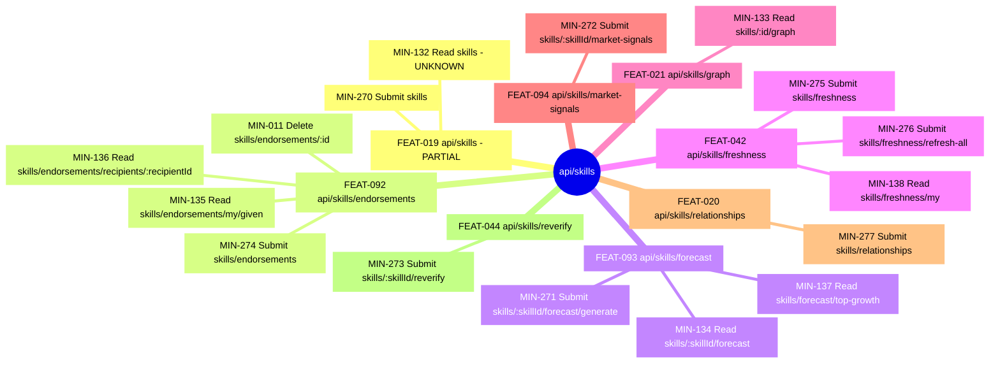
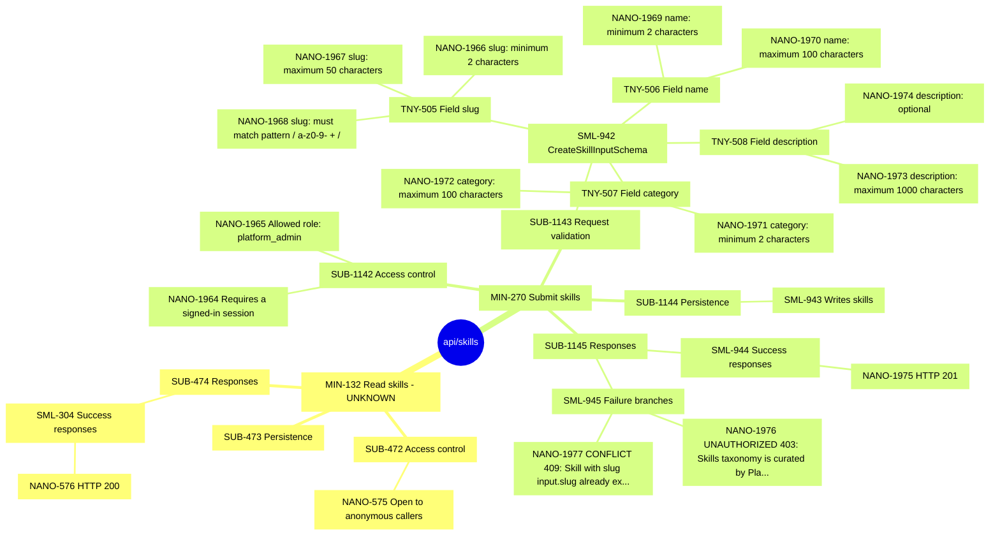
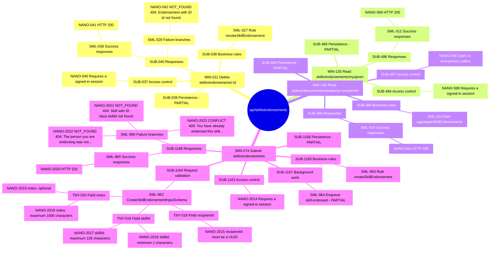
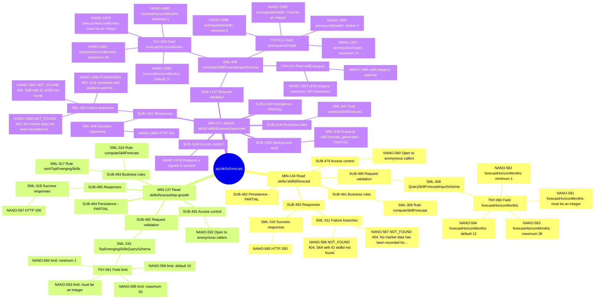
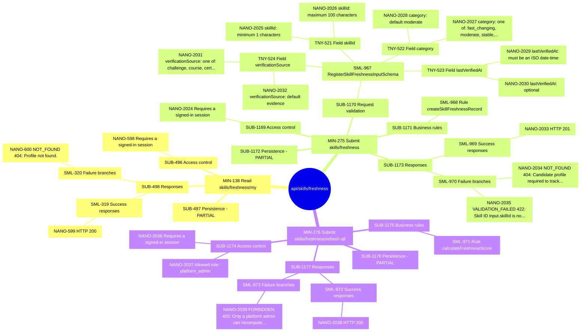
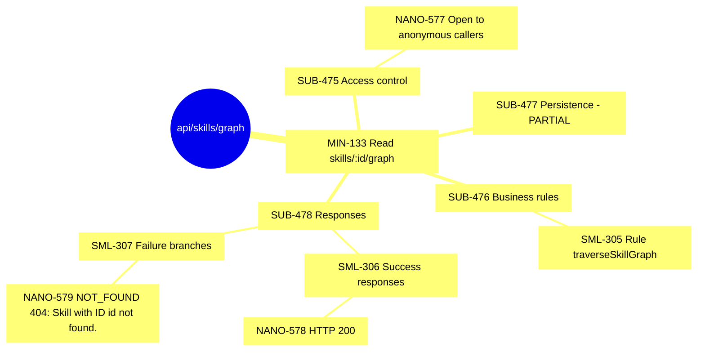
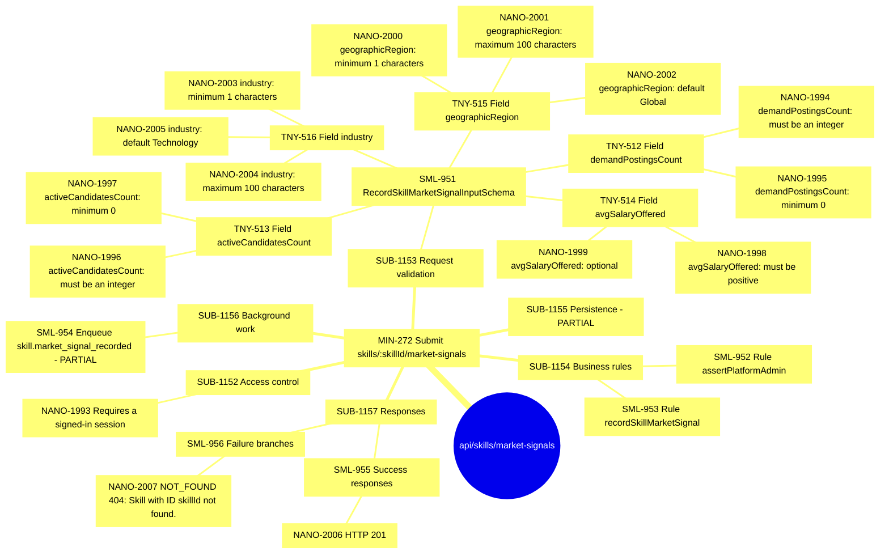
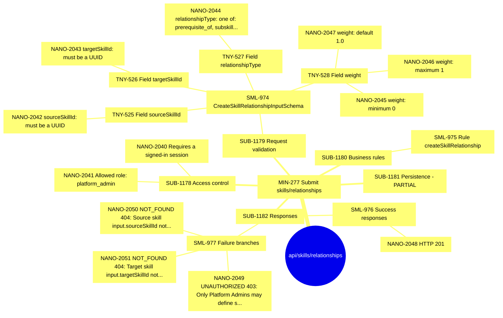
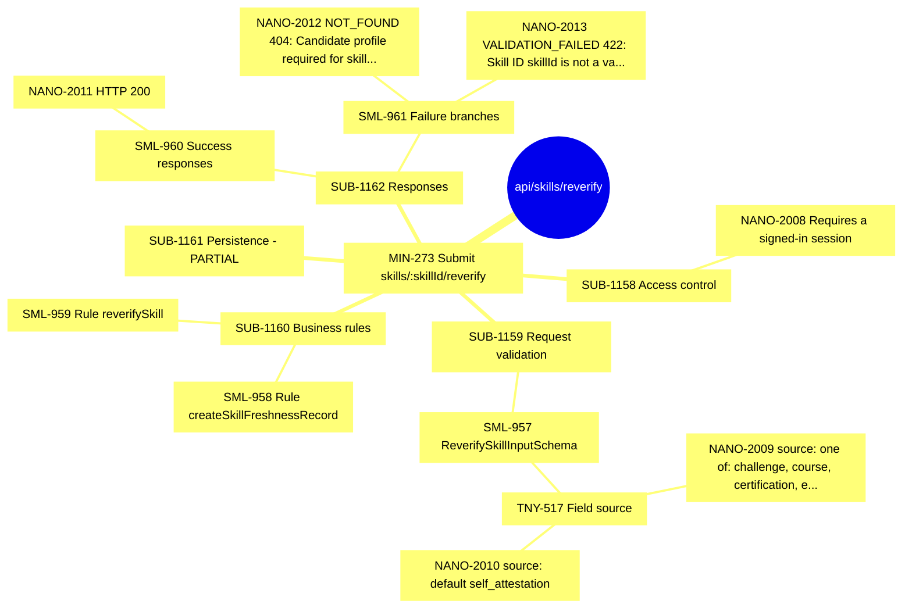

# api/skills (MOD-058)

Generated by `docs/mindmap/tools/catalog.py` from `master/MASTER_PROJECT_GRAPH.json` at commit `9b3032f`. Do not edit by hand. Back to the [feature catalog](../FEATURE_CATALOG.md).

**Application:** apps/api (MOD-001). **Purpose:** API module: routes under /api/v1/skills in apps/api/src/server.ts.

**Nodes by level:** MODULE 1, MAJOR 8, MINOR 16, SUB 72, SMALL 56, TINY 26, NANO 117. **Status:** IMPLEMENTED 276, PARTIALLY_IMPLEMENTED 19, UNKNOWN 1. **Verification:** PATH_LEVEL 252, UNKNOWN 3, VERIFIED 32.

**User roles that reach it:** anonymous, authenticated, platform_admin.

**Known gaps:** MIN-270 no first-party web caller found; MIN-011 ephemeral: state held in process memory, lost on restart; MIN-011 no first-party web caller found; MIN-135 ephemeral: state held in process memory, lost on restart; MIN-135 no first-party web caller found; MIN-136 ephemeral: state held in process memory, lost on restart; MIN-136 no first-party web caller found; MIN-274 ephemeral: state held in process memory, lost on restart; MIN-274 no first-party web caller found; MIN-134 ephemeral: state held in process memory, lost on restart; MIN-134 no first-party web caller found; MIN-137 ephemeral: state held in process memory, lost on restart; MIN-137 no first-party web caller found; MIN-271 ephemeral: state held in process memory, lost on restart; MIN-271 no first-party web caller found; MIN-138 ephemeral: state held in process memory, lost on restart; MIN-275 ephemeral: state held in process memory, lost on restart; MIN-276 ephemeral: state held in process memory, lost on restart; MIN-276 no first-party web caller found; MIN-133 ephemeral: state held in process memory, lost on restart; MIN-272 ephemeral: state held in process memory, lost on restart; MIN-272 no first-party web caller found; MIN-277 ephemeral: state held in process memory, lost on restart; MIN-277 no first-party web caller found; MIN-273 ephemeral: state held in process memory, lost on restart; MIN-273 no first-party web caller found.

**Called from (web screens and components):** FEAT-160 Screen /career, FEAT-164 Screen /hiring, FEAT-195 Component SkillsSection

## Module map (to minor features)

## FEAT-019 api/skills

api/skills

| ID        | Level | Parent   | Name                                                                          | Description                                                                                                                                                                                    | Status                | Verification | Evidence                                                | Related                                                       |
| --------- | ----- | -------- | ----------------------------------------------------------------------------- | ---------------------------------------------------------------------------------------------------------------------------------------------------------------------------------------------- | --------------------- | ------------ | ------------------------------------------------------- | ------------------------------------------------------------- |
| FEAT-019  | MAJOR | MOD-058  | api/skills                                                                    |                                                                                                                                                                                                | PARTIALLY_IMPLEMENTED |              | apps/api/src/server.ts:1778                             |                                                               |
| MIN-132   | MINOR | FEAT-019 | Read skills                                                                   | Skills Taxonomy Endpoints (F-84, BR-141..147) GET /api/v1/skills for anyone (public); durable (PostgreSQL); responds 200.                                                                      | UNKNOWN               | VERIFIED     | apps/api/src/server.ts:1778                             | API-022, TEST-084, TEST-089, TEST-101, TEST-108, TEST-117 ... |
| SUB-472   | SUB   | MIN-132  | Access control                                                                | Who may call GET /api/v1/skills: anyone (public).                                                                                                                                              | IMPLEMENTED           | PATH_LEVEL   | apps/api/src/server.ts:1778                             |                                                               |
| NANO-575  | NANO  | SUB-472  | Open to anonymous callers                                                     | auth: public.                                                                                                                                                                                  | IMPLEMENTED           | PATH_LEVEL   | apps/api/src/server.ts:1778                             | ROLE-001                                                      |
| SUB-473   | SUB   | MIN-132  | Persistence                                                                   | Durable: writes go through the PostgreSQL store.                                                                                                                                               | IMPLEMENTED           | PATH_LEVEL   | apps/api/src/server.ts:1778                             |                                                               |
| SUB-474   | SUB   | MIN-132  | Responses                                                                     | Success 200; 0 explicit failure branch(es) besides validation and access errors.                                                                                                               | IMPLEMENTED           | PATH_LEVEL   | apps/api/src/server.ts:1778                             |                                                               |
| SML-304   | SMALL | SUB-474  | Success responses                                                             | HTTP 200 (implicit).                                                                                                                                                                           | IMPLEMENTED           | PATH_LEVEL   | apps/api/src/server.ts:1778                             |                                                               |
| NANO-576  | NANO  | SML-304  | HTTP 200                                                                      | Replies 200 when the operation succeeds (implicit default).                                                                                                                                    | IMPLEMENTED           | PATH_LEVEL   | apps/api/src/server.ts:1778                             |                                                               |
| MIN-270   | MINOR | FEAT-019 | Submit skills                                                                 | POST /api/v1/skills for roles platform_admin; validates CreateSkillInputSchema; durable (PostgreSQL); writes skills; responds 201; 2 failure branch(es). Gaps: no first-party web caller found | IMPLEMENTED           | VERIFIED     | apps/api/src/server.ts:1782                             | API-023, TEST-103, TEST-145, TEST-213                         |
| SUB-1142  | SUB   | MIN-270  | Access control                                                                | Who may call POST /api/v1/skills: roles platform_admin.                                                                                                                                        | IMPLEMENTED           | PATH_LEVEL   | apps/api/src/server.ts:1782                             |                                                               |
| NANO-1964 | NANO  | SUB-1142 | Requires a signed-in session                                                  | Requests without a valid session token are rejected with 401 UNAUTHENTICATED.                                                                                                                  | IMPLEMENTED           | PATH_LEVEL   | apps/api/src/server.ts:1782                             | ROLE-001                                                      |
| NANO-1965 | NANO  | SUB-1142 | Allowed role: platform_admin                                                  | platform_admin is one of the roles allowed here (platform_admin); a caller holding none of them is rejected with 403.                                                                          | IMPLEMENTED           | PATH_LEVEL   | apps/api/src/server.ts:1782                             | ROLE-008                                                      |
| SUB-1143  | SUB   | MIN-270  | Request validation                                                            | The request is parsed with CreateSkillInputSchema; a failure returns 400 with field details before any business logic runs.                                                                    | IMPLEMENTED           | PATH_LEVEL   | apps/api/src/server.ts:1782                             |                                                               |
| SML-942   | SMALL | SUB-1143 | CreateSkillInputSchema                                                        | CreateSkillInputSchema: 4 field(s)                                                                                                                                                             | IMPLEMENTED           | PATH_LEVEL   | packages/contracts/src/index.ts:190                     | SCH-012                                                       |
| TNY-505   | TINY  | SML-942  | Field slug                                                                    | slug (string, required): minimum 2 characters; maximum 50 characters; must match pattern /^[a-z0-9-]+$/                                                                                        | IMPLEMENTED           | PATH_LEVEL   | packages/contracts/src/index.ts:191                     |                                                               |
| NANO-1966 | NANO  | TNY-505  | slug: minimum 2 characters                                                    | slug minimum 2 characters.                                                                                                                                                                     | IMPLEMENTED           | PATH_LEVEL   | packages/contracts/src/index.ts:191                     |                                                               |
| NANO-1967 | NANO  | TNY-505  | slug: maximum 50 characters                                                   | slug maximum 50 characters.                                                                                                                                                                    | IMPLEMENTED           | PATH_LEVEL   | packages/contracts/src/index.ts:191                     |                                                               |
| NANO-1968 | NANO  | TNY-505  | slug: must match pattern /^[a-z0-9-]+$/                                       | slug must match pattern /^[a-z0-9-]+$/; message "Slug must be lowercase alphanumeric with hyphens".                                                                                            | IMPLEMENTED           | PATH_LEVEL   | packages/contracts/src/index.ts:191                     |                                                               |
| TNY-506   | TINY  | SML-942  | Field name                                                                    | name (string, required): minimum 2 characters; maximum 100 characters                                                                                                                          | IMPLEMENTED           | PATH_LEVEL   | packages/contracts/src/index.ts:196                     |                                                               |
| NANO-1969 | NANO  | TNY-506  | name: minimum 2 characters                                                    | name minimum 2 characters.                                                                                                                                                                     | IMPLEMENTED           | PATH_LEVEL   | packages/contracts/src/index.ts:196                     |                                                               |
| NANO-1970 | NANO  | TNY-506  | name: maximum 100 characters                                                  | name maximum 100 characters.                                                                                                                                                                   | IMPLEMENTED           | PATH_LEVEL   | packages/contracts/src/index.ts:196                     |                                                               |
| TNY-507   | TINY  | SML-942  | Field category                                                                | category (string, required): minimum 2 characters; maximum 100 characters                                                                                                                      | IMPLEMENTED           | PATH_LEVEL   | packages/contracts/src/index.ts:197                     |                                                               |
| NANO-1971 | NANO  | TNY-507  | category: minimum 2 characters                                                | category minimum 2 characters.                                                                                                                                                                 | IMPLEMENTED           | PATH_LEVEL   | packages/contracts/src/index.ts:197                     |                                                               |
| NANO-1972 | NANO  | TNY-507  | category: maximum 100 characters                                              | category maximum 100 characters.                                                                                                                                                               | IMPLEMENTED           | PATH_LEVEL   | packages/contracts/src/index.ts:197                     |                                                               |
| TNY-508   | TINY  | SML-942  | Field description                                                             | description (string, optional): maximum 1000 characters; optional                                                                                                                              | IMPLEMENTED           | PATH_LEVEL   | packages/contracts/src/index.ts:198                     |                                                               |
| NANO-1973 | NANO  | TNY-508  | description: maximum 1000 characters                                          | description maximum 1000 characters.                                                                                                                                                           | IMPLEMENTED           | PATH_LEVEL   | packages/contracts/src/index.ts:198                     |                                                               |
| NANO-1974 | NANO  | TNY-508  | description: optional                                                         | description optional.                                                                                                                                                                          | IMPLEMENTED           | PATH_LEVEL   | packages/contracts/src/index.ts:198                     |                                                               |
| SUB-1144  | SUB   | MIN-270  | Persistence                                                                   | Durable: writes go through the PostgreSQL store.                                                                                                                                               | IMPLEMENTED           | PATH_LEVEL   | apps/api/src/server.ts:1782                             |                                                               |
| SML-943   | SMALL | SUB-1144 | Writes skills                                                                 | Writes table skills (00002_evidence_skills_schema.sql).                                                                                                                                        | IMPLEMENTED           | PATH_LEVEL   | supabase/migrations/00002_evidence_skills_schema.sql:17 | DB-010                                                        |
| SUB-1145  | SUB   | MIN-270  | Responses                                                                     | Success 201; 2 explicit failure branch(es) besides validation and access errors.                                                                                                               | IMPLEMENTED           | PATH_LEVEL   | apps/api/src/server.ts:1782                             |                                                               |
| SML-944   | SMALL | SUB-1145 | Success responses                                                             | HTTP 201.                                                                                                                                                                                      | IMPLEMENTED           | PATH_LEVEL   | apps/api/src/server.ts:1782                             |                                                               |
| NANO-1975 | NANO  | SML-944  | HTTP 201                                                                      | Replies 201 when the operation succeeds.                                                                                                                                                       | IMPLEMENTED           | PATH_LEVEL   | apps/api/src/server.ts:1782                             |                                                               |
| SML-945   | SMALL | SUB-1145 | Failure branches                                                              | 2 DomainError branch(es) in the handler, mapped to HTTP by the global error handler.                                                                                                           | IMPLEMENTED           | PATH_LEVEL   | apps/api/src/server.ts:1782                             |                                                               |
| NANO-1976 | NANO  | SML-945  | UNAUTHORIZED 403: Skills taxonomy is curated by Platform Admin only (BR-141). | Throws DomainError(UNAUTHORIZED) "Skills taxonomy is curated by Platform Admin only (BR-141)." -> HTTP 403.                                                                                    | IMPLEMENTED           | PATH_LEVEL   | apps/api/src/server.ts:1785                             | ERR-024                                                       |
| NANO-1977 | NANO  | SML-945  | CONFLICT 409: Skill with slug "${input.slug}" already exists.                 | Throws DomainError(CONFLICT) "Skill with slug "${input.slug}" already exists." -> HTTP 409.                                                                                                    | IMPLEMENTED           | PATH_LEVEL   | apps/api/src/server.ts:1793                             | ERR-025                                                       |

## FEAT-092 api/skills/endorsements

api/skills/endorsements

| ID        | Level | Parent   | Name                                                              | Description                                                                                                                                                                                                                                                                                                                          | Status                | Verification | Evidence                                    | Related                                         |
| --------- | ----- | -------- | ----------------------------------------------------------------- | ------------------------------------------------------------------------------------------------------------------------------------------------------------------------------------------------------------------------------------------------------------------------------------------------------------------------------------ | --------------------- | ------------ | ------------------------------------------- | ----------------------------------------------- |
| FEAT-092  | MAJOR | MOD-058  | api/skills/endorsements                                           |                                                                                                                                                                                                                                                                                                                                      | IMPLEMENTED           |              | apps/api/src/server.ts:7356                 |                                                 |
| MIN-011   | MINOR | FEAT-092 | Delete skills/endorsements/:id                                    | 3. Revoke Endorsement within 30-day window DELETE /api/v1/skills/endorsements/:id for any signed-in session; calls revokeSkillEndorsement; ephemeral (process memory); responds 200; 1 failure branch(es). Gaps: ephemeral: state held in process memory, lost on restart; no first-party web caller found                           | IMPLEMENTED           | VERIFIED     | apps/api/src/server.ts:7474                 | API-156, TEST-117, TEST-198                     |
| SUB-037   | SUB   | MIN-011  | Access control                                                    | Who may call DELETE /api/v1/skills/endorsements/:id: any signed-in session.                                                                                                                                                                                                                                                          | IMPLEMENTED           | PATH_LEVEL   | apps/api/src/server.ts:7474                 |                                                 |
| NANO-040  | NANO  | SUB-037  | Requires a signed-in session                                      | Requests without a valid session token are rejected with 401 UNAUTHENTICATED.                                                                                                                                                                                                                                                        | IMPLEMENTED           | PATH_LEVEL   | apps/api/src/server.ts:7474                 | ROLE-001                                        |
| SUB-038   | SUB   | MIN-011  | Business rules                                                    | Domain functions from packages/domain called by the handler (1).                                                                                                                                                                                                                                                                     | IMPLEMENTED           | PATH_LEVEL   | apps/api/src/server.ts:7474                 |                                                 |
| SML-027   | SMALL | SUB-038  | Rule revokeSkillEndorsement                                       | Calls revokeSkillEndorsement (packages/domain/src/peer-credibility.ts). Rule status IMPLEMENTED; its own tests: VERIFIED.                                                                                                                                                                                                            | IMPLEMENTED           | VERIFIED     | packages/domain/src/peer-credibility.ts:171 | RULE-171                                        |
| SUB-039   | SUB   | MIN-011  | Persistence                                                       | Ephemeral: state lives in API process memory and is lost on restart.                                                                                                                                                                                                                                                                 | PARTIALLY_IMPLEMENTED | PATH_LEVEL   | apps/api/src/server.ts:7474                 |                                                 |
| SUB-040   | SUB   | MIN-011  | Responses                                                         | Success 200; 1 explicit failure branch(es) besides validation and access errors.                                                                                                                                                                                                                                                     | IMPLEMENTED           | PATH_LEVEL   | apps/api/src/server.ts:7474                 |                                                 |
| SML-028   | SMALL | SUB-040  | Success responses                                                 | HTTP 200.                                                                                                                                                                                                                                                                                                                            | IMPLEMENTED           | PATH_LEVEL   | apps/api/src/server.ts:7474                 |                                                 |
| NANO-041  | NANO  | SML-028  | HTTP 200                                                          | Replies 200 when the operation succeeds.                                                                                                                                                                                                                                                                                             | IMPLEMENTED           | PATH_LEVEL   | apps/api/src/server.ts:7474                 |                                                 |
| SML-029   | SMALL | SUB-040  | Failure branches                                                  | 1 DomainError branch(es) in the handler, mapped to HTTP by the global error handler.                                                                                                                                                                                                                                                 | IMPLEMENTED           | PATH_LEVEL   | apps/api/src/server.ts:7474                 |                                                 |
| NANO-042  | NANO  | SML-029  | NOT_FOUND 404: Endorsement with ID ${id} not found.               | Throws DomainError(NOT_FOUND) "Endorsement with ID ${id} not found." -> HTTP 404.                                                                                                                                                                                                                                                    | IMPLEMENTED           | PATH_LEVEL   | apps/api/src/server.ts:7482                 | ERR-153                                         |
| MIN-135   | MINOR | FEAT-092 | Read skills/endorsements/my/given                                 | 4. Query Endorsements Given by Authenticated User GET /api/v1/skills/endorsements/my/given for any signed-in session; ephemeral (process memory); responds 200. Gaps: ephemeral: state held in process memory, lost on restart; no first-party web caller found                                                                      | IMPLEMENTED           | VERIFIED     | apps/api/src/server.ts:7504                 | API-157, TEST-101, TEST-117                     |
| SUB-484   | SUB   | MIN-135  | Access control                                                    | Who may call GET /api/v1/skills/endorsements/my/given: any signed-in session.                                                                                                                                                                                                                                                        | IMPLEMENTED           | PATH_LEVEL   | apps/api/src/server.ts:7504                 |                                                 |
| NANO-588  | NANO  | SUB-484  | Requires a signed-in session                                      | Requests without a valid session token are rejected with 401 UNAUTHENTICATED.                                                                                                                                                                                                                                                        | IMPLEMENTED           | PATH_LEVEL   | apps/api/src/server.ts:7504                 | ROLE-001                                        |
| SUB-485   | SUB   | MIN-135  | Persistence                                                       | Ephemeral: state lives in API process memory and is lost on restart.                                                                                                                                                                                                                                                                 | PARTIALLY_IMPLEMENTED | PATH_LEVEL   | apps/api/src/server.ts:7504                 |                                                 |
| SUB-486   | SUB   | MIN-135  | Responses                                                         | Success 200; 0 explicit failure branch(es) besides validation and access errors.                                                                                                                                                                                                                                                     | IMPLEMENTED           | PATH_LEVEL   | apps/api/src/server.ts:7504                 |                                                 |
| SML-312   | SMALL | SUB-486  | Success responses                                                 | HTTP 200.                                                                                                                                                                                                                                                                                                                            | IMPLEMENTED           | PATH_LEVEL   | apps/api/src/server.ts:7504                 |                                                 |
| NANO-589  | NANO  | SML-312  | HTTP 200                                                          | Replies 200 when the operation succeeds.                                                                                                                                                                                                                                                                                             | IMPLEMENTED           | PATH_LEVEL   | apps/api/src/server.ts:7504                 |                                                 |
| MIN-136   | MINOR | FEAT-092 | Read skills/endorsements/recipients/:recipientId                  | 2. Query Skill Endorsements for a Candidate (with aggregated strength) GET /api/v1/skills/endorsements/recipients/:recipientId for anyone (public); calls aggregateSkillEndorsements; ephemeral (process memory); responds 200. Gaps: ephemeral: state held in process memory, lost on restart; no first-party web caller found      | IMPLEMENTED           | VERIFIED     | apps/api/src/server.ts:7447                 | API-155, TEST-101, TEST-117, TEST-145, TEST-198 |
| SUB-487   | SUB   | MIN-136  | Access control                                                    | Who may call GET /api/v1/skills/endorsements/recipients/:recipientId: anyone (public).                                                                                                                                                                                                                                               | IMPLEMENTED           | PATH_LEVEL   | apps/api/src/server.ts:7447                 |                                                 |
| NANO-590  | NANO  | SUB-487  | Open to anonymous callers                                         | auth: public.                                                                                                                                                                                                                                                                                                                        | IMPLEMENTED           | PATH_LEVEL   | apps/api/src/server.ts:7447                 | ROLE-001                                        |
| SUB-488   | SUB   | MIN-136  | Business rules                                                    | Domain functions from packages/domain called by the handler (1).                                                                                                                                                                                                                                                                     | IMPLEMENTED           | PATH_LEVEL   | apps/api/src/server.ts:7447                 |                                                 |
| SML-313   | SMALL | SUB-488  | Rule aggregateSkillEndorsements                                   | Calls aggregateSkillEndorsements (packages/domain/src/peer-credibility.ts). Rule status IMPLEMENTED; its own tests: VERIFIED.                                                                                                                                                                                                        | IMPLEMENTED           | VERIFIED     | packages/domain/src/peer-credibility.ts:205 | RULE-172                                        |
| SUB-489   | SUB   | MIN-136  | Persistence                                                       | Ephemeral: state lives in API process memory and is lost on restart.                                                                                                                                                                                                                                                                 | PARTIALLY_IMPLEMENTED | PATH_LEVEL   | apps/api/src/server.ts:7447                 |                                                 |
| SUB-490   | SUB   | MIN-136  | Responses                                                         | Success 200; 0 explicit failure branch(es) besides validation and access errors.                                                                                                                                                                                                                                                     | IMPLEMENTED           | PATH_LEVEL   | apps/api/src/server.ts:7447                 |                                                 |
| SML-314   | SMALL | SUB-490  | Success responses                                                 | HTTP 200.                                                                                                                                                                                                                                                                                                                            | IMPLEMENTED           | PATH_LEVEL   | apps/api/src/server.ts:7447                 |                                                 |
| NANO-591  | NANO  | SML-314  | HTTP 200                                                          | Replies 200 when the operation succeeds.                                                                                                                                                                                                                                                                                             | IMPLEMENTED           | PATH_LEVEL   | apps/api/src/server.ts:7447                 |                                                 |
| MIN-274   | MINOR | FEAT-092 | Submit skills/endorsements                                        | 1. Create a Skill Endorsement POST /api/v1/skills/endorsements for any signed-in session; validates CreateSkillEndorsementInputSchema; calls createSkillEndorsement; ephemeral (process memory); responds 201; 3 failure branch(es). Gaps: ephemeral: state held in process memory, lost on restart; no first-party web caller found | IMPLEMENTED           | VERIFIED     | apps/api/src/server.ts:7356                 | API-154, TEST-101, TEST-117, TEST-198           |
| SUB-1163  | SUB   | MIN-274  | Access control                                                    | Who may call POST /api/v1/skills/endorsements: any signed-in session.                                                                                                                                                                                                                                                                | IMPLEMENTED           | PATH_LEVEL   | apps/api/src/server.ts:7356                 |                                                 |
| NANO-2014 | NANO  | SUB-1163 | Requires a signed-in session                                      | Requests without a valid session token are rejected with 401 UNAUTHENTICATED.                                                                                                                                                                                                                                                        | IMPLEMENTED           | PATH_LEVEL   | apps/api/src/server.ts:7356                 | ROLE-001                                        |
| SUB-1164  | SUB   | MIN-274  | Request validation                                                | The request is parsed with CreateSkillEndorsementInputSchema; a failure returns 400 with field details before any business logic runs.                                                                                                                                                                                               | IMPLEMENTED           | PATH_LEVEL   | apps/api/src/server.ts:7356                 |                                                 |
| SML-962   | SMALL | SUB-1164 | CreateSkillEndorsementInputSchema                                 | CreateSkillEndorsementInputSchema: 3 field(s)                                                                                                                                                                                                                                                                                        | IMPLEMENTED           | PATH_LEVEL   | packages/contracts/src/index.ts:1364        | SCH-105                                         |
| TNY-518   | TINY  | SML-962  | Field recipientId                                                 | recipientId (string, required): must be a UUID                                                                                                                                                                                                                                                                                       | IMPLEMENTED           | PATH_LEVEL   | packages/contracts/src/index.ts:1365        |                                                 |
| NANO-2015 | NANO  | TNY-518  | recipientId: must be a UUID                                       | recipientId must be a UUID.                                                                                                                                                                                                                                                                                                          | IMPLEMENTED           | PATH_LEVEL   | packages/contracts/src/index.ts:1365        |                                                 |
| TNY-519   | TINY  | SML-962  | Field skillId                                                     | skillId (string, required): minimum 1 characters; maximum 128 characters                                                                                                                                                                                                                                                             | IMPLEMENTED           | PATH_LEVEL   | packages/contracts/src/index.ts:1366        |                                                 |
| NANO-2016 | NANO  | TNY-519  | skillId: minimum 1 characters                                     | skillId minimum 1 characters.                                                                                                                                                                                                                                                                                                        | IMPLEMENTED           | PATH_LEVEL   | packages/contracts/src/index.ts:1366        |                                                 |
| NANO-2017 | NANO  | TNY-519  | skillId: maximum 128 characters                                   | skillId maximum 128 characters.                                                                                                                                                                                                                                                                                                      | IMPLEMENTED           | PATH_LEVEL   | packages/contracts/src/index.ts:1366        |                                                 |
| TNY-520   | TINY  | SML-962  | Field notes                                                       | notes (string, optional): maximum 1000 characters; optional                                                                                                                                                                                                                                                                          | IMPLEMENTED           | PATH_LEVEL   | packages/contracts/src/index.ts:1367        |                                                 |
| NANO-2018 | NANO  | TNY-520  | notes: maximum 1000 characters                                    | notes maximum 1000 characters.                                                                                                                                                                                                                                                                                                       | IMPLEMENTED           | PATH_LEVEL   | packages/contracts/src/index.ts:1367        |                                                 |
| NANO-2019 | NANO  | TNY-520  | notes: optional                                                   | notes optional.                                                                                                                                                                                                                                                                                                                      | IMPLEMENTED           | PATH_LEVEL   | packages/contracts/src/index.ts:1367        |                                                 |
| SUB-1165  | SUB   | MIN-274  | Business rules                                                    | Domain functions from packages/domain called by the handler (1).                                                                                                                                                                                                                                                                     | IMPLEMENTED           | PATH_LEVEL   | apps/api/src/server.ts:7356                 |                                                 |
| SML-963   | SMALL | SUB-1165 | Rule createSkillEndorsement                                       | Calls createSkillEndorsement (packages/domain/src/peer-credibility.ts). Rule status IMPLEMENTED; its own tests: VERIFIED.                                                                                                                                                                                                            | IMPLEMENTED           | VERIFIED     | packages/domain/src/peer-credibility.ts:124 | RULE-170                                        |
| SUB-1166  | SUB   | MIN-274  | Persistence                                                       | Ephemeral: state lives in API process memory and is lost on restart.                                                                                                                                                                                                                                                                 | PARTIALLY_IMPLEMENTED | PATH_LEVEL   | apps/api/src/server.ts:7356                 |                                                 |
| SUB-1167  | SUB   | MIN-274  | Background work                                                   | Enqueues 1 background job kind(s) in background_jobs for apps/worker.                                                                                                                                                                                                                                                                | IMPLEMENTED           | PATH_LEVEL   | apps/api/src/server.ts:7356                 |                                                 |
| SML-964   | SMALL | SUB-1167 | Enqueue skill.endorsed                                            | Dispatches job:skill.endorsed; worker handler: recordEvent (no-op: marks the event recorded).                                                                                                                                                                                                                                        | PARTIALLY_IMPLEMENTED | UNKNOWN      | packages/domain/src/background-jobs.ts:171  | SVC-041                                         |
| SUB-1168  | SUB   | MIN-274  | Responses                                                         | Success 201; 3 explicit failure branch(es) besides validation and access errors.                                                                                                                                                                                                                                                     | IMPLEMENTED           | PATH_LEVEL   | apps/api/src/server.ts:7356                 |                                                 |
| SML-965   | SMALL | SUB-1168 | Success responses                                                 | HTTP 201.                                                                                                                                                                                                                                                                                                                            | IMPLEMENTED           | PATH_LEVEL   | apps/api/src/server.ts:7356                 |                                                 |
| NANO-2020 | NANO  | SML-965  | HTTP 201                                                          | Replies 201 when the operation succeeds.                                                                                                                                                                                                                                                                                             | IMPLEMENTED           | PATH_LEVEL   | apps/api/src/server.ts:7356                 |                                                 |
| SML-966   | SMALL | SUB-1168 | Failure branches                                                  | 3 DomainError branch(es) in the handler, mapped to HTTP by the global error handler.                                                                                                                                                                                                                                                 | IMPLEMENTED           | PATH_LEVEL   | apps/api/src/server.ts:7356                 |                                                 |
| NANO-2021 | NANO  | SML-966  | NOT_FOUND 404: Skill with ID ${input.skillId} not found.          | Throws DomainError(NOT_FOUND) "Skill with ID ${input.skillId} not found." -> HTTP 404.                                                                                                                                                                                                                                               | IMPLEMENTED           | PATH_LEVEL   | apps/api/src/server.ts:7362                 | ERR-150                                         |
| NANO-2022 | NANO  | SML-966  | NOT_FOUND 404: The person you are endorsing was not found.        | Throws DomainError(NOT_FOUND) "The person you are endorsing was not found." -> HTTP 404.                                                                                                                                                                                                                                             | IMPLEMENTED           | PATH_LEVEL   | apps/api/src/server.ts:7365                 | ERR-151                                         |
| NANO-2023 | NANO  | SML-966  | CONFLICT 409: You have already endorsed this skill for this user. | Throws DomainError(CONFLICT) "You have already endorsed this skill for this user." -> HTTP 409.                                                                                                                                                                                                                                      | IMPLEMENTED           | PATH_LEVEL   | apps/api/src/server.ts:7381                 | ERR-152                                         |

## FEAT-093 api/skills/forecast

api/skills/forecast

| ID        | Level | Parent   | Name                                                                         | Description                                                                                                                                                                                                                                                                                                                                                                            | Status                | Verification | Evidence                                     | Related                               |
| --------- | ----- | -------- | ---------------------------------------------------------------------------- | -------------------------------------------------------------------------------------------------------------------------------------------------------------------------------------------------------------------------------------------------------------------------------------------------------------------------------------------------------------------------------------- | --------------------- | ------------ | -------------------------------------------- | ------------------------------------- |
| FEAT-093  | MAJOR | MOD-058  | api/skills/forecast                                                          |                                                                                                                                                                                                                                                                                                                                                                                        | IMPLEMENTED           |              | apps/api/src/server.ts:7532                  |                                       |
| MIN-134   | MINOR | FEAT-093 | Read skills/:skillId/forecast                                                | 3. Query 12-Month (or custom) Skill Supply/Demand Forecast GET /api/v1/skills/:skillId/forecast for anyone (public); validates QuerySkillForecastInputSchema; calls computeSkillForecast; ephemeral (process memory); responds 200; 2 failure branch(es). Gaps: ephemeral: state held in process memory, lost on restart; no first-party web caller found                              | IMPLEMENTED           | VERIFIED     | apps/api/src/server.ts:7629                  | API-160, TEST-132, TEST-145, TEST-212 |
| SUB-479   | SUB   | MIN-134  | Access control                                                               | Who may call GET /api/v1/skills/:skillId/forecast: anyone (public).                                                                                                                                                                                                                                                                                                                    | IMPLEMENTED           | PATH_LEVEL   | apps/api/src/server.ts:7629                  |                                       |
| NANO-580  | NANO  | SUB-479  | Open to anonymous callers                                                    | auth: public.                                                                                                                                                                                                                                                                                                                                                                          | IMPLEMENTED           | PATH_LEVEL   | apps/api/src/server.ts:7629                  | ROLE-001                              |
| SUB-480   | SUB   | MIN-134  | Request validation                                                           | The request is parsed with QuerySkillForecastInputSchema; a failure returns 400 with field details before any business logic runs.                                                                                                                                                                                                                                                     | IMPLEMENTED           | PATH_LEVEL   | apps/api/src/server.ts:7629                  |                                       |
| SML-308   | SMALL | SUB-480  | QuerySkillForecastInputSchema                                                | QuerySkillForecastInputSchema: 1 field(s)                                                                                                                                                                                                                                                                                                                                              | IMPLEMENTED           | PATH_LEVEL   | packages/contracts/src/index.ts:1483         | SCH-117                               |
| TNY-060   | TINY  | SML-308  | Field forecastHorizonMonths                                                  | forecastHorizonMonths (number, optional): must be an integer; minimum 1; maximum 36; default 12                                                                                                                                                                                                                                                                                        | IMPLEMENTED           | PATH_LEVEL   | packages/contracts/src/index.ts:1484         |                                       |
| NANO-581  | NANO  | TNY-060  | forecastHorizonMonths: must be an integer                                    | forecastHorizonMonths must be an integer.                                                                                                                                                                                                                                                                                                                                              | IMPLEMENTED           | PATH_LEVEL   | packages/contracts/src/index.ts:1484         |                                       |
| NANO-582  | NANO  | TNY-060  | forecastHorizonMonths: minimum 1                                             | forecastHorizonMonths minimum 1.                                                                                                                                                                                                                                                                                                                                                       | IMPLEMENTED           | PATH_LEVEL   | packages/contracts/src/index.ts:1484         |                                       |
| NANO-583  | NANO  | TNY-060  | forecastHorizonMonths: maximum 36                                            | forecastHorizonMonths maximum 36.                                                                                                                                                                                                                                                                                                                                                      | IMPLEMENTED           | PATH_LEVEL   | packages/contracts/src/index.ts:1484         |                                       |
| NANO-584  | NANO  | TNY-060  | forecastHorizonMonths: default 12                                            | forecastHorizonMonths default 12.                                                                                                                                                                                                                                                                                                                                                      | IMPLEMENTED           | PATH_LEVEL   | packages/contracts/src/index.ts:1484         |                                       |
| SUB-481   | SUB   | MIN-134  | Business rules                                                               | Domain functions from packages/domain called by the handler (1).                                                                                                                                                                                                                                                                                                                       | IMPLEMENTED           | PATH_LEVEL   | apps/api/src/server.ts:7629                  |                                       |
| SML-309   | SMALL | SUB-481  | Rule computeSkillForecast                                                    | Calls computeSkillForecast (packages/domain/src/skill-forecasting.ts). Rule status IMPLEMENTED; its own tests: VERIFIED.                                                                                                                                                                                                                                                               | IMPLEMENTED           | VERIFIED     | packages/domain/src/skill-forecasting.ts:113 | RULE-224                              |
| SUB-482   | SUB   | MIN-134  | Persistence                                                                  | Ephemeral: state lives in API process memory and is lost on restart.                                                                                                                                                                                                                                                                                                                   | PARTIALLY_IMPLEMENTED | PATH_LEVEL   | apps/api/src/server.ts:7629                  |                                       |
| SUB-483   | SUB   | MIN-134  | Responses                                                                    | Success 200; 2 explicit failure branch(es) besides validation and access errors.                                                                                                                                                                                                                                                                                                       | IMPLEMENTED           | PATH_LEVEL   | apps/api/src/server.ts:7629                  |                                       |
| SML-310   | SMALL | SUB-483  | Success responses                                                            | HTTP 200.                                                                                                                                                                                                                                                                                                                                                                              | IMPLEMENTED           | PATH_LEVEL   | apps/api/src/server.ts:7629                  |                                       |
| NANO-585  | NANO  | SML-310  | HTTP 200                                                                     | Replies 200 when the operation succeeds.                                                                                                                                                                                                                                                                                                                                               | IMPLEMENTED           | PATH_LEVEL   | apps/api/src/server.ts:7629                  |                                       |
| SML-311   | SMALL | SUB-483  | Failure branches                                                             | 2 DomainError branch(es) in the handler, mapped to HTTP by the global error handler.                                                                                                                                                                                                                                                                                                   | IMPLEMENTED           | PATH_LEVEL   | apps/api/src/server.ts:7629                  |                                       |
| NANO-586  | NANO  | SML-311  | NOT_FOUND 404: Skill with ID "${skillId}" not found.                         | Throws DomainError(NOT_FOUND) "Skill with ID "${skillId}" not found." -> HTTP 404.                                                                                                                                                                                                                                                                                                     | IMPLEMENTED           | PATH_LEVEL   | apps/api/src/server.ts:7636                  | ERR-154                               |
| NANO-587  | NANO  | SML-311  | NOT_FOUND 404: No market data has been recorded for this skill yet.          | Throws DomainError(NOT_FOUND) "No market data has been recorded for this skill yet." -> HTTP 404.                                                                                                                                                                                                                                                                                      | IMPLEMENTED           | PATH_LEVEL   | apps/api/src/server.ts:7644                  | ERR-155                               |
| MIN-137   | MINOR | FEAT-093 | Read skills/forecast/top-growth                                              | 1. Get Top Emerging Skills (trajectory & scarcity ranking) GET /api/v1/skills/forecast/top-growth for anyone (public); validates TopEmergingSkillsQuerySchema; calls computeSkillForecast, rankTopEmergingSkills; ephemeral (process memory); responds 200. Gaps: ephemeral: state held in process memory, lost on restart; no first-party web caller found                            | IMPLEMENTED           | VERIFIED     | apps/api/src/server.ts:7532                  | API-158, TEST-132, TEST-145, TEST-212 |
| SUB-491   | SUB   | MIN-137  | Access control                                                               | Who may call GET /api/v1/skills/forecast/top-growth: anyone (public).                                                                                                                                                                                                                                                                                                                  | IMPLEMENTED           | PATH_LEVEL   | apps/api/src/server.ts:7532                  |                                       |
| NANO-592  | NANO  | SUB-491  | Open to anonymous callers                                                    | auth: public.                                                                                                                                                                                                                                                                                                                                                                          | IMPLEMENTED           | PATH_LEVEL   | apps/api/src/server.ts:7532                  | ROLE-001                              |
| SUB-492   | SUB   | MIN-137  | Request validation                                                           | The request is parsed with TopEmergingSkillsQuerySchema; a failure returns 400 with field details before any business logic runs.                                                                                                                                                                                                                                                      | IMPLEMENTED           | PATH_LEVEL   | apps/api/src/server.ts:7532                  |                                       |
| SML-315   | SMALL | SUB-492  | TopEmergingSkillsQuerySchema                                                 | TopEmergingSkillsQuerySchema: 1 field(s)                                                                                                                                                                                                                                                                                                                                               | IMPLEMENTED           | PATH_LEVEL   | packages/contracts/src/index.ts:1489         | SCH-118                               |
| TNY-061   | TINY  | SML-315  | Field limit                                                                  | limit (number, optional): must be an integer; minimum 1; maximum 50; default 10                                                                                                                                                                                                                                                                                                        | IMPLEMENTED           | PATH_LEVEL   | packages/contracts/src/index.ts:1490         |                                       |
| NANO-593  | NANO  | TNY-061  | limit: must be an integer                                                    | limit must be an integer.                                                                                                                                                                                                                                                                                                                                                              | IMPLEMENTED           | PATH_LEVEL   | packages/contracts/src/index.ts:1490         |                                       |
| NANO-594  | NANO  | TNY-061  | limit: minimum 1                                                             | limit minimum 1.                                                                                                                                                                                                                                                                                                                                                                       | IMPLEMENTED           | PATH_LEVEL   | packages/contracts/src/index.ts:1490         |                                       |
| NANO-595  | NANO  | TNY-061  | limit: maximum 50                                                            | limit maximum 50.                                                                                                                                                                                                                                                                                                                                                                      | IMPLEMENTED           | PATH_LEVEL   | packages/contracts/src/index.ts:1490         |                                       |
| NANO-596  | NANO  | TNY-061  | limit: default 10                                                            | limit default 10.                                                                                                                                                                                                                                                                                                                                                                      | IMPLEMENTED           | PATH_LEVEL   | packages/contracts/src/index.ts:1490         |                                       |
| SUB-493   | SUB   | MIN-137  | Business rules                                                               | Domain functions from packages/domain called by the handler (2).                                                                                                                                                                                                                                                                                                                       | IMPLEMENTED           | PATH_LEVEL   | apps/api/src/server.ts:7532                  |                                       |
| SML-316   | SMALL | SUB-493  | Rule computeSkillForecast                                                    | Calls computeSkillForecast (packages/domain/src/skill-forecasting.ts). Rule status IMPLEMENTED; its own tests: VERIFIED.                                                                                                                                                                                                                                                               | IMPLEMENTED           | VERIFIED     | packages/domain/src/skill-forecasting.ts:113 | RULE-224                              |
| SML-317   | SMALL | SUB-493  | Rule rankTopEmergingSkills                                                   | Calls rankTopEmergingSkills (packages/domain/src/skill-forecasting.ts). Rule status IMPLEMENTED; its own tests: VERIFIED.                                                                                                                                                                                                                                                              | IMPLEMENTED           | VERIFIED     | packages/domain/src/skill-forecasting.ts:308 | RULE-225                              |
| SUB-494   | SUB   | MIN-137  | Persistence                                                                  | Ephemeral: state lives in API process memory and is lost on restart.                                                                                                                                                                                                                                                                                                                   | PARTIALLY_IMPLEMENTED | PATH_LEVEL   | apps/api/src/server.ts:7532                  |                                       |
| SUB-495   | SUB   | MIN-137  | Responses                                                                    | Success 200; 0 explicit failure branch(es) besides validation and access errors.                                                                                                                                                                                                                                                                                                       | IMPLEMENTED           | PATH_LEVEL   | apps/api/src/server.ts:7532                  |                                       |
| SML-318   | SMALL | SUB-495  | Success responses                                                            | HTTP 200.                                                                                                                                                                                                                                                                                                                                                                              | IMPLEMENTED           | PATH_LEVEL   | apps/api/src/server.ts:7532                  |                                       |
| NANO-597  | NANO  | SML-318  | HTTP 200                                                                     | Replies 200 when the operation succeeds.                                                                                                                                                                                                                                                                                                                                               | IMPLEMENTED           | PATH_LEVEL   | apps/api/src/server.ts:7532                  |                                       |
| MIN-271   | MINOR | FEAT-093 | Submit skills/:skillId/forecast/generate                                     | 4. Generate/Recompute Skill Forecast (Admin / Recruiter / On-demand) POST /api/v1/skills/:skillId/forecast/generate for any signed-in session; validates GenerateSkillForecastInputSchema; calls computeSkillForecast; ephemeral (process memory); responds 201; 3 failure branch(es). Gaps: ephemeral: state held in process memory, lost on restart; no first-party web caller found | IMPLEMENTED           | VERIFIED     | apps/api/src/server.ts:7668                  | API-161, TEST-132, TEST-212           |
| SUB-1146  | SUB   | MIN-271  | Access control                                                               | Who may call POST /api/v1/skills/:skillId/forecast/generate: any signed-in session.                                                                                                                                                                                                                                                                                                    | IMPLEMENTED           | PATH_LEVEL   | apps/api/src/server.ts:7668                  |                                       |
| NANO-1978 | NANO  | SUB-1146 | Requires a signed-in session                                                 | Requests without a valid session token are rejected with 401 UNAUTHENTICATED.                                                                                                                                                                                                                                                                                                          | IMPLEMENTED           | PATH_LEVEL   | apps/api/src/server.ts:7668                  | ROLE-001                              |
| SUB-1147  | SUB   | MIN-271  | Request validation                                                           | The request is parsed with GenerateSkillForecastInputSchema; a failure returns 400 with field details before any business logic runs.                                                                                                                                                                                                                                                  | IMPLEMENTED           | PATH_LEVEL   | apps/api/src/server.ts:7668                  |                                       |
| SML-946   | SMALL | SUB-1147 | GenerateSkillForecastInputSchema                                             | GenerateSkillForecastInputSchema: 3 field(s)                                                                                                                                                                                                                                                                                                                                           | IMPLEMENTED           | PATH_LEVEL   | packages/contracts/src/index.ts:1475         | SCH-116                               |
| TNY-509   | TINY  | SML-946  | Field forecastHorizonMonths                                                  | forecastHorizonMonths (number, optional): must be an integer; minimum 1; maximum 36; default 12                                                                                                                                                                                                                                                                                        | IMPLEMENTED           | PATH_LEVEL   | packages/contracts/src/index.ts:1476         |                                       |
| NANO-1979 | NANO  | TNY-509  | forecastHorizonMonths: must be an integer                                    | forecastHorizonMonths must be an integer.                                                                                                                                                                                                                                                                                                                                              | IMPLEMENTED           | PATH_LEVEL   | packages/contracts/src/index.ts:1476         |                                       |
| NANO-1980 | NANO  | TNY-509  | forecastHorizonMonths: minimum 1                                             | forecastHorizonMonths minimum 1.                                                                                                                                                                                                                                                                                                                                                       | IMPLEMENTED           | PATH_LEVEL   | packages/contracts/src/index.ts:1476         |                                       |
| NANO-1981 | NANO  | TNY-509  | forecastHorizonMonths: maximum 36                                            | forecastHorizonMonths maximum 36.                                                                                                                                                                                                                                                                                                                                                      | IMPLEMENTED           | PATH_LEVEL   | packages/contracts/src/index.ts:1476         |                                       |
| NANO-1982 | NANO  | TNY-509  | forecastHorizonMonths: default 12                                            | forecastHorizonMonths default 12.                                                                                                                                                                                                                                                                                                                                                      | IMPLEMENTED           | PATH_LEVEL   | packages/contracts/src/index.ts:1476         |                                       |
| TNY-510   | TINY  | SML-946  | Field skillCategory                                                          | skillCategory (string, optional): maximum 100 characters; optional                                                                                                                                                                                                                                                                                                                     | IMPLEMENTED           | PATH_LEVEL   | packages/contracts/src/index.ts:1477         |                                       |
| NANO-1983 | NANO  | TNY-510  | skillCategory: maximum 100 characters                                        | skillCategory maximum 100 characters.                                                                                                                                                                                                                                                                                                                                                  | IMPLEMENTED           | PATH_LEVEL   | packages/contracts/src/index.ts:1477         |                                       |
| NANO-1984 | NANO  | TNY-510  | skillCategory: optional                                                      | skillCategory optional.                                                                                                                                                                                                                                                                                                                                                                | IMPLEMENTED           | PATH_LEVEL   | packages/contracts/src/index.ts:1477         |                                       |
| TNY-511   | TINY  | SML-946  | Field prerequisiteDepth                                                      | prerequisiteDepth (number, optional): must be an integer; minimum 0; maximum 10; default 0                                                                                                                                                                                                                                                                                             | IMPLEMENTED           | PATH_LEVEL   | packages/contracts/src/index.ts:1478         |                                       |
| NANO-1985 | NANO  | TNY-511  | prerequisiteDepth: must be an integer                                        | prerequisiteDepth must be an integer.                                                                                                                                                                                                                                                                                                                                                  | IMPLEMENTED           | PATH_LEVEL   | packages/contracts/src/index.ts:1478         |                                       |
| NANO-1986 | NANO  | TNY-511  | prerequisiteDepth: minimum 0                                                 | prerequisiteDepth minimum 0.                                                                                                                                                                                                                                                                                                                                                           | IMPLEMENTED           | PATH_LEVEL   | packages/contracts/src/index.ts:1478         |                                       |
| NANO-1987 | NANO  | TNY-511  | prerequisiteDepth: maximum 10                                                | prerequisiteDepth maximum 10.                                                                                                                                                                                                                                                                                                                                                          | IMPLEMENTED           | PATH_LEVEL   | packages/contracts/src/index.ts:1478         |                                       |
| NANO-1988 | NANO  | TNY-511  | prerequisiteDepth: default 0                                                 | prerequisiteDepth default 0.                                                                                                                                                                                                                                                                                                                                                           | IMPLEMENTED           | PATH_LEVEL   | packages/contracts/src/index.ts:1478         |                                       |
| SUB-1148  | SUB   | MIN-271  | Business rules                                                               | Domain functions from packages/domain called by the handler (1).                                                                                                                                                                                                                                                                                                                       | IMPLEMENTED           | PATH_LEVEL   | apps/api/src/server.ts:7668                  |                                       |
| SML-947   | SMALL | SUB-1148 | Rule computeSkillForecast                                                    | Calls computeSkillForecast (packages/domain/src/skill-forecasting.ts). Rule status IMPLEMENTED; its own tests: VERIFIED.                                                                                                                                                                                                                                                               | IMPLEMENTED           | VERIFIED     | packages/domain/src/skill-forecasting.ts:113 | RULE-224                              |
| SUB-1149  | SUB   | MIN-271  | Persistence                                                                  | Ephemeral: state lives in API process memory and is lost on restart.                                                                                                                                                                                                                                                                                                                   | PARTIALLY_IMPLEMENTED | PATH_LEVEL   | apps/api/src/server.ts:7668                  |                                       |
| SUB-1150  | SUB   | MIN-271  | Background work                                                              | Enqueues 1 background job kind(s) in background_jobs for apps/worker.                                                                                                                                                                                                                                                                                                                  | IMPLEMENTED           | PATH_LEVEL   | apps/api/src/server.ts:7668                  |                                       |
| SML-948   | SMALL | SUB-1150 | Enqueue skill.forecast_generated                                             | Dispatches job:skill.forecast_generated; worker handler: recordEvent (no-op: marks the event recorded).                                                                                                                                                                                                                                                                                | PARTIALLY_IMPLEMENTED | UNKNOWN      | packages/domain/src/background-jobs.ts:171   | SVC-042                               |
| SUB-1151  | SUB   | MIN-271  | Responses                                                                    | Success 201; 3 explicit failure branch(es) besides validation and access errors.                                                                                                                                                                                                                                                                                                       | IMPLEMENTED           | PATH_LEVEL   | apps/api/src/server.ts:7668                  |                                       |
| SML-949   | SMALL | SUB-1151 | Success responses                                                            | HTTP 201.                                                                                                                                                                                                                                                                                                                                                                              | IMPLEMENTED           | PATH_LEVEL   | apps/api/src/server.ts:7668                  |                                       |
| NANO-1989 | NANO  | SML-949  | HTTP 201                                                                     | Replies 201 when the operation succeeds.                                                                                                                                                                                                                                                                                                                                               | IMPLEMENTED           | PATH_LEVEL   | apps/api/src/server.ts:7668                  |                                       |
| SML-950   | SMALL | SUB-1151 | Failure branches                                                             | 3 DomainError branch(es) in the handler, mapped to HTTP by the global error handler.                                                                                                                                                                                                                                                                                                   | IMPLEMENTED           | PATH_LEVEL   | apps/api/src/server.ts:7668                  |                                       |
| NANO-1990 | NANO  | SML-950  | FORBIDDEN 403: Only recruiters and platform admins can regenerate forecasts. | Throws DomainError(FORBIDDEN) "Only recruiters and platform admins can regenerate forecasts." -> HTTP 403.                                                                                                                                                                                                                                                                             | IMPLEMENTED           | PATH_LEVEL   | apps/api/src/server.ts:7676                  | ERR-156                               |
| NANO-1991 | NANO  | SML-950  | NOT_FOUND 404: Skill with ID "${skillId}" not found.                         | Throws DomainError(NOT_FOUND) "Skill with ID "${skillId}" not found." -> HTTP 404.                                                                                                                                                                                                                                                                                                     | IMPLEMENTED           | PATH_LEVEL   | apps/api/src/server.ts:7685                  | ERR-154                               |
| NANO-1992 | NANO  | SML-950  | NOT_FOUND 404: No market data has been recorded for this skill yet.          | Throws DomainError(NOT_FOUND) "No market data has been recorded for this skill yet." -> HTTP 404.                                                                                                                                                                                                                                                                                      | IMPLEMENTED           | PATH_LEVEL   | apps/api/src/server.ts:7692                  | ERR-155                               |

## FEAT-042 api/skills/freshness

api/skills/freshness

| ID        | Level | Parent   | Name                                                                                      | Description                                                                                                                                                                                                                                                                                                                               | Status                | Verification | Evidence                               | Related                                         |
| --------- | ----- | -------- | ----------------------------------------------------------------------------------------- | ----------------------------------------------------------------------------------------------------------------------------------------------------------------------------------------------------------------------------------------------------------------------------------------------------------------------------------------- | --------------------- | ------------ | -------------------------------------- | ----------------------------------------------- |
| FEAT-042  | MAJOR | MOD-058  | api/skills/freshness                                                                      |                                                                                                                                                                                                                                                                                                                                           | IMPLEMENTED           |              | apps/api/src/server.ts:3267            |                                                 |
| MIN-138   | MINOR | FEAT-042 | Read skills/freshness/my                                                                  | GET /api/v1/skills/freshness/my for any signed-in session; ephemeral (process memory); responds 200; 1 failure branch(es). Gaps: ephemeral: state held in process memory, lost on restart                                                                                                                                                 | IMPLEMENTED           | VERIFIED     | apps/api/src/server.ts:3308            | API-059, TEST-131, TEST-211                     |
| SUB-496   | SUB   | MIN-138  | Access control                                                                            | Who may call GET /api/v1/skills/freshness/my: any signed-in session.                                                                                                                                                                                                                                                                      | IMPLEMENTED           | PATH_LEVEL   | apps/api/src/server.ts:3308            |                                                 |
| NANO-598  | NANO  | SUB-496  | Requires a signed-in session                                                              | Requests without a valid session token are rejected with 401 UNAUTHENTICATED.                                                                                                                                                                                                                                                             | IMPLEMENTED           | PATH_LEVEL   | apps/api/src/server.ts:3308            | ROLE-001                                        |
| SUB-497   | SUB   | MIN-138  | Persistence                                                                               | Ephemeral: state lives in API process memory and is lost on restart.                                                                                                                                                                                                                                                                      | PARTIALLY_IMPLEMENTED | PATH_LEVEL   | apps/api/src/server.ts:3308            |                                                 |
| SUB-498   | SUB   | MIN-138  | Responses                                                                                 | Success 200; 1 explicit failure branch(es) besides validation and access errors.                                                                                                                                                                                                                                                          | IMPLEMENTED           | PATH_LEVEL   | apps/api/src/server.ts:3308            |                                                 |
| SML-319   | SMALL | SUB-498  | Success responses                                                                         | HTTP 200.                                                                                                                                                                                                                                                                                                                                 | IMPLEMENTED           | PATH_LEVEL   | apps/api/src/server.ts:3308            |                                                 |
| NANO-599  | NANO  | SML-319  | HTTP 200                                                                                  | Replies 200 when the operation succeeds.                                                                                                                                                                                                                                                                                                  | IMPLEMENTED           | PATH_LEVEL   | apps/api/src/server.ts:3308            |                                                 |
| SML-320   | SMALL | SUB-498  | Failure branches                                                                          | 1 DomainError branch(es) in the handler, mapped to HTTP by the global error handler.                                                                                                                                                                                                                                                      | IMPLEMENTED           | PATH_LEVEL   | apps/api/src/server.ts:3308            |                                                 |
| NANO-600  | NANO  | SML-320  | NOT_FOUND 404: Profile not found.                                                         | Throws DomainError(NOT_FOUND) "Profile not found." -> HTTP 404.                                                                                                                                                                                                                                                                           | IMPLEMENTED           | PATH_LEVEL   | apps/api/src/server.ts:3312            | ERR-015                                         |
| MIN-275   | MINOR | FEAT-042 | Submit skills/freshness                                                                   | Skill Decay & Freshness Tracking Endpoints (F-123, BR-225..BR-232) POST /api/v1/skills/freshness for any signed-in session; validates RegisterSkillFreshnessInputSchema; calls createSkillFreshnessRecord; ephemeral (process memory); responds 201; 2 failure branch(es). Gaps: ephemeral: state held in process memory, lost on restart | IMPLEMENTED           | VERIFIED     | apps/api/src/server.ts:3267            | API-058, TEST-084, TEST-131, TEST-173, TEST-211 |
| SUB-1169  | SUB   | MIN-275  | Access control                                                                            | Who may call POST /api/v1/skills/freshness: any signed-in session.                                                                                                                                                                                                                                                                        | IMPLEMENTED           | PATH_LEVEL   | apps/api/src/server.ts:3267            |                                                 |
| NANO-2024 | NANO  | SUB-1169 | Requires a signed-in session                                                              | Requests without a valid session token are rejected with 401 UNAUTHENTICATED.                                                                                                                                                                                                                                                             | IMPLEMENTED           | PATH_LEVEL   | apps/api/src/server.ts:3267            | ROLE-001                                        |
| SUB-1170  | SUB   | MIN-275  | Request validation                                                                        | The request is parsed with RegisterSkillFreshnessInputSchema; a failure returns 400 with field details before any business logic runs.                                                                                                                                                                                                    | IMPLEMENTED           | PATH_LEVEL   | apps/api/src/server.ts:3267            |                                                 |
| SML-967   | SMALL | SUB-1170 | RegisterSkillFreshnessInputSchema                                                         | RegisterSkillFreshnessInputSchema: 4 field(s)                                                                                                                                                                                                                                                                                             | IMPLEMENTED           | PATH_LEVEL   | packages/contracts/src/index.ts:1108   | SCH-086                                         |
| TNY-521   | TINY  | SML-967  | Field skillId                                                                             | skillId (string, required): minimum 1 characters; maximum 100 characters                                                                                                                                                                                                                                                                  | IMPLEMENTED           | PATH_LEVEL   | packages/contracts/src/index.ts:1109   |                                                 |
| NANO-2025 | NANO  | TNY-521  | skillId: minimum 1 characters                                                             | skillId minimum 1 characters.                                                                                                                                                                                                                                                                                                             | IMPLEMENTED           | PATH_LEVEL   | packages/contracts/src/index.ts:1109   |                                                 |
| NANO-2026 | NANO  | TNY-521  | skillId: maximum 100 characters                                                           | skillId maximum 100 characters.                                                                                                                                                                                                                                                                                                           | IMPLEMENTED           | PATH_LEVEL   | packages/contracts/src/index.ts:1109   |                                                 |
| TNY-522   | TINY  | SML-967  | Field category                                                                            | category (enum, optional): one of: fast_changing, moderate, stable, foundational; default 'moderate'                                                                                                                                                                                                                                      | IMPLEMENTED           | PATH_LEVEL   | packages/contracts/src/index.ts:1110   |                                                 |
| NANO-2027 | NANO  | TNY-522  | category: one of: fast_changing, moderate, stable, foundational                           | category one of: fast_changing, moderate, stable, foundational.                                                                                                                                                                                                                                                                           | IMPLEMENTED           | PATH_LEVEL   | packages/contracts/src/index.ts:1110   |                                                 |
| NANO-2028 | NANO  | TNY-522  | category: default 'moderate'                                                              | category default 'moderate'; message "moderate".                                                                                                                                                                                                                                                                                          | IMPLEMENTED           | PATH_LEVEL   | packages/contracts/src/index.ts:1110   |                                                 |
| TNY-523   | TINY  | SML-967  | Field lastVerifiedAt                                                                      | lastVerifiedAt (string, optional): must be an ISO date-time; optional                                                                                                                                                                                                                                                                     | IMPLEMENTED           | PATH_LEVEL   | packages/contracts/src/index.ts:1111   |                                                 |
| NANO-2029 | NANO  | TNY-523  | lastVerifiedAt: must be an ISO date-time                                                  | lastVerifiedAt must be an ISO date-time.                                                                                                                                                                                                                                                                                                  | IMPLEMENTED           | PATH_LEVEL   | packages/contracts/src/index.ts:1111   |                                                 |
| NANO-2030 | NANO  | TNY-523  | lastVerifiedAt: optional                                                                  | lastVerifiedAt optional.                                                                                                                                                                                                                                                                                                                  | IMPLEMENTED           | PATH_LEVEL   | packages/contracts/src/index.ts:1111   |                                                 |
| TNY-524   | TINY  | SML-967  | Field verificationSource                                                                  | verificationSource (enum, optional): one of: challenge, course, certification, evidence, self_attestation; default 'evidence'                                                                                                                                                                                                             | IMPLEMENTED           | PATH_LEVEL   | packages/contracts/src/index.ts:1112   |                                                 |
| NANO-2031 | NANO  | TNY-524  | verificationSource: one of: challenge, course, certification, evidence, self_attestation  | verificationSource one of: challenge, course, certification, evidence, self_attestation.                                                                                                                                                                                                                                                  | IMPLEMENTED           | PATH_LEVEL   | packages/contracts/src/index.ts:1112   |                                                 |
| NANO-2032 | NANO  | TNY-524  | verificationSource: default 'evidence'                                                    | verificationSource default 'evidence'; message "evidence".                                                                                                                                                                                                                                                                                | IMPLEMENTED           | PATH_LEVEL   | packages/contracts/src/index.ts:1112   |                                                 |
| SUB-1171  | SUB   | MIN-275  | Business rules                                                                            | Domain functions from packages/domain called by the handler (1).                                                                                                                                                                                                                                                                          | IMPLEMENTED           | PATH_LEVEL   | apps/api/src/server.ts:3267            |                                                 |
| SML-968   | SMALL | SUB-1171 | Rule createSkillFreshnessRecord                                                           | Calls createSkillFreshnessRecord (packages/domain/src/skill-decay.ts). Rule status IMPLEMENTED; its own tests: VERIFIED.                                                                                                                                                                                                                  | IMPLEMENTED           | VERIFIED     | packages/domain/src/skill-decay.ts:103 | RULE-221                                        |
| SUB-1172  | SUB   | MIN-275  | Persistence                                                                               | Ephemeral: state lives in API process memory and is lost on restart.                                                                                                                                                                                                                                                                      | PARTIALLY_IMPLEMENTED | PATH_LEVEL   | apps/api/src/server.ts:3267            |                                                 |
| SUB-1173  | SUB   | MIN-275  | Responses                                                                                 | Success 201; 2 explicit failure branch(es) besides validation and access errors.                                                                                                                                                                                                                                                          | IMPLEMENTED           | PATH_LEVEL   | apps/api/src/server.ts:3267            |                                                 |
| SML-969   | SMALL | SUB-1173 | Success responses                                                                         | HTTP 201.                                                                                                                                                                                                                                                                                                                                 | IMPLEMENTED           | PATH_LEVEL   | apps/api/src/server.ts:3267            |                                                 |
| NANO-2033 | NANO  | SML-969  | HTTP 201                                                                                  | Replies 201 when the operation succeeds.                                                                                                                                                                                                                                                                                                  | IMPLEMENTED           | PATH_LEVEL   | apps/api/src/server.ts:3267            |                                                 |
| SML-970   | SMALL | SUB-1173 | Failure branches                                                                          | 2 DomainError branch(es) in the handler, mapped to HTTP by the global error handler.                                                                                                                                                                                                                                                      | IMPLEMENTED           | PATH_LEVEL   | apps/api/src/server.ts:3267            |                                                 |
| NANO-2034 | NANO  | SML-970  | NOT_FOUND 404: Candidate profile required to track skill freshness.                       | Throws DomainError(NOT_FOUND) "Candidate profile required to track skill freshness." -> HTTP 404.                                                                                                                                                                                                                                         | IMPLEMENTED           | PATH_LEVEL   | apps/api/src/server.ts:3271            | ERR-062                                         |
| NANO-2035 | NANO  | SML-970  | VALIDATION_FAILED 422: Skill ID ${input.skillId} is not a valid canonical skill (BR-144). | Throws DomainError(VALIDATION_FAILED) "Skill ID ${input.skillId} is not a valid canonical skill (BR-144)." -> HTTP 422.                                                                                                                                                                                                                   | IMPLEMENTED           | PATH_LEVEL   | apps/api/src/server.ts:3276            | ERR-063                                         |
| MIN-276   | MINOR | FEAT-042 | Submit skills/freshness/refresh-all                                                       | POST /api/v1/skills/freshness/refresh-all for roles platform_admin; calls calculateFreshnessScore; ephemeral (process memory); responds 200; 1 failure branch(es). Gaps: ephemeral: state held in process memory, lost on restart; no first-party web caller found                                                                        | IMPLEMENTED           | VERIFIED     | apps/api/src/server.ts:3411            | API-062, TEST-131, TEST-211                     |
| SUB-1174  | SUB   | MIN-276  | Access control                                                                            | Who may call POST /api/v1/skills/freshness/refresh-all: roles platform_admin.                                                                                                                                                                                                                                                             | IMPLEMENTED           | PATH_LEVEL   | apps/api/src/server.ts:3411            |                                                 |
| NANO-2036 | NANO  | SUB-1174 | Requires a signed-in session                                                              | Requests without a valid session token are rejected with 401 UNAUTHENTICATED.                                                                                                                                                                                                                                                             | IMPLEMENTED           | PATH_LEVEL   | apps/api/src/server.ts:3411            | ROLE-001                                        |
| NANO-2037 | NANO  | SUB-1174 | Allowed role: platform_admin                                                              | platform_admin is one of the roles allowed here (platform_admin); a caller holding none of them is rejected with 403.                                                                                                                                                                                                                     | IMPLEMENTED           | PATH_LEVEL   | apps/api/src/server.ts:3411            | ROLE-008                                        |
| SUB-1175  | SUB   | MIN-276  | Business rules                                                                            | Domain functions from packages/domain called by the handler (1).                                                                                                                                                                                                                                                                          | IMPLEMENTED           | PATH_LEVEL   | apps/api/src/server.ts:3411            |                                                 |
| SML-971   | SMALL | SUB-1175 | Rule calculateFreshnessScore                                                              | Calls calculateFreshnessScore (packages/domain/src/skill-decay.ts). Rule status IMPLEMENTED; its own tests: VERIFIED.                                                                                                                                                                                                                     | IMPLEMENTED           | VERIFIED     | packages/domain/src/skill-decay.ts:57  | RULE-220                                        |
| SUB-1176  | SUB   | MIN-276  | Persistence                                                                               | Ephemeral: state lives in API process memory and is lost on restart.                                                                                                                                                                                                                                                                      | PARTIALLY_IMPLEMENTED | PATH_LEVEL   | apps/api/src/server.ts:3411            |                                                 |
| SUB-1177  | SUB   | MIN-276  | Responses                                                                                 | Success 200; 1 explicit failure branch(es) besides validation and access errors.                                                                                                                                                                                                                                                          | IMPLEMENTED           | PATH_LEVEL   | apps/api/src/server.ts:3411            |                                                 |
| SML-972   | SMALL | SUB-1177 | Success responses                                                                         | HTTP 200.                                                                                                                                                                                                                                                                                                                                 | IMPLEMENTED           | PATH_LEVEL   | apps/api/src/server.ts:3411            |                                                 |
| NANO-2038 | NANO  | SML-972  | HTTP 200                                                                                  | Replies 200 when the operation succeeds.                                                                                                                                                                                                                                                                                                  | IMPLEMENTED           | PATH_LEVEL   | apps/api/src/server.ts:3411            |                                                 |
| SML-973   | SMALL | SUB-1177 | Failure branches                                                                          | 1 DomainError branch(es) in the handler, mapped to HTTP by the global error handler.                                                                                                                                                                                                                                                      | IMPLEMENTED           | PATH_LEVEL   | apps/api/src/server.ts:3411            |                                                 |
| NANO-2039 | NANO  | SML-973  | FORBIDDEN 403: Only a platform admin can recompute every freshness score.                 | Throws DomainError(FORBIDDEN) "Only a platform admin can recompute every freshness score." -> HTTP 403.                                                                                                                                                                                                                                   | IMPLEMENTED           | PATH_LEVEL   | apps/api/src/server.ts:3418            | ERR-067                                         |

## FEAT-021 api/skills/graph

api/skills/graph

| ID       | Level | Parent   | Name                                          | Description                                                                                                                                                                                                | Status                | Verification | Evidence                          | Related                               |
| -------- | ----- | -------- | --------------------------------------------- | ---------------------------------------------------------------------------------------------------------------------------------------------------------------------------------------------------------- | --------------------- | ------------ | --------------------------------- | ------------------------------------- |
| FEAT-021 | MAJOR | MOD-058  | api/skills/graph                              |                                                                                                                                                                                                            | IMPLEMENTED           |              | apps/api/src/server.ts:1841       |                                       |
| MIN-133  | MINOR | FEAT-021 | Read skills/:id/graph                         | GET /api/v1/skills/:id/graph for anyone (public); calls traverseSkillGraph; ephemeral (process memory); responds 200; 1 failure branch(es). Gaps: ephemeral: state held in process memory, lost on restart | IMPLEMENTED           | VERIFIED     | apps/api/src/server.ts:1841       | API-025, TEST-103, TEST-145, TEST-181 |
| SUB-475  | SUB   | MIN-133  | Access control                                | Who may call GET /api/v1/skills/:id/graph: anyone (public).                                                                                                                                                | IMPLEMENTED           | PATH_LEVEL   | apps/api/src/server.ts:1841       |                                       |
| NANO-577 | NANO  | SUB-475  | Open to anonymous callers                     | auth: public.                                                                                                                                                                                              | IMPLEMENTED           | PATH_LEVEL   | apps/api/src/server.ts:1841       | ROLE-001                              |
| SUB-476  | SUB   | MIN-133  | Business rules                                | Domain functions from packages/domain called by the handler (1).                                                                                                                                           | IMPLEMENTED           | PATH_LEVEL   | apps/api/src/server.ts:1841       |                                       |
| SML-305  | SMALL | SUB-476  | Rule traverseSkillGraph                       | Calls traverseSkillGraph (packages/domain/src/skills.ts). Rule status IMPLEMENTED; its own tests: VERIFIED.                                                                                                | IMPLEMENTED           | VERIFIED     | packages/domain/src/skills.ts:126 | RULE-228                              |
| SUB-477  | SUB   | MIN-133  | Persistence                                   | Ephemeral: state lives in API process memory and is lost on restart.                                                                                                                                       | PARTIALLY_IMPLEMENTED | PATH_LEVEL   | apps/api/src/server.ts:1841       |                                       |
| SUB-478  | SUB   | MIN-133  | Responses                                     | Success 200; 1 explicit failure branch(es) besides validation and access errors.                                                                                                                           | IMPLEMENTED           | PATH_LEVEL   | apps/api/src/server.ts:1841       |                                       |
| SML-306  | SMALL | SUB-478  | Success responses                             | HTTP 200.                                                                                                                                                                                                  | IMPLEMENTED           | PATH_LEVEL   | apps/api/src/server.ts:1841       |                                       |
| NANO-578 | NANO  | SML-306  | HTTP 200                                      | Replies 200 when the operation succeeds.                                                                                                                                                                   | IMPLEMENTED           | PATH_LEVEL   | apps/api/src/server.ts:1841       |                                       |
| SML-307  | SMALL | SUB-478  | Failure branches                              | 1 DomainError branch(es) in the handler, mapped to HTTP by the global error handler.                                                                                                                       | IMPLEMENTED           | PATH_LEVEL   | apps/api/src/server.ts:1841       |                                       |
| NANO-579 | NANO  | SML-307  | NOT_FOUND 404: Skill with ID ${id} not found. | Throws DomainError(NOT_FOUND) "Skill with ID ${id} not found." -> HTTP 404.                                                                                                                                | IMPLEMENTED           | PATH_LEVEL   | apps/api/src/server.ts:1847       | ERR-029                               |

## FEAT-094 api/skills/market-signals

api/skills/market-signals

| ID        | Level | Parent   | Name                                                 | Description                                                                                                                                                                                                                                                                                                                                                                                  | Status                | Verification | Evidence                                    | Related                     |
| --------- | ----- | -------- | ---------------------------------------------------- | -------------------------------------------------------------------------------------------------------------------------------------------------------------------------------------------------------------------------------------------------------------------------------------------------------------------------------------------------------------------------------------------- | --------------------- | ------------ | ------------------------------------------- | --------------------------- |
| FEAT-094  | MAJOR | MOD-058  | api/skills/market-signals                            |                                                                                                                                                                                                                                                                                                                                                                                              | IMPLEMENTED           |              | apps/api/src/server.ts:7577                 |                             |
| MIN-272   | MINOR | FEAT-094 | Submit skills/:skillId/market-signals                | 2. Record Real-time Labor Market Signal for a Skill POST /api/v1/skills/:skillId/market-signals for any signed-in session; validates RecordSkillMarketSignalInputSchema; calls assertPlatformAdmin, recordSkillMarketSignal; ephemeral (process memory); responds 201; 1 failure branch(es). Gaps: ephemeral: state held in process memory, lost on restart; no first-party web caller found | IMPLEMENTED           | VERIFIED     | apps/api/src/server.ts:7577                 | API-159, TEST-132, TEST-212 |
| SUB-1152  | SUB   | MIN-272  | Access control                                       | Who may call POST /api/v1/skills/:skillId/market-signals: any signed-in session.                                                                                                                                                                                                                                                                                                             | IMPLEMENTED           | PATH_LEVEL   | apps/api/src/server.ts:7577                 |                             |
| NANO-1993 | NANO  | SUB-1152 | Requires a signed-in session                         | Requests without a valid session token are rejected with 401 UNAUTHENTICATED.                                                                                                                                                                                                                                                                                                                | IMPLEMENTED           | PATH_LEVEL   | apps/api/src/server.ts:7577                 | ROLE-001                    |
| SUB-1153  | SUB   | MIN-272  | Request validation                                   | The request is parsed with RecordSkillMarketSignalInputSchema; a failure returns 400 with field details before any business logic runs.                                                                                                                                                                                                                                                      | IMPLEMENTED           | PATH_LEVEL   | apps/api/src/server.ts:7577                 |                             |
| SML-951   | SMALL | SUB-1153 | RecordSkillMarketSignalInputSchema                   | RecordSkillMarketSignalInputSchema: 5 field(s)                                                                                                                                                                                                                                                                                                                                               | IMPLEMENTED           | PATH_LEVEL   | packages/contracts/src/index.ts:1465        | SCH-115                     |
| TNY-512   | TINY  | SML-951  | Field demandPostingsCount                            | demandPostingsCount (number, required): must be an integer; minimum 0                                                                                                                                                                                                                                                                                                                        | IMPLEMENTED           | PATH_LEVEL   | packages/contracts/src/index.ts:1466        |                             |
| NANO-1994 | NANO  | TNY-512  | demandPostingsCount: must be an integer              | demandPostingsCount must be an integer.                                                                                                                                                                                                                                                                                                                                                      | IMPLEMENTED           | PATH_LEVEL   | packages/contracts/src/index.ts:1466        |                             |
| NANO-1995 | NANO  | TNY-512  | demandPostingsCount: minimum 0                       | demandPostingsCount minimum 0.                                                                                                                                                                                                                                                                                                                                                               | IMPLEMENTED           | PATH_LEVEL   | packages/contracts/src/index.ts:1466        |                             |
| TNY-513   | TINY  | SML-951  | Field activeCandidatesCount                          | activeCandidatesCount (number, required): must be an integer; minimum 0                                                                                                                                                                                                                                                                                                                      | IMPLEMENTED           | PATH_LEVEL   | packages/contracts/src/index.ts:1467        |                             |
| NANO-1996 | NANO  | TNY-513  | activeCandidatesCount: must be an integer            | activeCandidatesCount must be an integer.                                                                                                                                                                                                                                                                                                                                                    | IMPLEMENTED           | PATH_LEVEL   | packages/contracts/src/index.ts:1467        |                             |
| NANO-1997 | NANO  | TNY-513  | activeCandidatesCount: minimum 0                     | activeCandidatesCount minimum 0.                                                                                                                                                                                                                                                                                                                                                             | IMPLEMENTED           | PATH_LEVEL   | packages/contracts/src/index.ts:1467        |                             |
| TNY-514   | TINY  | SML-951  | Field avgSalaryOffered                               | avgSalaryOffered (number, optional): must be positive; optional                                                                                                                                                                                                                                                                                                                              | IMPLEMENTED           | PATH_LEVEL   | packages/contracts/src/index.ts:1468        |                             |
| NANO-1998 | NANO  | TNY-514  | avgSalaryOffered: must be positive                   | avgSalaryOffered must be positive.                                                                                                                                                                                                                                                                                                                                                           | IMPLEMENTED           | PATH_LEVEL   | packages/contracts/src/index.ts:1468        |                             |
| NANO-1999 | NANO  | TNY-514  | avgSalaryOffered: optional                           | avgSalaryOffered optional.                                                                                                                                                                                                                                                                                                                                                                   | IMPLEMENTED           | PATH_LEVEL   | packages/contracts/src/index.ts:1468        |                             |
| TNY-515   | TINY  | SML-951  | Field geographicRegion                               | geographicRegion (string, optional): minimum 1 characters; maximum 100 characters; default 'Global'                                                                                                                                                                                                                                                                                          | IMPLEMENTED           | PATH_LEVEL   | packages/contracts/src/index.ts:1469        |                             |
| NANO-2000 | NANO  | TNY-515  | geographicRegion: minimum 1 characters               | geographicRegion minimum 1 characters.                                                                                                                                                                                                                                                                                                                                                       | IMPLEMENTED           | PATH_LEVEL   | packages/contracts/src/index.ts:1469        |                             |
| NANO-2001 | NANO  | TNY-515  | geographicRegion: maximum 100 characters             | geographicRegion maximum 100 characters.                                                                                                                                                                                                                                                                                                                                                     | IMPLEMENTED           | PATH_LEVEL   | packages/contracts/src/index.ts:1469        |                             |
| NANO-2002 | NANO  | TNY-515  | geographicRegion: default 'Global'                   | geographicRegion default 'Global'; message "Global".                                                                                                                                                                                                                                                                                                                                         | IMPLEMENTED           | PATH_LEVEL   | packages/contracts/src/index.ts:1469        |                             |
| TNY-516   | TINY  | SML-951  | Field industry                                       | industry (string, optional): minimum 1 characters; maximum 100 characters; default 'Technology'                                                                                                                                                                                                                                                                                              | IMPLEMENTED           | PATH_LEVEL   | packages/contracts/src/index.ts:1470        |                             |
| NANO-2003 | NANO  | TNY-516  | industry: minimum 1 characters                       | industry minimum 1 characters.                                                                                                                                                                                                                                                                                                                                                               | IMPLEMENTED           | PATH_LEVEL   | packages/contracts/src/index.ts:1470        |                             |
| NANO-2004 | NANO  | TNY-516  | industry: maximum 100 characters                     | industry maximum 100 characters.                                                                                                                                                                                                                                                                                                                                                             | IMPLEMENTED           | PATH_LEVEL   | packages/contracts/src/index.ts:1470        |                             |
| NANO-2005 | NANO  | TNY-516  | industry: default 'Technology'                       | industry default 'Technology'; message "Technology".                                                                                                                                                                                                                                                                                                                                         | IMPLEMENTED           | PATH_LEVEL   | packages/contracts/src/index.ts:1470        |                             |
| SUB-1154  | SUB   | MIN-272  | Business rules                                       | Domain functions from packages/domain called by the handler (2).                                                                                                                                                                                                                                                                                                                             | IMPLEMENTED           | PATH_LEVEL   | apps/api/src/server.ts:7577                 |                             |
| SML-952   | SMALL | SUB-1154 | Rule assertPlatformAdmin                             | Calls assertPlatformAdmin (packages/domain/src/admin.ts). Rule status IMPLEMENTED; its own tests: VERIFIED.                                                                                                                                                                                                                                                                                  | IMPLEMENTED           | VERIFIED     | packages/domain/src/admin.ts:44             | RULE-005                    |
| SML-953   | SMALL | SUB-1154 | Rule recordSkillMarketSignal                         | Calls recordSkillMarketSignal (packages/domain/src/skill-forecasting.ts). Rule status IMPLEMENTED; its own tests: VERIFIED.                                                                                                                                                                                                                                                                  | IMPLEMENTED           | VERIFIED     | packages/domain/src/skill-forecasting.ts:56 | RULE-223                    |
| SUB-1155  | SUB   | MIN-272  | Persistence                                          | Ephemeral: state lives in API process memory and is lost on restart.                                                                                                                                                                                                                                                                                                                         | PARTIALLY_IMPLEMENTED | PATH_LEVEL   | apps/api/src/server.ts:7577                 |                             |
| SUB-1156  | SUB   | MIN-272  | Background work                                      | Enqueues 1 background job kind(s) in background_jobs for apps/worker.                                                                                                                                                                                                                                                                                                                        | IMPLEMENTED           | PATH_LEVEL   | apps/api/src/server.ts:7577                 |                             |
| SML-954   | SMALL | SUB-1156 | Enqueue skill.market_signal_recorded                 | Dispatches job:skill.market_signal_recorded; worker handler: recordEvent (no-op: marks the event recorded).                                                                                                                                                                                                                                                                                  | PARTIALLY_IMPLEMENTED | UNKNOWN      | packages/domain/src/background-jobs.ts:171  | SVC-043                     |
| SUB-1157  | SUB   | MIN-272  | Responses                                            | Success 201; 1 explicit failure branch(es) besides validation and access errors.                                                                                                                                                                                                                                                                                                             | IMPLEMENTED           | PATH_LEVEL   | apps/api/src/server.ts:7577                 |                             |
| SML-955   | SMALL | SUB-1157 | Success responses                                    | HTTP 201.                                                                                                                                                                                                                                                                                                                                                                                    | IMPLEMENTED           | PATH_LEVEL   | apps/api/src/server.ts:7577                 |                             |
| NANO-2006 | NANO  | SML-955  | HTTP 201                                             | Replies 201 when the operation succeeds.                                                                                                                                                                                                                                                                                                                                                     | IMPLEMENTED           | PATH_LEVEL   | apps/api/src/server.ts:7577                 |                             |
| SML-956   | SMALL | SUB-1157 | Failure branches                                     | 1 DomainError branch(es) in the handler, mapped to HTTP by the global error handler.                                                                                                                                                                                                                                                                                                         | IMPLEMENTED           | PATH_LEVEL   | apps/api/src/server.ts:7577                 |                             |
| NANO-2007 | NANO  | SML-956  | NOT_FOUND 404: Skill with ID "${skillId}" not found. | Throws DomainError(NOT_FOUND) "Skill with ID "${skillId}" not found." -> HTTP 404.                                                                                                                                                                                                                                                                                                           | IMPLEMENTED           | PATH_LEVEL   | apps/api/src/server.ts:7588                 | ERR-154                     |

## FEAT-020 api/skills/relationships

api/skills/relationships

| ID        | Level | Parent   | Name                                                                                | Description                                                                                                                                                                                                                                                                                              | Status                | Verification | Evidence                            | Related                     |
| --------- | ----- | -------- | ----------------------------------------------------------------------------------- | -------------------------------------------------------------------------------------------------------------------------------------------------------------------------------------------------------------------------------------------------------------------------------------------------------- | --------------------- | ------------ | ----------------------------------- | --------------------------- |
| FEAT-020  | MAJOR | MOD-058  | api/skills/relationships                                                            |                                                                                                                                                                                                                                                                                                          | IMPLEMENTED           |              | apps/api/src/server.ts:1812         |                             |
| MIN-277   | MINOR | FEAT-020 | Submit skills/relationships                                                         | POST /api/v1/skills/relationships for roles platform_admin; validates CreateSkillRelationshipInputSchema; calls createSkillRelationship; ephemeral (process memory); responds 201; 3 failure branch(es). Gaps: ephemeral: state held in process memory, lost on restart; no first-party web caller found | IMPLEMENTED           | VERIFIED     | apps/api/src/server.ts:1812         | API-024, TEST-103, TEST-213 |
| SUB-1178  | SUB   | MIN-277  | Access control                                                                      | Who may call POST /api/v1/skills/relationships: roles platform_admin.                                                                                                                                                                                                                                    | IMPLEMENTED           | PATH_LEVEL   | apps/api/src/server.ts:1812         |                             |
| NANO-2040 | NANO  | SUB-1178 | Requires a signed-in session                                                        | Requests without a valid session token are rejected with 401 UNAUTHENTICATED.                                                                                                                                                                                                                            | IMPLEMENTED           | PATH_LEVEL   | apps/api/src/server.ts:1812         | ROLE-001                    |
| NANO-2041 | NANO  | SUB-1178 | Allowed role: platform_admin                                                        | platform_admin is one of the roles allowed here (platform_admin); a caller holding none of them is rejected with 403.                                                                                                                                                                                    | IMPLEMENTED           | PATH_LEVEL   | apps/api/src/server.ts:1812         | ROLE-008                    |
| SUB-1179  | SUB   | MIN-277  | Request validation                                                                  | The request is parsed with CreateSkillRelationshipInputSchema; a failure returns 400 with field details before any business logic runs.                                                                                                                                                                  | IMPLEMENTED           | PATH_LEVEL   | apps/api/src/server.ts:1812         |                             |
| SML-974   | SMALL | SUB-1179 | CreateSkillRelationshipInputSchema                                                  | CreateSkillRelationshipInputSchema: 4 field(s)                                                                                                                                                                                                                                                           | IMPLEMENTED           | PATH_LEVEL   | packages/contracts/src/index.ts:203 | SCH-013                     |
| TNY-525   | TINY  | SML-974  | Field sourceSkillId                                                                 | sourceSkillId (string, required): must be a UUID                                                                                                                                                                                                                                                         | IMPLEMENTED           | PATH_LEVEL   | packages/contracts/src/index.ts:204 |                             |
| NANO-2042 | NANO  | TNY-525  | sourceSkillId: must be a UUID                                                       | sourceSkillId must be a UUID.                                                                                                                                                                                                                                                                            | IMPLEMENTED           | PATH_LEVEL   | packages/contracts/src/index.ts:204 |                             |
| TNY-526   | TINY  | SML-974  | Field targetSkillId                                                                 | targetSkillId (string, required): must be a UUID                                                                                                                                                                                                                                                         | IMPLEMENTED           | PATH_LEVEL   | packages/contracts/src/index.ts:205 |                             |
| NANO-2043 | NANO  | TNY-526  | targetSkillId: must be a UUID                                                       | targetSkillId must be a UUID.                                                                                                                                                                                                                                                                            | IMPLEMENTED           | PATH_LEVEL   | packages/contracts/src/index.ts:205 |                             |
| TNY-527   | TINY  | SML-974  | Field relationshipType                                                              | relationshipType (enum, required): one of: prerequisite_of, subskill_of, supersedes, correlates_with                                                                                                                                                                                                     | IMPLEMENTED           | PATH_LEVEL   | packages/contracts/src/index.ts:206 |                             |
| NANO-2044 | NANO  | TNY-527  | relationshipType: one of: prerequisite_of, subskill_of, supersedes, correlates_with | relationshipType one of: prerequisite_of, subskill_of, supersedes, correlates_with.                                                                                                                                                                                                                      | IMPLEMENTED           | PATH_LEVEL   | packages/contracts/src/index.ts:206 |                             |
| TNY-528   | TINY  | SML-974  | Field weight                                                                        | weight (number, optional): minimum 0; maximum 1; default 1.0                                                                                                                                                                                                                                             | IMPLEMENTED           | PATH_LEVEL   | packages/contracts/src/index.ts:207 |                             |
| NANO-2045 | NANO  | TNY-528  | weight: minimum 0                                                                   | weight minimum 0.                                                                                                                                                                                                                                                                                        | IMPLEMENTED           | PATH_LEVEL   | packages/contracts/src/index.ts:207 |                             |
| NANO-2046 | NANO  | TNY-528  | weight: maximum 1                                                                   | weight maximum 1.                                                                                                                                                                                                                                                                                        | IMPLEMENTED           | PATH_LEVEL   | packages/contracts/src/index.ts:207 |                             |
| NANO-2047 | NANO  | TNY-528  | weight: default 1.0                                                                 | weight default 1.0.                                                                                                                                                                                                                                                                                      | IMPLEMENTED           | PATH_LEVEL   | packages/contracts/src/index.ts:207 |                             |
| SUB-1180  | SUB   | MIN-277  | Business rules                                                                      | Domain functions from packages/domain called by the handler (1).                                                                                                                                                                                                                                         | IMPLEMENTED           | PATH_LEVEL   | apps/api/src/server.ts:1812         |                             |
| SML-975   | SMALL | SUB-1180 | Rule createSkillRelationship                                                        | Calls createSkillRelationship (packages/domain/src/skills.ts). Rule status IMPLEMENTED; its own tests: VERIFIED.                                                                                                                                                                                         | IMPLEMENTED           | VERIFIED     | packages/domain/src/skills.ts:84    | RULE-227                    |
| SUB-1181  | SUB   | MIN-277  | Persistence                                                                         | Ephemeral: state lives in API process memory and is lost on restart.                                                                                                                                                                                                                                     | PARTIALLY_IMPLEMENTED | PATH_LEVEL   | apps/api/src/server.ts:1812         |                             |
| SUB-1182  | SUB   | MIN-277  | Responses                                                                           | Success 201; 3 explicit failure branch(es) besides validation and access errors.                                                                                                                                                                                                                         | IMPLEMENTED           | PATH_LEVEL   | apps/api/src/server.ts:1812         |                             |
| SML-976   | SMALL | SUB-1182 | Success responses                                                                   | HTTP 201.                                                                                                                                                                                                                                                                                                | IMPLEMENTED           | PATH_LEVEL   | apps/api/src/server.ts:1812         |                             |
| NANO-2048 | NANO  | SML-976  | HTTP 201                                                                            | Replies 201 when the operation succeeds.                                                                                                                                                                                                                                                                 | IMPLEMENTED           | PATH_LEVEL   | apps/api/src/server.ts:1812         |                             |
| SML-977   | SMALL | SUB-1182 | Failure branches                                                                    | 3 DomainError branch(es) in the handler, mapped to HTTP by the global error handler.                                                                                                                                                                                                                     | IMPLEMENTED           | PATH_LEVEL   | apps/api/src/server.ts:1812         |                             |
| NANO-2049 | NANO  | SML-977  | UNAUTHORIZED 403: Only Platform Admins may define skill relationships (BR-141).     | Throws DomainError(UNAUTHORIZED) "Only Platform Admins may define skill relationships (BR-141)." -> HTTP 403.                                                                                                                                                                                            | IMPLEMENTED           | PATH_LEVEL   | apps/api/src/server.ts:1815         | ERR-026                     |
| NANO-2050 | NANO  | SML-977  | NOT_FOUND 404: Source skill ${input.sourceSkillId} not found.                       | Throws DomainError(NOT_FOUND) "Source skill ${input.sourceSkillId} not found." -> HTTP 404.                                                                                                                                                                                                              | IMPLEMENTED           | PATH_LEVEL   | apps/api/src/server.ts:1823         | ERR-027                     |
| NANO-2051 | NANO  | SML-977  | NOT_FOUND 404: Target skill ${input.targetSkillId} not found.                       | Throws DomainError(NOT_FOUND) "Target skill ${input.targetSkillId} not found." -> HTTP 404.                                                                                                                                                                                                              | IMPLEMENTED           | PATH_LEVEL   | apps/api/src/server.ts:1826         | ERR-028                     |

## FEAT-044 api/skills/reverify

api/skills/reverify

| ID        | Level | Parent   | Name                                                                                | Description                                                                                                                                                                                                                                                                                                           | Status                | Verification | Evidence                               | Related                                |
| --------- | ----- | -------- | ----------------------------------------------------------------------------------- | --------------------------------------------------------------------------------------------------------------------------------------------------------------------------------------------------------------------------------------------------------------------------------------------------------------------- | --------------------- | ------------ | -------------------------------------- | -------------------------------------- |
| FEAT-044  | MAJOR | MOD-058  | api/skills/reverify                                                                 |                                                                                                                                                                                                                                                                                                                       | IMPLEMENTED           |              | apps/api/src/server.ts:3358            |                                        |
| MIN-273   | MINOR | FEAT-044 | Submit skills/:skillId/reverify                                                     | POST /api/v1/skills/:skillId/reverify for any signed-in session; validates ReverifySkillInputSchema; calls createSkillFreshnessRecord, reverifySkill; ephemeral (process memory); responds 200; 2 failure branch(es). Gaps: ephemeral: state held in process memory, lost on restart; no first-party web caller found | IMPLEMENTED           | VERIFIED     | apps/api/src/server.ts:3358            | API-061, TEST-131, TEST-211            |
| SUB-1158  | SUB   | MIN-273  | Access control                                                                      | Who may call POST /api/v1/skills/:skillId/reverify: any signed-in session.                                                                                                                                                                                                                                            | IMPLEMENTED           | PATH_LEVEL   | apps/api/src/server.ts:3358            |                                        |
| NANO-2008 | NANO  | SUB-1158 | Requires a signed-in session                                                        | Requests without a valid session token are rejected with 401 UNAUTHENTICATED.                                                                                                                                                                                                                                         | IMPLEMENTED           | PATH_LEVEL   | apps/api/src/server.ts:3358            | ROLE-001                               |
| SUB-1159  | SUB   | MIN-273  | Request validation                                                                  | The request is parsed with ReverifySkillInputSchema; a failure returns 400 with field details before any business logic runs.                                                                                                                                                                                         | IMPLEMENTED           | PATH_LEVEL   | apps/api/src/server.ts:3358            |                                        |
| SML-957   | SMALL | SUB-1159 | ReverifySkillInputSchema                                                            | ReverifySkillInputSchema: 1 field(s)                                                                                                                                                                                                                                                                                  | IMPLEMENTED           | PATH_LEVEL   | packages/contracts/src/index.ts:1119   | SCH-087                                |
| TNY-517   | TINY  | SML-957  | Field source                                                                        | source (enum, optional): one of: challenge, course, certification, evidence, self_attestation; default 'self_attestation'                                                                                                                                                                                             | IMPLEMENTED           | PATH_LEVEL   | packages/contracts/src/index.ts:1120   |                                        |
| NANO-2009 | NANO  | TNY-517  | source: one of: challenge, course, certification, evidence, self_attestation        | source one of: challenge, course, certification, evidence, self_attestation.                                                                                                                                                                                                                                          | IMPLEMENTED           | PATH_LEVEL   | packages/contracts/src/index.ts:1120   |                                        |
| NANO-2010 | NANO  | TNY-517  | source: default 'self_attestation'                                                  | source default 'self_attestation'; message "self_attestation".                                                                                                                                                                                                                                                        | IMPLEMENTED           | VERIFIED     | packages/contracts/src/index.ts:1120   | TEST-173, TEST-211, TEST-131, TEST-059 |
| SUB-1160  | SUB   | MIN-273  | Business rules                                                                      | Domain functions from packages/domain called by the handler (2).                                                                                                                                                                                                                                                      | IMPLEMENTED           | PATH_LEVEL   | apps/api/src/server.ts:3358            |                                        |
| SML-958   | SMALL | SUB-1160 | Rule createSkillFreshnessRecord                                                     | Calls createSkillFreshnessRecord (packages/domain/src/skill-decay.ts). Rule status IMPLEMENTED; its own tests: VERIFIED.                                                                                                                                                                                              | IMPLEMENTED           | VERIFIED     | packages/domain/src/skill-decay.ts:103 | RULE-221                               |
| SML-959   | SMALL | SUB-1160 | Rule reverifySkill                                                                  | Calls reverifySkill (packages/domain/src/skill-decay.ts). Rule status IMPLEMENTED; its own tests: VERIFIED.                                                                                                                                                                                                           | IMPLEMENTED           | VERIFIED     | packages/domain/src/skill-decay.ts:138 | RULE-222                               |
| SUB-1161  | SUB   | MIN-273  | Persistence                                                                         | Ephemeral: state lives in API process memory and is lost on restart.                                                                                                                                                                                                                                                  | PARTIALLY_IMPLEMENTED | PATH_LEVEL   | apps/api/src/server.ts:3358            |                                        |
| SUB-1162  | SUB   | MIN-273  | Responses                                                                           | Success 200; 2 explicit failure branch(es) besides validation and access errors.                                                                                                                                                                                                                                      | IMPLEMENTED           | PATH_LEVEL   | apps/api/src/server.ts:3358            |                                        |
| SML-960   | SMALL | SUB-1162 | Success responses                                                                   | HTTP 200.                                                                                                                                                                                                                                                                                                             | IMPLEMENTED           | PATH_LEVEL   | apps/api/src/server.ts:3358            |                                        |
| NANO-2011 | NANO  | SML-960  | HTTP 200                                                                            | Replies 200 when the operation succeeds.                                                                                                                                                                                                                                                                              | IMPLEMENTED           | PATH_LEVEL   | apps/api/src/server.ts:3358            |                                        |
| SML-961   | SMALL | SUB-1162 | Failure branches                                                                    | 2 DomainError branch(es) in the handler, mapped to HTTP by the global error handler.                                                                                                                                                                                                                                  | IMPLEMENTED           | PATH_LEVEL   | apps/api/src/server.ts:3358            |                                        |
| NANO-2012 | NANO  | SML-961  | NOT_FOUND 404: Candidate profile required for skill re-verification.                | Throws DomainError(NOT_FOUND) "Candidate profile required for skill re-verification." -> HTTP 404.                                                                                                                                                                                                                    | IMPLEMENTED           | PATH_LEVEL   | apps/api/src/server.ts:3365            | ERR-066                                |
| NANO-2013 | NANO  | SML-961  | VALIDATION_FAILED 422: Skill ID ${skillId} is not a valid canonical skill (BR-144). | Throws DomainError(VALIDATION_FAILED) "Skill ID ${skillId} is not a valid canonical skill (BR-144)." -> HTTP 422.                                                                                                                                                                                                     | IMPLEMENTED           | PATH_LEVEL   | apps/api/src/server.ts:3369            | ERR-039                                |
