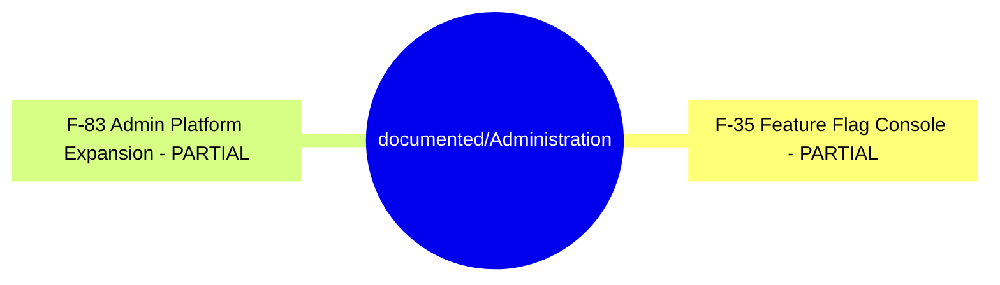

# documented/Administration (MOD-245)

Generated by `docs/mindmap/tools/catalog.py` from `master/MASTER_PROJECT_GRAPH.json` at commit `9b3032f`. Do not edit by hand. Back to the [feature catalog](../FEATURE_CATALOG.md).

**Application:** Documented scope (registry features) (APP-001). **Purpose:** Registry features in category 'Administration'.

**Nodes by level:** MODULE 1, MAJOR 2. **Status:** PARTIALLY_IMPLEMENTED 2, UNKNOWN 1. **Verification:** UNKNOWN 1.

## Module map (to minor features)

## F-35 Feature Flag Console

Feature Flag Console

| ID   | Level | Parent  | Name                 | Description | Status                | Verification | Evidence                               | Related |
| ---- | ----- | ------- | -------------------- | ----------- | --------------------- | ------------ | -------------------------------------- | ------- |
| F-35 | MAJOR | MOD-245 | Feature Flag Console |             | PARTIALLY_IMPLEMENTED |              | docs/registries/FEATURE_REGISTRY.md:51 |         |

## F-83 Admin Platform Expansion

Admin Platform Expansion

| ID   | Level | Parent  | Name                     | Description | Status                | Verification | Evidence                               | Related |
| ---- | ----- | ------- | ------------------------ | ----------- | --------------------- | ------------ | -------------------------------------- | ------- |
| F-83 | MAJOR | MOD-245 | Admin Platform Expansion |             | PARTIALLY_IMPLEMENTED |              | docs/registries/FEATURE_REGISTRY.md:99 |         |
