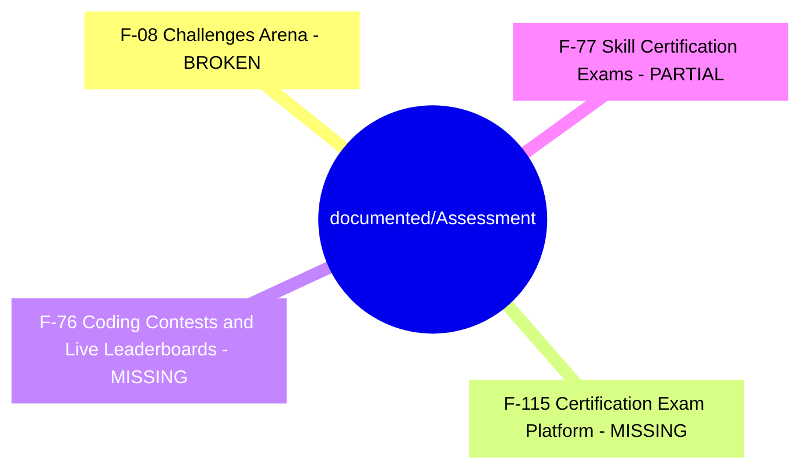

# documented/Assessment (MOD-214)

Generated by `docs/mindmap/tools/catalog.py` from `master/MASTER_PROJECT_GRAPH.json` at commit `9b3032f`. Do not edit by hand. Back to the [feature catalog](../FEATURE_CATALOG.md).

**Application:** Documented scope (registry features) (APP-001). **Purpose:** Registry features in category 'Assessment'.

**Nodes by level:** MODULE 1, MAJOR 4. **Status:** BROKEN 1, NOT_IMPLEMENTED 2, PARTIALLY_IMPLEMENTED 1, UNKNOWN 1. **Verification:** UNKNOWN 1.

## Module map (to minor features)

## F-08 Challenges Arena

Challenges Arena

| ID   | Level | Parent  | Name             | Description | Status | Verification | Evidence                               | Related |
| ---- | ----- | ------- | ---------------- | ----------- | ------ | ------------ | -------------------------------------- | ------- |
| F-08 | MAJOR | MOD-214 | Challenges Arena |             | BROKEN |              | docs/registries/FEATURE_REGISTRY.md:24 |         |

## F-115 Certification Exam Platform

Certification Exam Platform

| ID    | Level | Parent  | Name                        | Description | Status          | Verification | Evidence                                | Related |
| ----- | ----- | ------- | --------------------------- | ----------- | --------------- | ------------ | --------------------------------------- | ------- |
| F-115 | MAJOR | MOD-214 | Certification Exam Platform |             | NOT_IMPLEMENTED |              | docs/registries/FEATURE_REGISTRY.md:131 |         |

## F-76 Coding Contests & Live Leaderboards

Coding Contests & Live Leaderboards

| ID   | Level | Parent  | Name                                | Description | Status          | Verification | Evidence                               | Related |
| ---- | ----- | ------- | ----------------------------------- | ----------- | --------------- | ------------ | -------------------------------------- | ------- |
| F-76 | MAJOR | MOD-214 | Coding Contests & Live Leaderboards |             | NOT_IMPLEMENTED |              | docs/registries/FEATURE_REGISTRY.md:92 |         |

## F-77 Skill Certification Exams

Skill Certification Exams

| ID   | Level | Parent  | Name                      | Description | Status                | Verification | Evidence                               | Related |
| ---- | ----- | ------- | ------------------------- | ----------- | --------------------- | ------------ | -------------------------------------- | ------- |
| F-77 | MAJOR | MOD-214 | Skill Certification Exams |             | PARTIALLY_IMPLEMENTED |              | docs/registries/FEATURE_REGISTRY.md:93 |         |
