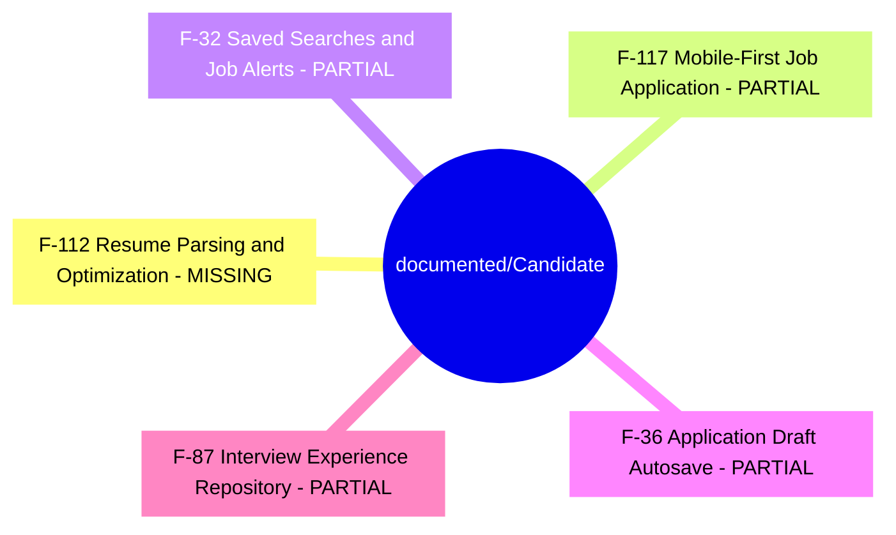

# documented/Candidate (MOD-224)

Generated by `docs/mindmap/tools/catalog.py` from `master/MASTER_PROJECT_GRAPH.json` at commit `9b3032f`. Do not edit by hand. Back to the [feature catalog](../FEATURE_CATALOG.md).

**Application:** Documented scope (registry features) (APP-001). **Purpose:** Registry features in category 'Candidate'.

**Nodes by level:** MODULE 1, MAJOR 5. **Status:** NOT_IMPLEMENTED 1, PARTIALLY_IMPLEMENTED 4, UNKNOWN 1. **Verification:** UNKNOWN 1.

## Module map (to minor features)

## F-112 Resume Parsing & Optimization

Resume Parsing & Optimization

| ID    | Level | Parent  | Name                          | Description | Status          | Verification | Evidence                                | Related |
| ----- | ----- | ------- | ----------------------------- | ----------- | --------------- | ------------ | --------------------------------------- | ------- |
| F-112 | MAJOR | MOD-224 | Resume Parsing & Optimization |             | NOT_IMPLEMENTED |              | docs/registries/FEATURE_REGISTRY.md:128 |         |

## F-117 Mobile-First Job Application

Mobile-First Job Application

| ID    | Level | Parent  | Name                         | Description | Status                | Verification | Evidence                                | Related |
| ----- | ----- | ------- | ---------------------------- | ----------- | --------------------- | ------------ | --------------------------------------- | ------- |
| F-117 | MAJOR | MOD-224 | Mobile-First Job Application |             | PARTIALLY_IMPLEMENTED |              | docs/registries/FEATURE_REGISTRY.md:133 |         |

## F-32 Saved Searches & Job Alerts

Saved Searches & Job Alerts

| ID   | Level | Parent  | Name                        | Description | Status                | Verification | Evidence                               | Related |
| ---- | ----- | ------- | --------------------------- | ----------- | --------------------- | ------------ | -------------------------------------- | ------- |
| F-32 | MAJOR | MOD-224 | Saved Searches & Job Alerts |             | PARTIALLY_IMPLEMENTED |              | docs/registries/FEATURE_REGISTRY.md:48 |         |

## F-36 Application Draft Autosave

Application Draft Autosave

| ID   | Level | Parent  | Name                       | Description | Status                | Verification | Evidence                               | Related |
| ---- | ----- | ------- | -------------------------- | ----------- | --------------------- | ------------ | -------------------------------------- | ------- |
| F-36 | MAJOR | MOD-224 | Application Draft Autosave |             | PARTIALLY_IMPLEMENTED |              | docs/registries/FEATURE_REGISTRY.md:52 |         |

## F-87 Interview Experience Repository

Interview Experience Repository

| ID   | Level | Parent  | Name                            | Description | Status                | Verification | Evidence                                | Related |
| ---- | ----- | ------- | ------------------------------- | ----------- | --------------------- | ------------ | --------------------------------------- | ------- |
| F-87 | MAJOR | MOD-224 | Interview Experience Repository |             | PARTIALLY_IMPLEMENTED |              | docs/registries/FEATURE_REGISTRY.md:103 |         |
