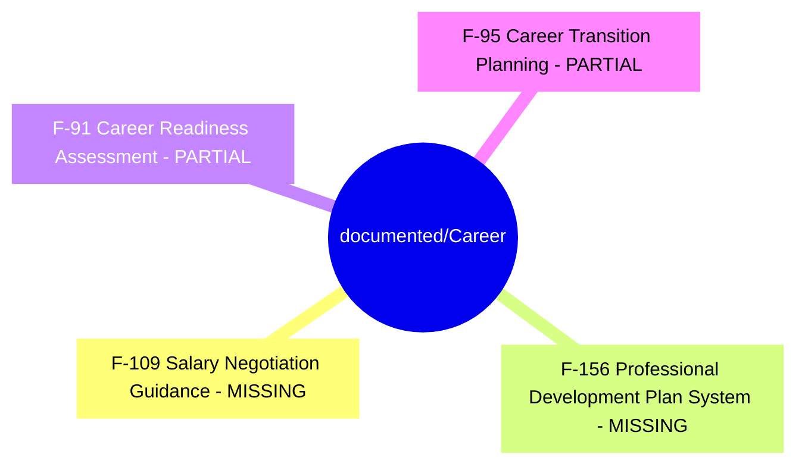

# documented/Career (MOD-221)

Generated by `docs/mindmap/tools/catalog.py` from `master/MASTER_PROJECT_GRAPH.json` at commit `9b3032f`. Do not edit by hand. Back to the [feature catalog](../FEATURE_CATALOG.md).

**Application:** Documented scope (registry features) (APP-001). **Purpose:** Registry features in category 'Career'.

**Nodes by level:** MODULE 1, MAJOR 4. **Status:** NOT_IMPLEMENTED 2, PARTIALLY_IMPLEMENTED 2, UNKNOWN 1. **Verification:** UNKNOWN 1.

## Module map (to minor features)

## F-109 Salary Negotiation Guidance

Salary Negotiation Guidance

| ID    | Level | Parent  | Name                        | Description | Status          | Verification | Evidence                                | Related |
| ----- | ----- | ------- | --------------------------- | ----------- | --------------- | ------------ | --------------------------------------- | ------- |
| F-109 | MAJOR | MOD-221 | Salary Negotiation Guidance |             | NOT_IMPLEMENTED |              | docs/registries/FEATURE_REGISTRY.md:125 |         |

## F-156 Professional Development Plan System

Professional Development Plan System

| ID    | Level | Parent  | Name                                 | Description | Status          | Verification | Evidence                                | Related |
| ----- | ----- | ------- | ------------------------------------ | ----------- | --------------- | ------------ | --------------------------------------- | ------- |
| F-156 | MAJOR | MOD-221 | Professional Development Plan System |             | NOT_IMPLEMENTED |              | docs/registries/FEATURE_REGISTRY.md:182 |         |

## F-91 Career Readiness Assessment

Career Readiness Assessment

| ID   | Level | Parent  | Name                        | Description | Status                | Verification | Evidence                                | Related |
| ---- | ----- | ------- | --------------------------- | ----------- | --------------------- | ------------ | --------------------------------------- | ------- |
| F-91 | MAJOR | MOD-221 | Career Readiness Assessment |             | PARTIALLY_IMPLEMENTED |              | docs/registries/FEATURE_REGISTRY.md:107 |         |

## F-95 Career Transition Planning

Career Transition Planning

| ID   | Level | Parent  | Name                       | Description | Status                | Verification | Evidence                                | Related |
| ---- | ----- | ------- | -------------------------- | ----------- | --------------------- | ------------ | --------------------------------------- | ------- |
| F-95 | MAJOR | MOD-221 | Career Transition Planning |             | PARTIALLY_IMPLEMENTED |              | docs/registries/FEATURE_REGISTRY.md:111 |         |
