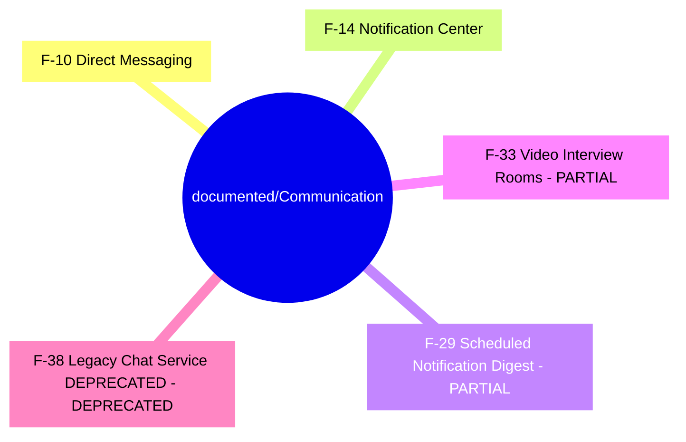

# documented/Communication (MOD-216)

Generated by `docs/mindmap/tools/catalog.py` from `master/MASTER_PROJECT_GRAPH.json` at commit `9b3032f`. Do not edit by hand. Back to the [feature catalog](../FEATURE_CATALOG.md).

**Application:** Documented scope (registry features) (APP-001). **Purpose:** Registry features in category 'Communication'.

**Nodes by level:** MODULE 1, MAJOR 5. **Status:** DEPRECATED 1, IMPLEMENTED 2, PARTIALLY_IMPLEMENTED 2, UNKNOWN 1. **Verification:** UNKNOWN 1.

## Module map (to minor features)

## F-10 Direct Messaging

Direct Messaging

| ID   | Level | Parent  | Name             | Description | Status      | Verification | Evidence                               | Related |
| ---- | ----- | ------- | ---------------- | ----------- | ----------- | ------------ | -------------------------------------- | ------- |
| F-10 | MAJOR | MOD-216 | Direct Messaging |             | IMPLEMENTED |              | docs/registries/FEATURE_REGISTRY.md:26 |         |

## F-14 Notification Center

Notification Center

| ID   | Level | Parent  | Name                | Description | Status      | Verification | Evidence                               | Related |
| ---- | ----- | ------- | ------------------- | ----------- | ----------- | ------------ | -------------------------------------- | ------- |
| F-14 | MAJOR | MOD-216 | Notification Center |             | IMPLEMENTED |              | docs/registries/FEATURE_REGISTRY.md:30 |         |

## F-29 Scheduled Notification Digest

Scheduled Notification Digest

| ID   | Level | Parent  | Name                          | Description | Status                | Verification | Evidence                               | Related |
| ---- | ----- | ------- | ----------------------------- | ----------- | --------------------- | ------------ | -------------------------------------- | ------- |
| F-29 | MAJOR | MOD-216 | Scheduled Notification Digest |             | PARTIALLY_IMPLEMENTED |              | docs/registries/FEATURE_REGISTRY.md:45 |         |

## F-33 Video Interview Rooms

Video Interview Rooms

| ID   | Level | Parent  | Name                  | Description | Status                | Verification | Evidence                               | Related |
| ---- | ----- | ------- | --------------------- | ----------- | --------------------- | ------------ | -------------------------------------- | ------- |
| F-33 | MAJOR | MOD-216 | Video Interview Rooms |             | PARTIALLY_IMPLEMENTED |              | docs/registries/FEATURE_REGISTRY.md:49 |         |

## F-38 Legacy Chat Service (DEPRECATED)

Legacy Chat Service (DEPRECATED)

| ID   | Level | Parent  | Name                             | Description | Status     | Verification | Evidence                               | Related |
| ---- | ----- | ------- | -------------------------------- | ----------- | ---------- | ------------ | -------------------------------------- | ------- |
| F-38 | MAJOR | MOD-216 | Legacy Chat Service (DEPRECATED) |             | DEPRECATED |              | docs/registries/FEATURE_REGISTRY.md:54 |         |
