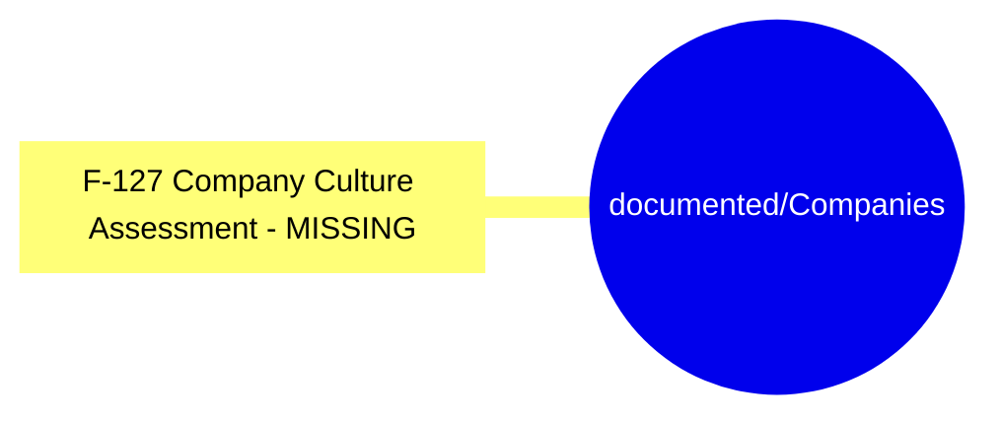

# documented/Companies (MOD-229)

Generated by `docs/mindmap/tools/catalog.py` from `master/MASTER_PROJECT_GRAPH.json` at commit `9b3032f`. Do not edit by hand. Back to the [feature catalog](../FEATURE_CATALOG.md).

**Application:** Documented scope (registry features) (APP-001). **Purpose:** Registry features in category 'Companies'.

**Nodes by level:** MODULE 1, MAJOR 1. **Status:** NOT_IMPLEMENTED 1, UNKNOWN 1. **Verification:** UNKNOWN 1.

## Module map (to minor features)

## F-127 Company Culture Assessment

Company Culture Assessment

| ID    | Level | Parent  | Name                       | Description | Status          | Verification | Evidence                                | Related |
| ----- | ----- | ------- | -------------------------- | ----------- | --------------- | ------------ | --------------------------------------- | ------- |
| F-127 | MAJOR | MOD-229 | Company Culture Assessment |             | NOT_IMPLEMENTED |              | docs/registries/FEATURE_REGISTRY.md:148 |         |
