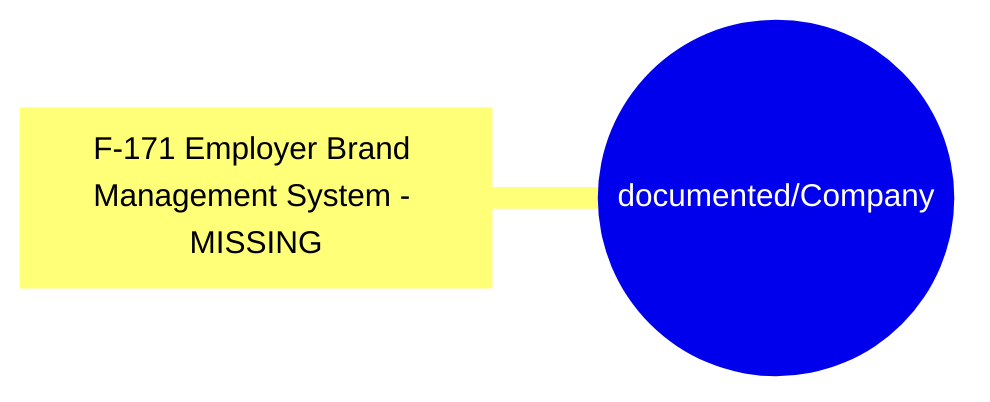

# documented/Company (MOD-240)

Generated by `docs/mindmap/tools/catalog.py` from `master/MASTER_PROJECT_GRAPH.json` at commit `9b3032f`. Do not edit by hand. Back to the [feature catalog](../FEATURE_CATALOG.md).

**Application:** Documented scope (registry features) (APP-001). **Purpose:** Registry features in category 'Company'.

**Nodes by level:** MODULE 1, MAJOR 1. **Status:** NOT_IMPLEMENTED 1, UNKNOWN 1. **Verification:** UNKNOWN 1.

## Module map (to minor features)

## F-171 Employer Brand Management System

Employer Brand Management System

| ID    | Level | Parent  | Name                             | Description | Status          | Verification | Evidence                                | Related |
| ----- | ----- | ------- | -------------------------------- | ----------- | --------------- | ------------ | --------------------------------------- | ------- |
| F-171 | MAJOR | MOD-240 | Employer Brand Management System |             | NOT_IMPLEMENTED |              | docs/registries/FEATURE_REGISTRY.md:197 |         |
