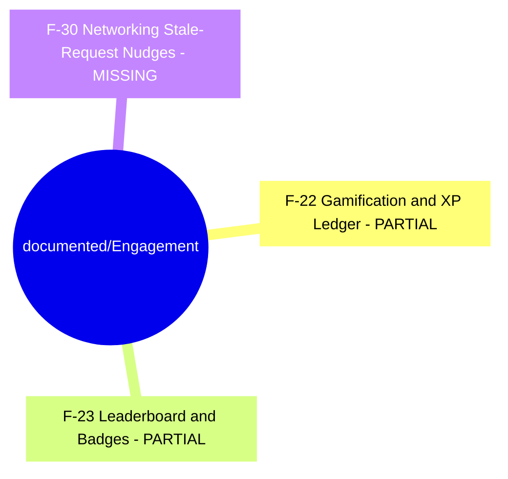

# documented/Engagement (MOD-243)

Generated by `docs/mindmap/tools/catalog.py` from `master/MASTER_PROJECT_GRAPH.json` at commit `9b3032f`. Do not edit by hand. Back to the [feature catalog](../FEATURE_CATALOG.md).

**Application:** Documented scope (registry features) (APP-001). **Purpose:** Registry features in category 'Engagement'.

**Nodes by level:** MODULE 1, MAJOR 3. **Status:** NOT_IMPLEMENTED 1, PARTIALLY_IMPLEMENTED 2, UNKNOWN 1. **Verification:** UNKNOWN 1.

## Module map (to minor features)

## F-22 Gamification & XP Ledger

Gamification & XP Ledger

| ID   | Level | Parent  | Name                     | Description | Status                | Verification | Evidence                               | Related |
| ---- | ----- | ------- | ------------------------ | ----------- | --------------------- | ------------ | -------------------------------------- | ------- |
| F-22 | MAJOR | MOD-243 | Gamification & XP Ledger |             | PARTIALLY_IMPLEMENTED |              | docs/registries/FEATURE_REGISTRY.md:38 |         |

## F-23 Leaderboard & Badges

Leaderboard & Badges

| ID   | Level | Parent  | Name                 | Description | Status                | Verification | Evidence                               | Related |
| ---- | ----- | ------- | -------------------- | ----------- | --------------------- | ------------ | -------------------------------------- | ------- |
| F-23 | MAJOR | MOD-243 | Leaderboard & Badges |             | PARTIALLY_IMPLEMENTED |              | docs/registries/FEATURE_REGISTRY.md:39 |         |

## F-30 Networking Stale-Request Nudges

Networking Stale-Request Nudges

| ID   | Level | Parent  | Name                            | Description | Status          | Verification | Evidence                               | Related |
| ---- | ----- | ------- | ------------------------------- | ----------- | --------------- | ------------ | -------------------------------------- | ------- |
| F-30 | MAJOR | MOD-243 | Networking Stale-Request Nudges |             | NOT_IMPLEMENTED |              | docs/registries/FEATURE_REGISTRY.md:46 |         |
