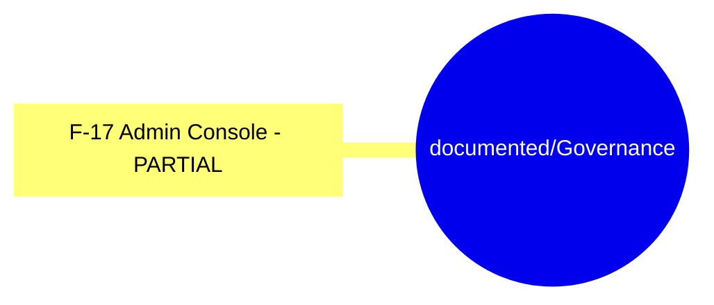

# documented/Governance (MOD-239)

Generated by `docs/mindmap/tools/catalog.py` from `master/MASTER_PROJECT_GRAPH.json` at commit `9b3032f`. Do not edit by hand. Back to the [feature catalog](../FEATURE_CATALOG.md).

**Application:** Documented scope (registry features) (APP-001). **Purpose:** Registry features in category 'Governance'.

**Nodes by level:** MODULE 1, MAJOR 1. **Status:** PARTIALLY_IMPLEMENTED 1, UNKNOWN 1. **Verification:** UNKNOWN 1.

## Module map (to minor features)

## F-17 Admin Console

Admin Console

| ID   | Level | Parent  | Name          | Description | Status                | Verification | Evidence                               | Related |
| ---- | ----- | ------- | ------------- | ----------- | --------------------- | ------------ | -------------------------------------- | ------- |
| F-17 | MAJOR | MOD-239 | Admin Console |             | PARTIALLY_IMPLEMENTED |              | docs/registries/FEATURE_REGISTRY.md:33 |         |
