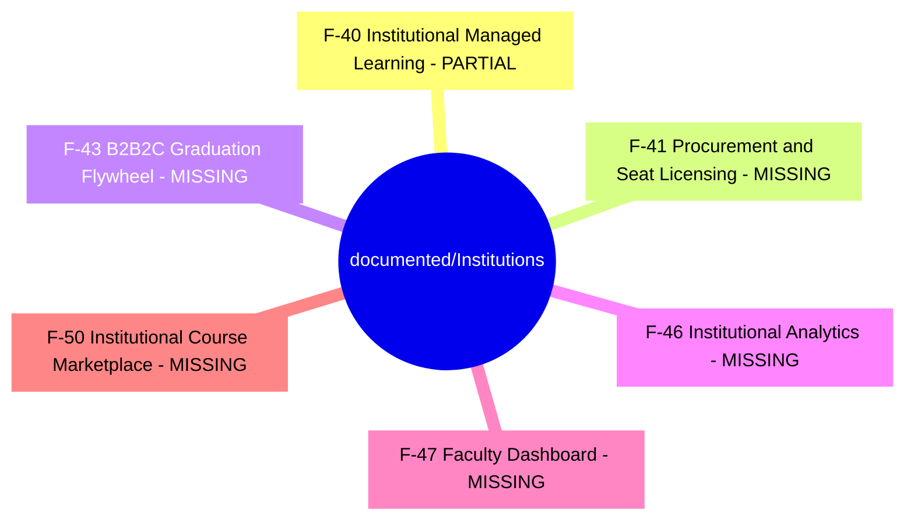

# documented/Institutions (MOD-246)

Generated by `docs/mindmap/tools/catalog.py` from `master/MASTER_PROJECT_GRAPH.json` at commit `9b3032f`. Do not edit by hand. Back to the [feature catalog](../FEATURE_CATALOG.md).

**Application:** Documented scope (registry features) (APP-001). **Purpose:** Registry features in category 'Institutions'.

**Nodes by level:** MODULE 1, MAJOR 6. **Status:** NOT_IMPLEMENTED 5, PARTIALLY_IMPLEMENTED 1, UNKNOWN 1. **Verification:** UNKNOWN 1.

## Module map (to minor features)

## F-40 Institutional Managed Learning

Institutional Managed Learning

| ID   | Level | Parent  | Name                           | Description | Status                | Verification | Evidence                               | Related |
| ---- | ----- | ------- | ------------------------------ | ----------- | --------------------- | ------------ | -------------------------------------- | ------- |
| F-40 | MAJOR | MOD-246 | Institutional Managed Learning |             | PARTIALLY_IMPLEMENTED |              | docs/registries/FEATURE_REGISTRY.md:56 |         |

## F-41 Procurement & Seat Licensing

Procurement & Seat Licensing

| ID   | Level | Parent  | Name                         | Description | Status          | Verification | Evidence                               | Related |
| ---- | ----- | ------- | ---------------------------- | ----------- | --------------- | ------------ | -------------------------------------- | ------- |
| F-41 | MAJOR | MOD-246 | Procurement & Seat Licensing |             | NOT_IMPLEMENTED |              | docs/registries/FEATURE_REGISTRY.md:57 |         |

## F-43 B2B2C Graduation Flywheel

B2B2C Graduation Flywheel

| ID   | Level | Parent  | Name                      | Description | Status          | Verification | Evidence                               | Related |
| ---- | ----- | ------- | ------------------------- | ----------- | --------------- | ------------ | -------------------------------------- | ------- |
| F-43 | MAJOR | MOD-246 | B2B2C Graduation Flywheel |             | NOT_IMPLEMENTED |              | docs/registries/FEATURE_REGISTRY.md:59 |         |

## F-46 Institutional Analytics

Institutional Analytics

| ID   | Level | Parent  | Name                    | Description | Status          | Verification | Evidence                               | Related |
| ---- | ----- | ------- | ----------------------- | ----------- | --------------- | ------------ | -------------------------------------- | ------- |
| F-46 | MAJOR | MOD-246 | Institutional Analytics |             | NOT_IMPLEMENTED |              | docs/registries/FEATURE_REGISTRY.md:62 |         |

## F-47 Faculty Dashboard

Faculty Dashboard

| ID   | Level | Parent  | Name              | Description | Status          | Verification | Evidence                               | Related |
| ---- | ----- | ------- | ----------------- | ----------- | --------------- | ------------ | -------------------------------------- | ------- |
| F-47 | MAJOR | MOD-246 | Faculty Dashboard |             | NOT_IMPLEMENTED |              | docs/registries/FEATURE_REGISTRY.md:63 |         |

## F-50 Institutional Course Marketplace

Institutional Course Marketplace

| ID   | Level | Parent  | Name                             | Description | Status          | Verification | Evidence                               | Related |
| ---- | ----- | ------- | -------------------------------- | ----------- | --------------- | ------------ | -------------------------------------- | ------- |
| F-50 | MAJOR | MOD-246 | Institutional Course Marketplace |             | NOT_IMPLEMENTED |              | docs/registries/FEATURE_REGISTRY.md:66 |         |
